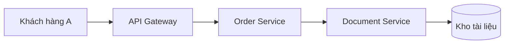

# Chống confused deputy khi truyền credential

Một API service thường cần gọi dịch vụ khác thay mặt người dùng hoặc để hoàn tất một nghiệp vụ. Ví dụ, ứng dụng nhận yêu cầu tải hóa đơn từ khách hàng rồi gọi `document-service`; một backend nhận URL để lấy ảnh từ đối tác; hoặc một service dùng API key của tổ chức để gọi nhà cung cấp thanh toán. Nếu service sử dụng credential có quyền rộng mà không ràng buộc credential đó với người yêu cầu, hành động và tài nguyên đích, attacker có thể khiến service dùng quyền của chính nó để truy cập dữ liệu hoặc thực hiện thao tác mà người gọi không được phép.

Đây là tình huống **confused deputy**: một thành phần có thẩm quyền hợp lệ bị lợi dụng làm trung gian để dùng thẩm quyền đó sai mục đích. Rủi ro tăng lên khi credential được chuyển tiếp qua nhiều service, khi service nhận URL/đích đến do client kiểm soát hoặc khi hệ thống dùng một service account chung cho nhiều người dùng.

Trong API Security, truyền credential phải giữ rõ danh tính của người dùng cuối, danh tính service thực hiện request, phạm vi ủy quyền, audience của token và tài nguyên đích. Không phải credential nào service đang giữ cũng được phép gửi tiếp; không phải service nào xác thực được cũng được phép truy cập mọi object.

Sau bài học, người đọc có thể:

- Giải thích confused deputy và ambient authority trong luồng gọi API.
- Phân biệt token relay, token exchange, delegated credential và service credential.
- Thiết kế credential theo audience, scope, actor, subject và thời hạn tối thiểu.
- Ngăn client điều khiển việc chọn credential, downstream hoặc đích gửi credential.
- Tránh rò rỉ token qua redirect, URL, log, trace, exception và proxy.
- Kiểm thử service caller hợp lệ nhưng user cuối không có quyền trên tài nguyên.

## 1. Confused deputy khi service truyền credential

Giả sử một ứng dụng có API cho phép khách hàng xem hóa đơn:



`document-service` có service credential được phép đọc mọi hóa đơn trong hệ thống. `order-service` gọi nó để lấy hóa đơn của khách hàng A. Nếu `order-service` chỉ gửi `invoiceId` và `document-service` chỉ xác minh token của `order-service`, người gọi có thể thay ID sang hóa đơn của khách hàng B. Document service đã xác thực đúng caller service, nhưng bỏ qua quyền của end user trên hóa đơn.

Một biến thể khác xảy ra khi backend có API key của nhà cung cấp. Client gửi `providerAccount`, `resourceId` hoặc URL tùy ý; backend dùng API key quyền cao để truy cập tài nguyên tương ứng rồi trả kết quả. Khi đó client không trực tiếp sở hữu API key, nhưng điều khiển cách backend sử dụng credential đó.

### 1.1. Vì sao gọi là deputy?

Deputy là thành phần được cấp quyền để thực hiện một công việc hợp lệ. Nó trở thành confused deputy khi không phân biệt được:

- Quyền mà chính service cần để vận hành.
- Quyền mà người dùng cuối đã được ủy quyền.
- Quyền mà request cụ thể đang yêu cầu.
- Tài nguyên mà credential có thể truy cập so với tài nguyên mà caller được phép chọn.

Service có thể có quyền kỹ thuật rộng hơn người dùng. Nếu service dùng quyền rộng đó mà không áp dụng policy theo subject, action và resource, nó trở thành một đường vòng vượt qua authorization.

### 1.2. Ambient authority

Ambient authority là quyền có sẵn trong môi trường thực thi mà code có thể vô tình sử dụng, ví dụ API key nằm trong biến môi trường, service account có quyền đọc mọi bucket hoặc credential được gắn tự động vào mọi request HTTP đi ra.

Một hàm nhận `url` nhưng không nhận rõ credential hoặc policy có thể âm thầm dùng credential toàn cục. Người gọi hàm không thấy quyền nào đang được sử dụng, còn code bên trong có thể truy cập tài nguyên vượt quá mục đích ban đầu.

Giảm ambient authority bằng cách truyền dependency và quyền một cách tường minh: client riêng cho từng dịch vụ, credential riêng theo workload, interface giới hạn thao tác, token ngắn hạn và policy kiểm tra trước khi gọi ra ngoài.

## 2. Phân biệt các loại credential và danh tính

Trong một request nhiều service, có thể tồn tại đồng thời nhiều danh tính:

| Thành phần | Ví dụ | Ý nghĩa |
|---|---|---|
| Subject/end user | `user-A` | Người dùng cuối mà hành động phục vụ hoặc tác động tới |
| Actor/calling service | `order-service` | Workload trực tiếp gửi request downstream |
| Client application | `web-bff` | Ứng dụng khởi tạo luồng truy cập |
| Service credential | Token của `order-service` | Chứng minh workload được xác thực và có quyền gọi API nhất định |
| Delegated token | Token đại diện user A tới `document-api` | Mang quyền được ủy quyền cho một resource server cụ thể |
| Resource/audience | `document-api` | API mà token được phát hành để sử dụng |
| Object | Invoice `INV-200` | Tài nguyên cụ thể cần kiểm tra quyền |

Không gộp tất cả thành một trường `userId` hoặc một token chung. Service identity chứng minh ai đang kết nối; user identity chứng minh chủ thể cuối; delegated authority mô tả phạm vi hành động được phép thay mặt chủ thể đó.

Một quyết định truy cập có thể được mô tả:

```text
subject = user-A
actor = order-service
action = invoice:read
audience = document-api
resource = invoice INV-200
context = tenant T-1, request-id R-123

ALLOW khi:
  actor được phép gọi document-api cho delegated action này
  AND subject có quyền invoice:read
  AND invoice INV-200 thuộc phạm vi subject được truy cập
  AND token có audience/scope phù hợp
  AND trạng thái nghiệp vụ cho phép đọc
```

Token hợp lệ không tự động cho phép mọi object ID. Scope `invoice:read` có thể cho phép gọi chức năng đọc hóa đơn, nhưng service vẫn cần kiểm tra user A có quyền trên hóa đơn cụ thể hay không.

## 3. Những mẫu truyền credential và khi nào sử dụng

### 3.1. Token relay: chuyển tiếp access token của user

Gateway hoặc BFF chuyển tiếp access token người dùng tới downstream. Downstream tự xác minh token và áp dụng authorization theo subject.

Ưu điểm là giữ được danh tính người dùng cuối mà không cần tin một header user ID do upstream tự khai báo. Tuy nhiên, token phải được phát hành cho audience phù hợp với downstream. Token dành riêng cho `order-api` không mặc nhiên được dùng ở `document-api`.

Khi relay:

- Chỉ chuyển token đến service nằm trong luồng tin cậy và cần token đó.
- Kiểm tra issuer, chữ ký, thời hạn, audience và scope tại resource server.
- Không chuyển tiếp token tới URL hoặc host do client cung cấp.
- Không forward toàn bộ header `Authorization` một cách mù quáng qua mọi hop.
- Không ghi token vào log, URL, trace attribute hoặc thông báo lỗi.
- Downstream vẫn kiểm tra quyền trên object và property.

Token relay phù hợp khi token ban đầu đã có audience/scope đúng và kiến trúc muốn downstream tự đánh giá quyền user. Nếu không, dùng token exchange hoặc cơ chế delegation phù hợp.

### 3.2. Token exchange: đổi token cho downstream

Khi access token ban đầu không dành cho downstream hoặc có scope không phù hợp, một service được phép có thể trao đổi token để lấy token mới cho resource server đích. OAuth 2.0 Token Exchange được mô tả trong RFC 8693.

Ví dụ logic:

```text
Token đầu vào:
  subject = user-A
  audience = order-api
  scope = order:read

Order service yêu cầu token cho:
  audience = document-api
  scope = invoice:read

Authorization server phát hành delegated token:
  subject = user-A
  actor/client = order-service (theo profile được cấu hình)
  audience = document-api
  scope = invoice:read
  expiry = thời hạn ngắn
```

Authorization server phải kiểm soát client nào được exchange, subject token nào được chấp nhận, audience/resource nào được yêu cầu và scope nào có thể cấp. Downstream xác minh token mới rồi kiểm tra object cụ thể.

Không tự tạo token bằng cách sao chép claim của user rồi ký bằng khóa của service. Không tăng scope trong quá trình exchange chỉ vì service có quyền rộng hơn user. Token exchange chỉ an toàn khi authorization server thực thi policy delegation.

### 3.3. Service credential: hành động bằng quyền của workload

OAuth Client Credentials, workload identity hoặc mTLS phù hợp khi service thực hiện công việc bằng quyền của chính nó, không đại diện cho end user cụ thể. Ví dụ job định kỳ dọn dữ liệu hết hạn hoặc service health check.

Nếu một user khởi tạo thao tác trên dữ liệu riêng, service credential đơn thuần không mang quyền user. Khi đó cần delegated token hoặc một user context có xác minh và policy tương đương. Không gửi `X-User-Id: user-A` kèm service token rồi mặc định rằng service đã được phép hành động thay user A.

Service credential cần được giới hạn theo workload, API, action, môi trường và thời hạn. Tách credential giữa dev, staging và production; tránh một API key dùng chung cho nhiều service hoặc nhiều tenant.

### 3.4. Signed assertion hoặc user context

Một số hệ thống dùng service token để xác thực workload và signed assertion riêng để truyền subject/tenant/action. Downstream xác minh chữ ký assertion, issuer, audience, thời hạn và mối liên hệ với service caller.

Nếu dùng header nội bộ như `X-User-Id`, gateway phải xóa header cùng tên do client bên ngoài gửi trước khi tự tạo header tin cậy. Downstream chỉ chấp nhận header qua kết nối và service identity đã xác minh, đồng thời phải có trust boundary rõ ràng. Header không ký, không ràng buộc nguồn và không có expiry rất dễ bị giả mạo.

Không coi user context là quyền truy cập. Assertion chứng minh nguồn gốc của context; authorization service vẫn phải đánh giá subject/action/resource.

## 4. Không forward credential theo đích đến do client kiểm soát

Một lỗi nghiêm trọng là nhận URL từ client rồi gắn credential của backend vào request:

```java
// Không an toàn: URL do caller kiểm soát nhưng backend gắn credential đặc quyền.
HttpRequest request = HttpRequest.newBuilder(URI.create(requestUrl))
        .header("Authorization", "Bearer " + serviceAccessToken)
        .GET()
        .build();
```

Nếu `requestUrl` trỏ tới server của attacker, backend có thể gửi service token ra ngoài. Nếu URL trỏ tới địa chỉ nội bộ, request có thể trở thành SSRF và dùng quyền mạng của backend để truy cập dịch vụ không nên công khai.

### 4.1. Chọn đích đến từ cấu hình tin cậy

Ưu tiên nhận một resource ID hoặc tên đối tác đã đăng ký thay vì URL tùy ý. Server tự ánh xạ ID đó sang base URL đã cấu hình và credential phù hợp.

Ví dụ:

```java
PartnerConfig partner = partnerRegistry.requireEnabled(partnerId);
URI target = partner.baseUri().resolve("/v1/resources/" + validatedResourceId);
Credential credential = credentialProvider.forPartner(partner.id());
partnerClient.fetch(target, credential);
```

`partnerRegistry`, `baseUri` và credential phải đến từ cấu hình có thẩm quyền; `partnerId` phải được kiểm tra caller có quyền dùng tích hợp đó. `validatedResourceId` cần được encode/validate theo hợp đồng URL, tránh cho phép path traversal hoặc thay đổi host.

### 4.2. Nếu buộc phải nhận URL

Nếu nghiệp vụ cần truy cập URL do user gửi, không gắn credential nội bộ mặc định. Có thể dùng một fetcher cách ly không có secret, giới hạn mạng egress và chỉ trả nội dung đã kiểm tra. Nếu phải dùng credential của một đối tác, chỉ cho phép hostname đã đăng ký và credential được ràng buộc với đúng đối tác.

Các kiểm soát cần thiết:

- Chỉ cho phép scheme cần thiết, thường là `https`; từ chối `file:`, `gopher:`, `ftp:` và scheme không dùng.
- Parse URL bằng thư viện chuẩn; từ chối user-info, port không được phép và hostname ngoài allowlist.
- Kiểm tra DNS và mọi địa chỉ IPv4/IPv6; chặn loopback, private, link-local, multicast, reserved và metadata endpoint.
- Chống DNS rebinding bằng cách bảo đảm địa chỉ được kiểm tra cũng là địa chỉ được kết nối; cân nhắc egress proxy.
- Tắt redirect hoặc kiểm tra lại từng redirect; không gửi credential qua redirect sang host khác.
- Đặt timeout, giới hạn response size, content type và số lần gọi.
- Chặn truy cập mạng nội bộ ở firewall/security group, không chỉ bằng validation ứng dụng.

### 4.3. Redirect và credential forwarding

HTTP client có thể tự động follow redirect. Không giả định thư viện luôn loại bỏ `Authorization` khi redirect sang host khác; hành vi phụ thuộc client và cấu hình. Với request mang credential, nên tắt redirect tự động hoặc kiểm tra scheme/host/port ở từng hop. Nếu đích đến thay đổi, phải xác định credential có được phép gửi tới đích mới hay không.

Không forward header nhạy cảm như `Authorization`, `Cookie`, `Proxy-Authorization` hoặc custom API key qua redirect không được kiểm soát. Cũng cần kiểm tra redirect tương đối, redirect nhiều bước và redirect quay về địa chỉ nội bộ.

## 5. Ràng buộc credential theo audience, scope và thời hạn

Một credential an toàn cần có phạm vi hẹp:

- **Audience/resource:** token chỉ dùng cho API dự kiến, ví dụ `document-api`, không dùng chung mọi service.
- **Scope/action:** chỉ cấp `invoice:read` nếu cần đọc hóa đơn; không cấp `document:*` hoặc `admin:*` cho tiện.
- **Subject/actor:** giữ rõ user cuối và service thực hiện hành động theo profile token được hỗ trợ.
- **Tenant/resource scope:** giới hạn tenant hoặc resource khi authorization server và API hỗ trợ.
- **Expiry:** access token ngắn hạn; không dùng credential tồn tại lâu hơn nhu cầu.
- **Sender constraint:** với hệ thống cần mức bảo vệ cao, cân nhắc mTLS-bound token hoặc DPoP để giảm khả năng dùng token bị đánh cắp ở client khác.

Scope thường mô tả loại chức năng, không nhất thiết biểu diễn toàn bộ quyền trên từng object. Ví dụ `invoice:read` không có nghĩa user được đọc mọi invoice. Downstream vẫn kiểm tra owner, tenant, assignment và trạng thái.

Không đưa token vào query string. URL có thể bị ghi trong access log, browser history, proxy, tracing hoặc analytics. Dùng `Authorization` header qua TLS và không log giá trị header này.

## 6. Tránh credential substitution và confused deputy qua header/body

Không để caller tự chọn credential mà server sẽ sử dụng. Các thiết kế rủi ro gồm:

- Client gửi `apiKey`, `accessToken` hoặc `Authorization` trong JSON body để backend dùng thay.
- Client gửi `tenantId`, `accountId` hoặc `partnerAccount` rồi backend tự chọn credential quyền cao theo giá trị đó mà không kiểm tra quyền.
- Client gửi tên secret hoặc secret reference để backend tải credential tùy ý.
- Header `X-User-Id`, `X-Role`, `X-Tenant-Id` được tin mà không xác minh nguồn.
- Một endpoint generic cho phép caller chỉ định host, path, method và header rồi backend gửi request với credential nội bộ.

Thay vào đó, client chỉ gửi định danh nghiệp vụ nằm trong allowlist. Server xác định credential theo principal và cấu hình tích hợp tin cậy, kiểm tra quyền sử dụng tích hợp và xây dựng request downstream từ template đã kiểm soát.

Nếu nghiệp vụ yêu cầu user kết nối tài khoản của chính họ, credential phải được gắn với user/tenant cụ thể, lưu trong secret/token vault, mã hóa khi lưu và chỉ lấy sau khi authorization thành công. Không dùng credential của một tenant để phục vụ request của tenant khác.

## 7. Quản lý credential an toàn trong ứng dụng

### 7.1. Lưu trữ và truy cập secret

Không commit API key, client secret, private key hoặc refresh token vào repository, image/container, file cấu hình công khai hay log. Dùng secret manager hoặc workload identity để cấp credential. Phân quyền đọc secret theo service và môi trường; ứng dụng chỉ lấy đúng secret cần thiết.

Không dùng một secret chung cho mọi service. Tách credential theo:

- Service/workload và môi trường.
- Đối tác hoặc resource server.
- Mục đích/action.
- Tenant nếu mô hình tích hợp yêu cầu credential riêng theo tenant.

### 7.2. Luân chuyển và thu hồi

Thiết kế rotation trước khi có sự cố: hỗ trợ giai đoạn overlap giữa credential cũ/mới, cập nhật consumer, xác minh hoạt động và thu hồi credential cũ. Khi phát hiện lộ token/key, thu hồi hoặc rotate, kiểm tra log sử dụng, xác định phạm vi dữ liệu và hạn chế quyền còn lại.

Không lưu refresh token trong log hoặc queue không được bảo vệ. Nếu cần refresh, dùng OAuth client/credential manager có lifecycle và concurrency control để tránh nhiều request đồng thời làm refresh token bị xoay vòng hoặc vô hiệu hóa.

### 7.3. Giảm thời gian và phạm vi tồn tại của credential

Chỉ lấy credential ngay trước khi gọi dịch vụ cần nó; không giữ token trong object toàn cục hoặc thread-local lâu hơn cần thiết. Cache token theo issuer/audience/scope/client phù hợp và tôn trọng expiry. Không dùng token có scope rộng làm fallback khi token delegated không lấy được.

Nếu token exchange hoặc authorization service lỗi, thao tác nhạy cảm nên fail closed. Không tự chuyển sang service credential quyền cao để “giúp request tiếp tục chạy”.

## 8. Ví dụ luồng an toàn với Spring Boot

Giả sử user A gọi endpoint xem hóa đơn. Gateway xác thực user; order service gọi document service bằng delegated token dành riêng cho `document-api`.

Luồng xử lý:

1. Gateway xác minh access token user và loại bỏ các header identity do client tự gửi.
2. Order service xác minh user context và kiểm tra quyền đọc order.
3. Order service yêu cầu token exchange với audience `document-api` và scope `invoice:read`.
4. Authorization server chỉ cấp token nếu client, subject và scope đáp ứng policy.
5. Document service xác minh token, lấy subject và actor, truy vấn invoice trong tenant scope.
6. Document service kiểm tra user A có quyền đọc invoice cụ thể và trả DTO giới hạn field.

Ví dụ service layer tại document service:

```java
@Transactional(readOnly = true)
public InvoiceResponse getInvoice(UUID invoiceId,
                                  DelegatedPrincipal principal) {
    Invoice invoice = invoiceRepository
            .findByIdAndTenantId(invoiceId, principal.tenantId())
            .orElseThrow(InvoiceNotFoundException::new);

    authorizationService.requireCanReadInvoice(
            principal.subject(),
            principal.actor(),
            invoice);

    return invoiceMapper.toResponse(invoice);
}
```

`DelegatedPrincipal` là principal được tạo từ token đã xác minh, không phải object bind từ request body. `subject` đại diện user A; `actor` ghi nhận order service; tenant được lấy từ claim/context đáng tin cậy và đối chiếu với dữ liệu object. `requireCanReadInvoice` kiểm tra quan hệ, action và trạng thái nghiệp vụ. Service authentication vẫn cần được thực hiện ở lớp resource server hoặc workload identity.

Ví dụ này không có nghĩa token exchange tự kiểm tra invoice ID. Token exchange cấp phạm vi ủy quyền; document service vẫn quyết định user có quyền trên object cụ thể hay không.

## 9. Kiểm soát HTTP client và proxy

Tạo HTTP client riêng cho từng upstream với base URL, credential provider và policy rõ ràng. Tránh một generic client nhận bất kỳ URL và bộ header nào từ caller.

Các nguyên tắc:

- Gắn credential tại lớp client biết rõ host/audience, không gắn global interceptor vào mọi request đi ra.
- Chỉ forward header đã allowlist; loại bỏ cookie và authorization không cần thiết.
- Không chuyển tiếp credential khi host, scheme hoặc port thay đổi.
- Giới hạn redirect, timeout, response size, connection pool và số request đồng thời.
- Không cho caller điều khiển `Host`, `X-Forwarded-*`, proxy settings hoặc DNS resolution tùy ý.
- Dùng TLS và xác minh certificate; mTLS khi cần xác thực workload hai chiều.
- Phân biệt lỗi xác thực upstream với lỗi quyền của end user; không retry bằng credential khác có quyền rộng hơn.

Nếu service đóng vai trò proxy, cần định nghĩa rõ API proxy có cho phép method/path/header nào. Không để endpoint trở thành “open proxy có credential” mà caller có thể dùng để gọi tài nguyên nội bộ hoặc bên ngoài.

## 10. Log, trace và thông báo lỗi không được làm lộ credential

Credential có thể rò rỉ ngoài request body:

- Access log ghi nguyên header `Authorization`.
- HTTP client log toàn bộ request/response headers ở mức debug.
- Trace attribute lưu token hoặc query string có secret.
- Exception message chứa URL kèm query parameter hoặc thông tin xác thực.
- Redirect URL, error page hoặc callback echo lại credential.
- Crash dump hoặc diagnostic endpoint phơi bày biến môi trường.

Hãy cấu hình redaction cho `Authorization`, `Cookie`, `Set-Cookie`, API key, client secret và token. Log request ID, upstream name, audience, action và kết quả xác thực ở dạng an toàn thay vì token thô. Nếu cần nhận diện token trong audit, dùng fingerprint/hash có kiểm soát, không dùng giá trị credential.

Thông báo lỗi cho client nên tổng quát. Không trả upstream response body có thể chứa credential, stack trace hoặc chi tiết hệ thống. Không phản chiếu token không hợp lệ về client để “debug”.

## 11. Kiểm thử chống confused deputy khi truyền credential

Kiểm thử phải tách xác thực service, delegation và quyền trên object. Ma trận tối thiểu:

| Service caller | User context | Đích/resource | Kết quả mong đợi |
|---|---|---|---|
| Service không hợp lệ | User có quyền | Document API | Từ chối service authentication |
| Service hợp lệ | Thiếu user/delegation | Invoice nhạy cảm | Từ chối nếu endpoint yêu cầu delegated user |
| Service hợp lệ | User A có quyền | Invoice của A | Cho phép trong scope/audience phù hợp |
| Service hợp lệ | User A không có quyền | Invoice của B | Từ chối dù service credential có quyền đọc rộng |
| Service hợp lệ | Token sai audience | Document API | Từ chối token |
| Service hợp lệ | Token thiếu scope | `invoice:read` | Từ chối |
| Service hợp lệ | Header `X-User-Id` do client giả mạo | Invoice của B | Header ngoài không được tin; từ chối |
| Service hợp lệ | User A | URL do client trỏ tới host attacker | Không gửi service credential tới host đó |
| Service hợp lệ | User A | Redirect sang host khác | Không forward credential sang host mới |
| Service hợp lệ | User A | URL tới loopback/private/metadata IP | Chặn theo SSRF/egress policy |
| Service hợp lệ | User A | Token hết hạn/revoked | Từ chối; không fallback sang quyền service rộng |
| Service hợp lệ | User A | Tenant B resource | Từ chối và không lộ dữ liệu |

Các test quan trọng:

1. Gửi cùng service token nhưng thay subject/object; xác minh object authorization vẫn được thực hiện.
2. Gửi token đúng chữ ký nhưng sai audience, issuer, expiry hoặc scope.
3. Thử token exchange yêu cầu scope lớn hơn policy cho phép.
4. Thử dùng service credential của workload A tại API dành cho workload B.
5. Giả mạo user/tenant header ở request ngoài; gateway phải xóa và tạo lại context tin cậy.
6. Dùng URL độc hại, redirect, DNS thay đổi và địa chỉ private; xác minh credential không bị gửi ra ngoài.
7. Kiểm tra log, trace, exception và response không chứa token/secret.
8. Kiểm tra cache token tách theo audience/scope/client và không dùng token hết hạn.
9. Kiểm tra downstream từ chối khi token exchange hoặc policy service không khả dụng.
10. Kiểm tra audit ghi được subject, actor, action và resource mà không ghi credential.

Test cốt lõi là: **service caller có credential hợp lệ nhưng user cuối không có quyền trên object phải bị từ chối, và credential đặc quyền không được dùng để vượt qua quyết định đó.**

## 12. Giám sát và ứng phó sự cố

Theo dõi các tín hiệu:

- Một service credential được dùng từ workload, network hoặc thời điểm bất thường.
- Một service account truy cập nhiều tenant hoặc nhiều object không liên quan.
- Token exchange tăng đột biến, yêu cầu audience/scope bất thường hoặc bị từ chối nhiều lần.
- Downstream thường xuyên nhận request có service token nhưng thiếu subject/delegation context.
- HTTP client gửi credential tới host ngoài allowlist hoặc gặp redirect bất thường.
- Tỷ lệ `401`/`403` tăng ở một hop trong chuỗi gọi.
- Credential xuất hiện trong log/trace hoặc hệ thống phát hiện secret scanning.

Audit nên ghi subject, actor service, client, audience, scope/action, resource ID, tenant, request ID và quyết định allow/deny. Không ghi token hoặc secret thô. Khi có nghi ngờ lộ credential, thu hồi/rotate, xác định các service và resource đã bị truy cập, kiểm tra audit trail, vô hiệu hóa đường proxy bị lợi dụng và bổ sung regression test.

## 13. Checklist triển khai

- [ ] Đã phân biệt subject/end user, actor service, client application và resource server.
- [ ] Mỗi credential có owner, mục đích, audience, scope và vòng đời rõ ràng.
- [ ] Chọn token relay, token exchange hoặc service credential theo đúng loại hành động.
- [ ] Không dùng service credential quyền rộng thay cho delegated user context.
- [ ] Token/assertion được xác minh issuer, signature, audience, expiry và scope.
- [ ] Service sở hữu tài nguyên kiểm tra quyền trên object, tenant, relationship và trạng thái.
- [ ] Client không thể chọn credential hoặc secret reference tùy ý.
- [ ] Không forward `Authorization`/cookie qua host hoặc redirect không tin cậy.
- [ ] URL do client kiểm soát không được nhận credential đặc quyền; SSRF và egress được giới hạn.
- [ ] HTTP client có allowlist host, timeout, response limit và redirect policy.
- [ ] Secret được lưu trong secret manager, phân quyền tối thiểu và có quy trình rotation/revocation.
- [ ] Log, trace, exception và response đã redaction credential.
- [ ] Có test service hợp lệ + user không có quyền, sai audience/scope, spoofed context và redirect.
- [ ] Khi delegation/policy không xác minh được, thao tác nhạy cảm fail closed.

## Kết luận

Chống confused deputy khi truyền credential đòi hỏi service hiểu rõ nó đang hành động bằng quyền của ai, cho ai, tới API nào và trên tài nguyên nào. Hãy tách service identity khỏi end-user identity, dùng token relay hoặc token exchange đúng audience/scope, giới hạn credential theo workload và không gắn secret vào đích đến do client điều khiển. Service sở hữu tài nguyên vẫn phải kiểm tra quyền trên từng object; credential hợp lệ chỉ mở đường cho giao tiếp, không thay thế authorization nghiệp vụ.
