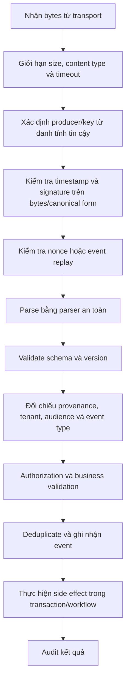

# Kiểm tra schema, signature và provenance

API thường tiêu thụ dữ liệu do hệ thống khác tạo ra: webhook từ đối tác, event qua message broker, response từ dịch vụ bên ngoài, file import hoặc dữ liệu đồng bộ giữa các service. Dữ liệu có thể đến từ một nguồn hợp lệ nhưng vẫn sai cấu trúc, bị sửa đổi, bị phát lại, được tạo bởi thành phần không có quyền hoặc đã đi qua một chuỗi trung gian không đáng tin cậy.

Trước khi dùng dữ liệu đó để cập nhật trạng thái, thanh toán, cấp quyền hoặc kích hoạt workflow, consumer cần xác minh ít nhất ba khía cạnh:

- **Schema:** dữ liệu có đúng cấu trúc, kiểu, giới hạn và phiên bản hợp đồng được hỗ trợ không?
- **Signature:** nội dung có được bảo vệ toàn vẹn và được ký bởi bên giữ khóa được tin cậy không?
- **Provenance:** dữ liệu thực sự đến từ producer, tenant, hệ thống và luồng xử lý nào; các thông tin nguồn gốc có được xác minh và bảo toàn không?

Ba kiểm tra này bổ sung cho nhau. Payload đúng schema chưa chắc đến từ nguồn đáng tin cậy. Chữ ký hợp lệ chưa chứng minh dữ liệu đúng nghiệp vụ hoặc người ký có quyền yêu cầu hành động. Provenance được khai báo trong JSON cũng không đáng tin nếu không được ràng buộc với danh tính đã xác thực và bằng chứng toàn vẹn.

## 1. Vì sao phải xem dữ liệu upstream là không đáng tin mặc định?

Một service nội bộ hoặc nhà cung cấp đã được tích hợp vẫn có thể gửi dữ liệu sai do bug, cấu hình nhầm, phiên bản schema không tương thích hoặc tài khoản bị xâm phạm. Dữ liệu từ hệ thống khác đi qua ranh giới tin cậy và cần được kiểm tra trước khi consumer sử dụng.

Ví dụ một webhook báo thanh toán thành công:

```json
{
  "eventId": "evt_01J8YQ7K3F5M",
  "eventType": "payment.succeeded",
  "occurredAt": "2026-11-18T10:15:00Z",
  "tenantId": "tenant-42",
  "paymentId": "pay_123",
  "amount": 500000,
  "currency": "VND",
  "status": "SUCCEEDED"
}
```

JSON này có thể parse được và đúng schema nhưng vẫn có thể là giả mạo. Một attacker có thể gửi event tương tự để đánh dấu đơn hàng đã thanh toán. Ngược lại, một webhook được ký đúng bởi provider vẫn có thể chứa event cũ, gửi nhầm tenant, sai amount do lỗi tích hợp hoặc đã được xử lý trước đó.

Consumer cần tránh suy luận “đến từ mạng nội bộ thì đáng tin” hoặc “TLS đã thành công thì payload đúng”. TLS bảo vệ kết nối giữa hai đầu TLS; schema, signature, provenance và authorization giải quyết các câu hỏi khác nhau.

## 2. Phân biệt schema, signature và provenance

| Lớp kiểm tra | Câu hỏi cần trả lời | Có thể chứng minh | Không thể tự chứng minh |
|---|---|---|---|
| Schema validation | Dữ liệu có đúng hợp đồng được hỗ trợ không? | Cấu trúc, kiểu, trường bắt buộc, enum, giới hạn và phiên bản phù hợp | Ai tạo dữ liệu, dữ liệu có bị sửa hay caller có quyền không |
| Signature verification | Nội dung có khớp với chữ ký được tạo bằng khóa tin cậy không? | Tính toàn vẹn và bằng chứng sở hữu khóa theo thuật toán | Dữ liệu đúng nghiệp vụ, mới, không replay hoặc người ký được phép mọi hành động |
| Provenance validation | Nguồn, tenant, producer và chuỗi chuyển giao có đáng tin không? | Nguồn gốc theo các định danh và bằng chứng được xác minh | Mọi claim trong payload là đúng nếu không được ký hoặc đối chiếu |
| Authorization | Chủ thể/producer có quyền yêu cầu hành động này trên resource này không? | Quyền theo policy tại thời điểm quyết định | Cấu trúc payload đúng hoặc chữ ký hợp lệ |
| Business validation | Sự kiện có phù hợp trạng thái và dữ liệu hiện tại không? | Điều kiện nghiệp vụ được đáp ứng | Nguồn gửi event thực sự là provider nếu chưa xác thực nguồn |

Một pipeline an toàn thường thực hiện tất cả lớp cần thiết trước khi tạo side effect. Không dùng một kết quả PASS để thay thế các kiểm tra còn lại.

## 3. Xác định ranh giới tiêu thụ dữ liệu

Trước khi viết validator, xác định dữ liệu đến từ đâu và được sử dụng như thế nào:

| Nguồn | Rủi ro điển hình | Kiểm tra cần xem xét |
|---|---|---|
| Webhook từ đối tác | Giả mạo, sửa body, replay, gửi sai tenant | Signature, timestamp/nonce, event ID, schema, mapping provider-account |
| Message broker | Producer sai quyền, event cũ, duplicate, schema drift | Broker ACL, producer identity, schema version, event provenance, deduplication |
| Response từ API upstream | Upstream bị xâm phạm, response sai schema hoặc quá lớn | TLS, service identity, response schema, giới hạn kích thước, timeout |
| File import | File giả định dạng, dữ liệu độc hại, metadata giả | File type/content, schema, nguồn tải lên, checksum/signature nếu có |
| Service nội bộ | Lateral movement, service account dùng chung, trust quá rộng | Workload identity, mTLS, permission producer, event schema và tenant scope |
| Data pipeline/batch | Nguồn dữ liệu bị thay thế, thiếu lịch sử chuyển giao | Manifest, checksum, chữ ký artifact, nguồn tạo và lịch sử xử lý |

Mỗi nguồn cần có hợp đồng và trust policy riêng. Không dùng chung một secret HMAC cho mọi đối tác nếu cần nhận diện chính xác producer và thu hồi riêng từng tích hợp.

## 4. Kiểm tra schema trước khi dùng dữ liệu

Schema xác định cấu trúc mà consumer chấp nhận. Với JSON, có thể dùng JSON Schema hoặc OpenAPI schema; với message binary, có thể dùng Protobuf, Avro hoặc schema registry phù hợp. Việc chọn định dạng phụ thuộc giao thức, nhưng cần kiểm tra cả cấu trúc lẫn giới hạn tài nguyên.

### 4.1. Kiểm tra cấu trúc và kiểu dữ liệu

Một schema cho event thanh toán có thể quy định:

```json
{
  "$schema": "https://json-schema.org/draft/2020-12/schema",
  "type": "object",
  "additionalProperties": false,
  "required": [
    "eventId", "eventType", "occurredAt", "paymentId",
    "amount", "currency", "status"
  ],
  "properties": {
    "eventId": {"type": "string", "minLength": 1, "maxLength": 128},
    "eventType": {"const": "payment.succeeded"},
    "occurredAt": {"type": "string", "format": "date-time"},
    "tenantId": {"type": "string", "minLength": 1, "maxLength": 64},
    "paymentId": {"type": "string", "minLength": 1, "maxLength": 128},
    "amount": {"type": "integer", "minimum": 1, "maximum": 100000000000},
    "currency": {"enum": ["VND", "USD"]},
    "status": {"const": "SUCCEEDED"}
  }
}
```

Ví dụ minh họa này giới hạn các trường không được khai báo bằng `additionalProperties: false`. Một số hệ thống cần hỗ trợ extension field; khi đó nên đặt chúng trong một object riêng có schema và giới hạn riêng, thay vì chấp nhận mọi trường ở root.

Schema nên kiểm tra:

- Trường bắt buộc, trường tùy chọn và khả năng nullable.
- Kiểu dữ liệu chính xác, tránh ép kiểu ngầm từ string sang number hoặc boolean.
- Độ dài chuỗi, kích thước mảng, số phần tử và độ sâu object.
- Range số, độ chính xác decimal, đơn vị và currency.
- Định dạng ngày giờ, timezone và quy tắc timestamp.
- Enum hoặc tập giá trị được hỗ trợ.
- Quan hệ giữa các trường khi có thể mô tả bằng schema.
- Trường không được phép hoặc trường extension phải có quy tắc rõ.

Validation schema không thay thế kiểm tra nghiệp vụ. `amount=500000` có thể đúng kiểu và nằm trong range nhưng vẫn không khớp giao dịch đã tạo trong hệ thống.

### 4.2. Kiểm soát phiên bản schema

Event cần có version hoặc một cơ chế xác định schema rõ ràng. Consumer phải biết phiên bản nào được hỗ trợ và xử lý thay đổi tương thích như thế nào.

| Thay đổi | Tác động có thể có |
|---|---|
| Thêm field optional | Có thể tương thích nếu consumer bỏ qua field không biết theo hợp đồng |
| Thêm field required | Có thể làm consumer cũ từ chối payload mới |
| Đổi kiểu field | Thường là breaking change |
| Đổi ý nghĩa enum hoặc đơn vị | Có thể nguy hiểm dù schema vẫn parse thành công |
| Xóa field đang dùng | Làm consumer cũ thất bại hoặc mất dữ liệu |
| Thu hẹp range | Có thể từ chối dữ liệu trước đây hợp lệ |

Không chỉ dựa vào số version do payload tự khai báo. Consumer cần đối chiếu version với registry hoặc danh sách schema được tin cậy. Không tải schema tùy ý từ URL do message cung cấp vì có thể mở ra SSRF hoặc làm consumer sử dụng schema do attacker kiểm soát.

Với schema registry, giới hạn quyền publish schema, yêu cầu review thay đổi, đặt compatibility policy và xác định cách consumer pin hoặc nâng version. Registry cũng là một nguồn dữ liệu cần xác thực và giám sát.

### 4.3. Kiểm soát parser và giới hạn tài nguyên

Ngay cả trước khi schema validation hoàn tất, parser đã phải xử lý bytes đầu vào. Vì vậy:

- Giới hạn request/body/message size trước khi parse toàn bộ.
- Giới hạn nesting depth, số phần tử, độ dài string và số field.
- Từ chối JSON malformed, encoding không hợp lệ và duplicate key nếu parser/hợp đồng không quy định rõ cách xử lý.
- Tránh parser cho phép polymorphic type hoặc tự khởi tạo class dựa trên type name từ input.
- Không bật Java native deserialization cho dữ liệu không tin cậy; ưu tiên định dạng dữ liệu có schema rõ.
- Đặt timeout và giới hạn CPU/RAM cho parse file hoặc payload phức tạp.

Nếu parser và validator diễn giải duplicate JSON key khác nhau, ví dụ validator đọc giá trị đầu còn business layer dùng giá trị cuối, attacker có thể vượt qua kiểm tra. Chọn parser có hành vi xác định và từ chối input nhập nhằng.

## 5. Xác minh chữ ký của dữ liệu

Signature giúp phát hiện nội dung bị thay đổi và xác minh request được tạo bởi bên giữ khóa tương ứng. Cần dùng giao thức chữ ký đã được định nghĩa và thư viện mật mã chuẩn; không tự thiết kế thuật toán ghép chuỗi hoặc cách ký riêng thiếu canonicalization.

### 5.1. HMAC và chữ ký bất đối xứng

| Cơ chế | Cách hoạt động | Phù hợp khi |
|---|---|---|
| HMAC-SHA-256 | Producer và consumer dùng chung secret để ký/xác minh | Số bên tích hợp ít, có thể bảo vệ secret riêng cho từng producer |
| RSA hoặc ECDSA | Producer ký bằng private key, consumer xác minh bằng public key | Consumer không nên giữ khóa có thể tạo chữ ký thay producer |
| Ed25519 | Producer ký bằng private key Ed25519, consumer xác minh bằng public key | Hệ thống và thư viện hỗ trợ thuật toán này, cần chữ ký gọn và quản lý key rõ |

Với HMAC, bất kỳ bên nào giữ shared secret đều có thể tạo chữ ký hợp lệ. Vì vậy không dùng một HMAC secret chung cho nhiều producer nếu cần quy trách nhiệm hoặc thu hồi từng bên. Với chữ ký bất đối xứng, private key chỉ nằm ở producer; consumer giữ public key đã được đăng ký hoặc phân phối qua kênh tin cậy.

Không cho payload tự chọn thuật toán tùy ý. Server cần cấu hình allowlist thuật toán theo tích hợp, từ chối `none`, thuật toán yếu, key type không khớp hoặc các biến thể downgrade. Key ID trong header chỉ là gợi ý tra cứu; nó không phải bằng chứng tin cậy và không được phép khiến server tải key từ URL tùy ý.

### 5.2. Ký đúng bytes hoặc canonical representation

Một lỗi phổ biến là parse JSON rồi serialize lại trước khi xác minh chữ ký, trong khi producer ký trên raw bytes ban đầu. Hai JSON có thể mang cùng dữ liệu nhưng khác khoảng trắng, thứ tự field hoặc cách escape; chữ ký trên byte sequence sẽ khác.

Có hai cách phổ biến:

1. **Ký raw body bytes:** xác minh đúng byte sequence nhận được trước khi parse và không để proxy thay đổi body trên đường đi.
2. **Ký canonical representation:** cả hai bên áp dụng cùng chuẩn canonicalization đã công bố, bao gồm quy tắc encoding, field, thứ tự và normalization.

Không tự tạo canonicalization tùy ý. Nếu dùng JSON Canonicalization Scheme hoặc giao thức chữ ký HTTP chuẩn, phải tuân thủ đầy đủ định dạng và phiên bản tương ứng. Với webhook provider, dùng chính xác thuật toán, header, encoding và cách tính digest trong tài liệu chính thức của provider.

### 5.3. Ví dụ xác minh HMAC trên raw body

Một webhook có thể gửi timestamp, signature và raw request body. Ví dụ dưới đây minh họa cách tính HMAC; cấu trúc chuỗi ký phải theo hợp đồng của provider, không được áp dụng nguyên mẫu cho mọi dịch vụ.

```java
public boolean verifyHmac(
        byte[] secret,
        String timestamp,
        byte[] rawBody,
        byte[] providedSignature) {

    byte[] prefix = (timestamp + ".").getBytes(StandardCharsets.UTF_8);
    byte[] signedPayload = new byte[prefix.length + rawBody.length];
    System.arraycopy(prefix, 0, signedPayload, 0, prefix.length);
    System.arraycopy(rawBody, 0, signedPayload, prefix.length, rawBody.length);

    try {
        Mac mac = Mac.getInstance("HmacSHA256");
        mac.init(new SecretKeySpec(secret, "HmacSHA256"));
        byte[] expected = mac.doFinal(signedPayload);
        return MessageDigest.isEqual(expected, providedSignature);
    } catch (GeneralSecurityException ex) {
        throw new IllegalStateException("Signature verification unavailable", ex);
    }
}
```

Trong triển khai thực tế, cần parse signature encoding như hex hoặc Base64 theo đúng spec, kiểm tra độ dài, giới hạn timestamp, quản lý secret trong secret manager và không ghi raw signature hoặc secret vào log. Không so sánh chữ ký bằng `String.equals` hoặc phép so sánh có thời gian phụ thuộc vào vị trí byte khác nhau.

### 5.4. Xác minh đúng thành phần được ký

Nếu chữ ký chỉ bao phủ body nhưng không ràng buộc method, path, tenant hoặc event type, một payload có thể bị chuyển sang endpoint hoặc ngữ cảnh khác. Tùy giao thức, chữ ký cần bao phủ các thành phần có ảnh hưởng đến cách diễn giải request:

- HTTP method và target URI hoặc route identity.
- Digest của body hoặc raw body.
- Timestamp và nonce/event ID.
- Content-Type hoặc schema version nếu chúng ảnh hưởng parser.
- Producer/client identity hoặc key ID.
- Tenant hoặc audience nếu giao thức yêu cầu.

Với HTTP Message Signatures, dùng chuẩn và thư viện tương thích thay vì tự tạo header signature. Với webhook provider, không tự thêm hoặc bỏ thành phần khỏi chuỗi ký mà provider quy định.

## 6. Quản lý khóa xác minh và vòng đời chữ ký

Signature chỉ có giá trị khi consumer biết khóa nào thuộc về producer nào và khóa đó còn hiệu lực. Cần quản lý key registry theo danh tính tích hợp:

| Metadata | Mục đích |
|---|---|
| `key_id` | Chọn khóa xác minh; không phải secret |
| `producer_id` | Chủ thể sở hữu khóa |
| `tenant_scope` | Phạm vi tenant hoặc project được gắn với producer |
| `algorithm` | Thuật toán được cho phép cho key |
| `public_key` hoặc secret reference | Dữ liệu/đường dẫn lấy khóa xác minh |
| `status` | Active, retiring, revoked |
| `not_before`, `expires_at` | Cửa sổ hiệu lực |
| `created_at`, `revoked_at` | Audit vòng đời |

Không lấy public key hoặc JWKS URL từ payload không tin cậy rồi tự động truy cập URL đó. Nếu dùng JWKS, URL phải được cấu hình hoặc đăng ký từ nguồn tin cậy, hostname/egress được kiểm soát, TLS được xác minh và có cache/rotation policy rõ ràng. Tránh để `kid` điều khiển đường dẫn file hoặc URL truy xuất tùy ý.

### 6.1. Xoay vòng và thu hồi khóa

Khi xoay khóa, có thể duy trì khóa cũ ở trạng thái verify-only trong khoảng chuyển đổi, đồng thời producer bắt đầu ký bằng khóa mới. Đặt thời hạn kết thúc rõ ràng, theo dõi tỷ lệ request dùng key cũ và thu hồi key sau khi hoàn tất.

Nếu khóa bị lộ, thu hồi ngay và đánh giá các event đã được ký trong khoảng nghi ngờ. Cần có khả năng từ chối key đã revoked trên mọi consumer instance; cache key status phải có TTL/invalidation phù hợp. Không xóa public key cũ khỏi mọi audit record nếu vẫn cần xác minh sự kiện lịch sử theo chính sách lưu trữ, nhưng phải phân biệt khả năng xác minh lịch sử với quyền chấp nhận request mới.

## 7. Xác minh provenance và danh tính producer

Provenance mô tả dữ liệu đến từ đâu, ai tạo, được tạo trong ngữ cảnh nào và đã đi qua những bước chuyển giao nào. Một payload có thể chứa `source`, `producerId` hoặc `tenantId`, nhưng các field đó chỉ là claim cho đến khi được ràng buộc với danh tính đã xác thực hoặc bằng chứng ký.

Một event envelope có thể gồm:

```json
{
  "eventId": "evt_01J8YQ7K3F5M",
  "eventType": "payment.succeeded",
  "schemaVersion": "2.1",
  "producer": "payment-provider-a",
  "tenant": "tenant-42",
  "subject": "payment/pay_123",
  "occurredAt": "2026-11-18T10:15:00Z",
  "correlationId": "corr_5f81",
  "data": {
    "paymentId": "pay_123",
    "amount": 500000,
    "currency": "VND"
  }
}
```

Các trường này hỗ trợ định tuyến, kiểm tra và audit. Consumer phải xác minh `producer` khớp với client/key/certificate đã xác thực; tenant phải nằm trong phạm vi producer được cấp; event type phải được producer đó phép gửi; subject phải tham chiếu resource phù hợp.

### 7.1. Xác thực danh tính ở transport layer

Có thể dùng TLS server authentication để client xác minh endpoint. Với tích hợp service-to-service, mTLS có thể xác thực client certificate và ràng buộc kết nối với workload identity. OAuth client credentials hoặc workload identity cũng có thể cung cấp danh tính producer và scope.

Transport identity hữu ích nhưng không luôn đi theo payload sau khi message được chuyển qua broker hoặc lưu trữ. Nếu cần xác minh nguồn gốc end-to-end, hãy ký event envelope hoặc dùng cơ chế attestation/provenance tương ứng. Khi broker chuyển message, consumer cần biết producer gốc và broker có thể được tin cậy ở mức nào.

### 7.2. Kiểm tra producer, tenant và audience

Không tin tenant ID trong body chỉ vì schema cho phép field đó. Đối chiếu với:

- Client ID, service account hoặc certificate identity đã xác thực.
- Tenant/project được gán cho producer trong registry.
- Audience hoặc consumer/service đích được phép nhận event.
- Resource ID và tenant thực tế trong database.
- Loại event mà producer được quyền phát.

Ví dụ, provider A chỉ được gửi event cho các merchant account đã liên kết với tenant của họ. Nếu event khai báo `tenant-99` nhưng credential chỉ có scope `tenant-42`, consumer phải từ chối hoặc cách ly event và ghi audit. Không dùng tenant do producer tự khai báo làm quyền truy cập database.

### 7.3. Provenance qua nhiều bước chuyển giao

Một message có thể được tạo bởi service A, chuyển qua broker B, xử lý bởi worker C rồi lưu vào data lake D. Cần phân biệt producer gốc với các processor trung gian. Metadata có thể ghi:

- Original producer identity và key/certificate reference.
- Event ID và thời điểm tạo.
- Broker/topic/partition hoặc transport reference.
- Processor identity và thời điểm xử lý.
- Schema version và checksum/digest của payload.
- Correlation ID hoặc trace ID để nối các bước.
- Kết quả xác minh và phiên bản policy đã áp dụng.

Không để một processor ghi đè `producer` gốc thành danh tính của chính nó. Nếu cần ghi nguồn chuyển tiếp, lưu thêm trường `processedBy` hoặc một provenance record mới. Với dữ liệu cần audit mạnh, lưu event bất biến hoặc chữ ký theo từng chặng, tùy threat model.

## 8. Kết hợp schema, signature và provenance trong pipeline

Một pipeline tiêu thụ webhook hoặc event có thể được tổ chức như sau:



Thứ tự chi tiết phụ thuộc giao thức. Ví dụ, cần parse một header tối thiểu để tìm key ID, nhưng không nên parse payload phức tạp trước khi giới hạn kích thước và xác minh chữ ký khi giao thức cho phép xác minh raw bytes. Event ID có thể cần parse sau signature để deduplication. Điều quan trọng là không để dữ liệu chưa được xác minh kích hoạt side effect.

### 8.1. Không đồng nhất chữ ký hợp lệ với quyền thực hiện

Sau khi signature PASS, consumer vẫn phải kiểm tra producer có quyền phát loại event đó và event có tác động tới resource trong phạm vi được cấp không. Ví dụ một provider có thể ký event `payment.succeeded` nhưng không có quyền phát `user.role_changed`.

### 8.2. Chống replay và duplicate delivery

Webhook và message broker thường có cơ chế retry, vì vậy cùng một event hợp lệ có thể được gửi nhiều lần. Cần dùng event ID hoặc delivery ID cùng unique constraint/deduplication store để chỉ xử lý side effect một lần.

Với request signing có timestamp/nonce, nonce ngăn phát lại cùng thông điệp ký. Event ID deduplication xử lý delivery lặp hợp lệ theo hợp đồng nghiệp vụ. Hai cơ chế có thể cần cùng lúc: retry có thể tạo chữ ký mới/nonce mới nhưng vẫn mang cùng event ID.

Không xóa deduplication record quá sớm nếu event cũ vẫn có thể được gửi lại. TTL cần phù hợp với retry window, thời gian đối soát và ràng buộc nghiệp vụ. Với sự kiện tài chính, nên có unique business reference bền vững hơn TTL ngắn.

## 9. Kiểm tra response từ upstream API

Unsafe consumption không chỉ xảy ra với webhook. Khi service gọi API bên ngoài, response phải được coi là input không tin cậy.

Consumer nên:

- Xác minh TLS certificate và hostname; dùng danh tính service/client phù hợp.
- Giới hạn connect timeout, read timeout, response size và redirect.
- Chỉ chấp nhận status code và content type được hợp đồng hỗ trợ.
- Parse response bằng parser an toàn và validate schema/version.
- Không deserialize trực tiếp vào domain entity có quyền hoặc trường nội bộ.
- Xác minh signature hoặc response digest nếu giao thức/provider hỗ trợ và threat model yêu cầu.
- Đối chiếu resource ID, tenant, amount, currency và trạng thái với dữ liệu nội bộ.
- Không tự động tin URL, callback target hoặc schema URL do response cung cấp.

Nếu upstream trả `200 OK` nhưng body có schema sai, tenant không khớp hoặc amount không đúng giao dịch đã yêu cầu, không được coi thao tác thành công chỉ dựa trên HTTP status.

### 9.1. Redirect và endpoint động

Nếu API client tự động theo redirect, một response upstream có thể chuyển request sang host khác. Với endpoint nhạy cảm, giới hạn redirect hoặc tắt tự động redirect; nếu cho phép, xác minh lại scheme, host, port, DNS resolution và chính sách egress ở mỗi hop. Không forward Authorization header hoặc credential sang origin khác ngoài hợp đồng.

Không lấy URL trong payload để tải schema, key hoặc callback một cách tùy ý. Đây là điểm giao nhau giữa unsafe consumption và SSRF; URL cần allowlist host/scheme/port và được kiểm soát ở tầng network.

## 10. Xử lý dữ liệu không hợp lệ hoặc không xác minh được

Khi schema, signature hoặc provenance không đạt, consumer không nên “best effort” tiếp tục xử lý một side effect nhạy cảm. Cần xác định hành vi rõ ràng:

| Lỗi | Hành vi đề xuất |
|---|---|
| Payload quá lớn hoặc sai Content-Type | Từ chối sớm, không parse sâu |
| Signature sai | Từ chối; ghi security event; không thực hiện nghiệp vụ |
| Key ID không biết hoặc đã revoked | Từ chối; không tải key từ nguồn tùy ý |
| Timestamp quá cũ hoặc nonce đã dùng | Từ chối replay |
| Schema version không hỗ trợ | Cách ly hoặc dead-letter theo chính sách; yêu cầu producer xử lý tương thích |
| Tenant/producer không khớp | Từ chối hoặc quarantine; cảnh báo nếu có dấu hiệu giả mạo |
| Business reference không khớp | Không commit side effect; đưa vào reconciliation nếu cần |
| Schema registry/KMS tạm thời không sẵn sàng | Tạm dừng hoặc retry có giới hạn; không bỏ qua kiểm tra |

Với message asynchronous, có thể chuyển event lỗi sang dead-letter queue/quarantine để điều tra. DLQ phải có quyền đọc/ghi hạn chế, thời gian lưu rõ ràng và quy trình redrive sau khi sửa nguyên nhân. Không redrive tự động payload chưa xác minh hoặc đã bị đánh dấu độc hại.

## 11. Audit và giám sát provenance

Để điều tra khi dữ liệu upstream gây ra thay đổi sai, cần ghi lại đủ metadata chứng minh nguồn và quá trình xử lý:

- Producer/client/workload identity đã xác minh.
- Key ID hoặc certificate reference, không ghi private key/secret.
- Event ID, event type, schema version và tenant scope.
- Signature verification result và lý do thất bại ở dạng mã sự kiện.
- Timestamp, nonce/deduplication outcome và correlation ID.
- Consumer identity, topic/route và thời điểm xử lý.
- Business resource reference và kết quả authorization.
- Kết quả xử lý, retry count và DLQ/quarantine reference.

Không ghi raw access token, HMAC secret, private key hoặc toàn bộ payload nhạy cảm vào log. Có thể ghi payload digest để đối chiếu nội dung mà không lưu plaintext. Nếu cần giữ bản gốc phục vụ điều tra, lưu trong kho riêng có mã hóa, kiểm soát truy cập và retention policy.

Các cảnh báo hữu ích gồm tỷ lệ signature failure tăng đột biến, key ID không tồn tại, producer gửi event type ngoài scope, tenant mismatch, schema version mới bất thường, duplicate rate tăng và DLQ tăng nhanh.

## 12. Kiểm thử schema, signature và provenance

Test cần bao phủ cả trường hợp đúng và sai, cũng như những tình huống các lớp kiểm tra không đồng ý với nhau.

| Tình huống | Kết quả cần xác minh |
|---|---|
| Payload đúng schema, chữ ký hợp lệ, producer đúng scope | Được tiếp tục tới business validation |
| Payload đúng schema nhưng chữ ký sai | Bị từ chối trước side effect |
| Chữ ký hợp lệ nhưng schema sai | Không xử lý nghiệp vụ |
| Chữ ký hợp lệ, schema hợp lệ nhưng tenant không khớp producer | Bị từ chối hoặc quarantine |
| Producer hợp lệ gửi event type ngoài quyền | Bị từ chối ở authorization |
| Schema version không hỗ trợ | Không tự parse theo schema gần giống |
| Field unknown hoặc duplicate JSON key | Hành vi đúng hợp đồng; không có parser differential |
| Payload quá lớn hoặc nesting quá sâu | Bị giới hạn trước khi tiêu tốn tài nguyên quá mức |
| Raw body thay đổi whitespace/encoding sau ký | Kết quả theo đúng quy tắc ký/canonicalization đã công bố |
| `kid` không biết hoặc trỏ tới URL tùy ý | Không tải key từ nguồn không tin cậy |
| Key bị revoked | Request mới bị từ chối theo thời gian thu hồi quy định |
| Timestamp cũ hoặc nonce đã dùng | Bị từ chối replay |
| Event ID được giao nhiều lần | Side effect chỉ được thực hiện một lần |
| Upstream trả 200 nhưng body sai schema | Không coi là thành công |
| Upstream redirect sang host không được phép | Redirect bị chặn theo policy |
| Schema registry/KMS tạm thời lỗi | Không fail-open; retry/quarantine theo chính sách |
| Consumer nhận event từ broker nhưng producer metadata không đáng tin | Không suy ra danh tính từ field tự khai báo |
| Consumer xử lý lại từ DLQ | Xác minh lại schema, provenance và idempotency trước redrive |

Nên có test tích hợp với key rotation, schema registry, message broker, KMS/secret manager và nhiều consumer instance. Test chữ ký chỉ với một hàm HMAC không chứng minh gateway, proxy, broker và consumer đang giữ nguyên bytes và metadata cần xác minh.

## 13. Checklist trước khi tiêu thụ dữ liệu upstream

- [ ] Đã xác định producer, transport, tenant và mục đích dữ liệu.
- [ ] Payload có giới hạn kích thước, timeout, nesting và số phần tử.
- [ ] Parser không bật unsafe deserialization hoặc polymorphic type tùy ý.
- [ ] Schema/version đến từ registry hoặc hợp đồng được tin cậy.
- [ ] Kiểm tra field bắt buộc, kiểu, enum, range và unknown/duplicate field.
- [ ] Signature được xác minh theo đúng spec trên raw bytes hoặc canonical form.
- [ ] Thuật toán được allowlist; key ID không điều khiển URL/file lookup tùy ý.
- [ ] Key/certificate có owner, scope, thời hạn, rotation và revocation.
- [ ] Producer identity được đối chiếu với credential hoặc workload identity đã xác thực.
- [ ] Tenant, audience, event type và resource nằm trong phạm vi producer được phép.
- [ ] Timestamp, nonce hoặc event ID được dùng để xử lý replay/duplicate phù hợp.
- [ ] Authorization và business validation hoàn tất trước side effect.
- [ ] Upstream response, redirect và content type được kiểm soát.
- [ ] Lỗi xác minh không làm consumer fail-open; có quarantine/DLQ và redrive an toàn.
- [ ] Audit ghi provenance và kết quả mà không làm lộ secret hoặc payload nhạy cảm.
- [ ] Có test cho signature sai, schema sai, producer sai, tenant mismatch, replay và key rotation.

## 14. Nguyên tắc thiết kế

Hãy coi mọi dữ liệu từ upstream, webhook, broker, file import hoặc service khác là dữ liệu cần xác minh trước khi sử dụng. Schema validation bảo đảm consumer hiểu đúng cấu trúc; signature xác minh nội dung được bảo vệ bởi khóa của producer; provenance liên kết dữ liệu với nguồn, tenant, audience và chuỗi chuyển giao. Sau đó vẫn phải kiểm tra authorization, trạng thái nghiệp vụ và chống replay trước khi tạo side effect.

Không tải schema hoặc key từ URL do payload điều khiển, không tin producer/tenant tự khai báo, không deserialize kiểu tùy ý và không bỏ qua kiểm tra khi registry/KMS lỗi. **Dữ liệu chỉ nên được tiêu thụ khi cấu trúc được hỗ trợ, chữ ký hợp lệ, nguồn gốc nằm trong phạm vi tin cậy và hành động được phép theo trạng thái hiện tại của hệ thống.**
