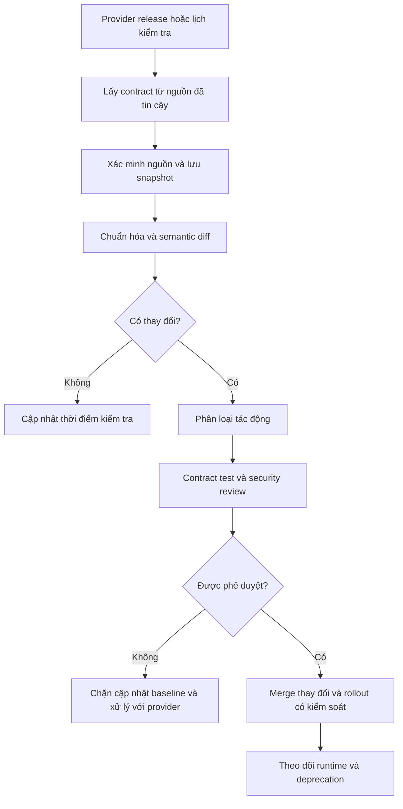

# Theo dõi thay đổi contract của nhà cung cấp

## 1. Vì sao phải theo dõi contract bên ngoài?

Ứng dụng thường tiêu thụ API do đối tác, nhà cung cấp SaaS, cổng thanh toán, dịch vụ định danh hoặc nền tảng cloud vận hành. Consumer dựa vào contract để biết endpoint nào tồn tại, request cần field gì, response có cấu trúc ra sao, lỗi được biểu diễn thế nào và credential nào được yêu cầu.

Contract có thể thay đổi theo thời gian. Nhà cung cấp có thể thêm field, đổi kiểu dữ liệu, bỏ endpoint, thay enum, siết giới hạn, đổi scope OAuth, chuyển base URL hoặc ngừng một phiên bản. Một thay đổi được nhà cung cấp coi là nhỏ vẫn có thể làm consumer lỗi, xử lý sai dữ liệu hoặc mở ra rủi ro bảo mật.

Ví dụ, ứng dụng thanh toán đang đọc `status` với các giá trị `PENDING`, `PAID`, `FAILED`. Nhà cung cấp thêm `REVIEW_REQUIRED`. Nếu code consumer dùng nhánh mặc định coi mọi giá trị chưa biết là `PAID`, một thay đổi contract có thể dẫn tới sai lệch nghiệp vụ nghiêm trọng. Tương tự, một field response mới như `accountOwner` có thể bị vô tình ghi vào model nội bộ nếu ứng dụng deserialize trực tiếp vào entity.

Theo dõi contract là một phần của bảo mật API và quản lý rủi ro phụ thuộc bên ngoài. Mục tiêu là phát hiện thay đổi, hiểu tác động, kiểm thử và phê duyệt trước khi thay đổi ảnh hưởng tới production.

## 2. Contract của nhà cung cấp bao gồm những gì?

Không nên chỉ theo dõi danh sách endpoint. Một contract API có thể gồm nhiều lớp:

| Thành phần | Nội dung cần theo dõi | Tác động khi thay đổi |
|---|---|---|
| API description | OpenAPI, AsyncAPI, GraphQL schema, protobuf/gRPC IDL hoặc tài liệu chính thức. | Client sinh mã có thể thay đổi; request/response có thể không còn tương thích. |
| Endpoint và routing | Base URL, path, HTTP method, host, port, redirect và region. | Request có thể đi sai đích hoặc sang vùng dữ liệu khác. |
| Request schema | Field, kiểu, required, format, range, enum, default và validation rule. | Request bị từ chối hoặc giá trị bị diễn giải khác. |
| Response schema | Field, nullability, kiểu, enum, pagination và cấu trúc lồng nhau. | Deserialization lỗi hoặc logic xử lý sai. |
| Authentication | OAuth flow, issuer, audience, scope, API key, mTLS, token lifetime. | Credential không còn hợp lệ hoặc quyền bị mở rộng/thu hẹp. |
| Authorization semantics | Ý nghĩa permission, role, ownership và tenant scope. | Consumer có thể được cấp thiếu quyền hoặc quyền quá rộng. |
| Error contract | Status code, error code, retryability và response body. | Retry sai, bỏ qua lỗi hoặc lặp tác dụng phụ. |
| Rate limit và quota | Hạn mức, burst, `Retry-After`, pagination và timeout. | Quá tải, mất dữ liệu hoặc tăng chi phí. |
| Lifecycle | Version, deprecation, sunset, migration window và hỗ trợ. | Consumer tiếp tục dùng phiên bản sắp bị ngừng. |
| Security requirements | TLS, certificate, webhook signature, IP policy, data classification. | Kênh giao tiếp hoặc cách xác minh dữ liệu không còn an toàn. |

Contract có thể được công bố dưới dạng OpenAPI/Swagger, AsyncAPI, GraphQL SDL, protobuf, JSON Schema, tài liệu versioned hoặc changelog. Hãy xác định nguồn chính thức cho từng nhà cung cấp và ghi lại phiên bản/định danh artifact mà consumer thực sự sử dụng.

## 3. Lập inventory nhà cung cấp và contract đang được sử dụng

Không thể giám sát thay đổi nếu tổ chức không biết đang phụ thuộc vào API nào. Mỗi tích hợp nên có một bản ghi inventory với thông tin đủ để xác định owner, môi trường, dữ liệu và tác động.

| Trường inventory | Ví dụ nội dung |
|---|---|
| Provider và sản phẩm | `Acme Payments – Payment API`. |
| Owner nội bộ | Team Payments Platform và người chịu trách nhiệm tích hợp. |
| Consumer | `checkout-service`, `refund-worker`. |
| API/version | `Payments API v2`. |
| Contract source | URL/registry chính thức hoặc artifact được lưu trong repository. |
| Contract revision | Release tag, commit, version hoặc digest đã phê duyệt. |
| Environment | Sandbox, staging, production. |
| Data classification | Thông tin đơn hàng, định danh khách hàng, dữ liệu thanh toán. |
| Credential model | OAuth client credentials, mTLS hoặc API key. |
| Network destination | Hostname/region được phép gọi. |
| Criticality | Mức ảnh hưởng nếu API ngừng hoạt động hoặc đổi contract. |
| Change channel | Changelog, email kỹ thuật, webhook, portal hoặc release feed. |
| Deprecation date | Ngày dự kiến ngừng hỗ trợ phiên bản. |

Inventory nên có owner và được rà soát khi thêm, thay thế hoặc xóa integration. Dựa vào danh sách dependency trong source code đơn thuần có thể bỏ sót endpoint được cấu hình ngoài ứng dụng, webhook, job định kỳ, script vận hành hoặc dịch vụ do team khác quản lý.

## 4. Chọn và bảo vệ nguồn contract

Nguồn contract phải có thể xác minh và truy vết. Không lấy schema từ một URL bất kỳ do user hoặc response runtime cung cấp rồi tự động tin tưởng.

Ưu tiên theo thứ tự phù hợp với nhà cung cấp:

1. Artifact versioned từ portal/registry chính thức của nhà cung cấp.
2. Repository chính thức có tag/release và lịch sử thay đổi.
3. Tài liệu/changelog chính thức có ngày phát hành và phạm vi áp dụng.
4. Artifact được nhà cung cấp gửi qua kênh xác thực, có chữ ký hoặc checksum/provenance nếu hỗ trợ.
5. Sandbox/metadata endpoint chỉ dùng để kiểm tra bổ sung, không mặc định là nguồn chuẩn duy nhất.

Khi tải contract tự động:

- Chỉ cho phép hostname/registry đã được quản trị; dùng HTTPS và xác minh TLS bình thường.
- Giới hạn quyền đọc artifact và credential truy cập portal; không dùng token production rộng quyền cho job theo dõi.
- Lưu bản snapshot, thời điểm lấy, provider version, digest và nguồn tải.
- Xác minh chữ ký/checksum nếu nhà cung cấp công bố; checksum chỉ chứng minh nội dung khớp với giá trị tin cậy đã nhận, không tự chứng minh tác giả.
- Không chạy code, plugin hoặc script lấy từ contract repository trong pipeline.
- Không để URL contract do người dùng tự chọn dẫn tới server-side fetch tùy ý; pipeline tải spec cũng có nguy cơ SSRF và cần egress allowlist.
- Giữ lịch sử phiên bản đã duyệt để có thể so sánh, tái tạo build và điều tra sự cố.

Không nên tự động triển khai mọi thay đổi chỉ vì URL spec đã thay đổi. Một nguồn hợp lệ có thể phát hành breaking change, bị cập nhật nhầm hoặc bị chiếm quyền. Xác thực nguồn là bước đầu; semantic review và kiểm thử vẫn bắt buộc.

## 5. Lưu snapshot và phát hiện thay đổi

Một quy trình cơ bản có thể gồm:

1. Lấy contract từ nguồn chính thức theo lịch hoặc nhận thông báo release.
2. Xác minh nguồn, TLS, quyền truy cập, chữ ký/checksum và metadata version.
3. Lưu snapshot mới thành artifact bất biến, không ghi đè bản đã phê duyệt.
4. Chuẩn hóa định dạng để loại khác biệt không có ý nghĩa như thứ tự key, whitespace hoặc thứ tự danh sách không mang ngữ nghĩa.
5. Chạy semantic diff theo loại contract, không chỉ so sánh text.
6. Phân loại thay đổi: breaking, additive, behavioral, security-sensitive hoặc documentation-only.
7. Tạo báo cáo/PR cho owner review; yêu cầu test và approval theo mức rủi ro.
8. Chỉ cập nhật baseline đang dùng sau khi thay đổi được chấp nhận và consumer đã sẵn sàng.



### Vì sao cần semantic diff?

Text diff có thể báo thay đổi lớn chỉ vì format hoặc thứ tự field. Ngược lại, một thay đổi ngắn như `required: false` thành `required: true`, `readOnly` thay đổi hoặc scope OAuth bị xóa có thể có tác động lớn. Semantic diff hiểu cấu trúc và ngữ nghĩa của OpenAPI/schema để tạo báo cáo hữu ích hơn.

Với mỗi provider, hãy chọn công cụ diff phù hợp với định dạng contract và pin phiên bản công cụ trong pipeline. Review các thay đổi bị công cụ đánh dấu; không coi kết quả “no breaking changes” là bằng chứng đầy đủ về tương thích hành vi hoặc bảo mật.

## 6. Phân loại thay đổi contract

Không phải mọi thay đổi đều có cùng mức rủi ro. Phân loại cần xét cả chiều request và response, cách consumer deserialize và logic nghiệp vụ.

| Loại thay đổi | Ví dụ | Tác động thường gặp |
|---|---|---|
| Breaking request | Bỏ field, đổi tên, đổi kiểu, thêm field bắt buộc, siết range/format. | Consumer cũ gửi request không còn hợp lệ. |
| Breaking response | Bỏ field, đổi kiểu, thay cấu trúc lồng nhau hoặc chuyển field thành nullable. | Client lỗi parse hoặc logic nhận `null` ngoài dự kiến. |
| Enum/union change | Thêm giá trị status hoặc subtype mới. | Client dùng switch exhaustive hoặc parser strict có thể lỗi; nhánh mặc định có thể xử lý sai. |
| Endpoint change | Đổi path, method, hostname, port hoặc base URL. | Request thất bại hoặc bị chuyển tới đích không được phê duyệt. |
| Authentication change | Đổi issuer/audience, OAuth flow, scope hoặc certificate requirement. | Token cũ không còn dùng được hoặc consumer được cấp quyền khác. |
| Authorization change | Thay ý nghĩa role, ownership, tenant hoặc resource scope. | Có thể mở rộng quyền ngoài dự kiến hoặc làm mất quyền cần thiết. |
| Error/retry change | Đổi status code, error code hoặc `Retry-After`. | Retry không đúng, gây request storm hoặc lặp tác dụng phụ. |
| Limit change | Giảm page size, body limit, quota hoặc timeout. | Consumer có thể bị throttle, mất trang dữ liệu hoặc timeout. |
| Additive request | Thêm field optional. | Thường tương thích nếu server bỏ qua field lạ và semantics không đổi. |
| Additive response | Thêm field response. | Có thể phá strict deserializer hoặc code generator; cần kiểm tra consumer thực tế. |
| Documentation-only | Sửa mô tả, ví dụ hoặc typo. | Thường ít tác động nhưng cần xác nhận không đổi semantics. |

“Additive” không đồng nghĩa luôn an toàn. Thêm giá trị enum vào response có thể phá client; thêm field vào response có thể làm deserializer strict thất bại; thêm endpoint mới có thể tạo chức năng nhạy cảm cần được inventory và authorization review. Hãy đánh giá dựa trên consumer thực tế và cấu hình parser, không chỉ tên loại thay đổi.

## 7. Những thay đổi bảo mật phải được ưu tiên

Một thay đổi có thể không phá build nhưng vẫn thay đổi trust boundary hoặc quyền dữ liệu. Đánh dấu security-sensitive khi có các trường hợp:

- Thay base URL, hostname, region, redirect hoặc certificate/TLS policy.
- Thêm OAuth scope, đổi audience/issuer hoặc nới cách xác thực.
- Thay đổi permission, role, tenant behavior, object ownership hoặc điều kiện truy cập.
- Thêm field nhạy cảm vào response, mở rộng dữ liệu cá nhân hoặc dữ liệu thanh toán.
- Thay đổi webhook signature, thuật toán ký, timestamp tolerance hoặc cơ chế xác minh callback.
- Thay đổi giới hạn upload/download, pagination, filter hoặc export có thể làm lộ nhiều dữ liệu hơn.
- Thêm endpoint admin, bulk operation, debug endpoint hoặc thao tác có tác dụng phụ.
- Thay đổi retry/idempotency semantics, có thể làm consumer gửi lặp giao dịch.
- Thay đổi schema cho phép dữ liệu đầu vào rộng hơn, expression/filter động hoặc URL do client kiểm soát.

Thay đổi hostname cần kiểm tra kỹ vì consumer có thể gửi credential đến một origin mới. Không tự động chấp nhận `servers`/base URL mới từ OpenAPI hoặc cấu hình runtime. Destination phải được phê duyệt, allowlist và kiểm soát egress riêng.

## 8. Kiểm thử tương thích contract

Semantic diff chỉ cho biết cấu trúc thay đổi. Contract test xác nhận consumer và provider vẫn hiểu nhau theo cách ứng dụng đang sử dụng.

### Consumer-driven contract test

Consumer mô tả các tương tác mà nó thực sự cần: method/path, headers, request fields, response fields và điều kiện quan trọng. Provider chạy verification để xác nhận implementation đáp ứng các tương tác đó. Cách này giúp phát hiện thay đổi ảnh hưởng đến consumer cụ thể thay vì chỉ kiểm tra toàn bộ spec.

Contract test nên:

- Chỉ mô tả phần API consumer thật sự dùng; tránh khóa mọi chi tiết không cần thiết.
- Kiểm tra request/response, status code, content type, nullability, enum và error behavior.
- Dùng dữ liệu giả, không dùng credential hoặc dữ liệu production.
- Xác minh authorization scope và tenant/resource boundary cho thao tác nhạy cảm.
- Kiểm tra idempotency/retry nếu API tạo tác dụng phụ.
- Chạy provider verification khi provider có thể cung cấp sandbox hoặc verification pipeline.

### Schema validation và integration test

Validate request/response mẫu theo schema đã duyệt. Chạy integration test với sandbox của nhà cung cấp để xác minh hành vi thực tế, nhưng giới hạn số lượng request và tránh tạo giao dịch thật. Sandbox có thể khác production; test cần ghi rõ giới hạn đó.

Không nên chỉ test “HTTP 200”. Hãy kiểm tra dữ liệu thực tế, error code, pagination, rate limit, auth failure, retry, timeout và các side effect quan trọng.

## 9. Xử lý dữ liệu response mới hoặc không mong đợi

Consumer cần chịu được thay đổi tương thích mà không vô tình mở rộng quyền dữ liệu.

- Deserialize response vào DTO riêng của integration, không trực tiếp vào entity/database model nội bộ.
- Chỉ map field đã được ứng dụng cho phép; không mass-assign field response vào `role`, `tenantId`, `ownerId`, `balance` hoặc trạng thái nội bộ.
- Với field chưa biết, chọn chính sách rõ: bỏ qua có kiểm soát, lưu raw payload cách ly để điều tra hoặc từ chối nếu field ảnh hưởng quyết định bảo mật.
- Không mặc định giá trị enum chưa biết là trạng thái thành công, đã thanh toán hoặc được phê duyệt.
- Xử lý `null`, thiếu field và giá trị mặc định một cách tường minh.
- Giới hạn độ dài chuỗi, số phần tử, độ sâu JSON và kích thước response.
- Không hiển thị hoặc log toàn bộ payload nếu có dữ liệu nhạy cảm.

Ví dụ, khi nhận status thanh toán mới `REVIEW_REQUIRED`, consumer nên chuyển sang trạng thái “cần xử lý/không kết luận” và yêu cầu quy trình nghiệp vụ tương ứng. Không dùng nhánh `default -> SUCCESS` chỉ để tránh lỗi xử lý.

## 10. Generated client và dependency update

Generated client giúp giảm sai khác giữa code và contract, nhưng code sinh ra cũng là thay đổi phần mềm cần review.

- Pin generator version và cấu hình; tránh pipeline tự động tải bản mới nhất không kiểm soát.
- Lưu contract snapshot đã duyệt cùng thông tin version/digest.
- Sinh client trong branch/PR riêng và review diff source, dependency, auth handling, timeout, retry và destination.
- Kiểm tra code generator có tạo deserializer quá permissive, logging payload hoặc default URL không mong muốn không.
- Không tự động cập nhật production client chỉ vì spec mới được phát hiện.
- Scan dependency và xác minh nguồn package; tránh lấy generator/plugin không rõ nguồn.
- Kiểm thử backward compatibility và rollback về client/spec đã biết tốt.

Generated client không thay thế kiểm tra authorization, validation, SSRF protection, rate limit hoặc output filtering ở ứng dụng.

## 11. Deprecation, versioning và migration window

Nhà cung cấp có thể đánh dấu endpoint/version sắp ngừng hỗ trợ. Theo dõi thông báo deprecation và sunset như một thay đổi có deadline.

| Trạng thái | Hành động của consumer |
|---|---|
| Active | Theo dõi contract, giữ integration test và owner. |
| Deprecated | Ghi nhận ngày thông báo, endpoint thay thế, tác động và kế hoạch migration. |
| Sunset scheduled | Đặt deadline, triển khai phiên bản mới, chạy song song/canary nếu có thể. |
| Retired | Ngừng gọi endpoint cũ, thu hồi credential và xóa cấu hình/dependency không còn dùng. |

Kế hoạch migration nên có owner, milestone, môi trường thử nghiệm, tiêu chí hoàn thành và phương án rollback. Không đợi đến sát ngày sunset mới bắt đầu cập nhật. Nếu provider không đưa ra migration window đủ dài, cần đánh giá business continuity và phương án thay thế.

## 12. Đưa theo dõi contract vào CI/CD

Một pipeline có thể áp dụng các gate sau:

| Gate | Kiểm tra | Kết quả khi thất bại |
|---|---|---|
| Source verification | Nguồn contract, version, digest/chữ ký và thời điểm lấy. | Không chấp nhận artifact chưa xác minh. |
| Schema lint | Cấu trúc spec, security scheme, server URL, schema consistency. | Chặn PR hoặc yêu cầu sửa. |
| Semantic diff | Breaking và security-sensitive changes. | Yêu cầu owner/security review. |
| Contract tests | Consumer expectations và provider verification. | Chặn cập nhật integration. |
| Security tests | Auth scopes, destination allowlist, data exposure, limits, error/retry. | Chặn release nếu có vi phạm. |
| Generated client review | Dependency, code diff, auth, timeout, retry và URL. | Không tự merge. |
| Staging verification | Sandbox/staging integration và telemetry. | Không promote production. |
| Production rollout | Canary, alert và rollback criteria. | Dừng rollout/rollback khi vượt ngưỡng. |

```yaml
# Ví dụ metadata nội bộ để pin contract đã được duyệt.
provider: acme-payments
api: payments-v2
contract:
  source: https://developer.acme.example/openapi/payments-v2.yaml
  version: "2.4.1"
  sha256: "<approved-digest>"
review:
  owner: payments-platform
  approved_change: "CHG-1234"
```

Đây là metadata minh họa, không phải định dạng chuẩn bắt buộc. Digest cần được lấy từ artifact đã xác minh và cập nhật qua review; không tự tin một giá trị hash được tải cùng một nguồn chưa tin cậy.

Pipeline nên tạo báo cáo có thể review: provider/version, thay đổi, mức độ, consumer bị ảnh hưởng, test đã chạy, quyết định và người phê duyệt. Tránh để thông báo thay đổi chỉ nằm trong log build khó tìm.

## 13. Theo dõi thay đổi lúc runtime

Contract được duyệt không bảo đảm provider luôn thực thi đúng contract. Nhà cung cấp có thể rollout không đồng bộ, cấu hình sai hoặc thay đổi behavior trước khi cập nhật spec.

Runtime monitoring nên quan sát:

- Tỷ lệ `4xx`, `5xx`, timeout, TLS/handshake failure và lỗi deserialization.
- Field bắt buộc bị thiếu, kiểu dữ liệu khác dự kiến, enum chưa biết hoặc response schema violation.
- Thay đổi `Content-Type`, pagination, error body, retry header và rate-limit header.
- Thay đổi DNS, certificate, hostname hoặc redirect chain.
- Tăng response size, số record, độ sâu payload hoặc thời gian xử lý.
- Thay đổi dữ liệu nhạy cảm được trả về hoặc scope/permission thực tế.
- Tỷ lệ retry, idempotency conflict, duplicate operation và tác dụng phụ lặp.

Log nên có provider, API version, operation, status, latency, request/correlation ID, contract revision và loại lỗi. Không ghi token, API key, dữ liệu thanh toán hoặc toàn bộ payload cá nhân. Dùng sampling và redaction để tránh log tạo thêm rủi ro dữ liệu.

Khi phát hiện drift, có thể tạm dừng thao tác nhạy cảm, chuyển sang chế độ fail-safe, dùng circuit breaker hoặc fallback đã được thiết kế. Không tự động bỏ qua lỗi schema nếu việc đó có thể biến một trạng thái chưa biết thành thành công. Với thanh toán hoặc quyền truy cập, ưu tiên trạng thái không kết luận và quy trình đối soát.

## 14. Xử lý sự cố khi provider thay đổi ngoài kế hoạch

Khi phát hiện contract hoặc behavior thay đổi bất ngờ:

1. Xác định provider, endpoint/version, consumer và môi trường bị ảnh hưởng.
2. So sánh snapshot đang dùng với spec/changelog mới; xác minh nguồn thay đổi.
3. Phân loại ảnh hưởng: availability, data integrity, authorization, confidentiality, credential, cost hoặc compliance.
4. Nếu destination/auth/security requirement thay đổi, tạm dừng outbound call nhạy cảm cho đến khi xác minh.
5. Kiểm tra request/response đã xảy ra, tác dụng phụ, dữ liệu bị đọc/ghi và giao dịch cần đối soát.
6. Liên hệ provider qua kênh hỗ trợ đã xác minh; yêu cầu release note, migration path hoặc rollback.
7. Cập nhật contract/client trong branch có review, chạy test và rollout có kiểm soát.
8. Nếu credential có thể đã gửi tới host không mong muốn, revoke/rotate và rà soát audit log.
9. Ghi nhận nguyên nhân, thời gian phát hiện, thời gian khắc phục và cải tiến monitoring.

Không tự động rollback chỉ bằng cách đổi lại spec nếu provider đã triển khai behavior mới ở production. Cần xác minh phiên bản server thực tế và khả năng tương thích trước khi chọn rollback hoặc forward-fix.

## 15. Ví dụ thực tế: provider thêm trạng thái mới

Giả sử contract hiện tại mô tả:

```yaml
PaymentStatus:
  type: string
  enum:
    - PENDING
    - PAID
    - FAILED
```

Provider phát hành contract mới:

```yaml
PaymentStatus:
  type: string
  enum:
    - PENDING
    - PAID
    - FAILED
    - REVIEW_REQUIRED
```

Đây là thay đổi additive ở schema, nhưng có thể phá consumer strict. Review cần trả lời:

- Consumer có switch đầy đủ các enum không?
- Giá trị chưa biết có bị coi là `PAID` hoặc success không?
- Quy trình nghiệp vụ cần chờ, yêu cầu người xử lý hay kiểm tra trạng thái khác?
- Dashboard, alert, reconciliation và báo cáo có phân loại giá trị mới không?
- Sandbox có thể tạo trạng thái mới để kiểm thử không?

Một cách xử lý an toàn là biểu diễn trạng thái nội bộ có giá trị `UNKNOWN/REQUIRES_REVIEW`, không cho phép giao dịch hoàn tất cho đến khi hiểu semantics. Khi provider xác nhận ý nghĩa, consumer mới map sang trạng thái domain cụ thể và cập nhật contract test.

## 16. Checklist theo dõi contract nhà cung cấp

- [ ] Mọi API bên ngoài đều có inventory, owner, consumer, version và criticality?
- [ ] Nguồn contract/changelog chính thức được xác định và xác minh?
- [ ] Snapshot và digest của contract đã duyệt được lưu bất biến?
- [ ] Có lịch kiểm tra hoặc cơ chế nhận thông báo thay đổi?
- [ ] Có semantic diff theo đúng định dạng OpenAPI/AsyncAPI/GraphQL/protobuf/schema?
- [ ] Breaking change và security-sensitive change được phân loại riêng?
- [ ] Thay đổi base URL, auth, scope, tenant, data exposure và webhook được review bảo mật?
- [ ] Contract test và provider verification chạy trong CI hoặc staging?
- [ ] Generated client/generator/dependency được pin và review?
- [ ] Response mới/enum mới/field mới không làm mass-assign hoặc mặc định thành success?
- [ ] Destination mới được allowlist và kiểm tra SSRF/egress trước khi dùng?
- [ ] Có kế hoạch deprecation, migration window, canary và rollback?
- [ ] Runtime monitoring phát hiện schema drift, auth failure, retry storm và data anomaly?
- [ ] Có runbook xử lý provider change ngoài kế hoạch và credential exposure?
- [ ] Báo cáo thay đổi có owner, người duyệt, test evidence và contract revision?

Theo dõi thay đổi contract của nhà cung cấp giúp consumer biết rõ mình đang phụ thuộc vào API version nào, thay đổi nào sắp ảnh hưởng và thay đổi nào có thể làm lệch ranh giới bảo mật. Quy trình hiệu quả kết hợp inventory, nguồn contract tin cậy, snapshot, semantic diff, contract test, review bảo mật, rollout có kiểm soát và runtime monitoring. Không cập nhật mù quáng theo spec mới; mọi thay đổi cần được đánh giá trong ngữ cảnh dữ liệu, quyền, destination và tác dụng phụ mà consumer thực sự sử dụng.
