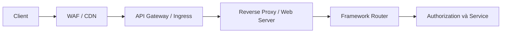

# HTTP method hoặc endpoint không cần thiết

Mỗi HTTP method và endpoint được công khai đều mở thêm một đường để client tương tác với hệ thống. Nếu API vô tình cho phép những method không cần dùng, giữ lại endpoint thử nghiệm hoặc để lộ route quản trị, kẻ tấn công có thêm cơ hội dò tìm và khai thác chức năng ngoài dự kiến. Rủi ro này thường đến từ cấu hình mặc định quá rộng, route cũ chưa được gỡ, controller dùng mapping tổng quát hoặc gateway và ứng dụng áp dụng chính sách khác nhau.

**Attack surface** của API là tập hợp các điểm mà người dùng hoặc hệ thống bên ngoài có thể tương tác. Thu hẹp attack surface nghĩa là chỉ công bố endpoint và HTTP method thực sự phục vụ nghiệp vụ, áp dụng quyền phù hợp cho từng thao tác và loại bỏ đường truy cập không còn cần thiết. Việc này không thay thế authentication, authorization hay validation; nó giảm số đường mà các kiểm soát đó phải bảo vệ.

Trong API Security, cần quản lý endpoint theo inventory có owner, mục đích, consumer và trạng thái vòng đời. Mỗi route chỉ nên ánh xạ các HTTP method được thiết kế rõ ràng. Những method như `TRACE`, `CONNECT` hoặc WebDAV methods thường không cần thiết trên API ứng dụng và nên bị vô hiệu hóa ở web server/proxy nếu không có nhu cầu cụ thể. `OPTIONS` và `HEAD` cần được đánh giá riêng vì có thể phục vụ CORS preflight hoặc kiểm tra metadata.

## 1. Vì sao method và endpoint thừa tạo rủi ro?

Một API có thể hoạt động đúng với `GET /api/orders/{id}` và `POST /api/orders`, nhưng cấu hình server hoặc controller lại vô tình chấp nhận thêm `PUT`, `DELETE`, `TRACE` hoặc method khác. Tương tự, hệ thống có thể chỉ công bố `/api/v1/orders` cho client nhưng vẫn giữ `/internal/debug`, `/test`, `/admin`, `/old-api` hoặc endpoint actuator trên cùng host.

Những đường truy cập thừa có thể gây ra các rủi ro sau:

- **Vượt qua giả định của ứng dụng:** một method không được giao diện sử dụng vẫn có thể gọi trực tiếp bằng HTTP client hoặc script.
- **Thực hiện hành động không được dự kiến:** nếu route cho phép `PUT` hoặc `DELETE` ngoài ý muốn, dữ liệu có thể bị thay đổi hoặc xóa.
- **Lộ thông tin triển khai:** endpoint debug, metrics, schema, health detail hoặc tài liệu API có thể tiết lộ version, topology, tên service và cấu hình.
- **Bỏ qua kiểm soát ở một tầng:** gateway chỉ giới hạn `GET` và `POST`, nhưng backend vẫn có route `DELETE`; hoặc proxy chặn một method nhưng đường nội bộ gọi thẳng ứng dụng lại không chặn.
- **Tăng khả năng dò tìm:** method discovery, route alias và endpoint cũ giúp attacker lập bản đồ chức năng và phiên bản chưa được vá.
- **Tạo đường vòng authorization:** endpoint legacy có thể thiếu kiểm tra object-level, tenant hoặc property-level mà endpoint mới đã có.
- **Khó giám sát và bảo trì:** route trùng, method override hoặc nhiều alias khiến log, rate limit và policy không thống nhất.

Không phải mọi method ít dùng đều là lỗ hổng. Rủi ro nằm ở việc method hoặc endpoint được bật mà không có mục đích, owner, kiểm soát truy cập và quy trình vận hành rõ ràng.

## 2. Inventory endpoint và method

Trước khi tắt một route, cần biết hệ thống thực sự đang công bố những gì. Không nên chỉ dựa vào tài liệu OpenAPI vì tài liệu có thể cũ hoặc không bao gồm route được tạo động, endpoint nội bộ và cấu hình web server.

Inventory nên kết hợp:

- Route mapping trong framework/controller và router của từng service.
- OpenAPI hoặc API catalog đang được publish.
- Cấu hình ingress, reverse proxy, API gateway, load balancer và web server.
- Endpoint quản trị, health, metrics, debug, schema, documentation và test fixture.
- Access log và telemetry theo route template/method trong một khoảng thời gian đủ đại diện.
- Consumer, service owner, mục đích nghiệp vụ, loại dữ liệu và mức độ nhạy cảm.

Một bảng inventory tối thiểu có thể như sau:

| Route | Method cần thiết | Consumer | Owner | Trạng thái |
| --- | --- | --- | --- | --- |
| `/api/orders` | `GET`, `POST` | Web app, mobile app | Orders team | Public API đã duyệt |
| `/api/orders/{id}` | `GET`, `PATCH` | Web app, mobile app | Orders team | Public API đã duyệt |
| `/api/orders/{id}/cancel` | `POST` | Web app | Orders team | Hành động nghiệp vụ có quyền riêng |
| `/actuator/health` | `GET` | Orchestrator | Platform team | Chỉ mạng quản trị/health probe |
| `/actuator/env` | Không công khai | Không có consumer công khai | Platform team | Tắt hoặc giới hạn chặt |
| `/api/v1/legacy-export` | Không còn cần | Consumer cũ đã chuyển đổi | Data team | Đang sunset rồi gỡ |

Ví dụ trên chỉ minh họa cách phân loại. Method và route thực tế phải được xác nhận với owner và consumer trước khi thay đổi.

### 2.1. Phân loại endpoint theo phạm vi

Có thể phân loại route thành:

- **Public/business API:** phục vụ consumer bên ngoài hoặc ứng dụng người dùng; cần contract và authorization rõ ràng.
- **Internal service API:** chỉ dành cho workload/service đã xác thực; cần network policy, workload identity và quyền tối thiểu.
- **Management/operations API:** health, metrics, diagnostics, configuration và administration; cần tách host/network hoặc authentication mạnh.
- **Development/test API:** mock, seed, debug, fixture, profiling; không được triển khai công khai ở production.
- **Deprecated API:** phiên bản hoặc route cũ đang được sunset; phải có owner, thời hạn và kế hoạch loại bỏ.

Không coi từ `internal` trong URL là biện pháp bảo vệ. Route nội bộ vẫn có thể bị truy cập nếu mạng, gateway hoặc workload identity cấu hình sai.

### 2.2. Phát hiện route không được khai báo

So sánh route thực tế với API catalog để tìm endpoint không có owner hoặc không có trong contract. Kiểm tra cả route được tạo từ annotation, servlet, filter, actuator, static file server và reverse proxy. Một route không xuất hiện trong OpenAPI chưa chắc là route không tồn tại.

Log lưu lượng giúp biết endpoint nào đang được sử dụng, nhưng không chứng minh endpoint không có traffic là an toàn để xóa. Có thể có batch job theo tháng, đối tác ít gọi hoặc quy trình khẩn cấp hiếm khi dùng. Trước khi gỡ, cần thông báo consumer, quan sát đủ chu kỳ nghiệp vụ và xác nhận với owner.

## 3. Chỉ cho phép HTTP method cần thiết trên từng route

HTTP method thể hiện loại thao tác mà client yêu cầu. Không nên bật tất cả method trên mọi route rồi trông chờ controller hoặc frontend tự hạn chế.

| Method | Ý nghĩa phổ biến | Cách xem xét trên API |
| --- | --- | --- |
| `GET` | Đọc representation; được định nghĩa là safe | Chỉ cho phép đọc dữ liệu trong phạm vi authorization; không tạo side effect nghiệp vụ. |
| `HEAD` | Tương tự `GET` nhưng không trả response body | Giữ nếu consumer cần metadata; bảo đảm authorization và không làm lộ metadata nhạy cảm. |
| `POST` | Gửi dữ liệu để xử lý hoặc tạo hành động | Dùng cho command/operation; cần validation, authorization, idempotency khi phù hợp. |
| `PUT` | Tạo/thay thế representation tại URI; idempotent theo semantics HTTP | Chỉ bật khi API hỗ trợ thay thế toàn bộ tài nguyên theo contract. |
| `PATCH` | Áp dụng thay đổi một phần | Giới hạn field, kiểm tra property authorization và semantics null/omitted. |
| `DELETE` | Xóa hoặc yêu cầu xóa tài nguyên; idempotent theo semantics HTTP | Chỉ bật cho route có nghiệp vụ xóa; kiểm tra object, trạng thái và quyền riêng. |
| `OPTIONS` | Hỏi các tùy chọn giao tiếp của resource | Có thể cần cho CORS preflight hoặc discovery; giới hạn thông tin và method được công bố. |
| `TRACE` | Echo request để chẩn đoán | Thường nên tắt trên API production vì có thể phản chiếu header/dữ liệu nhạy cảm. |
| `CONNECT` | Thiết lập tunnel đến đích | Chỉ dành cho proxy/tunnel được thiết kế riêng; không cần trên API ứng dụng thông thường. |
| WebDAV (`PROPFIND`, `PROPPATCH`, `MKCOL`, `COPY`, `MOVE`, `LOCK`, `UNLOCK`) | Thao tác quản lý tài nguyên WebDAV | Tắt nếu ứng dụng không cung cấp WebDAV; nếu có thì cần authorization và giới hạn rõ. |

Tính chất safe hoặc idempotent của HTTP method không tự động làm request an toàn. `DELETE` có semantics idempotent nhưng vẫn là thao tác phá hủy; `PUT` idempotent nhưng vẫn có thể ghi đè dữ liệu. Authorization và validation luôn phải dựa trên hành động thực tế.

Một số framework tự hỗ trợ `HEAD` cho route `GET` và tự tạo phản hồi `OPTIONS` liệt kê method của route. Vì vậy, inventory cần kiểm tra hành vi runtime thực tế, không chỉ tìm annotation `@HeadMapping` hoặc `@OptionsMapping` trong source.

### 3.1. Không dùng mapping tổng quát khi chỉ cần một method

Trong Spring MVC, `@RequestMapping` không khai báo `method` có thể khớp nhiều HTTP method. Nếu endpoint chỉ đọc dữ liệu, hãy dùng `@GetMapping`; nếu tạo resource, dùng `@PostMapping`; nếu cập nhật, chọn `@PutMapping` hoặc `@PatchMapping` theo contract.

Ví dụ mapping quá rộng:

```java
@RestController
@RequestMapping("/api/reports")
class ReportController {

    @RequestMapping("/{id}")
    ReportView getReport(@PathVariable UUID id) {
        return reportService.get(id);
    }
}
```

Mapping rõ method:

```java
@RestController
@RequestMapping("/api/reports")
class ReportController {

    @GetMapping("/{id}")
    ReportView getReport(@PathVariable UUID id) {
        return reportService.get(id);
    }
}
```

Mapping rõ ràng giúp framework trả `405 Method Not Allowed` khi route tồn tại nhưng method không được khai báo, thay vì vô tình đưa request đến handler không được thiết kế cho method đó. Controller vẫn cần authorization ở service và không được dựa vào annotation mapping để cấp quyền truy cập object.

### 3.2. Quyền phải gắn với method và action

`GET /api/orders/{id}` và `DELETE /api/orders/{id}` có thể dùng chung resource nhưng yêu cầu quyền khác nhau. Cấu hình authorization cần phân biệt `orders:read` với `orders:delete`; không cấp quyền xóa chỉ vì caller được đọc đơn hàng.

Ví dụ Spring Security:

```java
@Bean
SecurityFilterChain apiSecurity(HttpSecurity http) throws Exception {
    http
        .securityMatcher("/api/**")
        .authorizeHttpRequests(auth -> auth
            .requestMatchers(HttpMethod.GET, "/api/orders/**")
                .hasAuthority("SCOPE_orders:read")
            .requestMatchers(HttpMethod.POST, "/api/orders")
                .hasAuthority("SCOPE_orders:create")
            .requestMatchers(HttpMethod.PATCH, "/api/orders/**")
                .hasAuthority("SCOPE_orders:update")
            .requestMatchers(HttpMethod.DELETE, "/api/orders/**")
                .hasAuthority("SCOPE_orders:delete")
            .anyRequest().denyAll()
        )
        .cors(Customizer.withDefaults());

    return http.build();
}
```

Đây là ví dụ minh họa; ứng dụng cần cấu hình authentication, CORS allowlist và CSRF phù hợp với kiểu client. Quy tắc `anyRequest().denyAll()` đóng mặc định các request không có rule cụ thể, nhưng không thay thế method mapping ở MVC hoặc object-level authorization trong service. CORS filter xử lý preflight trước bước authorization khi được cấu hình đúng; không mở rộng `Access-Control-Allow-Methods` chỉ để làm request đi qua. Cần kiểm tra thứ tự matcher và route cụ thể để tránh rule rộng che mất rule hẹp.

## 4. Xử lý method không được hỗ trợ đúng cách

Khi route tồn tại nhưng method không được phép, server thường trả `405 Method Not Allowed` và có thể kèm header `Allow` liệt kê method được hỗ trợ. Nếu route không tồn tại, trả `404 Not Found`. Nếu server không nhận diện method extension, có thể trả `501 Not Implemented` theo semantics HTTP.

Không nên chuyển mọi method lạ thành `200 OK`, fallback sang `GET` hoặc âm thầm thực hiện một hành động khác. Cũng không nên trả thông tin nội bộ trong error body.

Ví dụ:

```http
DELETE /api/reports/123 HTTP/1.1
Host: api.example.com
```

Nếu report chỉ hỗ trợ đọc:

```http
HTTP/1.1 405 Method Not Allowed
Allow: GET, HEAD, OPTIONS
Content-Type: application/problem+json
```

Danh sách `Allow` phải phản ánh đúng contract và không quảng bá method nội bộ không cần thiết. Nếu endpoint không nên được phát hiện bởi caller chưa có quyền, tổ chức có thể dùng response policy phù hợp để giảm khả năng enumeration, nhưng phải nhất quán và không làm sai semantics ở các consumer được hỗ trợ.

### 4.1. Tắt TRACE và method nguy hiểm ở tầng server

Các method không dùng nên bị tắt ở web server/container hoặc reverse proxy, nơi request được tiếp nhận đầu tiên. Ví dụ, cấu hình connector để không hỗ trợ TRACE; vô hiệu hóa WebDAV module nếu không sử dụng; không cấu hình proxy tunnel CONNECT cho virtual host API.

Không chỉ dựa vào controller vì một số method có thể được xử lý ở web server, servlet container, static resource handler hoặc proxy trước khi vào ứng dụng. Sau khi thay đổi, cần kiểm tra từ bên ngoài qua đúng ingress production-like và kiểm tra cả đường nội bộ.

### 4.2. CORS và OPTIONS

Browser có thể gửi `OPTIONS` preflight để hỏi server có cho phép origin, method và header dự kiến hay không. Không nên chặn toàn bộ `OPTIONS` một cách máy móc nếu API cần CORS. Cấu hình CORS cần giới hạn origin, method và header cụ thể; chỉ trả `Access-Control-Allow-Methods` cho các method thật sự được hỗ trợ.

CORS là chính sách trình duyệt, không phải authorization phía server. Một script, mobile app hoặc HTTP client ngoài browser vẫn có thể gọi trực tiếp endpoint. Vì vậy, mỗi method vẫn phải được kiểm tra authentication và authorization theo nghiệp vụ. Không dùng `Access-Control-Allow-Methods` làm biện pháp duy nhất để cấm `DELETE` hoặc `PUT`.

`OPTIONS` cũng có thể được dùng để khám phá các method được hỗ trợ. Chỉ cung cấp thông tin phù hợp với contract công khai; tránh để endpoint quản trị hoặc nội bộ bị lộ qua discovery trên public host.

## 5. Kiểm soát method override và chuẩn hóa request

Một số ứng dụng hoặc proxy hỗ trợ method override qua header như `X-HTTP-Method-Override` hoặc form parameter `_method`, thường để client cũ gửi method không hỗ trợ trực tiếp. Nếu override được xử lý không nhất quán giữa gateway, WAF và backend, attacker có thể lợi dụng để vượt qua rule dựa trên HTTP method gốc.

Ví dụ gateway chỉ cho `POST` nhưng backend đọc `X-HTTP-Method-Override: DELETE` và thực hiện xóa. Khi đó gateway ghi nhận POST trong khi ứng dụng thực hiện DELETE.

Biện pháp:

- Tắt method override nếu không có consumer thực sự cần.
- Nếu cần, chỉ hỗ trợ trên route cụ thể và với client đã xác thực.
- Chuẩn hóa method một lần tại biên tin cậy trước khi áp dụng authorization, rate limit, audit và routing.
- Gateway, WAF, application và logging phải dùng cùng method hiệu lực.
- Từ chối request có method override mâu thuẫn hoặc nhiều nguồn override khác nhau.
- Không cho phép client thay đổi method sau khi authorization đã được quyết định.

Không nên chỉ xóa header ở một tầng rồi giả định các tầng sau cũng bỏ qua. Cần kiểm thử đường đi thực tế và xác minh framework/container có filter method override nào được bật.

## 6. Gỡ endpoint thử nghiệm, debug và quản trị khỏi public surface

Endpoint không cần thiết không chỉ là HTTP method. Các route được thêm cho phát triển, kiểm thử hoặc vận hành cũng có thể mở rộng attack surface nếu được publish trên host công khai.

Các nhóm cần rà soát:

- `/debug`, `/test`, `/mock`, `/seed`, `/fixtures`, `/internal`.
- Endpoint bật profiling, heap dump, thread dump hoặc diagnostic.
- Spring Boot Actuator như `/actuator/env`, `/actuator/configprops`, `/actuator/heapdump`, `/actuator/threaddump`.
- Swagger UI, OpenAPI JSON/YAML, GraphiQL, GraphQL introspection hoặc API explorer nếu không cần public.
- Endpoint quản trị user, role, feature flag, job scheduler và cấu hình hệ thống.
- Route legacy, alias cũ, API version đã sunset hoặc endpoint backup/export tạm thời.
- Static file, backup archive, log file hoặc file cấu hình bị đặt nhầm dưới web root.

Không phải tất cả endpoint health, metrics hoặc documentation đều phải xóa. Chúng cần được phân loại và expose theo mục đích: health probe tối thiểu có thể chỉ dành cho orchestrator; metrics chỉ dành cho monitoring network; tài liệu API có thể được publish có kiểm soát. Endpoint quản trị nên đặt trên management port/host hoặc mạng riêng và yêu cầu authentication, authorization cùng audit.

### 6.1. Ví dụ giới hạn Spring Boot Actuator

Chỉ expose endpoint vận hành thực sự cần dùng:

```yaml
management:
  endpoints:
    web:
      exposure:
        include: health,info,prometheus
  endpoint:
    health:
      show-details: never
```

Ví dụ này giới hạn danh sách endpoint được expose qua web và không hiển thị health details cho caller thông thường. Cần cấu hình security/network riêng cho `prometheus` và các endpoint quản trị, vì `exposure.include` không tự xác thực người gọi. Không expose `env`, `configprops`, `heapdump` hoặc `threaddump` ra public nếu không có use case và biện pháp bảo vệ rõ ràng.

### 6.2. Debug route và cấu hình theo môi trường

Không dùng một profile production có debug endpoint rồi dựa vào frontend không gọi đến. Hãy loại endpoint development/test khỏi artifact hoặc cấu hình production; kiểm tra cấu hình build và deployment để không bật nhầm profile. Nếu endpoint diagnostic cần thiết khi vận hành, hãy giới hạn bằng management network, workload identity hoặc quyền quản trị và audit mọi lần truy cập.

## 7. Gỡ route cũ theo vòng đời API

Endpoint legacy thường tồn tại lâu hơn dự kiến vì consumer chưa chuyển đổi hoặc không ai chịu trách nhiệm. Cần quy trình sunset có kiểm soát:

1. Xác định route, method, consumer, owner và dữ liệu/side effect liên quan.
2. Kiểm tra traffic và dependency trong đủ chu kỳ nghiệp vụ, bao gồm batch và consumer ít hoạt động.
3. Thông báo deprecation, cung cấp route thay thế và thời hạn chuyển đổi.
4. Có thể trả header `Deprecation`/`Sunset` hoặc thông tin migration theo contract khi phù hợp.
5. Theo dõi consumer còn gọi, làm việc với owner và đặt mốc ngừng nhận request.
6. Tắt route tại gateway và ứng dụng, xóa mapping cùng test/cấu hình không còn dùng.
7. Kiểm thử route cũ không còn thực hiện side effect và không có alias khác vẫn dẫn đến handler cũ.
8. Cập nhật API catalog và inventory.

Không xóa route chỉ vì log gần đây không có traffic. Một integration có thể gọi theo lịch tháng/quý hoặc chỉ chạy khi có sự cố. Cần xác nhận với owner và consumer trước khi loại bỏ.

## 8. Đồng bộ chính sách giữa gateway, proxy và ứng dụng

Một request thường đi qua nhiều tầng:



Mỗi tầng có thể diễn giải method, path, header và route khác nhau. Chính sách method cần được đồng bộ:

- WAF/gateway chỉ forward method cần thiết cho từng route.
- Reverse proxy và web server tắt method extension không sử dụng.
- Framework router chỉ khai báo method cần thiết.
- Authorization phân biệt quyền theo method/action.
- Logging và rate limit dùng method đã chuẩn hóa.
- Service nội bộ vẫn kiểm tra quyền nếu có thể được gọi ngoài gateway.

Nếu chỉ chặn ở gateway, một route có thể bị gọi qua internal load balancer hoặc service-to-service path. Nếu chỉ chặn ở application, web server có thể xử lý `TRACE`, WebDAV hoặc static resource trước khi request tới controller. Cần kiểm thử cả ingress công khai và đường nội bộ được hỗ trợ.

### 8.1. Path normalization và route alias

Method allowlist không đủ nếu cùng một handler có thể được truy cập qua nhiều path alias hoặc qua cách chuẩn hóa khác nhau. Rà soát trailing slash, chữ hoa/thường, encoded path separator, duplicate slash, path parameter, rewrite rule và route alias giữa gateway với framework. Không để gateway kiểm tra `/admin` nhưng backend chuẩn hóa một path khác thành route quản trị.

Định nghĩa canonical route và chuẩn hóa một lần ở biên tin cậy. Các tầng sau phải dùng cùng biểu diễn path; authorization phải chạy trên route thực sự được dispatch. Kiểm thử các biến thể encoding và rewrite theo framework đang sử dụng.

## 9. Ví dụ kiểm thử method và endpoint

Kiểm thử cần xác minh method được hỗ trợ, method bị từ chối, quyền theo method và các endpoint không được publish.

| Kịch bản | Request | Kết quả mong đợi |
| --- | --- | --- |
| Method được hỗ trợ | `GET /api/orders/123` với quyền đọc | Trả dữ liệu trong phạm vi được phép. |
| Method không được mapping | `DELETE /api/reports/123` khi route chỉ hỗ trợ GET | `405` nếu request tới MVC mapping; có thể là `403` nếu security filter deny trước; không có side effect. |
| Không có route | Gọi endpoint test đã gỡ | `404` hoặc response policy đã định nghĩa; không gọi handler cũ. |
| Method nguy hiểm | `TRACE /api/orders` | Bị từ chối tại server/proxy theo cấu hình. |
| WebDAV không dùng | `PROPFIND /api/orders` | Bị từ chối; không expose WebDAV handler. |
| CONNECT | `CONNECT api.example.com:443` đến API virtual host | Không tạo tunnel qua API host. |
| CORS preflight hợp lệ | `OPTIONS` với origin/method được cấu hình | Trả CORS headers phù hợp, không mở thêm method ngoài allowlist. |
| CORS preflight không hợp lệ | Origin hoặc method không được phép | Không cấp `Access-Control-Allow-Origin/Methods` tương ứng. |
| Method override | `POST` kèm `X-HTTP-Method-Override: DELETE` | Bị bỏ qua hoặc từ chối theo chính sách; không thực hiện DELETE ngoài ý muốn. |
| Thiếu quyền theo method | User có `orders:read` gọi DELETE | `403`; dữ liệu không bị xóa. |
| Endpoint quản trị | Anonymous gọi `/actuator/env` | Không truy cập được; endpoint không public. |
| Route legacy | Consumer gọi route đã sunset sau thời hạn | Route bị tắt theo kế hoạch; không chạy side effect cũ. |

### 9.1. Ví dụ test Spring MockMvc

```java
@Test
void reportEndpointRejectsDelete() throws Exception {
    mockMvc.perform(delete("/api/reports/{id}", reportId)
            .with(jwt().authorities(
                new SimpleGrantedAuthority("SCOPE_reports:read"))))
        .andExpect(status().isForbidden());

    assertThat(reportRepository.existsById(reportId)).isTrue();
}
```

Test minh họa chạy cùng SecurityFilterChain có `anyRequest().denyAll()`, nên DELETE bị từ chối với `403` trước khi tới MVC handler mapping. Nếu muốn kiểm tra riêng hành vi router, tạo một MVC-only test không gắn security filter và xác minh `405 Method Not Allowed`. Contract nên xác định hành vi mong đợi theo tầng xử lý; trong mọi trường hợp, method không được phép không được tạo side effect.

### 9.2. Kiểm thử deployment thực tế

MockMvc không kiểm tra được cấu hình WAF, ingress, reverse proxy hoặc connector. Cần có smoke test trên môi trường tích hợp/production-like để gửi các method không dùng đến đúng hostname và xác minh chúng bị chặn ở tầng dự kiến. Kiểm tra `Allow`, CORS headers, redirect và path rewrite; xác nhận không có endpoint debug/actuator ngoài dự kiến.

## 10. Monitoring và quản trị thay đổi

Theo dõi request theo route template và method để phát hiện method bất thường, route cũ còn traffic hoặc endpoint chưa có owner. Các tín hiệu hữu ích:

- Request dùng `TRACE`, `CONNECT` hoặc WebDAV method trên API host.
- Method không có trong OpenAPI/API catalog.
- Tỷ lệ `405`, `404` hoặc `403` tăng đột biến trên một route.
- Request vào debug, admin, actuator hoặc legacy endpoint từ public network.
- Method override header xuất hiện ngoài client/route đã đăng ký.
- Một route nhận method khác với baseline hoặc contract.
- Consumer tiếp tục gọi endpoint đã deprecate sau thời hạn sunset.

Log nên ghi route template, method đã chuẩn hóa, principal/client, decision, status, source network ở mức phù hợp và correlation ID. Không ghi access token hoặc payload nhạy cảm. Alert nên có owner và hướng xử lý; một số request lạ có thể là scanner Internet thông thường, cần đánh giá tần suất và tác động trước khi khóa client hợp lệ.

Mọi thay đổi endpoint/method cần qua review: ai yêu cầu, mục đích, consumer, dữ liệu và side effect, quyền cần thiết, môi trường expose, test và thời hạn nếu là endpoint tạm thời. Endpoint thử nghiệm nên có cơ chế tự hết hạn hoặc được đưa vào inventory để tránh tồn tại vô thời hạn.

## 11. Checklist thu hẹp HTTP method và endpoint

- [ ] Có inventory route/method từ application, OpenAPI, gateway, proxy và web server.
- [ ] Mỗi endpoint có owner, mục đích, consumer và phân loại public/internal/management/test.
- [ ] Controller/router khai báo method cụ thể; tránh mapping tổng quát không cần thiết.
- [ ] Mỗi method có quyền chức năng riêng và vẫn kiểm tra object/property authorization.
- [ ] Tắt `TRACE`, `CONNECT` và WebDAV methods nếu ứng dụng không cần.
- [ ] Giữ `HEAD`/`OPTIONS` chỉ khi có use case; CORS origin/method/header được giới hạn.
- [ ] CORS không bị dùng thay cho authorization phía server.
- [ ] Method override bị tắt hoặc được giới hạn và chuẩn hóa nhất quán qua mọi tầng.
- [ ] Debug, test, admin, actuator, schema và legacy endpoint không bị expose ngoài dự kiến.
- [ ] Endpoint quản trị/metrics/health được tách mạng hoặc bảo vệ bằng identity và quyền phù hợp.
- [ ] Route legacy có owner, thông báo deprecation/sunset và kế hoạch gỡ.
- [ ] Gateway, proxy, web server và application áp dụng cùng allowlist method/path.
- [ ] Test bao gồm method không hỗ trợ, CORS preflight, override, route alias và side effect.
- [ ] Có smoke test trên ingress thực tế và theo dõi route/method lạ.
- [ ] Thay đổi endpoint có review, audit và cập nhật API catalog.

Chỉ công bố method và endpoint phục vụ use case đã được xác định. Khi route có mapping cụ thể, quyền được gắn với từng hành động, endpoint quản trị/test/legacy được quản lý riêng và chính sách thống nhất từ gateway đến ứng dụng, API giảm được bề mặt tấn công và hạn chế các đường truy cập ngoài dự kiến.
