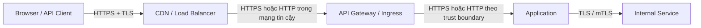

# CORS, TLS và security header

Một API có thể kiểm tra token và phân quyền đúng nhưng vẫn bị cấu hình sai ở lớp trình duyệt, kết nối hoặc HTTP response. CORS quá rộng có thể cho website không đáng tin đọc dữ liệu mà browser gửi kèm cookie; TLS yếu hoặc certificate không được xác minh có thể làm lộ hay sửa dữ liệu trên đường truyền; thiếu security header có thể khiến trang tài liệu API, trang đăng nhập hoặc giao diện quản trị dễ bị khai thác.

Các cấu hình này thường nằm ở nhiều lớp: ứng dụng, Spring Security, reverse proxy, API gateway, ingress controller, load balancer và CDN. Nếu chỉ sửa controller nhưng gateway ghi đè header, hoặc gateway đã kết thúc TLS nhưng kết nối tới backend lại đi qua mạng không tin cậy, hệ thống vẫn có thể không đạt chính sách mong muốn.

Trong module `SECURITY_API_SECURITY`, bảo mật API được thiết kế theo từng endpoint, đối tượng dữ liệu và luồng nghiệp vụ thay vì chỉ dựa vào đăng nhập hay HTTPS. CORS, TLS và security header cần được cấu hình theo loại client, độ nhạy cảm dữ liệu và trust boundary thực tế. Chúng bổ trợ cho authentication, authorization, CSRF protection và output filtering; không thay thế các kiểm soát đó.

## Mục tiêu học tập

Sau bài này, người học có thể:

- Giải thích same-origin policy và vai trò thực sự của CORS trong browser.
- Thiết kế allowlist origin chính xác, xử lý preflight, credential và cache an toàn.
- Phân biệt CORS với authentication, authorization và CSRF protection.
- Cấu hình TLS phiên bản, certificate, hostname verification và TLS termination phù hợp.
- Hiểu HSTS, giới hạn của HSTS và cách triển khai `includeSubDomains` an toàn.
- Chọn security header phù hợp cho JSON API, trang đăng nhập và tài liệu API.
- Cấu hình CORS, Spring Security và reverse proxy mà không tạo đường bypass.
- Kiểm thử header trên response thành công, lỗi, redirect và preflight; giám sát certificate và cấu hình TLS.

## 1. Security misconfiguration ở lớp HTTP

Security misconfiguration xảy ra khi một thành phần bảo mật được bật sai, thiếu cấu hình hoặc không nhất quán giữa các lớp. Ví dụ:

- CORS cho phép mọi origin và bật credential.
- Ứng dụng phản chiếu bất kỳ giá trị `Origin` nào vào `Access-Control-Allow-Origin`.
- Preflight trả lời mọi method và header mà không có policy cụ thể.
- TLS còn cho phép protocol hoặc cipher suite lỗi thời.
- Client không kiểm tra certificate hostname, hoặc service gọi downstream bỏ qua TLS verification.
- HTTP không được chuyển sang HTTPS và cookie nhạy cảm thiếu `Secure`.
- HSTS được cấu hình ở backend nhưng bị gateway xóa khỏi response.
- Response JSON hoặc trang API docs thiếu header phù hợp.
- Header an toàn chỉ xuất hiện ở response 200, nhưng biến mất ở 401, 403, 404 hoặc 500.
- Gateway và ứng dụng cùng ghi một header với hai giá trị mâu thuẫn.

Các lỗi này thường không nằm trong một endpoint duy nhất. Cần xác định response path từ client qua CDN/gateway tới ứng dụng và ngược lại, sau đó kiểm tra cấu hình ở nơi thực sự phát response.

## 2. Same-origin policy và CORS

### 2.1. Same-origin policy là gì?

Browser áp dụng same-origin policy (SOP) để hạn chế một trang web đọc dữ liệu thuộc origin khác. Origin được xác định bởi bộ ba:

- Scheme, ví dụ `https`.
- Hostname, ví dụ `app.example.com`.
- Port, ví dụ `443`.

Do đó, `https://app.example.com` và `https://api.example.com` là hai origin khác nhau; `http://app.example.com` và `https://app.example.com` cũng khác origin. Hai URL cùng hostname nhưng khác port cũng là cross-origin.

CORS (Cross-Origin Resource Sharing) là cơ chế để server khai báo những origin nào được browser cho phép đọc response cross-origin. Server trả các HTTP response header như `Access-Control-Allow-Origin` để browser quyết định có chia sẻ response với JavaScript của trang gọi hay không.

### 2.2. CORS không phải authentication hoặc authorization

CORS không xác minh danh tính người dùng, không cấp quyền truy cập resource và không chặn mọi request cross-origin. Nó chủ yếu điều khiển việc browser cho JavaScript đọc response.

Một số điểm cần nhớ:

- `curl`, backend service, script ngoài browser và client tự viết không bị browser áp dụng CORS theo cách tương tự.
- Request đơn giản cross-origin có thể vẫn được browser gửi; browser chỉ không cho JavaScript đọc response nếu CORS không cho phép.
- CORS không ngăn attacker gọi trực tiếp API bằng token hoặc credential đã lấy được.
- CORS không thay thế kiểm tra user, tenant, object hoặc property authorization.
- Với authentication dựa trên cookie, CORS cũng không thay thế CSRF token và các biện pháp chống CSRF.

Ví dụ: website độc hại gửi một form cross-origin tới endpoint chuyển tiền. Request có thể được gửi dù website không đọc được response. Nếu browser tự đính kèm cookie phiên đăng nhập và server không có CSRF protection, thao tác vẫn có thể xảy ra. Vì vậy, cần bảo vệ endpoint thay đổi trạng thái bằng CSRF token, cookie policy, kiểm tra origin/referer phù hợp và authorization phía server.

### 2.3. Khi nào cần CORS?

CORS chỉ cần thiết khi browser client ở origin khác cần gọi API và đọc response. Nếu frontend và API cùng origin qua reverse proxy, có thể không cần bật CORS. Với server-to-server integration, CORS không phải cơ chế kiểm soát truy cập.

Hãy lập danh sách origin thực sự cần dùng, ví dụ:

| Client | Origin | Nhu cầu |
|---|---|---|
| Web application production | `https://app.example.com` | Đọc API bằng session cookie hoặc bearer token |
| Admin portal | `https://admin.example.com` | Gọi API quản trị theo quyền riêng |
| Local development | `http://localhost:3000` | Chỉ bật trong profile phát triển |
| Partner backend | Không có browser origin | Dùng authentication và authorization server-to-server; không cần CORS |

Không thêm origin staging, localhost hoặc domain đối tác vào production allowlist nếu không có nhu cầu rõ ràng. Môi trường development cần policy riêng, không dùng chung cấu hình permissive với production.

## 3. Thiết kế CORS allowlist an toàn

### 3.1. Chỉ cho phép origin cụ thể

Với API có dữ liệu riêng tư hoặc dùng credential, hãy so sánh origin với allowlist đã cấu hình. Ví dụ:

```text
allowedOrigins = {
    "https://app.example.com",
    "https://admin.example.com"
}

if request.origin exactly matches an allowed origin:
    return Access-Control-Allow-Origin: that exact origin
else:
    do not grant CORS access
```

Origin là tuple scheme/host/port, không bao gồm path. So sánh chính xác theo origin đã parse và canonicalize; không dùng `contains`, regex rộng hoặc kiểm tra suffix thiếu ranh giới.

Ví dụ các kiểm tra nguy hiểm:

```java
origin.contains("example.com")
origin.endsWith("example.com")
```

Chúng có thể chấp nhận `https://example.com.attacker.test` hoặc `https://notexample.com`. Nếu có nhu cầu cho subdomain, xác định chính xác những subdomain được phép hoặc kiểm tra hostname suffix có ranh giới dấu chấm sau khi chuẩn hóa, đồng thời giới hạn scheme và port.

### 3.2. Không phản chiếu Origin tùy ý

Một lỗi phổ biến là đọc header `Origin` rồi trả nguyên giá trị vào `Access-Control-Allow-Origin` mà không kiểm tra. Khi đó mọi website có thể được browser cho phép đọc response.

Không thực hiện kiểu:

```text
Access-Control-Allow-Origin: <value received from request Origin>
```

trừ khi giá trị đã được xác minh khớp allowlist. Nếu origin không được phép, không gửi header cấp quyền CORS cho origin đó. Không thay bằng `*` như một fallback.

Header `Origin` do browser tạo trong ngữ cảnh CORS nhưng có thể được client không phải browser tự gửi. Vì vậy, không dùng nó làm danh tính hoặc bằng chứng authorization.

### 3.3. Cẩn trọng với origin `null`

Browser có thể gửi `Origin: null` trong một số ngữ cảnh như sandboxed iframe, tài liệu `file:` hoặc nguồn opaque. Không cho phép `null` một cách tổng quát để “hỗ trợ local file” vì nhiều ngữ cảnh không đáng tin có thể có origin này.

Nếu một use case đặc biệt thật sự cần hỗ trợ, phải giới hạn trong môi trường và luồng riêng, không bật cho API production chứa dữ liệu nhạy cảm.

### 3.4. Wildcard chỉ phù hợp với tài nguyên công khai không dùng credential

Với API đọc dữ liệu công khai, không nhạy cảm và không dùng credential cross-origin, có thể cân nhắc:

```http
Access-Control-Allow-Origin: *
```

Browser không chấp nhận wildcard `Access-Control-Allow-Origin: *` khi request ở chế độ credentialed. Không kết hợp wildcard với `Access-Control-Allow-Credentials: true`.

Không suy luận rằng endpoint công khai thì mọi method đều công khai. Endpoint ghi dữ liệu, endpoint có quota hoặc endpoint tạo chi phí vẫn cần authentication, authorization và business rules dù response đọc có thể dùng wildcard.

## 4. Credentialed CORS và cookie

### 4.1. Khi nào cần `Access-Control-Allow-Credentials`?

Khi browser fetch cross-origin ở chế độ cho phép credential, ví dụ gửi cookie phiên, server cần trả:

```http
Access-Control-Allow-Origin: https://app.example.com
Access-Control-Allow-Credentials: true
```

Giá trị hợp lệ của `Access-Control-Allow-Credentials` là chuỗi `true`. Origin phải là origin cụ thể được cho phép, không phải `*`.

Ví dụ phía browser:

```javascript
fetch("https://api.example.com/me", {
  method: "GET",
  credentials: "include"
});
```

Server phải xác thực session và kiểm tra quyền như bình thường. CORS chỉ cho browser chia sẻ response với trang gọi; nó không biến origin được allow thành user đã đăng nhập.

### 4.2. CORS và cookie SameSite là hai lớp khác nhau

Cookie có thể được gửi trong cross-site context hay không còn phụ thuộc `SameSite`, `Secure`, domain, path và chính sách browser. Ví dụ cookie `SameSite=None` cần `Secure`; cookie `SameSite=Lax` hoặc `Strict` có hành vi hạn chế hơn trong cross-site request.

Không xem `SameSite` là giải pháp CSRF tuyệt đối cho mọi kiến trúc. Cần xem xét subdomain cùng site, luồng điều hướng, browser compatibility và cách xác thực. Với cookie authentication, dùng CSRF token hoặc cơ chế chống CSRF phù hợp cho thao tác thay đổi trạng thái.

Cookie session thường nên có:

```http
Set-Cookie: SESSION=...; Path=/; Secure; HttpOnly; SameSite=Lax
```

Chỉ dùng `SameSite=None` khi thật sự cần gửi cookie trong cross-site context và đã có CSRF protection phù hợp. Hạn chế `Domain` để cookie không bị chia sẻ tới các subdomain không cần thiết.

### 4.3. Không dùng CORS để bảo vệ endpoint ghi dữ liệu

Với `POST`, `PUT`, `PATCH` hoặc `DELETE`, hãy thực hiện:

- Authentication và authorization ở server.
- CSRF protection nếu credential tự động được browser gửi, đặc biệt cookie session.
- Validation và kiểm tra business state.
- Idempotency/rate limit khi thao tác tạo side effect hoặc chi phí.
- Audit cho hành động nhạy cảm.

Không dựa vào việc browser chặn response để cho rằng request không thể gây tác động. CORS sai cấu hình có thể làm lộ response; CSRF thiếu kiểm soát có thể cho request hợp lệ về mặt HTTP thực hiện thay mặt người dùng.

## 5. Preflight request

### 5.1. Preflight là gì?

Trước một số cross-origin request, browser gửi preflight `OPTIONS` để hỏi server có cho phép origin, method và header dự kiến hay không.

Ví dụ:

```http
OPTIONS /api/orders HTTP/1.1
Origin: https://app.example.com
Access-Control-Request-Method: PATCH
Access-Control-Request-Headers: authorization, content-type, x-request-id
```

Server có thể trả:

```http
HTTP/1.1 204 No Content
Access-Control-Allow-Origin: https://app.example.com
Access-Control-Allow-Methods: GET, POST, PATCH
Access-Control-Allow-Headers: Authorization, Content-Type, X-Request-ID
Access-Control-Max-Age: 600
Vary: Origin, Access-Control-Request-Method, Access-Control-Request-Headers
```

Browser dùng response này để quyết định có gửi request thực tế hay không. Preflight thường không mang cookie hoặc credential của request thực tế. Vì vậy, CORS handling phải được đặt đúng vị trí trong security filter chain để `OPTIONS` preflight có thể được xử lý mà không làm lộ hoặc mở quyền cho endpoint.

### 5.2. Chỉ cho phép method và header cần thiết

Không mặc định cho mọi method như `GET, POST, PUT, PATCH, DELETE, OPTIONS, TRACE`. `TRACE` thường không cần cho API. Cho phép đúng method mà frontend thực sự sử dụng.

Tương tự, `Access-Control-Allow-Headers` nên giới hạn header cần thiết như `Authorization`, `Content-Type`, `X-Request-ID` hoặc header versioning. Không cần cho mọi header chỉ để tránh phải cập nhật cấu hình.

`Access-Control-Expose-Headers` chỉ nên công khai những response header mà browser JavaScript cần đọc, ví dụ `X-Request-ID` hoặc `Content-Disposition` khi cần tên file. Không expose cookie, internal routing header hoặc metadata không dành cho client.

### 5.3. Cache preflight đúng cách

`Access-Control-Max-Age` cho browser cache kết quả preflight trong thời gian nhất định. Giá trị dài làm giảm số lần OPTIONS nhưng cũng khiến thay đổi policy có thể chưa có hiệu lực ngay ở browser đã cache. Chọn thời hạn theo nhu cầu vận hành và khả năng thu hồi quyền.

Nếu response CORS thay đổi theo `Origin`, cần trả `Vary: Origin` để shared cache không dùng response của origin này cho origin khác. Nếu response preflight còn thay đổi theo `Access-Control-Request-Method` hoặc `Access-Control-Request-Headers`, thêm các header tương ứng vào `Vary` khi intermediary cache có thể lưu response đó.

Không cache response chứa dữ liệu cá nhân như tài nguyên công khai. CORS cache và HTTP response cache là hai vấn đề riêng; vẫn cần `Cache-Control` phù hợp cho dữ liệu nhạy cảm.

### 5.4. Không cho phép mọi OPTIONS một cách mù quáng

Một số framework cần xử lý preflight trước authentication. Tuy nhiên, không nên biến mọi `OPTIONS` thành quyền truy cập endpoint hoặc vô hiệu hóa authorization. Chỉ xử lý CORS preflight theo origin/method/header policy; request thực tế vẫn phải đi qua authentication, authorization và validation.

## 6. `Vary: Origin` và cache correctness

Khi server trả origin cụ thể dựa trên request, response cần:

```http
Vary: Origin
```

Nếu không, CDN hoặc reverse proxy có thể cache response chứa `Access-Control-Allow-Origin: https://app.example.com` rồi phục vụ cho request từ origin khác. Đây là lỗi cache policy có thể tạo hành vi CORS không nhất quán.

Với preflight response được cache theo method và request headers, cân nhắc:

```http
Vary: Origin, Access-Control-Request-Method, Access-Control-Request-Headers
```

Đảm bảo gateway/CDN không xóa `Vary` hoặc gộp nhiều giá trị không đúng. Khi nhiều lớp cùng tạo CORS header, hãy chọn một nơi chịu trách nhiệm chính để tránh header trùng hoặc mâu thuẫn.

## 7. TLS: bảo vệ kết nối và xác minh server

### 7.1. TLS bảo vệ điều gì?

TLS cung cấp mã hóa dữ liệu trên đường truyền, kiểm tra tính toàn vẹn và xác thực server dựa trên certificate. Với mutual TLS, client cũng trình certificate để server xác minh danh tính phía gọi.

TLS không quyết định user có được đọc object nào, không ngăn BOLA/BFLA và không xác minh quyền nghiệp vụ. Một kết nối HTTPS hợp lệ vẫn có thể mang request trái phép hoặc dữ liệu quá mức.

### 7.2. Phiên bản TLS và cipher suite

Với hệ thống production hiện đại, ưu tiên TLS 1.3 và hỗ trợ TLS 1.2 khi cần tương thích. Tắt SSLv3, TLS 1.0 và TLS 1.1; loại bỏ cipher suite yếu, thuật toán trao đổi khóa lỗi thời và cấu hình downgrade không cần thiết.

Ưu tiên cấu hình cipher suite do nền tảng TLS/server hiện đại quản lý thay vì tự tạo danh sách dài không được duy trì. Kiểm tra cả listener ở CDN, load balancer, ingress, gateway và application server; một lớp yếu có thể trở thành điểm vào thực tế.

Không bật TLS 1.3 bằng cách sửa cấu hình ở một tầng rồi giả định toàn bộ đường đi đã an toàn. Hãy kiểm tra phiên bản TLS thương lượng thực tế từ client tới public edge và từ edge tới backend.

### 7.3. Certificate chain và hostname verification

Server cần certificate:

- Được cấp bởi CA mà client dự kiến tin cậy.
- Còn hiệu lực và có chain đầy đủ tới trust anchor phù hợp.
- Có Subject Alternative Name (SAN) khớp hostname client truy cập.
- Dùng key và thuật toán phù hợp với chính sách hiện hành.
- Có private key được bảo vệ và quy trình gia hạn/rotate.

Client phải xác minh certificate chain và hostname. Không tắt hostname verification trong production để “sửa” lỗi certificate. Với service-to-service, certificate có thể được cấp bởi private CA hoặc workload identity system, nhưng client vẫn cần xác minh identity theo trust policy.

Không chỉ kiểm tra ngày hết hạn. Cần theo dõi ngày hết hạn sắp tới, lỗi chain, SAN mismatch, key rotation và thay đổi CA. Wildcard certificate có phạm vi rộng; chỉ dùng khi quản lý domain/subdomain và private key tương ứng đủ chặt.

### 7.4. Client-side TLS verification

Backend gọi API bên ngoài phải xác minh certificate của server đích. Không cấu hình trust-all, hostname verifier luôn trả true hoặc tắt certificate validation trong production. Với private CA, cài trust anchor đúng và giới hạn phạm vi trust thay vì tin mọi certificate tự ký.

Nếu service-to-service cần xác thực hai chiều, có thể dùng mTLS với workload certificate riêng. Điều này xác thực workload ở tầng kết nối; service vẫn phải kiểm tra scope, endpoint, object và tenant authorization.

## 8. TLS termination và trust boundary

### 8.1. TLS kết thúc ở đâu?

Trong nhiều hệ thống, TLS được kết thúc ở CDN, load balancer, ingress hoặc API gateway. Từ điểm đó tới application server có thể là HTTP hoặc TLS thứ hai.



Việc dùng HTTP giữa hai thành phần chỉ có thể chấp nhận khi đường truyền nằm trong trust boundary được kiểm soát, có network isolation phù hợp và threat model cho phép. Nếu traffic đi qua mạng dùng chung, node khác tenant hoặc hạ tầng không tin cậy, cần TLS giữa các hop.

### 8.2. Forwarded headers phải đến từ proxy tin cậy

Gateway có thể gửi `Forwarded`, `X-Forwarded-Proto`, `X-Forwarded-Host` hoặc `X-Forwarded-For` để ứng dụng biết thông tin request gốc. Nếu backend tin các header này từ mọi client, attacker có thể giả mạo scheme/host/IP, ảnh hưởng redirect, secure-cookie, audit hoặc URL tạo ra trong response.

Chỉ xử lý forwarded headers khi request đến từ proxy/load balancer được tin cậy. Proxy cần xóa header do client gửi rồi ghi giá trị đã xác minh; backend cần giới hạn trusted proxy list và không cho truy cập trực tiếp bypass proxy nếu thiết kế yêu cầu.

Không dùng `X-Forwarded-Proto: https` làm bằng chứng rằng client đã có kết nối HTTPS nếu header có thể do client tự gửi. TLS state phải được xác lập tại edge đáng tin cậy và truyền qua trust boundary được bảo vệ.

### 8.3. Redirect HTTP sang HTTPS

Public endpoint nên chuyển request HTTP sang HTTPS tại edge hoặc listener phù hợp. Redirect không bảo vệ request nhạy cảm đã được gửi qua HTTP trước khi redirect xảy ra; do đó không gửi credential hoặc dữ liệu nhạy cảm qua HTTP rồi trông chờ server redirect.

Không tạo redirect URL từ `Host` header tùy ý. Dùng public hostname đã cấu hình hoặc forwarded host chỉ từ proxy tin cậy. Nếu có API endpoint không cần hỗ trợ HTTP, có thể từ chối kết nối HTTP thay vì redirect.

## 9. HSTS (HTTP Strict Transport Security)

### 9.1. HSTS hoạt động như thế nào?

HSTS cho browser biết rằng domain chỉ nên được truy cập qua HTTPS trong một khoảng thời gian. Browser lưu policy và tự nâng cấp điều hướng HTTP sang HTTPS trước khi gửi request ở những lần truy cập tiếp theo.

Ví dụ:

```http
Strict-Transport-Security: max-age=31536000
```

HSTS chỉ được browser chấp nhận từ response HTTPS hợp lệ. Gửi header này qua HTTP không tạo policy tin cậy. HSTS không thay thế TLS certificate hợp lệ, không bảo vệ client không hỗ trợ HSTS và không tự áp dụng cho mọi HTTP client như `curl` hoặc ứng dụng mobile.

### 9.2. `includeSubDomains` và preload

Có thể dùng:

```http
Strict-Transport-Security: max-age=31536000; includeSubDomains
```

`includeSubDomains` áp dụng policy cho các subdomain. Chỉ bật khi mọi subdomain thuộc phạm vi đều hỗ trợ HTTPS ổn định, bao gồm hệ thống cũ, domain dùng cho dịch vụ phụ và môi trường được truy cập bởi browser. Nếu có một subdomain chỉ hỗ trợ HTTP, người dùng có thể không truy cập được sau khi policy được lưu.

`preload` có thể đưa domain vào danh sách HSTS preload của browser. Đây là cam kết vận hành dài hạn và có quy trình thêm/gỡ riêng; không thêm chỉ để đạt checklist. Cần bảo đảm toàn bộ domain/subdomain phù hợp trước khi đăng ký.

### 9.3. Chọn max-age và triển khai theo giai đoạn

Khi triển khai lần đầu, có thể bắt đầu với thời hạn ngắn trên domain đã xác nhận HTTPS hoạt động, quan sát lỗi, rồi tăng dần. Với domain ổn định, thời hạn dài hơn giúp browser duy trì policy. Khi cần gỡ, browser vẫn giữ policy tới khi hết `max-age`, nên phải có kế hoạch chuyển đổi.

HSTS phù hợp nhất cho browser-facing domain. Với API chỉ được gọi bởi service hoặc client native, vẫn cần HTTPS và certificate validation; HSTS không phải cơ chế thay thế cho TLS policy ở các client đó.

## 10. Security headers cho API và browser-facing endpoint

Không phải mọi header đều có ý nghĩa cho mọi response. Cần phân biệt JSON API thuần, HTML login/admin, Swagger/OpenAPI UI và file download.

### 10.1. `X-Content-Type-Options: nosniff`

Header này yêu cầu browser không tự suy đoán MIME type theo nội dung khi xử lý một số loại tài nguyên. API nên trả `Content-Type` chính xác, ví dụ `application/json`, và có thể thêm:

```http
X-Content-Type-Options: nosniff
```

Điều này đặc biệt hữu ích khi endpoint trả nội dung có thể được browser diễn giải như script/style hoặc khi server phục vụ file. `nosniff` không thay thế việc kiểm tra nội dung upload/download và không biến HTML không tin cậy thành an toàn.

### 10.2. `Cache-Control` cho dữ liệu nhạy cảm

Response chứa profile, token, thông tin thanh toán hoặc dữ liệu tenant riêng nên có cache policy phù hợp. Ví dụ:

```http
Cache-Control: no-store
```

`no-store` yêu cầu cache không lưu response. Với dữ liệu có thể cache riêng cho một người dùng trong một số trường hợp, policy có thể là `private` và thời hạn ngắn, nhưng cần đánh giá shared cache, browser cache và sensitivity. Không đặt `public` hoặc cache dài cho response cá nhân chỉ vì gateway cần hiệu năng.

`Cache-Control` không thay thế authorization. Nếu CDN cache response riêng tư sai key hoặc bỏ qua cookie/Authorization, dữ liệu có thể rò rỉ giữa user hoặc tenant. Kiểm tra cả CDN cache key và cache bypass policy.

### 10.3. Content Security Policy (CSP)

CSP chủ yếu áp dụng cho tài liệu HTML mà browser render, ví dụ:

- Trang đăng nhập hoặc quản trị.
- Swagger UI/OpenAPI documentation UI.
- Trang callback OAuth/OIDC.
- Trang web frontend được phục vụ cùng domain API.

Một CSP có thể bắt đầu với policy hạn chế như:

```http
Content-Security-Policy: default-src 'self'; object-src 'none'; base-uri 'self'; frame-ancestors 'none'
```

Policy thực tế cần dựa trên script, style, image, font, connect và frame dependencies của ứng dụng. Dùng nonce hoặc hash cho inline script khi cần; tránh `unsafe-inline`/`unsafe-eval` nếu có thể. Có thể triển khai `Content-Security-Policy-Report-Only` để quan sát vi phạm trước khi enforce.

JSON API thuần không cần một CSP phức tạp vì browser không render JSON như tài liệu HTML theo cách tương tự. Hãy áp CSP trên HTML/UI response; không sao chép một policy bất kỳ vào mọi endpoint mà không hiểu tác dụng.

### 10.4. `frame-ancestors` và `X-Frame-Options`

Để ngăn trang HTML nhạy cảm bị nhúng trong frame nhằm thực hiện clickjacking, CSP có thể dùng:

```http
Content-Security-Policy: frame-ancestors 'none'
```

Hoặc giới hạn parent cụ thể. `X-Frame-Options: DENY` là cơ chế cũ hơn và vẫn hữu ích cho browser tương thích, nhưng CSP `frame-ancestors` là lựa chọn hiện đại hơn. Hai header này có ý nghĩa với nội dung browser render như login/admin/docs, không phải lớp authorization cho JSON API.

### 10.5. `Referrer-Policy` và `Permissions-Policy`

Với trang HTML, `Referrer-Policy: no-referrer` hoặc policy ít nghiêm hơn có thể hạn chế URL bị gửi trong `Referer` khi điều hướng. Chọn policy theo nhu cầu analytics và privacy; tránh để query string chứa secret bị truyền sang site khác.

`Permissions-Policy` giới hạn browser features như camera, microphone hoặc geolocation trong document. Nó phù hợp với UI, không thay thế quyền truy cập API ở server.

### 10.6. Loại bỏ header tiết lộ công nghệ

Có thể tắt hoặc chuẩn hóa `Server`, `X-Powered-By` và header debug không cần thiết. Việc ẩn version header chỉ giảm một phần thông tin fingerprinting; bảo mật chính vẫn là cập nhật framework, dependency và cấu hình TLS đúng.

Không xóa các header HTTP cần thiết cho semantics hoặc bảo mật như `WWW-Authenticate`, `Retry-After`, `Content-Type` hay `Vary` chỉ vì muốn response trông tối giản.

## 11. Cookie và response header liên quan

Nếu API dùng cookie session, cần xem xét:

| Thuộc tính | Mục đích | Lưu ý |
|---|---|---|
| `Secure` | Chỉ gửi cookie qua HTTPS | Bật cho session cookie production |
| `HttpOnly` | Ngăn JavaScript đọc cookie | Giảm rủi ro đánh cắp cookie qua XSS, không ngăn CSRF |
| `SameSite` | Hạn chế cookie trong cross-site context | Chọn `Lax`, `Strict` hoặc `None` theo flow; `None` cần `Secure` |
| `Path` | Giới hạn path gửi cookie | Không xem đây là ranh giới bảo mật mạnh |
| `Domain` | Xác định host nhận cookie | Tránh chia sẻ cookie tới mọi subdomain nếu không cần |

Không trả session token trong JSON nếu kiến trúc đã chọn HttpOnly cookie. Ngược lại, nếu dùng bearer token do client chủ động gửi, cần bảo vệ nơi lưu token trong browser và không log token. CORS allowlist phải phản ánh đúng origin được phép đọc response, còn cookie policy và CSRF protection xử lý các rủi ro khác.

## 12. Cấu hình CORS và security headers trong Spring

### 12.1. CORS configuration rõ ràng

Với Spring, cấu hình CORS tập trung theo origin, method, header và credential cần thiết. Ví dụ:

```java
@Configuration
class ApiCorsConfig {
    @Bean
    CorsConfigurationSource corsConfigurationSource() {
        CorsConfiguration config = new CorsConfiguration();
        config.setAllowedOrigins(List.of(
            "https://app.example.com",
            "https://admin.example.com"
        ));
        config.setAllowedMethods(List.of(
            "GET", "POST", "PATCH", "DELETE", "OPTIONS"
        ));
        config.setAllowedHeaders(List.of(
            "Authorization", "Content-Type", "X-Request-ID"
        ));
        config.setExposedHeaders(List.of("X-Request-ID"));
        config.setAllowCredentials(true);
        config.setMaxAge(Duration.ofMinutes(10));

        UrlBasedCorsConfigurationSource source =
            new UrlBasedCorsConfigurationSource();
        source.registerCorsConfiguration("/api/**", config);
        return source;
    }
}
```

Ví dụ dùng origin cố định cho production. Không bật `allowedOrigins("*")` cùng `allowCredentials(true)`. Nếu cần origin động, dùng allowlist và cơ chế so sánh origin đã chuẩn hóa; không phản chiếu mọi giá trị request.

### 12.2. Đặt CORS đúng vị trí trong Spring Security

Spring Security cần xử lý CORS trước các bước authentication có thể từ chối preflight, vì preflight thường không mang cookie. Ví dụ cấu hình:

```java
@Bean
SecurityFilterChain securityFilterChain(HttpSecurity http) throws Exception {
    return http
        .cors(Customizer.withDefaults())
        .authorizeHttpRequests(auth -> auth
            .requestMatchers("/actuator/health").permitAll()
            .requestMatchers("/api/admin/**").hasAuthority("SCOPE_admin")
            .anyRequest().authenticated()
        )
        .build();
}
```

`cors()` bật tích hợp CORS trong filter chain; cấu hình authorization vẫn áp dụng cho request thực tế. Không `permitAll()` toàn bộ `/api/**` chỉ để preflight hoạt động. Hãy kiểm thử preflight `OPTIONS` riêng và xác nhận request `PATCH`/`POST` sau đó vẫn cần credential, scope và object authorization.

Nếu có nhiều `CorsConfigurationSource`, filter chain hoặc gateway policy, xác minh cấu hình nào thực sự được áp dụng cho từng route. Tránh cấu hình CORS đồng thời ở gateway và ứng dụng theo hai allowlist khác nhau.

### 12.3. Security headers trong Spring

Spring Security hỗ trợ một số header mặc định và cho phép cấu hình bổ sung. Ví dụ định hướng:

```java
http.headers(headers -> headers
    .contentTypeOptions(Customizer.withDefaults())
    .httpStrictTransportSecurity(hsts -> hsts
        .includeSubDomains(true)
        .maxAgeInSeconds(31_536_000)
    )
);
```

Chỉ bật `includeSubDomains` sau khi xác minh toàn bộ subdomain thuộc phạm vi đều dùng HTTPS. HSTS thường được phát tại public edge; nếu gateway là nơi kết thúc TLS, cấu hình header tại đó và xác minh backend không ghi đè hoặc xóa header.

Với HTML docs/admin, cấu hình CSP và frame policy riêng. Không giả định `X-Frame-Options` hoặc CSP mặc định của framework phù hợp với mọi UI; hãy kiểm thử Swagger UI, OAuth callback và trang được nhúng hợp lệ.

## 13. Cấu hình ở reverse proxy, gateway và ingress

### 13.1. Chọn một nơi làm chủ từng policy

Một kiến trúc có thể áp dụng:

| Policy | Nơi thường phù hợp | Điều cần xác minh |
|---|---|---|
| Public TLS certificate và protocol | CDN/load balancer/ingress | TLS version, chain, SAN, renewal và redirect |
| TLS backend hop | Gateway/ingress và application listener | Mã hóa qua trust boundary, xác minh certificate nếu dùng TLS |
| CORS | API gateway hoặc application security layer | Một nguồn policy nhất quán, preflight và error response |
| HSTS | Public HTTPS edge | Header chỉ phát trên HTTPS, không bị backend xóa |
| `nosniff`, cache policy | Gateway hoặc ứng dụng | Áp dụng cho cả response lỗi và thành công |
| CSP/frame policy | Web server phục vụ HTML/docs | Không áp sai cho JSON API; không bị override |
| Cookie attributes | Thành phần tạo `Set-Cookie` | Không mất `Secure`, `HttpOnly`, `SameSite` qua proxy |

Không quan trọng policy được đặt ở gateway hay ứng dụng bằng mọi giá; quan trọng là có owner rõ, không có đường bypass và response cuối cùng đúng contract.

### 13.2. Không tạo duplicate hoặc mâu thuẫn header

Nếu gateway thêm `Access-Control-Allow-Origin` nhưng ứng dụng cũng thêm header khác, client có thể nhận nhiều giá trị không hợp lệ hoặc behavior không nhất quán. Tương tự, hai tầng có thể phát HSTS với `max-age` khác nhau hoặc một tầng xóa `Cache-Control`.

Xác định một nguồn có thẩm quyền cho từng header/policy. Nếu cần gateway override, cấu hình xóa header cũ trước khi thêm header chuẩn. Kiểm thử response qua public endpoint, không chỉ gọi trực tiếp application port.

### 13.3. Bảo vệ direct origin

Nếu public traffic phải đi qua CDN/gateway để áp TLS, WAF và CORS, origin server không nên có thể bị truy cập trực tiếp từ Internet. Dùng network ACL/security group, private listener hoặc xác thực gateway-to-origin phù hợp. Nếu origin vẫn có thể truy cập trực tiếp, kiểm tra các header và security policy có được áp dụng giống public path hay không.

## 14. Kiểm thử CORS, TLS và security headers

### 14.1. Kiểm thử CORS

| Nhóm kiểm thử | Request | Kết quả mong đợi |
|---|---|---|
| Allowed origin | Origin đúng allowlist | Trả đúng một `Access-Control-Allow-Origin` tương ứng |
| Unknown origin | Origin ngoài allowlist | Không cấp quyền CORS; không phản chiếu origin |
| Suffix spoofing | `https://example.com.attacker.test` | Bị từ chối |
| Origin null | `Origin: null` | Bị từ chối trừ use case riêng đã phê duyệt |
| Credentialed request | Origin hợp lệ và credentials mode `include` | Origin cụ thể, `Allow-Credentials: true`, cookie policy phù hợp |
| Wildcard + credentials | Cấu hình `*` cùng credential | Cấu hình bị từ chối/review; không phát response sai |
| Preflight | OPTIONS với method/header hợp lệ | Trả method/header đúng allowlist và không thực thi side effect |
| Disallowed method | Preflight yêu cầu method không cho phép | Không cấp `Access-Control-Allow-Methods` cho method đó |
| Disallowed header | Preflight yêu cầu header không cho phép | Không cấp quyền cho header đó |
| Cache | Origin A rồi Origin B qua shared cache | `Vary: Origin` ngăn dùng nhầm response |
| Actual request authorization | Preflight được phép nhưng thiếu token hoặc CSRF token | Request thực tế vẫn bị từ chối theo security policy |
| Error response | API trả 401/403/500 từ origin hợp lệ | CORS behavior nhất quán nhưng không lộ chi tiết lỗi |

### 14.2. Kiểm thử TLS

- Chỉ TLS 1.2/1.3 được thương lượng theo policy.
- Certificate chain hợp lệ, SAN khớp hostname, certificate chưa hết hạn.
- Certificate sai hostname, self-signed không được tin cậy hoặc chain thiếu phải bị từ chối.
- HTTP không truyền credential trước khi redirect sang HTTPS.
- Backend hop được mã hóa khi đi qua trust boundary cần bảo vệ.
- Service client từ chối certificate không hợp lệ; không có trust-all fallback.
- Certificate renewal/rotation diễn ra trước khi hết hạn và không gây outage.
- Gateway và origin không chấp nhận direct path trái với kiến trúc.

### 14.3. Kiểm thử security headers

Kiểm tra response cuối cùng của các loại route:

- JSON thành công, JSON lỗi, 401, 403, 404, 429 và 500.
- Redirect HTTP-to-HTTPS và redirect giữa các route.
- Login/admin page, Swagger UI/OpenAPI docs và OAuth callback.
- File download, upload error và response cacheable.
- Health endpoint công khai và diagnostics endpoint được bảo vệ.

Xác minh `Content-Type`, `X-Content-Type-Options`, `Cache-Control`, HSTS, CSP/frame policy, cookie attributes và các header CORS. Đảm bảo không có duplicate header, giá trị mâu thuẫn hoặc header debug bị lộ.

Có thể dùng browser developer tools để kiểm tra preflight và console CORS error, nhưng cần automated integration test và kiểm tra TLS từ bên ngoài để xác minh cấu hình thực tế.

## 15. Logging, monitoring và vận hành

### 15.1. CORS telemetry

Theo dõi:

- Origin bị từ chối theo route và client type.
- Tỷ lệ preflight thành công/thất bại.
- Method/header được yêu cầu nhưng không nằm trong allowlist.
- CORS policy mismatch giữa gateway và application.
- Response bị cache sai hoặc thiếu `Vary: Origin`.

Không log cookie, bearer token hoặc toàn bộ request headers chỉ để điều tra CORS. Có thể log origin đã chuẩn hóa, route template và policy decision nếu retention/access control phù hợp.

### 15.2. TLS và certificate monitoring

Theo dõi certificate expiry, chain validation, SAN mismatch, handshake failure, TLS version/cipher distribution và backend TLS errors. Đặt cảnh báo trước ngày hết hạn đủ lâu để có thời gian gia hạn và xử lý DNS/CA issue.

Kiểm tra cả public certificate lẫn certificate nội bộ/mTLS. Theo dõi thay đổi trust bundle và private CA. Không ghi private key hoặc nội dung secret vào log.

### 15.3. Quản lý thay đổi cấu hình

Mỗi thay đổi CORS/TLS/header cần có owner, môi trường áp dụng, lý do và cách rollback. Không dùng wildcard tạm thời để chữa lỗi production mà không có thời hạn thu hồi. Cấu hình security header và CORS nên được version hóa cùng deployment; certificate renewal nên tự động và có cảnh báo.

Khi phát hiện cấu hình sai:

1. Xác định route, origin/client và response path bị ảnh hưởng.
2. Thu hẹp allowlist hoặc sửa header tại lớp có thẩm quyền.
3. Nếu credential/cookie hoặc dữ liệu bị lộ, đánh giá phạm vi và thu hồi session/token khi cần.
4. Kiểm tra cache/CDN để tránh tiếp tục phục vụ response có policy cũ.
5. Xác minh TLS/certificate và backend hop.
6. Thêm regression test và theo dõi sau rollout.

## 16. Checklist trước khi phát hành

- [ ] Chỉ bật CORS cho browser origin thực sự cần gọi API.
- [ ] Origin được parse/canonicalize và so khớp allowlist chính xác; không phản chiếu tùy ý.
- [ ] Không cho phép `Origin: null` hoặc wildcard một cách tổng quát.
- [ ] `Access-Control-Allow-Origin: *` không được dùng cùng credentialed CORS.
- [ ] Method, request header và exposed response header chỉ gồm những giá trị cần thiết.
- [ ] Preflight được xử lý đúng vị trí; request thực tế vẫn qua authentication, authorization và CSRF protection.
- [ ] Dynamic origin response có `Vary: Origin`; preflight cache có `Vary` phù hợp.
- [ ] Cookie có `Secure`, `HttpOnly`, `SameSite`, `Domain` và `Path` theo threat model.
- [ ] TLS 1.0/1.1 và protocol yếu bị tắt; TLS 1.2/1.3 được cấu hình theo policy.
- [ ] Certificate chain và hostname/SAN được xác minh; private key được bảo vệ và certificate được rotate.
- [ ] TLS termination và backend hop tuân theo trust boundary; forwarded headers chỉ tin từ proxy tin cậy.
- [ ] Client không được yêu cầu gửi credential qua HTTP và không dựa vào redirect để bảo vệ dữ liệu; HSTS chỉ phát trên HTTPS.
- [ ] `includeSubDomains`/preload chỉ bật sau khi toàn bộ domain trong phạm vi sẵn sàng.
- [ ] `nosniff`, cache policy và header phù hợp được áp dụng cho response thành công/lỗi.
- [ ] CSP/frame policy áp dụng cho HTML/docs/UI; không nhầm chúng là authorization cho JSON API.
- [ ] Health/debug/actuator và direct origin được giới hạn đúng cách.
- [ ] Không có duplicate hoặc mâu thuẫn header giữa gateway và ứng dụng.
- [ ] Có test CORS allowed/denied, preflight, credentials, cache, TLS và mọi nhóm response.
- [ ] Có monitoring origin bị từ chối, preflight failure, handshake error và certificate expiry.

## Kết luận

CORS quyết định browser có được đọc response cross-origin; TLS bảo vệ kết nối và xác minh peer; security headers hướng dẫn browser xử lý response an toàn hơn. Cần cấu hình từng lớp theo đúng vai trò: allowlist origin cụ thể, preflight có giới hạn, credential và CSRF được xử lý riêng, TLS/certificate được xác minh trên mọi trust boundary, HSTS được triển khai có kiểm soát và header phù hợp với JSON API hoặc HTML UI. Kiểm thử response cuối cùng qua gateway và giám sát cấu hình giúp tránh những sai lệch thường xuất hiện giữa ứng dụng và hạ tầng.
