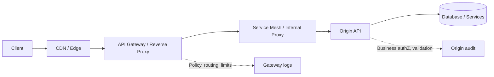

# Gateway và origin có policy không đồng nhất

Trong kiến trúc API, request thường đi qua nhiều lớp trước khi tới ứng dụng: CDN, load balancer, API gateway, reverse proxy, service mesh và origin service. Mỗi lớp có thể thực hiện một phần kiểm soát bảo mật như TLS, authentication, authorization, WAF, rate limit, giới hạn body hoặc kiểm tra đường dẫn.

Rủi ro xuất hiện khi các lớp này hiểu request khác nhau hoặc áp dụng policy khác nhau. Gateway có thể chặn `/admin`, nhưng origin vẫn cho phép truy cập trực tiếp. Gateway xác minh JWT, nhưng origin lại tin một header `X-User-Role` do client tự gửi. Gateway giới hạn `POST`, trong khi origin còn hỗ trợ `PUT` hoặc method override. Gateway và origin chuẩn hóa URL khác nhau, khiến một request bị gateway kiểm tra như route thông thường nhưng origin xử lý như endpoint quản trị.

**Gateway là một điểm thực thi policy quan trọng, nhưng origin vẫn phải bảo vệ tài nguyên và nghiệp vụ của chính nó.** Các lớp cần thống nhất cách diễn giải request, danh tính, quyền, giới hạn tài nguyên và hành vi lỗi. Nếu gateway là lớp duy nhất có kiểm soát, bất kỳ đường truy cập trực tiếp hoặc sai lệch cấu hình nào cũng có thể bỏ qua toàn bộ ranh giới bảo mật.

## 1. Gateway và origin nằm ở đâu trong luồng request?

Gateway thường là điểm vào tập trung để định tuyến request, xác thực token, áp dụng quota, WAF, logging và chuyển tiếp tới backend. Origin là dịch vụ hoặc máy chủ thực sự cung cấp API và xử lý dữ liệu/nghiệp vụ. Một hệ thống có thể có nhiều proxy trung gian, vì vậy cần xác định chính xác đâu là ranh giới tin cậy và nơi nào thực thi từng policy.



Ví dụ một request `GET /api/accounts/acc-17` có thể được xử lý qua các lớp:

1. CDN kết thúc TLS công khai và chuyển tiếp request.
2. Gateway xác minh access token, kiểm tra quota và định tuyến tới `account-api`.
3. Service mesh xác minh workload identity của gateway hoặc proxy gọi trực tiếp.
4. Origin kiểm tra token hoặc identity assertion đã được xác minh, xác định principal và quyền đọc account cụ thể.
5. Origin kiểm tra tenant, trạng thái nghiệp vụ, lọc field và truy vấn dữ liệu.

Không phải mọi hệ thống cần tất cả lớp. Điều quan trọng là có sơ đồ luồng thực tế, biết TLS kết thúc ở đâu, header nào được thêm/xóa, danh tính nào được chuyển tiếp và policy nào được thực thi tại từng hop.

### 1.1. Phân biệt gateway policy và origin policy

| Lớp | Trách nhiệm thường gặp | Ví dụ kiểm soát |
|---|---|---|
| CDN/edge | Lọc traffic biên, TLS, cache và chống DDoS | TLS policy, WAF rule, cache behavior |
| API gateway | Điểm vào API, định tuyến và policy dùng chung | Token validation, client quota, route/method allowlist |
| Service mesh/proxy | Bảo vệ giao tiếp service-to-service | mTLS, workload identity, network authorization |
| Origin service | Bảo vệ dữ liệu và nghiệp vụ cụ thể | Object/function authorization, validation, business limits |
| Data layer | Ràng buộc truy cập dữ liệu và tính toàn vẹn | Tenant scoping, transaction, row-level controls nếu có |

Gateway thường phù hợp để áp dụng policy tổng quát và giảm traffic xấu trước khi vào hệ thống. Origin hiểu dữ liệu, trạng thái và quan hệ nghiệp vụ nên cần tự kiểm tra những điều kiện chỉ nó mới biết. Một lớp không thể thay thế hoàn toàn lớp còn lại.

### 1.2. Policy phải được phân công rõ ràng

Không nhất thiết phải lặp lại mọi kiểm tra ở mọi tầng. Cần xác định kiểm soát nào là bắt buộc tại gateway, kiểm soát nào phải có ở origin và kiểm soát nào được chia sẻ qua một cơ chế tin cậy.

Ví dụ:

- Gateway xác minh chữ ký token, issuer, audience và thời hạn trước khi chuyển request.
- Origin vẫn kiểm tra principal có quyền `account:read` trên đúng account và tenant.
- Gateway áp quota theo client và route; origin giới hạn chi phí truy vấn, batch size và số object trả về.
- Gateway loại bỏ header identity do client gửi; origin chỉ tin assertion từ gateway qua kênh đã xác thực.
- Origin không phụ thuộc vào một route UI hoặc WAF rule để bảo vệ action nhạy cảm.

Policy cần có owner, source of truth, phiên bản và cách kiểm thử. Nếu gateway và origin mỗi nơi tự cấu hình bằng tay, sai lệch sẽ tích lũy theo thời gian.

## 2. Những dạng policy không đồng nhất thường gặp

Một số ví dụ điển hình:

| Gateway | Origin | Rủi ro |
|---|---|---|
| Chặn route `/admin/*` | Origin vẫn expose endpoint admin qua ingress khác | Bypass gateway hoặc dùng route alias |
| Chỉ cho `GET` | Origin chấp nhận `POST`, `PUT`, `PATCH`, `DELETE` | Gọi action ngoài dự kiến |
| Xác minh JWT | Origin tin `X-User-Id` hoặc `X-Role` không được xác thực | Giả mạo principal/role |
| Giới hạn body 1 MB | Origin nhận body lớn hơn qua đường nội bộ/direct | Resource exhaustion |
| Rate limit theo API key | Origin không có giới hạn chi phí hoặc concurrency | Abuse qua credential hợp lệ hoặc đường bypass |
| Chuẩn hóa path theo một quy tắc | Origin decode/normalize lần nữa theo quy tắc khác | Route confusion và authorization bypass |
| TLS bắt buộc ở edge | Origin HTTP port có thể truy cập từ mạng rộng | Traffic nội bộ bị nghe lén/giả mạo |
| Cache response theo URL | Origin tạo response riêng theo user/tenant | Dữ liệu của người này có thể được trả cho người khác |
| Gateway ẩn lỗi nội bộ | Origin trả stack trace qua ingress phụ | Rò rỉ thông tin triển khai |

Sai lệch có thể là lỗi cấu hình, khác biệt phiên bản phần mềm, route mới chưa được thêm policy, một ingress cũ còn tồn tại hoặc giả định sai về header do proxy chuyển tiếp.

## 3. Origin bị truy cập trực tiếp: gateway không còn là ranh giới

Một lỗi kiến trúc phổ biến là cho rằng mọi request tới origin đều đã đi qua gateway. Trên thực tế, origin có thể vẫn được truy cập từ Internet, mạng nội bộ rộng, VPN, một load balancer cũ hoặc một service khác.

Ví dụ:

```text
Internet --> api.example.com --> Gateway --> account-api

Nhưng origin còn có địa chỉ:
Internet / partner network --> account-origin.internal.example
```

Nếu `account-origin.internal.example` có thể được gọi trực tiếp, attacker có thể bỏ qua WAF, rate limit, authentication hoặc route policy của gateway.

### 3.1. Giới hạn network path tới origin

Các biện pháp thường dùng:

- Đặt origin trong private network hoặc subnet không có public ingress khi kiến trúc cho phép.
- Firewall/security group chỉ cho phép nguồn gateway, load balancer hoặc service mesh đã định danh kết nối tới origin port.
- Tắt public listener hoặc ingress cũ không còn cần thiết.
- Dùng mTLS giữa gateway/proxy và origin để xác thực workload gọi trực tiếp.
- Nếu dùng private link, tunnel hoặc overlay network, vẫn xác minh workload identity và policy ở tầng ứng dụng.
- Kiểm tra IPv4 và IPv6; không để chỉ IPv4 bị giới hạn trong khi origin vẫn public qua IPv6.

Network restriction giảm đường bypass, nhưng không đủ để cấp quyền nghiệp vụ. Một gateway bị xâm nhập hoặc một workload nội bộ bị chiếm quyền vẫn có thể gọi origin; origin cần kiểm tra action và resource theo principal đã xác minh.

### 3.2. Kiểm tra mọi ingress và listener

Origin có thể có nhiều listener hoặc đường vào:

- Public load balancer và internal load balancer.
- HTTP và HTTPS port cùng tồn tại.
- IPv4 và IPv6.
- Kubernetes Service, Ingress, NodePort hoặc port-forward.
- Debug/management port.
- Sidecar, service mesh gateway hoặc legacy reverse proxy.
- Endpoint dành cho health check hoặc batch worker.

Kiểm kê cả listener đang hoạt động và listener được tạo tự động bởi nền tảng. Đừng chỉ kiểm tra DNS public hoặc cấu hình gateway chính.

### 3.3. Default virtual host và route không xác định

Nếu origin dùng virtual host, request có Host không khớp có thể rơi vào default server block. Default route không nên trả nội dung ứng dụng, directory listing hoặc trang quản trị. Hãy cấu hình default host từ chối request hoặc trả response tối thiểu, đồng thời xác minh Host/SNI theo allowlist.

Không dựa vào Host header do client gửi để chọn tenant, callback URL hoặc base URL đáng tin cậy nếu header đó chưa được proxy xác minh và chuẩn hóa.

## 4. Authentication phải nhất quán qua các hop

Gateway có thể xác minh access token rồi chuyển thông tin principal cho origin. Rủi ro xuất hiện khi origin không biết thông tin đó đến từ đâu hoặc tin header do client tự tạo.

Ví dụ không an toàn:

```http
GET /api/admin/users HTTP/1.1
Host: origin.internal
X-User-Id: admin-1
X-User-Role: ADMIN
```

Nếu origin tin các header này mà không xác minh gateway hoặc token, caller có thể tự khai báo danh tính quyền cao.

### 4.1. Hai mô hình phổ biến

**Mô hình A: origin tự xác minh access token.** Gateway chuyển tiếp token gốc hoặc token được cấp cho đúng audience của origin. Origin tự kiểm tra chữ ký/issuer/audience/expiry/scope theo policy.

**Mô hình B: gateway xác minh và chuyển identity assertion.** Gateway xác thực token rồi tạo assertion có chữ ký hoặc truyền principal qua một kênh mTLS tin cậy. Origin chỉ chấp nhận assertion từ gateway được định danh, kiểm tra issuer/audience/time/signature và không cho client gửi assertion giả trực tiếp.

Không nên trộn hai mô hình một cách mơ hồ. Ví dụ, gateway xác minh token nhưng origin lại ưu tiên `X-Role` nếu có; một header không đáng tin có thể ghi đè identity đã xác minh.

### 4.2. Xóa header do client gửi trước khi thêm header tin cậy

Nếu gateway dùng header để chuyển principal, gateway cần xóa mọi header cùng tên đến từ client rồi tự tạo lại từ thông tin đã xác minh. Ví dụ các header nội bộ có thể gồm:

```text
X-Authenticated-Subject
X-Authenticated-Client
X-Authenticated-Tenant
X-Identity-Issuer
```

Tên header chỉ là ví dụ. Không nên dùng tên dễ bị nhầm với header public hoặc cho phép client override. Tốt hơn là dùng assertion có chữ ký hoặc một giao thức identity nội bộ đã được định nghĩa, kết hợp mTLS và network restriction.

Origin phải từ chối request có identity assertion thiếu, sai issuer/audience, hết hạn hoặc đến từ peer không được tin. Không được coi header identity là đáng tin chỉ vì request có vẻ đến từ mạng nội bộ.

### 4.3. Audience và delegation

Token dành cho gateway không nhất thiết dành cho origin. Nếu origin nhận access token, token cần có audience phù hợp với API đó. Không dùng ID token làm access token và không chuyển tiếp token tới service không nằm trong audience.

Nếu gateway gọi origin thay mặt user, origin cần biết caller trực tiếp là workload gateway và user context đã được ủy quyền. Có thể dùng token exchange hoặc assertion theo hợp đồng. Không truyền một `userId` tự khai báo rồi coi đó là delegation.

## 5. Authorization phải được thực thi ở origin

Gateway có thể kiểm tra scope chung như `accounts.read`, nhưng thường không biết quan hệ giữa principal và account cụ thể. Origin cần kiểm tra quyền trên object, function và field dựa trên dữ liệu nghiệp vụ.

Ví dụ:

```pseudo
principal = verifiedPrincipal(request)
account = accountRepository.findWithinTenant(accountId, principal.tenantId)

if account is missing:
    denyAccordingToDisclosurePolicy

if not authorization.can(principal, "account:read", account):
    deny

return accountResponseFor(principal, account)
```

Không được giả định request đã qua gateway nghĩa là user đã được phép đọc mọi object. Gateway xác minh danh tính hoặc scope ở mức tổng quát; origin quyết định quyền cụ thể và kiểm tra trạng thái nghiệp vụ.

### 5.1. Function-level authorization

Một route như `/api/admin/users/{id}/disable` cần permission cụ thể như `user:disable`. Không được dựa vào việc gateway chỉ công bố route cho một nhóm client hoặc ẩn menu admin ở UI. Origin cần kiểm tra permission trước side effect.

### 5.2. Object-level authorization

Origin phải ràng buộc ID với tenant/owner/relationship. Nếu gateway lọc query parameter `tenantId` nhưng origin tin body hoặc route param khác, request có thể vượt phạm vi. Principal và tenant phải đến từ context đã xác minh; object relationship phải được kiểm tra trong service/data layer.

### 5.3. Property-level authorization

Gateway thường không hiểu field-level permission của response. Origin cần dùng DTO/allowlist và lọc field nhạy cảm trước khi trả dữ liệu. Không serialize raw entity chỉ vì gateway đã xác thực user.

## 6. Chuẩn hóa URL, path và HTTP method nhất quán

Một request có thể được diễn giải khác nhau ở gateway và origin nếu hai bên decode hoặc normalize path khác nhau. Đây là nguồn của route bypass, access control mismatch và đôi khi là request smuggling ở tầng HTTP.

Các dạng cần kiểm tra:

- Dấu `/` kép: `/api//admin`.
- Dot segment: `/api/public/../admin`.
- Percent encoding: `%2f`, `%2e`, `%252f` hoặc ký tự encoded nhiều lần.
- Backslash `\` trong môi trường/framework có cách xử lý khác nhau.
- Chữ hoa/chữ thường và trailing slash.
- Semicolon/path parameter hoặc matrix parameter.
- Unicode normalization và IDN nếu route có thành phần Unicode.
- Duplicate slash, encoded null byte hoặc ký tự điều khiển bị proxy/framework từ chối khác nhau.

Ví dụ, gateway có thể kiểm tra raw path `/api/public/%2e%2e/admin` như một route public, nhưng origin decode rồi normalize thành `/api/admin`. Khi đó policy đã được áp dụng trên một route khác với route thực thi.

### 6.1. Một quy tắc canonicalization

Hệ thống nên thống nhất:

1. Lớp nào chịu trách nhiệm parse request target và decode path.
2. Những dạng encoding nào được chấp nhận hoặc từ chối.
3. Thứ tự decode, normalize dot segment và route matching.
4. Path được dùng cho authorization, logging, cache key và routing có giống nhau không.
5. Request mơ hồ hoặc không chuẩn có bị từ chối sớm không.

Không nên decode nhiều lần ở nhiều lớp. Một lựa chọn an toàn thường là từ chối path có encoding không hợp lệ hoặc mơ hồ, sau đó dùng một canonical path duy nhất cho routing và policy. Cần kiểm thử theo hành vi thực tế của proxy và framework đang dùng.

### 6.2. HTTP method và method override

Gateway và origin phải thống nhất method được hỗ trợ. Kiểm tra cả `GET`, `HEAD`, `POST`, `PUT`, `PATCH`, `DELETE`, `OPTIONS` và method tùy chỉnh nếu có. Không mặc định rằng chỉ `POST` gây side effect.

Một số framework hỗ trợ method override qua query parameter hoặc header như `X-HTTP-Method-Override`. Nếu gateway không xét override nhưng origin có, caller có thể biến request được gateway cho phép thành action khác. Hãy tắt method override nếu không cần; nếu cần, chuẩn hóa trước khi authorization và chỉ chấp nhận nguồn override đã định nghĩa.

### 6.3. Route rewrite và alias

Gateway có thể rewrite `/v1/users` thành `/internal/user-service/users`. Policy phải được gắn với route/action thực tế, không chỉ path public. Cần kiểm tra mọi alias, API version cũ và route nội bộ để tránh một endpoint được bảo vệ còn endpoint khác thực hiện cùng chức năng nhưng thiếu rule.

## 7. Request smuggling và khác biệt parser giữa các lớp

HTTP request smuggling có thể xảy ra khi proxy/gateway và origin không thống nhất cách xác định ranh giới request. Một lớp có thể dùng `Content-Length`, lớp khác xử lý `Transfer-Encoding` hoặc HTTP/2-to-HTTP/1 translation khác nhau. Kẻ tấn công có thể khiến một phần request bị hiểu là request tiếp theo hoặc được chuyển tới backend khác với policy ban đầu.

Các điểm cần quản lý:

- Từ chối request có framing mơ hồ hoặc header framing xung đột.
- Chuẩn hóa và kiểm tra `Content-Length`/`Transfer-Encoding` theo parser chuẩn.
- Cập nhật proxy, gateway và server để xử lý các biến thể request smuggling đã biết.
- Cẩn trọng khi chuyển HTTP/2 sang HTTP/1.1; kiểm tra cách gateway tạo request backend.
- Không cho phép duplicate header nhạy cảm được diễn giải khác nhau giữa các hop.
- Kiểm thử connection reuse, keep-alive, pipelining và backend pool theo cấu hình thực tế.

Không nên tự viết parser HTTP hoặc dùng regex để xác định request boundary. Hãy dùng implementation được cập nhật và cấu hình proxy/backend theo khuyến nghị của nhà cung cấp. Request không hợp lệ cần bị từ chối ở lớp đầu tiên trước khi được chuyển tiếp.

## 8. Header, Host, Forwarded và trust boundary

Proxy thường thêm các header như `Forwarded`, `X-Forwarded-For`, `X-Forwarded-Proto` hoặc `X-Forwarded-Host`. Origin có thể dùng chúng để tạo absolute URL, xác định IP client, redirect hoặc áp policy. Nếu origin tin header do client tự gửi, attacker có thể giả mạo nguồn hoặc scheme.

### 8.1. Forwarded headers

Gateway cần xóa hoặc ghi đè các forwarded header đến từ client theo một quy tắc rõ ràng. Origin chỉ nên tin header được thêm bởi proxy trong trust list đã cấu hình. Nếu có nhiều proxy, phải xác định chính xác số hop và cách parse chuỗi `X-Forwarded-For`/`Forwarded`.

Không lấy phần tử đầu hoặc cuối một cách tùy tiện. Khi request có thể đi qua CDN, load balancer và gateway, mỗi lớp có thể thêm địa chỉ khác nhau. Hãy dùng danh sách proxy tin cậy và thuật toán parse theo topology.

### 8.2. Host và scheme

Host header có thể ảnh hưởng absolute URL, password reset link, OAuth redirect hoặc tenant routing. Gateway và origin cần allowlist hostname hợp lệ, đồng thời xác minh TLS SNI/certificate theo cấu hình. Không dùng Host tùy ý để tạo URL gửi email hoặc redirect.

`X-Forwarded-Proto: https` chỉ đáng tin khi được proxy tin cậy ghi đè và origin chỉ nhận traffic từ proxy đó. Nếu client có thể tự gửi header này, origin có thể nghĩ request HTTP không an toàn là HTTPS và tạo cookie/redirect sai.

### 8.3. IP allowlist

IP allowlist ở gateway không đủ nếu origin public hoặc có ingress khác. Nếu origin dùng IP để nhận diện gateway, cần giới hạn network path và kết hợp mTLS/workload identity. IP có thể thay đổi khi autoscaling hoặc qua NAT; quản lý allowlist bằng cơ chế tự động, có owner và kiểm thử sau mỗi thay đổi hạ tầng.

## 9. TLS và mTLS giữa gateway với origin

Kết thúc TLS tại edge giúp quản lý certificate tập trung, nhưng đoạn từ gateway tới origin vẫn là một trust boundary. Nếu traffic đi qua mạng dùng chung hoặc có workload không tin cậy, HTTP nội bộ có thể bị nghe lén hoặc giả mạo.

Các lựa chọn:

- TLS từ gateway tới origin với certificate server được xác minh đúng hostname/SAN.
- mTLS để origin xác minh workload gateway và gateway xác minh origin.
- Service mesh tự động cấp/rotate workload certificate và áp policy kết nối.
- Network segmentation bổ sung để chỉ workload cần thiết có thể kết nối.

Nếu dùng mTLS, origin không nên cho phép mọi certificate nội bộ truy cập mọi route. Certificate xác thực workload; authorization policy vẫn phải giới hạn action/resource. Cần tách trust domain giữa dev/staging/production và xoay certificate an toàn.

Không tắt certificate verification để “sửa lỗi kết nối nội bộ”. Không dùng `verify=false`, trust-all manager hoặc bỏ qua hostname verification. Nếu certificate lỗi, sửa trust chain, SAN, SNI và rotation.

## 10. Rate limit, quota và giới hạn tài nguyên ở cả hai lớp

Gateway là nơi phù hợp để chặn burst sớm, áp quota theo API key/client/tenant và bảo vệ service khỏi traffic quá mức. Tuy nhiên, origin vẫn cần giới hạn chi phí thực thi vì:

- Có đường gọi nội bộ hoặc direct origin không qua gateway.
- Một request hợp lệ vẫn có thể gây query nặng, batch lớn hoặc response rất lớn.
- Gateway chỉ nhìn thấy request count, không nhất thiết biết chi phí database hoặc business action.
- Một client hợp lệ bị chiếm quyền có thể nằm trong quota chung.

### 10.1. Chia trách nhiệm

| Kiểm soát | Gateway | Origin |
|---|---|---|
| Rate limit theo IP/client/API key | Có thể áp dụng ở edge | Có thể bổ sung theo principal/tenant/action |
| Quota theo tenant/hợp đồng | Thích hợp cho quota tổng | Kiểm tra quota nghiệp vụ và usage thực tế |
| Body size | Giới hạn sớm | Kiểm tra lại giới hạn parser/domain cần thiết |
| Page size/batch size | Có thể áp dụng default | Bắt buộc validate theo nghiệp vụ và resource cost |
| Concurrency/queue | Giới hạn upstream/connection | Giới hạn worker, DB pool và operation |
| Timeout | Timeout kết nối/response giữa các hop | Deadline cho DB và downstream calls |

Không nên giả định giới hạn tại gateway tự động có hiệu lực trên origin. Hãy kiểm thử bằng cách gọi từng ingress và xác minh cùng một policy được áp dụng hoặc origin có lớp bảo vệ tương đương.

### 10.2. Retry và idempotency

Gateway hoặc client có thể retry request khi timeout. Nếu origin xử lý giao dịch không idempotent, retry có thể tạo thanh toán hoặc đơn hàng trùng. Cần xác định lớp nào retry, giới hạn số lần, dùng exponential backoff có jitter và yêu cầu idempotency key cho action phù hợp.

Gateway không nên retry mọi `POST` chỉ vì upstream timeout; origin có thể đã commit side effect nhưng response bị mất. Origin cần lưu trạng thái idempotency và trả lại kết quả nhất quán.

## 11. Body size, content type, timeout và decompression

Gateway và origin cần thống nhất giới hạn request body, header size, multipart upload, content type và timeout. Nếu gateway cho body 1 MB nhưng origin cho 100 MB, direct ingress có thể trở thành đường resource exhaustion. Nếu gateway giới hạn compressed size nhưng origin giải nén không giới hạn, một payload nhỏ có thể tạo ra dữ liệu rất lớn.

Các kiểm soát:

- Giới hạn cả compressed và decompressed body size.
- Giới hạn số lượng header, độ dài header và số phần multipart.
- Kiểm tra `Content-Type` và định dạng thực tế tại origin; không chỉ tin extension hoặc header.
- Đặt timeout đọc request, xử lý ứng dụng và downstream dependency.
- Có giới hạn cho upload, streaming và request chưa hoàn tất.
- Không để proxy và origin có timeout mâu thuẫn khiến request bị treo hoặc client retry lặp.

Gateway có thể từ chối sớm request vượt giới hạn; origin vẫn cần validate cấu trúc và domain input. Một request dưới giới hạn byte vẫn có thể chứa JSON lồng quá sâu, số phần tử quá lớn hoặc biểu thức truy vấn tốn tài nguyên.

## 12. WAF, CORS và security headers không thay thế origin authorization

WAF có thể phát hiện mẫu tấn công phổ biến như payload injection, scanner hoặc request bất thường. Nhưng WAF không hiểu đầy đủ quyền trên từng object và business flow. False positive có thể chặn request hợp lệ; false negative có thể bỏ lọt payload mới hoặc cách mã hóa khác.

CORS là cơ chế trình duyệt kiểm soát JavaScript từ origin nào được đọc response. Nó không ngăn `curl`, mobile app hoặc server-to-server client gọi API. Không dùng CORS allowlist làm authorization.

Security headers như HSTS, CSP, `X-Content-Type-Options` và `Referrer-Policy` có vai trò riêng trong browser security. Chúng không chứng minh user có quyền truy cập object hoặc action ở origin API.

Gateway có thể thêm security header, nhưng origin và các endpoint phục vụ qua ingress khác cũng cần cấu hình phù hợp. Tránh thêm header trùng hoặc giá trị mâu thuẫn ở nhiều lớp; xác định một nơi sở hữu header và kiểm tra response cuối cùng.

## 13. Cache policy phải phù hợp với danh tính và response

Gateway/CDN có thể cache response để giảm tải. Nếu response phụ thuộc principal, tenant, role hoặc object permission, cache key chỉ dựa trên URL có thể trả dữ liệu của user này cho user khác.

Ví dụ:

1. Alice gọi `GET /api/profile` và nhận dữ liệu cá nhân.
2. Gateway cache response theo URL.
3. Bob gọi cùng URL và nhận response của Alice mà không chạy origin authorization.

Với response riêng tư, dùng `Cache-Control: private` hoặc `no-store` tùy yêu cầu. Nếu cần cache tại gateway, key phải bao gồm mọi dimension ảnh hưởng representation và quyền; điều này cần được thiết kế cẩn thận vì token/role có thể thay đổi. Invalidate cache khi quyền hoặc dữ liệu thay đổi.

Không cache response lỗi xác thực/authorization hoặc response chứa `Set-Cookie` theo cách có thể chia sẻ giữa người dùng. Kiểm thử cả `GET`, `HEAD`, `304 Not Modified`, ETag, `Vary`, CDN và cache của origin. `Vary: Authorization` không thay thế việc xác minh cấu hình cache thực tế.

## 14. Error handling và thông tin lộ ra ở từng lớp

Gateway có thể trả lỗi JSON chuẩn, trong khi origin trả stack trace hoặc trang debug khi bị gọi trực tiếp. Điều này tạo ra khác biệt vừa gây khó hiểu cho client vừa có thể lộ framework, đường dẫn file, SQL hoặc internal hostname.

Hãy thống nhất:

- Status code và error schema công khai.
- Request ID/correlation ID để hỗ trợ điều tra.
- Thông báo lỗi không chứa stack trace, token, secret hoặc dữ liệu nội bộ.
- Chi tiết kỹ thuật được giữ trong log nội bộ có kiểm soát.
- Cách xử lý lỗi khi gateway không kết nối được origin.
- Không để default error page hoặc debug endpoint public.

Không nên biến mọi lỗi thành `200 OK` hoặc trả response giả thành công. Client cần phân biệt lỗi authentication, authorization, validation, rate limit và dependency failure để xử lý đúng.

## 15. Ví dụ policy phân chia giữa gateway và origin

Một policy minh họa cho API quản lý account:

```yaml
gateway:
  upstream: account-api
  publicRoute: /api/accounts/*
  methods: [GET, POST, PATCH]
  authentication:
    type: bearer-jwt
    issuer: https://identity.example.com
    audience: account-api
  rateLimit:
    key: client-and-route
    limit: 120
    window: 1m
  requestLimits:
    bodyBytes: 1048576
  originTransport:
    tls: required
    clientIdentity: gateway-workload

origin:
  requireTrustedIngress: true
  requireVerifiedPrincipal: true
  authorization:
    objectPolicy: account-owner-or-delegated-access
    fieldPolicy: account-response-allowlist
    functionPermissions:
      - account:read
      - account:update
  validation:
    maxPageSize: 100
    maxBatchSize: 20
  resourceLimits:
    queryTimeoutMs: 2000
    concurrentExportsPerTenant: 2
```

Đây là ví dụ mô tả, không phải schema chuẩn của gateway hoặc framework. Các giá trị cần được hiệu chỉnh theo SLO, năng lực hệ thống và hợp đồng client. Điểm quan trọng là gateway và origin có trách nhiệm bổ sung cho nhau, cùng xác định identity và route/action.

### 15.1. Không chỉ tin vào cấu hình gateway

Origin có thể kiểm tra:

```pseudo
if request.peer is not trustedGatewayWorkload:
    rejectConnection

principal = verifyTrustedIdentityAssertion(request)
if principal is invalid:
    rejectAuthentication

route = canonicalRoute(request)
action = mapRouteAndMethodToBusinessAction(route, request.method)

if not authorization.can(principal, action, resource, context):
    rejectAuthorization

validateRequestAndBusinessLimits(request)
executeBusinessOperation()
```

Origin không nên tự tin vào một `X-Authenticated-Role` hoặc `X-Forwarded-User` chỉ vì header xuất hiện. `verifyTrustedIdentityAssertion` cần kiểm tra nguồn gửi, chữ ký/issuer/audience/time hoặc token theo kiến trúc.

## 16. Quản lý cấu hình và ngăn policy drift

Policy không đồng nhất thường phát sinh khi gateway và origin được triển khai bởi nhóm khác nhau, cấu hình lưu ở nhiều nơi hoặc route mới không được cập nhật vào mọi lớp.

Các thực hành hữu ích:

- Quản lý route, method, auth policy, quota và body limit bằng configuration as code.
- Định nghĩa owner cho từng API/route và nơi lưu source of truth.
- Dùng template/module dùng chung cho gateway và service bootstrap, nhưng cho phép policy nghiệp vụ riêng ở origin.
- Review thay đổi route, method, audience, header trust và ingress như thay đổi bảo mật.
- Version hóa policy và ghi lại ai thay đổi, lý do, thời điểm.
- Dùng canary hoặc staged rollout khi thay đổi gateway/mesh policy.
- Phát hiện drift giữa cấu hình mong muốn và cấu hình đang chạy.
- Xóa endpoint, listener, DNS và ingress cũ khi migration hoàn tất.

Không nên sao chép một file policy chung sang nhiều service rồi để mỗi nơi tự sửa không kiểm soát. Có thể dùng policy bundle hoặc generated config, nhưng phải có test xác minh output của từng gateway/origin.

### 16.1. Kiểm tra policy khi build và deploy

CI/CD có thể kiểm tra:

- Mọi route public có authentication requirement rõ ràng, trừ endpoint public đã được phê duyệt.
- Mọi action nhạy cảm có authorization rule ở origin.
- Không có ingress public ngoài gateway dự kiến.
- Không có default allow hoặc wildcard route quá rộng.
- Body, header, timeout, retry và cache policy nằm trong giới hạn được phê duyệt.
- Hostname, issuer, audience, trust bundle và mTLS profile khớp môi trường.
- Cấu hình production không bật debug hoặc trust-all certificate.

Static check không thay thế integration test. Cần kiểm thử traffic thật qua các hop để xác minh proxy rewrite, header stripping và route matching.

## 17. Kiểm thử tính nhất quán gateway-origin

Kiểm thử cần so sánh cùng request qua public gateway và đường gọi origin được kiểm soát trong môi trường test. Không mở origin public chỉ để thử; có thể dùng network test runner trong private environment.

### 17.1. Ma trận test cơ bản

| Tình huống | Qua gateway | Gọi origin trực tiếp trong test | Kết quả mong đợi |
|---|---|---|---|
| Không có credential | Bị từ chối theo policy | Không thể kết nối hoặc bị từ chối | Không có đường bypass |
| Token sai issuer/audience/expired | Bị từ chối | Origin cũng không tin assertion/token sai | Không thực thi action |
| Header `X-Role: ADMIN` giả | Bị bỏ qua | Origin từ chối assertion không tin cậy | Không nâng quyền |
| User hợp lệ nhưng sai tenant/object | Origin từ chối object | Origin vẫn từ chối | Không có BOLA |
| Method không được hỗ trợ | Gateway từ chối | Origin từ chối | Không có method bypass |
| Encoded path/dot segment/duplicate slash | Cùng canonicalization hoặc từ chối | Origin không route sang endpoint nhạy cảm | Không có path confusion |
| Body vượt giới hạn | Bị giới hạn ở edge | Origin cũng giới hạn | Không có resource bypass |
| Request smuggling/framing mơ hồ | Bị từ chối ở proxy | Không có parser disagreement | Không tạo request backend ngoài ý muốn |
| Response riêng tư được cache | Cache không chia sẻ sai | Origin trả theo principal | Không rò rỉ cross-user |
| Origin ingress không qua gateway | Không áp dụng | Network/mTLS policy chặn | Không thể bypass edge |

### 17.2. Kiểm thử route normalization

Tạo test cho path gốc và các biến thể encoding, ví dụ:

```text
/api/accounts/acc-17
/api//accounts/acc-17
/api/public/../admin/users
/api/%2e%2e/admin/users
/api%2fadmin/users
/api/accounts%252fadmin
```

Kết quả cần được định nghĩa theo framework/proxy thực tế. Có thể từ chối các dạng không chuẩn thay vì cố gắng hỗ trợ. Điều quan trọng là gateway không được kiểm tra một route trong khi origin thực thi route khác.

### 17.3. Kiểm thử header spoofing và TLS

- Gửi `X-Forwarded-For`, `X-Forwarded-Host`, `X-Forwarded-Proto` giả từ client.
- Gửi identity header như `X-User-Id`, `X-Role` hoặc `X-Authenticated-Subject` giả.
- Kết nối tới origin bằng certificate không được tin, certificate sai SAN hoặc không có client certificate khi mTLS bắt buộc.
- Thử gọi origin qua IPv4, IPv6, hostname cũ và ingress nội bộ.
- Xác minh origin chỉ tin proxy/workload đúng và không chấp nhận request trực tiếp ngoài policy.

### 17.4. Kiểm thử cache và retry

- Làm nóng cache bằng user có quyền cao rồi gọi bằng user quyền thấp.
- Thử `GET`/`HEAD`, ETag và `304` để kiểm tra cache representation.
- Làm timeout sau khi origin commit để kiểm tra gateway retry không tạo giao dịch trùng.
- Kiểm tra `Retry-After`, rate limit và quota có nhất quán giữa gateway và origin.

## 18. Logging, monitoring và phát hiện sai lệch

Để điều tra policy mismatch, cần correlation ID xuyên suốt các hop. Log gateway và origin nên có cùng request ID hoặc trace ID để xác định request được nhận diện và xử lý khác nhau ở đâu.

Thông tin có thể ghi:

- Route template, method và API version sau khi chuẩn hóa.
- Gateway route/policy ID và origin service/version.
- Principal/client/tenant đã xác minh ở mức identifier cần thiết.
- Kết quả authentication, authorization, rate limit và validation.
- Peer workload identity hoặc ingress path.
- Request ID/trace ID, status, latency và reason code.
- Policy version/config revision được áp dụng.

Không ghi access token, API key, session cookie, private key hoặc body nhạy cảm. Forwarded headers có thể chứa IP cá nhân; chỉ lưu theo chính sách dữ liệu và retention phù hợp.

Các tín hiệu cần theo dõi:

- Request tới origin không có gateway identity hoặc đến từ network path không mong đợi.
- Tỷ lệ request bị gateway từ chối nhưng origin lại ghi nhận request tương tự thành công.
- Route/method không có trong inventory hoặc API version cũ vẫn được gọi.
- Authentication/authorization decision khác nhau giữa gateway và origin.
- Tăng 401/403/404, request có path encoding bất thường hoặc duplicate header.
- Origin traffic không khớp gateway forwarded traffic volume.
- Policy revision giữa gateway và origin lệch phiên bản ngoài kế hoạch.
- Certificate sắp hết hạn, mTLS handshake failure hoặc direct ingress mới xuất hiện.

Không chỉ so sánh tổng request count; retry, health check, internal call và cache hit có thể làm số liệu khác nhau. Dùng request ID/trace ID và phân loại traffic để tìm chênh lệch có ý nghĩa.

## 19. Checklist trước khi phát hành thay đổi gateway hoặc origin

- [ ] Có sơ đồ đầy đủ các hop từ client tới origin và các ingress khác.
- [ ] Origin không public hoặc chỉ nhận traffic từ nguồn/proxy/workload được tin cậy.
- [ ] IPv4, IPv6, listener, port, load balancer và ingress cũ đã được kiểm tra.
- [ ] Default virtual host từ chối host không hợp lệ; Host/SNI được allowlist.
- [ ] TLS/mTLS giữa gateway và origin được xác minh đúng certificate/SAN; không tắt verification.
- [ ] Header identity/forwarded do client gửi được xóa hoặc ghi đè tại proxy tin cậy.
- [ ] Origin chỉ tin identity assertion từ nguồn đã xác thực và kiểm tra issuer/audience/time/signature.
- [ ] Authentication và audience phù hợp với từng origin API.
- [ ] Origin thực thi function, object, tenant và field authorization trước side effect/response.
- [ ] Gateway và origin thống nhất path normalization, method, method override và route rewrite.
- [ ] Request framing/duplicate header được parser xử lý nhất quán; proxy/backend đã cập nhật.
- [ ] Body, header, upload, decompression, timeout, concurrency và retry có giới hạn ở cả hai lớp.
- [ ] Rate limit/quota có nhiều dimension; origin bảo vệ chi phí nghiệp vụ và dependency.
- [ ] WAF/CORS/security headers không bị xem là thay thế authorization.
- [ ] Cache policy không chia sẻ response theo URL khi dữ liệu phụ thuộc principal/tenant.
- [ ] Error response không lộ stack trace hoặc thông tin nội bộ qua ingress phụ.
- [ ] Cấu hình được quản lý/version hóa, có owner, review và drift detection.
- [ ] Có integration tests qua gateway và đường origin được kiểm soát cho các trường hợp bypass.
- [ ] Log/trace có correlation ID xuyên suốt nhưng không chứa credential hoặc payload nhạy cảm.

## 20. Nguyên tắc cần ghi nhớ

Gateway và origin là hai lớp có trách nhiệm khác nhau nhưng phải nhất quán. Gateway giúp kiểm soát điểm vào, định tuyến, authentication tổng quát, WAF và giới hạn traffic. Origin hiểu dữ liệu và nghiệp vụ nên phải kiểm tra quyền trên function, object, tenant và field, đồng thời validate input và giới hạn chi phí thực thi.

Đừng giả định mọi request đều đi qua gateway. Hãy đóng hoặc giới hạn direct ingress, kiểm tra cả IPv4/IPv6, port quản trị và listener cũ. Nếu gateway chuyển identity qua header, phải xóa header do client gửi và bảo vệ assertion bằng mTLS/chữ ký hoặc cơ chế tin cậy tương đương. Không tin `X-Role`, `X-Forwarded-For` hoặc `X-Forwarded-Proto` nếu chưa xác minh nguồn.

Gateway và origin cần thống nhất cách parse path, method, header, request framing, body limit, timeout, cache và retry. Một route được bảo vệ ở gateway nhưng có alias hoặc cách normalize khác ở origin vẫn có thể bị bypass. Quản lý policy as code, kiểm thử integration qua các hop và theo dõi drift để phát hiện sai lệch sau deploy.

Một phép kiểm tra thực tế là gửi cùng một bộ request hợp lệ, thiếu credential, sai role, sai tenant và path encoding bất thường qua gateway và origin test ingress. Kết quả phải phù hợp với policy đã định nghĩa; origin không được cho phép request mà chỉ bị chặn nhờ một rule gateway có thể bị bỏ qua.

## Tài liệu tham khảo

- OWASP API Security Top 10 (2023) — API8:2023 Security Misconfiguration.
- OWASP REST Security Cheat Sheet — TLS, access control, HTTP methods và error handling.
- OWASP HTTP Headers Cheat Sheet — forwarded headers và security headers.
- RFC 9110 — HTTP Semantics: request target, method, fields và representation.
- RFC 9112 — HTTP/1.1: message syntax and routing.
- RFC 9113 — HTTP/2: framing và protocol behavior.
- RFC 8446 — TLS 1.3.
- OWASP Web Security Testing Guide — kiểm thử cấu hình, access control và request smuggling.
