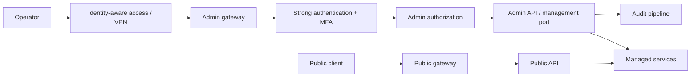

# Admin endpoint bị public ngoài ý muốn

Trong chương **Security misconfiguration** của module `SECURITY_API_SECURITY`, admin endpoint là bất kỳ API hoặc giao diện nào có thể thay đổi cấu hình, quản lý tài khoản, xem dữ liệu vận hành nhạy cảm, chạy tác vụ quản trị hoặc điều khiển trạng thái hệ thống. Endpoint quản trị bị public ngoài ý muốn khi nó có thể được truy cập từ mạng hoặc danh tính không nằm trong phạm vi dự kiến. Nguyên nhân thường không nằm ở một dòng code duy nhất mà xuất phát từ cấu hình gateway, reverse proxy, port management, route mapping, security filter chain, môi trường triển khai hoặc thay đổi hạ tầng.

Một endpoint có tên `/admin` không tự nhiên an toàn vì khó đoán; một endpoint không có chữ `admin` vẫn có thể thực hiện hành động quản trị. Cần xác định toàn bộ bề mặt quản trị, quyết định rõ ai được truy cập từ đâu, áp dụng xác thực và phân quyền ở server, rồi kiểm tra từ góc nhìn mạng thực tế. Không coi việc ẩn link trên giao diện, đổi URL hoặc chỉ chặn ở frontend là biện pháp bảo vệ.

## 1. Vì sao admin endpoint bị public là rủi ro cao?

Endpoint quản trị thường có quyền rộng hơn API nghiệp vụ thông thường. Nếu bị lộ, attacker có thể thay đổi cấu hình, tạo hoặc nâng quyền tài khoản, xem secret, đọc log chứa dữ liệu nhạy cảm, chạy lệnh vận hành, trigger export, dừng dịch vụ hoặc thay đổi trạng thái hệ thống.

Ví dụ các chức năng thường cần bảo vệ chặt:

| Nhóm chức năng | Ví dụ endpoint | Tác động nếu truy cập trái phép |
|---|---|---|
| Quản lý danh tính | `POST /internal/users/{id}/roles` | Nâng quyền, tạo tài khoản quản trị |
| Cấu hình hệ thống | `PATCH /ops/configuration` | Thay đổi behavior hoặc vô hiệu hóa kiểm soát |
| Quản lý secret | `GET /ops/secrets` | Lộ credential và token dịch vụ |
| Vận hành | `POST /ops/jobs/{id}/retry` | Trigger tác vụ tốn tài nguyên hoặc side effect |
| Dữ liệu | `POST /ops/exports` | Trích xuất dữ liệu lớn hoặc dữ liệu nhiều tenant |
| Hệ thống | `POST /ops/cache/flush` | Gây gián đoạn, tăng tải đột biến |
| Chẩn đoán | `GET /actuator/env`, `GET /debug/heapdump` | Lộ biến môi trường, cấu hình, dữ liệu trong memory |
| Feature control | `PATCH /admin/features/{name}` | Bật chức năng chưa sẵn sàng hoặc bypass quy trình |

Tên và path trong bảng là ví dụ. Một endpoint chỉ đọc cũng có thể có tác động lớn nếu trả credential, topology, thông tin khách hàng hoặc dữ liệu phục vụ khai thác bước tiếp theo.

### 1.1. Phân biệt public API và admin API

Public API là API được thiết kế để phục vụ người dùng hoặc đối tác theo contract công khai. “Public” ở đây nói về khả năng tiếp cận theo thiết kế, không có nghĩa mọi request đều được phép. Admin API là bề mặt điều khiển dành cho operator hoặc service có quyền cụ thể.

Một API nội bộ không tự động an toàn chỉ vì nó không được tài liệu hóa công khai. Nó vẫn có thể bị truy cập qua route gateway cấu hình nhầm, ingress, service mesh, SSRF, compromised workload hoặc credential bị lộ. Mạng nội bộ là một lớp giới hạn đường đi, không thay thế xác thực và authorization.

### 1.2. Tách bốn câu hỏi bảo mật

Với từng admin operation, cần trả lời riêng:

1. **Exposure:** request có thể đi tới endpoint từ những mạng hoặc entry point nào?
2. **Authentication:** server xác minh danh tính operator/service bằng cách nào?
3. **Authorization:** danh tính đó có quyền thực hiện đúng action trên đúng resource hay không?
4. **Audit:** hệ thống ghi nhận ai đã làm gì, ở đâu, vào thời điểm nào và kết quả ra sao?

Chỉ kiểm soát một câu hỏi không giải quyết được ba câu còn lại. Ví dụ, chỉ bind endpoint vào private interface giảm khả năng tiếp cận từ Internet nhưng không ngăn một workload nội bộ bị xâm nhập gọi endpoint quản trị.

## 2. Lập inventory toàn bộ bề mặt quản trị

Trước khi thay đổi cấu hình, hãy lập danh sách endpoint và giao diện quản trị từ nhiều nguồn. Tìm theo annotation hoặc path `/admin` là chưa đủ vì các endpoint như actuator, debug, metrics, GraphQL mutation, job controller hoặc API nội bộ có thể không mang tên quản trị.

Inventory nên bao gồm:

- REST controller và route quản trị.
- Spring Boot Actuator hoặc endpoint health/metrics/diagnostic tùy chỉnh.
- Swagger/OpenAPI UI, GraphiQL, GraphQL introspection và mutation quản trị.
- Debug, profiling, heap dump, thread dump, config và environment endpoint.
- Job scheduler, retry queue, replay event và data export/import.
- Admin UI, support console và endpoint backend của giao diện đó.
- Internal service API, service mesh admin port và management port.
- Kubernetes dashboard, internal control API và endpoint của operator/agent.
- Webhook, callback hoặc endpoint nhận lệnh vận hành.

Với mỗi operation, ghi lại:

| Thuộc tính | Câu hỏi cần trả lời |
|---|---|
| Operation ID | Tên ổn định trong API contract là gì? |
| Method/path | Method và route thực tế sau rewrite là gì? |
| Owner | Team hoặc service nào chịu trách nhiệm? |
| Mục đích | Chức năng quản trị cụ thể là gì? |
| Data/action | Đọc dữ liệu nào, thay đổi trạng thái nào, gọi downstream nào? |
| Principal | Operator, support agent hay workload identity nào được dùng? |
| Permission | Scope/role/action cụ thể nào cần thiết? |
| Network exposure | Gateway, ingress, VPN, private network hay localhost? |
| Environment | Production, staging, test hay local? |
| Audit | Sự kiện nào được ghi và lưu ở đâu? |
| Test | Bài test nào chứng minh endpoint không public ngoài ý muốn? |

Đánh dấu rõ endpoint `public-by-design`, `admin-private`, `service-only` hoặc `disabled`. Mỗi ngoại lệ cần có owner và lý do. Endpoint chưa được phân loại không nên mặc định được public.

## 3. Những con đường khiến admin endpoint bị lộ

### 3.1. Gateway hoặc reverse proxy route nhầm

Một route quản trị có thể bị đưa vào public listener khi cấu hình gateway dùng wildcard như `/api/*`, `/**` hoặc forward toàn bộ traffic tới service. Một route mới được thêm vào service cũng có thể tự động được public do rule tổng quát đã tồn tại.

Ví dụ cấu hình nguy hiểm về mặt ý tưởng:

```text
Public listener :443
  /api/**  -> application-service:8080
  /**      -> application-service:8080

Application routes
  /api/orders/**
  /admin/**
  /actuator/**
```

Nếu service không có security rule riêng, route `/admin/**` hoặc `/actuator/**` có thể tiếp cận từ Internet dù team nghĩ chúng chỉ dùng nội bộ.

Kiểm tra cả route match order, path rewrite, trailing slash, URL encoding, duplicate slash và method. Gateway có thể chuẩn hóa path khác với application; một rule chặn `/admin` nhưng cho phép `/admin/`, `%61dmin` hoặc route sau rewrite có thể tạo lỗ hổng nếu hai lớp diễn giải khác nhau.

### 3.2. Management port được mở ra interface ngoài dự kiến

Nhiều framework cho phép chạy management endpoint trên port riêng. Port riêng không đồng nghĩa private. Nếu process bind vào mọi interface (`0.0.0.0` hoặc `::`) và firewall/security group mở port, endpoint có thể được truy cập từ mạng ngoài.

Kiểm tra cả IPv4 và IPv6 binding, container port mapping, Kubernetes Service, LoadBalancer, NodePort, host networking và firewall rule. Đừng chỉ kiểm tra port chính của ứng dụng.

### 3.3. Cấu hình staging/debug bị đưa lên production

Profile `dev`, `test` hoặc `debug` có thể bật endpoint, verbose error, mock authentication hoặc expose toàn bộ actuator. Nếu biến môi trường, profile activation hoặc Helm values sai, cấu hình này có thể chạy trong production.

Không dựa vào tên profile để khẳng định trạng thái an toàn. Kiểm tra effective configuration tại runtime và đảm bảo production policy được áp dụng ngay cả khi profile bị chọn sai.

### 3.4. Security filter chain không match endpoint quản trị

Trong ứng dụng có nhiều security filter chain, thứ tự và matcher quyết định chain nào xử lý request. Một chain chuyên cho API có thể không match `/actuator/**`, hoặc chain mặc định có thể vô tình cho phép request chưa xác thực. Khi thêm endpoint mới, matcher cũ có thể không bao phủ nó.

Với Spring Security, cần kiểm tra `securityMatcher`, `requestMatchers`, thứ tự `@Order` và chain fallback. Đảm bảo mọi request đều đi qua một chain có quy tắc xác thực rõ ràng; không để endpoint rơi vào vùng không có policy.

### 3.5. CORS hoặc ẩn UI bị hiểu nhầm là authorization

CORS là chính sách trình duyệt về việc JavaScript từ origin nào được đọc response. CORS không ngăn `curl`, script server-side hoặc client không phải browser gọi endpoint. Ẩn nút admin, không render menu hoặc không công bố route trong OpenAPI cũng không chặn request trực tiếp.

Admin endpoint vẫn phải xác thực và phân quyền ở server. Nếu dùng cookie/session cho admin UI, cần xem xét CSRF; nếu dùng bearer token, cần bảo vệ token và kiểm tra authorization như mọi API khác.

### 3.6. IP allowlist bị bypass hoặc cấu hình sai

IP allowlist có thể là lớp bảo vệ bổ sung, nhưng cần biết IP nào đang được tin cậy. Khi ứng dụng đứng sau proxy, không đọc `X-Forwarded-For` hoặc `X-Real-IP` từ request bất kỳ để quyết định quyền; chỉ tin header được ghi đè bởi proxy đã xác minh. Nếu client có thể tự gửi header đó, attacker có thể giả địa chỉ được allowlist.

IP allowlist cũng không xác minh danh tính operator và có thể bị chia sẻ bởi NAT/VPN hoặc thay đổi theo hạ tầng. Kết hợp network segmentation với authentication mạnh và permission cụ thể.

### 3.7. Internal endpoint bị truy cập qua đường gián tiếp

Endpoint không public trực tiếp vẫn có thể bị gọi thông qua SSRF, compromised service, open proxy, webhook hoặc chức năng URL fetch. Nếu admin service tin mọi request đến từ subnet nội bộ, một SSRF trong service khác có thể trở thành đường truy cập quản trị.

Không chỉ kiểm tra public ingress. Xác định service nào có thể kết nối tới admin port và giới hạn egress/ingress theo workload identity hoặc network policy.

## 4. Thiết kế admin plane riêng

Với hệ thống có nhiều chức năng quản trị, nên tách admin plane khỏi public application plane ở mức kiến trúc và vận hành. Tách riêng giúp giảm khả năng một thay đổi route public vô tình mở endpoint quản trị.

Một mô hình tham khảo:



Các lớp có thể gồm:

- DNS/hostname riêng cho admin console.
- Listener hoặc gateway riêng với route allowlist.
- Private network, VPN hoặc identity-aware proxy để giới hạn entry point.
- Workload/service identity cho lời gọi nội bộ.
- Security policy riêng cho admin API.
- Audit pipeline độc lập và cảnh báo thao tác nhạy cảm.

Không nhất thiết phải triển khai một cluster riêng cho mọi hệ thống. Điều quan trọng là admin endpoint có ranh giới exposure, identity và authorization rõ ràng, không phụ thuộc vào route wildcard của public API.

### 4.1. Network restriction là defense in depth

Chỉ mở admin API qua VPN/private gateway có thể giảm đáng kể bề mặt tấn công. Tuy nhiên, VPN account bị chiếm hoặc workload trong private network bị xâm nhập vẫn có thể gọi endpoint. Do đó, mỗi request cần xác minh principal và permission.

Network policy nên giới hạn source workload/namespace/security group cụ thể thay vì cho phép toàn bộ private CIDR nếu có thể. Đối với service-to-service, dùng workload identity hoặc mTLS kết hợp authorization theo action và resource.

### 4.2. Không để public và admin listener dùng chung policy mơ hồ

Nếu phải dùng chung application process, tách rõ route matcher, authentication mechanism và authorization rule. Nếu dùng port riêng, kiểm soát bind address, service exposure và firewall riêng. Tách port không tự tạo security boundary nếu cả hai port vẫn đi qua cùng ingress hoặc cùng security chain permissive.

## 5. Authentication cho admin endpoint

Admin endpoint cần xác minh danh tính rõ ràng. Tùy kiến trúc, có thể dùng OIDC/OAuth 2.0 cho operator, mTLS hoặc workload identity cho service, và cơ chế step-up cho hành động nhạy cảm.

### 5.1. Không dùng shared secret chung cho mọi operator

Tài khoản cá nhân giúp truy vết và thu hồi quyền theo người. Tránh một tài khoản `admin/admin`, API key dùng chung trong wiki hoặc token không có owner. Credential cần được quản lý trong secret manager, có rotation và quy trình thu hồi.

Với con người, dùng identity provider tập trung, MFA và chính sách session phù hợp. Với workload, dùng danh tính máy có audience, issuer, expiry và scope rõ; tránh nhúng credential dài hạn vào image hoặc source code.

### 5.2. MFA và step-up authentication

MFA nên được yêu cầu cho admin console và các thao tác có tác động lớn. Với thao tác như thay đổi quyền, đọc secret, export dữ liệu nhạy cảm hoặc xoay vòng credential, có thể yêu cầu step-up authentication gần thời điểm hành động.

Không chỉ kiểm tra một claim `amr` hoặc `mfa=true` nếu issuer không đáng tin hoặc token quá cũ. Xác minh issuer/audience/signature/expiry và semantics của authentication context theo identity provider. Step-up phải gắn với phiên hoặc giao dịch cụ thể.

### 5.3. Token có audience và scope phù hợp

Token dành cho public API không nên tự động có quyền gọi admin API. Admin API nên yêu cầu audience/resource server riêng hoặc scope quản trị cụ thể. Service token chỉ có quyền đúng operation cần thiết, không dùng scope tổng quát như `admin:*` nếu không có lý do.

Kiểm tra issuer, audience, thời hạn, chữ ký, algorithm allowlist và claim cần thiết. Không chấp nhận token chỉ vì nó được ký bởi cùng một issuer nếu audience không dành cho admin service.

### 5.4. Service-to-service authentication

Lời gọi giữa service cần có danh tính workload đáng tin, ví dụ mTLS hoặc token workload được cấp ngắn hạn. Admin API phải phân biệt service nào được gọi operation nào. “Request đến từ cluster” không phải một principal.

Nếu dùng mTLS, xác minh certificate chain, SAN/identity và trust domain. Không chỉ kiểm tra có certificate bất kỳ. Authorization vẫn cần ánh xạ service identity tới permission cụ thể.

## 6. Authorization theo chức năng và tài nguyên

Authentication trả lời ai đang gọi; authorization quyết định người đó có được thực hiện hành động này hay không. Admin API không nên có một quyền `isAdmin` duy nhất cho mọi operation nếu các chức năng có mức nhạy cảm khác nhau.

### 6.1. Least privilege theo action

Tách quyền theo chức năng, ví dụ:

| Permission | Phạm vi |
|---|---|
| `ops:health:read` | Xem trạng thái health tổng quát |
| `ops:metrics:read` | Xem metric được phép công bố |
| `ops:jobs:retry` | Retry job thuộc phạm vi được giao |
| `ops:users:manage` | Quản lý user trong phạm vi tổ chức |
| `ops:roles:grant` | Cấp/thu hồi role; có thể cần phê duyệt bổ sung |
| `ops:secrets:rotate` | Xoay vòng secret được chỉ định |
| `ops:config:write` | Thay đổi nhóm cấu hình cụ thể |
| `ops:data:export` | Tạo export trong phạm vi được cấp |

Tên scope chỉ là ví dụ. Mỗi permission cần có owner, resource scope và quy tắc cấp quyền. Không suy ra quyền quản trị từ email domain, tên nhóm hoặc một header do client gửi.

### 6.2. Object-level authorization vẫn áp dụng cho admin

Operator có thể chỉ được quản lý một tenant, một region, một nhóm dịch vụ hoặc một tập project. Không để role `support` hoặc `ops` tự động truy cập mọi tenant. Kiểm tra resource scope và relationship trên từng object.

Ví dụ một support agent được phép xem trạng thái đơn hàng của tenant A nhưng không được đọc nội dung payment hoặc secret của tenant B. Admin API vẫn phải áp dụng tenant boundary và property-level authorization.

### 6.3. Tách read và write

Quyền xem metrics không đồng nghĩa quyền thay đổi config. Quyền xem user không đồng nghĩa quyền reset MFA hoặc grant role. Tách permission read/write và tách các hành động có tác động cao thành operation riêng để giảm quyền mặc định.

### 6.4. Break-glass access

Trường hợp khẩn cấp có thể cần quyền tạm thời vượt quyền thường ngày. Break-glass cần:

- Điều kiện kích hoạt rõ và lý do/ticket bắt buộc.
- Xác thực mạnh và step-up.
- Phạm vi quyền tối thiểu và thời hạn ngắn.
- Audit bất biến, cảnh báo tức thời và review sau sự kiện.
- Thu hồi tự động khi hết hạn.

Không dùng break-glass làm tài khoản admin dùng chung hoặc cách bỏ qua quy trình cấp quyền thông thường.

## 7. Cấu hình Spring Boot Actuator an toàn

Spring Boot Actuator cung cấp endpoint vận hành như health, info, metrics, env, configprops, beans, mappings, heapdump và loggers tùy phiên bản/cấu hình. Một số endpoint có thể tiết lộ thông tin nhạy cảm hoặc cho phép thay đổi trạng thái. Chỉ expose endpoint thực sự cần thiết.

### 7.1. Chỉ expose endpoint cần dùng

Ví dụ cấu hình cơ bản:

```yaml
management:
  endpoints:
    web:
      exposure:
        include: "health,info"
  endpoint:
    health:
      show-details: "when-authorized"
```

Không dùng `include: "*"` trong production nếu chưa có đánh giá từng endpoint. Không expose `env`, `configprops`, `heapdump`, `threaddump`, `mappings` hoặc `loggers` ra public chỉ để tiện debug. Tên và tính năng endpoint có thể khác theo phiên bản và dependency; kiểm tra đúng phiên bản Spring Boot đang chạy.

Health check công khai hoặc dùng cho load balancer nên trả thông tin tối thiểu. Chi tiết component, dependency hoặc thông tin nội bộ chỉ dành cho principal vận hành có quyền.

### 7.2. Tách management port và giới hạn mạng

Có thể cấu hình management port riêng:

```yaml
management:
  server:
    port: 8081
```

Port riêng chỉ giúp tách listener. Cần cấu hình network để chỉ monitoring system hoặc admin gateway được kết nối. Nếu bind vào loopback, hãy xác minh topology: trong container, sidecar hoặc probe từ pod khác, loopback có thể làm endpoint không thể truy cập theo thiết kế. Không bind vào mọi interface rồi giả định port không được publish là đủ; kiểm tra service/ingress/firewall thực tế.

### 7.3. SecurityFilterChain riêng cho Actuator

Ví dụ minh họa với Spring Security 6 và JWT resource server:

```java
@Bean
@Order(1)
SecurityFilterChain actuatorSecurity(HttpSecurity http) throws Exception {
    return http
        .securityMatcher(EndpointRequest.toAnyEndpoint())
        .authorizeHttpRequests(auth -> auth
            .requestMatchers(EndpointRequest.to("health", "info")).permitAll()
            .anyRequest().hasAuthority("SCOPE_ops:admin"))
        // Chỉ bỏ qua CSRF cho management endpoints khi dùng bearer token
        // trong Authorization header và không dùng cookie/session/browser auth.
        .csrf(csrf -> csrf.ignoringRequestMatchers(EndpointRequest.toAnyEndpoint()))
        .oauth2ResourceServer(oauth2 -> oauth2.jwt(Customizer.withDefaults()))
        .build();
}

@Bean
@Order(2)
SecurityFilterChain applicationSecurity(HttpSecurity http) throws Exception {
    return http
        .authorizeHttpRequests(auth -> auth
            .requestMatchers("/public/**").permitAll()
            .anyRequest().authenticated())
        .oauth2ResourceServer(oauth2 -> oauth2.jwt(Customizer.withDefaults()))
        .build();
}
```

Ví dụ cần được điều chỉnh theo cách ứng dụng xác thực và chính sách health endpoint. `EndpointRequest` matcher giúp gắn policy với Actuator endpoint thay vì chỉ so sánh path. Chain đầu phải có thứ tự trước chain ứng dụng; chain fallback vẫn cần quy tắc rõ cho mọi request còn lại. Nếu dùng cookie/session cho browser admin UI, đánh giá CSRF riêng; không tắt CSRF toàn cục chỉ để làm ví dụ API ngắn hơn.

CSRF exemption trong ví dụ chỉ phù hợp khi Actuator chain dùng bearer token được client chủ động đặt trong `Authorization` header và không chấp nhận credential tự động gửi từ browser như cookie hoặc HTTP Basic. Nếu endpoint có thể được gọi bằng session/cookie hoặc cơ chế browser tự gửi credential, giữ CSRF protection và cấu hình token/origin policy phù hợp. Không sao chép exemption này sang chain ứng dụng.

`health` và `info` chỉ nên `permitAll` nếu response đã được giới hạn thông tin và việc công khai phù hợp với threat model. Nếu không, yêu cầu authentication hoặc giới hạn qua monitoring network. `SCOPE_ops:admin` là authority ví dụ; cấu hình converter phải ánh xạ claim scope thực tế thành authority mà Spring Security kiểm tra.

### 7.4. Không để endpoint diagnostic tiết lộ secret

Ngay cả khi Actuator được bảo vệ, cần hạn chế nội dung trả về. Không đưa password, token, private key, connection string hoặc secret vào `info`, health detail, error message hay custom diagnostic endpoint. Masking là lớp bổ sung; tốt nhất không đưa secret vào diagnostic payload ngay từ đầu.

## 8. Bảo vệ admin route tại gateway và reverse proxy

Gateway là một lớp kiểm soát exposure quan trọng. Cấu hình nên theo allowlist route, không forward toàn bộ service path ra public.

### 8.1. Tách listener và route table

Có thể dùng public listener chỉ khai báo các route nghiệp vụ; admin listener khai báo route quản trị và yêu cầu identity/network policy khác. Nếu buộc dùng chung listener, route admin cần rule rõ, thứ tự match được kiểm tra và security policy tại application vẫn phải enforce.

Ví dụ policy dạng khái niệm:

```text
PUBLIC_GATEWAY:
  allow:
    - GET /v1/catalog/**
    - POST /v1/orders
    - GET /v1/orders/{id}
  deny:
    - /admin/**
    - /ops/**
    - /actuator/**
    - /debug/**

ADMIN_GATEWAY:
  allow:
    - /ops/health
    - /ops/jobs/**
    - /ops/users/**
  require:
    - approved identity provider
    - MFA / step-up where required
    - operation-specific scope
```

Đây là ví dụ minh họa; syntax thực tế phụ thuộc gateway. Rule `deny` ở public gateway không thay thế authorization ở application và không nên là lớp duy nhất bảo vệ admin operation.

### 8.2. Kiểm tra path normalization và rewrite

Kiểm thử các biến thể path mà gateway và backend có thể diễn giải khác nhau:

- `/admin`, `/admin/` và chữ hoa/thường nếu router phân biệt.
- Double slash, dot segment và encoded slash.
- Percent encoding hoặc ký tự Unicode trong path.
- HTTP method khác nhau trên cùng route.
- Rewrite từ `/ops` sang `/internal/admin`.
- Header override hoặc route được chọn qua host/path tùy chỉnh.

Không dựa vào regex path đơn giản nếu gateway và framework chuẩn hóa khác nhau. Quy định một canonical path và test end-to-end qua đúng proxy chain production.

### 8.3. Trust proxy header đúng cách

Chỉ chấp nhận forwarded headers từ proxy được tin cậy và cấu hình proxy ghi đè giá trị do client gửi. Không dùng `X-Forwarded-For`, `X-Forwarded-Host` hoặc `X-Forwarded-Proto` trực tiếp cho quyết định authorization nếu nguồn header chưa được xác minh.

Đặc biệt, không dùng forwarded IP làm bằng chứng duy nhất rằng caller là operator. Network identity và user/service identity là hai lớp khác nhau.

## 9. Triển khai trên Kubernetes và cloud

Trong Kubernetes, admin endpoint có thể bị public qua Service type `LoadBalancer`/`NodePort`, Ingress, Gateway API, port-forward, hostNetwork hoặc service mesh route. Kiểm tra manifest và trạng thái runtime; một service tên `internal-admin` vẫn có thể được expose ra ngoài.

### 9.1. Service và Ingress

- Public Ingress chỉ trỏ tới service nghiệp vụ cần công khai.
- Admin service dùng `ClusterIP` hoặc private load balancer theo kiến trúc.
- Không tạo `NodePort` hoặc public LoadBalancer cho management port nếu không có nhu cầu được duyệt.
- Kiểm tra cả IPv4/IPv6 ingress, cloud security group và firewall rule.
- Tránh route wildcard tới mọi port của pod.

`ClusterIP` chỉ giới hạn exposure theo network model của cluster; nó không thay thế authentication. Pod khác trong cluster có thể gọi service nếu network policy cho phép.

### 9.2. NetworkPolicy và workload identity

NetworkPolicy có thể giới hạn ingress chỉ từ namespace/pod selector hoặc CIDR được phê duyệt. Kiểm tra CNI có enforce policy hay không; một YAML NetworkPolicy tồn tại không bảo đảm cluster đang thực thi nếu CNI không hỗ trợ hoặc policy chưa match pod.

Kết hợp network policy với workload identity/mTLS và authorization theo operation. Không dùng service account có quyền cluster-admin cho mọi workload. RBAC Kubernetes và authorization của ứng dụng là hai phạm vi riêng: quyền gọi Kubernetes API không tự động là quyền gọi admin API của ứng dụng, và ngược lại.

### 9.3. ConfigMap, Secret và deployment drift

Quản lý admin exposure trong manifest/Helm/Kustomize/IaC có review. Tránh cấu hình production được tạo bằng cách kế thừa values dev có `exposure.include: "*"` hoặc bật debug. Secret không nên nằm trong ConfigMap hoặc log startup.

CI/CD có thể kiểm tra manifest để phát hiện:

- Admin Service dùng `LoadBalancer`/`NodePort` không được phê duyệt.
- Ingress public trỏ tới management service.
- Management port được publish ra host.
- Actuator expose endpoint nhạy cảm.
- Debug profile hoặc permissive security config trong production overlay.
- NetworkPolicy bị thiếu hoặc selector không match workload.

Static manifest scan là bước đầu; cần kiểm tra live resources sau deploy vì cloud controller, admission policy hoặc thao tác thủ công có thể làm cấu hình runtime khác repo.

## 10. Admin UI, API documentation và GraphQL

Admin UI là client của admin API, không phải lớp authorization. Nếu UI không hiển thị nút “Delete user” nhưng endpoint vẫn cho mọi authenticated user gọi, hệ thống vẫn có lỗ hổng.

### 10.1. Swagger/OpenAPI và GraphiQL

API documentation UI hoặc GraphiQL có thể để lộ route, schema và mutation. Chúng không nhất thiết phải tắt trong mọi môi trường, nhưng nên giới hạn theo môi trường, identity và network. Introspection có thể được bật theo policy; dù tắt introspection, authorization trên resolver vẫn phải đầy đủ.

### 10.2. GraphQL admin mutation

GraphQL có thể dùng một endpoint duy nhất cho public và admin query. Khi đó không thể chỉ chặn path `/admin/**`; cần kiểm tra quyền ở resolver/service cho từng mutation và field nhạy cảm. Test alias, fragment, nested resolver và batch để không có nhánh nào bỏ qua policy.

### 10.3. CSRF và session cho browser admin UI

Nếu admin UI dùng cookie tự động gửi theo browser, cần CSRF protection cho thao tác thay đổi trạng thái, cookie `Secure`, `HttpOnly`, `SameSite` phù hợp và kiểm tra origin theo thiết kế. CORS không thay thế CSRF. Nếu dùng bearer token lưu trong browser, đánh giá nguy cơ XSS và cách bảo vệ token.

## 11. Audit và kiểm soát thao tác quản trị

Mọi admin action có tác động cần audit. Một bản ghi nên cho biết:

- Actor hoặc workload identity.
- Tenant, project hoặc resource scope liên quan.
- Action/operation và resource ID.
- Thời điểm, source gateway hoặc correlation ID.
- Kết quả allow/deny và policy decision code.
- Lý do/ticket nếu là break-glass hoặc thao tác cần phê duyệt.
- Giá trị trước/sau ở dạng đã redaction nếu cần điều tra.

Không ghi password, token, private key, OTP hoặc toàn bộ secret trong audit. Bảo vệ audit store khỏi sửa/xóa bởi chính admin đang bị giám sát; dùng quyền ghi riêng, retention phù hợp và cảnh báo khi audit pipeline bị gián đoạn.

Với thao tác rủi ro cao như grant admin role, rotate signing key, export dữ liệu nhiều tenant hoặc thay đổi network policy, cân nhắc approval hai người (four-eyes), step-up authentication và thông báo real-time. Không cần áp dụng cùng quy trình nặng cho mọi thao tác read-only; phân loại theo tác động và khả năng đảo ngược.

## 12. Kiểm thử admin endpoint không bị public ngoài ý muốn

Kiểm thử phải diễn ra từ đúng các vantage point: Internet/public network, mạng người dùng nội bộ, admin VPN, workload namespace và service identity. Chỉ gọi endpoint từ localhost không chứng minh exposure ngoài thực tế.

### 12.1. Kiểm thử từ bên ngoài

Trong staging hoặc môi trường kiểm thử được phép, thử truy cập mọi admin hostname, path và port từ một mạng không tin cậy. Kết quả mong đợi là không route được hoặc bị từ chối trước khi lộ dữ liệu. Không thực hiện scan tùy tiện trên hệ thống không thuộc phạm vi kiểm thử.

Kiểm tra:

- Admin route không xuất hiện trên public gateway.
- Management port không mở qua public IP, LoadBalancer hoặc NodePort.
- Các biến thể path/rewrite không vượt rule.
- HTTP method không được bảo vệ riêng không thể thay đổi trạng thái.
- Health response công khai không tiết lộ dependency, host, version hoặc secret ngoài mức cho phép.

### 12.2. Kiểm thử authentication và authorization

Với mỗi operation, chạy các trường hợp:

| Caller | Kết quả mong đợi |
|---|---|
| Không có credential | `401` hoặc từ chối theo contract |
| Token sai chữ ký/issuer/audience/expiry | Từ chối |
| User đã đăng nhập nhưng không có admin scope | `403` hoặc `404` theo policy |
| Operator có scope read nhưng gọi write | Từ chối |
| Operator có scope nhưng sai tenant/resource | Từ chối |
| Workload identity không được cấp operation | Từ chối |
| Break-glass grant hết hạn/đã thu hồi | Từ chối |
| Operator đủ quyền và MFA context hợp lệ | Chỉ action được cấp mới thành công |

Test không chỉ kiểm tra status code. Xác minh không có side effect, event, job hoặc thay đổi database khi request bị từ chối.

### 12.3. Kiểm thử cấu hình runtime

Sau deploy, kiểm tra effective exposure:

- Liệt kê listener, bind address và port thực tế.
- Kiểm tra gateway/Ingress route table đã render.
- Kiểm tra Service type, endpoints, security group và NetworkPolicy.
- Xác minh Actuator endpoint được expose đúng danh sách.
- Kiểm tra profile và environment variable production.
- Xác minh security filter chain thực sự match từng admin route.
- Kiểm tra audit event được tạo khi allow và deny.

Có thể tự động hóa bằng deployment smoke test và policy-as-code. Cần giữ kết quả kiểm tra như release evidence, có timestamp, môi trường và commit/deployment ID.

### 12.4. Ma trận kiểm thử tối thiểu

| Bề mặt | Kiểm tra | Kết quả mong đợi |
|---|---|---|
| Public gateway | Gọi `/admin`, `/ops`, `/actuator` | Không expose hoặc từ chối |
| Management port | Kết nối từ public network | Không thể kết nối |
| Path rewrite | Encoded slash, trailing slash, rewrite | Không bypass policy |
| Actuator | Gọi endpoint nhạy cảm không credential | Từ chối |
| Security chain | Route mới không có matcher cụ thể | Fallback vẫn yêu cầu xác thực |
| Authorization | Read-only scope gọi write operation | Từ chối |
| Tenant scope | Operator A truy cập resource tenant B | Từ chối nếu không có grant |
| Proxy headers | Client giả `X-Forwarded-For` | Không thay đổi danh tính/allowlist decision |
| Kubernetes | Admin service bị tạo LoadBalancer ngoài ý muốn | CI/runtime policy phát hiện |
| Audit | Admin action allow/deny | Event có actor, action, result và correlation ID |

## 13. Xử lý khi phát hiện admin endpoint bị public

Khi phát hiện endpoint quản trị đang public ngoài ý muốn, xử lý theo thứ tự ưu tiên:

1. Chặn exposure tại gateway, load balancer hoặc firewall để giảm khả năng truy cập ngay.
2. Xác minh endpoint có yêu cầu authentication/authorization hay đang mở hoàn toàn.
3. Thu thập access log, audit log, gateway log và deployment history trong khoảng thời gian liên quan.
4. Xác định request trái phép, actor, IP/source, resource và side effect đã xảy ra.
5. Thu hồi hoặc xoay vòng credential có khả năng bị lộ; vô hiệu hóa token/session đáng ngờ.
6. Kiểm tra thay đổi tài khoản, role, config, secret, export, job và dữ liệu.
7. Sửa policy tại application và infrastructure, bổ sung regression test.
8. Deploy lại và xác minh từ public network cùng các mạng nội bộ không được phép.

Không xóa log hoặc chỉ đóng port rồi kết luận sự cố đã kết thúc. Cần đánh giá xem endpoint đã bị truy cập trước khi phát hiện và có dữ liệu/credential nào bị lộ hay không.

## 14. Lỗi cấu hình thường gặp

| Lỗi | Hệ quả | Cách khắc phục |
|---|---|---|
| Dựa vào path khó đoán | Attacker có thể dò route hoặc tìm trong bundle/log | Authentication và authorization server-side |
| Ẩn admin link trên UI | Endpoint vẫn gọi trực tiếp được | Bảo vệ từng operation ở backend |
| Chỉ dùng CORS | Non-browser client vẫn gọi được | CORS riêng; authn/authz đầy đủ |
| Public gateway forward wildcard | Route quản trị mới tự động bị expose | Route allowlist và deny admin paths |
| Management port bind mọi interface | Port phụ bị mở ra mạng ngoài | Bind/network policy/firewall và test runtime |
| Actuator expose `*` | Lộ config, metrics hoặc endpoint điều khiển | Chỉ expose endpoint cần và bảo vệ detail |
| Security filter chain không match route | Request rơi vào policy permissive | Matcher/ordering/fallback rõ và integration test |
| Tin `X-Forwarded-For` từ client | Giả mạo source IP | Chỉ tin proxy đã xác minh và ghi đè header |
| Cho mọi service trong cluster gọi admin API | Compromised workload có thể quản trị hệ thống | Workload identity, mTLS và permission hẹp |
| Dùng role `admin` cho mọi chức năng | Quyền quá rộng và khó audit | Scope theo action/resource, least privilege |
| Không audit thao tác quản trị | Khó điều tra và quy trách nhiệm | Audit bền vững, cảnh báo và retention |
| Chỉ test ở localhost | Bỏ sót exposure qua ingress/cloud | Test từ public và các network vantage point |

## 15. Checklist review trước khi phát hành

- [ ] Có inventory đầy đủ REST, Actuator, debug, GraphQL, admin UI, job và internal API.
- [ ] Mỗi endpoint được phân loại public, admin-private, service-only hoặc disabled.
- [ ] Admin API có owner, principal, permission và network exposure được ghi rõ.
- [ ] Public gateway dùng route allowlist; không forward wildcard tới admin service.
- [ ] Management port, IPv4/IPv6 bind, container port và cloud exposure được kiểm tra.
- [ ] Admin plane có entry point riêng hoặc security policy riêng được kiểm chứng.
- [ ] Mọi admin request đều xác thực danh tính; không dựa vào private network đơn thuần.
- [ ] Token có issuer/audience/scope phù hợp; operator dùng MFA/step-up theo rủi ro.
- [ ] Permission được tách theo action và resource; object/tenant scope vẫn được kiểm tra.
- [ ] Break-glass có thời hạn, lý do, audit và tự động thu hồi.
- [ ] Actuator chỉ expose endpoint cần thiết; health/info không lộ chi tiết nhạy cảm.
- [ ] SecurityFilterChain matcher, thứ tự và fallback đã được integration test.
- [ ] CORS, CSRF, cookie và browser session được cấu hình theo đúng threat model.
- [ ] Proxy header chỉ được tin từ proxy đã xác minh.
- [ ] Kubernetes Service, Ingress, NetworkPolicy, workload identity và RBAC được review.
- [ ] OpenAPI/GraphQL/admin UI không bị xem là lớp authorization.
- [ ] Mọi admin action quan trọng có audit, correlation ID và cảnh báo phù hợp.
- [ ] Có test từ public network, unauthorized principal và sai scope/tenant.
- [ ] CI/runtime policy phát hiện route hoặc port quản trị bị expose ngoài dự kiến.

## Kết luận

Admin endpoint bị public ngoài ý muốn thường là kết quả của nhiều lớp cấu hình không đồng bộ: gateway, management port, security chain, cloud exposure và quyền của workload. Hãy lập inventory trước, tách rõ admin plane, giới hạn entry point ở network layer, xác thực và phân quyền từng operation ở application, đồng thời ghi audit mọi hành động quan trọng. Kiểm thử từ public network và kiểm tra cấu hình runtime sau deploy giúp phát hiện drift trước khi endpoint quản trị trở thành đường vào hệ thống.
