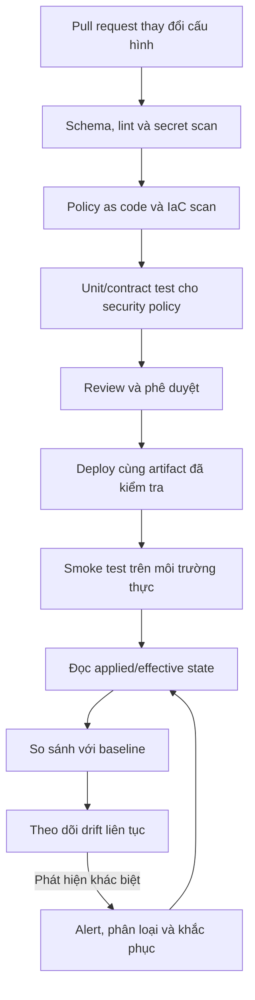

# Configuration drift và kiểm tra tự động

Trong chương **Security misconfiguration** của module `SECURITY_API_SECURITY`, cấu hình bảo mật phải được quản lý như một phần của thiết kế API. Một endpoint có thể được viết đúng nhưng vẫn trở nên dễ tấn công nếu cấu hình triển khai bị thay đổi: môi trường production mở thêm route debug, gateway bỏ rate limit, CORS chuyển thành wildcard, ingress mất TLS hoặc quyền truy cập của service account rộng hơn dự kiến.

**Configuration drift** là tình trạng cấu hình thực tế đã triển khai khác với trạng thái đã được phê duyệt. Drift có thể xuất hiện do chỉnh sửa thủ công, hotfix, thay đổi mặc định khi nâng cấp phiên bản, biến môi trường ghi đè, thao tác của nhà cung cấp cloud hoặc một thay đổi chỉ được áp dụng ở một phần cụm. Nếu chỉ review file cấu hình trong Git mà không kiểm tra trạng thái đang chạy, hệ thống vẫn có thể tồn tại cấu hình nguy hiểm.

Module này tập trung vào bảo mật API theo từng endpoint, đối tượng dữ liệu và luồng nghiệp vụ. Vì vậy, baseline cần mô tả được những điều kiện như ai được gọi endpoint, ai được thao tác trên đối tượng nào, dữ liệu nào được phép đi qua, giới hạn tài nguyên ra sao và hệ thống phải phản ứng thế nào khi có lỗi.

## Configuration drift ảnh hưởng đến bảo mật API như thế nào?

Drift không chỉ là khác biệt về giá trị cấu hình. Một thay đổi nhỏ có thể làm mất một lớp kiểm soát trong luồng nghiệp vụ:

| Khu vực | Cấu hình mong đợi | Drift có thể tạo ra |
|---|---|---|
| Authentication | Endpoint nhạy cảm yêu cầu token hợp lệ và đúng issuer/audience | Gateway bỏ bước xác thực hoặc chấp nhận issuer không được tin cậy |
| Authorization | Mỗi request kiểm tra quyền chức năng và quyền trên đối tượng | Một route bị bỏ khỏi policy, hoặc service account có quyền đọc dữ liệu của tenant khác |
| CORS | Chỉ cho phép origin cụ thể, method và header cần thiết | Cho phép mọi origin hoặc phản chiếu origin bất kỳ kèm credential |
| TLS và ingress | TLS bắt buộc, certificate hợp lệ, upstream được xác thực | Listener HTTP công khai, cấu hình TLS yếu hoặc bỏ xác minh upstream |
| Rate limit | Có giới hạn theo danh tính, endpoint và tài nguyên | Policy bị gỡ, quota tăng quá cao hoặc chỉ giới hạn ở một replica |
| Request parsing | Giới hạn body, header, độ sâu và loại nội dung | Cho phép payload lớn, parser dễ bị tiêu thụ CPU/bộ nhớ hoặc chấp nhận content type không mong muốn |
| Error handling | Không trả stack trace, câu truy vấn hay cấu hình nội bộ | Debug mode bật ở production, lỗi tiết lộ thông tin nhạy cảm |
| Management endpoint | Chỉ expose endpoint vận hành cần thiết và có kiểm soát truy cập | Actuator, admin API, Swagger UI hoặc debug route bị public |
| Logging và dữ liệu | Che token, giới hạn dữ liệu cá nhân, thời hạn lưu rõ ràng | Ghi request/response đầy đủ, lưu secret hoặc dữ liệu nhạy cảm quá lâu |
| Outbound integration | Egress allowlist và timeout được áp dụng | API có thể gọi tới mạng nội bộ, metadata service hoặc host tùy ý |

Ví dụ, một API `GET /accounts/{accountId}` có thể đã kiểm tra JWT và có logic kiểm tra chủ sở hữu. Nhưng nếu cấu hình gateway vô tình route `/accounts/**` sang một upstream cũ không có kiểm tra object-level authorization, việc xác thực ở gateway vẫn không bảo vệ được dữ liệu. Tương tự, cấu hình rate limit tốt ở một môi trường không đảm bảo rằng production đang dùng cùng policy.

## Phân biệt baseline, cấu hình thực tế và thay đổi hợp lệ

Để phát hiện drift, trước hết phải xác định trạng thái nào là nguồn chuẩn. Một mô hình dễ vận hành gồm ba thành phần:

- **Desired state (baseline):** cấu hình đã được review và phê duyệt, lưu trong hệ thống quản lý phiên bản hoặc nguồn cấu hình có kiểm soát.
- **Applied state:** cấu hình mà nền tảng xác nhận đã áp dụng cho deployment, gateway, ingress, identity provider, network policy và các thành phần liên quan.
- **Effective runtime state:** hành vi hoặc cấu hình có hiệu lực tại thời điểm request được xử lý, bao gồm giá trị bị ghi đè bởi environment variable, secret/config store, feature flag, dynamic policy hoặc mặc định của phiên bản phần mềm.

Ba trạng thái này có thể khác nhau. Manifest trong Git có thể đúng nhưng deployment chưa rollout xong; cấu hình trong cluster có thể đúng nhưng gateway cache policy cũ; hoặc một biến môi trường có thể ghi đè giá trị trong file. Vì vậy, kiểm tra cần xác định rõ mình đang so sánh lớp nào và có cách xác minh cấu hình đã thực sự có hiệu lực hay chưa.

Không phải mọi khác biệt đều là drift nguy hiểm. Ví dụ số replica, hostname, certificate fingerprint hoặc secret version có thể thay đổi theo vận hành. Hãy phân loại cấu hình thành:

1. **Security invariant:** điều kiện không được nới lỏng, như bắt buộc TLS, không public admin endpoint, không cho phép wildcard origin kèm credential.
2. **Environment-specific:** giá trị khác nhau có chủ đích giữa dev, staging và production, nhưng vẫn phải tuân theo cùng chính sách an toàn.
3. **Dynamic/rotating:** giá trị thay đổi thường xuyên như secret version, certificate, replica count hoặc feature flag có kiểm soát.
4. **Exception có thời hạn:** khác biệt được phê duyệt cho một mục đích cụ thể, có owner, lý do, phạm vi, biện pháp bù trừ và ngày hết hạn.

Chỉ loại bỏ khác biệt đã được định nghĩa rõ khỏi phép so sánh. Không dùng một danh sách ignore rộng để che drift; đặc biệt không loại trừ toàn bộ network, identity, CORS, TLS hoặc authorization chỉ vì chúng thường thay đổi.

## Xây dựng baseline bảo mật có thể kiểm tra

Baseline nên mô tả các thuộc tính bảo mật cần đạt thay vì chỉ sao chép một file cấu hình lớn. Mỗi quy tắc cần có phạm vi, giá trị mong đợi, cách kiểm tra và người chịu trách nhiệm.

### 1. Lập inventory theo endpoint và luồng nghiệp vụ

Đừng chỉ đặt policy ở cấp toàn ứng dụng. Với mỗi nhóm endpoint, ghi nhận:

- Phương thức và route; endpoint có public, partner-only hay internal-only.
- Cơ chế xác thực: loại token, issuer, audience, thời hạn và cách kiểm tra chữ ký.
- Quyền chức năng: role, scope hoặc permission cần có.
- Quyền trên đối tượng: điều kiện tenant/owner, quan hệ giữa người gọi và tài nguyên, thao tác được phép.
- Phân loại dữ liệu: public, nội bộ, nhạy cảm hoặc dữ liệu cá nhân; yêu cầu mã hóa, che log và thời hạn lưu.
- Giới hạn tài nguyên: body size, pagination, timeout, concurrency, quota và tốc độ request.
- Hành vi lỗi: status code, response schema và thông tin tuyệt đối không được tiết lộ.
- Dependency outbound: hostname, port, protocol, timeout và egress policy.

Đối với một luồng như thanh toán, cần mô tả cả callback/webhook, endpoint truy vấn trạng thái, endpoint hoàn tiền và quyền của service-to-service. Baseline phải phản ánh toàn bộ đường đi của dữ liệu, không chỉ route đầu tiên.

### 2. Quản lý cấu hình theo nguồn chuẩn

Đưa cấu hình ứng dụng, gateway, ingress, IAM, network policy và hạ tầng vào quy trình quản lý phiên bản khi công cụ hỗ trợ. Dùng pull request, review bắt buộc và lịch sử thay đổi để trả lời được ai thay đổi điều gì, vì sao và được phê duyệt khi nào.

Một số nguyên tắc cần áp dụng:

- Dùng cấu hình tường minh cho các thuộc tính bảo mật quan trọng. Không phụ thuộc vào default có thể thay đổi khi nâng cấp framework hoặc image.
- Tách giá trị theo môi trường bằng overlay có kiểm soát. Không sao chép rồi chỉnh sửa thủ công nhiều file gần giống nhau.
- Giữ cùng một artifact đã build xuyên suốt các môi trường; chỉ thay cấu hình được phép thay đổi. Tránh build một binary khác cho production mà không có bằng chứng tương ứng.
- Secret lưu trong secret manager hoặc cơ chế được bảo vệ; không commit secret vào Git, không đưa secret vào output của drift report. So sánh version, metadata hoặc fingerprint được thiết kế an toàn thay vì in giá trị bí mật.
- Ghi rõ owner và nguồn cấp của mỗi cấu hình. Nếu một giá trị có thể đến từ file, environment variable, remote config và command-line argument, cần xác định precedence và quan sát được giá trị hiệu lực mà không làm lộ secret.
- Thay đổi khẩn cấp phải được ghi nhận lại vào nguồn chuẩn sau khi xử lý; nếu không, lần reconcile tiếp theo có thể ghi đè hotfix hoặc khiến drift tiếp tục tồn tại.

### 3. Chọn trạng thái mặc định an toàn

Baseline nên ưu tiên từ chối khi thiếu cấu hình bảo mật bắt buộc. Ví dụ: thiếu issuer hoặc audience thì không chấp nhận token; thiếu allowlist origin thì không bật CORS rộng; thiếu egress policy thì không cho phép ứng dụng gọi tùy ý; endpoint quản trị không được public chỉ vì chưa khai báo rule.

Không nên dùng một cờ `security.enabled=false` chung cho nhiều cơ chế. Mỗi kiểm soát cần cấu hình độc lập, có tên rõ ràng và có test chứng minh. Với các ngoại lệ, cần scope hẹp theo endpoint, service hoặc môi trường và có ngày hết hạn.

## Các lớp kiểm tra tự động

Một cơ chế đáng tin cậy kết hợp kiểm tra trước khi merge, trong lúc triển khai và khi hệ thống đang chạy. Một lớp đơn lẻ không thể phát hiện mọi dạng drift.



### 1. Kiểm tra tĩnh trong CI

Trước khi merge, tự động kiểm tra:

- Cấu hình đúng schema, không có key sai chính tả hoặc giá trị không được hỗ trợ.
- Không có secret, private key, token hoặc credential bị commit.
- Không bật debug, stack trace, management endpoint hoặc API documentation công khai ngoài chính sách.
- Không có CORS wildcard trong trường hợp không được phép; không phản chiếu origin tùy ý.
- TLS được bật ở listener public và upstream; không tắt certificate/hostname verification.
- IAM role, service account, security group và network policy tuân theo least privilege.
- Timeout, giới hạn body, pagination, concurrency và rate limit có giá trị trong khoảng cho phép.
- Các endpoint nhạy cảm có authentication và authorization policy tương ứng.

Có thể dùng schema validator, linter, secret scanner, IaC scanner và policy-as-code. Công cụ cụ thể tùy stack; kết quả của scanner cần được review theo ngữ cảnh để tránh false positive hoặc rule quá rộng. Một cảnh báo bị bỏ qua phải có lý do, owner và thời hạn, không chỉ một annotation `ignore` vĩnh viễn.

### 2. Kiểm tra policy và cấu hình theo môi trường

Sau khi render Helm/Kustomize hoặc tạo execution plan cho hạ tầng, kiểm tra cấu hình cuối cùng mà môi trường sẽ nhận. Kiểm tra file nguồn riêng lẻ có thể bỏ sót lỗi do overlay, template, variable hoặc default.

Ví dụ, cùng một ứng dụng có thể có baseline chung và override theo môi trường:

```yaml
# api-security-baseline.yaml - mô hình policy minh họa
api:
  publicIngress:
    tlsRequired: true
    allowedHosts:
      - api.example.com
  cors:
    allowedOrigins:
      - https://app.example.com
    allowCredentials: true
    allowedMethods: [GET, POST, PATCH, DELETE]
  errors:
    exposeStackTrace: false
    exposeInternalMessages: false
  management:
    publicExposure: false
  limits:
    maxRequestBytes: 1048576
    requestTimeoutSeconds: 10
    maxPageSize: 100
  outbound:
    allowedHosts:
      - payment.partner.example
```

Đây là cấu trúc baseline minh họa để diễn đạt yêu cầu, không phải tên property có thể đặt trực tiếp vào mọi framework. Adapter hoặc policy test của dự án phải ánh xạ các thuộc tính này sang cấu hình thật của gateway, ứng dụng và nền tảng.

Kiểm tra thêm các điều kiện liên quan: nếu `allowCredentials` là `true`, origin phải là danh sách cụ thể; nếu public ingress bật, TLS phải bắt buộc; nếu endpoint quản trị tồn tại, nó phải nằm trên mạng quản trị và có authentication riêng; nếu endpoint nhận dữ liệu lớn, phải có giới hạn body, timeout và quota phù hợp.

### 3. Test cấu hình như một hợp đồng

Viết test để xác nhận policy được gắn vào đúng route và đúng phương thức. Một test chỉ kiểm tra rằng filter hoặc security middleware đã được khởi tạo là chưa đủ. Cần gửi request và xác nhận hành vi:

- Không token: endpoint private trả `401`.
- Token hợp lệ nhưng thiếu quyền chức năng: trả `403`.
- Người dùng có quyền chức năng nhưng không sở hữu đối tượng: không đọc hoặc sửa được dữ liệu của người khác.
- Token sai issuer/audience hoặc hết hạn: bị từ chối.
- CORS preflight từ origin ngoài allowlist: không được cấp quyền truy cập.
- Payload quá lớn, pagination vượt mức hoặc request vượt quota: bị giới hạn có kiểm soát.
- Debug route và management endpoint không thể truy cập từ mạng public.
- Lỗi không trả stack trace, secret, SQL hoặc đường dẫn nội bộ.
- Request outbound tới hostname ngoài allowlist bị chặn.

Kiểm tra cả trường hợp âm tính và side effect. Ví dụ, request bị từ chối không được tạo đơn hàng, cập nhật trạng thái, gửi email hoặc gọi dịch vụ thanh toán. Với object-level authorization, dùng ít nhất hai principal và hai đối tượng thuộc hai tenant khác nhau để chứng minh không có truy cập chéo.

### 4. Smoke test sau triển khai

Sau khi deployment hoàn tất, chạy test từ vị trí mạng tương ứng với người dùng thực tế. Kiểm tra đường đi qua DNS, CDN/WAF, load balancer, API gateway, ingress và ứng dụng. Test trực tiếp pod hoặc service nội bộ có thể bỏ qua lớp cấu hình đang cần xác minh.

Smoke test nên xác nhận TLS/certificate, redirect, security headers, CORS, authentication, authorization, rate limit, body limit, error response và khả năng truy cập management route. Dùng tài khoản và dữ liệu test có phạm vi giới hạn; không thực hiện thao tác ghi lên dữ liệu production nếu chưa có thiết kế an toàn.

Smoke test chứng minh hành vi tại thời điểm kiểm tra. Nó không thay thế kiểm tra cấu hình liên tục, vì drift có thể xuất hiện ngay sau đó do thao tác vận hành hoặc thay đổi dynamic config.

### 5. Phát hiện drift khi runtime

Định kỳ hoặc theo sự kiện, thu thập trạng thái thực tế từ các nguồn có thẩm quyền: API của cloud provider, Kubernetes API, gateway control plane, identity provider, service mesh, secret manager và ứng dụng. So sánh với baseline đã render cho đúng phiên bản và môi trường.

Một bộ so sánh nên:

1. Xác định đúng resource bằng ID ổn định, không chỉ dựa vào tên hiển thị.
2. Chuẩn hóa dữ liệu trước khi so sánh: thứ tự phần tử, giá trị mặc định, biểu diễn boolean, đơn vị thời gian và các trường do nền tảng tự sinh.
3. Loại trừ có chọn lọc trường volatile đã được định nghĩa, nhưng vẫn so sánh security invariant.
4. Phân biệt `missing`, `unexpected`, `changed` và `unreadable`. Không đọc được trạng thái phải được báo là thiếu quan sát, không được xem như không có drift.
5. So sánh fingerprint hoặc metadata an toàn cho secret; không xuất secret thô vào log, alert hay artifact CI.
6. Gắn kết quả với commit, image digest, release ID, môi trường, resource owner và thời điểm quan sát.

Nếu ứng dụng hỗ trợ endpoint health hoặc diagnostics nội bộ, chỉ expose metadata tối thiểu cho hệ thống giám sát có xác thực. Không tạo endpoint public trả toàn bộ effective configuration để phục vụ drift detection.

## Ví dụ quy trình kiểm tra trong CI/CD

Một pipeline triển khai có thể chia thành các gate sau:

```text
1. Validate source config
   - schema/lint
   - secret scan
2. Render config theo môi trường đích
   - resolve overlay và template
   - kiểm tra default và biến bắt buộc
3. Evaluate security policy
   - ingress/TLS/CORS/IAM/network
   - endpoint authn/authz và resource limits
4. Review plan và approve
5. Deploy immutable artifact + reviewed config
6. Wait for rollout và xác minh applied state
7. Run black-box security smoke tests
8. Record release fingerprint và baseline version
9. Continuous drift detection sau deploy
```

Gate phải thất bại rõ ràng khi không thể xác minh một kiểm soát quan trọng. Ví dụ pipeline không truy cập được gateway control plane thì không nên đánh dấu kiểm tra gateway là PASS. Có thể phân biệt `PASS`, `FAIL` và `UNKNOWN`; `UNKNOWN` cần retry hoặc xử lý theo chính sách, không được tự động chuyển thành `PASS`.

Với hạ tầng khai báo bằng Terraform, execution plan giúp review thay đổi dự kiến trước khi apply. Tuy nhiên, plan không tự chứng minh trạng thái sau apply hoặc thay đổi thủ công về sau; cần đọc lại resource thực tế và chạy drift detection riêng. Với Kubernetes, diff giữa manifest đã render và object trong cluster hữu ích nhưng cần chuẩn hóa trường do API server hoặc controller tự quản lý.

## Xử lý khi phát hiện drift

Không tự động reconcile mọi khác biệt ngay lập tức. Một thao tác tự sửa có thể xóa hotfix đang ngăn sự cố, làm gián đoạn traffic hoặc ghi đè thay đổi hợp lệ chưa kịp cập nhật vào baseline. Hãy xử lý theo mức độ rủi ro:

1. **Xác minh:** resource nào lệch, môi trường nào, giá trị nào thay đổi, thay đổi bắt đầu từ khi nào và có request/incident liên quan không?
2. **Phân loại:** drift có làm yếu authentication, authorization, TLS, network boundary, data protection hoặc resource limit không? Đây là thay đổi được phê duyệt, thay đổi ngoài ý muốn hay chưa rõ nguồn gốc?
3. **Giảm thiểu:** nếu có nguy cơ khai thác đang mở, ưu tiên chặn route, thu hẹp quyền, tắt public exposure hoặc rollback theo runbook đã kiểm thử.
4. **Khôi phục nguồn chuẩn:** sửa cấu hình trong repository hoặc hệ thống quản lý cấu hình, review và triển khai lại. Không chỉ sửa trực tiếp trên môi trường rồi bỏ quên nguồn chuẩn.
5. **Xác minh sau khắc phục:** đọc lại applied/effective state, chạy smoke test và kiểm tra log/audit event để xác nhận kiểm soát đã trở lại.
6. **Ngăn tái diễn:** tìm nguyên nhân gốc như quyền chỉnh sửa quá rộng, pipeline bỏ qua gate, template thiếu property, default thay đổi hoặc quy trình hotfix không có bước đồng bộ.

Với drift được chấp nhận tạm thời, tạo exception có phạm vi và ngày hết hạn. Hệ thống cần cảnh báo trước khi exception hết hạn và tự chuyển về trạng thái cần xử lý khi quá hạn. Không biến exception thành baseline mới nếu chưa qua review bảo mật.

## Ưu tiên cảnh báo và vận hành

Không phải mọi khác biệt đều có cùng mức độ nghiêm trọng. Có thể phân loại theo tác động:

| Mức | Ví dụ | Hành động |
|---|---|---|
| Critical | Public admin/debug endpoint; bỏ authentication; public storage hoặc route truy cập dữ liệu tenant khác | Cô lập hoặc rollback ngay theo runbook, báo đội phụ trách và lưu bằng chứng |
| High | Tắt TLS, mở CORS quá rộng kèm credential, bỏ authorization hoặc egress allowlist | Khắc phục khẩn cấp, đánh giá khả năng truy cập và dữ liệu bị ảnh hưởng |
| Medium | Rate limit nới lỏng, body size/timeout vượt baseline, error detail lộ thêm thông tin nội bộ | Tạo incident/task có deadline, đánh giá mức phơi nhiễm và điều chỉnh |
| Low | Drift ở metadata không ảnh hưởng security invariant hoặc khác biệt đã có exception hợp lệ | Ghi nhận, theo dõi và cập nhật baseline nếu cần |

Theo dõi các chỉ số: số drift chưa xử lý theo mức độ, thời gian phát hiện, thời gian khắc phục, tỷ lệ false positive, số exception quá hạn, tỷ lệ deployment vượt qua gate và số lần drift tái diễn. Cảnh báo cần có resource ID, môi trường, rule bị vi phạm, baseline version, owner và hướng dẫn xử lý; tuyệt đối không đính kèm secret hoặc raw configuration nhạy cảm.

Audit log cần đủ để truy vết ai hoặc service nào đã thay đổi cấu hình, thời điểm, nguồn thay đổi và kết quả. Quyền đọc và thay đổi cấu hình production phải được giới hạn theo least privilege; thao tác nhạy cảm cần approval hoặc cơ chế break-glass có giám sát.

## Những sai lầm thường gặp

- Chỉ scan file trong Git mà không kiểm tra cấu hình sau khi render và trạng thái thực tế.
- Dùng một baseline duy nhất cho mọi môi trường rồi thêm nhiều ngoại lệ không có owner.
- Bỏ qua toàn bộ trường động, vô tình bỏ qua cả trường bảo mật quan trọng.
- Coi việc không đọc được runtime state là không có drift.
- Tự động sửa mọi drift mà không đánh giá tác động đến traffic và incident đang diễn ra.
- Chỉ test authentication ở gateway mà không kiểm tra object-level authorization trong ứng dụng.
- In toàn bộ cấu hình hiệu lực để debug, vô tình làm lộ token, password, private key hoặc thông tin hạ tầng.
- Cho phép exception không có thời hạn hoặc rule ignore vĩnh viễn.
- Coi pipeline xanh là bằng chứng bảo mật production luôn đúng sau thời điểm deploy.

## Checklist triển khai

- [ ] Có inventory endpoint, service, gateway, ingress, identity và dependency outbound.
- [ ] Có baseline được version hóa, owner rõ ràng và review bảo mật.
- [ ] Security invariant được tách khỏi giá trị theo môi trường và giá trị động.
- [ ] Cấu hình bảo mật quan trọng được khai báo tường minh, không phụ thuộc default không ổn định.
- [ ] Secret không xuất hiện trong source, log, alert hoặc drift report.
- [ ] CI kiểm tra schema, secret, IaC và policy sau khi render cấu hình theo môi trường.
- [ ] Có test âm tính cho authentication, function/object authorization, CORS, TLS, rate limit, body limit và error handling.
- [ ] Có smoke test qua đường truy cập thực tế sau deploy.
- [ ] Có runtime drift detection từ applied/effective state và báo `UNKNOWN` khi không quan sát được.
- [ ] Có quy trình phân loại, khắc phục, xác minh và ngăn drift tái diễn.
- [ ] Mọi exception có owner, lý do, phạm vi, biện pháp bù trừ và ngày hết hạn.
- [ ] Audit log và cảnh báo không làm lộ dữ liệu nhạy cảm.

Configuration drift là rủi ro liên tục vì cấu hình có thể thay đổi sau khi code đã được review và triển khai. Quản lý baseline có kiểm soát, kiểm tra tự động ở CI/CD, xác minh hành vi sau deploy và so sánh trạng thái runtime giúp phát hiện sớm những thay đổi làm suy yếu bảo mật API. Mục tiêu là giữ các kiểm soát theo endpoint, đối tượng dữ liệu và luồng nghiệp vụ đúng như đã được phê duyệt trong suốt vòng đời vận hành.
