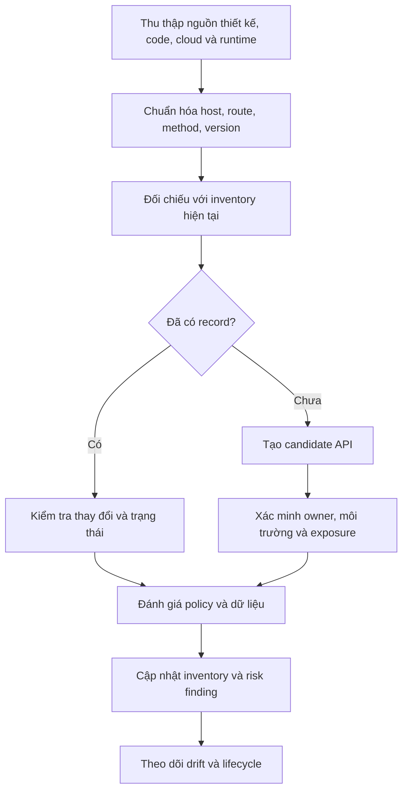

# Improper Inventory Management

Một tổ chức có thể bảo vệ tốt các endpoint mà đội phát triển biết đến, nhưng vẫn để lộ dữ liệu qua một API cũ, một hostname staging bị quên, một phiên bản mobile API chưa được retire hoặc một dịch vụ đối tác đang chạy ngoài quy trình quản lý. Đây là vấn đề **Improper Inventory Management**: tổ chức không có danh mục API đầy đủ, chính xác và được duy trì liên tục, nên không biết toàn bộ bề mặt API đang tồn tại, ai sở hữu nó, phục vụ môi trường nào và cần được bảo vệ ra sao.

API inventory không chỉ là danh sách URL. Một bản kiểm kê hữu ích phải liên kết host, endpoint, method, phiên bản, môi trường, chủ sở hữu, dữ liệu được xử lý, cơ chế xác thực, phụ thuộc, tài liệu và vòng đời. API discovery là quá trình tìm và xác minh các API đang tồn tại; inventory management là quá trình quản lý kết quả discovery, cập nhật thay đổi, xử lý sai lệch và loại bỏ API hết vòng đời.

Trong API Security, không thể áp dụng xác thực, phân quyền, validation, giám sát hoặc kiểm thử cho một API mà tổ chức không biết nó tồn tại. Vì vậy, quản lý inventory là nền tảng để kiểm soát từng endpoint, object dữ liệu và luồng nghiệp vụ trên toàn bộ hệ thống.

Sau bài học, người đọc có thể:

- Giải thích rủi ro khi danh mục API thiếu, cũ hoặc không có chủ sở hữu.
- Phân biệt API discovery, inventory management và vulnerability scanning.
- Tìm API từ gateway, DNS, cloud, service mesh, source code, CI/CD và lưu lượng thực tế.
- Nhận diện shadow API, zombie API, API phiên bản cũ và API ngoài quy trình.
- Xây dựng metadata và quy trình quản lý vòng đời API.
- Đối chiếu inventory với hệ thống đang chạy, xử lý sai lệch và kiểm thử liên tục.

## 1. Improper Inventory Management là gì?

Inventory management là việc duy trì một nguồn thông tin có thẩm quyền về các API mà tổ chức sở hữu, vận hành, sử dụng hoặc cung cấp cho bên thứ ba. Inventory cần phản ánh trạng thái thực tế thay vì chỉ phản ánh thiết kế ban đầu.

Một API inventory tối thiểu nên trả lời:

1. API đang được truy cập qua hostname, base path và endpoint nào?
2. Có những method, phiên bản và schema request/response nào?
3. API thuộc môi trường production, staging, development, test hay môi trường đối tác?
4. Đội nào sở hữu API, ai chịu trách nhiệm vận hành và ai phê duyệt thay đổi?
5. API xử lý loại dữ liệu nào, có dữ liệu cá nhân hoặc dữ liệu nhạy cảm không?
6. API xác thực và phân quyền bằng cơ chế nào? Có kiểm tra quyền trên object/property không?
7. API phụ thuộc service, database, message broker hoặc nhà cung cấp nào?
8. API đang ở trạng thái draft, active, deprecated, retired hay unknown?
9. Tài liệu, SLA, ngày review và kế hoạch ngừng hỗ trợ ở đâu?

Một danh sách endpoint chỉ gồm URL không đủ để quản lý rủi ro. Ví dụ `api.example.com/v1/users` và `staging-api.example.com/v1/users` có thể có cùng path nhưng khác môi trường, dữ liệu, quyền truy cập và mức độ bảo vệ. Một endpoint nội bộ có thể không xuất hiện trong API gateway nhưng vẫn được truy cập trực tiếp qua load balancer hoặc service mesh.

### 1.1. Các loại API cần kiểm kê

Inventory nên bao gồm các nhóm phù hợp với kiến trúc tổ chức:

- Public API dành cho ứng dụng hoặc đối tác bên ngoài.
- Private/internal API giữa các service.
- Partner API và API do bên thứ ba cung cấp.
- Admin, operations, support và diagnostic API.
- Mobile API, web backend/BFF và API dành cho thiết bị/IoT.
- Webhook, callback, event ingestion và endpoint nhận dữ liệu.
- GraphQL, gRPC, WebSocket và các giao diện RPC khác nếu nằm trong phạm vi quản lý.
- API ở staging, development, test, sandbox và các môi trường tạm thời.
- API cũ, phiên bản còn hoạt động hoặc endpoint không còn được tài liệu hóa.

Không nên chỉ kiểm kê các API đi qua một API Gateway. Các đường truy cập trực tiếp, host phụ, ingress riêng, serverless function và dịch vụ do nhóm khác triển khai cũng có thể tạo bề mặt tấn công.

## 2. Vì sao inventory thiếu gây rủi ro bảo mật?

Khi tổ chức không biết API nào đang tồn tại, các biện pháp bảo vệ có thể chỉ bao phủ một phần hệ thống.

### 2.1. Shadow API

Shadow API là API đang được sử dụng nhưng không được quản lý hoặc không xuất hiện trong inventory chính thức. API có thể được tạo bởi một nhóm sản phẩm, nhóm tích hợp hoặc nhà thầu mà quy trình bảo mật trung tâm không biết.

Ví dụ, một đội triển khai endpoint `/internal/export-all` để phục vụ hỗ trợ khách hàng. Endpoint được publish trên hostname riêng, không qua gateway chuẩn, không có owner rõ ràng và trả dữ liệu lớn. Dù chức năng ban đầu chỉ dành cho nội bộ, một cấu hình mạng sai có thể khiến endpoint truy cập từ Internet.

### 2.2. Zombie API

Zombie API là API hoặc phiên bản API đã được xem là cũ, không còn được hỗ trợ nhưng vẫn chạy hoặc vẫn có thể truy cập. Ví dụ, ứng dụng đã chuyển sang `/v3` nhưng `/v1` vẫn hoạt động để hỗ trợ một client cũ bị bỏ quên.

Phiên bản cũ có thể thiếu các kiểm tra mới như object authorization, validation, rate limit hoặc logging. Nếu dữ liệu production vẫn được truy cập qua phiên bản đó, kẻ tấn công có thể chọn đường yếu hơn.

### 2.3. API không có owner hoặc tài liệu

Không có owner khiến việc vá lỗi, rotate credential, thay đổi policy và retire API bị trì hoãn. Tài liệu lỗi thời có thể hướng developer tới endpoint không còn được bảo vệ hoặc bỏ sót endpoint đang hoạt động.

### 2.4. Sai lệch giữa môi trường

Staging hoặc development có thể chứa dữ liệu production, credential dùng chung hoặc cấu hình bảo mật lỏng hơn. Hostname sandbox bị expose ra Internet cũng có thể trở thành điểm xâm nhập. Inventory cần thể hiện môi trường thực tế và kiểm soát dữ liệu/credential tương ứng.

### 2.5. Phụ thuộc bên thứ ba không được theo dõi

API gọi dịch vụ bên thứ ba có thể truyền dữ liệu, token hoặc định danh khách hàng ra ngoài. Nếu inventory không ghi nhận provider, dữ liệu chia sẻ, credential và owner tích hợp, tổ chức khó đánh giá rủi ro khi nhà cung cấp thay đổi API, ngừng phiên bản hoặc gặp sự cố.

## 3. Phân biệt discovery, inventory và vulnerability scanning

Ba hoạt động liên quan nhưng có mục đích khác nhau:

| Hoạt động | Mục tiêu | Kết quả |
|---|---|---|
| API discovery | Tìm host, service, endpoint và giao diện API đang tồn tại | Danh sách phát hiện, nguồn và mức độ tin cậy |
| API inventory management | Xác minh, phân loại, gán owner, theo dõi vòng đời và sai lệch | Danh mục có thẩm quyền, được cập nhật liên tục |
| API security testing/scanning | Đánh giá lỗi cấu hình, xác thực, phân quyền, validation và lỗ hổng | Findings, mức độ rủi ro và kế hoạch khắc phục |

Discovery không chứng minh API an toàn. Inventory đầy đủ cũng không đồng nghĩa mọi endpoint đã được kiểm thử. Ngược lại, quét bảo mật một danh sách URL cũ có thể bỏ sót toàn bộ API mới hoặc shadow API.

Quy trình tốt liên kết ba hoạt động: discovery tìm tài sản, inventory xác định chủ sở hữu và phạm vi, testing đánh giá rủi ro trên tài sản đã biết. Kết quả kiểm thử và thay đổi triển khai lại cập nhật inventory.

## 4. Các nguồn để phát hiện API

Không có một nguồn đơn lẻ nào nhìn thấy toàn bộ API. Nên kết hợp nguồn thiết kế, nguồn triển khai và tín hiệu runtime.

### 4.1. API Gateway, ingress và load balancer

Xuất route/configuration từ API Gateway, ingress controller, reverse proxy và load balancer. Những nguồn này giúp xác định public host, route, method, upstream service, policy xác thực và rate limit.

Giới hạn: API có thể bypass gateway qua địa chỉ load balancer, service public trực tiếp, ingress khác hoặc hostname cũ. Cần đối chiếu DNS/cloud và traffic thực tế.

### 4.2. DNS, certificate và domain inventory

Đối chiếu DNS zone, subdomain, CNAME, wildcard record, certificate inventory và hệ thống quản lý domain. Các tên như `api`, `api-v2`, `staging-api`, `mobile-api`, `partner-api` có thể chỉ ra host cần xác minh.

DNS record hoặc certificate không tự chứng minh có API đang hoạt động; chúng là tín hiệu discovery. Cần kiểm tra chủ sở hữu, đích trỏ, trạng thái dịch vụ và quyền truy cập. Certificate Transparency có thể giúp phát hiện hostname công khai được cấp chứng chỉ, nhưng không thay thế inventory domain nội bộ hoặc xác minh endpoint.

### 4.3. Cloud và hạ tầng triển khai

Thu thập từ cloud asset inventory, container orchestration, serverless functions, service mesh, security group, firewall, public IP, ingress và deployment metadata. Kiểm tra service có listener HTTP/gRPC, route public hoặc endpoint quản trị không.

Nguồn này giúp phát hiện API được triển khai trực tiếp ngoài gateway và các môi trường tạm thời. Cần liên kết tài nguyên cloud với service owner và repository để biết ai chịu trách nhiệm.

### 4.4. Source code, OpenAPI và CI/CD

Quét repository để tìm route/controller, annotation mapping, OpenAPI/Swagger specification, GraphQL schema, gRPC proto, webhook handler và cấu hình HTTP server. Thu thập artifact từ build/deploy pipeline để biết phiên bản nào được đưa lên môi trường nào.

Tài liệu OpenAPI là nguồn hữu ích nhưng có thể không khớp runtime. Một endpoint được thêm bằng code nhưng chưa cập nhật spec sẽ bị bỏ sót nếu chỉ đọc tài liệu. Ngược lại, spec có thể mô tả endpoint đã retire.

### 4.5. Service mesh và service registry

Service mesh, service discovery và registry cho biết service nào đang giao tiếp với service nào, port/protocol nào được sử dụng và có mTLS hay không. Đây là nguồn quan trọng cho internal API không public.

Traffic quan sát được không phải lúc nào cũng thể hiện đầy đủ endpoint: mã hóa, dynamic routing, message protocol hoặc traffic hiếm có thể làm thiếu dữ liệu. Kết hợp với source/configuration và chủ sở hữu service.

### 4.6. Runtime traffic, log và tracing

Phân tích access log, API gateway log, distributed trace, WAF telemetry và network flow để tìm route thực sự được gọi. Runtime data có thể phát hiện endpoint chưa được tài liệu hóa hoặc host cũ vẫn còn traffic.

Chỉ thu thập metadata cần thiết. Không ghi token, cookie, secret hoặc toàn bộ payload nhạy cảm chỉ để phục vụ discovery. Có thể chuẩn hóa route template như `/users/{id}` thay vì lưu mọi ID thực tế.

### 4.7. Ứng dụng client và tài liệu tích hợp

Kiểm tra mobile application, web bundle, SDK, cấu hình endpoint, tài liệu developer portal, collection API test và hướng dẫn đối tác. Client cũ có thể còn gọi một phiên bản API đã bị bỏ khỏi tài liệu chính thức.

Không coi việc tìm thấy URL trong ứng dụng là bằng chứng API nên public; cần xác minh chủ sở hữu, mục đích và trạng thái thực tế.

## 5. Quy trình discovery và xác minh

Một quy trình có thể triển khai theo các bước:



### 5.1. Chuẩn hóa phát hiện

Một route có thể xuất hiện nhiều lần qua gateway, ingress và source code. Chuẩn hóa theo tổ hợp host/base path, API/service, version, method và route template. Không gộp hai endpoint chỉ vì path giống nhau nếu chúng thuộc host, môi trường hoặc policy khác nhau.

### 5.2. Xác minh thay vì tự động tin mọi candidate

Discovery có thể tạo false positive: DNS record trỏ tới website tĩnh, route trong test code chưa deploy hoặc spec cũ không còn chạy. Với mỗi candidate, xác minh:

- Host có resolve và thuộc domain tổ chức hoặc đối tác được phê duyệt không?
- Service/upstream nào xử lý request?
- Endpoint có thực sự hoạt động và hỗ trợ method nào?
- Môi trường và exposure là gì: Internet, partner, private network hay local-only?
- Có owner và repository/deployment liên quan không?
- API đang active, deprecated, retired hay chưa xác định?

Không tự động gọi endpoint nhạy cảm hoặc gửi payload ghi dữ liệu chỉ để xác minh. Dùng nguồn cấu hình, health check an toàn hoặc test có phạm vi được phê duyệt.

### 5.3. Xử lý candidate chưa rõ owner

API chưa xác định được owner cần được gắn trạng thái `UNOWNED` hoặc `NEEDS_REVIEW`, lưu nguồn phát hiện và ngày xác minh. Nếu API public hoặc có dữ liệu nhạy cảm, chuyển thành finding có mức ưu tiên cao để triage. Không xóa route chỉ vì chưa biết owner; trước tiên cần xác định có client hoặc nghiệp vụ đang phụ thuộc.

## 6. Thiết kế một API inventory có thể vận hành

Một inventory có ích cần metadata đủ để đánh giá rủi ro và quản lý vòng đời. Ví dụ cấu trúc record:

```yaml
apiId: order-api-v2
name: Order API
baseUrl: https://api.example.com/orders
version: v2
environment: production
exposure: public
protocol: HTTPS
ownerTeam: commerce-platform
technicalContact: commerce-oncall
repository: commerce/order-service
specification: openapi/order-v2.yaml
authentication: OAuth2-JWT
authorization:
  functionLevel: true
  objectLevel: true
  propertyLevel: true
dataClassification:
  - customer-personal-data
dependencies:
  - payment-service
  - inventory-service
lifecycle: active
createdAt: 2025-03-01
lastVerifiedAt: 2026-11-01
nextReviewAt: 2027-02-01
```

Đây là ví dụ minh họa, không phải schema bắt buộc. Không lưu secret hoặc token trong inventory. Có thể lưu reference tới secret manager hoặc hệ thống quản lý credential nếu cần.

### 6.1. Nhóm metadata nên có

| Nhóm | Trường gợi ý | Mục đích |
|---|---|---|
| Định danh | API ID, tên, domain, base path, protocol | Nhận diện tài sản và tránh trùng |
| Endpoint | Route template, method, version, schema | Biết chính xác bề mặt API |
| Môi trường | Production, staging, dev, test, sandbox | Phân biệt dữ liệu và mức exposure |
| Exposure | Public, partner, internal, private | Xác định bề mặt truy cập |
| Ownership | Owner team, technical contact, business owner | Có người chịu trách nhiệm |
| Bảo mật | AuthN, AuthZ, mTLS, rate limit, WAF | Hiểu lớp kiểm soát hiện có |
| Dữ liệu | Classification, tenant scope, PII/sensitive data | Ưu tiên bảo vệ và kiểm soát output |
| Phụ thuộc | Upstream/downstream, provider, data store | Hiểu chuỗi tin cậy và tác động thay đổi |
| Tài liệu | OpenAPI, runbook, developer portal | Hỗ trợ phát triển và vận hành |
| Vòng đời | Draft, active, deprecated, retired, dates | Quản lý thay đổi và ngừng hỗ trợ |
| Discovery | Source, first seen, last seen, confidence | Truy nguyên và xác minh phát hiện |

### 6.2. Inventory ở mức API và endpoint

Một record ở mức service có thể chứa nhiều endpoint với quyền khác nhau. Ví dụ `order-api` có `GET /orders/{id}`, `PATCH /orders/{id}` và `POST /orders/{id}/refunds`; ba endpoint này có thể có scope, object authorization, dữ liệu trả về và rủi ro khác nhau.

Nên có liên kết từ API/service record tới endpoint-level metadata, ít nhất cho các endpoint nhạy cảm hoặc public. Không nên chỉ gán một nhãn `OAuth protected` cho toàn service rồi coi mọi endpoint có cùng mức bảo vệ.

## 7. Phát hiện shadow API và zombie API

### 7.1. Shadow API

Tín hiệu thường gặp:

- Host hoặc route xuất hiện trong runtime traffic nhưng không có trong OpenAPI hoặc inventory.
- Cloud load balancer/public IP có listener HTTP nhưng không gắn với API gateway.
- DNS record hoặc certificate mới xuất hiện mà chưa có owner.
- Controller/route trong repository được deploy nhưng pipeline không publish spec.
- Endpoint admin/debug/metrics được expose qua host công khai.
- Một team hoặc vendor tạo API để tích hợp nhanh mà không qua quy trình đăng ký.

Khi phát hiện, xác minh owner, dữ liệu, exposure, auth policy và client phụ thuộc. Nếu API không được phê duyệt, áp dụng kế hoạch hạn chế truy cập hoặc retire có kiểm soát; tránh tắt đột ngột endpoint đang phục vụ giao dịch quan trọng mà chưa đánh giá tác động.

### 7.2. Zombie API và phiên bản cũ

Zombie API có thể được nhận diện qua:

- Version cũ vẫn có request trong access log.
- DNS/ingress/deployment còn tồn tại dù tài liệu đã đánh dấu retired.
- Mobile app hoặc SDK cũ còn hard-code endpoint.
- Credential hoặc client registration của version cũ chưa bị thu hồi.
- API cũ không còn owner nhưng vẫn truy cập dữ liệu production.

Không chỉ xóa record khỏi tài liệu. Cần tắt route, thu hồi credential, xóa DNS/ingress liên quan, cập nhật client và xác minh không còn traffic hợp lệ. Nếu phải giữ tạm vì client cũ, ghi rõ owner, lý do, hạn chót và biện pháp bảo vệ.

### 7.3. API debug và operations

Endpoint health, metrics, actuator, debug, profiling hoặc administrative control có thể làm lộ thông tin hoặc cho phép thay đổi hệ thống. Chúng cần được kiểm kê như API thực thụ, xác định exposure, authentication, network policy và quyền truy cập. Không cho rằng endpoint không nằm trong tài liệu public nên sẽ không bị tìm thấy.

## 8. Quản lý phiên bản và vòng đời API

Mỗi API cần trạng thái vòng đời rõ ràng:

| Trạng thái | Ý nghĩa | Yêu cầu quản lý |
|---|---|---|
| `DRAFT` | Đang thiết kế/chưa phát hành | Có owner, schema và review trước khi deploy |
| `ACTIVE` | Đang được hỗ trợ | Có monitoring, test, tài liệu và security owner |
| `DEPRECATED` | Đã thông báo ngừng hỗ trợ | Có thời hạn, migration path và theo dõi client còn dùng |
| `RETIRED` | Đã ngừng phục vụ | Route/credential/DNS được tắt hoặc thu hồi; inventory giữ lịch sử |
| `UNKNOWN` / `UNOWNED` | Chưa xác minh hoặc chưa có owner | Triage, xác minh và gán người chịu trách nhiệm |

Kế hoạch deprecation nên nêu:

- Version/endpoint bị ảnh hưởng và ngày thông báo.
- Version thay thế và hướng dẫn migration.
- Client/partner còn sử dụng và cách liên hệ.
- Mốc ngừng nhận request hoặc ngừng hỗ trợ.
- Cách xử lý credential, DNS, route, certificate và dữ liệu còn lưu.
- Người chịu trách nhiệm và quy trình exception nếu phải gia hạn.

Không coi `deprecated` là đã an toàn để bỏ qua. Một API deprecated vẫn đang hoạt động và vẫn phải có xác thực, phân quyền, logging, patch và kiểm thử cho tới khi thực sự retired.

## 9. Tích hợp inventory vào quy trình phát triển

Inventory không nên là một spreadsheet được cập nhật thủ công một lần mỗi năm. Hãy đưa quản lý API vào quy trình thiết kế và triển khai:

1. **Design:** tạo API ID, owner, contract, data classification, auth policy và lifecycle state trước khi triển khai.
2. **Code:** route/controller và OpenAPI được kiểm tra để phát hiện endpoint không có trong contract.
3. **CI:** validate schema, phát hiện breaking change, endpoint mới, method mới và cấu hình bảo mật thiếu.
4. **Deploy:** pipeline cập nhật version, host, environment, owner và thời điểm triển khai vào inventory.
5. **Runtime:** discovery từ gateway/cloud/traffic đối chiếu với inventory để tìm drift và shadow API.
6. **Review:** owner xác nhận định kỳ, đánh giá dữ liệu/quyền và cập nhật deprecation/retirement.

Ví dụ gate trong CI có thể từ chối deploy khi:

- Có route mới nhưng không có OpenAPI hoặc metadata tương ứng.
- Endpoint public thiếu owner hoặc data classification.
- Endpoint quản trị bị cấu hình public ngoài policy.
- Thay đổi auth requirement hoặc response schema chưa được review.
- API version cũ chưa có kế hoạch deprecation nhưng version mới thay thế đã phát hành.

Gate cần phù hợp kiến trúc và không tạo ngoại lệ khó quản lý. Với endpoint internal hoặc dynamic route, có thể yêu cầu metadata bổ sung thay vì bắt buộc mọi route đều có spec public.

## 10. Đối chiếu inventory và phát hiện drift

Discovery nên chạy liên tục hoặc theo lịch phù hợp. So sánh candidate mới với inventory để phân loại:

- **New API:** phát hiện host/route chưa có record.
- **Changed API:** method, schema, host, version, auth hoặc exposure thay đổi.
- **Missing API:** record còn active nhưng không thấy deployment/traffic; cần xác minh trước khi retire.
- **Unowned API:** chưa tìm được owner.
- **Unexpected exposure:** API internal xuất hiện ở Internet hoặc host ngoài dự kiến.
- **Zombie candidate:** API retired nhưng vẫn resolve, nhận traffic hoặc còn deployment.

Không nên retire một API chỉ vì không thấy traffic trong một khoảng thời gian ngắn. Một endpoint hiếm dùng như khôi phục tài khoản, báo cáo cuối tháng hoặc callback đối tác có thể không xuất hiện thường xuyên. Kết hợp deployment state, owner confirmation, client inventory, lịch nghiệp vụ và traffic trong thời gian đủ dài.

Mỗi finding cần có nguồn phát hiện, bằng chứng, thời điểm đầu/cuối quan sát, confidence và owner xử lý. Điều này giúp triage có căn cứ thay vì tạo cảnh báo trùng lặp.

## 11. Kết nối inventory với API Security

Inventory chỉ có giá trị bảo mật khi giúp xác định và áp dụng đúng kiểm soát cho từng API.

### 11.1. Xác thực và phân quyền

Ghi nhận API dùng OAuth/JWT, API key, mTLS, session hay cơ chế khác. Ở mức endpoint, xác định scope/role, object authorization, property authorization và tenant boundary. Một API nội bộ vẫn cần authorization; network location không thay thế quyền trên object.

### 11.2. Dữ liệu và output

Phân loại endpoint theo dữ liệu xử lý: public, internal, confidential, personal hoặc regulated. Ghi nhận endpoint trả dữ liệu nhạy cảm, endpoint export/download và webhook gửi dữ liệu ra ngoài. Dùng inventory để xác định nơi cần masking, encryption, audit và retention.

### 11.3. Validation và resource consumption

Ghi nhận endpoint nhận URL, file, batch, query phức tạp hoặc payload lớn vì chúng có thể tạo SSRF, injection hoặc resource exhaustion. Kiểm tra giới hạn body, pagination, timeout, rate limit, quota và retry policy.

### 11.4. Phụ thuộc và credential

Ghi nhận downstream, provider, credential owner và luồng dữ liệu. Không lưu secret thô trong inventory; lưu reference tới hệ thống quản lý secret. API gọi bên thứ ba cần biết host allowlist, scope credential, dữ liệu truyền đi và quy trình thu hồi khi tích hợp bị retire.

### 11.5. Kiểm thử và giám sát

Liên kết API record với test suite, security assessment, alert, runbook và lịch review. Khi API mới được phát hiện, đưa vào backlog xác minh xác thực, object/property authorization, validation, SSRF, rate limit và logging.

## 12. Ví dụ: phát hiện một API cũ còn hoạt động

Giả sử inventory ghi nhận `orders-v3` là phiên bản active và `orders-v1` là retired. Runtime discovery vẫn thấy request tới `https://legacy-api.example.com/v1/orders/{id}`.

Quy trình xử lý:

1. Xác minh host và route vẫn trỏ tới production service nào.
2. Xác định traffic đến từ mobile app, SDK, partner hay nguồn không rõ.
3. Kiểm tra endpoint v1 có auth, object authorization, property filtering, rate limit và audit giống v3 không.
4. Đối chiếu dữ liệu trả về và các khác biệt schema; xác định có field nhạy cảm hoặc policy cũ không.
5. Gán owner và thông báo client còn dùng để chuyển sang v3.
6. Đặt thời hạn deprecation, theo dõi traffic và xử lý exception có phê duyệt.
7. Khi không còn phụ thuộc hợp lệ, tắt route, thu hồi credential, xóa DNS/ingress nếu phù hợp và xác minh endpoint không còn truy cập được.
8. Cập nhật inventory thành `RETIRED`, lưu thời điểm và bằng chứng xác minh.

Nếu endpoint v1 có lỗ hổng nghiêm trọng, có thể cần hạn chế truy cập ngay trong khi phối hợp migration. Quyết định phải cân nhắc mức rủi ro và tác động dịch vụ; không để một API cũ tiếp tục mở chỉ vì còn client chưa được nhận diện.

## 13. Kiểm thử và chỉ số đánh giá inventory

Kiểm thử inventory không chỉ là kiểm tra file có record. Cần xác minh danh mục phản ánh được tài sản thực tế và giúp phát hiện thay đổi.

| Test | Cách thực hiện | Kết quả mong đợi |
|---|---|---|
| Endpoint trong code chưa có spec | Thêm route test trong branch | CI phát hiện route chưa đăng ký |
| Host public ngoài gateway | Tạo fixture cloud/ingress không qua gateway | Discovery tìm thấy và tạo candidate |
| API version cũ còn traffic | Gửi request test tới version deprecated | Drift detection cảnh báo |
| API không có owner | Xóa owner trong fixture inventory | Trạng thái unowned và ticket triage |
| Staging bị public | Thay exposure của staging trong cấu hình test | Finding unexpected exposure |
| Spec không khớp runtime | Thêm method thực tế không có trong spec | Contract/runtime diff phát hiện |
| API retired còn deploy | Giữ route sau khi đổi lifecycle | Retirement verification thất bại |
| API hiếm dùng | Không có traffic trong cửa sổ ngắn | Không tự động retire nếu chưa xác minh owner |
| Secret trong metadata | Đưa giá trị giả lập có dạng token vào fixture | Secret scanning phát hiện; không lưu credential thô |

Một số chỉ số hữu ích:

- Tỷ lệ API active có owner được xác nhận.
- Tỷ lệ API có OpenAPI/schema hoặc tài liệu cập nhật.
- Tỷ lệ endpoint public đã phân loại dữ liệu và có auth policy.
- Số shadow API mới và thời gian trung bình từ phát hiện tới triage.
- Số zombie/deprecated API còn traffic hoặc còn deployment.
- Số API không rõ môi trường, owner hoặc exposure.
- Tỷ lệ API có security test, runbook và ngày review hợp lệ.
- Số sai lệch giữa runtime discovery và inventory theo từng nguồn.

Chỉ số cần được diễn giải theo mức độ rủi ro. Một tổ chức có nhiều API chưa chắc kém an toàn; vấn đề là API không có owner, không được phân loại hoặc không được bảo vệ tương xứng.

## 14. Checklist quản lý API inventory

- [ ] Có nguồn inventory tập trung và owner chịu trách nhiệm duy trì.
- [ ] Đã thu thập public, internal, partner, admin, webhook, mobile và các API ở môi trường phi production.
- [ ] Discovery kết hợp gateway, DNS, cloud, source code, CI/CD, service mesh và runtime traffic.
- [ ] Mỗi API có host, route, method, version, environment và exposure rõ ràng.
- [ ] Mỗi API có owner, contact, repository, tài liệu và trạng thái lifecycle.
- [ ] Có data classification và metadata về authentication/authorization.
- [ ] Có liên kết tới upstream/downstream, provider và credential reference; không lưu secret thô.
- [ ] Có phát hiện shadow API, zombie API, debug endpoint và host ngoài dự kiến.
- [ ] Có quy trình deprecation/retirement với owner, thời hạn và migration path.
- [ ] Runtime discovery được đối chiếu với inventory để phát hiện drift.
- [ ] CI/CD kiểm tra route mới, contract, exposure và metadata bảo mật.
- [ ] API không có owner hoặc không xác định được trạng thái được đưa vào triage.
- [ ] Việc retire có xác minh traffic, client phụ thuộc, route, DNS, credential và deployment.
- [ ] Inventory được review định kỳ và có bằng chứng cập nhật.

## Kết luận

Improper Inventory Management xảy ra khi tổ chức không biết đầy đủ API nào đang tồn tại, ai sở hữu chúng, chúng chạy ở đâu và đang xử lý dữ liệu gì. Discovery cần kết hợp nguồn thiết kế, source code, cloud, DNS, gateway và runtime; inventory cần chuẩn hóa metadata, ownership, security policy và lifecycle; testing cần xác minh danh mục khớp với hệ thống thực tế. Khi shadow API, zombie API và sai lệch môi trường được phát hiện sớm, tổ chức mới có thể áp dụng xác thực, phân quyền, validation, giới hạn tài nguyên, bảo vệ dữ liệu và giám sát trên toàn bộ bề mặt API.
