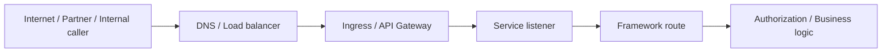

# Shadow API và undocumented route

API inventory là danh mục có kiểm soát về những giao diện mà hệ thống thực sự cung cấp: endpoint, method, phiên bản, môi trường, chủ sở hữu, dữ liệu xử lý và chính sách bảo mật. Trong thực tế, danh mục chính thức thường không phản ánh đầy đủ những gì đang chạy. Một service có thể còn route cũ, một mobile app cũ tiếp tục gọi API đã bỏ khỏi tài liệu, hoặc một backend được truy cập trực tiếp mà không đi qua API gateway. Những giao diện này tạo thành *shadow API* hoặc *undocumented route*.

Một API không có trong tài liệu không nhất thiết là lỗ hổng. Nó có thể là endpoint nội bộ được bảo vệ đúng cách hoặc route mới chưa cập nhật spec. Rủi ro xuất hiện khi tổ chức không biết route tồn tại, không có owner, không kiểm tra quyền, không theo dõi traffic hoặc không có kế hoạch vòng đời. Một endpoint cũ vẫn có thể chứa dữ liệu nhạy cảm và quyền quản trị dù giao diện người dùng hiện tại không còn gọi nó.

Trong API Security, discovery phải kết hợp nguồn tĩnh và nguồn runtime. OpenAPI, source code hoặc gateway config riêng lẻ đều có thể thiếu. Mục tiêu là tìm ra bề mặt API thực tế, xác minh route nào hợp lệ, đánh giá rủi ro và đưa chúng vào quy trình quản trị liên tục.

## 1. Shadow API, undocumented route và zombie API

Các thuật ngữ thường được dùng gần nhau nhưng có ý nghĩa khác nhau:

| Thuật ngữ | Ý nghĩa | Ví dụ |
|---|---|---|
| Documented API | API đã được đăng ký trong inventory/spec chính thức và có owner | `/api/v2/orders` có OpenAPI, auth policy và nhóm chịu trách nhiệm |
| Undocumented route | Route đang tồn tại nhưng thiếu hoặc sai tài liệu/inventory | `POST /api/orders/{id}/recalculate` có trong service nhưng không có trong spec |
| Shadow API | API đang được triển khai hoặc sử dụng ngoài quy trình quản lý/API governance đã phê duyệt | Một service được public qua load balancer riêng, bỏ qua gateway và inventory |
| Zombie API | API cũ được cho là đã ngừng hoặc không còn được hỗ trợ nhưng vẫn hoạt động | `/api/v1/users` vẫn trả dữ liệu dù client mới đã chuyển sang v3 |
| Orphaned endpoint | Route không còn owner rõ ràng hoặc owner đã rời nhóm | Endpoint debug còn mở sau khi dự án kết thúc |

Một route có thể đồng thời là undocumented, shadow và zombie. Cần phân loại theo tình trạng quản trị và vòng đời, không chỉ theo tên gọi.

## 2. Vì sao API ngoài inventory xuất hiện?

Các nguyên nhân thường gặp:

- **Version cũ chưa được gỡ:** mobile app, desktop client hoặc đối tác vẫn dùng API v1 sau khi backend ra v2/v3.
- **Triển khai khẩn cấp:** nhóm phát triển thêm endpoint để xử lý sự cố nhưng quên cập nhật OpenAPI, gateway policy hoặc security review.
- **Đường truy cập trực tiếp:** service được expose qua ingress, load balancer, container port hoặc hostname riêng, không đi qua gateway trung tâm.
- **Route nội bộ bị lộ:** endpoint dành cho vận hành/debug/maintenance vô tình được expose ra mạng công khai.
- **Khác biệt môi trường:** route tồn tại ở staging, preview, QA hoặc production nhưng inventory chỉ ghi một môi trường.
- **Tích hợp đối tác:** callback, webhook hoặc API riêng được cấu hình thủ công ngoài quy trình đăng ký.
- **Tài liệu lỗi thời:** source code thay đổi nhưng spec, developer portal và contract test không được cập nhật.
- **Framework tự tạo endpoint:** actuator, health, metrics, GraphQL, gRPC reflection hoặc route do plugin/framework cung cấp không được đưa vào inventory.
- **Shadow IT hoặc dịch vụ mua ngoài:** một nhóm tự triển khai API hoặc SaaS integration mà bộ phận quản trị không biết.

Việc route không được frontend gọi không chứng minh route không còn được sử dụng. Client cũ, cron job, webhook, đối tác hoặc service khác có thể vẫn phụ thuộc vào nó.

## 3. Vì sao shadow API là rủi ro bảo mật?

API ngoài inventory thường thiếu một hoặc nhiều kiểm soát đã áp dụng cho API chính thức:

- Không có authentication hoặc chấp nhận credential yếu/cũ.
- Có authentication nhưng thiếu function authorization hoặc object-level authorization.
- Không giới hạn tenant, cho phép đọc dữ liệu của tổ chức khác.
- Dùng scope rộng hoặc service account có quyền cao.
- Không có rate limit, payload limit, timeout hoặc quota.
- Trả dữ liệu debug, stack trace, internal ID, email hoặc thông tin cá nhân.
- Cho phép HTTP method nguy hiểm hoặc chức năng quản trị không được tài liệu hóa.
- Chạy phiên bản framework/dependency đã lỗi thời.
- Bỏ qua WAF, gateway, audit hoặc telemetry chuẩn.
- Không có owner xử lý cảnh báo, vá lỗi hoặc thu hồi endpoint.

Một endpoint cũ có thể trở thành đường vòng qua kiểm soát mới. Ví dụ API v2 đã kiểm tra `orders:read` và quyền trên từng order, nhưng route v1 vẫn chỉ yêu cầu token hợp lệ. Attacker có thể gọi trực tiếp route cũ nếu biết hoặc tìm được URL.

## 4. Không chỉ dựa vào OpenAPI để tìm API

OpenAPI/Swagger là nguồn quan trọng để hiểu contract, nhưng chỉ phản ánh những gì được mô tả trong spec. Nó có thể thiếu route nội bộ, route legacy, endpoint phát sinh động hoặc method chưa được khai báo. Ngược lại, spec có thể chứa route đã bị xóa.

Hãy kết hợp nhiều nguồn độc lập:

| Nguồn discovery | Có thể phát hiện | Giới hạn |
|---|---|---|
| OpenAPI/Swagger và developer portal | Route, schema, auth scheme được công bố | Có thể cũ, thiếu hoặc không khớp runtime |
| Source code và framework route registry | Controller, router, annotation, method mapping | Có thể không thấy route tạo động hoặc dịch vụ ngoài repository |
| API gateway/ingress/load balancer config | Host, path, method, upstream và exposure | Có thể bỏ sót đường truy cập trực tiếp vào service |
| Access log và gateway traffic | Route thực sự được gọi, caller, status, volume | Chỉ thấy traffic trong thời gian lưu log; route không được gọi sẽ vắng mặt |
| Distributed tracing/APM | Luồng gọi giữa service và downstream | Sampling có thể bỏ sót; URL/header cần redaction |
| DNS, certificate và cloud asset inventory | Hostname, listener, load balancer, public endpoint | Host có thể không còn hoạt động hoặc không phải API |
| Web/mobile client và SDK | API mà client đang gọi, kể cả version cũ | Không bao phủ mọi client/partner |
| CI/CD artifact và deployment manifest | Service/route được build hoặc triển khai | Manifest có thể không phản ánh trạng thái thực tế |
| Webhook/integration registry | Callback và endpoint đối tác | Registry có thể thiếu integration được cấu hình thủ công |
| Service mesh và network flow | Service-to-service destination và traffic | Không phải mọi giao thức đều dễ ánh xạ thành route HTTP |

So sánh kết quả giữa các nguồn giúp tìm chênh lệch: code có route nhưng gateway không biết; gateway có upstream nhưng inventory không có; traffic gọi host không thuộc danh sách; spec khai báo endpoint nhưng runtime không còn phục vụ.

## 5. Quy trình discovery theo hai hướng: passive và active

### Passive discovery

Passive discovery thu thập metadata từ những hoạt động và cấu hình đang có mà không chủ động gửi request dò tìm endpoint. Nguồn thường dùng là access log, trace, gateway config, service registry, DNS/certificate inventory, source repository và deployment manifest.

Ưu điểm là ít tác động tới hệ thống và phản ánh route thực sự được sử dụng. Nhược điểm là không phát hiện được route chưa có traffic trong cửa sổ quan sát hoặc chỉ được gọi theo mùa vụ.

Khi phân tích log/trace, chỉ thu thập route template, method, host, status và metadata cần thiết. Không sao chép access token, cookie, query chứa secret hoặc raw payload vào inventory.

### Active discovery

Active discovery gửi request có kiểm soát tới các host/path đã nằm trong phạm vi được phép để xác minh route, method, authentication và response. Có thể dùng crawler, API scanner hoặc kiểm tra contract.

Trước khi chạy:

- Xác định rõ hostname, IP, environment và service thuộc phạm vi kiểm tra.
- Ưu tiên staging hoặc môi trường kiểm thử; production cần có phê duyệt và giới hạn tốc độ.
- Dùng tài khoản test với quyền tối thiểu và dữ liệu giả lập.
- Bắt đầu bằng các phương thức ít tác động như `GET`, `HEAD` hoặc `OPTIONS` nếu endpoint hỗ trợ.
- Không tự động gọi `POST`, `PUT`, `PATCH` hoặc `DELETE` trên dữ liệu thật khi chưa biết tác động.
- Đặt request rate, concurrency, timeout và ngưỡng dừng.
- Ghi lại scanner, thời gian, scope và request ID để owner phân biệt traffic kiểm tra.

Active discovery không phải là lý do để fuzz hoặc brute-force đường dẫn ngoài phạm vi. Mục tiêu là xác minh bề mặt đã biết hoặc được phê duyệt, không gây gián đoạn hay thay đổi dữ liệu.

## 6. Lập inventory có đủ thông tin bảo mật

Một dòng inventory chỉ ghi URL là chưa đủ. Mỗi API/service nên có metadata giúp xác định owner, exposure, dữ liệu và policy.

| Trường | Nội dung cần lưu |
|---|---|
| API/service ID | Định danh ổn định của API hoặc service |
| Host/base URL | Hostname, base path và environment |
| Route/method | Path template, HTTP method hoặc operation name |
| Protocol/style | REST, GraphQL, gRPC, WebSocket, webhook hoặc protocol khác |
| Version | API version, schema version hoặc trạng thái legacy |
| Owner | Nhóm chịu trách nhiệm, contact và escalation path |
| Exposure | Public, partner, internal, private network hoặc management plane |
| Authentication | OAuth/OIDC, mTLS, API key, session hoặc anonymous |
| Authorization | Function permission, object policy, tenant scope và service identity |
| Data classification | Public, internal, confidential, personal hoặc regulated data |
| Dependencies | Database, service, provider, queue và storage liên quan |
| Lifecycle | Active, deprecated, sunset planned, retired hoặc unknown |
| Discovery evidence | Source code, spec, gateway, traffic, DNS hoặc scanner |
| Last verified | Lần cuối đối chiếu runtime và policy |
| Security status | Owner assigned, reviewed, exception hoặc remediation pending |

Ví dụ record minh họa:

```yaml
apiId: orders-api
environment: production
host: api.example.test
route: /api/v1/orders/{orderId}/export
method: POST
protocol: REST
version: v1
owner: commerce-platform
exposure: public
authentication: oauth2-access-token
authorization:
  functionPermission: orders:export
  objectScope: tenant-and-order
dataClassification: confidential
lifecycle: deprecated
discoveredFrom:
  - gateway-traffic
  - service-route-registry
lastVerified: 2026-11-18
```

Record trên chỉ là ví dụ cấu trúc. Không đưa token, secret, payload thật hoặc dữ liệu cá nhân vào inventory. Lưu reference tới secret manager hoặc policy document nếu cần, không lưu giá trị bí mật.

## 7. Chuẩn hóa route trước khi so sánh

Một lỗi phổ biến là so sánh URL dạng chuỗi nguyên văn. Cùng một route có thể xuất hiện dưới nhiều dạng hoặc có cách match khác nhau tùy framework, proxy và server.

Hãy chuẩn hóa và lưu các thành phần riêng:

- Scheme, hostname, port và environment.
- Base path và route template, ví dụ `/orders/{orderId}`.
- HTTP method, bao gồm `GET`, `POST`, `PUT`, `PATCH`, `DELETE`, `HEAD` và `OPTIONS`.
- Version trong path, header hoặc media type.
- Content type và response media type.
- Query parameter names và schema, không lưu giá trị nhạy cảm.
- Authentication scheme và permission cần thiết.
- Trailing slash, chữ hoa/thường và quy tắc percent-encoding theo server thực tế.
- Redirect, rewrite rule, alias và route do gateway tạo.

Không gộp hai route chỉ vì path gần giống nhau. `GET /users/{id}` và `DELETE /users/{id}` có tác động và quyền khác nhau. `POST /orders/{id}/cancel` cũng có ý nghĩa nghiệp vụ khác `POST /orders` dù cùng method.

Các biến thể như `%2F`, encoded dot segment, duplicate slash hoặc path normalization có thể được gateway và backend diễn giải khác nhau. Cần kiểm tra cấu hình route matching và đảm bảo lớp gateway/backend thống nhất cách chuẩn hóa. Không dựa vào một regex đơn giản để kết luận endpoint đã được bảo vệ.

## 8. Đừng bỏ sót API không phải REST route thông thường

Inventory cần bao phủ mọi bề mặt giao tiếp có thể xử lý dữ liệu hoặc hành động:

| Loại giao diện | Ví dụ cần inventory |
|---|---|
| REST | Path/method và version |
| GraphQL | Endpoint, schema, query/mutation, resolver và introspection policy |
| gRPC | Service, RPC method, reflection và transport exposure |
| WebSocket | Handshake, subprotocol, message type và authorization sau khi kết nối |
| Webhook | Inbound callback, outbound destination, event type và signature policy |
| Async API | Queue/topic, event schema, producer/consumer identity và tenant scope |
| Management/operations | Health, metrics, actuator, admin, debug và maintenance endpoint |
| File transfer | Upload/download, signed URL và object storage API |
| Partner API | Hostname, client registration, contract và credential riêng |

Một GraphQL endpoint có thể chỉ có một URL nhưng expose nhiều query và mutation. Một WebSocket có thể xác thực lúc handshake nhưng cần phân quyền cho từng message hoặc subscription. Một queue consumer không có URL HTTP nhưng vẫn là API giữa các service. Không giới hạn inventory ở danh sách controller REST.

## 9. Phân biệt route tồn tại với route thực sự được expose

Route trong source code không nhất thiết truy cập được từ internet. Ngược lại, một service có thể bị expose qua hostname hoặc listener không xuất hiện trong tài liệu.

Hãy xác minh đường đi:



Với từng route, xác định:

- Host nào resolve tới listener?
- Listener có public IP hoặc public load balancer không?
- Route có đi qua gateway/WAF/authentication middleware không?
- Có thể truy cập trực tiếp service bằng IP/port hoặc internal DNS không?
- Gateway và backend có cùng quy tắc path normalization không?
- Management port có bị expose chung với application port không?
- Có route rewrite hoặc alias tạo đường truy cập khác không?

Một route nội bộ vẫn cần authentication và authorization phù hợp vì mạng nội bộ không phải ranh giới tin cậy tuyệt đối. Network restriction là lớp bổ sung, không thay thế identity và permission.

## 10. Tìm chênh lệch giữa code, spec, gateway và traffic

Hãy tạo tập hợp route từ từng nguồn rồi đối chiếu theo host, method, path template, version và environment.

| Phát hiện | Cách diễn giải ban đầu | Việc cần xác minh |
|---|---|---|
| Code có route, spec không có | Undocumented route hoặc spec chưa cập nhật | Owner, traffic, auth và mục đích |
| Gateway có route, code hiện tại không có | Upstream cũ, rewrite hoặc cấu hình stale | Backend đích, deployment và traffic thực tế |
| Traffic có host/path ngoài inventory | Shadow API hoặc hostname chưa đăng ký | DNS, certificate, load balancer và service owner |
| Spec có route nhưng không thấy traffic | API ít dùng, client theo mùa hoặc route đã chết | Cửa sổ quan sát, client cũ và hợp đồng đối tác |
| Backend có thể truy cập trực tiếp | Bypass gateway hoặc exposure ngoài dự kiến | Network policy, auth middleware và firewall |
| Route xuất hiện ở production nhưng chỉ tài liệu staging | Drift giữa môi trường | Release manifest và security policy theo môi trường |

Không tự động xóa route chỉ vì không thấy traffic trong vài ngày. Một API có thể chỉ được gọi cuối tháng, cuối quý, khi đối soát hoặc trong tình huống khẩn cấp. Cần cửa sổ quan sát phù hợp với chu kỳ nghiệp vụ và xác nhận từ owner/client trước khi retire.

## 11. Đánh giá rủi ro của route chưa được quản lý

Ưu tiên điều tra theo mức độ phơi lộ và tác động, không chỉ theo số lượng endpoint.

Các dấu hiệu cần ưu tiên cao:

- Route public hoặc partner-facing nhưng không có authentication.
- Có dữ liệu cá nhân, tài chính, bí mật kinh doanh hoặc dữ liệu regulated.
- Có chức năng admin, impersonation, role management, export, refund hoặc delete.
- Thiếu function authorization hoặc object/tenant-level authorization.
- Chấp nhận API key/token dài hạn, scope quá rộng hoặc credential đã hết vòng đời.
- Cho phép truy vấn/batch không giới hạn hoặc gọi dependency tốn phí.
- Expose actuator, debug, metrics hoặc cấu hình nội bộ.
- Có dependency/framework đã hết hỗ trợ hoặc lỗi thời.
- Không có owner, log/audit hoặc quy trình xử lý sự cố.
- Có thể truy cập trực tiếp backend bỏ qua gateway policy.

Một route nội bộ có thể có rủi ro cao nếu nó thực hiện thao tác đặc quyền. Một route public chỉ trả dữ liệu công khai có thể có mức ưu tiên thấp hơn, nhưng vẫn cần owner và lifecycle rõ ràng.

## 12. Xác minh security control trên từng endpoint

Khi tìm được route, không chỉ đánh dấu “có authentication”. Hãy kiểm tra theo từng lớp:

| Lớp | Câu hỏi kiểm tra |
|---|---|
| Authentication | Credential được xác minh đúng issuer/audience/signature/expiry hoặc client identity không? |
| Function authorization | Caller có permission đúng cho action và HTTP method không? |
| Object authorization | Caller có quyền trên object được tham chiếu không? |
| Tenant isolation | Query, cache, file và response bị giới hạn theo tenant tin cậy không? |
| Input validation | Schema, kích thước, enum, range, nested object và unknown field được kiểm soát không? |
| Resource protection | Rate, concurrency, page size, batch, timeout và payload có giới hạn không? |
| Data protection | Response chỉ chứa field cần thiết; TLS, cache và secret handling phù hợp không? |
| Error handling | Không lộ stack trace, SQL, hostname nội bộ hoặc credential không? |
| Audit/monitoring | Có owner, request correlation, security event và alert không? |
| Lifecycle | Có version, deprecation plan, support window và retirement owner không? |

Kiểm tra quyền với nhiều principal và tenant. Một token hợp lệ không chứng minh caller được gọi mọi chức năng. Route v1 và v2 cần cùng tiêu chuẩn bảo mật; không giả định version cũ an toàn vì nó ít được dùng.

## 13. Kiểm soát endpoint quản trị và debug

Endpoint phục vụ vận hành có thể tiết lộ cấu hình, route mapping, health detail, environment variable, dependency status hoặc dữ liệu nội bộ. Ví dụ trong Spring Boot Actuator, endpoint `mappings`, `env`, `configprops`, `heapdump` và `loggers` cần được quản lý cẩn thận.

Các nguyên tắc:

- Chỉ expose endpoint management thật sự cần thiết.
- Tách management port/network khỏi application traffic khi kiến trúc cho phép.
- Yêu cầu authentication mạnh và permission riêng cho thao tác quản trị.
- Giới hạn quyền đọc và ghi theo từng endpoint management.
- Không expose heap dump, environment, config hoặc mapping chi tiết ra internet.
- Không coi endpoint `health` là vô hại nếu response chứa tên host, database, dependency hoặc thông tin nội bộ.
- Kiểm tra cả endpoint do framework/plugin tự tạo và endpoint được bật qua cấu hình môi trường.

Ví dụ cấu hình Spring Boot Actuator có thể chỉ expose health qua HTTP management interface:

```yaml
management:
  endpoints:
    web:
      exposure:
        include: health
```

Đây chỉ là một phần cấu hình exposure. Ứng dụng vẫn cần cấu hình security cho management endpoint, quyết định có dùng management port riêng hay không và kiểm tra response health không tiết lộ chi tiết nhạy cảm. Không bật `include: "*"` cho production chỉ để tiện debug.

## 14. Xử lý route không rõ owner hoặc mục đích

Không nên xóa hoặc block một route ngay khi scanner phát hiện. Trước tiên hãy xác minh:

1. Host/service và deployment nào đang phục vụ route?
2. Nhóm nào sở hữu code, gateway config và dữ liệu liên quan?
3. Caller nào đang sử dụng route trong cửa sổ quan sát?
4. Có client cũ, mobile app, đối tác hoặc job định kỳ phụ thuộc không?
5. Route có tạo side effect hoặc xử lý dữ liệu nhạy cảm không?
6. Route có thể được thay bằng API được quản lý nào?
7. Có thể tạm giới hạn exposure hoặc permission mà không phá vỡ nghiệp vụ không?

Nếu chưa tìm được owner, gán một owner quản trị tạm thời để điều phối điều tra. Route public có rủi ro cao nhưng không rõ owner cần được escalation tới security/platform team; không để trạng thái `unknown` kéo dài vô thời hạn.

Trong thời gian điều tra, có thể áp dụng biện pháp giảm thiểu theo rủi ro như chặn truy cập internet, yêu cầu authentication, giới hạn source network hoặc rate limit. Nhưng phải kiểm tra tác động và không dùng một policy chung làm gián đoạn endpoint hợp lệ của tenant khác.

## 15. Deprecation và retirement an toàn

Khi xác định route không còn cần thiết hoặc đã được thay thế, hãy thực hiện deprecation có kế hoạch:

1. Xác định owner, client, traffic và dữ liệu bị ảnh hưởng.
2. Chọn API thay thế và xác nhận chức năng/quyền tương đương.
3. Thông báo client/đối tác, thời hạn chuyển đổi và hướng dẫn migration.
4. Có thể dùng header `Deprecation` và `Sunset` nếu phù hợp với contract và hạ tầng.
5. Theo dõi traffic còn lại theo client/version mà không log token hoặc payload nhạy cảm.
6. Giảm exposure hoặc scope khi có thể, đồng thời giữ compatibility trong thời hạn đã công bố.
7. Sau thời hạn, tắt route ở gateway và backend; kiểm tra mọi alias/hostname/HTTP method.
8. Xóa cấu hình, secret, certificate, DNS record, policy và documentation không còn dùng theo quy trình.
9. Giữ audit/evidence về thời điểm retire và cách xử lý client còn gọi.

Header `Sunset` có thể công bố thời điểm một tài nguyên dự kiến ngừng hoạt động; `Deprecation` có thể đánh dấu trạng thái deprecated. Header không tự tắt endpoint và không thay thế thông báo trực tiếp cho client/đối tác.

Không coi việc route không xuất hiện trong spec là đã retire. Cần xác minh ở runtime, gateway, ingress, backend và các host alias. Một route có thể vẫn tồn tại trực tiếp dù gateway đã xóa mapping.

## 16. Tích hợp API inventory vào CI/CD

Discovery nên trở thành quy trình liên tục thay vì một đợt rà soát duy nhất.

Trong CI/CD, có thể:

- Trích xuất route từ framework/build artifact hoặc API specification.
- So sánh OpenAPI diff để phát hiện endpoint/method/schema mới hoặc bị xóa.
- Yêu cầu owner, classification, authentication và permission cho route mới.
- Kiểm tra route mới có xuất hiện trong gateway/ingress config tương ứng không.
- Chạy contract/security test cho authentication, function/object authorization và tenant isolation.
- Chặn release nếu route nhạy cảm không có policy hoặc owner theo quy định.
- Ghi phiên bản inventory gắn với commit/build/deployment.

Không nên chặn mọi route mới chỉ vì chưa có spec nếu pipeline đang hỗ trợ một giao diện nội bộ có quy trình riêng. Thay vào đó, yêu cầu route có loại giao diện, owner, security policy và nguồn contract phù hợp. API governance cần bao phủ REST, GraphQL, gRPC, webhook và async interface.

## 17. Runtime discovery và phát hiện drift

Sau khi deploy, đối chiếu route inventory với traffic và cấu hình runtime:

- Route/host mới xuất hiện trong gateway hoặc access log.
- Backend có listener hoặc public address chưa được inventory ghi nhận.
- Traffic gọi method/path không có trong contract đã đăng ký.
- Route cũ vẫn có traffic sau ngày sunset.
- Service có thể truy cập trực tiếp qua network path không được phê duyệt.
- Authentication/authorization failure tăng ở một route legacy.
- Endpoint không có owner hoặc chưa được xác minh quá thời hạn.

Tạo cảnh báo drift theo mức độ rủi ro và có quy trình triage. Không alert mỗi lần một URL lạ xuất hiện mà không gom theo host/path template; điều đó tạo quá nhiều nhiễu. Đồng thời không ghi nguyên query/body chứa thông tin cá nhân hoặc token để phục vụ discovery.

## 18. Ví dụ đối chiếu inventory với runtime

Giả sử inventory có:

```text
GET  /api/v2/orders/{orderId}       documented, owner=commerce
POST /api/v2/orders/{orderId}/cancel documented, owner=commerce
```

Nhưng gateway traffic ghi nhận:

```text
GET    /api/v1/orders/{orderId}
POST   /api/v1/orders/{orderId}/refund
GET    /actuator/mappings
```

Các phát hiện cần được phân loại:

- `/api/v1/orders/{orderId}` có thể là zombie/legacy route; xác định client còn sử dụng và so sánh policy với v2.
- `/api/v1/orders/{orderId}/refund` có tác động tài chính; ưu tiên cao để xác minh authentication, `payments:refund`, object/tenant scope, approval và audit.
- `/actuator/mappings` có thể tiết lộ cấu trúc route; kiểm tra exposure, network và management security.

Không kết luận route nào cũng phải xóa chỉ dựa trên tên. Owner cần xác nhận mục đích và traffic; security team đánh giá mức rủi ro; platform team xác minh đường expose thực tế.

## 19. Kiểm thử API discovery và route governance

Một quy trình discovery tốt cần được kiểm thử để tránh bỏ sót hoặc tự tạo false positive:

| Tình huống | Kết quả mong đợi |
|---|---|
| Route có trong code và spec | Inventory ghi nhận đúng method, version và owner |
| Route có trong code nhưng thiếu spec | Tạo finding undocumented route để triage |
| Gateway có route nhưng backend không còn | Phát hiện stale mapping và xác minh trước khi xóa |
| Backend public bypass gateway | Phát hiện exposure và yêu cầu policy/network remediation |
| API v1 vẫn được client cũ gọi | Có owner, usage evidence và deprecation plan |
| Endpoint debug/actuator xuất hiện | Exposure được kiểm tra; endpoint nhạy cảm không public |
| Chỉ một HTTP method được ghi trong spec | Discovery phát hiện method khác đang hoạt động |
| Route có trailing slash/encoded path/alias | Chuẩn hóa và so sánh theo semantics runtime |
| GraphQL/gRPC/WebSocket/webhook | Được inventory theo đúng loại interface |
| Không có traffic trong một cửa sổ ngắn | Không tự động retire khi chưa xét chu kỳ nghiệp vụ |
| Route không có owner | Escalation và gán owner tạm thời |
| Route bị retire | Gateway, backend, alias và direct access đều không còn phục vụ |
| Client gọi route đã sunset | Có metric/alert; không log credential hoặc payload nhạy cảm |

Kiểm thử authorization riêng cho route phát hiện được: token thiếu, token hợp lệ nhưng thiếu permission, object của user khác, tenant khác, HTTP method khác và truy cập trực tiếp backend. Một route có thể đã được inventory nhưng vẫn không an toàn nếu policy không được thực thi.

## 20. Checklist quản trị shadow API

- [ ] Kết hợp source code, OpenAPI, gateway, traffic, DNS, cloud asset, client và service mesh.
- [ ] Phân biệt documented, undocumented, shadow, zombie và orphaned API.
- [ ] Inventory có host, environment, method, route template, version, protocol, owner và lifecycle.
- [ ] Ghi authentication, function/object authorization, tenant scope và data classification.
- [ ] Bao phủ REST, GraphQL, gRPC, WebSocket, webhook, async và management endpoint.
- [ ] Chuẩn hóa path/method/version nhưng giữ đúng semantics của gateway và backend.
- [ ] Xác minh public exposure, direct backend access và management port.
- [ ] Active discovery có scope, tài khoản test, rate limit và ngưỡng dừng.
- [ ] Route chưa rõ owner được triage/escalate, không bị bỏ quên.
- [ ] Route legacy có owner, client evidence và deprecation/sunset plan.
- [ ] CI/CD phát hiện route drift và yêu cầu policy cho endpoint mới.
- [ ] Runtime monitoring phát hiện host/path/method ngoài inventory.
- [ ] Retirement xác minh ở gateway, backend, DNS, alias, credential và client.
- [ ] Log/trace phục vụ discovery không chứa token, secret hoặc payload nhạy cảm.

## Kết luận

Shadow API và undocumented route xuất hiện khi code, deployment, gateway, client và tài liệu không còn đồng bộ. Chúng có thể giữ quyền cũ, bỏ qua gateway, expose dữ liệu nhạy cảm hoặc không có owner xử lý. Hãy kết hợp discovery từ source, spec, hạ tầng và traffic; chuẩn hóa route theo host, method, version và protocol; sau đó xác minh authentication, function/object authorization, tenant scope và data handling trên từng endpoint. Những route không còn cần thiết phải được deprecate và retire qua quy trình có owner, client communication và kiểm tra runtime. Khi inventory được cập nhật trong CI/CD và đối chiếu liên tục với production, tổ chức có thể phát hiện API ngoài quản lý trước khi chúng trở thành đường truy cập bị bỏ quên.
