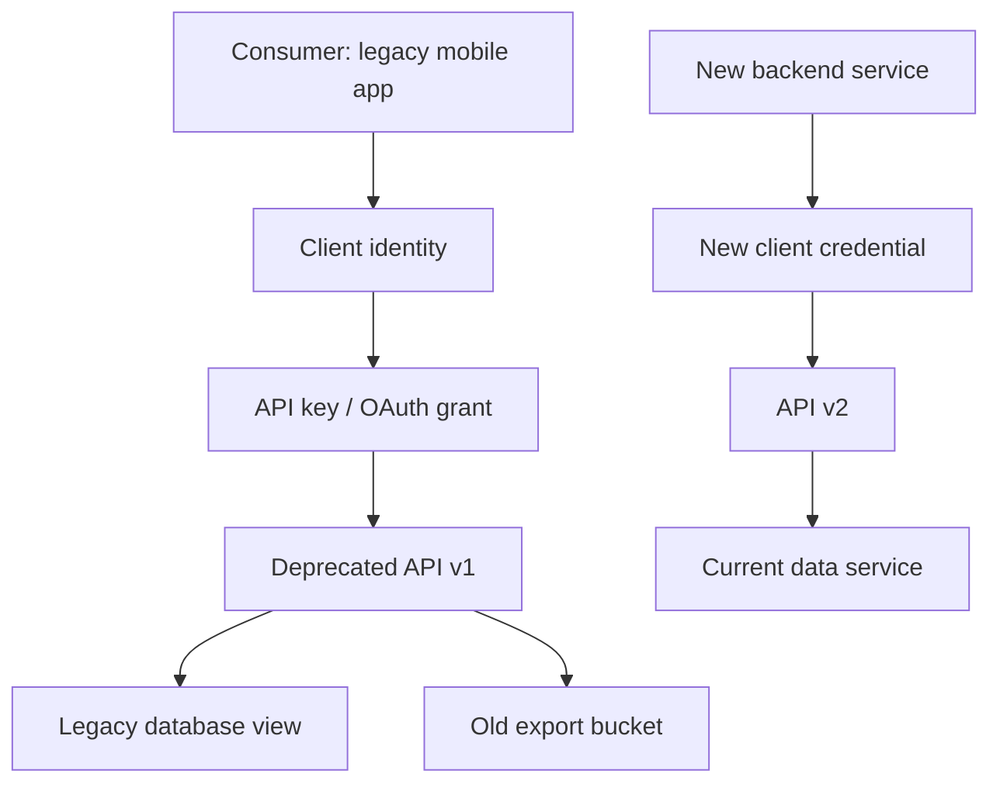
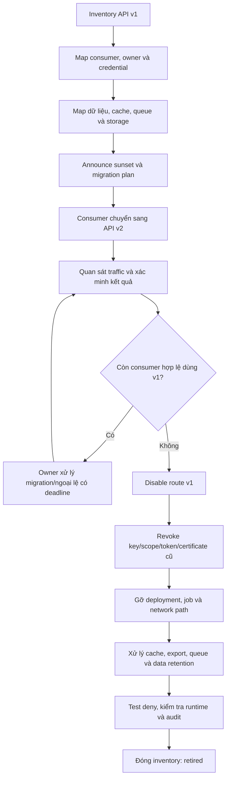

# Deprecated API vẫn còn credential hoặc dữ liệu

## 1. Vì sao API deprecated vẫn là rủi ro bảo mật?

Một API được đánh dấu deprecated thường vẫn tiếp tục hoạt động trong một khoảng thời gian để client có thể chuyển đổi. Tuy nhiên, nếu endpoint cũ vẫn truy cập được, credential cũ vẫn hợp lệ hoặc dữ liệu cũ vẫn được trả về, bề mặt tấn công của hệ thống vẫn còn tồn tại.

Một API có thể đã biến mất khỏi tài liệu công khai nhưng vẫn được sử dụng bởi mobile app cũ, batch job, đối tác, script vận hành hoặc một service nội bộ ít được biết đến. Một API version cũ cũng có thể dùng chung database, object storage, cache hoặc credential với phiên bản mới. Vì vậy, xóa route khỏi source code hoặc thêm nhãn deprecated không chứng minh API đã được loại bỏ an toàn.

Các tình huống thường gặp:

- Endpoint cũ vẫn được expose qua gateway, ingress hoặc một hostname khác.
- API key, OAuth client secret, refresh token hoặc certificate cũ chưa bị thu hồi.
- Token đã cấp trước đây vẫn có audience và scope cho API cũ.
- Service account cũ vẫn có quyền đọc dữ liệu hoặc gọi service nội bộ.
- Dữ liệu nhạy cảm vẫn tồn tại trong database, cache, search index, object storage, queue, log hoặc backup.
- Client không còn owner vẫn tiếp tục gọi API bằng credential dùng chung.
- API mới đã được bảo vệ tốt hơn nhưng API cũ vẫn bỏ qua authorization, validation hoặc audit mới.
- Endpoint cũ còn được dùng như đường vòng để truy cập dữ liệu mà API mới đã hạn chế.

Trong phạm vi **SECURITY_API_SECURITY**, inventory và discovery không dừng ở việc liệt kê endpoint. Đội ngũ cần theo dõi cả credential, principal, data store, consumer và đường đi mạng gắn với từng API. Việc retire API phải đóng được quyền truy cập và xử lý dữ liệu theo policy, đồng thời chứng minh không còn consumer hợp lệ phụ thuộc vào phiên bản cũ.

Sau bài học này, người học có thể:

1. Phân biệt deprecated, sunset và shutdown.
2. Tìm API cũ đang hoạt động từ nhiều nguồn inventory và runtime.
3. Liên kết API với owner, consumer, credential, scope và dữ liệu.
4. Lập kế hoạch thu hồi API key, OAuth client, token, certificate và service account.
5. Phát hiện dữ liệu còn sót trong cache, queue, log, backup và bản sao.
6. Thực hiện deprecation, migration, shutdown và verification có kiểm soát.
7. Xử lý trường hợp API cũ hoặc credential cũ vẫn được sử dụng sau ngày sunset.

## 2. Phân biệt deprecated, sunset và shutdown

Ba trạng thái này có ý nghĩa khác nhau và cần được quản lý riêng.

| Trạng thái | Ý nghĩa | Hành vi |
|---|---|---|
| Active | API đang được hỗ trợ | Tiếp tục phục vụ theo contract hiện hành |
| Deprecated | API đã được thông báo sẽ ngừng hỗ trợ | Vẫn có thể hoạt động trong thời gian chuyển đổi; cần cảnh báo và theo dõi |
| Sunset scheduled | Đã công bố thời điểm ngừng phục vụ | Consumer phải chuyển đổi trước deadline |
| Disabled/Shutdown | API không còn nhận request nghiệp vụ | Request bị từ chối hoặc route không còn tồn tại |
| Retired | Credential, quyền, route và phụ thuộc đã được xử lý theo quy trình | Không còn đường truy cập hợp lệ ngoài ngoại lệ được phê duyệt |

Deprecated không có nghĩa là vô hiệu hóa. Nếu API chỉ được đánh dấu trong OpenAPI hoặc tài liệu nhưng server vẫn xử lý request bình thường, API vẫn là một phần của attack surface.

Shutdown cũng chưa chắc đã hoàn tất retirement. Route có thể bị tắt nhưng API key vẫn dùng được ở một endpoint khác; dữ liệu vẫn có thể nằm trong export hoặc backup; certificate cũ vẫn được trust bởi service khác.

Một quy trình hoàn chỉnh cần quản lý riêng:

- API lifecycle: route và implementation còn hoạt động hay không.
- Credential lifecycle: key, token, client, certificate và service account còn hiệu lực không.
- Authorization lifecycle: principal còn scope, role hoặc data binding nào không.
- Data lifecycle: dữ liệu còn tồn tại ở đâu, ai được đọc và khi nào được xóa.
- Consumer lifecycle: client, job, SDK và tích hợp đã chuyển đổi hay chưa.

## 3. Vì sao inventory API thường bỏ sót phiên bản cũ?

Inventory có thể không đầy đủ vì endpoint tồn tại ở nhiều lớp và nhiều repository.

Ví dụ một hệ thống có:

- `/v1/orders` trong application.
- `/legacy/orders` được gateway route tới một service cũ.
- `api-old.example.com` trỏ tới ingress khác.
- Một mobile app cũ gọi trực tiếp hostname cũ.
- Một scheduled job gọi private endpoint.
- Một đối tác gọi API qua VPN hoặc allowlisted IP.
- Một bản triển khai cũ còn tồn tại ở region phụ hoặc cluster disaster recovery.

Tài liệu API thường phản ánh thiết kế dự kiến, trong khi runtime traffic phản ánh những gì thực sự đang được gọi. Source code thể hiện route có thể tồn tại, còn gateway, DNS, service mesh và network configuration cho biết route có thực sự được expose hay không.

Không nên kết luận API không còn được dùng chỉ vì không thấy trong OpenAPI, repository chính hoặc dashboard traffic của một gateway. Cần đối chiếu nhiều nguồn và xác định phạm vi quan sát của từng nguồn.

## 4. Khám phá API cũ từ nhiều nguồn

Một quy trình inventory đáng tin cậy kết hợp dữ liệu tĩnh và dữ liệu runtime.

| Nguồn | Có thể phát hiện | Hạn chế |
|---|---|---|
| API gateway/ingress | Route, hostname, version, policy và traffic | Có thể bỏ sót endpoint đi vòng gateway |
| DNS và certificate inventory | Hostname, alias, certificate còn hiệu lực | Không chứng minh hostname có API đang hoạt động |
| Source repository | Controller, route, version và middleware | Code có thể không được deploy hoặc deploy ở nơi khác |
| OpenAPI/GraphQL schema | Contract, operation và version được công bố | Tài liệu có thể cũ hoặc thiếu |
| Service mesh | Service-to-service calls và workload identity | Không nhất thiết thấy traffic ngoài mesh |
| Load balancer/firewall | Kết nối, listener, port và source | Không biết đầy đủ semantics của API |
| Application access log | Endpoint, status, caller metadata | Có thể thiếu, đã sampling hoặc retention ngắn |
| APM/distributed tracing | Dependency và luồng gọi | Không phải mọi request đều được trace |
| CI/CD và deployment inventory | Version, image, cluster, region | Có thể còn deployment thủ công ngoài pipeline |
| Client SDK/mobile inventory | Consumer và version đang phát hành | Khó xác định app đã cài nhưng không hoạt động |
| Partner/contract register | Tích hợp bên ngoài và owner | Có thể thiếu tích hợp phát sinh ngoài quy trình |
| Job scheduler/event broker | Batch, consumer và background workload | Consumer có thể không tạo HTTP access log thông thường |

### 4.1. Đối chiếu route trong source với route runtime

Tìm route trong source code là bước khởi đầu, không phải kết luận. Cần so sánh:

- Route được định nghĩa trong ứng dụng.
- Route được cấu hình ở gateway/ingress.
- Hostname và listener có thể đưa traffic đến ứng dụng.
- Version artifact đang chạy trong từng môi trường.
- Traffic quan sát được theo endpoint, method và caller.
- Quy tắc firewall hoặc private network cho phép kết nối.

Nếu route có trong source nhưng không có deployment, ghi nhận là code-only hoặc dormant. Nếu route không có trong source mới nhưng gateway vẫn route đến service cũ, đó là một exposure cần xử lý.

### 4.2. Dùng traffic history đủ dài

Không có request trong vài ngày không chứng minh API đã hết consumer. Một API có thể chỉ được gọi vào cuối tháng, cuối quý, khi đối soát hoặc trong tình huống khôi phục thảm họa.

Thời gian quan sát nên bao phủ chu kỳ nghiệp vụ phù hợp. Với job định kỳ, cần biết lịch chạy; với consumer hiếm khi hoạt động, cần xác minh owner và cấu hình thay vì chỉ dựa vào traffic.

### 4.3. Phát hiện hostname và alias cũ

API có thể được gọi qua nhiều hostname, CNAME hoặc private DNS zone. Khi retire, cần tìm:

- Hostname public và private.
- Alias cũ và vanity domain.
- Listener ở region hoặc cluster khác.
- Route qua VPN, peering hoặc private link.
- Certificate còn được gắn với hostname cũ.
- Redirect hoặc proxy route dẫn tới endpoint cũ.

Xóa DNS record không phải là cơ chế thu hồi credential. DNS cache, client cấu hình IP tĩnh hoặc đường private khác vẫn có thể tiếp cận service.

## 5. Xây dựng bản ghi inventory có thể hành động

Một bản ghi API chỉ có tên và URL chưa đủ để quản lý retirement. Nên lưu các trường hỗ trợ owner, risk và dependency mapping.

| Trường | Mục đích |
|---|---|
| API ID | Định danh ổn định của API |
| Service/owner | Nhóm chịu trách nhiệm kỹ thuật và nghiệp vụ |
| Environment/region | Nơi API đang chạy |
| Hostname/route/method | Cách truy cập cụ thể |
| API version | Version hoặc contract |
| Lifecycle status | Active, deprecated, sunset, disabled, retired |
| Data classification | Loại dữ liệu được xử lý |
| Authentication | API key, OAuth, mTLS, session hoặc cơ chế khác |
| Principal/client | Consumer hoặc workload được xác minh |
| Credential reference | Tham chiếu tới key/certificate/secret record, không lưu plaintext |
| Scopes/permissions | Quyền được cấp |
| Tenant/data scope | Phạm vi dữ liệu |
| Consumer/owner contact | Ai đang phụ thuộc và ai cần thông báo |
| Last seen | Lần sử dụng gần nhất và nguồn đo |
| Sunset date | Deadline đã công bố |
| Dependencies | Database, queue, storage và downstream service |
| Evidence | Link ticket, dashboard, contract hoặc approval |
| Retirement state | Các bước đã hoàn tất và bằng chứng xác minh |

Không lưu API secret, private key hoặc raw token vào inventory. Chỉ lưu reference hoặc identifier an toàn để nhóm vận hành biết credential nào cần rà soát.

### 5.1. Gắn owner cho cả API và consumer

Một API có thể do team A vận hành nhưng được nhiều team khác sử dụng. Cần owner của API và owner của từng consumer. Nếu chỉ có một owner chung, sẽ khó xác định ai cần migrate hoặc ai có quyền phê duyệt ngoại lệ.

Consumer có thể là:

- Frontend hoặc mobile application.
- Internal service hoặc microservice.
- Scheduled job, batch hoặc worker.
- Đối tác bên ngoài.
- Data pipeline hoặc analytics job.
- Support tool hoặc admin console.
- Test automation và operational script.

Nếu consumer không có owner, ghi rõ trạng thái unknown và xử lý như một rủi ro cần điều tra. Không tự động giả định traffic lạ là attacker hoặc traffic ít là vô hại.

## 6. Phân loại mức rủi ro của API deprecated

Không phải mọi API cũ có cùng mức rủi ro. Ưu tiên theo khả năng bị truy cập, dữ liệu và quyền mà credential còn nắm giữ.

Các yếu tố nên đánh giá:

- API có public internet exposure hay chỉ internal?
- Có authentication hay anonymous access?
- Credential có còn active và được dùng bởi nhiều consumer không?
- API có dữ liệu cá nhân, tài chính, bí mật kinh doanh hoặc dữ liệu nhạy cảm không?
- API có quyền ghi, xóa, export hoặc quản trị không?
- Authorization có object/tenant check hay chỉ dựa vào role rộng?
- Có audit log đầy đủ không?
- Consumer có owner và migration plan không?
- API có dùng chung credential với version mới không?
- Có bản triển khai cũ hoặc region không được quản lý không?

Ví dụ ma trận ưu tiên:

| Mức | Đặc điểm | Hành động |
|---|---|---|
| Critical | Public, không auth hoặc credential dùng chung có quyền cao; truy cập dữ liệu nhạy cảm | Cô lập/thu hồi khẩn cấp theo incident process |
| High | Credential còn active, quyền rộng hoặc dữ liệu quan trọng | Đặt sunset gần, giảm quyền và giám sát chặt |
| Medium | Có consumer xác định, quyền giới hạn, dữ liệu ít nhạy cảm | Lập migration và retirement có deadline |
| Low | Không có route runtime, không có credential active và đã có bằng chứng | Hoàn tất verification và đóng inventory |

Mức rủi ro phải dựa trên bằng chứng. Không đánh dấu low chỉ vì dashboard không có traffic nếu dashboard thiếu coverage hoặc log đã hết retention.

## 7. Credential nào có thể còn hiệu lực sau khi API deprecated?

Credential không tự hết hiệu lực khi route bị đánh dấu deprecated. Cần lập danh sách credential liên quan đến API và xác định chúng có được dùng ở nơi khác không.

| Credential | Rủi ro còn sót | Cách xử lý |
|---|---|---|
| API key | Key cũ vẫn xác thực được hoặc được dùng chung nhiều API | Map key ID tới client, scope và endpoint; thu hồi hoặc giảm quyền |
| OAuth client secret | Client cũ vẫn lấy token mới | Disable client hoặc rotate secret theo migration |
| Access token | Token đã cấp vẫn còn hạn và được resource server chấp nhận | Thu hẹp audience, giảm TTL, introspection/denylist nếu cần |
| Refresh token | Có thể tiếp tục mint access token | Revoke token family/grant theo khả năng của authorization server |
| mTLS certificate | Certificate cũ vẫn được trust | Revoke/expire, cập nhật trust bundle và mapping identity |
| JWT signing key | Public key cũ vẫn được tin để xác minh token | Quản lý key rotation, overlap và loại bỏ key sau thời hạn token |
| Service account | Principal vẫn có quyền gọi API hoặc đọc dữ liệu | Disable account, remove bindings và rotate secret |
| Basic auth/password | Credential cũ vẫn có thể đăng nhập | Rotate/revoke và tìm nơi lưu trữ |
| Webhook signing secret | Secret cũ vẫn xác minh hoặc ký message | Rotate, xác định thời gian overlap và retire secret cũ |

### 7.1. Credential có thể dùng chung nhiều API

Nếu một API key được cấp cho toàn bộ integration thay vì một endpoint, thu hồi key có thể làm hỏng API mới. Ngược lại, giữ key để API mới hoạt động có thể vô tình giữ đường truy cập API cũ.

Cần tách quyền theo client, resource, audience và scope. Khi có thể, cấp credential mới cho API mới với scope rõ; sau đó chuyển consumer và thu hồi credential cũ. Không giữ một key có quyền rộng chỉ để tránh thay đổi cấu hình.

### 7.2. Phân biệt client registration và credential instance

Một OAuth client có thể có nhiều secret, certificate hoặc token grant. Disable một secret chưa chắc đã vô hiệu hóa client; rotate một certificate chưa chắc đã thu hồi token đã cấp trước đó.

Inventory cần liên kết:

- Client ID.
- Credential version/identifier.
- Token grants và refresh token family nếu có.
- Audience và scope.
- Service principal/owner.
- Thời điểm tạo, expiry và revoke.
- Các API/resource server chấp nhận credential.

### 7.3. Không đưa secret vào ticket hoặc inventory

Khi tìm credential cũ, không copy raw key vào spreadsheet, issue, chat hoặc log. Dùng key ID, certificate fingerprint, secret reference hoặc một fingerprint an toàn được thiết kế cho việc đối chiếu.

Nếu phát hiện plaintext secret trong repository, artifact hoặc log, coi đó là một exposure cần xử lý bằng rotation/revocation. Xóa file ở commit mới không làm credential đã lộ mất hiệu lực.

## 8. Lập bản đồ credential tới API và consumer

Cần biết credential nào có thể gọi API nào và do ai sử dụng. Một quan hệ đơn giản:



Khi API v1 được retire, cần xác minh từng nhánh:

- Consumer cũ đã chuyển sang v2 hoặc đã ngừng hoạt động.
- Credential cũ không còn được chấp nhận cho v1.
- Nếu credential được dùng chung, scope của v1 đã bị loại bỏ.
- Database view hoặc service cũ không còn quyền truy cập không cần thiết.
- Export bucket và dữ liệu cũ có retention/deletion decision.
- API v2 vẫn hoạt động với credential mới và quyền đúng.

Không chỉ xóa node API v1 trong sơ đồ. Các nhánh credential, data store và consumer mới là nơi thường còn quyền truy cập sau retirement.

## 9. Quy trình deprecation có thời hạn

Deprecation cần một timeline rõ, có owner và tiêu chí hoàn tất.

### 9.1. Giai đoạn 1: Announce

- Công bố API/version bị deprecated.
- Nêu lý do, phạm vi endpoint và phiên bản thay thế.
- Công bố ngày sunset và hành vi sau ngày đó.
- Liệt kê thay đổi contract, authentication, scope và data semantics.
- Thông báo tới owner của consumer đã biết.
- Cung cấp migration guide và môi trường kiểm thử.

Nếu API xử lý dữ liệu nhạy cảm hoặc có lỗ hổng nghiêm trọng, timeline có thể cần rút ngắn và áp dụng biện pháp bảo vệ tạm thời.

### 9.2. Giai đoạn 2: Observe

Trong thời gian chuyển đổi:

- Ghi nhận traffic theo API version, route, client/key ID và tenant.
- Xác định consumer chưa migrate.
- Theo dõi lỗi, latency và tỷ lệ request bị từ chối.
- Kiểm tra credential cũ có đang được dùng ở API khác không.
- Kiểm tra job định kỳ và chu kỳ nghiệp vụ dài.
- Gửi cảnh báo cho owner khi gần sunset.

Không ghi raw credential để nhận diện consumer. Dùng principal/client/key identifier đã xác minh.

### 9.3. Giai đoạn 3: Migrate và reduce privilege

- Consumer chuyển sang API mới.
- Cấp credential riêng hoặc scope mới phù hợp.
- Giảm quyền của credential cũ theo từng bước.
- Tách tenant/data scope nếu trước đây quá rộng.
- Xác nhận API mới có authorization, validation và audit tương đương hoặc tốt hơn.
- Xác minh kết quả nghiệp vụ trước khi tắt API cũ.

### 9.4. Giai đoạn 4: Sunset và shutdown

Đến deadline:

- Từ chối request tới API cũ.
- Thu hồi credential chỉ phục vụ API cũ.
- Loại bỏ scope/resource permission của API cũ khỏi credential dùng chung.
- Gỡ route, deployment, ingress và listener không còn cần.
- Chặn network path cũ.
- Xử lý dữ liệu theo retention policy.
- Lưu bằng chứng shutdown và kết quả verification.

### 9.5. Giai đoạn 5: Verify và retire

Sau shutdown, theo dõi một khoảng thời gian phù hợp để xác nhận không còn consumer hợp lệ. Kiểm tra các nguồn runtime, credential registry, gateway, service mesh, database access và storage. Chỉ đóng trạng thái retired khi có owner xác nhận và bằng chứng cho từng hạng mục.

## 10. Thu hồi API key và credential cũ

### 10.1. API key

Với API key riêng cho API cũ:

1. Xác định key ID, client ID, owner và scope.
2. Kiểm tra key còn được sử dụng ở đâu.
3. Chuyển consumer sang key mới nếu cần.
4. Đánh dấu key cũ revoked.
5. Xác minh mọi API liên quan từ chối key cũ.
6. Ghi audit event và thời điểm thu hồi.

Nếu key dùng chung cho nhiều API, loại bỏ quyền tới API cũ ở policy layer hoặc cấp key mới có scope phù hợp trước khi thu hồi key cũ. Không chỉ đổi trạng thái route mà giữ nguyên key có quyền rộng.

### 10.2. OAuth client, access token và refresh token

Tắt client hoặc rotate client secret không nhất thiết thu hồi mọi access token đã phát hành. Cần xem xét:

- Access token là opaque hay JWT tự chứa.
- Resource server kiểm tra introspection hay chỉ xác minh chữ ký và expiry.
- Refresh token có rotation/reuse detection không.
- Có token family/grant revocation không.
- Audience của token có chỉ dành cho API cũ hay còn dùng ở resource khác.
- Thời gian tối đa token cũ còn có thể được chấp nhận.

Với JWT tự chứa, resource server có thể tiếp tục chấp nhận token đến khi hết hạn nếu không có denylist, introspection hoặc trạng thái revocation được kiểm tra. Khi cần shutdown nhanh, giảm TTL từ trước, thu hồi grant và dùng cơ chế chặn phù hợp ở resource server.

### 10.3. Certificate và mTLS

Certificate cũ có thể còn được trust trong trust store hoặc service mesh. Cần:

- Map fingerprint/subject/SAN tới workload và API.
- Cập nhật certificate mapping và trust bundle.
- Revoke hoặc loại certificate theo quy trình PKI.
- Xoay credential ở consumer.
- Kiểm tra connection đã mở có tiếp tục được chấp nhận hay không.
- Xác minh certificate cũ không còn xác thực được sau thời điểm hiệu lực.

Chỉ xóa certificate khỏi một repository không đồng nghĩa mọi verifier đã ngừng trust nó.

### 10.4. Signing key và JWKS

Nếu API cũ chấp nhận JWT được ký bởi một key đã dùng chung, không xóa public key ngay khi bắt đầu rotation nếu token hợp lệ vẫn cần được xác minh ở API mới.

Quy trình cần xác định:

- Key ID (kid) nào ký token cho API cũ.
- Audience và thời hạn token.
- Có thể tách signing key theo issuer/audience hay không.
- Thời gian overlap cần thiết.
- Khi nào mọi token cũ đã hết hạn hoặc bị revoke.
- Khi nào public key cũ được loại khỏi JWKS/trust configuration.

Không loại bỏ key đang được API mới sử dụng. Cũng không giữ key cũ vô thời hạn chỉ vì chưa biết còn consumer nào.

## 11. Dữ liệu nào có thể còn sau khi API ngừng hoạt động?

API cũ có thể đã ghi hoặc trả dữ liệu ra nhiều hệ thống. Tắt endpoint không xóa các bản sao.

| Vị trí | Dữ liệu có thể còn | Cần rà soát |
|---|---|---|
| Primary database | Row, table, view, stored procedure | Owner, access grants, retention |
| Read replica | Bản sao dữ liệu cũ | Replication và quyền truy cập |
| Object storage | File export, upload, snapshot | Bucket policy, object lifecycle, signed URL |
| Cache/CDN | Response, object cache, stale copy | TTL, purge và cache key |
| Search index | Document đã index | Index retention và deletion propagation |
| Message queue | Message chưa xử lý | Queue, retry, dead-letter queue |
| Data lake/warehouse | Bản trích xuất và bản tổng hợp | Lineage, retention, access policy |
| Logs/traces | Header, payload, identifier | Redaction, retention và quyền đọc |
| Backup/snapshot | Bản sao database/file | Retention, encryption, restore controls |
| Client device | Offline cache, local database, export | App lifecycle và hướng dẫn xóa |
| Report/download | File đã tải về | Owner, access link và retention |
| Test/staging | Dữ liệu production copy | Masking, isolation và deletion |

### 11.1. Xác định data lineage

Với mỗi endpoint cũ, xác định:

- API đọc hoặc ghi dữ liệu nào?
- Data owner là ai?
- Dữ liệu được tạo ra từ nguồn nào?
- Có được sao chép sang cache, search index hoặc warehouse không?
- Có được export cho consumer hoặc đối tác không?
- Có retention hoặc legal hold nào áp dụng không?
- Cơ chế xóa có lan truyền tới replica và downstream store không?

Nếu không có data lineage, nhóm vận hành có thể xóa dữ liệu ở database chính nhưng bỏ sót export, cache hoặc bản sao downstream.

### 11.2. Phân biệt dữ liệu nguồn và dữ liệu dẫn xuất

Một API cũ có thể trả dữ liệu được tổng hợp từ nhiều nguồn. Khi retire, cần xác định dữ liệu nào là source of truth, dữ liệu nào là derived copy và ai có quyền xóa.

Không xóa dữ liệu nguồn chỉ vì một API không còn hoạt động nếu dữ liệu đó vẫn phục vụ nghiệp vụ khác. Thay vào đó, loại bỏ quyền truy cập của API cũ, giữ dữ liệu theo retention policy và xử lý bản sao không còn mục đích.

### 11.3. Signed URL và download link

File đã được cấp signed URL có thể tiếp tục tải được cho đến khi URL hết hạn hoặc quyền bị thu hồi. Cần kiểm tra thời hạn URL, object ACL, bucket policy và khả năng revoke. Nếu link không thể thu hồi riêng, có thể cần rotate signing key hoặc thay đổi object access theo quy trình có đánh giá tác động.

Không coi việc xóa API download route là đủ nếu file URL vẫn truy cập trực tiếp được.

## 12. Xử lý cache, CDN và response cũ

Cache có thể tiếp tục phục vụ dữ liệu sau khi API đã bị shutdown hoặc authorization đã thay đổi.

Các điểm cần kiểm tra:

- Browser cache và mobile offline cache.
- Reverse proxy và API gateway cache.
- CDN cache.
- Application cache/Redis.
- Search result cache.
- Cache của service downstream.
- Cache key có chứa tenant/user context hay không.
- Response có bị cache công khai dù chứa dữ liệu riêng tư không?

### 12.1. Purge và invalidate

Khi dữ liệu hoặc quyền truy cập cần bị thu hồi, xác định cache nào có thể purge/invalidate. TTL ngắn giúp giảm thời gian tồn tại nhưng không thay thế revoke khi dữ liệu nhạy cảm bị lộ.

Nếu cache key không phân biệt tenant hoặc principal, dữ liệu của một người dùng có thể đã bị cache và trả cho người khác. Đây là lỗi authorization/cache isolation cần điều tra riêng, không chỉ là vấn đề retirement.

### 12.2. Stale cache và shutdown

Một gateway có thể tiếp tục trả response cache dù upstream API đã bị tắt. Kiểm thử cả cache hit và cache miss. Nếu endpoint bị shutdown vì lỗ hổng bảo mật, cần xem xét purge cache và tắt cache route ngay, không chờ TTL tự hết.

### 12.3. Không cache credential hoặc response nhạy cảm

Credential, token, session và response chứa dữ liệu nhạy cảm cần policy cache rõ ràng. Sử dụng Cache-Control phù hợp và cấu hình gateway/CDN theo semantics thực tế. Không giả định header ở application luôn được mọi proxy tôn trọng.

## 13. Queue, event và background job còn phụ thuộc API cũ

Tắt API đồng bộ không dừng các tác vụ đã được enqueue hoặc consumer đang retry.

Cần rà soát:

- Message chưa xử lý trong queue.
- Retry topic hoặc delayed queue.
- Dead-letter queue (DLQ).
- Scheduled job gọi endpoint cũ.
- Worker đang chạy phiên bản cũ.
- Event schema phụ thuộc API version cũ.
- Consumer offset và replay mechanism.
- Webhook callback còn trỏ tới hostname cũ.

Nếu message chứa dữ liệu nhạy cảm hoặc credential, retention và access policy của queue phải được xem xét. Không đưa raw API key hoặc bearer token vào message chỉ để worker có thể tiếp tục gọi API.

### 13.1. Dừng producer và consumer theo đúng thứ tự

Một quy trình thường gồm:

1. Xác định producer, consumer và owner.
2. Chặn việc tạo message mới cho workflow cũ.
3. Cho consumer xử lý hoặc quarantine message còn lại theo policy.
4. Cập nhật consumer sang contract mới.
5. Xử lý DLQ và replay permission.
6. Thu hồi credential cũ.
7. Xác minh không còn job hoặc consumer gọi API cũ.

Không xóa queue ngay nếu còn message nghiệp vụ cần xử lý hoặc có yêu cầu audit. Quyết định drain, migrate hay purge cần được data owner và owner nghiệp vụ xác nhận.

## 14. Log, trace và bản sao dữ liệu

Log và tracing thường sống lâu hơn API. Nếu API cũ từng ghi Authorization header, request body hoặc dữ liệu nhạy cảm, thông tin đó có thể còn trong hệ thống observability.

Rà soát:

- API gateway access log.
- Application log và exception.
- Distributed trace/span attributes.
- APM transaction samples.
- SIEM/security event.
- Audit log.
- CI/CD output và test report.
- Support ticket, incident attachment và export.
- Backup của hệ thống log.

Không xóa audit log bắt buộc chỉ để làm sạch dấu vết API cũ. Thay vào đó, kiểm soát quyền đọc, retention, masking và legal hold. Nếu log chứa credential còn hiệu lực, thu hồi credential trước và xử lý bản sao theo incident/data policy.

### 14.1. Secret redaction

Nếu log từng ghi raw API key, access token, cookie hoặc webhook secret, việc bật redaction hôm nay không tự sửa log lịch sử. Cần:

1. Thu hồi/rotate secret bị lộ.
2. Xác định hệ thống log và khoảng thời gian bị ảnh hưởng.
3. Hạn chế quyền truy cập ngay.
4. Áp dụng redaction/deletion theo policy và legal requirement.
5. Ghi nhận bằng chứng xử lý.
6. Kiểm tra pipeline để không tiếp tục ghi secret mới.

## 15. Retention, deletion và legal hold

Không phải mọi dữ liệu cũ đều được xóa ngay khi API bị retire. Quyết định cần dựa trên mục đích, data owner, hợp đồng, quy định và retention policy.

Phân loại:

- **Operational data:** dữ liệu không còn cần cho service đã retire; có thể xóa hoặc archive sau khi owner xác nhận.
- **Business records:** dữ liệu phải giữ theo quy trình nghiệp vụ hoặc quy định.
- **Security/audit records:** cần giữ để điều tra và chứng minh hoạt động; phải hạn chế truy cập.
- **Backups:** bản sao theo lịch retention; có thể không hỗ trợ xóa từng record ngay.
- **Legal hold:** dữ liệu bị yêu cầu bảo toàn cho điều tra hoặc tranh chấp.

Một quyết định deletion nên ghi:

- Data owner và approver.
- Dataset/object/store liên quan.
- Lý do giữ hoặc xóa.
- Thời hạn retention.
- Cách xóa hoặc archive.
- Ảnh hưởng tới replica, index, cache và backup.
- Bằng chứng hoàn tất.
- Ngoại lệ và ngày review lại.

Không tự ý xóa backup hoặc audit trail. Nếu backup không hỗ trợ selective deletion, tài liệu hóa retention và bảo đảm dữ liệu không thể được truy cập qua hệ thống production; khi restore, áp dụng deletion tombstone hoặc cleanup process trước khi mở lại dữ liệu.

## 16. API mới không được kế thừa quyền yếu của API cũ

Migration không chỉ thay URL. API mới cần kiểm tra lại contract và security controls.

Đối chiếu:

| Thành phần | API cũ | API mới cần xác nhận |
|---|---|---|
| Authentication | API key dùng chung? | Principal riêng và credential có owner |
| Authorization | Role rộng hoặc thiếu object check? | Scope, object, tenant và property check |
| Validation | Parser permissive? | Schema, size và content type rõ |
| Data access | Truy cập database trực tiếp? | Data service có policy và audit |
| Rate limit | Không có hoặc chỉ theo IP? | Theo identity, key, client, tenant và cost |
| Logging | Có raw token/payload? | Redaction và audit an toàn |
| Transport | TLS cũ hoặc trust yếu? | TLS và service identity theo policy |
| Egress | Gọi URL tùy ý? | Destination allowlist và network policy |
| Error handling | Stack trace hoặc detail nội bộ? | Error contract ổn định và không rò rỉ |
| Monitoring | Không có owner/metric? | Traffic, deny, quota và anomaly alert |

Không sao chép toàn bộ hành vi của API cũ sang API mới mà không review. Migration là thời điểm tốt để bỏ quyền không còn cần, sửa BOLA/IDOR, tenant isolation và các validation thiếu.

## 17. Chặn API cũ ở nhiều lớp

Để shutdown đáng tin cậy, cần gỡ đường truy cập ở tất cả nơi có thể nhận request.

### 17.1. Gateway và ingress

- Xóa hoặc disable route cũ.
- Gỡ hostname/virtual host không còn dùng.
- Xóa policy exception và allowlist IP không còn cần.
- Kiểm tra gateway cache và rewrite rule.
- Xác minh route không được tạo lại bởi config cũ hoặc pipeline khác.

### 17.2. Application và service runtime

- Disable controller/handler hoặc deploy version đã loại bỏ endpoint.
- Gỡ feature flag và fallback route cũ.
- Xóa service account hoặc binding không còn dùng.
- Thu hẹp database permission.
- Dừng worker/job cũ.
- Kiểm tra mọi region, cluster và disaster recovery environment.

### 17.3. Network và DNS

- Thu hẹp listener và firewall rule.
- Chặn đường private/direct còn tồn tại.
- Xóa DNS record sau khi xác nhận không còn dependency.
- Kiểm tra certificate và alias.
- Không dựa vào DNS deletion để thu hồi credential hoặc chặn truy cập IP trực tiếp.

### 17.4. Response sau shutdown

Có thể trả 410 Gone khi muốn công bố rõ resource/API đã bị loại bỏ. 404 Not Found có thể phù hợp nếu không muốn tiết lộ route tồn tại hoặc theo contract chung. 401/403 không phải lựa chọn thay thế mặc định cho shutdown vì chúng có nghĩa về authentication/authorization khác.

Response cần nhất quán và không tiết lộ thông tin nội bộ. Không trả lời request bằng nội dung dữ liệu cũ chỉ để hỗ trợ client chưa migrate.

## 18. Xử lý credential cũ còn được sử dụng sau sunset

Nếu sau ngày sunset vẫn thấy request bằng credential cũ, cần xác định đó là consumer chưa migrate, credential bị lộ hay traffic giả mạo.

Quy trình:

1. Xác định API route, credential ID, client/service principal và tenant.
2. Xác minh request đi qua gateway nào và môi trường nào.
3. Tìm owner của consumer theo inventory.
4. Phân loại traffic hợp lệ, lỗi cấu hình hoặc hành vi đáng ngờ.
5. Nếu credential chỉ dành cho API cũ, revoke theo incident/retirement policy.
6. Nếu credential dùng chung, remove quyền tới API cũ và đánh giá việc cấp credential mới.
7. Điều tra dữ liệu đã đọc/ghi và downstream side effect.
8. Cập nhật inventory, audit và incident record.

Không log raw credential để điều tra. Dùng key ID, client ID, certificate fingerprint hoặc principal đã xác minh.

Nếu có bằng chứng credential bị lộ, không chờ consumer xác nhận migration mới thu hồi. Cần ưu tiên containment và dùng credential mới theo quy trình incident response.

## 19. Kịch bản retirement end-to-end

Ví dụ một API GET /v1/customer-export được thay bằng POST /v2/exports.



Một ví dụ lịch trình:

| Giai đoạn | Hoạt động | Bằng chứng cần có |
|---|---|---|
| T-60 ngày | Công bố deprecated và sunset | Notice, owner, migration guide |
| T-30 ngày | Theo dõi consumer và giảm quyền | Traffic report, credential mapping |
| T-14 ngày | Nhắc consumer chưa migrate | Danh sách owner và exception |
| T-7 ngày | Kiểm tra readiness | Test API mới, rollback plan |
| T0 | Disable route và revoke quyền cũ | Gateway config, revoke event |
| T+1 đến T+30 | Verify không còn truy cập | Deny logs, inventory scan, owner sign-off |

Thời gian là ví dụ; API có rủi ro cao có thể cần xử lý sớm hơn. Không kéo dài sunset vô hạn vì một consumer không có owner hoặc không phản hồi.

## 20. Kiểm thử retirement và credential revocation

Không chỉ kiểm tra API mới hoạt động. Cần chứng minh API cũ và credential cũ bị từ chối.

### 20.1. Kiểm thử route

- Gọi endpoint cũ qua hostname chính.
- Gọi endpoint cũ qua alias và private hostname.
- Gọi qua gateway/ingress khác.
- Gọi trực tiếp service nếu network path cho phép.
- Gọi bằng method khác và path variant.
- Kiểm tra cache hit và cache miss.
- Kiểm tra mọi region/cluster/environment liên quan.

### 20.2. Kiểm thử credential

- API key cũ bị từ chối.
- OAuth client cũ không lấy được token mới.
- Access token cũ bị từ chối sau thời hạn/revocation policy.
- Refresh token cũ không mint được access token.
- Certificate cũ không xác thực được workload.
- Service account cũ không còn quyền.
- Credential dùng chung không còn scope tới API cũ.
- Signing key cũ chỉ được giữ trong thời gian overlap đã định và bị loại đúng lúc.

### 20.3. Kiểm thử dữ liệu

- Export link cũ không còn truy cập trái phép.
- Cache cũ không trả dữ liệu sau purge hoặc expiry policy.
- Search index không giữ record đã được yêu cầu xóa.
- Queue/DLQ không chứa credential hoặc dữ liệu ngoài retention.
- Database permission cũ đã được thu hẹp.
- Backup restore có cleanup/tombstone phù hợp.
- Client không còn lấy dữ liệu qua endpoint cũ.

### 20.4. Kiểm thử không ảnh hưởng API mới

- Credential mới vẫn hoạt động.
- API mới giữ đúng audience/scope.
- Consumer đã migrate vẫn hoàn thành nghiệp vụ.
- Rate limit và audit áp dụng đúng.
- Tenant isolation không bị thay đổi.
- Error response và retry behavior đúng contract.

## 21. Monitoring và bằng chứng retirement

Sau khi shutdown, tiếp tục giám sát để phát hiện route hoặc credential cũ xuất hiện trở lại.

Các tín hiệu hữu ích:

- Request tới route/version deprecated.
- 401/403/404/410 theo API cũ.
- Key ID hoặc client ID đã revoke vẫn bị thử.
- Certificate fingerprint cũ xuất hiện trong mTLS logs.
- DNS query hoặc connection tới hostname/IP cũ.
- Worker hoặc scheduled job cũ tiếp tục chạy.
- Access vào database view/table chỉ phục vụ API cũ.
- Request tới object storage/export link cũ.
- Cache hit từ namespace hoặc key cũ.
- Credential cũ xuất hiện trong repository, CI log hoặc secret scan.

### 21.1. Đo lường mức độ hoàn tất

Có thể dùng các chỉ số:

- Tỷ lệ API deprecated có owner.
- Tỷ lệ API có consumer mapping.
- Số credential active gắn với API deprecated.
- Số consumer chưa xác nhận migration.
- Số route cũ còn public/internal exposure.
- Số data store chưa có retention decision.
- Số API đã shutdown nhưng vẫn có request.
- Số ngoại lệ quá hạn.
- Thời gian từ sunset tới khi mọi credential liên quan bị revoke.

Không dùng một chỉ số tổng hợp duy nhất để kết luận an toàn. Ví dụ 100% route bị disable vẫn chưa đủ nếu key cũ còn quyền trên API khác hoặc dữ liệu cũ vẫn public trong object storage.

### 21.2. Bằng chứng cần lưu

Một retirement record nên có:

- API ID/version và route đã retire.
- Owner và người phê duyệt.
- Danh sách consumer và trạng thái migration.
- Credential IDs và revoke evidence.
- Gateway, deployment, DNS và network change.
- Data stores và retention/deletion decision.
- Test result cho route và credential cũ.
- Monitoring window và traffic result.
- Ngoại lệ còn tồn tại cùng owner/deadline.

## 22. Ví dụ kiểm soát trạng thái API trong ứng dụng

Một ứng dụng có thể giữ metadata lifecycle cho route, nhưng metadata này chỉ là một phần của enforcement. Ví dụ Java minh họa:

```java
public enum ApiLifecycle {
    ACTIVE,
    DEPRECATED,
    SUNSET,
    DISABLED
}

public record ApiRoutePolicy(
        String routeId,
        ApiLifecycle lifecycle,
        Instant sunsetAt
) {}

public void enforceLifecycle(ApiRoutePolicy policy, Clock clock) {
    if (policy.lifecycle() == ApiLifecycle.DISABLED
            || policy.lifecycle() == ApiLifecycle.SUNSET) {
        throw new ApiGoneException("API version is no longer available");
    }

    if (policy.lifecycle() == ApiLifecycle.DEPRECATED
            && policy.sunsetAt() != null
            && !clock.instant().isBefore(policy.sunsetAt())) {
        throw new ApiGoneException("API version is no longer available");
    }
}
```

Đây là ví dụ minh họa. Trong thực tế, lifecycle policy cần được enforce tại gateway và application để tránh một đường truy cập bypass. ApiGoneException cần được ánh xạ sang response contract phù hợp. Không dựa vào kiểm tra ngày ở một controller duy nhất để thay thế route removal, credential revocation và network enforcement.

### 22.1. Không chỉ kiểm tra ngày sunset

Ngày sunset có thể thay đổi do ngoại lệ được phê duyệt hoặc sự cố bảo mật cần shutdown sớm. Policy nên có trạng thái rõ, audit thay đổi và quyền quản trị hạn chế. Nếu nhiều instance cache lifecycle config, cần xác định propagation và thời gian tối đa để trạng thái disabled có hiệu lực.

### 22.2. Credential và route là hai lớp riêng

Ngay cả khi application trả 410, credential cũ vẫn có thể hợp lệ cho route khác. Ngược lại, revoke credential có thể không chặn anonymous endpoint cũ. Vì vậy, retirement cần kiểm tra cả route exposure lẫn credential registry.

## 23. Những lỗi thiết kế thường gặp

1. **Chỉ gắn nhãn deprecated.** API vẫn hoạt động và tiếp tục nhận credential.
2. **Chỉ xóa tài liệu.** Route và deployment vẫn tồn tại.
3. **Chỉ xóa route gateway.** Hostname hoặc đường private khác vẫn tới service.
4. **Chỉ revoke API key riêng lẻ.** OAuth client, token, certificate hoặc service account vẫn có quyền.
5. **Rotate secret nhưng giữ client cũ và scope rộng.** Credential mới vẫn có thể truy cập API không cần thiết.
6. **Giữ access token tự chứa không có revocation strategy.** Token cũ tiếp tục được chấp nhận đến expiry.
7. **Xóa DNS record rồi coi API đã an toàn.** DNS cache hoặc IP trực tiếp vẫn có thể truy cập.
8. **Không tìm consumer theo chu kỳ nghiệp vụ.** Batch cuối tháng bị bỏ sót.
9. **Chỉ nhìn traffic một gateway.** Private API hoặc direct route không được quan sát.
10. **Không map credential tới API và consumer.** Không biết revoke credential nào mà không làm hỏng hệ thống khác.
11. **Chỉ xóa dữ liệu database chính.** Cache, export, index, queue và backup vẫn còn bản sao.
12. **Purge cache nhưng quên signed URL.** File vẫn truy cập trực tiếp.
13. **Xóa queue ngay.** Có thể làm mất giao dịch cần xử lý hoặc audit.
14. **Không xem xét legal hold và retention.** Dữ liệu bị xóa sai hoặc giữ quá lâu.
15. **Copy security weakness sang API mới.** Migration giữ nguyên quyền rộng và validation yếu.
16. **Không kiểm thử route alias và region phụ.** Một deployment cũ tiếp tục bị truy cập.
17. **Không theo dõi sau shutdown.** API hoặc credential cũ có thể xuất hiện trở lại.
18. **Không lưu bằng chứng retirement.** Không thể chứng minh quyền và dữ liệu đã được xử lý.

## 24. Checklist retirement API an toàn

Trước khi đánh dấu API là retired, hãy xác nhận:

- [ ] API được phát hiện từ source, gateway, DNS, deployment và runtime.
- [ ] Có API ID, owner, environment, route, version và data classification.
- [ ] Đã xác định consumer nội bộ, đối tác, mobile app, job và data pipeline.
- [ ] Traffic history bao phủ chu kỳ nghiệp vụ phù hợp.
- [ ] Credential được map bằng ID/reference, không lưu plaintext.
- [ ] API key, OAuth client, access/refresh token, certificate và service account đã được rà soát.
- [ ] Credential dùng chung đã được tách scope hoặc thay thế an toàn.
- [ ] API mới có authentication, authorization, object/tenant checks và validation phù hợp.
- [ ] Consumer đã migrate hoặc có ngoại lệ được phê duyệt với deadline.
- [ ] Route đã bị disable ở gateway, ingress và application.
- [ ] Hostname, alias, region, cluster và private route đã được kiểm tra.
- [ ] Network path và service account không còn quyền không cần thiết.
- [ ] Cache, CDN, search index và signed URL đã được xử lý.
- [ ] Queue, retry, DLQ, scheduled job và webhook callback đã được rà soát.
- [ ] Log, trace, export, backup và client copy có retention/deletion decision.
- [ ] Legal hold và yêu cầu lưu trữ được tôn trọng.
- [ ] Test xác nhận API cũ và credential cũ bị từ chối.
- [ ] Test xác nhận API mới và consumer đã migrate vẫn hoạt động.
- [ ] Monitoring không còn request hợp lệ tới API cũ trong thời gian xác minh.
- [ ] Có bằng chứng revoke, shutdown, data handling và owner sign-off.
- [ ] Inventory được cập nhật trạng thái retired và lưu ngoại lệ còn lại.

## 25. Kết luận

API deprecated vẫn là một phần của attack surface nếu route còn truy cập được, credential còn hiệu lực hoặc dữ liệu vẫn có thể được đọc qua các bản sao. Đánh dấu deprecated chỉ bắt đầu quá trình chuyển đổi; nó không tự tắt API, thu hồi key/token/certificate hay xóa dữ liệu.

Một quy trình retirement an toàn cần inventory cả API, consumer, principal, credential, data store và network path. Sau khi thông báo và migrate consumer, hệ thống phải disable route ở các lớp, thu hồi quyền/credential phù hợp, xử lý cache, queue, export, log và backup theo retention policy, rồi kiểm thử rằng đường cũ bị từ chối còn đường mới vẫn hoạt động.

Chỉ đánh dấu retired khi có bằng chứng về shutdown, credential revocation, data handling và monitoring. Cách làm này giúp tránh một API cũ trở thành đường vòng ít được giám sát để truy cập dữ liệu hoặc sử dụng quyền mà hệ thống hiện tại đã không còn chủ định cấp.

