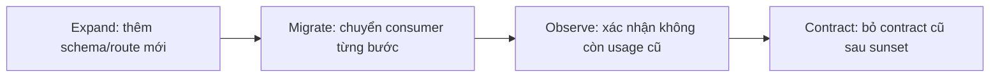

# Breaking change và backward compatibility

API là hợp đồng giữa provider và các client sử dụng nó. Khi provider thay đổi endpoint, request/response schema, cách xác thực, permission, quy tắc dữ liệu hoặc hành vi nghiệp vụ, client đang chạy có thể không còn hoạt động như trước. Một thay đổi tưởng như nhỏ, chẳng hạn đổi tên field, bỏ một giá trị enum, bắt buộc thêm scope hoặc giảm quota, có thể làm ứng dụng mobile cũ, integration của đối tác hoặc worker chưa được triển khai lại bị lỗi.

**Breaking change** là thay đổi khiến một hoặc nhiều client hợp lệ theo hợp đồng cũ không còn hoạt động đúng nếu không sửa đổi. **Backward compatibility** là khả năng phiên bản mới tiếp tục hỗ trợ các client được xây dựng theo hợp đồng trước đó trong phạm vi đã cam kết. Với API bảo mật, hợp đồng không chỉ gồm URL và JSON; nó còn bao gồm authentication, authorization, tenant scope, dữ liệu được phép đọc, error semantics, rate limit, idempotency và các bảo đảm vận hành.

Trong phạm vi `SECURITY_API_SECURITY`, cần đánh giá tác động của thay đổi theo endpoint, object và luồng nghiệp vụ. Mục tiêu là duy trì migration có kiểm soát, đồng thời không giữ lại hành vi nguy hiểm chỉ vì client cũ đang phụ thuộc vào nó. Khi cần siết bảo mật khẩn cấp, có thể phải chấp nhận thay đổi tương thích và tổ chức rollout/communication để giảm tác động.

## 1. API contract gồm những gì?

Một API contract mô tả cách client tương tác với provider và kết quả client có thể dựa vào. Contract thường gồm:

| Thành phần | Ví dụ | Thay đổi có thể gây breaking |
|---|---|---|
| Endpoint và method | `GET /v1/orders/{id}` | Xóa route, đổi method hoặc đổi path |
| Request schema | `customerId`, `items`, `pageSize` | Đổi tên field, đổi type, thêm field bắt buộc |
| Response schema | `id`, `status`, `total` | Xóa field, đổi type, đổi cấu trúc lồng nhau |
| Enum và code | `PENDING`, `PAID`, `CANCELLED` | Xóa hoặc đổi tên giá trị cũ |
| Semantics | `PATCH` cập nhật field được gửi | Đổi ý nghĩa null, default hoặc trạng thái |
| Authentication | Bearer token, API key, mTLS | Đổi issuer, audience, token profile hoặc credential scheme |
| Authorization | Scope `orders:read` | Bắt buộc permission mới hoặc thay đổi object scope |
| Error contract | `404`, `409`, `422` và error code | Đổi status/code khiến client xử lý sai |
| Limits | Pagination, timeout, rate limit | Giảm trần hoặc thay quota làm client hợp lệ bị từ chối |
| Side effects | Idempotency, retry, webhook | Thay đổi cách tạo giao dịch hoặc gửi event |
| Security/data policy | Field masking, tenant isolation | Thay đổi dữ liệu client được phép nhận hoặc cập nhật |

Một thay đổi có thể tương thích về cú pháp nhưng không tương thích về hành vi. Ví dụ response vẫn có cùng JSON field nhưng `status=APPROVED` giờ có nghĩa khác; client vẫn parse được nhưng có thể thực hiện sai quy trình nghiệp vụ.

### 1.1. Contract bao gồm cả hành vi bảo mật

Các điều kiện sau là một phần của contract:

- Client cần loại credential nào và credential đó được cấp bởi issuer nào.
- Token cần audience, scope, claim hoặc certificate nào.
- Caller có thể thực hiện action trên object/tenant nào.
- Field nào được trả về, được cập nhật hoặc bị mask.
- Khi không có quyền, API trả `403` hay `404` theo chính sách.
- Request có giới hạn kích thước, tần suất, concurrency và thời gian ra sao.
- Retry có an toàn không; idempotency key được giữ trong bao lâu.
- Webhook có chữ ký, timestamp, event ID và quy tắc retry nào.

Do đó, review compatibility chỉ dựa trên OpenAPI schema hoặc diff JSON là chưa đủ. Cần review cả policy và luồng nghiệp vụ.

## 2. Phân loại thay đổi tương thích và breaking

Không có quy tắc tuyệt đối cho mọi API, nhưng có thể dùng các nhóm sau để bắt đầu đánh giá.

### 2.1. Thay đổi thường tương thích

Các thay đổi sau thường tương thích nếu client tuân thủ contract và parser được thiết kế phù hợp:

- Thêm endpoint mới mà không đổi endpoint cũ.
- Thêm response field tùy chọn, không làm thay đổi semantics của field hiện có.
- Thêm error code mới trong khi giữ nguyên các code cũ; client phải có nhánh xử lý unknown code.
- Thêm optional request field có default tương thích.
- Thêm một permission mới cho endpoint mới mà không đổi quyền endpoint cũ.
- Thêm metadata/header tùy chọn mà client cũ có thể bỏ qua.
- Tăng giới hạn có kiểm soát nếu không làm thay đổi quota hoặc chi phí đã cam kết.

Tuy nhiên, ngay cả việc thêm field cũng có thể gây lỗi nếu client dùng strict deserialization, generated enum hoặc schema validation đóng. Thêm một enum value có thể làm ứng dụng cũ crash nếu code dùng exhaustive switch. Vì vậy, “additive” không đồng nghĩa luôn an toàn; cần biết hành vi của client thực tế.

### 2.2. Thay đổi thường breaking

- Xóa, đổi tên hoặc đổi kiểu field request/response.
- Đổi field từ optional thành required hoặc thay default có ảnh hưởng nghiệp vụ.
- Xóa/đổi enum value hoặc thay semantics của value hiện tại.
- Xóa endpoint, đổi method/path hoặc đổi media type bắt buộc.
- Đổi authentication scheme, issuer, audience, key format hoặc token claim bắt buộc.
- Bắt buộc scope/permission mới khiến client hiện tại bị từ chối.
- Thay đổi object/tenant scope hoặc quyền đọc/sửa dữ liệu.
- Giảm page size, body limit, rate limit, timeout hoặc concurrency dưới mức client đang sử dụng.
- Đổi error status/code mà client dựa vào để retry hoặc hiển thị luồng nghiệp vụ.
- Thay đổi idempotency, retry, ordering hoặc semantics webhook.
- Thay đổi response field masking khiến client không còn nhận dữ liệu trước đây.

### 2.3. Thay đổi bảo mật có thể cần phá tương thích

Một số thay đổi được thực hiện để sửa lỗ hổng hoặc giảm rủi ro:

- Chặn truy cập object thuộc tenant khác.
- Bỏ field nhạy cảm trước đây vô tình được trả về.
- Từ chối token có audience sai hoặc thuật toán không còn được phép.
- Thu hồi API key mặc định hoặc credential đã bị lộ.
- Yêu cầu scope rõ ràng cho action nhạy cảm.
- Tắt endpoint debug hoặc management endpoint đang public.
- Giảm giới hạn request sau khi phát hiện abuse.

Các thay đổi này có thể làm client cũ thất bại, nhưng không nên duy trì lỗ hổng chỉ để giữ backward compatibility. Hãy đánh giá mức độ khẩn cấp, xác định client bị ảnh hưởng, thông báo và hỗ trợ migration. Nếu nguy cơ đang bị khai thác, ưu tiên chặn đường tấn công và xử lý sự cố; thời gian chuyển đổi có thể phải rút ngắn.

## 3. Những ví dụ breaking change trong API bảo mật

| Thay đổi | Vì sao client có thể hỏng | Hướng xử lý |
|---|---|---|
| Thêm scope `orders:refund` bắt buộc | Token cũ chỉ có `orders:write` bị từ chối | Cấp scope mới, migrate client và kiểm tra quyền hẹp |
| Đổi JWT audience | Token được phát hành cho API cũ không còn hợp lệ | Token exchange/dual audience có thời hạn nếu an toàn |
| Bắt buộc mTLS cho integration | Client cũ không có certificate | Provision certificate, chạy song song có giới hạn rồi enforce |
| Ẩn `customerEmail` khỏi response | Client cũ dùng field để gửi hóa đơn | Thay bằng endpoint/permission riêng, giảm dữ liệu lộ |
| Thay `404` bằng `403` cho object ngoài tenant | Client thay đổi nhánh xử lý và có thể lộ existence | Giữ semantics thống nhất hoặc thông báo thay đổi có chủ đích |
| Giảm `pageSize` tối đa từ 500 xuống 100 | Client đồng bộ theo batch 500 bị lỗi | Thông báo, đo usage và chuyển dần sang cursor/pagination mới |
| Bỏ enum `PENDING_REVIEW` | Generated client không parse được giá trị | Thêm giai đoạn deprecation và unknown-enum handling |
| Đổi webhook signature header | Consumer không xác minh được event | Hỗ trợ hai verifier trong cửa sổ chuyển đổi có hạn |
| Bắt buộc idempotency key | Client cũ nhận lỗi khi tạo payment | Cập nhật SDK/client và rollout theo mức rủi ro |

Ví dụ về authorization: nếu endpoint `POST /payments/{id}/refund` trước đây chỉ yêu cầu `payments:write`, nhưng nay yêu cầu `payments:refund`, thay đổi có thể làm integration cũ bị `403`. Đây là breaking change về security contract dù OpenAPI path và request body không đổi.

## 4. Đánh giá compatibility trước khi thay đổi

Trước khi phát hành, cần xác định ai đang sử dụng hợp đồng cũ và họ phụ thuộc vào điều gì.

### 4.1. Xác định consumer

Lập danh sách:

- Web/mobile application và phiên bản đang được hỗ trợ.
- API key/client ID và integration đối tác.
- Service nội bộ, scheduled job và worker bất đồng bộ.
- Webhook consumer và hệ thống downstream.
- SDK/generated client và phiên bản thư viện.
- Tenant hoặc khách hàng có cấu hình riêng.

Không phải mọi consumer đều có thể nâng cấp cùng lúc. Mobile app có thể nằm trên thiết bị người dùng nhiều tháng; integration đối tác cần chu kỳ phê duyệt; worker có thể chỉ chạy theo lịch.

### 4.2. Dùng telemetry để biết contract đang được sử dụng

Ghi nhận metadata tối thiểu như API version, client ID, SDK version nếu có, endpoint, method, response status và thời điểm. Với thay đổi permission, có thể đo số request đang dùng scope cũ và số request bị từ chối nếu policy mới được chạy ở chế độ quan sát an toàn.

Không log access token, API key hoặc dữ liệu cá nhân để nhận diện client. Dùng ID đã được xác thực và metadata không nhạy cảm. Không suy luận rằng một client đã ngừng dùng chỉ vì không có traffic trong vài ngày; job theo tháng hoặc disaster recovery có thể vẫn phụ thuộc endpoint cũ.

### 4.3. Phân tích tác động theo endpoint và luồng

Với mỗi thay đổi, hỏi:

1. Endpoint, method và API version nào bị ảnh hưởng?
2. Request/response field, enum hoặc error code nào đổi?
3. Authentication, scope, object policy và tenant boundary có thay đổi không?
4. Client nào đang phụ thuộc vào hành vi cũ?
5. Có side effect, retry, webhook hoặc job bất đồng bộ liên quan không?
6. Có thể migrate từng client hay phải chuyển đồng loạt?
7. Có cách rollback an toàn nếu client mới gặp lỗi không?
8. Thay đổi có liên quan đến lỗ hổng cần xử lý khẩn cấp không?

### 4.4. Contract test và consumer-driven contract

Provider test xác nhận API mới vẫn đáp ứng các hợp đồng consumer đã đăng ký. Consumer-driven contract test có thể mô tả request/response mà client thực sự dùng, giúp phát hiện field hoặc semantics bị thay đổi.

Contract test không thay thế security test. Một consumer test có thể chứng minh client nhận được `200`, nhưng không chứng minh caller khác tenant bị từ chối. Cần bổ sung negative authorization tests, field-level access tests, token profile tests và abuse/rate-limit tests.

## 5. Chiến lược versioning API

Versioning giúp provider hỗ trợ nhiều contract trong giai đoạn chuyển đổi. Có nhiều cách biểu diễn version; điều quan trọng là chọn một cách nhất quán và định nghĩa rõ phần nào thuộc version.

### 5.1. URI path versioning

Ví dụ:

```text
GET /api/v1/orders/123
GET /api/v2/orders/123
```

Ưu điểm:

- Dễ quan sát trong log, gateway và tài liệu.
- Dễ route đến implementation khác nhau.
- Dễ kiểm tra client đang dùng version nào.

Hạn chế:

- Có thể tạo nhiều route/controller hoặc duplicate logic.
- Nếu policy authorization được copy giữa version, hai version dễ lệch bảo mật.
- Không phải mọi thay đổi đều cần một version mới; additive change thường có thể giữ cùng version.

### 5.2. Header hoặc media type versioning

Ví dụ custom header:

```http
GET /api/orders/123
API-Version: 2026-11-01
```

Hoặc dùng media type có version:

```http
Accept: application/vnd.example.orders-v2+json
```

Ưu điểm là URI không đổi và version có thể gắn với representation. Hạn chế là client, proxy, cache và observability phải xử lý header/version đúng; cache key cần phân biệt representation theo header phù hợp (`Vary`).

### 5.3. Chọn một chiến lược rõ ràng

Không trộn nhiều cách versioning tùy endpoint nếu không có lý do. Tài liệu cần nêu:

- Version nằm ở URI, header hay media type.
- Version áp dụng cho toàn API hay từng resource.
- Nếu client không gửi version, server chọn version nào.
- Version không hợp lệ hoặc đã sunset trả lỗi gì.
- Security policy nào dùng chung và policy nào khác theo version.
- Cache, gateway và analytics phân biệt version ra sao.

Versioning là công cụ quản lý contract, không phải cơ chế authorization. `/v1` và `/v2` đều phải xác thực caller, kiểm tra permission và object scope. Không được coi version cũ là vùng miễn kiểm soát bảo mật.

## 6. Backward compatibility trong request và response schema

### 6.1. Thêm field response

Thường có thể thêm field tùy chọn mà không đổi semantics cũ. Tuy nhiên, client dùng strict schema validation hoặc generated model có thể từ chối unknown field. SDK nên hỗ trợ unknown field hoặc provider cần thông báo thay đổi theo chính sách compatibility đã công bố.

Không thêm field nhạy cảm chỉ vì client có thể bỏ qua nó. Một field như `internalRiskScore`, `passwordResetState` hoặc `tenantBillingSecret` có thể tạo data exposure dù schema change là additive.

### 6.2. Xóa hoặc đổi field response

Xóa field là breaking nếu client còn đọc nó. Quy trình an toàn:

1. Xác định consumer sử dụng field qua telemetry hoặc contract test.
2. Đưa field mới vào response và đánh dấu field cũ deprecated.
3. Cập nhật SDK, tài liệu và migration guide.
4. Theo dõi traffic đọc field cũ nếu có telemetry phù hợp.
5. Xóa field trong version mới hoặc sau sunset đã công bố.

Nếu field bị lộ dữ liệu nhạy cảm, không giữ nó chỉ để hoàn tất thời gian deprecation. Cần cân bằng rủi ro data exposure với tác động migration và có thể thu hồi sớm.

### 6.3. Thêm field request

Thêm field optional thường tương thích nếu server cũ/new xử lý đúng. Thêm field required thường breaking. Nếu cần chuyển sang required, có thể triển khai theo giai đoạn:

- Giai đoạn đầu: server chấp nhận thiếu field và ghi metric/telemetry.
- Giai đoạn tiếp: SDK/client gửi field mới; server vẫn chấp nhận dạng cũ trong thời hạn.
- Giai đoạn enforce: từ chối request thiếu field sau khi consumer đã migrate.

Không dùng default nguy hiểm để giữ tương thích. Ví dụ nếu field `tenantId` bị thiếu, server không nên tự chọn tenant mặc định; hãy lấy tenant từ principal hoặc từ mapping tin cậy.

### 6.4. Enum và unknown values

Thêm enum value có thể làm client cũ lỗi nếu parser/generated code không chấp nhận giá trị lạ. Client nên có nhánh `UNKNOWN` hoặc giữ raw string; không nên assume enum set bất biến nếu provider có thể mở rộng.

Xóa hoặc đổi tên enum value là breaking. Nếu cần thay, thêm value mới, cho client xử lý cả hai trong giai đoạn chuyển đổi, theo dõi usage và ngừng value cũ sau deprecation.

### 6.5. Default, null và semantics

Thay đổi từ missing sang `null`, từ `null` sang empty string hoặc thay default có thể đổi hành vi client. Với PATCH, cần định nghĩa rõ:

- Field bị bỏ qua: giữ nguyên giá trị hiện tại?
- Field gửi `null`: xóa giá trị hay không hợp lệ?
- Field gửi empty string: lưu chuỗi rỗng hay normalize thành null?

Các semantics này cần có contract test. Không thay đổi ngầm vì có thể ảnh hưởng cả validation, authorization và business workflow.

## 7. Authorization và authentication khi versioning

Thay đổi security contract cần được đánh giá riêng vì một thay đổi tương thích về schema vẫn có thể làm request bị từ chối hoặc mở rộng quyền.

### 7.1. Thêm scope hoặc permission

Nếu endpoint mới yêu cầu scope mới, client cần được cấp quyền phù hợp. Không cấp scope rộng hơn chỉ để tránh lỗi `403`. Dùng least privilege và tách permission theo action.

Nếu siết quyền cho endpoint cũ, xác định consumer nào đang dùng quyền cũ, object/tenant scope nào được truy cập và lý do thay đổi. Có thể chạy policy ở chế độ quan sát trước nếu không có nguy cơ đang bị khai thác; không để chế độ quan sát kéo dài thay cho enforce.

### 7.2. Đổi issuer, audience hoặc token profile

Đổi JWT issuer/audience hoặc yêu cầu claim mới có thể khiến token cũ không còn hợp lệ. Có thể hỗ trợ song song issuer/audience cũ và mới trong một thời hạn nếu cả hai vẫn an toàn, nhưng phải:

- Chỉ tin issuer đã cấu hình.
- Kiểm tra audience theo resource server.
- Không hạ yêu cầu chữ ký/algorithm hoặc chấp nhận token không xác minh.
- Có thời điểm ngừng chấp nhận profile cũ.
- Theo dõi usage theo client/issuer mà không log token.

Nếu issuer/key cũ bị compromise, thu hồi khẩn cấp; không duy trì dual trust chỉ vì backward compatibility.

### 7.3. Thay API key hoặc mTLS

Khi chuyển API key sang mTLS hoặc workload identity, có thể hỗ trợ hai credential trong cửa sổ migration. Mỗi client cần credential riêng, scope rõ và thời hạn kết thúc. Không cho phép một key dùng chung toàn bộ khách hàng hoặc giữ legacy credential vô hạn.

### 7.4. Thay đổi object và field authorization

Siết object-level authorization hoặc field masking có thể làm client cũ mất quyền đọc dữ liệu. Đó có thể là thay đổi bảo mật bắt buộc. Cần cung cấp endpoint/permission thay thế hợp lệ nếu có use case, nhưng không trả lại dữ liệu ngoài quyền chỉ để giữ response cũ.

### 7.5. Error semantics và information hiding

Đổi `403` thành `404` để che giấu object có thể ảnh hưởng client xử lý lỗi. Khi thực hiện, tài liệu hóa semantics và test cả object tồn tại/không tồn tại, cùng tenant/khác tenant. Không để version cũ tiết lộ object existence nếu policy bảo mật hiện hành yêu cầu che giấu.

## 8. Rate limit, quota và resource contract

Rate limit và quota là một phần của khả năng sử dụng API. Client có thể phụ thuộc vào page size, concurrency, timeout hoặc quota đã công bố.

Trước khi thay đổi:

- Đo mức sử dụng thực tế theo client/tenant/endpoint.
- Phân biệt ngưỡng bảo vệ hệ thống với quota hợp đồng thương mại.
- Thông báo thay đổi và thời điểm áp dụng.
- Cung cấp `429` cùng `Retry-After` khi phù hợp.
- Hướng dẫn client dùng pagination, batch hoặc asynchronous job thay thế.
- Giữ global safety limit để bảo vệ hệ thống khi cần.

Nếu phát hiện abuse hoặc quá tải, có thể cần giảm giới hạn ngay. Khi đó hãy giới hạn theo principal/tenant/action có thể xác định, không nhất thiết block cả IP dùng chung. Bảo vệ availability là yêu cầu bảo mật; không thể giữ quota không an toàn chỉ để tương thích.

## 9. Webhook và event schema compatibility

Webhook consumer thường triển khai độc lập và khó nâng cấp đồng thời. Contract webhook cần xác định:

- Event type và schema version.
- Event ID, timestamp, signature và key ID.
- Quy tắc retry, timeout và idempotency.
- Thứ tự event hoặc khả năng nhận event trễ/duplicate.
- Cách xử lý field/enum không biết.
- Thời gian hỗ trợ signature version cũ.

Thêm field tùy chọn có thể tương thích nếu consumer bỏ qua unknown field. Đổi tên event, xóa field, đổi canonicalization hoặc signature header thường là breaking. Khi chuyển signature version, provider có thể ký theo hai phiên bản trong thời gian giới hạn hoặc phát hành endpoint/event version mới; consumer cần xác minh chữ ký theo đúng key/version và không được bỏ qua verification để tương thích.

Nếu signature scheme cũ có lỗ hổng hoặc key bị compromise, phải thu hồi ngay. Migration có thể yêu cầu re-delivery event hoặc consumer replay từ event store; cần bảo đảm replay không gây side effect trùng bằng event ID/idempotency.

## 10. Migration an toàn theo mô hình Expand–Migrate–Contract

Một cách phổ biến để thay đổi contract mà không yêu cầu mọi consumer chuyển cùng lúc là triển khai theo ba giai đoạn.



### 10.1. Expand

- Thêm field, endpoint, token profile hoặc schema mới.
- Giữ contract cũ hoạt động trong thời hạn xác định.
- Nếu có thể, server hỗ trợ đọc cả định dạng cũ và mới nhưng chuẩn hóa về một model nội bộ.
- Ghi metric theo version/client và audit thay đổi.
- Đảm bảo policy bảo mật mới được áp dụng ở cả đường cũ và đường mới.

### 10.2. Migrate

- Cập nhật SDK và tài liệu.
- Thông báo từng consumer và owner chịu trách nhiệm.
- Migrate client theo tenant/workload, dùng canary hoặc rolling deployment.
- Theo dõi lỗi xác thực, authorization, validation và business outcome.
- Với client không hoạt động thường xuyên, xác nhận lịch chạy và kế hoạch DR.
- Dừng phát hành mới dùng contract cũ khi đã đến mốc đã công bố.

### 10.3. Contract

- Xác nhận traffic cũ đã về 0 hoặc có ngoại lệ được phê duyệt.
- Gửi nhắc hạn cuối và cung cấp hướng dẫn hỗ trợ.
- Tắt route/field/token profile cũ theo kế hoạch.
- Kiểm tra request cũ bị từ chối đúng cách và request mới vẫn hoạt động.
- Xóa code/config/secret cũ không còn cần thiết.
- Giữ audit/metadata theo retention policy để điều tra.

Expand–Migrate–Contract là kỹ thuật triển khai; nó không bắt buộc phải duy trì legacy path nếu legacy path đang gây rủi ro nghiêm trọng. Trong tình huống compromise, có thể bỏ qua thời gian overlap và thu hồi ngay.

## 11. Deprecation và Sunset

Deprecation báo rằng một API/field/version vẫn còn hoạt động nhưng đã được lên kế hoạch thay thế hoặc ngừng hỗ trợ. Sunset là thời điểm dự kiến hoặc đã công bố khi tài nguyên/phiên bản ngừng phục vụ.

Một quy trình deprecation nên có:

1. Lý do và phạm vi deprecation.
2. Version/endpoint/field/header bị ảnh hưởng.
3. Version hoặc cách dùng thay thế.
4. Ngày bắt đầu deprecation và ngày sunset.
5. Consumer/tenant đang dùng và owner liên hệ.
6. Migration guide, SDK và ví dụ request/response.
7. Cách hỗ trợ client không thể migrate đúng hạn.
8. Điều kiện rút ngắn hoặc kéo dài lịch vì sự cố bảo mật.

### 11.1. HTTP headers thông báo deprecation

API có thể sử dụng header `Deprecation` để thông báo trạng thái deprecated và `Sunset` để chỉ thời điểm dự kiến ngừng phục vụ. Có thể kèm `Link` với quan hệ `deprecation` trỏ đến tài liệu hướng dẫn.

Ví dụ minh họa:

```http
HTTP/1.1 200 OK
Deprecation: @1798761600
Sunset: Sat, 30 Jan 2027 00:00:00 GMT
Link: <https://developer.example.com/deprecations/orders-v1>; rel="deprecation"
```

Giá trị ngày trong ví dụ chỉ minh họa cú pháp; khi triển khai cần tạo timestamp/HTTP-date chính xác theo tiêu chuẩn và lịch công bố thực tế. Header không thay thế thông báo trực tiếp cho đối tác hoặc tài liệu migration. Client có thể không ghi nhận header, vì vậy provider vẫn cần telemetry theo client/version.

### 11.2. Không deprecate vô thời hạn

Nếu API luôn gắn nhãn deprecated nhưng không có sunset hoặc owner, consumer sẽ không có động lực migration và provider phải duy trì nhiều implementation lâu dài. Mỗi deprecation cần thời hạn, tiêu chí hoàn tất và người chịu trách nhiệm. Ngoại lệ phải có lý do và thời hạn review.

### 11.3. Ngoại lệ cho sự cố bảo mật

Nếu endpoint cũ cho phép truy cập dữ liệu trái phép, signature yếu hoặc credential đã bị lộ, provider có thể phải sunset sớm hoặc tắt ngay. Ghi nhận lý do bảo mật, đánh giá tác động, thông báo qua kênh incident và cung cấp đường thay thế an toàn khi có thể.

## 12. Quản lý version trong code và gateway

Versioning dễ tạo duplicate controller và policy. Cần tránh để mỗi version tự phát triển một logic authorization riêng.

### 12.1. Tách contract adapter khỏi domain service

Có thể dùng controller/DTO riêng cho từng version, sau đó chuyển đổi về command/query model nội bộ chung:

```text
HTTP v1 DTO ----> v1 adapter ----+
                                 +--> Application service --> Domain model
HTTP v2 DTO ----> v2 adapter ----+
```

Adapter chịu trách nhiệm chuyển schema và semantics. Application service vẫn áp dụng authorization, tenant scoping và business invariant chung. Nếu một version có security policy khác vì yêu cầu hợp lệ, policy đó cần được khai báo và test rõ ràng, không phát sinh do copy-paste.

### 12.2. Policy dùng chung và version-specific

Những kiểm soát thường phải giữ nhất quán qua version:

- Authentication và token validation.
- Tenant/object authorization.
- Property-level data protection.
- Audit và data minimization.
- SSRF, validation và resource limits.
- Rate limiting cần thiết để bảo vệ hạ tầng.

Một số semantics có thể khác theo version, nhưng không được làm version cũ thành lối bypass. Ví dụ `v1` có thể trả response cũ trong một giai đoạn, nhưng vẫn phải lọc field nhạy cảm theo security policy hiện hành.

### 12.3. Gateway routing

Gateway có thể route `/v1` và `/v2` đến adapter hoặc service tương ứng. Cần xác minh:

- Gateway và service cùng hiểu version.
- Không có route alias bỏ qua authentication/authorization.
- Header version không thể bị proxy ghi đè hoặc hiểu khác nhau giữa các hop.
- Cache key phân biệt version/representation.
- Rate limit và telemetry được gắn đúng version/client.
- Unknown version bị từ chối rõ ràng, không fallback âm thầm sang version yếu hơn.

## 13. Thay đổi database và event nội bộ

API version mới thường cần thay đổi database schema. Tránh deploy một migration phá vỡ ngay khi code cũ vẫn đang chạy.

Một quy trình expand–contract cho database:

1. **Expand:** thêm cột/bảng/index mới, giữ cấu trúc cũ.
2. **Dual read/write có kiểm soát:** code mới ghi dữ liệu cần thiết cho cả hai dạng hoặc backfill dữ liệu cũ.
3. **Migrate:** chuyển code và consumer sang schema mới, xác minh dữ liệu.
4. **Observe:** theo dõi query và lỗi; xác nhận không còn code đọc cột cũ.
5. **Contract:** xóa cột/bảng cũ trong release sau khi chắc chắn không còn consumer.

Không dual-write vô thời hạn vì hai nguồn dữ liệu có thể lệch nhau. Cần định nghĩa nguồn sự thật, quy trình backfill, kiểm tra consistency và cách rollback. Với event schema, giữ consumer tương thích trong thời gian replay/retention; không xóa field mà worker cũ còn cần.

## 14. Rollback và tương thích dữ liệu

Rollback code không luôn đồng nghĩa rollback database hoặc side effect. Nếu version mới đã ghi dữ liệu theo schema mới, code cũ có thể không đọc được. Nếu API đã gửi webhook/payment/email, không thể hoàn tác bằng cách chỉ deploy image cũ.

Trước release, xác định:

- Code cũ có đọc được dữ liệu do code mới ghi không?
- Migration có thể rollback hay chỉ forward-fix?
- Có feature flag để dừng hành vi mới không?
- Event/webhook đã phát có thể replay hoặc gây duplicate không?
- Credential/token mới có tương thích với verifier cũ không?
- Nếu rollback, security policy nào vẫn phải giữ?

Không rollback về cấu hình có lỗ hổng hoặc credential đã bị compromise. Khi cần, giữ security fix và rollback phần chức năng gây lỗi bằng feature flag hoặc adapter tương thích.

## 15. Kiểm thử backward compatibility

Kiểm thử cần bao phủ schema, semantics, security và vận hành.

| Tình huống | Kết quả mong đợi |
|---|---|
| Client v1 gọi endpoint v1 sau khi v2 phát hành | Hoạt động theo contract v1 trong thời gian hỗ trợ |
| Client v1 gửi request cũ đến v2 | Được xử lý hoặc từ chối rõ theo contract; không fallback mơ hồ |
| Response v2 thêm optional field | Client cũ xử lý theo compatibility policy đã công bố |
| Enum mới xuất hiện | Client không crash hoặc có cách xử lý unknown value |
| Field cũ bị deprecated | Có cảnh báo/tài liệu; field còn hoạt động trong cửa sổ đã công bố nếu an toàn |
| Scope mới được yêu cầu | Client được cấp đúng scope; caller thiếu quyền vẫn bị từ chối |
| JWT issuer/audience mới | Token hợp lệ theo profile mới được chấp nhận; token sai issuer/audience bị từ chối |
| Object thuộc tenant khác | Bị từ chối ở mọi version |
| Field nhạy cảm đã bị loại bỏ | Không version nào vô tình trả lại field đó |
| Rate limit thay đổi | `429`/`Retry-After` đúng contract; quota tenant vẫn chính xác |
| Webhook signature chuyển version | Consumer xác minh đúng signature; không có đường bỏ qua verification |
| Event được retry/replay | Idempotency ngăn side effect trùng |
| Version đã sunset | Trả lỗi/documentation rõ và không route sang implementation yếu |
| Rollback code | Dữ liệu và security invariant vẫn nhất quán |

### 15.1. Contract test cho từng consumer

Lưu contract đã được consumer xác nhận và chạy provider verification trong CI. Với mỗi client quan trọng, có thể kiểm tra:

- Request headers, media type và schema.
- Response field/type/enum mà client sử dụng.
- Error status/code và retry behavior.
- Token scopes, audience và object scope.
- Pagination, rate limit và idempotency.
- Webhook signature và event ordering.

Không cần kiểm tra mọi chi tiết implementation. Contract test nên phản ánh hành vi mà consumer thực sự phụ thuộc.

### 15.2. Security regression test

Với mỗi version, chạy negative tests cho anonymous, user thiếu permission, tenant khác, object không tồn tại, token sai audience, API key revoked và request vượt quota. Một version cũ vẫn phải tuân thủ security policy hiện hành; versioning không phải lý do bỏ qua regression test.

## 16. Kế hoạch deprecation mẫu

Giả sử endpoint `GET /v1/reports/export` được thay bằng job API mới `POST /v2/report-jobs`.

| Giai đoạn | Hành động | Tiêu chí chuyển bước |
|---|---|---|
| Công bố | Gửi thông báo, migration guide, SDK và ngày sunset | Consumer biết phạm vi và owner |
| Expand | Triển khai v2, giữ v1 theo policy hiện hành | V2 qua contract/security tests |
| Migrate | Chuyển từng tenant/client sang v2 | Usage v1 giảm, v2 thành công |
| Verify | Kiểm tra job định kỳ, DR và client ít hoạt động | Không còn consumer hợp lệ cần v1 hoặc có ngoại lệ được duyệt |
| Sunset | Ngừng v1 theo ngày đã công bố | Request v1 bị từ chối rõ, không fallback |
| Cleanup | Xóa code/config/permission cũ | Không còn dependency và audit hoàn tất |

Nếu v1 có lỗ hổng cho phép export dữ liệu ngoài tenant, cần sửa policy ngay trên cả v1/v2 hoặc tắt v1 khẩn cấp. Không chờ đến ngày sunset thông thường.

## 17. Những lỗi triển khai thường gặp

| Lỗi | Hệ quả | Cách xử lý |
|---|---|---|
| Chỉ so sánh OpenAPI schema | Bỏ sót breaking change về authz, quota và semantics | Review cả security/behavior contract |
| Coi mọi additive field là an toàn | Strict client hoặc generated enum có thể lỗi | Test consumer thực tế và unknown values |
| Giữ version cũ với policy yếu | Version cũ trở thành đường bypass | Áp dụng security invariant ở mọi version |
| Cấp scope rộng để client khỏi lỗi | Mở rộng đặc quyền | Cấp quyền tối thiểu và migration riêng |
| Dual trust issuer/key vô thời hạn | Credential cũ tiếp tục được chấp nhận | Hạn sunset và thu hồi rõ ràng |
| Không có telemetry theo client/version | Không biết ai còn dùng contract cũ | Metrics theo client ID/version |
| Deprecation không có ngày kết thúc | Legacy code tồn tại vô hạn | Sunset date, owner và tiêu chí cleanup |
| Xóa field nhạy cảm nhưng giữ v1 response | Data exposure tiếp diễn | Security policy mới áp dụng xuyên version |
| Gateway route version khác service | Authentication/policy bị lệch giữa hop | Kiểm thử routing và policy end-to-end |
| DB migration phá vỡ code cũ | Rollback/deploy rolling bị lỗi | Expand–migrate–contract |
| Rollback về secret hoặc config yếu | Khôi phục lỗ hổng | Giữ security fix, rollback chức năng riêng |

## 18. Checklist review breaking change và backward compatibility

- [ ] Contract được xác định gồm route, schema, semantics, authn, authz, limits và side effects.
- [ ] Mọi consumer, SDK, tenant, worker và webhook client bị ảnh hưởng đã được xác định.
- [ ] Thay đổi được phân loại additive, breaking hoặc security emergency.
- [ ] Có versioning strategy rõ ràng và không fallback sang version yếu hơn.
- [ ] Field, enum, default, null và error semantics được review.
- [ ] Thay đổi issuer/audience/scope/key có kế hoạch migration và thời điểm revoke.
- [ ] Object/tenant/field authorization được test ở mọi version.
- [ ] Security fix không bị trì hoãn chỉ để giữ backward compatibility.
- [ ] Có telemetry theo client/version và không ghi token/secret.
- [ ] Có contract test, consumer test và security regression test.
- [ ] Migration dùng expand–migrate–contract khi phù hợp; DB/event schema được xử lý tương thích.
- [ ] Deprecation có lý do, owner, tài liệu, thông báo và sunset date.
- [ ] `Deprecation`, `Sunset` và tài liệu migration được dùng nhất quán khi phù hợp.
- [ ] Có canary, rollback/forward-fix plan và kiểm tra side effect/idempotency.
- [ ] Sau sunset, route/credential/permission cũ được thu hồi và cleanup.

Backward compatibility giúp client có thời gian chuyển đổi, nhưng không phải cam kết duy trì mọi hành vi cũ bất kể rủi ro. Khi contract được mô tả đầy đủ cả về dữ liệu lẫn bảo mật, consumer được nhận diện bằng telemetry, migration có giai đoạn rõ và version cũ vẫn tuân thủ security invariant hiện hành, provider có thể thay đổi API có kiểm soát mà không biến legacy endpoint thành điểm yếu lâu dài.
