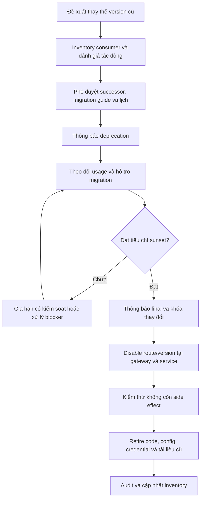

# Thu hồi version cũ đúng thời hạn

API version cũ thường tiếp tục tồn tại lâu sau khi phiên bản mới đã được phát hành. Một số consumer chưa chuyển đổi, SDK cũ vẫn được cài đặt, batch job chạy theo chu kỳ hoặc đối tác tích hợp không theo dõi thông báo thay đổi. Nếu giữ phiên bản cũ vô thời hạn, tổ chức phải tiếp tục vá lỗi, vận hành và bảo vệ nhiều contract cùng lúc. Nếu tắt quá sớm, hệ thống có thể làm gián đoạn khách hàng và quy trình nghiệp vụ.

**Thu hồi version cũ đúng thời hạn** là quy trình có kế hoạch để thông báo deprecation, hỗ trợ consumer chuyển đổi, đo mức sử dụng còn lại, ngừng nhận request và loại bỏ route/implementation cũ tại thời điểm đã công bố. Quy trình cần có owner, lịch trình, bằng chứng sử dụng, tiêu chí go/no-go và phương án xử lý ngoại lệ.

Trong API Security, version cũ còn hoạt động cũng là một bề mặt tấn công. Nó có thể chứa endpoint thiếu authorization, validation yếu, thuật toán token lỗi thời hoặc chính sách dữ liệu không còn phù hợp. Vì vậy, deprecation và sunset là một phần của quản trị vòng đời bảo mật: phải chuyển consumer sang contract được hỗ trợ và thực sự ngừng các đường truy cập cũ sau khi kết thúc thời gian chuyển đổi.

## 1. Phân biệt versioning, deprecation, sunset và retirement

Các khái niệm này có liên quan nhưng không đồng nghĩa:

| Khái niệm | Ý nghĩa | Kết quả mong đợi |
| --- | --- | --- |
| Versioning | Định danh các contract API khác nhau, ví dụ `/v1` và `/v2` | Consumer biết đang dùng contract nào. |
| Deprecation | Thông báo một version/endpoint không còn được khuyến nghị và sẽ kết thúc hỗ trợ | Consumer có thời gian lập kế hoạch chuyển đổi. |
| Sunset | Thời điểm dự kiến hoặc đã công bố API không còn được cung cấp | Consumer biết hạn cuối để hoàn tất migration. |
| Retirement / removal | Ngừng route, method, credential hoặc implementation cũ | Request đến phiên bản đã thu hồi không còn thực hiện nghiệp vụ. |

Một API có thể được đánh dấu deprecated trước nhiều tháng rồi mới sunset. Deprecation không tự động vô hiệu hóa route; sunset cũng không có tác dụng nếu gateway hoặc application vẫn tiếp tục dispatch request như trước. Retirement là hành động kỹ thuật thực sự loại bỏ đường truy cập.

### 1.1. Version API không nhất thiết là version ứng dụng

Một service có thể triển khai build `2026.11.18` nhưng vẫn hỗ trợ API `/v1` và `/v2`. Ngược lại, một API `/v2` có thể được phục vụ bởi nhiều bản build khác nhau trong quá trình rollout. Quyết định sunset cần gắn với contract, route, method và consumer cụ thể, không chỉ với số phiên bản artifact.

Nếu API version được chọn qua URL, media type hoặc header, inventory phải ghi rõ cách định tuyến đó. Cùng một path có thể phục vụ nhiều contract nếu content negotiation được dùng; chỉ xóa route URL không đủ để thu hồi media type cũ.

### 1.2. Deprecation không phải là thông báo thay đổi breaking bất ngờ

Deprecation cần đi kèm successor version, migration guide, thời gian hỗ trợ, ngày sunset và kênh hỗ trợ. Một thông báo chỉ nói “v1 sắp ngừng” nhưng không cho biết consumer cần đổi endpoint, schema, scope hay hành vi nghiệp vụ nào thì chưa đủ để migration.

## 2. Xây dựng chính sách hỗ trợ version

Trước khi phát hành version mới, tổ chức nên xác định chính sách hỗ trợ để consumer có thể dự đoán vòng đời API.

Chính sách thường cần nêu:

- Version nào đang ở trạng thái current, supported, deprecated hoặc retired.
- Thời gian hỗ trợ tối thiểu cho public, partner và internal API.
- Khoảng thời gian từ lúc thông báo deprecation đến sunset.
- Cách thông báo: response header, developer portal, email/partner contact, changelog và API catalog.
- Mức hỗ trợ trong giai đoạn chuyển đổi: bug fix, security fix, hỗ trợ migration và SLA.
- Điều kiện ngoại lệ, gia hạn và người có quyền phê duyệt.
- Cách xử lý version có lỗ hổng nghiêm trọng hoặc credential bị xâm phạm cần thu hồi sớm.

Không nên dùng một thời gian hỗ trợ cứng cho mọi loại API. Public API có nhiều consumer bên ngoài có thể cần thời gian dài hơn internal API do tổ chức kiểm soát. API nội bộ có thể chuyển đổi nhanh nếu tất cả consumer có owner và pipeline deploy đồng bộ. Partner API có thể cần cửa sổ theo hợp đồng và quy trình phối hợp.

| Loại API | Cân nhắc khi đặt thời hạn |
| --- | --- |
| Public API | Số lượng consumer, chu kỳ phát hành client, khả năng cập nhật ứng dụng di động và nghĩa vụ thông báo. |
| Partner API | Hợp đồng, lịch tích hợp, thời gian kiểm thử hai bên và đầu mối kỹ thuật. |
| Internal API | Mức độ kiểm soát consumer, khả năng rollout đồng bộ, dependency giữa service và release train. |
| Admin/operations API | Mức độ nhạy cảm, khả năng tiếp cận mạng quản trị và nhu cầu duy trì tương thích với công cụ vận hành. |

Thời hạn phải được công bố bằng ngày và múi giờ rõ ràng. Với API có consumer ở nhiều khu vực, UTC giúp tránh hiểu nhầm giữa các múi giờ. Tránh các thông báo mơ hồ như “cuối quý”, “trong vài tháng tới” hoặc “sẽ sớm đóng”.

## 3. Lập inventory consumer trước khi deprecate

Không thể thu hồi an toàn một version nếu không biết ai đang sử dụng nó. Inventory cần liên kết version với consumer thực tế, không chỉ liệt kê route trong source code.

Các nguồn dữ liệu có thể gồm:

- API gateway, ingress và access log theo version, route template, method và client identity.
- OAuth client, API key, service account hoặc workload identity đã đăng ký.
- Developer portal, partner registry, hợp đồng và danh sách integration owner.
- SDK/client version, user-agent đã chuẩn hóa và metadata do consumer đăng ký.
- Service dependency map, service mesh telemetry, tracing và job scheduler.
- Batch job, webhook callback, mobile app và consumer chạy theo chu kỳ dài.

Một bảng inventory nên có:

| Trường | Mục đích |
| --- | --- |
| API/version/route/method | Xác định chính xác contract và operation cần thu hồi. |
| Consumer/client ID | Nhận diện ứng dụng hoặc workload đang gọi. |
| Owner/contact | Người chịu trách nhiệm migration. |
| Tenant/partner | Phạm vi tổ chức hoặc hợp đồng liên quan. |
| Last seen / request volume | Đo thời điểm cuối và mức sử dụng theo cửa sổ thời gian. |
| Data/action sensitivity | Xác định tác động nếu tiếp tục duy trì version cũ. |
| Successor version | Phiên bản thay thế đã được xác định. |
| Migration status | Chưa bắt đầu, đang test, đã chuyển, ngoại lệ hoặc không xác định. |
| Sunset date / exception expiry | Mốc ngừng hỗ trợ và thời hạn ngoại lệ. |

### 3.1. Định danh consumer đáng tin cậy

Không nên dựa duy nhất vào IP hoặc user-agent để xác định consumer. Nhiều ứng dụng có thể dùng chung NAT, proxy hoặc user-agent; user-agent cũng có thể bị giả mạo. Với machine-to-machine, dùng OAuth client ID, workload identity, API key đã quản lý hoặc mTLS identity. Với user-facing API, có thể cần kết hợp application/client metadata với user và tenant đã xác thực.

Không ghi raw access token vào inventory hoặc log để phân biệt consumer. Dùng định danh client đã xác minh, subject pseudonymous hoặc token metadata tối thiểu.

### 3.2. Đo đủ chu kỳ nghiệp vụ

Không có traffic trong 7 ngày không chứng minh version không còn consumer. Một job có thể chạy hàng tháng; đối tác chỉ đồng bộ cuối kỳ; ứng dụng cũ chỉ được dùng khi có sự kiện đặc biệt. Cần chọn cửa sổ quan sát phù hợp với chu kỳ dài nhất đã biết, đồng thời xác nhận bằng registry và owner.

Khi không xác định được consumer, ghi nhận đó là unknown consumer và điều tra thêm. Không tự kết luận endpoint có thể gỡ chỉ vì log không thấy request gần đây.

## 4. Quy trình deprecation đến retirement

Một quy trình có thể chia thành các giai đoạn sau:



### 4.1. Giai đoạn 1: Đánh giá lý do và successor

Ghi rõ lý do deprecate: breaking change, schema không còn phù hợp, endpoint trùng, auth model cũ, thuật toán yếu, lỗi bảo mật, chi phí vận hành hoặc thay đổi nghiệp vụ. Xác định version thay thế và migration path. Nếu chưa có successor hoặc chưa có cách chuyển dữ liệu, chưa nên phát thông báo sunset chắc chắn.

Đánh giá tương thích theo request, response, error code, pagination, idempotency, authorization scope, rate limit, webhook/event và semantics nghiệp vụ. Một API mới có cùng path nhưng thay đổi quyền hoặc trạng thái có thể vẫn là breaking change đối với consumer.

### 4.2. Giai đoạn 2: Công bố deprecation

Thông báo cho consumer qua nhiều kênh. Response header giúp consumer kỹ thuật tự động phát hiện; developer portal và thông báo trực tiếp giúp owner hiểu tác động và kế hoạch chuyển đổi. Ghi rõ:

- Version/route/method bị deprecate.
- Ngày bắt đầu deprecation.
- Ngày sunset chính xác theo UTC.
- Successor version và link migration guide.
- Các thay đổi cần thực hiện: URL, schema, auth scope, credential, pagination, retry hoặc workflow.
- Kênh hỗ trợ, quy trình báo blocker và chính sách ngoại lệ.

Không chỉ thông báo trên changelog. Một consumer cũ có thể không theo dõi changelog; thông tin cần được đưa đến owner qua developer portal, email/partner contact hoặc kênh quản trị đã đăng ký.

### 4.3. Giai đoạn 3: Hỗ trợ migration

Trong thời gian deprecation, cung cấp ví dụ request/response mới, SDK, test environment, contract test hoặc compatibility adapter nếu phù hợp. Có thể tổ chức migration window, dashboard theo client và office hour cho partner. Theo dõi lỗi `4xx`/`5xx`, tỷ lệ request version mới, scope thiếu và response schema mismatch.

Không nên âm thầm thay đổi response của version cũ để ép consumer chuyển đổi. Nếu cần hạn chế rủi ro, áp dụng giới hạn được công bố và có kế hoạch. Version cũ vẫn phải nhận security fix trong thời gian hỗ trợ theo chính sách.

### 4.4. Giai đoạn 4: Quyết định go/no-go trước sunset

Trước ngày sunset, owner cần đánh giá tiêu chí đã thống nhất:

- Consumer quan trọng đã chuyển đổi hoặc có kế hoạch ngoại lệ được phê duyệt.
- Không còn unknown consumer có rủi ro cao.
- Version mới đáp ứng chức năng và security control tương đương hoặc tốt hơn.
- Dashboard cho thấy traffic còn lại ở mức chấp nhận được và đã giải thích.
- Partner, mobile app và batch job đã được thông báo theo đúng thời hạn.
- Runbook tắt route, rollback và hỗ trợ sự cố đã được chuẩn bị.
- Legal/compliance và hợp đồng đã được xem xét nếu dữ liệu hoặc dịch vụ có nghĩa vụ duy trì.

Nếu chưa đạt, quyết định gia hạn phải có người phê duyệt, lý do, phạm vi consumer và ngày hết hạn mới. Không gia hạn vô thời hạn hoặc biến ngoại lệ thành trạng thái mặc định.

### 4.5. Giai đoạn 5: Tắt và xác minh

Đến thời điểm đã công bố, disable version ở gateway/ingress và application router; ngừng cấp credential/scope chỉ phục vụ version cũ nếu phù hợp; xác minh mọi region và đường truy cập nội bộ. Request cũ không được thực hiện side effect.

Có thể trả `410 Gone` cho version đã retire để consumer biết endpoint đã bị loại bỏ và tham khảo migration guide. Một số hệ thống có thể chọn `404` theo chính sách che giấu route hoặc contract; hành vi cần nhất quán. Không trả `200` với dữ liệu rỗng hoặc âm thầm chuyển request sang version mới nếu semantics khác nhau.

### 4.6. Giai đoạn 6: Dọn dẹp hoàn tất

Sau khi traffic cũ đã bị chặn và không còn dependency, xóa route, controller, serializer, feature flag, schema, database compatibility code, gateway mapping, DNS alias, SDK generation và tài liệu cũ không còn cần. Thu hồi API key/client registration/scope riêng cho version nếu không còn consumer hợp lệ. Giữ audit record và dữ liệu cần thiết theo retention policy.

## 5. Sử dụng HTTP Deprecation và Sunset headers

Có thể dùng hai HTTP response header chuẩn để truyền thông tin vòng đời:

- `Deprecation` theo RFC 9745: cho biết resource đã bị deprecate từ thời điểm nào. Giá trị là Structured Field Date, ví dụ `@1794960000`.
- `Sunset` theo RFC 8594: cho biết thời điểm resource dự kiến không còn hoạt động. Giá trị dùng HTTP-date, ví dụ `Wed, 30 Jun 2027 23:59:59 GMT`.

Có thể thêm `Link` với quan hệ `deprecation` để trỏ đến tài liệu chính sách, và `successor-version` để trỏ đến phiên bản thay thế nếu phù hợp.

Ví dụ response minh họa:

```http
HTTP/1.1 200 OK
Deprecation: @1794960000
Sunset: Wed, 30 Jun 2027 23:59:59 GMT
Link: <https://developer.example.com/deprecations/orders-v1>; rel="deprecation"
Link: <https://api.example.com/v2/orders>; rel="successor-version"
Content-Type: application/json
```

Header chỉ thông báo vòng đời; nó không tự tắt endpoint và không thay thế thông báo trực tiếp tới consumer. Đảm bảo date value đúng format, UTC và nhất quán giữa gateway, application và developer portal. Không dùng `Sunset` như thời điểm bắt đầu deprecation; hai mốc có ý nghĩa khác nhau. Nếu consumer chạy trong browser khác origin, cấu hình CORS `Access-Control-Expose-Headers: Deprecation, Sunset, Link` để JavaScript có thể đọc các header này; việc expose header không thay thế authorization.

### 5.1. Gắn header tại gateway hoặc application

Nếu gateway quản lý toàn bộ route, có thể thêm header tập trung theo version. Nếu response được phát từ nhiều service hoặc có đường nội bộ bypass gateway, application cần có cấu hình tương ứng. Không để một số response có header còn response lỗi hoặc pagination response lại thiếu.

Ví dụ Spring filter minh họa cho route cũ:

```java
@Component
public class ApiDeprecationHeaderFilter extends OncePerRequestFilter {

    @Override
    protected void doFilterInternal(
            HttpServletRequest request,
            HttpServletResponse response,
            FilterChain filterChain) throws ServletException, IOException {

        String path = request.getServletPath();
        if ("/api/v1/orders".equals(path) || path.startsWith("/api/v1/orders/")) {
            response.setHeader("Deprecation", "@1794960000");
            response.setHeader("Sunset", "Wed, 30 Jun 2027 23:59:59 GMT");
            response.addHeader("Link",
                "<https://developer.example.com/deprecations/orders-v1>; rel=\"deprecation\"");
            response.addHeader("Link",
                "<https://api.example.com/v2/orders>; rel=\"successor-version\"");
        }

        filterChain.doFilter(request, response);
    }
}
```

Ví dụ cần được điều chỉnh theo route matching, cấu hình date và cách đăng ký filter của ứng dụng. Trong production, không nên hard-code ngày trong source; đưa các mốc và link vào cấu hình có version control, validation và owner. Nếu route có prefix overlap, dùng route matcher chính xác để không gắn nhầm header cho version mới.

### 5.2. Hành vi sau sunset

Sau khi route được retire, response có thể là:

```http
HTTP/1.1 410 Gone
Content-Type: application/problem+json
Link: <https://developer.example.com/migrations/orders-v2>; rel="deprecation"

{
  "code": "API_VERSION_RETIRED",
  "message": "This API version is no longer available. Migrate to the supported version.",
  "migrationGuide": "https://developer.example.com/migrations/orders-v2"
}
```

Không trả dữ liệu cũ hoặc thực hiện nghiệp vụ rồi mới báo sunset. Nếu dùng `410`, response nên an toàn, ổn định và không tiết lộ chi tiết nội bộ. Với endpoint nhạy cảm, có thể chọn `404` theo policy nhưng cần ghi rõ trong contract và migration guide.

## 6. Không tự động chuyển request cũ sang version mới

Một proxy có thể được cấu hình rewrite `/v1` thành `/v2`, nhưng cách này chỉ an toàn nếu semantics tương đương. Nếu `v2` thay đổi field bắt buộc, quyền, cách tính giá, state transition hoặc error behavior, rewrite có thể tạo side effect ngoài ý muốn.

Chỉ dùng compatibility adapter khi:

- Có mapping request/response rõ ràng và được kiểm thử.
- Authorization được đánh giá theo consumer và action thực tế.
- Không nâng quyền hoặc bỏ qua field validation.
- Idempotency, retry và business semantics được bảo toàn.
- Có metrics cho request đi qua adapter và thời hạn loại bỏ adapter.

Không dùng adapter như cách duy trì version cũ vô thời hạn. Adapter cũng là code cần vá, test và vận hành.

## 7. Ưu tiên security fix và thu hồi khẩn cấp

Chính sách sunset thông thường có thể bị rút ngắn khi version cũ có lỗ hổng nghiêm trọng. Ví dụ:

- Endpoint cũ thiếu object-level authorization hoặc cho phép mass assignment.
- Token dùng thuật toán yếu, khóa bị lộ hoặc không kiểm tra audience.
- Version cũ làm lộ dữ liệu nhạy cảm hoặc có SSRF không được kiểm soát.
- Credential của integration bị compromise.
- Có hành vi khai thác đang diễn ra và chưa thể giảm rủi ro bằng biện pháp tạm thời.

Khi cần thu hồi khẩn cấp, phải đánh giá tác động và có quyết định incident/security owner. Có thể chặn route hoặc scope ngay, thu hồi credential, giới hạn IP/workload, yêu cầu migration khẩn cấp hoặc tắt endpoint. Thông báo rõ lý do, phạm vi, thời điểm và hướng khắc phục; lưu bằng chứng và audit.

Không để thời hạn hỗ trợ thông thường buộc tổ chức tiếp tục cung cấp một endpoint đang bị khai thác. Ngược lại, không dùng lý do “security” chung chung để bỏ qua hợp đồng hoặc gây gián đoạn mà không có đánh giá và thông báo phù hợp.

## 8. Thu hồi credential và quyền gắn với version cũ

Một version có thể có OAuth client, scope, API key hoặc mTLS certificate riêng. Khi retire, rà soát:

- Client registration chỉ dùng cho version cũ.
- Scope như `orders:v1:read` hoặc permission cũ.
- API key, secret, certificate và workload identity không còn cần.
- Webhook endpoint/callback và subscription gắn với version cũ.
- Refresh token hoặc access token có quyền truy cập route cũ.
- Allowlist tại gateway, firewall và service mesh.

Không thu hồi credential dùng chung nếu consumer vẫn cần nó cho version mới. Ưu tiên tách client/scope theo use case từ đầu để có thể thu hồi chính xác. Nếu access token tự chứa vẫn còn hạn, cần cân nhắc TTL, audience/scope, denylist hoặc introspection theo mức rủi ro. Tắt route ở server vẫn là kiểm soát cuối cùng để bảo đảm token cũ không thực hiện được hành động.

## 9. Xử lý dữ liệu và tài nguyên sau khi retire

Thu hồi API version không đồng nghĩa xóa toàn bộ dữ liệu do version đó tạo ra. Cần phân biệt:

- **API implementation:** route, controller, adapter và schema cũ có thể được xóa sau khi không còn consumer.
- **Stored data:** dữ liệu đã tạo qua version cũ có thể vẫn cần phục vụ version mới hoặc nghĩa vụ lưu trữ.
- **Migration artifacts:** bảng trung gian, field legacy và dữ liệu cần chuyển đổi phải có kế hoạch riêng.
- **Logs/audit:** giữ theo retention và yêu cầu điều tra, không xóa chỉ vì API đã sunset.
- **Secrets/credentials:** thu hồi hoặc xóa khi không còn mục đích, theo quy trình quản lý secret.
- **Backups:** xử lý theo lịch backup/retention; không xóa tùy tiện nếu có nghĩa vụ khôi phục hoặc lưu trữ.

Nếu schema v1 có field bị loại bỏ trong v2, cần xác định dữ liệu cũ được giữ, chuyển đổi, ẩn hoặc xóa theo policy. Không xóa dữ liệu khách hàng chỉ vì route tạo ra nó đã bị retire.

## 10. Ví dụ kế hoạch sunset cho Orders API v1

Giả sử `orders-api v2` đã thay thế `v1` và cung cấp schema rõ hơn, scope tách theo action và kiểm tra tenant thống nhất. Kế hoạch minh họa:

| Mốc | Hoạt động | Tiêu chí hoàn tất |
| --- | --- | --- |
| 18/11/2026 | Công bố v1 deprecated | Portal, changelog, email consumer và response headers đã cập nhật. |
| 18/12/2026 | Hoàn tất thử nghiệm migration | SDK/partner test thành công; lỗi contract đã xử lý. |
| 31/03/2027 | Kiểm tra giữa kỳ | Dashboard có owner cho từng consumer còn traffic; ngoại lệ có hạn. |
| 31/05/2027 | Final notice | Consumer chưa chuyển nhận thông báo cuối và hướng dẫn hỗ trợ. |
| 30/06/2027 23:59:59 UTC | Sunset v1 | Gateway/application chặn route; không còn side effect qua v1. |
| Sau sunset | Cleanup | Gỡ mapping, scope riêng, adapter và tài liệu cũ; lưu audit. |

Kế hoạch thực tế cần được điều chỉnh theo hợp đồng, số lượng consumer và mức độ rủi ro. Nếu v1 có lỗ hổng đang bị khai thác, mốc sunset có thể phải sớm hơn và cần quy trình khẩn cấp.

### 10.1. Dashboard theo dõi migration

Các chỉ số nên có:

- Request count theo version, route, method, client và tenant.
- Distinct consumer còn sử dụng v1 và last seen.
- Tỷ lệ traffic v1/v2 theo thời gian.
- Consumer đã chuyển, đang migration, chưa phản hồi và ngoại lệ.
- Tỷ lệ lỗi `4xx`/`5xx`, authorization failure và schema mismatch của v2.
- Số credential/scope chỉ phục vụ v1 còn hoạt động.
- Request đến v1 sau ngày sunset và nguồn gọi.

Không đưa raw token, email hoặc user ID vào metric label. Dùng client ID/tenant reference đã được kiểm soát và lưu chi tiết điều tra ở hệ thống có phân quyền.

## 11. Kiểm thử deprecation và retirement

Kiểm thử phải bao phủ cả thông báo trước sunset và hành vi sau khi retire.

| Kịch bản | Điều kiện | Kết quả mong đợi |
| --- | --- | --- |
| Version current | Gọi version đang được hỗ trợ | Hoạt động theo contract. |
| Deprecated version | Gọi v1 trước sunset | Vẫn xử lý theo policy và có `Deprecation`, `Sunset`, migration link chính xác. |
| Header date | Kiểm tra format và timezone | `Deprecation` là Structured Field Date; `Sunset` là HTTP-date theo UTC. |
| Successor link | Consumer đọc link thay thế | Link trỏ đúng version/guide đang được hỗ trợ. |
| Consumer đã migrate | Client dùng v2 | Không còn phụ thuộc route hoặc scope v1. |
| Consumer chưa migrate | Client vẫn dùng v1 khi đến sunset | Nhận response retired theo contract; không có side effect. |
| Gateway bypass | Gọi trực tiếp backend hoặc internal ingress | v1 vẫn bị chặn theo chính sách, không chỉ chặn ở public gateway. |
| Credential cũ | Dùng scope/API key chỉ dành cho v1 sau thu hồi | Không truy cập được route đã retire. |
| Shared credential | Credential còn dùng cho v2 | Không bị thu hồi nhầm; v2 tiếp tục hoạt động. |
| Compatibility adapter | Request v1 được map sang v2 | Mapping bảo toàn authorization, validation và idempotency; có telemetry. |
| Exception | Consumer có gia hạn được duyệt | Chỉ client/route trong phạm vi được miễn, có ngày hết hạn và owner. |
| Emergency sunset | Version có lỗ hổng nghiêm trọng | Có thể chặn sớm; audit và thông báo incident đầy đủ. |
| Cleanup | Xóa controller/config cũ | Không còn alias hoặc route khác dispatch vào implementation đã retire. |

### 11.1. Kiểm tra không còn side effect

Sau khi tắt version, gửi request hợp lệ trước đây qua tất cả đường truy cập được hỗ trợ: public gateway, internal load balancer, service mesh và test environment. Xác minh response retired, database không đổi, không tạo message/event, không gọi payment hoặc downstream service và không phát hành signed URL.

Đối với webhook, callback và async consumer, kiểm tra cả event cũ đang nằm trong queue. Việc retire HTTP route không tự động xử lý message đã được phát hành trước đó. Cần quy định consumer version, schema compatibility và thời điểm ngừng nhận event cũ.

## 12. Rollback và ngoại lệ sau sunset

Không phải mọi sự cố sau sunset đều nên bật lại version cũ. Trước khi rollback, cần xác định lỗi ở version mới, gateway, DNS, credential hay consumer migration. Ưu tiên sửa version mới hoặc adapter có giới hạn nếu cách đó an toàn.

Nếu buộc phải mở lại v1:

- Chỉ người có thẩm quyền incident/release phê duyệt.
- Giới hạn consumer, route, method và thời gian mở lại.
- Giữ nguyên security fix; không phục hồi endpoint có lỗ hổng đã biết nếu chưa có biện pháp giảm rủi ro.
- Ghi audit, bật monitoring tăng cường và công bố ngày đóng lại.
- Tạo kế hoạch khắc phục có owner và deadline; không biến rollback thành hỗ trợ vô thời hạn.

Ngoại lệ migration cần lưu client/tenant, route, lý do, rủi ro, người phê duyệt, biện pháp bù, ngày hết hạn và tiêu chí đóng. Hệ thống nên tự cảnh báo ngoại lệ sắp hết hạn và không cho phép gia hạn chỉ bằng một thay đổi cấu hình không có review.

## 13. Checklist thu hồi version cũ

- [ ] Có chính sách support window, deprecation và sunset theo loại API.
- [ ] Inventory xác định version, route, method, consumer, owner và tenant/partner.
- [ ] Đã quan sát đủ chu kỳ nghiệp vụ và xác minh unknown consumer.
- [ ] Successor version và migration guide đã sẵn sàng, bao gồm thay đổi auth/schema/workflow.
- [ ] Deprecation được thông báo qua portal, changelog, contact và response headers.
- [ ] Ngày sunset chính xác theo UTC và có owner chịu trách nhiệm.
- [ ] Consumer migration được theo dõi bằng telemetry và dashboard.
- [ ] Go/no-go có tiêu chí rõ, ngoại lệ có người phê duyệt và ngày hết hạn.
- [ ] Gateway và application cùng chặn version cũ sau sunset.
- [ ] Request cũ không thể tạo side effect hoặc truy cập dữ liệu qua đường nội bộ.
- [ ] Credential, scope, key, callback và allowlist chỉ dành cho version cũ được rà soát.
- [ ] Dữ liệu lưu trữ, audit, backup và retention được xử lý riêng với API code.
- [ ] Có test header, 410/404, gateway bypass, credential cũ, async event và rollback.
- [ ] Route, adapter, config, SDK và tài liệu cũ được dọn dẹp sau khi xác nhận không còn dependency.
- [ ] Inventory và API catalog được cập nhật trạng thái retired.

Thu hồi version cũ đúng thời hạn cần dựa trên inventory consumer, chính sách hỗ trợ công khai, telemetry và tiêu chí go/no-go có thể kiểm chứng. Deprecation tạo thời gian chuyển đổi; sunset đặt mốc kết thúc; retirement phải thực sự chặn mọi đường truy cập cũ và dọn dẹp quyền liên quan. Khi thực hiện đủ các bước này, tổ chức vừa giảm gián đoạn cho consumer vừa loại bỏ được bề mặt tấn công và chi phí duy trì contract lỗi thời.
