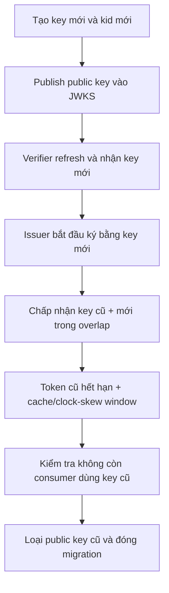
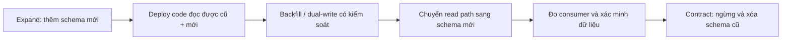

# Migration token, key và schema

Một API đang chạy thường có nhiều thành phần cùng phụ thuộc vào hợp đồng bảo mật: mobile app giữ refresh token, gateway xác minh access token, microservice đọc claims, job nền tiêu thụ message, database lưu trạng thái và đối tác tích hợp theo schema đã công bố. Khi thay token format, signing key hoặc schema, thay đổi ở một thành phần có thể khiến thành phần khác từ chối request, hiểu sai quyền hoặc tiếp tục chấp nhận credential cũ.

Migration an toàn là quá trình chuyển từ trạng thái cũ sang trạng thái mới trong khi vẫn kiểm soát được tính tương thích, quyền truy cập và khả năng rollback. Không nên coi đây chỉ là việc đổi version trong URL hoặc triển khai code mới. Cần quản lý đồng thời **issuer/consumer, token và key lifecycle, API/database/event schema, thời gian hỗ trợ phiên bản cũ và bằng chứng cho thấy không còn consumer hợp lệ phụ thuộc vào hợp đồng cũ**.

Ví dụ, hệ thống chuyển JWT từ signing key `key-2025` sang `key-2026`, đổi claim `roles` sang `permissions`, đồng thời đổi response field `customerName` thành `displayName`. Nếu phát hành đồng loạt, gateway có thể từ chối token mới, một service có thể không hiểu claim mới và mobile app cũ có thể lỗi khi parse response. Một kế hoạch migration cần triển khai khả năng đọc trước, chuyển phát hành sau, đo mức sử dụng và chỉ xóa hợp đồng cũ khi đã xác minh được consumer đã chuyển đổi.

## 1. Nguyên tắc migration an toàn

Migration bảo mật cần giữ được ba thuộc tính trong suốt quá trình:

- **Tính đúng đắn của quyền:** token/schema mới không mở rộng quyền ngoài chủ đích; token cũ không được giữ hiệu lực lâu hơn policy cho phép.
- **Tính tương thích có giới hạn:** consumer cũ có thời gian chuyển đổi rõ ràng, nhưng khả năng chấp nhận định dạng cũ không tồn tại vô thời hạn.
- **Khả năng quan sát và phục hồi:** biết ai còn dùng phiên bản cũ, lỗi xảy ra ở đâu, rollback có an toàn không và điều kiện nào cho phép kết thúc migration.

Các nguyên tắc thực hành:

1. Kiểm kê producer, consumer, API client, resource server, gateway, job và partner trước khi thay đổi.
2. Định nghĩa hợp đồng cũ/mới và phân loại thay đổi tương thích hay phá vỡ tương thích.
3. Ưu tiên triển khai khả năng đọc/nhận định dạng mới trước khi bắt đầu phát hành định dạng mới.
4. Dùng giai đoạn overlap có giới hạn, có ngày kết thúc và metric theo dõi.
5. Không nới validation hoặc authorization chỉ để làm migration “chạy qua”.
6. Tách migration thông thường khỏi ứng phó key/token compromise; compromise cần thu hồi khẩn cấp, không giữ key cũ chỉ để tương thích.
7. Chỉ loại bỏ định dạng cũ sau khi đã có bằng chứng consumer hợp lệ không còn phụ thuộc.
8. Kiểm thử rollback và đường forward-fix trước khi triển khai production.

### 1.1. Phân biệt tương thích và chấp nhận an toàn

Một consumer có thể parse được schema cũ và mới nhưng vẫn xử lý sai quyền. Ví dụ, service mới chấp nhận cả claim `role=ADMIN` và `permissions=[...]`; nếu claim cũ được ưu tiên hoặc được diễn giải rộng hơn, migration có thể tạo privilege escalation.

Tương thích kỹ thuật không đồng nghĩa với tương thích bảo mật. Mọi fallback cần có semantics rõ ràng, được kiểm tra theo principal/action/resource và có thời hạn kết thúc.

### 1.2. Không thay đổi nhiều hợp đồng độc lập trong một lần khó kiểm soát

Thay token issuer, signing algorithm, claim names, API response và database schema cùng một đợt làm khó xác định nguyên nhân khi lỗi. Khi có thể, tách thành các bước nhỏ với checkpoint riêng. Nếu bắt buộc phối hợp, ghi rõ thứ tự phụ thuộc và điều kiện hoàn tất của từng phần.

## 2. Kiểm kê trước khi migration

Trước khi sửa token, key hoặc schema, hãy lập inventory về nơi phát hành, nơi tiêu thụ và cách kiểm tra hợp đồng hiện tại.

| Thành phần | Cần xác định | Ví dụ |
|---|---|---|
| Token issuer | Issuer, audience, signing algorithm, key source, claim profile | Authorization server phát JWT cho `orders-api` |
| Token consumer | Service nào verify token, introspect hoặc đọc claim | Gateway, `orders-api`, `billing-worker` |
| Client | App version, grant type, token storage và refresh behavior | Mobile app v3 dùng refresh token rotation |
| Signing key | `kid`, key type, algorithm, nơi lưu private key, JWKS cache | RSA key trong KMS, public key qua JWKS |
| API schema | OpenAPI version, request/response fields, enum và error contract | `/v1/orders` trả `customerName` |
| Database | Column, index, constraint, trigger và dữ liệu cần backfill | `customer_name` được đổi thành `display_name` |
| Event/message | Producer, consumer group, schema registry và retention | `OrderCreated` được xử lý bởi analytics và billing |
| External partner | Owner, contact, version, traffic và support window | Đối tác gọi API qua client credential |

Không chỉ tìm trong source code. Consumer có thể là ứng dụng mobile đã phát hành, cron job, webhook partner hoặc service ít được dùng. Dùng logs/metrics và xác nhận với owner để bổ sung những consumer không xuất hiện trong repository hiện tại.

### 2.1. Lập bảng phụ thuộc và owner

Mỗi hợp đồng cũ cần có owner và consumer list. Ví dụ:

| Hợp đồng cũ | Producer | Consumer | Owner | Điều kiện kết thúc |
|---|---|---|---|---|
| JWT claim `roles` | Identity service | Gateway, account API | Identity team | Không còn token/consumer dùng claim cũ |
| Signing key `key-2025` | Authorization server | Tất cả JWT validators | Security platform | Token cuối cùng hết hạn và cache đã refresh |
| Response field `customerName` | Orders API | Web v1, mobile v2, partner A | Orders team | Traffic field/version cũ bằng 0 trong support window |
| Event schema v1 | Order producer | Billing worker v1 | Event platform | Consumer đã đọc schema v2 và backlog v1 đã drain |

Nếu không xác định được owner hoặc consumer, chưa nên xóa hợp đồng cũ. Có thể dùng giai đoạn quan sát, contact owner và deadline chuyển đổi thay vì giữ tương thích vô thời hạn.

## 3. Migration access token và claim

Token là credential, vì vậy thay đổi format hoặc claims phải được xử lý như thay đổi bảo mật. Cần xác định token cũ được phát hành bởi issuer nào, ký bằng key nào, dành cho audience nào và các service đang dựa vào claim nào để quyết định quyền.

### 3.1. Định nghĩa token profile cũ và mới

Một token profile nên mô tả tối thiểu:

- `iss`: issuer được tin cậy.
- `aud`: resource server hoặc nhóm API được phép nhận token.
- `sub`: định danh subject ổn định theo issuer.
- `exp`, `iat`, `nbf`: thời hạn và thời điểm hiệu lực.
- `scope` hoặc permission claims: phạm vi hành động.
- `jti`: token identifier nếu hệ thống cần revocation hoặc audit.
- `kid` và `alg` trong protected header: key identifier và thuật toán được dùng.
- Claim riêng của hệ thống: tenant, client, authentication context hoặc token type.

Ví dụ hai profile:

```json
{
  "iss": "https://identity.example.com",
  "aud": "orders-api",
  "sub": "user-42",
  "roles": ["ORDER_MANAGER"],
  "exp": 1795005000
}
```

```json
{
  "iss": "https://identity.example.com",
  "aud": "orders-api",
  "sub": "user-42",
  "permissions": ["order:read", "order:update"],
  "token_profile": "access-v2",
  "exp": 1795005000
}
```

Ví dụ chỉ minh họa. `roles` và `permissions` không nhất thiết tương đương. Cần định nghĩa mapping rõ ràng, đặc biệt với role có quyền rộng, role kế thừa hoặc quyền theo tenant/object.

### 3.2. Không suy ra quyền từ token chưa xác minh

Header và payload JWT chỉ là dữ liệu có thể đọc trước khi verify. Không được dùng `kid`, `iss`, `alg`, `roles` hoặc `permissions` chưa xác minh để cấp quyền hay truy cập key source tùy ý.

Một luồng validation nên:

1. Parse cấu trúc token theo giới hạn kích thước và định dạng.
2. Chọn key từ trust configuration/JWKS endpoint đã cấu hình; `kid` chỉ dùng để chọn trong tập key tin cậy.
3. Chỉ cho phép thuật toán đã cấu hình cho issuer/token profile; kiểm tra key type và algorithm tương ứng.
4. Xác minh chữ ký.
5. Xác minh `iss`, `aud`, `exp`, `nbf` và các claim bắt buộc.
6. Xác định token profile/version từ claims đã được xác minh.
7. Ánh xạ claim cũ/mới sang permission nội bộ theo quy tắc rõ ràng.
8. Tiếp tục authorization trên action, object, tenant và context.

Không lấy `jku` hoặc `x5u` tùy ý từ token để tải key từ một URL do token điều khiển. Điều này có thể biến token validation thành SSRF hoặc cho attacker đưa key giả. Không chấp nhận `alg=none`, algorithm confusion hoặc fallback sang thuật toán yếu chỉ vì token cũ từng dùng cấu hình khác.

### 3.3. Dual validation trong thời gian chuyển đổi

Khi cần hỗ trợ token profile v1 và v2, resource server có thể tạm thời xác minh cả hai. Tuy nhiên, phải phân biệt profile sau khi chữ ký được xác minh và áp dụng rule riêng cho từng profile.

```pseudo
verified = verifySignatureWithConfiguredIssuerKeys(rawToken)
claims = verifyStandardClaims(verified)

if claims.token_profile == "access-v2":
    principal = mapV2Permissions(claims.permissions)
else if isApprovedLegacyProfile(claims):
    principal = mapLegacyRolesToPermissions(claims.roles)
else:
    rejectToken

authorize(principal, action, resource, context)
```

`isApprovedLegacyProfile` phải dựa trên issuer, audience, thời hạn, claim contract và policy đã định nghĩa; không được nhận token cũ chỉ vì payload có một field `roles`. Mapping legacy phải không cấp quyền rộng hơn policy cũ và cần có test regression.

Dual validation cần có:

- Danh sách issuer/audience và profile được chấp nhận.
- Ngày bắt đầu, thời hạn overlap và ngày ngừng chấp nhận v1.
- Metric theo profile/token issuer để biết consumer còn dùng gì.
- Kế hoạch thu hồi refresh token hoặc buộc re-authentication khi cần.
- Kiểm thử token có claim thiếu, claim sai kiểu, claim trùng hoặc claim mâu thuẫn.

Không duy trì fallback v1 vô thời hạn. Nếu token cũ không còn được phát hành nhưng vẫn có thể tồn tại trong thời hạn dài, hãy dùng `exp` tối đa, refresh policy và deadline để xác định thời điểm có thể xóa validator cũ.

### 3.4. Thay đổi issuer, subject, audience hoặc scope

Đây là các thay đổi có thể phá vỡ ranh giới bảo mật:

- **Issuer (`iss`):** chuyển issuer cần cấu hình trust rõ ràng cho issuer mới và cũ trong thời gian overlap. Không chấp nhận mọi issuer hoặc bỏ kiểm tra issuer.
- **Subject (`sub`):** nếu đổi định dạng subject, cần mapping ổn định và tránh collision giữa hai issuer. `sub` không nên được hiểu là email nếu email có thể thay đổi.
- **Audience (`aud`):** token dành cho API A không tự động hợp lệ cho API B. Khi tách service, phát token đúng audience hoặc dùng token exchange; không mở rộng audience toàn hệ thống để migration dễ hơn.
- **Scope/permission:** mapping phải giữ least privilege. Không đổi `orders.read` thành `orders:*` như một cách tương thích.
- **Tenant claim:** xác định nguồn gốc và quan hệ tenant; không tin tenant ID do client gửi để ghi đè claim đã xác minh.
- **Authentication context:** nếu claim `acr`/`amr` thay đổi, policy step-up cần hiểu đúng semantics của issuer mới.

### 3.5. Refresh token và token family trong migration

Refresh token thường được lưu trong hệ thống authorization server hoặc là opaque credential. Không nên tự decode rồi biến đổi refresh token cũ thành token mới nếu server không có cơ chế migration an toàn.

Các lựa chọn:

- Tiếp tục chấp nhận refresh token cũ trong một thời gian giới hạn và phát access/refresh token theo profile mới sau lần refresh kế tiếp.
- Thu hồi token family cũ và yêu cầu user đăng nhập lại nếu thay đổi credential hoặc risk yêu cầu.
- Buộc re-authentication cho client/tenant có token không thể chuyển đổi an toàn.
- Phát hành token mới theo client version và ngừng cấp mới token cũ trước khi xóa validator cũ.

Nếu refresh token rotation được sử dụng, giữ nguyên kiểm soát reuse detection trong migration. Không chấp nhận token đã dùng lại chỉ vì hai phiên bản client đang cùng tồn tại. Khi có dấu hiệu compromise, ưu tiên thu hồi và re-authentication thay vì giữ overlap để tương thích.

## 4. Rotation và migration signing key

Signing key dùng để ký token là một phần của trust chain. Thay key cần phối hợp giữa issuer, JWKS publisher, gateway, resource server, cache và các consumer xác minh offline.

### 4.1. Rotation định kỳ với overlap

Một quy trình thông thường:

1. Tạo key mới trong KMS/HSM hoặc nơi lưu trữ key được kiểm soát; đặt `kid` duy nhất.
2. Publish public key mới trong JWKS trước khi dùng private key mới để ký token.
3. Chờ các verifier refresh JWKS hoặc bảo đảm key mới đã được phân phối tới mọi consumer.
4. Chuyển issuer sang ký token mới bằng key mới.
5. Trong thời gian overlap, verifier chấp nhận public key cũ và mới, nhưng chỉ theo issuer, algorithm và profile đã cấu hình.
6. Chờ token cuối cùng ký bằng key cũ hết hạn, cộng clock skew và thời gian cache/JWKS propagation đã tính.
7. Xác minh không còn token/consumer hợp lệ dùng key cũ rồi loại public key cũ khỏi JWKS và trust configuration.
8. Lưu audit metadata về key rotation; private key cũ được xử lý theo quy trình retention/destruction.



Không được bắt đầu ký bằng key mới trước khi các verifier có thể lấy public key tương ứng. Ngược lại, không được xóa key cũ khỏi JWKS ngay khi bắt đầu ký key mới nếu còn token cũ hợp lệ cần xác minh.

### 4.2. Tính thời gian overlap

Thời gian overlap cần dựa trên:

- Thời điểm phát hành token cuối cùng bằng key cũ.
- Thời hạn access token tối đa còn được chấp nhận.
- Clock skew được phép giữa issuer và resource server.
- JWKS cache TTL, CDN/cache propagation và lịch refresh key của verifier.
- Thời gian request đang chạy hoặc job có thể giữ token.
- Các consumer offline hoặc ít hoạt động.

Một ước lượng vận hành thường dùng là giữ public key cũ ít nhất tới khi token cuối cùng được ký bằng key đó hết hạn, cộng clock skew và khoảng thời gian propagation/cache cần thiết. Cần xác minh bằng metric và kiểm thử; không lấy một con số tùy ý làm mặc định cho mọi hệ thống.

### 4.3. `kid` và JWKS validation

`kid` là key identifier trong JOSE header. Nó giúp verifier chọn key trong tập key tin cậy, nhưng không tự chứng minh key đó đáng tin. Verifier cần:

- Chỉ tải JWKS từ issuer/URL đã cấu hình hoặc metadata được xác minh.
- Chọn key theo `kid`, `kty`, `use`/`key_ops` và algorithm policy phù hợp.
- Xử lý trường hợp không tìm thấy `kid`: refresh JWKS có giới hạn rồi từ chối nếu vẫn không có key.
- Không tải URL key do token tùy ý chỉ định.
- Không fallback sang một key khác khi `kid` không khớp.
- Cache JWKS có TTL và refresh strategy rõ ràng, tránh attacker gửi vô hạn `kid` ngẫu nhiên gây refresh storm.
- Giữ key set theo issuer/tenant trust boundary; không trộn key của nhiều issuer mà thiếu phân biệt.

### 4.4. Emergency rotation khi private key bị lộ

Key compromise khác với rotation định kỳ. Nếu private signing key bị lộ, attacker có thể tự ký token giả. Không nên giữ key bị lộ trong overlap chỉ để token cũ tiếp tục hoạt động.

Phản ứng có thể gồm:

1. Ngừng ký ngay bằng key bị lộ.
2. Loại key khỏi tập key được tin cậy hoặc phát tín hiệu thu hồi theo cơ chế verifier hỗ trợ.
3. Buộc refresh JWKS/cache invalidation; không chờ TTL bình thường nếu có thể chủ động purge.
4. Xem xét thu hồi token/session được ký trong khoảng có nguy cơ, dùng denylist, introspection hoặc token version.
5. Cấp key mới từ KMS/HSM và xác minh trust chain trước khi ký lại.
6. Kiểm tra audit, token issuance và các request được chấp nhận trong cửa sổ compromise.
7. Thông báo owner/client và xử lý re-authentication theo mức độ ảnh hưởng.

Emergency rotation có thể khiến token hợp lệ cũ bị từ chối và tạo đăng nhập lại diện rộng. Đây là tác động có thể cần chấp nhận để ngăn token giả. Phạm vi quyết định phải do incident response/security owner điều phối.

### 4.5. Tách signing key khỏi TLS key

TLS certificate/private key dùng để xác thực endpoint hoặc workload trong TLS handshake; JWT signing key dùng để ký token. Không tái sử dụng cùng một key pair cho nhiều mục đích nếu không có thiết kế và profile mật mã rõ ràng. Rotation của TLS certificate không tự động xoay JWT signing key, và ngược lại.

## 5. Migration API schema và contract

Schema là hợp đồng giữa producer và consumer. Thay đổi response, request, enum, nullability hoặc semantics có thể làm client lỗi hoặc tạo lỗ hổng nếu consumer diễn giải sai.

### 5.1. Phân loại thay đổi

| Thay đổi | Mức tương thích thường gặp | Rủi ro cần kiểm tra |
|---|---|---|
| Thêm response field optional | Thường additive | Client parser strict có thể từ chối field lạ |
| Thêm request field optional | Thường additive | Server cũ có thể bỏ qua; default có thể thay đổi nghiệp vụ |
| Thêm enum value | Có thể breaking với consumer exhaustive | Client không xử lý giá trị mới hoặc rơi vào nhánh mặc định nguy hiểm |
| Xóa/đổi tên field | Breaking | Consumer cũ không tìm thấy dữ liệu |
| Đổi kiểu field | Breaking | Parser lỗi hoặc coercion sai |
| Thay `null` thành omitted hoặc ngược lại | Có thể breaking | Khác semantics và validation |
| Đổi đơn vị hoặc ý nghĩa field | Breaking về semantics | Client vẫn parse nhưng tính toán sai |
| Thay error code/status | Có thể breaking | Retry hoặc error handling sai |
| Thay auth requirement/scope | Thay đổi bảo mật | Client mất quyền hoặc được cấp quyền rộng hơn ngoài ý muốn |

“Additive” không luôn luôn an toàn. Client có parser nghiêm ngặt có thể fail khi xuất hiện field mới; một enum mới có thể khiến mobile app crash; một field optional có default mới có thể thay đổi business behavior. Cần biết hành vi consumer thực tế.

### 5.2. Thêm field trước, chuyển consumer, rồi mới xóa field cũ

Ví dụ đổi `customerName` thành `displayName`:

1. Server thêm `displayName` nhưng vẫn trả `customerName` với cùng semantics.
2. Client mới ưu tiên `displayName`, có fallback tạm thời cho `customerName`.
3. Telemetry đo tỷ lệ client/version còn đọc field cũ nếu có thể quan sát được.
4. Gửi deprecation notice và migration guide.
5. Khi consumer đã chuyển, ngừng phát field cũ trong một release có kế hoạch.
6. Sau support window, xóa code fallback và contract cũ.

Không nên để hai field có semantics khác nhau mà không ghi rõ. Nếu `displayName` đã được chuẩn hóa khác `customerName`, cần định nghĩa chuyển đổi và tránh khiến client dùng nhầm giá trị cho quyết định bảo mật.

### 5.3. Request schema và response schema cần tách riêng

Request DTO nên chỉ chứa field client được phép gửi. Response DTO chỉ chứa field caller được phép đọc. Không dùng chung một database entity hoặc DTO cho cả hai hướng.

Ví dụ, request cập nhật profile không được nhận các field như `tenantId`, `role`, `isAdmin`, `accountStatus` nếu client không có quyền thay đổi chúng. Thêm field mới vào schema request cần kiểm tra mass assignment và default behavior. Thêm field vào response cần phân loại dữ liệu và field authorization.

### 5.4. Unknown field và enum value

Hãy định nghĩa rõ cách xử lý thuộc tính không biết:

- Với request, có thể từ chối unknown field để phát hiện client gửi sai hoặc field nhạy cảm không được hỗ trợ; nếu chọn ignore để forward compatibility, phải bảo đảm không có mass assignment hoặc silent behavior nguy hiểm.
- Với response, consumer nên xử lý field mới theo contract; parser strict cần được kiểm thử trước khi producer thêm field.
- Với enum, consumer nên có nhánh xử lý unknown value an toàn, nhưng không được biến giá trị không biết thành quyền cao hoặc trạng thái thành công.

Không được “tolerant” tới mức bỏ qua field bảo mật như `audience`, `tenant`, `approvalState` hoặc `permission` rồi tiếp tục xử lý theo default rộng.

### 5.5. Versioning API

Các chiến lược phổ biến:

- **URI versioning:** `/v1/orders`, `/v2/orders` — dễ quan sát và định tuyến, nhưng có thể tạo nhiều route song song.
- **Media type/header versioning:** version nằm trong `Accept` hoặc content negotiation — linh hoạt nhưng cần tooling và cache variation chính xác.
- **Schema/contract versioning:** version gắn với tài liệu/schema hoặc message — phù hợp event-driven systems, không nhất thiết là version URL.

Chọn một chiến lược nhất quán và tài liệu hóa. Không dùng API version mới để bỏ qua authentication, authorization hoặc validation. Mỗi version cần cùng baseline security, có thể có policy cụ thể hơn theo contract.

## 6. Database migration theo expand-migrate-contract

Thay schema database trực tiếp trong một release có thể làm phiên bản ứng dụng cũ lỗi ngay khi code mới được deploy hoặc rollback. Pattern expand-migrate-contract giúp duy trì khả năng chạy song song trong thời gian chuyển đổi.

### 6.1. Expand

Mở rộng database theo cách tương thích:

- Thêm column mới nullable hoặc có default an toàn.
- Thêm table/index mới mà code cũ không bị ảnh hưởng.
- Chưa xóa column cũ hoặc thay constraint mà ứng dụng cũ cần.
- Deploy code có thể đọc cả dữ liệu cũ và mới, nhưng chưa phụ thuộc vào việc backfill đã hoàn tất.

### 6.2. Migrate

Chuyển dữ liệu và consumer:

- Backfill dữ liệu theo batch có giới hạn, có checkpoint và có thể resume.
- Nếu cần dual-write, định nghĩa nguồn sự thật và xử lý partial failure.
- So sánh số lượng, checksum hoặc invariant giữa dữ liệu cũ và mới.
- Chuyển read path sang field/table mới theo canary hoặc feature flag.
- Theo dõi lỗi, latency, lock, replication lag và dữ liệu lệch.

### 6.3. Contract

Chỉ sau khi mọi consumer đã chuyển:

- Ngừng ghi field/table cũ.
- Xác minh không còn read path cũ.
- Xóa constraint/index/column cũ theo kế hoạch.
- Xóa compatibility code và feature flag không còn cần.
- Cập nhật tài liệu/schema và migration history.



### 6.4. Dual-write có rủi ro

Ghi đồng thời hai field không tự động bảo đảm nhất quán. Một lần ghi có thể thành công ở cột mới nhưng thất bại ở cột cũ; retry có thể ghi hai lần; trigger và application có thể ghi đè lẫn nhau.

Nếu cần dual-write:

- Xác định một nguồn sự thật trong từng giai đoạn.
- Thực hiện hai ghi trong cùng database transaction nếu cùng datastore và khả thi.
- Nếu khác datastore, dùng outbox/saga và đối soát thay vì giả định atomicity.
- Làm operation idempotent và có cơ chế retry.
- Theo dõi mismatch và có quy trình sửa dữ liệu.
- Không xóa field cũ khi còn mismatch hoặc consumer đọc dữ liệu cũ.

### 6.5. Rollback database không phải lúc nào cũng là chạy migration ngược

Một migration có thể mất thông tin khi chuyển đổi, ví dụ gộp hai field hoặc làm tròn số. Sau khi ghi dữ liệu mới, rollback code cũ có thể không hiểu dữ liệu đã thay đổi. Cần xác định trước rollback có thể thực hiện bằng cách giữ cột cũ, restore backup, chạy forward-fix hay phải dừng write trong thời gian ngắn.

Không chạy destructive migration (drop column/table, rewrite không thể đảo ngược) trước khi đã có backup/restore test, consumer inventory và phê duyệt vận hành cần thiết.

## 7. Schema migration cho event và message

Event thường được lưu trong broker hoặc data lake lâu hơn vòng đời của một API request. Một consumer mới có thể phải đọc message được phát hành từ nhiều tháng trước. Vì vậy, event schema cần quy tắc tương thích riêng.

### 7.1. Producer và consumer có thể triển khai lệch thời điểm

Ví dụ `OrderCreated` v1 có:

```json
{
  "eventType": "OrderCreated",
  "schemaVersion": 1,
  "orderId": "ord-100",
  "customerName": "An"
}
```

v2 đổi field thành:

```json
{
  "eventType": "OrderCreated",
  "schemaVersion": 2,
  "orderId": "ord-100",
  "customer": {
    "displayName": "An"
  }
}
```

Consumer cần biết version và cách parse đúng. Có thể hỗ trợ v1/v2 trong một khoảng thời gian hoặc phát event type mới. Không nên đoán version chỉ từ việc field nào đó có xuất hiện.

### 7.2. Quy tắc tương thích event

- Thêm field optional thường dễ tương thích hơn xóa/đổi kiểu field, nhưng cần kiểm tra strict consumer.
- Giữ semantics ổn định; nếu đổi ý nghĩa, tạo version hoặc event type mới.
- Consumer cần xử lý unknown field/value an toàn.
- Không tái sử dụng field cũ cho ý nghĩa mới.
- Giữ schema cũ đủ lâu cho message tồn đọng, replay và consumer offline.
- Đặt retention và kế hoạch xử lý dead-letter queue theo schema version.
- Không để event chứa token, password, API secret hoặc dữ liệu cá nhân ngoài mục đích.

### 7.3. Schema registry và compatibility mode

Schema registry có thể kiểm tra backward, forward hoặc full compatibility trước khi đăng ký schema mới. Cần hiểu chính xác compatibility mode và cách registry xử lý default, optional, union/enum và field deletion. Một schema pass registry không chứng minh consumer code thực tế xử lý đúng; vẫn cần contract test và integration test.

## 8. Deprecation và Sunset

Deprecation là thông báo một API, field, token profile hoặc key format đang được thay thế và không nên dùng cho tích hợp mới. Sunset là mốc dự kiến tài nguyên/phiên bản sẽ ngừng hoạt động. Cần phân biệt:

- **Deprecated:** đã công bố lộ trình thay thế; vẫn có thể hoạt động.
- **Sunset scheduled:** đã công bố thời điểm dự kiến ngừng phục vụ.
- **Retired:** đã ngừng; request có thể nhận `410 Gone` hoặc response phù hợp với policy.

### 8.1. Header deprecation

Với HTTP API, có thể dùng các header chuẩn:

- `Deprecation` theo RFC 9745 để báo resource đã deprecated.
- `Sunset` theo RFC 8594 để thông báo thời điểm sau đó resource dự kiến không còn phục vụ.
- `Link` với relation `deprecation` để dẫn tới tài liệu migration khi phù hợp.

Header chỉ là tín hiệu cho client; nó không tự thông báo tới mọi owner hoặc buộc client chuyển đổi. Cần kết hợp tài liệu, changelog, developer portal, email/partner notice theo kênh được phê duyệt và telemetry.

Ví dụ minh họa:

```http
HTTP/1.1 200 OK
Deprecation: @1795000000
Sunset: Wed, 31 Mar 2027 00:00:00 GMT
Link: <https://developer.example.com/migrations/orders-v1>; rel="deprecation"
```

Giá trị thời gian ở ví dụ chỉ minh họa cách biểu diễn theo từng header; hãy tuân thủ đúng định dạng của RFC 9745 và RFC 8594 trong triển khai. Không tự tạo header `X-Deprecated` riêng nếu đã có thể dùng semantics chuẩn và tài liệu hóa rõ.

### 8.2. Lộ trình deprecation

Một lộ trình thực tế có thể gồm:

1. Công bố phiên bản/field/token profile thay thế và lý do thay đổi.
2. Cung cấp migration guide, sample code và sandbox/test environment.
3. Bắt đầu đánh dấu deprecated, ghi metric theo client/version.
4. Mở giai đoạn chuyển đổi, hỗ trợ partner và theo dõi lỗi.
5. Gửi nhắc trước Sunset theo support policy.
6. Khi đạt điều kiện, ngừng phát hành credential/schema cũ và cuối cùng tắt validator/route cũ.
7. Giữ trang tài liệu migration và thông tin lỗi hữu ích sau khi retired.

Không đặt Sunset chỉ dựa trên lịch nếu chưa kiểm kê consumer. Ngược lại, không để deprecation vô thời hạn mà không có owner, deadline và tiêu chí kết thúc.

### 8.3. Không tiết lộ quá nhiều thông tin qua lỗi retired

Khi API version đã ngừng, có thể trả `410 Gone` kèm liên kết migration nếu điều đó phù hợp với chính sách công khai. Nếu route chứa dữ liệu hoặc object nhạy cảm, vẫn cần áp dụng authentication/authorization và không tiết lộ object tồn tại ngoài quyền caller.

## 9. Rollout theo giai đoạn

Một migration lớn nên có các checkpoint và tiêu chí go/no-go:

| Giai đoạn | Thay đổi | Điều kiện tiếp tục |
|---|---|---|
| 0. Inventory | Thu thập consumer, owner, version và baseline | Không còn dependency quan trọng chưa rõ owner |
| 1. Prepare readers | Deploy verifier/parser đọc được format mới | Test cũ/mới pass; chưa phát hành mới đại trà |
| 2. Publish trust/schema | Publish public key/JWKS hoặc schema mới | Mọi consumer cần thiết đã nhận được metadata |
| 3. Canary writers | Một nhóm nhỏ phát token/schema mới | Error rate, auth decision và business metrics ổn định |
| 4. Ramp up | Mở rộng producer/client theo tỷ lệ | Consumer cũ/mới đều xử lý đúng, không tăng deny bất thường |
| 5. Deprecate old | Ngừng phát hành định dạng cũ và thông báo Sunset | Traffic cũ giảm theo kế hoạch |
| 6. Contract | Xóa key/schema/validator/route cũ | Consumer inventory và telemetry xác nhận an toàn |

Canary cần bao gồm nhiều loại consumer: browser, mobile, partner, service-to-service và background job. Một canary chỉ dùng web client mới không chứng minh mobile app cũ đã tương thích.

## 10. Rollback và forward compatibility

Rollback phải được thiết kế trước khi deploy. Với một số thay đổi, quay về code cũ có thể không an toàn nếu dữ liệu mới đã được ghi hoặc credential cũ đã bị thu hồi.

### 10.1. Câu hỏi cần trả lời trước migration

- Code phiên bản cũ có thể đọc dữ liệu mới không?
- Producer mới có thể gửi message mà consumer cũ không hiểu không?
- Token mới có thể bị validator cũ từ chối không?
- Key cũ đã bị xóa/thu hồi chưa? Có lý do bảo mật khiến không được khôi phục không?
- Database đã backfill hoặc ghi dữ liệu vào field mới chưa?
- Client đã lưu token/schema mới vào cache hoặc local storage chưa?
- Feature flag có thể chuyển về trạng thái trước mà không làm mất dữ liệu không?

### 10.2. Rollback strategy theo loại migration

| Loại | Cách rollback/khắc phục có thể dùng | Rủi ro |
|---|---|---|
| API response field additive | Tắt field mới hoặc quay producer về response cũ | Client mới có thể đã phụ thuộc field mới |
| Token claim migration | Quay issuance về profile cũ nếu key/issuer cũ còn an toàn; hoặc forward-fix consumer | Không khôi phục key bị compromise |
| Signing key rotation thường lệ | Có thể tạm ký lại bằng key cũ nếu chưa retire và private key còn an toàn | Verifier/cache có thể lệch; không dùng nếu key bị lộ |
| Emergency key rotation | Forward-fix và cấp lại token bằng key mới | Không rollback về key bị compromise |
| Database expand | Giữ schema mở rộng và rollback application nếu code cũ vẫn tương thích | Cần kiểm tra migration đã ghi dữ liệu gì |
| Database contract/drop | Thường cần restore hoặc forward migration; không luôn đảo ngược được | Có thể mất dữ liệu và gây downtime |
| Event schema | Giữ consumer đọc cả hai version hoặc replay/transform message | Backlog cũ và replay dài hạn |

### 10.3. Ưu tiên forward-fix khi rollback làm yếu bảo mật

Nếu key bị lộ, issuer cũ không còn đáng tin hoặc schema cũ chứa lỗ hổng authorization, rollback có thể đưa hệ thống về trạng thái kém an toàn. Trong trường hợp đó, giữ hướng migration và sửa consumer/producer mới có thể là lựa chọn đúng, dù cần kế hoạch giảm tác động người dùng.

## 11. Kiểm thử migration

Test cần bao phủ producer, consumer, contract và security behavior. Không chỉ kiểm tra parse thành công.

### 11.1. Ma trận token và key

| Tình huống | Kết quả mong đợi |
|---|---|
| Token v1 hợp lệ trong overlap | Chấp nhận theo legacy policy và quyền không rộng hơn trước |
| Token v2 hợp lệ | Chấp nhận theo profile mới |
| Token có `iss` không được tin | Từ chối |
| Token có `aud` không đúng API | Từ chối |
| Token thiếu `exp`/claim bắt buộc | Từ chối theo profile |
| Token v1 đã hết thời hạn hỗ trợ | Từ chối |
| Token có `kid` không biết | Refresh JWKS có giới hạn rồi từ chối nếu không có key |
| Token ký bằng key cũ trong overlap | Xác minh được nếu key và token còn trong thời hạn cho phép |
| Token ký bằng key cũ sau khi retire | Từ chối |
| JWKS không truy cập được | Dùng cache hợp lệ theo policy; không tin key chưa xác minh |
| JWT có `jku`/`x5u` trỏ URL ngoài cấu hình | Không tải key theo URL đó |
| Private key compromise | Key bị chặn theo incident policy; không giữ overlap thông thường |
| Refresh token cũ bị reuse | Phát hiện và xử lý token family theo policy |

### 11.2. Ma trận schema và database

| Tình huống | Kết quả mong đợi |
|---|---|
| Consumer cũ đọc response có field optional mới | Hoạt động theo contract/parser đã kiểm thử |
| Consumer strict gặp enum mới | Xử lý an toàn hoặc từ chối có kiểm soát, không chọn default quyền cao |
| Request gửi field không được phép | Bị reject/ignore theo contract; không mass assign |
| Field cũ và mới cùng tồn tại | Semantics và precedence rõ ràng |
| Backfill chạy lại | Idempotent, không nhân đôi hoặc ghi sai dữ liệu |
| Dual-write một phía thất bại | Có phát hiện mismatch và cơ chế retry/đối soát |
| Consumer event nhận schema v1/v2 | Parse theo version chính xác |
| Consumer replay message cũ | Schema cũ vẫn được xử lý trong retention window |
| Contract phase drop column | Không còn consumer/read/write cũ; backup/restore đã thử |

### 11.3. Kiểm thử deprecation và sunset

- Header `Deprecation`, `Sunset` và link migration có định dạng đúng.
- Header xuất hiện trên response của đúng resource/version.
- Client cũ được nhận thông báo và có hướng dẫn chuyển đổi.
- Metric nhận diện được client/version còn sử dụng endpoint cũ.
- Sau Sunset, route cũ bị xử lý theo contract đã công bố.
- API retired vẫn áp dụng authorization và không làm lộ dữ liệu ngoài scope.

## 12. Monitoring và tiêu chí kết thúc migration

Migration không nên kết thúc chỉ vì deployment thành công. Cần theo dõi trạng thái thực tế của producer và consumer.

Các metric hữu ích:

- Tỷ lệ token v1/v2 được xác minh theo issuer, client và resource server.
- Số request bị từ chối theo `kid`, issuer, audience, token profile và reason code.
- JWKS refresh success/failure, cache age, unknown `kid` rate và thời gian propagation.
- Refresh token reuse, revocation và re-authentication rate.
- Tỷ lệ request theo API version, client version và partner.
- Schema validation error, unknown enum/field và response parse failure.
- Database backfill progress, mismatch count, replication lag và lock/latency.
- Event consumer lag, dead-letter count và số message theo schema version.
- Request tới endpoint deprecated và số consumer còn sử dụng.

Không đưa raw token, secret, private key hoặc dữ liệu cá nhân vào metric label. Dùng identifier không nhạy cảm hoặc nhóm tổng hợp; chi tiết điều tra nằm trong log/audit có kiểm soát.

### 12.1. Điều kiện đóng migration

Chỉ đóng migration khi các điều kiện phù hợp đã đạt:

- Producer không còn phát hành token/key/schema cũ.
- Không còn consumer hợp lệ sử dụng format cũ trong support window đã thống nhất.
- Token cũ đã hết hạn hoặc bị thu hồi; key cũ đã được retire theo đúng risk level.
- Database/event backlog đã backfill/drain và invariant dữ liệu đạt yêu cầu.
- Traffic version cũ bằng 0 hoặc chỉ còn request đã xác định được owner và có ngoại lệ được phê duyệt.
- Rollback/forward-fix và incident runbook đã được cập nhật.
- Compatibility code, feature flag và tài liệu cũ được xử lý có chủ đích.

Nếu còn traffic cũ không rõ nguồn, hãy điều tra trước khi tắt. Không dùng việc traffic thấp làm bằng chứng duy nhất rằng không còn consumer quan trọng.

## 13. Ví dụ kế hoạch migration tổng hợp

Giả sử hệ thống cần đổi signing key, thay claim `roles` thành `permissions` và đổi response `customerName` thành `displayName`.

| Thời điểm | Issuer/key | Resource server | API/schema | Điều kiện |
|---|---|---|---|---|
| T-14 ngày | Publish public key mới vào JWKS | Deploy verifier hỗ trợ key cũ/mới và profile v1/v2 | Thêm `displayName`, giữ `customerName` | Test contract và key propagation pass |
| T-7 ngày | Kiểm tra tất cả verifier nhận key mới | Canary xác minh token v2 | Client mới đọc `displayName` | Không có lỗi auth/schema bất thường |
| T0 | Bắt đầu ký bằng key mới và phát claim v2 | Chấp nhận v1/v2 trong overlap | Bắt đầu deprecate `customerName` | Metrics và owner trực incident |
| T+7 ngày | Ngừng cấp mới token v1 | Theo dõi token v1 còn active | Theo dõi client còn đọc field cũ | Consumer cũ có owner và deadline |
| T+30 ngày | Token v1 hết hạn/refresh family cũ xử lý xong | Xóa legacy validator nếu đạt tiêu chí | Ngừng trả field cũ theo Sunset | Traffic cũ bằng 0 hoặc ngoại lệ đã xử lý |
| T+35 ngày | Retire key cũ sau cache/clock window | Chỉ xác minh key mới | Xóa compatibility code | Audit xác nhận migration hoàn tất |

Các mốc chỉ là ví dụ. Thời gian thực tế phải dựa trên max token lifetime, client release cycle, partner SLA, cache TTL, event retention và khả năng rollout của tổ chức. Nếu key cũ bị compromise, không áp dụng lịch overlap thông thường.

## 14. Checklist trước khi bắt đầu migration

- [ ] Có inventory producer, consumer, client version, partner, job và owner.
- [ ] Định nghĩa contract cũ/mới và phân loại breaking/additive changes.
- [ ] Token profile có issuer, audience, claims, algorithms và key source rõ ràng.
- [ ] Dual validation chỉ chấp nhận profile đã phê duyệt, có thời hạn và không mở rộng quyền.
- [ ] `kid` chỉ chọn key trong JWKS/trust configuration tin cậy; không tải key từ URL tùy token.
- [ ] Key mới được publish và verifier nhận trước khi issuer bắt đầu ký bằng key mới.
- [ ] Overlap tính theo token expiry, clock skew, cache TTL và consumer propagation.
- [ ] Có emergency key-compromise procedure tách biệt rotation định kỳ.
- [ ] Request DTO, response DTO và event schema được quản lý riêng.
- [ ] Field mới được phân loại và review về authorization, privacy và mass assignment.
- [ ] Database dùng expand-migrate-contract; backfill và dual-write có idempotency/đối soát.
- [ ] Event consumer xử lý version cũ/mới và replay trong retention window.
- [ ] Deprecation/Sunset có owner, migration guide, support window và telemetry.
- [ ] Canary, rollback/forward-fix và incident runbook đã được xác định.
- [ ] Có test matrix cho token, key, schema, database, event và deprecation.
- [ ] Có metric để biết consumer cũ còn tồn tại và độ trễ propagation.
- [ ] Chỉ contract/remove khi đã có bằng chứng và điều kiện kết thúc đạt.

## 15. Nguyên tắc cần ghi nhớ

Migration token, key và schema là thay đổi trust contract giữa nhiều producer và consumer. Hãy kiểm kê dependency, định nghĩa profile cũ/mới, triển khai reader trước writer, dùng overlap có giới hạn và đo traffic thực tế. Không nới issuer, audience, algorithm, permission hoặc schema validation để che lỗi tương thích.

Với signing key, publish public key mới trước khi ký, giữ key cũ trong thời gian đủ cho token và cache hợp lệ, rồi retire. Nếu private key bị lộ, dùng quy trình emergency rotation và thu hồi; không giữ key compromise vì lý do tương thích. Với token claims, mapping role/scope phải giữ least privilege và token cũ cần có deadline.

Với schema, thêm field hoặc table trước, chuyển consumer và dữ liệu, xác minh rồi mới xóa hợp đồng cũ. Dùng expand-migrate-contract cho database; version rõ ràng cho event; deprecation và Sunset có owner, thông báo và metric. Rollback phải được kiểm tra trước, đặc biệt khi đã ghi dữ liệu mới hoặc thu hồi credential.

Một phép kiểm tra thực tế là chạy song song consumer cũ và mới trong môi trường test, phát token/schema ở từng version, xoay key, replay event và đo trạng thái sau revocation. Nếu hệ thống chỉ hoạt động khi chấp nhận mọi format hoặc giữ mọi key cũ, migration chưa có ranh giới kết thúc an toàn.

## Tài liệu tham khảo

- RFC 7515 — JSON Web Signature (JWS), gồm JOSE header và `kid`.
- RFC 7517 — JSON Web Key (JWK) và JWK Set (JWKS).
- RFC 7519 — JSON Web Token (JWT).
- RFC 7518 — JSON Web Algorithms (JWA).
- RFC 8414 — OAuth 2.0 Authorization Server Metadata.
- RFC 9745 — The Deprecation HTTP Response Header Field.
- RFC 8594 — The Sunset HTTP Response Header Field.
- RFC 9110 — HTTP Semantics.
- OpenAPI Specification — mô tả API contract và schema.
- OWASP API Security Top 10 — authorization, authentication, resource consumption và security misconfiguration.
