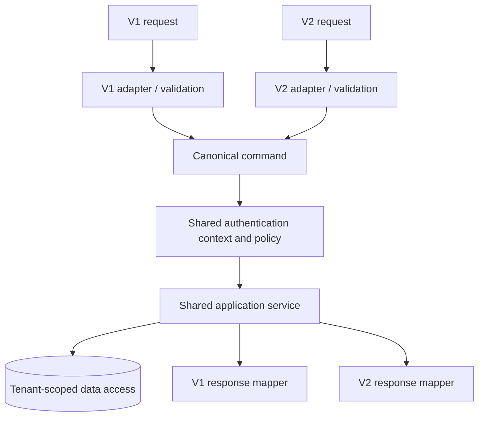

# Không để version cũ bỏ qua control mới

Trong chương **Version và deprecation** của module `SECURITY_API_SECURITY`, mỗi phiên bản API đang được phục vụ đều là một đường vào hệ thống và phải tuân thủ các kiểm soát bảo mật hiện hành. Khi thêm validation, object authorization, tenant isolation, rate limit, chống SSRF hoặc quy tắc bảo vệ dữ liệu vào version mới, version cũ không được trở thành lối đi vòng cho cùng nghiệp vụ.

Lỗi thường gặp là đội phát triển sửa endpoint `/v2` nhưng quên `/v1`, trong khi cả hai cùng gọi một service hoặc cùng truy cập dữ liệu. Một lỗi khác là chỉ thêm security filter vào route mới, hoặc để controller cũ gọi repository trực tiếp. Attacker có thể tiếp tục dùng version cũ để gửi payload không còn hợp lệ, đọc field đã bị ẩn, truy cập object ngoài tenant hoặc kích hoạt hành động mà version mới đã chặn.

Nguyên tắc cần giữ là **security invariant áp dụng nhất quán trên mọi version còn hoạt động**. Version có thể khác nhau về schema, tên field, định dạng response hoặc semantics tương thích; quyền truy cập, tenant boundary, giới hạn tài nguyên và các yêu cầu an toàn phải được enforce ở lớp dùng chung hoặc được chứng minh tương đương ở từng adapter.

## 1. Vì sao version cũ dễ trở thành đường vòng bảo mật?

API version thường được tạo để thay đổi contract mà không làm hỏng client hiện tại. Trong quá trình đó, hệ thống có thể duy trì nhiều route:

```text
/v1/orders/{id}
/v2/orders/{id}
/legacy/orders/{id}
```

Các route có thể khác controller, DTO, middleware hoặc service. Nếu security fix chỉ được áp dụng cho version mới, route cũ vẫn có thể thực hiện hành vi cũ.

Ví dụ, `/v2/users/{id}` đã kiểm tra ownership trước khi trả hồ sơ, nhưng `/v1/users/{id}` vẫn trả entity trực tiếp. User A có thể gọi v1 để đọc email hoặc internal note của user B dù v2 đã che các field đó. Tương tự, v2 giới hạn bulk request ở 100 ID nhưng v1 vẫn chấp nhận 50.000 ID; hoặc v2 chặn URL trỏ tới private IP trong khi endpoint preview v1 vẫn dùng HTTP client mặc định.

### 1.1. Các dạng lệch control giữa version

| Control mới | Đường vòng thường gặp ở version cũ | Tác động |
|---|---|---|
| Authentication | Route cũ nằm ngoài security matcher hoặc dùng cơ chế token yếu | Truy cập không xác thực hoặc token không đúng audience |
| Function authorization | Controller cũ chỉ kiểm tra đăng nhập | User có thể gọi chức năng quản trị hoặc thao tác ghi |
| Object authorization | V1 truy vấn theo ID mà không kiểm tra owner/relationship | BOLA/IDOR |
| Tenant isolation | V1 không thêm tenant predicate hoặc nhận `tenantId` từ body | Đọc/ghi dữ liệu tenant khác |
| Property authorization | V1 serialize entity hoặc DTO cũ có field nội bộ | Rò dữ liệu nhạy cảm |
| Input validation | V1 giữ giới hạn cũ hoặc không kiểm tra nested object | Payload gây lỗi, mass assignment hoặc resource exhaustion |
| SSRF protection | V1 không dùng URL fetcher an toàn mới | Truy cập metadata/private network |
| Rate limit/quota | Chỉ áp dụng limit cho route v2 | Bypass quota và tăng chi phí qua v1 |
| Audit | V1 không ghi actor/action hoặc không phát security event | Khó phát hiện và điều tra |
| Data retention | V1 export/download không áp dụng policy mới | Dữ liệu tiếp tục bị lộ qua luồng cũ |

Không chỉ REST path mới cần xem xét. GraphQL schema version, RPC method, webhook contract, mobile API, internal endpoint, export job và callback có thể tiếp tục gọi logic cũ dù route HTTP đã đổi.

### 1.2. API version không phải security boundary

Version chỉ xác định contract hoặc behavior compatibility. Nó không chứng minh caller đáng tin, không đại diện cho role, tenant, client type hay mức bảo mật. Không cấp quyền rộng hơn cho `/v1` vì đó là client cũ; cũng không cho `/v2` quyền cao hơn chỉ vì nó mới.

Một token được phát hành cho public API vẫn phải được kiểm tra issuer, audience, expiry, scope và principal trên mọi version. Nếu token dành riêng cho một resource server hoặc operation, không suy ra rằng route cũ được phép nhận token chỉ vì chữ ký hợp lệ.

## 2. Xác định security invariant trước khi quản lý version

Trước khi thêm hoặc deprecate version, hãy liệt kê các quy tắc bảo mật không được thay đổi theo version. Các quy tắc này là tiêu chí để review và test.

Ví dụ security invariant cho một API đa tenant:

1. Mọi request được xác thực theo cơ chế hiện hành hoặc bị từ chối.
2. Principal chỉ thực hiện action được cấp trên resource thuộc phạm vi được phép.
3. Mọi truy vấn đọc/ghi dữ liệu đều giới hạn tenant theo context do server xác minh.
4. Response chỉ chứa field principal được phép xem.
5. Request tuân thủ giới hạn body, field, array, depth, concurrency và quota hiện hành.
6. URL fetch, redirect và outbound request đi qua SSRF policy chung.
7. Side effect bị từ chối không được tạo event, job, file hoặc lời gọi provider ngoài ý muốn.
8. Hành động nhạy cảm có audit event đủ để truy vết.

Các invariant này áp dụng cho mọi version còn được phục vụ, bao gồm version chỉ dành cho đối tác hoặc client nội bộ. Nếu có ngoại lệ, phải ghi rõ lý do, phạm vi, thời hạn, owner và cách kiểm soát rủi ro; không để ngoại lệ tồn tại vô thời hạn chỉ vì client cũ chưa nâng cấp.

### 2.1. Tách compatibility khỏi security policy

Version adapter có thể chuyển đổi contract cũ sang mô hình nội bộ mới. Ví dụ v1 nhận `customer_code`, v2 nhận `customerId`; cả hai adapter chuyển thành cùng một command có kiểu dữ liệu chuẩn. Authorization, tenant scope, quota và business invariant được thực thi sau khi chuẩn hóa.



Adapter chịu trách nhiệm tương thích schema và mapping. Shared policy/service chịu trách nhiệm bảo mật và nghiệp vụ chung. Cách tổ chức này giảm nguy cơ version cũ tự triển khai một phiên bản authorization riêng đã lỗi thời.

### 2.2. Không đặt policy chỉ trong controller mới

Nếu policy chỉ tồn tại trong controller v2, một controller v1 khác có thể bỏ qua. Đặt kiểm soát quan trọng ở service/domain boundary, repository query hoặc middleware chung phù hợp với loại kiểm soát.

Ví dụ:

- Authentication ở security filter/resource server dùng chung cho mọi route.
- Function/object authorization ở policy service hoặc method security dùng chung.
- Tenant scoping ở repository/query boundary và database constraint.
- Property filtering ở response mapper theo principal và use case.
- Quota/rate limit ở shared gateway hoặc application service theo cost unit.
- SSRF protection ở outbound HTTP adapter duy nhất.

Không phải mọi kiểm soát đều nên dồn vào một middleware. Cần đặt kiểm soát tại nơi có đủ ngữ cảnh và không thể bị bỏ qua bởi version adapter khác.

## 3. Inventory mọi version và operation đang hoạt động

Muốn bảo đảm parity, trước tiên phải biết version nào còn có thể nhận traffic. Không dựa riêng vào tài liệu API hoặc danh sách version trong source code vì gateway, mobile app, partner integration và internal consumer có thể tiếp tục dùng route cũ.

Inventory cần ghi:

| Thuộc tính | Nội dung |
|---|---|
| API family | Nhóm nghiệp vụ, ví dụ Orders hoặc Users |
| Version | V1, V2, header-based version hoặc schema revision |
| Operation ID | Định danh operation ổn định |
| Method/path | Route sau gateway rewrite |
| Consumer | Web, mobile, partner, internal service, batch job |
| Traffic | Request count, tenant/client distribution và last seen |
| Security owner | Team chịu trách nhiệm policy |
| Control set | Authn, authz, tenant, property, validation, quota, audit... |
| Lifecycle | Active, deprecated, sunset scheduled, disabled |
| Replacement | Version/operation thay thế và hướng dẫn migration |
| Test evidence | Test ID chứng minh invariant trên version đó |

Thu thập version từ router/controller, OpenAPI, gateway route, GraphQL schema, SDK, telemetry và service consumer. Đánh dấu cả alias, route legacy và path được rewrite về cùng handler.

### 3.1. Đừng chỉ so sánh URL version

Version có thể được chọn qua:

- Path: `/v1/...`, `/v2/...`.
- Header: `API-Version: 2` hoặc vendor media type.
- Query parameter nếu hệ thống cũ dùng cách này.
- Hostname/subdomain riêng.
- GraphQL schema hoặc persisted query revision.
- RPC package/service/method revision.
- Webhook event type/version.

Một operation có thể được expose qua nhiều cơ chế. Kiểm thử phải xác định version thực tế sau khi gateway và application đã giải quyết negotiation.

### 3.2. Version không rõ hoặc không hỗ trợ phải fail closed

Nếu client gửi version không được hỗ trợ, trả lỗi contract rõ ràng như `400`, `404` hoặc `406` tùy cách version negotiation được thiết kế. Không tự động fallback sang một version cũ hoặc default permissive. Fallback có thể làm client tưởng đang dùng control mới trong khi server xử lý theo contract cũ.

Ghi nhận version được chọn trong telemetry và response metadata phù hợp để điều tra. Không để client tự chọn version bằng một header không được gateway/application kiểm soát hoặc có thể bị proxy xóa.

## 4. Giữ authentication nhất quán trên mọi version

Mọi route version còn hoạt động phải đi qua cơ chế xác thực được phê duyệt. Một route cũ không được bỏ qua filter vì matcher chỉ liệt kê `/v2/**`.

### 4.1. Kiểm tra token theo resource server, không theo tuổi version

Với JWT hoặc opaque token, kiểm tra issuer, audience, expiry, signature/introspection, scope và trạng thái principal theo policy hiện hành. Không cho token legacy tồn tại vô thời hạn nếu cơ chế ký, thuật toán, audience hoặc claim không còn đáp ứng yêu cầu.

Nếu cần hỗ trợ credential cũ trong giai đoạn chuyển đổi, giới hạn rõ:

- Consumer cụ thể đã được đăng ký.
- Operation và scope được phép.
- Thời hạn chuyển đổi và ngày chấm dứt.
- Mức rủi ro và biện pháp bù.
- Cách đo traffic và cảnh báo khi credential cũ còn được sử dụng.

Không biến “v1” thành một authentication realm yếu hơn. Nếu credential cũ không thể đáp ứng yêu cầu tối thiểu, cần kế hoạch migrate/rotate và thời hạn dừng.

### 4.2. Security matcher phải bao phủ toàn bộ route

Với Spring Security, kiểm tra các `SecurityFilterChain`, `securityMatcher`, `requestMatchers` và thứ tự `@Order`. Một chain chỉ match `/v2/**` không tự bảo vệ `/v1/**`. Chain fallback phải yêu cầu authentication theo mặc định.

Ví dụ cấu hình khái niệm:

```java
@Bean
@Order(1)
SecurityFilterChain apiSecurity(HttpSecurity http) throws Exception {
    return http
        .securityMatcher("/v1/**", "/v2/**", "/legacy/**")
        .authorizeHttpRequests(auth -> auth
            .requestMatchers(HttpMethod.GET, "/v1/**", "/v2/**", "/legacy/**")
                .hasAuthority("SCOPE_api:read")
            .requestMatchers("/v1/**", "/v2/**", "/legacy/**")
                .hasAuthority("SCOPE_api:write"))
        .oauth2ResourceServer(oauth2 -> oauth2.jwt(Customizer.withDefaults()))
        .build();
}

@Bean
@Order(99)
SecurityFilterChain fallbackSecurity(HttpSecurity http) throws Exception {
    return http
        .authorizeHttpRequests(auth -> auth.anyRequest().denyAll())
        .build();
}
```

Đây là ví dụ rút gọn để minh họa phạm vi route. Ứng dụng thực tế cần chia permission theo operation cụ thể, cấu hình CSRF phù hợp với bearer token hoặc cookie/session, và bảo đảm chain fallback không làm hỏng các route public-by-design đã được khai báo riêng. Không dùng một scope read/write tổng quát cho mọi API nếu nghiệp vụ cần permission chi tiết.

### 4.3. Không tin version do client khai báo như một quyền

Header hoặc query chọn version chỉ quyết định contract được dùng. Nó không chứng minh client là ứng dụng tin cậy hoặc có quyền truy cập. Nếu cần phân biệt client, xác minh client identity bằng OAuth client authentication, mTLS hoặc cơ chế phù hợp; sau đó authorization vẫn được kiểm tra theo principal, operation và resource.

## 5. Authorization và tenant isolation không được yếu đi ở version cũ

Đây là nhóm lỗi có thể tạo ra BOLA/IDOR và cross-tenant data exposure. Cùng một tài nguyên có thể được truy cập qua nhiều version, nhưng mọi đường phải áp dụng cùng security invariant.

### 5.1. Object authorization ở service boundary

Tránh viết kiểm tra owner riêng trong controller v2 rồi để controller v1 gọi repository trực tiếp. Đưa policy vào application service hoặc policy component được mọi version dùng:

```java
@Service
public class OrderApplicationService {
    private final OrderRepository orders;
    private final OrderPolicy policy;

    public OrderApplicationService(OrderRepository orders, OrderPolicy policy) {
        this.orders = orders;
        this.policy = policy;
    }

    public OrderView getOrder(UUID orderId, CurrentPrincipal principal) {
        Order order = orders.findByIdAndTenantId(
                orderId, principal.tenantId())
            .orElseThrow(ResourceNotFoundException::new);

        policy.requireCanRead(principal, order);
        return OrderView.from(order);
    }
}
```

Cả V1 và V2 controller phải gọi `getOrder()` hoặc một service method có cùng policy. Repository query giới hạn tenant trước khi trả object; policy kiểm tra thêm role, ownership hoặc relationship. `principal.tenantId()` phải đến từ security context đã xác minh, không lấy trực tiếp từ path/body.

### 5.2. Tenant predicate phải có ở mọi query path

Một số version có thể dùng query khác nhau do schema hoặc pagination. Dù vậy, truy vấn vẫn phải giới hạn tenant. Kiểm tra cả list, search, export, bulk, nested resource và background job. Không để V1 dùng `findById(id)` trong khi V2 dùng `findByIdAndTenantId(id, tenantId)`.

Với update/delete, tenant predicate cần nằm trong câu lệnh ghi hoặc transaction có kiểm soát. Kiểm tra số dòng bị tác động và không phát side effect nếu resource ngoài phạm vi. Database constraint, composite foreign key hoặc row-level security có thể bổ sung lớp bảo vệ.

### 5.3. Quyền chức năng và property-level authorization

Version cũ không được giữ field hoặc operation đã bị thu hồi quyền. Nếu V2 bỏ `internalNote` khỏi response, V1 cũng phải ngừng trả field đó theo policy hiện hành. Nếu V2 yêu cầu `ops:refund`, V1 không được tiếp tục cho phép mọi authenticated user refund.

Tách response DTO theo version nhưng lấy field từ cùng policy decision. V1 có thể map về schema cũ với các field đã được phép; nếu field cũ không còn được công bố, trả representation an toàn theo contract hoặc từ chối operation cần thiết. Không serialize entity chỉ để duy trì tương thích.

## 6. Validation và resource limit phải dùng chính sách hiện hành

Version cũ thường có giới hạn đầu vào khác vì contract ban đầu lỏng hơn. Khi phát hiện một payload gây rủi ro, cần đánh giá mọi version đang nhận payload tương đương.

### 6.1. Chuẩn hóa về canonical command

V1 và V2 có thể dùng tên field khác nhau nhưng nên chuyển thành một command chuẩn có giới hạn thống nhất. Ví dụ V1 dùng `items`, V2 dùng `lines`; cả hai chuyển thành `CreateOrderCommand` rồi áp dụng max 50 item, quantity range và kiểm tra quyền trên từng product.

Không giả định validation DTO mới tự động áp dụng cho DTO cũ. Test riêng mỗi adapter và kiểm tra command sau mapping để không có đường bỏ sót.

### 6.2. Giới hạn payload và parser ở tầng dùng chung

Body size, parser depth, string length, numeric token length, array count và request timeout nên được áp dụng trước khi controller theo version xử lý. Nếu gateway chỉ giới hạn `/v2/**`, V1 vẫn có thể nhận body lớn. Nếu application parser dùng cấu hình riêng theo route, cần xác minh mọi version đều có giới hạn.

Giới hạn phải tính cả các luồng multipart, compressed body, GraphQL query, batch request và upload trực tiếp. Không chỉ kiểm tra JSON DTO.

### 6.3. Quota và cost limit theo nghiệp vụ, không theo URL

Nếu một request tạo email, SMS, storage hoặc third-party call, quota cần được tính theo cost unit và tenant/actor. Đừng tạo bucket riêng theo path version để client có thể lấy thêm quota bằng cách chuyển qua v1. Một số trường hợp cần bucket theo operation family để giữ tổng chi phí ổn định.

Nếu cần phân biệt cost model do V1 và V2 có behavior khác nhau, ghi rõ hệ số cost nhưng vẫn áp dụng hard budget tổng cho tenant/provider. Rate limit tại gateway nên bao phủ tất cả route alias.

## 7. Các control đặc thù không được bỏ sót

### 7.1. SSRF và outbound request

Nếu V2 dùng `SafeUrlFetcher` để kiểm tra scheme, resolve A/AAAA, chặn private IP, pin địa chỉ và kiểm soát redirect, V1 không được tiếp tục gọi `RestTemplate` hoặc HTTP client mặc định với URL do client cung cấp. Hãy đưa outbound request qua một adapter chung, áp dụng cùng destination policy và response limit.

Kiểm tra cả URL trong webhook configuration, image preview, import, document conversion, callback validation và integration endpoint. Endpoint có tên khác hoặc version cũ vẫn có thể tạo outbound request.

### 7.2. Cache và signed URL

Nếu response phụ thuộc principal, tenant hoặc field policy, cache key cần phản ánh phạm vi đó trên mọi version. Không để V1 dùng shared cache key thiếu tenant trong khi V2 đã sửa. Signed URL được cấp từ V1 cũng phải kiểm tra object authorization, method, expiry và tenant scope.

Khi quyền thay đổi hoặc membership bị thu hồi, cache và URL cần có behavior được định nghĩa. Nếu signed URL không thể thu hồi ngay, giới hạn expiry và phạm vi object/method.

### 7.3. Audit và security event

Đảm bảo V1 cũng ghi actor, tenant, operation, resource, decision và correlation ID. Nếu audit event schema đã thay đổi, dùng adapter để chuẩn hóa event từ mọi version về một schema nội bộ. Không để thao tác từ version cũ trở thành “blind spot” trong monitoring.

Không ghi token, password, secret hoặc toàn bộ payload nhạy cảm chỉ để phân biệt version. Ghi version đã được chọn như metadata có kiểm soát.

### 7.4. Webhook, callback và asynchronous work

Version của API nhận request có thể tạo job được thực thi sau đó. Worker phải nhận tenant context, actor/delegation, operation và policy metadata cần thiết. Không tin job cũ chỉ vì nó được tạo bởi V1. Khi job chạy, kiểm tra lại các quyền có thể thay đổi theo thời gian theo semantics đã công bố.

Webhook event version cũng cần xác minh signature, timestamp, replay protection và mapping tenant. Không để callback v1 dùng secret yếu hoặc bỏ qua chữ ký vì đối tác chưa migrate.

## 8. Tổ chức code để security fix lan tới mọi version

Một cấu trúc dễ duy trì là version adapter mỏng và application service dùng chung:

```text
api/
  v1/
    OrderV1Controller
    OrderV1Request
    OrderV1ResponseMapper
  v2/
    OrderV2Controller
    OrderV2Request
    OrderV2ResponseMapper
application/
  OrderApplicationService
  OrderPolicy
  TenantContext
  UsageQuotaService
infrastructure/
  TenantScopedOrderRepository
  SafeUrlFetcher
  AuditPublisher
```

Các version adapter nên làm những việc sau:

- Parse/validate contract cụ thể của version.
- Chuyển dữ liệu sang command/query chuẩn.
- Gọi application service dùng chung.
- Chuyển kết quả thành response DTO của version.
- Gắn deprecation metadata nếu version đã được thông báo ngừng hỗ trợ.

Adapter không nên tự thực hiện authorization, tenant lookup, outbound HTTP, quota accounting hoặc truy vấn dữ liệu nhạy cảm. Nếu có lý do kiến trúc khiến một version cần logic riêng, tách policy thành component dùng chung và chứng minh parity bằng test.

### 8.1. Shared policy không có nghĩa bỏ qua khác biệt nghiệp vụ

Không ép hai version có behavior giống hệt nhau nếu contract khác nhau. Ví dụ V1 cho phép `status=PROCESSING`, V2 dùng `state=IN_PROGRESS`; adapter có thể chuyển đổi enum. Nhưng việc caller có quyền chuyển order sang trạng thái đó phải được kiểm tra bằng cùng policy domain.

Nếu V1 có semantics cũ không còn an toàn, không giữ behavior nguy hiểm chỉ vì compatibility. Có thể từ chối riêng operation đó, cung cấp migration endpoint hoặc dừng version theo lịch đã thông báo.

## 9. Ví dụ Spring: V1 và V2 dùng chung service

Ví dụ sau minh họa hai controller với request/response khác nhau nhưng cùng gọi application service. Phần authentication được thực hiện bởi security chain dùng chung; service thực hiện tenant-scoped lookup và object policy.

```java
@RestController
@RequestMapping("/v1/orders")
class OrderV1Controller {
    private final OrderApplicationService orders;

    OrderV1Controller(OrderApplicationService orders) {
        this.orders = orders;
    }

    @GetMapping("/{id}")
    OrderV1Response get(
            @PathVariable UUID id,
            @AuthenticationPrincipal CurrentPrincipal principal) {
        OrderView view = orders.getOrder(id, principal);
        return OrderV1Response.from(view);
    }
}

@RestController
@RequestMapping("/v2/orders")
class OrderV2Controller {
    private final OrderApplicationService orders;

    OrderV2Controller(OrderApplicationService orders) {
        this.orders = orders;
    }

    @GetMapping("/{id}")
    OrderV2Response get(
            @PathVariable UUID id,
            @AuthenticationPrincipal CurrentPrincipal principal) {
        OrderView view = orders.getOrder(id, principal);
        return OrderV2Response.from(view);
    }
}
```

Ví dụ service:

```java
@Service
class OrderApplicationService {
    private final OrderRepository orders;
    private final OrderPolicy policy;

    OrderApplicationService(OrderRepository orders, OrderPolicy policy) {
        this.orders = orders;
        this.policy = policy;
    }

    OrderView getOrder(UUID id, CurrentPrincipal principal) {
        Order order = orders.findByIdAndTenantId(id, principal.tenantId())
            .orElseThrow(ResourceNotFoundException::new);
        policy.requireCanRead(principal, order);
        return OrderView.fromAllowedFields(order, principal, policy);
    }
}
```

Các kiểu `OrderV1Response`, `OrderV2Response`, `OrderView`, repository và policy là ví dụ theo ứng dụng. `fromAllowedFields` minh họa việc field-level policy được áp dụng trước mapping; trong code thực tế có thể trả projection/DTO đã lọc từ service. `@AuthenticationPrincipal` lấy principal từ security context, không lấy tenant từ request. Controller không được có đường repository riêng để tránh bỏ qua policy.

### 9.1. Response version cũ vẫn phải tuân thủ field policy

Giả sử V1 từng trả `internalNote` nhưng policy hiện hành cấm user thông thường đọc field đó. Không nên giữ field này trong response chỉ vì schema cũ có khai báo. Các lựa chọn cần được công bố:

- Bỏ field khỏi response V1 nếu client có thể tương thích với field optional.
- Trả `null`/omit theo contract và semantics đã định nghĩa.
- Từ chối operation nếu không thể duy trì contract an toàn.
- Yêu cầu consumer migrate và kết thúc V1 trong thời hạn cụ thể.

Không trả field nhạy cảm để tránh làm hỏng client. Compatibility không phải lý do hợp lệ để duy trì data exposure.

## 10. Quản lý deprecation và sunset an toàn

Deprecation là thông báo version/operation sẽ bị ngừng hỗ trợ; sunset là thời điểm dịch vụ ngừng nhận request. Hai mốc này cần được quản lý có kế hoạch, không chỉ thêm header vào response.

### 10.1. Đặt mốc lifecycle rõ ràng

Mỗi version nên có:

- Ngày phát hành và trạng thái hiện tại.
- Ngày bắt đầu deprecation.
- Ngày sunset dự kiến và timezone rõ ràng.
- Consumer/tenant đang sử dụng.
- Version/operation thay thế.
- Security change bắt buộc phải áp dụng ngay.
- Owner hỗ trợ migration và kênh thông báo.

Không trì hoãn security fix đến ngày sunset. Nếu phát hiện lỗ hổng nghiêm trọng ở V1, cần áp dụng control hoặc tắt operation dễ bị khai thác ngay theo quy trình incident/change, đồng thời hỗ trợ client migrate. Sunset là công cụ quản lý lifecycle, không phải biện pháp khắc phục lỗ hổng trong thời gian chờ.

### 10.2. Dùng deprecation metadata nhất quán

Có thể trả metadata theo contract, ví dụ các header `Deprecation`, `Sunset` và `Link` tới tài liệu migration nếu hệ thống đã thống nhất cách dùng. Header cần có giá trị đúng định dạng, được gateway giữ lại và có test. Không trả ngày sunset khác nhau giữa instance hoặc environment do cấu hình drift.

Ví dụ response:

```http
HTTP/1.1 200 OK
Deprecation: @1814399999
Sunset: Wed, 30 Jun 2027 23:59:59 GMT
Link: <https://developer.example.test/migrations/orders-v1>; rel="deprecation"
```

Ngày trong ví dụ chỉ minh họa. Tài liệu migration cần nêu field/operation thay thế, thay đổi validation, scope mới, behavior lỗi và hướng dẫn kiểm thử. Không đưa thông tin nội bộ hoặc credential vào link/header.

`Deprecation` dùng giá trị Structured Field Date dạng `@` kèm Unix timestamp theo RFC 9745, không dùng boolean `true`. `Sunset` dùng HTTP-date theo RFC 8594. Khi sinh header, chuyển thời điểm từ một cấu hình UTC thống nhất và kiểm tra giá trị sau khi đi qua gateway/proxy.

### 10.3. Theo dõi consumer trước khi sunset

Dùng telemetry để xác định ai còn gọi version cũ. Có thể ghi client ID, tenant ID, version, operation, request count và last seen ở dạng có kiểm soát. Tránh log payload hoặc token. Liên hệ owner qua kênh đã được phê duyệt và cung cấp hướng dẫn migrate.

Trước ngày sunset, kiểm tra traffic thấp nhưng chưa bằng zero: scheduled job hàng tháng/quý hoặc client chỉ hoạt động theo mùa có thể không xuất hiện trong cửa sổ quan sát ngắn. Xác định thời gian quan sát phù hợp với chu kỳ nghiệp vụ.

### 10.4. Sunset có kiểm soát

Khi đến hạn, trả lỗi version retired ổn định, không fallback sang version khác. Có thể dùng `410 Gone` cho endpoint/version đã ngừng hỗ trợ nếu phù hợp contract. Response chỉ hướng dẫn version thay thế và tài liệu migration; không tiết lộ chi tiết hạ tầng.

Gỡ route ở gateway và application, thu hồi credential/scope chỉ dành cho version đó nếu có, dọn consumer và xóa code sau khi xác minh không còn dependency. Giữ audit và telemetry cần thiết theo retention policy.

## 11. Security patch và thay đổi không tương thích

Không phải mọi security fix đều có thể chờ một major version. Nếu V1 có lỗi authorization hoặc SSRF, bản vá cần áp dụng cho V1 đang hoạt động. Có thể cần thay đổi hành vi và làm một số request trước đây thành lỗi; đây là thay đổi cần quản lý, nhưng không nên duy trì lỗ hổng chỉ để giữ compatibility.

### 11.1. Phân loại mức độ thay đổi

| Loại thay đổi | Ví dụ | Cách xử lý |
|---|---|---|
| Additive, không giảm bảo mật | Thêm field optional không nhạy cảm | Cập nhật contract và test tương thích |
| Security tightening | Thêm tenant predicate, giới hạn payload, ẩn field | Áp dụng trên mọi version; thông báo tác động |
| Breaking security fix | Từ chối scope cũ hoặc chặn endpoint nguy hiểm | Vá khẩn cấp, thông báo và migration path |
| Remove insecure operation | Tắt endpoint export không kiểm soát | Disable/gỡ route, cung cấp luồng thay thế an toàn |
| Sunset version | Ngừng V1 | Theo lifecycle, telemetry và kế hoạch consumer |

### 11.2. Không tạo feature flag bypass vô thời hạn

Có thể dùng feature flag để rollout policy mới theo giai đoạn, nhưng flag phải có owner, scope, expiry, metric và kế hoạch xóa. Không để `legacySecurityDisabled=true` hoặc `skipTenantCheckForV1` tồn tại vĩnh viễn.

Nếu cần compatibility exception cho một consumer, giới hạn theo client identity/tenant/operation, ghi audit, áp dụng compensating control và ngày hết hạn. Không dùng `if (apiVersion == V1) skipAuthorization()`.

### 11.3. Rollout theo quan sát nhưng fail closed ở ranh giới quan trọng

Với validation không phá vỡ bảo mật ngay lập tức, có thể chạy chế độ observe để đo payload hiện tại trước khi enforce. Nhưng không dùng shadow mode để trì hoãn fix cho lỗ hổng đang cho phép truy cập trái phép, tenant crossing hoặc SSRF tới mạng nhạy cảm. Có thể rollout nhanh bằng policy trung tâm, canary và rollback có kiểm soát, nhưng rollback không được khôi phục một lỗ hổng đã biết mà không có quyết định rủi ro rõ ràng.

## 12. Kiểm thử security parity giữa các version

Kiểm thử cần chứng minh cùng một principal, resource và action nhận quyết định bảo mật tương đương trên mọi version, kể cả alias hoặc route legacy.

### 12.1. Ma trận version × operation × principal

| Version | Principal | Operation | Trường hợp | Kết quả mong đợi |
|---|---|---|---|---|
| V1 | Anonymous | Read order | Không token | Từ chối |
| V2 | Anonymous | Read order | Không token | Từ chối |
| V1 | User A | Read order B | Khác tenant/owner | Từ chối |
| V2 | User A | Read order B | Khác tenant/owner | Từ chối |
| V1 | Viewer | Delete order A | Không có write permission | Từ chối |
| V2 | Viewer | Delete order A | Không có write permission | Từ chối |
| V1 | User A | Read profile B | Field nhạy cảm | Không lộ field |
| V2 | User A | Read profile B | Field nhạy cảm | Không lộ field |
| V1 | Tenant A | Bulk update | Batch vượt quota | Từ chối trước side effect |
| V2 | Tenant A | Bulk update | Batch vượt quota | Từ chối trước side effect |

Ma trận này là ví dụ. Thực tế cần bao phủ từng operation và các security invariant có liên quan; không chỉ chọn một vài endpoint đại diện nếu các controller có code path khác nhau.

### 12.2. So sánh quyết định policy, không chỉ status code

Hai version có thể trả status code khác nhau vì contract khác nhau (ví dụ V1 trả `404`, V2 trả `403` để che giấu object). Điều cần so sánh là policy decision và side effect: cả hai đều không trả dữ liệu trái phép, không thay đổi resource, không phát event và không gọi provider.

Có thể ghi test oracle chung như:

```text
Given principal A and resource B outside A's tenant
When the same read/update action is sent to every active API version
Then no version returns protected data
And no version changes resource B
And no version emits an event or downstream call
```

### 12.3. Kiểm thử route và matcher

Tạo test liệt kê mọi route version, alias và method. Xác minh request không credential bị chặn ở mọi route yêu cầu authentication. Với Spring Security, có thể dùng MockMvc/Spring Security Test để kiểm tra chain thực tế; bổ sung test gateway để phát hiện route rewrite mở endpoint cũ.

Test cần bao gồm path normalization, trailing slash, method override nếu được hỗ trợ, content negotiation, version header không hợp lệ và route fallback. Không chỉ test controller method trực tiếp vì cách đó có thể bỏ qua filter chain.

### 12.4. Kiểm thử validation và resource limit

Gửi cùng payload tương đương tới mọi version: chuỗi quá dài, numeric token lớn, array vượt max, nested object sâu, body quá lớn, compressed body, bulk ID list và query complexity. Xác minh mọi version đều từ chối trước khi tạo side effect. Nếu giới hạn khác nhau vì contract, giới hạn đó vẫn phải đáp ứng security budget đã định nghĩa.

### 12.5. Kiểm thử các đường gián tiếp

Test cả cache, export, signed URL, queue, worker, webhook, GraphQL, RPC và internal service. Một endpoint v1 có thể tạo job được worker xử lý sau; test phải xác minh tenant, actor và authorization context được giữ đúng. Khi quyền bị thu hồi, behavior phải theo policy đã công bố.

### 12.6. Coverage gate trong CI

Có thể duy trì mapping operation/version tới test ID:

| Operation ID | V1 test | V2 test | Shared policy test | Trạng thái |
|---|---|---|---|---|
| `getOrder` | `v1_getOrder_deniesOtherTenant` | `v2_getOrder_deniesOtherTenant` | `orderPolicy_requiresTenant` | Covered |
| `updateOrder` | `v1_updateOrder_checksWrite` | `v2_updateOrder_checksWrite` | `orderPolicy_requiresWrite` | Covered |
| `createExport` | `v1_export_enforcesQuota` | `v2_export_enforcesQuota` | `quota_reservation_atomic` | Covered |
| `fetchPreview` | `v1_preview_blocksPrivateIp` | `v2_preview_blocksPrivateIp` | `safeFetcher_pinsAddress` | Covered |

Khi thêm version hoặc operation, CI có thể cảnh báo nếu thiếu test parity. Test shared policy không thay thế hoàn toàn test adapter: vẫn cần chứng minh mỗi version thực sự gọi policy chung và không có code path bỏ qua.

## 13. Monitoring và phát hiện version cũ bị dùng để bypass

Theo dõi usage theo version và operation giúp phát hiện bất thường. Một đợt tăng traffic V1 sau khi V2 siết validation hoặc authorization có thể cho thấy client vô tình dùng sai version hoặc có người cố ý bypass control.

Metric nên gồm:

- Request count theo version, operation, client và tenant.
- Tỷ lệ `401`, `403`, `404`, `410`, `413`, `429` theo version.
- Validation failure theo error code và field path đã chuẩn hóa.
- Tỷ lệ object authorization/tenant denial.
- Usage quota và cost unit theo version family, tenant và provider.
- SSRF destination rejection và redirect rejection.
- Cache hit/miss theo security scope.
- Deprecation usage, last seen và consumer chưa migrate.
- Security event và side effect từ route legacy.

Không dùng raw token, email, số điện thoại hoặc resource data làm metric label. Cardinality cao có thể làm hệ thống monitoring tốn tài nguyên và tạo thêm rủi ro dữ liệu. Log cần mask thông tin nhạy cảm và có quyền truy cập phù hợp.

### 13.1. Cảnh báo khi traffic cũ tăng bất thường

Tạo cảnh báo khi V1 tăng đột biến sau khi control mới được bật ở V2, khi xuất hiện client mới gọi route legacy hoặc khi một principal bị từ chối ở V2 nhưng tiếp tục gọi V1. Cần điều tra nguyên nhân trước khi kết luận có tấn công; có thể là mobile app cũ, retry logic hoặc cache client.

### 13.2. Audit version được chọn

Ghi version đã được server chọn, không chỉ version client yêu cầu. Với header negotiation, ghi cả requested version và resolved version để phát hiện fallback ngoài ý muốn. Không cho client tự ghi đè metadata audit bằng header tùy ý.

## 14. Lỗi thiết kế thường gặp

| Lỗi | Hệ quả | Cách khắc phục |
|---|---|---|
| Chỉ vá V2 | V1 trở thành bypass | Áp dụng invariant cho mọi version active |
| Security matcher chỉ có `/v2/**` | Route cũ có thể không được bảo vệ | Matcher bao phủ mọi route và fallback deny/authenticate |
| Controller V1 gọi repository trực tiếp | Bỏ qua policy/service mới | Adapter mỏng, shared application service |
| Tenant filter chỉ ở query V2 | Cross-tenant access qua V1 | Tenant scope ở repository/domain/database |
| V1 serialize entity | Lộ field đã bị ẩn ở V2 | DTO allowlist và shared property policy |
| V1 có validation yếu hơn | Payload gây resource exhaustion | Parser/body limits chung và test từng adapter |
| Quota theo path version | Chuyển sang V1 để lấy thêm quota | Quota theo tenant/actor/operation family/cost unit |
| URL fetcher V1 cũ | SSRF bypass control mới | Outbound adapter dùng chung |
| Cache key không có tenant/version policy | Response nhầm scope | Cache key theo representation và security scope |
| Không có sunset date | Legacy endpoint tồn tại vô hạn | Lifecycle, telemetry, owner và sunset plan |
| Feature flag bypass không expiry | Security exception thành vĩnh viễn | Owner, scope, audit, expiry và removal task |
| Chỉ test shared service | Adapter cũ có thể không gọi service | Test route thực tế cho từng version |

## 15. Checklist review trước khi phát hành

- [ ] Inventory liệt kê mọi version, alias, operation và consumer còn hoạt động.
- [ ] Security invariant được ghi rõ và áp dụng cho mọi version active.
- [ ] API version chỉ chọn contract, không quyết định mức tin cậy hoặc quyền.
- [ ] Authentication matcher bao phủ route cũ, route mới và alias.
- [ ] Token được kiểm tra issuer, audience, expiry, signature và scope theo resource server.
- [ ] Object authorization, tenant scope và property policy được dùng chung.
- [ ] Version adapter không tự truy vấn dữ liệu hoặc gọi outbound HTTP bỏ qua policy.
- [ ] Validation, parser limit, body size, bulk limit và quota không bị bypass qua version cũ.
- [ ] Cache, signed URL, export, queue, worker, webhook và callback giữ security context.
- [ ] Security patch được áp dụng ngay trên version còn active khi cần thiết.
- [ ] Compatibility exception có owner, phạm vi, compensating control và expiry.
- [ ] Deprecation/sunset có mốc, replacement, consumer telemetry và migration guide.
- [ ] Version không hỗ trợ không fallback sang version yếu hơn.
- [ ] CI có test parity theo version × operation × principal × resource.
- [ ] Test xác minh response, database state, event và downstream call.
- [ ] Monitoring phân biệt requested version và resolved version; cảnh báo traffic legacy bất thường.
- [ ] Audit bao gồm version, actor, tenant, action và policy decision, không ghi secret.

## Kết luận

Version cũ vẫn là một phần của bề mặt tấn công cho đến khi nó thực sự ngừng nhận request. Hãy giữ các security invariant ở lớp dùng chung, để version adapter chỉ xử lý khác biệt contract, đồng thời kiểm thử từng route/version bằng cùng principal và tình huống. Áp dụng security fix trên mọi version đang hoạt động, theo dõi consumer, đặt sunset rõ ràng và không cho version negotiation fallback sang một đường xử lý yếu hơn. Nhờ vậy, khả năng tương thích không trở thành lý do duy trì một lối đi vòng bảo mật.
