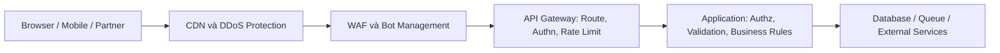

# WAF, bot control và request size limit

API Gateway và edge là lớp đầu tiên nhìn thấy lưu lượng từ Internet. Lớp này có thể chặn request rõ ràng độc hại, giảm bot tự động, giới hạn kích thước request và bảo vệ ứng dụng khỏi burst trước khi request tiêu thụ tài nguyên backend. Tuy nhiên, một WAF bật mặc định hoặc một giới hạn body đặt riêng ở gateway chưa đủ bảo vệ API nếu policy không hiểu endpoint, nếu có đường gọi bypass edge hoặc nếu ứng dụng xử lý request khác với cách WAF đã phân tích.

Trong module `SECURITY_API_SECURITY`, bảo mật API được thiết kế theo từng endpoint, đối tượng dữ liệu và luồng nghiệp vụ. Vì vậy, WAF, bot control và request size limit cần được xây dựng dựa trên contract của API, độ nhạy cảm của operation và chi phí xử lý. Edge giảm bề mặt tấn công và lọc sớm; service vẫn phải xác thực, phân quyền, validate dữ liệu và bảo vệ invariant nghiệp vụ.

## Mục tiêu học tập

Sau bài này, người học có thể:

- Giải thích vai trò và giới hạn của Web Application Firewall (WAF) trong kiến trúc API.
- Thiết kế WAF rule theo route, method, content type và API schema.
- Sử dụng managed rules và OWASP Core Rule Set có kiểm soát false positive.
- Phân biệt bot automation, traffic bất thường và người dùng hợp lệ có hành vi khác thường.
- Kết hợp rate limit, bot signals, challenge và identity-aware controls.
- Đặt giới hạn request line, header, body, multipart, decompression và thời gian đọc.
- Đồng bộ request size limit giữa CDN, gateway, reverse proxy và application.
- Nhận diện parser differential, request smuggling và đường bypass edge.
- Kiểm thử, giám sát và vận hành policy WAF/bot/size limit an toàn.

## 1. WAF và edge security trong kiến trúc API

### 1.1. WAF là gì?

Web Application Firewall (WAF) phân tích HTTP request/response và áp dụng rule để phát hiện hoặc chặn một số dạng tấn công web. Tùy sản phẩm và cấu hình, WAF có thể kiểm tra:

- Method, path, query string và HTTP version.
- Header, cookie và một số thuộc tính của request.
- Content-Type, body và cấu trúc payload được hỗ trợ.
- Pattern thường gặp của SQL injection, cross-site scripting, path traversal hoặc protocol abuse.
- IP/network reputation, request rate, bot signals và hành vi theo session.
- Một phần schema/API contract như method, path, field hoặc content type hợp lệ.

WAF thường được triển khai ở CDN, edge proxy, load balancer hoặc API Gateway. Nó có thể chặn request trước khi tới ứng dụng, giúp tiết kiệm CPU, connection pool, database và chi phí downstream.

### 1.2. WAF không thay thế bảo mật trong service

WAF không hiểu đầy đủ quyền nghiệp vụ của từng user và object. Một request có thể vượt qua WAF nhưng vẫn là BOLA, BFLA hoặc lạm dụng business flow. Ví dụ:

- User gọi `GET /orders/123` với cú pháp hoàn toàn hợp lệ nhưng không sở hữu order 123.
- Client có quyền gọi `POST /refunds` nhưng yêu cầu hoàn tiền vượt số tiền đã thanh toán.
- Một người tự động hóa hàng nghìn lần claim coupon với payload không chứa pattern độc hại.
- Một API key hợp lệ được dùng từ botnet để tiêu thụ quota.

WAF không thể thay thế:

- Authentication và kiểm tra token/session.
- Function, object và property-level authorization.
- Validation theo schema và business rule phía server.
- Idempotency, transaction, concurrency control và quota nghiệp vụ.
- SSRF destination validation trong outbound HTTP client.
- Output filtering và bảo vệ dữ liệu nhạy cảm.

Hãy xem WAF là một lớp phòng thủ bổ sung, không phải nơi quyết định cuối cùng một người dùng được phép làm gì.

### 1.3. Vị trí của WAF và edge controls



Mỗi lớp có trách nhiệm riêng:

| Lớp | Trách nhiệm tiêu biểu | Ví dụ kiểm soát |
|---|---|---|
| CDN/network edge | Hấp thụ lưu lượng lớn và giảm traffic không cần thiết | DDoS protection, geo/network policy theo rủi ro, cache |
| WAF | Phân tích HTTP và chặn pattern tấn công | Managed rules, protocol validation, API schema rules |
| Bot management | Đánh giá khả năng automation và hành vi | Reputation, velocity, challenge, session signals |
| API Gateway | Định tuyến và áp policy theo client/route | Authentication integration, rate limit, quota, request size |
| Application | Quyết định quyền và tính hợp lệ của nghiệp vụ | BOLA/BFLA, schema validation, state transition |
| Data/downstream | Bảo vệ tính toàn vẹn và capacity | Constraints, transaction, queue limit, timeout |

Không phải hệ thống nào cũng cần một sản phẩm WAF riêng. CDN, ingress hoặc gateway có thể cung cấp một phần tính năng. Điều cần thiết là xác định policy nào đang chạy ở đâu, ai sở hữu và liệu traffic có thể bỏ qua lớp đó không.

## 2. Xây dựng WAF policy theo API contract

### 2.1. Bắt đầu từ route và operation

Không áp một rule giống nhau cho mọi endpoint. Mỗi operation có method, content type, kích thước payload và hành vi hợp lệ khác nhau.

Ví dụ:

| Endpoint | Request hợp lệ thường gặp | Rủi ro cần chú ý |
|---|---|---|
| `GET /catalog` | Query ngắn, không body | Scraping, burst, query abuse |
| `POST /auth/login` | JSON nhỏ với username/password | Credential stuffing, enumeration, bot |
| `POST /files` | Multipart với giới hạn file cụ thể | File quá lớn, content giả, archive bomb |
| `POST /reports/export` | JSON filter nhỏ, xử lý tốn tài nguyên | Expensive query, concurrency và quota |
| `PATCH /accounts/{id}` | JSON với tập field được phép | Mass assignment, injection, property abuse |
| `POST /webhooks/provider` | Payload theo schema nhà cung cấp | Signature validation, replay, body size |

Với từng route, xác định:

1. Method được phép và method cần từ chối.
2. Content-Type và content encoding được hỗ trợ.
3. Kích thước request line, header, body và từng file.
4. Schema, field, kiểu dữ liệu và độ sâu tối đa nếu WAF hỗ trợ.
5. Mức độ nhạy cảm và chi phí backend của operation.
6. Client type: browser, mobile, partner, webhook hay workload nội bộ.
7. Policy rate/bot và cách xử lý false positive.

### 2.2. Positive security model và negative security model

**Negative security model** tìm pattern được xem là xấu, ví dụ chuỗi giống SQL injection hoặc script. Managed WAF rules thường dùng nhiều heuristic theo hướng này. Ưu điểm là triển khai nhanh và bao phủ nhiều pattern đã biết; nhược điểm là có false positive và không thể hiểu mọi ngữ cảnh nghiệp vụ.

**Positive security model** định nghĩa điều gì được phép: method, path, content type, field, kích thước, định dạng và schema hợp lệ. Ví dụ endpoint nhận JSON chỉ cho phép `application/json`, tối đa 64 KB, các field `name`, `email`, `message` và không nhận field ngoài contract.

Hai mô hình nên bổ trợ nhau. Managed rules phát hiện pattern tấn công phổ biến; positive rules giới hạn request vào contract API. Một chuỗi có vẻ độc hại trong field tìm kiếm có thể là dữ liệu hợp lệ, nhưng request chứa method lạ hoặc body vượt kích thước vẫn có thể bị từ chối theo contract.

### 2.3. Dùng OpenAPI/schema để tạo policy

Nếu API có OpenAPI contract được duy trì, có thể dùng nó làm đầu vào để kiểm tra:

- Route và HTTP method có được định nghĩa không.
- Request Content-Type có phù hợp không.
- Field bắt buộc, kiểu dữ liệu, enum và giới hạn string/array.
- Kích thước payload hoặc giới hạn số item có thể suy ra từ schema.
- Response contract và các header được công bố.

WAF có thể không hỗ trợ đầy đủ OpenAPI hoặc chỉ hỗ trợ một tập con. Không giả định schema validation ở WAF tương đương validation trong ứng dụng. Phải giữ server-side validation là nguồn quyết định cuối cùng và kiểm tra sự khác nhau giữa schema runtime và schema được deploy ở edge.

### 2.4. Method, path và content type

Chỉ cho phép method mà route cần. Ví dụ endpoint tạo đơn có thể nhận `POST`; không cần tự động cho `PUT`, `DELETE`, `TRACE` hoặc method mở rộng khác. Nếu có `OPTIONS` cho CORS preflight, xử lý nó theo CORS policy riêng.

Giới hạn Content-Type theo route. Endpoint JSON không nên nhận `text/plain`, XML hoặc multipart nếu không có use case. Endpoint upload cần định nghĩa loại media được chấp nhận và vẫn xác minh nội dung thực tế trong application vì header do client khai báo có thể giả mạo.

Không chỉ kiểm tra đuôi file hoặc `Content-Type` để kết luận file an toàn. Cần kiểm tra signature/magic bytes, giải nén an toàn, antivirus/sandbox khi phù hợp và lưu file ngoài web root hoặc trong object storage có policy riêng.

## 3. Managed rules và OWASP Core Rule Set

### 3.1. Managed WAF rules

Managed rule group thường cung cấp tập rule được nhà cung cấp cập nhật để phát hiện các pattern phổ biến như:

- SQL injection và XSS.
- Local/remote file inclusion hoặc path traversal.
- Protocol anomalies và malformed request.
- Known exploit patterns cho một số framework hoặc platform.
- Bad bot/reputation signals tùy sản phẩm.

Ưu điểm là giảm công sức tự viết rule và nhận cập nhật khi threat pattern thay đổi. Nhược điểm là rule có thể chặn request hợp lệ, phụ thuộc cách parser của WAF và có thể không hiểu business semantics của API.

### 3.2. OWASP Core Rule Set (CRS)

OWASP Core Rule Set là bộ rule phổ biến có thể dùng với các WAF tương thích như ModSecurity. CRS giúp phát hiện nhiều dạng tấn công web thường gặp, nhưng cần tuning theo ứng dụng và phiên bản rule set.

Không bật block mode trên production mà chưa quan sát false positive. Một quy trình an toàn thường gồm:

1. Chọn phiên bản CRS và ghi nhận cấu hình đang dùng.
2. Chạy detection/logging hoặc chế độ phù hợp để thu thập match.
3. Phân tích rule ID, route, field và request hợp lệ bị match.
4. Điều chỉnh bằng exclusion hẹp cho đúng route/parameter/rule.
5. Chạy regression tests và kiểm tra không mở rộng ngoại lệ quá mức.
6. Chuyển sang block theo từng nhóm route hoặc theo giai đoạn.
7. Theo dõi tỷ lệ block, false positive và thay đổi sau khi cập nhật rule.

### 3.3. Tuning false positive có kiểm soát

Khi request hợp lệ bị WAF chặn, không tắt toàn bộ rule group hoặc allowlist toàn bộ IP một cách vội vàng. Trước tiên, xác định:

- Rule ID nào match và dữ liệu nào kích hoạt.
- Route/method nào bị ảnh hưởng.
- Field đó có thực sự cần chấp nhận nội dung như vậy không.
- Có thể sửa client contract hoặc encode input đúng cách không.
- Nếu cần exclusion, có thể giới hạn ở một parameter, route và rule ID không.

Ví dụ, field `search` có thể cần ký tự đặc biệt để truy vấn. Exclusion nên áp dụng đúng field và route, không tắt kiểm tra SQLi cho mọi request. Ghi rõ lý do, owner, thời hạn review và test tái hiện cho mỗi exclusion.

### 3.4. Virtual patching

WAF có thể tạm chặn một pattern khai thác đã biết trong lúc đội ứng dụng chuẩn bị bản vá. Đây là virtual patching. Nó giúp giảm exposure nhưng không sửa lỗi trong code và không bảo đảm mọi biến thể payload đều bị chặn.

Với virtual patching:

- Xác định CVE/bug, route và điều kiện khai thác cụ thể.
- Tạo rule hẹp, kiểm tra payload hợp lệ và biến thể bypass.
- Theo dõi block event và lỗi người dùng.
- Ghi nhận thời hạn gỡ rule sau khi ứng dụng đã vá và kiểm thử.
- Không dùng WAF rule như lý do trì hoãn bản vá dependency hoặc code.

## 4. API-aware WAF và protocol validation

### 4.1. Kiểm tra HTTP protocol

Edge có thể từ chối request có:

- Method không hợp lệ hoặc không được route hỗ trợ.
- Request target quá dài hoặc malformed.
- Header name/value không hợp lệ, header trùng lặp theo cách gây mơ hồ.
- Content-Length sai định dạng hoặc xung đột với Transfer-Encoding.
- Content-Type/Content-Encoding không được hỗ trợ.
- Body bị cắt, vượt giới hạn hoặc không khớp framing.

Parser ở WAF, proxy và application phải hiểu request framing nhất quán. Sự khác nhau trong cách diễn giải `Content-Length`, `Transfer-Encoding`, duplicate header hoặc HTTP/2-to-HTTP/1 translation có thể tạo request smuggling hoặc request desynchronization.

### 4.2. Request smuggling và parser differential

Request smuggling có thể xảy ra khi front-end và back-end không đồng ý về ranh giới request. Ví dụ một lớp ưu tiên `Content-Length`, lớp khác ưu tiên `Transfer-Encoding`; hoặc các lớp xử lý duplicate header khác nhau.

Biện pháp:

- Dùng phiên bản gateway/proxy/server được cập nhật và cấu hình protocol an toàn.
- Từ chối request có framing mơ hồ, duplicate/conflicting length headers hoặc cú pháp bất thường.
- Chuẩn hóa request khi proxy và không chuyển tiếp framing không tin cậy nguyên trạng.
- Đồng bộ HTTP/2, HTTP/1.1 và upstream protocol behavior.
- Không cho truy cập trực tiếp backend để bypass parser ở edge.
- Kiểm thử bằng công cụ và kịch bản an toàn trong môi trường staging có kiểm soát.

Không cố xử lý request framing mơ hồ bằng cách tự đoán ý định client. Từ chối request là lựa chọn an toàn hơn.

### 4.3. Header và cookie policy

WAF có thể giới hạn số lượng header, tổng header bytes, kích thước cookie và một số header được phép. Hãy tránh giới hạn quá thấp khiến OAuth/JWT hoặc cookie hợp lệ bị cắt; đồng thời không cho header vô hạn làm cạn bộ nhớ.

Không tin `X-Forwarded-For`, `Forwarded`, `X-Original-URL` hoặc header định tuyến nếu chúng đến trực tiếp từ client. Edge phải xóa/ghi đè các header forwarding theo trusted proxy chain. Nếu backend tin header do client tự đặt, attacker có thể bypass policy IP hoặc route.

## 5. Bot control và automation defense

### 5.1. Bot không phải lúc nào cũng độc hại

Bot là client tự động. Có bot hợp lệ như search crawler, monitoring agent, webhook sender hoặc integration partner. Bot độc hại có thể dùng để:

- Credential stuffing và password spraying.
- Scraping dữ liệu hoặc thu thập inventory.
- Giữ vé/chỗ, claim coupon hoặc tạo tài khoản hàng loạt.
- Spam form, OTP, comment hoặc review.
- Dò endpoint, fuzz payload hoặc tìm API không được công bố.
- Tạo request tốn CPU, database hoặc chi phí third-party.

Policy cần phân loại bot theo identity, purpose và quyền truy cập. Không chặn mọi automation chỉ vì User-Agent không giống browser.

### 5.2. Kết hợp nhiều tín hiệu

Bot detection nên kết hợp nhiều nhóm tín hiệu:

| Nhóm | Tín hiệu | Hạn chế |
|---|---|---|
| Network | IP reputation, ASN, proxy/VPN, datacenter source | NAT, mobile carrier và VPN doanh nghiệp có thể dùng chung IP |
| Request behavior | Velocity, burst, nhịp request, endpoint sequence, error ratio | Người dùng hợp lệ có thể retry hoặc thao tác nhanh |
| Session/account | Account age, login history, verification state, session consistency | Account thật có thể bị chiếm hoặc tự động hóa |
| Client/browser | Header consistency, cookie, JavaScript/browser signals | Có thể bị giả lập; không phải bằng chứng danh tính |
| Device | Tính nhất quán thiết bị và phiên | Có rủi ro quyền riêng tư và false positive |
| Business outcome | Tỷ lệ claim, checkout, hủy, refund, failed login | Cần baseline và ngữ cảnh nghiệp vụ |
| Identity | API client ID, mTLS identity, signed token, partner registration | Credential hợp lệ vẫn có thể bị lạm dụng hoặc đánh cắp |

Không dựa vào `User-Agent`, `Referer` hoặc một IP duy nhất. Với partner API, client identity được xác thực bằng OAuth client credentials, mTLS hoặc cơ chế phù hợp có giá trị hơn header tự khai báo.

### 5.3. Progressive friction

Áp dụng mức ma sát tăng dần theo rủi ro:

1. **Rủi ro thấp:** cho phép request theo quota bình thường.
2. **Rủi ro tăng:** giảm tốc độ, áp concurrency limit hoặc yêu cầu đăng nhập.
3. **Rủi ro trung bình:** yêu cầu challenge như CAPTCHA hoặc xác minh bổ sung.
4. **Rủi ro cao:** tạm dừng operation nhạy cảm, step-up authentication hoặc review.
5. **Có bằng chứng lạm dụng:** thu hồi credential/session hoặc chặn theo quy trình incident response.

Challenge cần được gắn với session/request context, có thời hạn và xác minh ở server. Không chấp nhận `captchaPassed=true` do client tự gửi. CAPTCHA tăng chi phí automation nhưng có thể bị giải qua dịch vụ bên ngoài, browser thật hoặc người thật; nó không thay thế authentication, authorization và quota.

### 5.4. Phân loại và cho phép bot hợp lệ

Bot hợp lệ nên có danh tính hoặc cách xác minh riêng:

- Partner dùng client credential hoặc mTLS identity.
- Webhook xác minh chữ ký, timestamp và event ID.
- Monitoring agent dùng credential có scope hẹp và route riêng.
- Search crawler được phép chỉ trên nội dung công khai theo policy rõ ràng.

Không allowlist bot chỉ bằng User-Agent vì header này có thể bị giả mạo. Nếu dùng IP allowlist, cần xác minh nguồn IP chính thức, cập nhật khi provider thay đổi và vẫn yêu cầu authentication phù hợp.

### 5.5. Fairness và false positive

Nhiều người dùng có thể chung IP qua NAT, mạng di động, trường học hoặc doanh nghiệp. Một người dùng có thể đổi IP liên tục hoặc dùng VPN. Vì vậy, chặn toàn bộ IP có thể ảnh hưởng lớn tới người dùng hợp lệ.

Hãy đo:

- Tỷ lệ challenge và challenge completion.
- Tỷ lệ block được xác nhận là bot độc hại.
- Tỷ lệ khiếu nại hoặc support ticket do block nhầm.
- Khác biệt theo client type, khu vực mạng và endpoint.
- Tác động của policy tới conversion và hoàn tất nghiệp vụ.

Chỉ thu thập device/browser signals trong phạm vi cần thiết, có mục đích, quyền truy cập và thời hạn lưu rõ ràng.

## 6. Rate limit và bot control theo route

Bot control và rate limit thường phối hợp nhưng không giống nhau. Rate limit giới hạn số request hoặc cost trong một khoảng thời gian; bot control đánh giá xác suất automation và chọn hành động phù hợp.

Ví dụ policy:

| Route | Policy gợi ý | Lý do |
|---|---|---|
| `POST /auth/login` | Limit theo account, source network và client; phát hiện credential stuffing; challenge theo risk | Bảo vệ account và authentication capacity |
| `POST /auth/otp` | Cooldown theo destination/account, network và global provider budget | Ngăn spam và chi phí SMS |
| `GET /catalog` | Edge cache, per-client/network rate và scrape detection | Bảo vệ dữ liệu công khai và backend |
| `POST /events/{id}/reserve` | Authenticated identity, per-account quota, concurrency và event capacity | Ngăn giữ chỗ tự động |
| `POST /reports/export` | Tenant quota, cost units, concurrent job limit | Bảo vệ database và worker |
| `POST /webhooks/{provider}` | Provider identity/signature, replay protection, bounded retry | Cho phép automation hợp lệ có kiểm soát |

Không áp một ngưỡng chung như 100 request/phút cho mọi route. Một request export có thể tốn tài nguyên bằng hàng nghìn request đọc cache; một lần gửi OTP có thể tạo chi phí ngay cả khi chỉ có một request.

## 7. Request size limit: giới hạn ở nhiều lớp

### 7.1. Vì sao cần giới hạn kích thước?

Request quá lớn có thể làm cạn memory, disk, connection, parser CPU hoặc queue capacity. Attacker có thể gửi:

- Body lớn hơn mức ứng dụng cần.
- Header/cookie cực dài hoặc số lượng header quá nhiều.
- JSON lồng sâu, array rất lớn hoặc string dài bất thường.
- Multipart chứa nhiều file hoặc field nhỏ với tổng overhead lớn.
- Archive nén nhỏ nhưng giải nén thành dữ liệu rất lớn.
- Chunked body kéo dài, gửi rất chậm hoặc không kết thúc.
- GraphQL query/batch chứa quá nhiều operation.

Không chỉ đặt `max body size`. Cần giới hạn request line, header count/bytes, body bytes, file bytes, số part, field count, nesting depth, thời gian đọc và concurrency.

### 7.2. Phân biệt các loại giới hạn

| Giới hạn | Nội dung | Ví dụ policy minh họa |
|---|---|---|
| Request line/target | Method, path và query string | Giới hạn vài KB theo contract |
| Header | Tổng bytes, số header, mỗi header và cookie | Giới hạn tổng header và cookie |
| Body | Tổng request payload | JSON API 64 KB hoặc 256 KB tùy endpoint |
| File | Kích thước từng file | Upload ảnh tối đa 10 MB/file |
| Multipart | Tổng body, số part và field | Tối đa 5 file và 20 field |
| Decompressed body | Kích thước sau giải nén | Hard cap độc lập với compressed bytes |
| JSON complexity | Độ sâu, số phần tử, string length | Giới hạn nesting và array size |
| Read duration | Thời gian client gửi hết body | Header/body timeout và minimum data rate |
| Concurrency | Số request upload/parse đồng thời | Giới hạn theo instance/tenant |

Các con số trên chỉ là ví dụ để minh họa cách đặt policy. Giá trị thực tế phải dựa trên API contract, nhu cầu sản phẩm, memory budget, proxy limits và downstream capacity.

### 7.3. Giới hạn ở edge trước khi buffer body

Edge nên từ chối request vượt giới hạn càng sớm càng tốt, trước khi proxy buffer toàn bộ body vào RAM hoặc disk. Với body streaming, gateway cần có cơ chế đếm byte và dừng stream khi vượt hard cap.

Không chỉ tin `Content-Length`: request có thể dùng chunked transfer hoặc không khai báo độ dài trước. Hãy enforce limit trên số byte thực tế đã nhận. Nếu HTTP/2 được chuyển sang HTTP/1.1 upstream, kiểm tra cách gateway tạo framing mới và đảm bảo không có parser disagreement.

### 7.4. Đồng bộ giới hạn giữa các lớp

Giả sử CDN cho phép 20 MB, gateway 10 MB và application 5 MB. Người dùng có thể nhận lỗi khác nhau tùy route hoặc đường đi; request có thể đã tiêu tốn tài nguyên ở edge trước khi bị backend từ chối.

Đặt policy theo một bảng chung:

| Route | Edge max body | Application max body | Ghi chú |
|---|---:|---:|---|
| `POST /auth/login` | 16 KB | 16 KB | JSON nhỏ |
| `POST /orders` | 128 KB | 128 KB | Giới hạn item count và field length |
| `POST /files` | 12 MB | 12 MB | Giới hạn file và multipart parts |
| `POST /webhooks/{provider}` | 256 KB | 256 KB | Theo schema provider |

Đây là số minh họa. Edge và application cần thống nhất hoặc edge có thể đặt mức thấp hơn để bảo vệ sớm, miễn contract công bố rõ. Không để application chấp nhận lớn hơn edge nếu client cần gửi payload đó; cũng không để edge cho phép quá lớn so với memory/processing budget của service.

### 7.5. Trả lỗi đúng semantics

Khi request vượt kích thước được phép, thường trả `413 Content Too Large` (trước đây thường được gọi là Payload Too Large). Response nên ngắn và không phản chiếu body:

```http
HTTP/1.1 413 Content Too Large
Content-Type: application/problem+json

{
  "type": "https://api.example.com/problems/request-too-large",
  "title": "Request content is too large",
  "status": 413,
  "code": "REQUEST_TOO_LARGE",
  "detail": "The request exceeds the maximum size allowed for this endpoint."
}
```

Nếu header hoặc request line quá lớn khiến request không thể parse an toàn, edge có thể từ chối sớm bằng response phù hợp hoặc đóng kết nối theo khả năng protocol. Không đưa raw header/body vào error response.

## 8. Upload, multipart và decompression safety

### 8.1. Multipart có nhiều kích thước cần giới hạn

Với `multipart/form-data`, cần giới hạn:

- Tổng request body.
- Kích thước từng file.
- Tổng số file/part.
- Kích thước từng field và tổng field bytes.
- Độ dài filename và header part.
- Thời gian upload và số upload đồng thời.

Không chỉ dựa vào kích thước file riêng lẻ. Một request có thể chứa hàng nghìn part nhỏ, tạo overhead parser lớn. Filename do client cung cấp không được dùng trực tiếp làm đường dẫn lưu file.

### 8.2. Kiểm tra nội dung file ở application

WAF có thể chặn một số file type hoặc pattern, nhưng không phải antivirus đầy đủ. Application nên:

- Allowlist loại file theo nghiệp vụ.
- Kiểm tra magic bytes và parse định dạng bằng thư viện được cập nhật.
- Đổi tên file bằng ID do server tạo.
- Lưu ngoài web root hoặc bucket private.
- Không thực thi file upload.
- Quét malware/sandbox khi rủi ro và use case yêu cầu.
- Giới hạn archive entry count, nesting, expanded bytes và path traversal trong archive.
- Cấp URL tải xuống có authorization và thời hạn phù hợp.

### 8.3. Decompression bomb

Một payload nén nhỏ có thể giải nén thành dữ liệu rất lớn. Nếu gateway hoặc application tự giải nén trước khi kiểm tra giới hạn, attacker có thể tiêu thụ memory/CPU vượt mức.

Đặt giới hạn cho cả compressed bytes và decompressed bytes; giới hạn tỷ lệ nén, số entry và thời gian giải nén. Chỉ chấp nhận Content-Encoding cần thiết. Nếu WAF không giải nén hoặc không hiểu format, không giả định nó đã kiểm tra nội dung sau giải nén.

## 9. Slow request và resource exhaustion

Request nhỏ vẫn có thể làm cạn tài nguyên nếu client gửi từng byte rất chậm hoặc giữ connection mở. Các kiểu tấn công thường được gọi là slow client/slow request.

Biện pháp ở edge/proxy:

- Header timeout và body/read timeout.
- Minimum data rate hoặc giới hạn thời gian upload tổng.
- Max concurrent connections theo nguồn và global capacity.
- Connection idle timeout và keep-alive limit.
- Giới hạn số request trên một connection nếu phù hợp protocol.
- Queue và buffer có giới hạn.
- Backpressure và load shedding khi upstream quá tải.

Timeout phải phù hợp với loại client và payload. Upload lớn qua mạng di động có thể cần thời gian dài hơn request JSON nhỏ; vì vậy, có thể đặt profile riêng theo route thay vì một timeout duy nhất.

## 10. Ví dụ cấu hình tại edge và application

### 10.1. Nginx minh họa

Ví dụ sau minh họa một số directive phổ biến; cần điều chỉnh theo phiên bản, kiến trúc và route thực tế:

```nginx
http {
    # Giới hạn kích thước request body mặc định.
    client_max_body_size 1m;

    # Giới hạn kích thước và số lượng buffer cho request header lớn.
    large_client_header_buffers 4 8k;

    # Giới hạn thời gian chờ client gửi header/body.
    client_header_timeout 10s;
    client_body_timeout 15s;

    server {
        listen 443 ssl;
        server_name api.example.com;

        location ^~ /api/files/ {
            client_max_body_size 12m;
            proxy_request_buffering on;
            proxy_pass http://application;
        }

        location /api/ {
            client_max_body_size 128k;
            proxy_pass http://application;
        }
    }
}
```

Các directive ở trên không phải một cấu hình hoàn chỉnh cho production. `client_max_body_size` giới hạn body ở Nginx; `large_client_header_buffers` kiểm soát buffer cho request line/header lớn. `client_body_timeout` giới hạn thời gian giữa hai lần đọc liên tiếp từ client, không phải tổng thời gian tối đa để tải xong body; cần thêm request deadline hoặc giới hạn upload duration ở lớp phù hợp. Cần bổ sung TLS, upstream trust, logging, rate limiting và policy route cụ thể.

Không đặt `client_max_body_size` lớn toàn cục chỉ để một upload endpoint hoạt động. Tách location hoặc virtual host với giới hạn theo use case; application vẫn phải enforce cùng giới hạn.

### 10.2. Spring Boot multipart limits

Với endpoint upload dùng Servlet multipart, có thể cấu hình giới hạn ở application:

```yaml
spring:
  servlet:
    multipart:
      max-file-size: 10MB
      max-request-size: 12MB
      file-size-threshold: 1MB
```

`max-file-size` giới hạn mỗi file; `max-request-size` giới hạn tổng multipart request; `file-size-threshold` ảnh hưởng ngưỡng lưu tạm trong memory/disk tùy container. Đây không phải giới hạn thay thế cho gateway, request header, JSON nesting hoặc decompression.

Đặt storage tạm ở volume có quota và quyền hạn phù hợp. Đảm bảo file tạm được dọn khi upload lỗi hoặc client ngắt kết nối. Kiểm tra cách servlet container xử lý multipart trước khi controller được gọi.

### 10.3. Giới hạn JSON trong application

Body size limit không ngăn JSON có cấu trúc quá sâu hoặc mảng quá lớn nếu tổng byte vẫn dưới giới hạn. Cần cấu hình parser để giới hạn nesting depth, token/string length và số phần tử khi thư viện hỗ trợ; đồng thời kiểm tra collection size và business constraints sau parse.

Không deserialize payload lớn hoặc phức tạp thành object graph không giới hạn. Với endpoint batch, giới hạn số item và tổng cost, không chỉ số HTTP request.

## 11. Xử lý WAF false positive và thay đổi policy

### 11.1. Triển khai theo giai đoạn

Một quy trình rollout có thể gồm:

1. Inventory route, client và payload hợp lệ.
2. Bật rule ở detection/log mode trong staging hoặc canary.
3. Thu thập match và phân loại false positive.
4. Điều chỉnh rule/exclusion hẹp, bổ sung contract validation.
5. Kiểm thử regression, performance và request size boundary.
6. Chuyển từng nhóm route sang block mode.
7. Theo dõi 4xx, conversion, latency và support signal.
8. Có rollback nhanh về policy version trước nếu phát hiện tác động ngoài dự kiến.

### 11.2. Quản lý exclusion

Mỗi exclusion cần có:

- Rule ID và route/method cụ thể.
- Parameter hoặc header được miễn kiểm tra nếu cần.
- Lý do nghiệp vụ và bằng chứng false positive.
- Owner và thời điểm tạo.
- Thời hạn review hoặc điều kiện gỡ.
- Regression test bảo đảm không mở rộng bypass.

Không tạo exclusion toàn bộ path `/api/*` hoặc tắt một nhóm rule cho mọi client chỉ để xử lý một field. Không allowlist IP cố định nếu vấn đề thực sự nằm ở payload parser.

### 11.3. Fail-open hay fail-closed?

Nếu WAF hoặc bot service không sẵn sàng, hệ thống cần policy theo mức độ rủi ro:

- Với endpoint công khai, ít nhạy cảm và có giới hạn downstream khác, có thể dùng fallback rate limit local trong thời gian ngắn.
- Với login, OTP, payment, admin hoặc operation tạo chi phí lớn, nên fail closed hoặc giảm chức năng an toàn nếu không đánh giá được request.
- Nếu edge inspection bị bỏ qua do lỗi, cần cảnh báo ngay và có giới hạn capacity khác bảo vệ backend.
- Không để chế độ fail-open tồn tại lâu mà không có owner và thời hạn.

Quyết định phải dựa trên tác động của block nhầm và tác động của cho phép traffic không được kiểm tra. Không có một chế độ duy nhất phù hợp với mọi route.

## 12. Tránh bypass WAF và edge policy

WAF chỉ bảo vệ request đi qua nó. Hãy rà soát:

- Direct origin access qua IP hoặc hostname phụ.
- API version cũ hoặc route alias chưa có policy.
- Internal endpoint bị expose qua ingress khác.
- WebSocket, GraphQL, gRPC hoặc streaming route có pipeline riêng.
- Upload đi qua object storage presigned URL và không qua WAF.
- Alternate port/listener hoặc domain staging.
- IPv4/IPv6 listener không có cùng policy.
- HTTP/2/HTTP/3 path và protocol downgrade ở upstream.
- Gateway route rewrite khiến WAF và application nhìn path khác nhau.

Origin nên chỉ nhận traffic từ edge/gateway được phép bằng network ACL, private listener hoặc gateway-to-origin authentication. Nếu presigned upload bỏ qua WAF, size/type/quota phải được ràng buộc trong signed policy và kiểm tra lại sau upload.

## 13. Kiểm thử WAF, bot control và request size limit

Kiểm thử cần bao gồm cả payload độc hại đã biết và request hợp lệ gần ranh giới giới hạn. Mọi thử nghiệm tấn công nên thực hiện trong staging hoặc môi trường được cho phép.

| Nhóm kiểm thử | Kịch bản | Kết quả mong đợi |
|---|---|---|
| Managed rules | Payload test đại diện SQLi/XSS/path traversal | Rule phát hiện/chặn theo policy mà không làm lộ dữ liệu |
| False positive | Field tìm kiếm chứa ký tự hợp lệ giống pattern | Request hợp lệ được xử lý sau tuning hẹp |
| API method | Gọi method không được contract hỗ trợ | Bị từ chối ở edge hoặc application |
| Content-Type | Gửi XML/text vào endpoint chỉ nhận JSON | Bị từ chối rõ ràng |
| API schema | Thiếu field, field lạ hoặc kiểu dữ liệu sai | Bị chặn theo schema nếu có; application vẫn validate |
| Header size | Header/cookie vượt giới hạn | Bị từ chối trước khi cạn tài nguyên |
| Body size | Payload đúng giới hạn và vượt một byte | Boundary hoạt động nhất quán; vượt limit nhận 413 |
| Chunked body | Body chunked vượt giới hạn không khai báo Content-Length | Byte counter vẫn chặn đúng |
| Slow upload | Gửi body rất chậm hoặc giữ connection | Timeout/minimum rate bảo vệ worker và connection |
| Multipart | Nhiều part nhỏ, file quá lớn, field quá dài | Enforce part count, file và total size |
| Archive bomb | Compressed body nhỏ, expanded size lớn | Decompression limit dừng xử lý |
| JSON complexity | Nesting sâu, array lớn hoặc string cực dài | Parser/validation từ chối trước khi tốn tài nguyên quá mức |
| Bot automation | Nhiều tài khoản/IP gửi chuỗi thao tác lặp | Identity, velocity và business signals được kết hợp |
| Legitimate bot | Partner webhook/monitoring agent đã đăng ký | Được xác minh bằng identity và policy hẹp |
| Shared NAT | Nhiều user hợp lệ dùng chung IP | Không block toàn bộ chỉ dựa trên IP |
| Challenge | Challenge giả, hết hạn hoặc replay | Server từ chối challenge không hợp lệ |
| Direct origin | Gọi origin bỏ qua CDN/gateway | Kết nối bị chặn hoặc policy tương đương vẫn được áp dụng |
| IPv6/bypass | Gọi qua IPv6 hoặc alternate hostname | Không có đường đi thiếu WAF policy |
| Parser differential | Request framing mơ hồ/duplicate length header | Edge từ chối; không có request desynchronization |
| WAF outage | WAF/bot service timeout | Hành vi fail-open/closed theo route policy và có alert |
| Policy rollout | Rule update tạo false positive | Canary phát hiện; rollback hoạt động |

### 13.1. Kiểm thử boundary size

Với giới hạn body là `N` bytes, test tối thiểu:

- `N - 1` bytes: request được chấp nhận nếu payload hợp lệ.
- `N` bytes: request được chấp nhận nếu đúng contract.
- `N + 1` bytes: request bị từ chối với status phù hợp.
- Chunked body có tổng bytes vượt `N`.
- Body bị cắt giữa chừng hoặc client ngắt kết nối.
- Compressed body có expanded size vượt giới hạn.

Kiểm tra ở edge và application để xác nhận không có khoảng lệch khiến một lớp buffer quá nhiều trước khi lớp khác từ chối.

## 14. Logging, metrics và incident response

### 14.1. Metrics WAF

Theo dõi:

- Request được allow/block theo route, method, rule group và action.
- Rule ID match, anomaly score nếu sản phẩm sử dụng và top false-positive routes.
- Tỷ lệ 403/413/429/5xx và thay đổi sau policy rollout.
- Request size distribution, header bytes, body bytes và upload duration.
- Direct-origin attempt và traffic không đi qua edge.
- WAF latency, inspection timeout, capacity và service availability.

### 14.2. Metrics bot

- Bot/challenge/allow/block rate theo route và client type.
- Challenge completion và false positive.
- Login failure, account creation, OTP send, scraping và reservation velocity.
- Partner identity và credential anomaly.
- Tác động tới conversion, checkout completion và support ticket.

### 14.3. Metrics request size và resource

- Số request bị từ chối vì request line/header/body/file size.
- Upload duration, concurrent upload, temporary disk usage và parser CPU.
- Decompression ratio và expanded bytes.
- Queue depth, connection count, worker saturation và memory pressure.
- Tỷ lệ request bị timeout hoặc client disconnect.

### 14.4. Logging an toàn

Log có thể ghi request ID, route template, method, rule ID, action, size, client identity đã chuẩn hóa và lý do từ chối. Không log raw Authorization header, cookie, API key, password hoặc toàn bộ body. Với payload bị WAF chặn, lưu mẫu đã redaction hoặc fingerprint nếu cần điều tra và có quyền truy cập/retention phù hợp.

Không dùng raw URL/query hoặc user ID làm metric label có cardinality không giới hạn. Dùng route template, policy ID và error category.

### 14.5. Phản ứng khi WAF/bot control bị lạm dụng hoặc cấu hình sai

1. Xác định route, rule, client và phạm vi request bị ảnh hưởng.
2. Phân biệt tấn công thật, burst hợp lệ, bot hợp lệ và false positive.
3. Điều chỉnh policy hẹp hoặc bật challenge/limit bổ sung theo risk.
4. Nếu backend đang quá tải, dùng concurrency limit, load shedding và bảo vệ downstream.
5. Nếu origin bị bypass, chặn direct path và xác minh IPv4/IPv6/listener phụ.
6. Kiểm tra request size, parser và upload storage để xác định tài nguyên đã tiêu thụ.
7. Ghi lại policy version, thay đổi và kết quả; thêm regression tests trước rollout tiếp theo.

## 15. Checklist trước khi phát hành

- [ ] Mỗi route có method, content type, schema và resource cost rõ ràng.
- [ ] WAF managed rules/CRS được bật theo giai đoạn và có quy trình tuning false positive.
- [ ] Exclusion giới hạn theo rule, route và parameter; có owner và review date.
- [ ] Positive security rules kiểm soát method, path, content type và request schema khi khả thi.
- [ ] WAF được xem là lớp bổ sung; application vẫn thực hiện authentication, authorization và validation.
- [ ] Bot control kết hợp network, identity, session, behavior và business signals.
- [ ] Bot hợp lệ có identity/registration; không allowlist chỉ bằng User-Agent.
- [ ] Challenge được xác minh ở server và có expiry/replay protection.
- [ ] Rate limit, quota và concurrency được đặt theo route/client/tenant/resource.
- [ ] Request line, header, cookie, body, file, multipart và JSON complexity có giới hạn.
- [ ] Chunked body được đếm byte thực tế; không chỉ tin Content-Length.
- [ ] Compressed và decompressed size đều được giới hạn.
- [ ] Upload có file type validation, safe storage, malware/archive controls khi phù hợp.
- [ ] Header/body timeout, slow-client protection và queue/buffer có giới hạn.
- [ ] Edge và application thống nhất request size contract.
- [ ] WAF, gateway và backend parse request framing nhất quán; request mơ hồ bị từ chối.
- [ ] Direct origin, IPv6, alternate domain, WebSocket/GraphQL/gRPC và presigned upload đã được rà soát.
- [ ] WAF/bot outage có fail-open/closed policy theo mức rủi ro và alert.
- [ ] Có boundary tests N-1/N/N+1, chunked, multipart, decompression và parser differential.
- [ ] Có metrics cho false positive, bot challenge, 413, resource saturation và policy rollout.
- [ ] Log đã redaction credential, cookie, PII và body nhạy cảm.

## Kết luận

WAF, bot control và request size limit giúp edge giảm request độc hại, automation và payload gây quá tải trước khi chúng chạm tới ứng dụng. Hiệu quả phụ thuộc vào việc policy hiểu API contract, được áp dụng nhất quán trên mọi đường truy cập và có quy trình tuning/giám sát rõ ràng. Kết hợp managed rules với positive security, bot signals nhiều lớp, giới hạn kích thước theo từng route và validation phía application tạo thành lớp phòng thủ thực tế hơn so với chỉ bật WAF mặc định hoặc đặt một giới hạn body chung.
