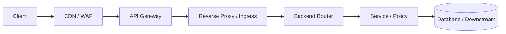

# Đồng bộ route, method và policy

API gateway và backend cùng tham gia quyết định request sẽ đi tới đâu và được phép làm gì. Gateway thường định tuyến theo host, path, HTTP method, version hoặc header; backend tiếp tục xử lý nghiệp vụ và truy cập dữ liệu. Nếu hai tầng diễn giải request hoặc áp dụng policy khác nhau, một request có thể được kiểm tra như thao tác ít rủi ro ở gateway nhưng lại được thực thi như thao tác nhạy cảm ở backend.

Ví dụ, gateway chỉ cho phép `GET /api/orders/**` với scope đọc nhưng backend hỗ trợ `DELETE` trên cùng path. Nếu gateway dùng rule theo path mà không xét method, hoặc proxy chuyển đổi method trước khi backend xử lý, request xóa đơn có thể đi qua lớp kiểm soát không phù hợp. Tương tự, gateway có thể kiểm tra `/api/v1` nhưng rewrite path sang handler v2 có policy khác.

Đồng bộ route, method và policy nghĩa là mọi tầng có cùng cách chuẩn hóa request, cùng xác định route và hành động, cùng hiểu danh tính/permission được chuyển tiếp, và cùng áp dụng quyết định bảo mật. Gateway tạo lớp bảo vệ ở biên; backend vẫn phải kiểm tra quyền tại nơi thực hiện nghiệp vụ.

## 1. Vì sao route và policy có thể lệch nhau?

Một request đi qua nhiều thành phần trước khi tới code nghiệp vụ:



Mỗi thành phần có thể parse, rewrite hoặc bổ sung thông tin request. Các khác biệt nhỏ có thể tạo ra ranh giới bảo mật không nhất quán:

- Gateway match path trước khi decode nhưng backend decode hoặc normalize thêm lần nữa.
- Gateway kiểm tra path mà bỏ qua HTTP method.
- Gateway cho phép `POST`, trong khi backend diễn giải method override thành `DELETE`.
- Gateway route theo version/header khác với version backend thực sự xử lý.
- Gateway xác thực token nhưng chuyển tiếp header danh tính do client tự gửi.
- Gateway xóa hoặc đổi header có ý nghĩa với chữ ký request.
- Gateway cho phép route mới nhưng backend chưa có policy; hoặc backend mở endpoint mới nhưng gateway không có rule tương ứng.
- Một đường gọi nội bộ truy cập trực tiếp backend và bỏ qua gateway.

Những lỗi này thường xuất hiện khi route và policy được cấu hình độc lập ở nhiều repository hoặc nhiều nhóm vận hành. Cần quản lý chúng như một hợp đồng chung.

## 2. Xác định một request bằng cùng một bộ thuộc tính

Để đồng bộ, các tầng cần thống nhất những thành phần xác định request:

| Thành phần | Câu hỏi cần thống nhất | Ví dụ |
|---|---|---|
| Host / authority | Request dành cho API nào? | `api.example.test` |
| HTTP method | Hành động HTTP nào được yêu cầu? | `GET`, `PATCH`, `DELETE` |
| Path đã chuẩn hóa | Resource hoặc route nào được gọi? | `/api/orders/ORD-42` |
| API version | Contract nào được áp dụng? | `v2` |
| Content type | Body được parse theo định dạng nào? | `application/json` |
| Identity | Ai hoặc client nào đã xác thực? | User principal hoặc workload identity |
| Permission / scope | Caller được thực hiện hành động nào? | `orders:cancel` |
| Tenant / resource scope | Phạm vi dữ liệu nào được phép? | `tenant-42` |
| Policy version | Quy tắc nào đã quyết định allow/deny? | `orders-policy-17` |

Không phải mọi tầng đều cần biết tất cả thuộc tính. Nhưng bất kỳ tầng nào định tuyến hoặc ra quyết định bảo mật phải dùng cùng định nghĩa cho các thuộc tính liên quan. Ví dụ gateway có thể kiểm tra scope ở mức coarse-grained; backend vẫn kiểm tra quan hệ owner và trạng thái đơn hàng.

## 3. Quản lý route inventory và contract chung

Hãy duy trì danh mục route có chủ sở hữu và mô tả hành động. Danh mục nên ghi ít nhất:

- Service/backend đích và owner chịu trách nhiệm.
- Host, base path, route template và API version.
- HTTP method được hỗ trợ.
- Authentication requirement và loại principal được chấp nhận.
- Scope/permission cần có ở mức chức năng.
- Chính sách rate limit, quota, body size và timeout.
- Quy tắc CORS, content type và header được phép.
- Yêu cầu object/property authorization ở backend.
- Trạng thái lifecycle: active, deprecated hoặc disabled.

Ví dụ route inventory:

| Route | Method | Gateway policy | Backend policy |
|---|---|---|---|
| `/api/v2/orders` | `GET` | Token hợp lệ, `orders:read`, rate limit đọc | Tenant scope, filter theo quyền dữ liệu |
| `/api/v2/orders` | `POST` | Token hợp lệ, `orders:create`, quota tạo đơn | Validate sản phẩm, tenant, giá và trạng thái |
| `/api/v2/orders/{id}` | `GET` | Token hợp lệ, `orders:read` | Object authorization và output filtering |
| `/api/v2/orders/{id}` | `PATCH` | Token hợp lệ, `orders:update`, giới hạn body | Property authorization, state validation, transaction |
| `/api/v2/orders/{id}/cancel` | `POST` | Token hợp lệ, `orders:cancel`, anti-abuse | Owner/role, trạng thái có thể hủy, idempotency |

Gateway policy và backend policy không cần trùng hoàn toàn. Gateway thường chặn request không có token, scope hoặc hạn mức ngay ở biên; backend hiểu dữ liệu nghiệp vụ và quyết định quyền trên đối tượng cụ thể. Route inventory phải thể hiện rõ trách nhiệm của từng tầng để không có khoảng trống.

### 3.1. Một nguồn sự thật cho route metadata

Nếu route được khai báo ở nhiều nơi, hãy có quy trình đồng bộ hoặc sinh cấu hình từ một nguồn đã được review. Có thể dùng OpenAPI, route registry hoặc cấu hình khai báo có schema để mô tả path/method/version và metadata bảo mật.

Không nhất thiết mọi policy runtime phải được sinh từ OpenAPI. Nhưng tài liệu, gateway configuration và test matrix cần được đối chiếu tự động hoặc trong quy trình review để phát hiện:

- Route trong backend chưa có gateway rule.
- Gateway route tới handler không tồn tại.
- Method được gateway cho phép nhưng backend không hỗ trợ.
- Method nhạy cảm chưa có permission riêng.
- Route mới thiếu owner hoặc policy.
- API version cũ còn active ngoài kế hoạch.

## 4. Đồng bộ method và path matching

Gateway phải match cặp method và route template, không chỉ kiểm tra prefix URL. Ví dụ, quyền đọc không tự động cấp quyền cập nhật hoặc xóa.

Một policy minh họa:

```yaml
routes:
  - id: orders-read
    path: /api/v2/orders/**
    methods: [GET, HEAD]
    requiredScopes: [orders:read]
    upstream: orders-service

  - id: orders-update
    path: /api/v2/orders/**
    methods: [PATCH]
    requiredScopes: [orders:update]
    upstream: orders-service

  - id: orders-cancel
    path: /api/v2/orders/*/cancel
    methods: [POST]
    requiredScopes: [orders:cancel]
    upstream: orders-service
```

Đây là cấu hình minh họa, không phải cú pháp áp dụng cho mọi gateway. Cần kiểm tra semantics wildcard, path parameter, thứ tự rule và cách gateway xử lý `HEAD`, `OPTIONS` trong sản phẩm đang dùng.

### 4.1. Không dùng prefix mơ hồ

Rule `/api/admin` có thể khớp cả `/api/administrator` nếu matcher chỉ dùng prefix string. Rule `/api/v1` có thể vô tình khớp `/api/v10`. Dùng route matcher theo segment hoặc template và test các path gần giống.

Không dựa vào thứ tự rule tổng quát nếu rule cụ thể có thể bị rule wildcard bắt trước. Quy định rõ precedence và có test xác nhận route thực tế được chọn.

### 4.2. Chuẩn hóa path đúng một cách nhất quán

Các tầng cần thống nhất cách xử lý:

- Percent encoding như `%2F`, `%2E` và double encoding `%252E`.
- Dot segment `.` và `..`.
- Dấu gạch chéo lặp, trailing slash và backslash.
- Unicode normalization và ký tự tương đương.
- Matrix/path parameter nếu framework hỗ trợ.
- Case sensitivity của path.
- Query string có ảnh hưởng định tuyến hay không.

Ví dụ gateway kiểm tra `/api/orders/%2e%2e/admin` như một chuỗi chưa decode, nhưng backend decode thành `/api/admin`. Khi đó gateway và backend không còn đồng ý route nào được gọi.

Chọn quy tắc canonicalization rõ ràng, áp dụng trước route matching và không decode nhiều lần. Với path nhập nhằng hoặc encoding không hợp lệ, từ chối request thay vì cố đoán. Nếu gateway rewrite path, hãy ghi rõ original path và effective upstream path trong cấu hình; backend không nên tự diễn giải lại theo quy tắc khác.

## 5. Đồng bộ HTTP method và method override

Một số framework hỗ trợ method override qua header hoặc form field, ví dụ `X-HTTP-Method-Override` hoặc `_method`. Nếu gateway kiểm tra method gốc `POST` nhưng backend chuyển thành `DELETE`, authorization ở biên có thể không còn phù hợp.

Ví dụ request cần kiểm tra:

```http
POST /api/v2/orders/ORD-42 HTTP/1.1
X-HTTP-Method-Override: DELETE
Authorization: Bearer <token>
```

Các nguyên tắc:

- Tắt method override nếu không có nhu cầu tương thích.
- Nếu hỗ trợ, chuẩn hóa effective method trước khi gateway authorization.
- Gateway và backend phải dùng cùng effective method.
- Từ chối header override trùng lặp, nhiều giá trị hoặc method không nằm trong allowlist.
- Không cho phép client thay đổi method sau khi policy đã được đánh giá.
- Ghi method gốc và effective method để phục vụ điều tra, không ghi credential.

Tương tự, kiểm tra các phương thức ít dùng như `TRACE`, `CONNECT` hoặc method tùy chỉnh. Nếu API không hỗ trợ, tắt ở gateway, proxy và application server.

## 6. Đồng bộ version và content negotiation

Version có thể nằm trong path, header hoặc media type. Nếu nhiều nguồn cùng tồn tại, gateway và backend phải xác định cùng một version.

Ví dụ request nhập nhằng:

```http
GET /api/v1/orders/ORD-42 HTTP/1.1
X-API-Version: 2
Accept: application/vnd.example.orders.v3+json
```

Nếu gateway chọn v1 nhưng backend chọn v3 theo `Accept`, request có thể đi qua policy không tương ứng với contract thực thi.

Nên:

- Chọn một nguồn version chính thức cho mỗi API surface.
- Nếu hỗ trợ nhiều nguồn, định nghĩa precedence và từ chối khi chúng mâu thuẫn.
- Không fallback âm thầm sang version khác khi version thiếu hoặc không hỗ trợ.
- Đồng bộ `Accept` và `Content-Type` với schema/handler được chọn.
- Ghi version đã chuẩn hóa vào log/trace và metric.
- Bảo đảm mọi version còn hoạt động có policy tương đương theo mức rủi ro.

Gateway không nên tự hạ version để “cứu” request nếu điều đó làm thay đổi validation hoặc authorization. Backend cần xác nhận version mà gateway chuyển tiếp đúng với route đã chọn.

## 7. Chuyển tiếp identity và trusted headers

Gateway có thể xác thực access token rồi chuyển thông tin identity cho backend. Đây là ranh giới tin cậy quan trọng: backend chỉ được tin header do gateway tạo sau khi gateway đã loại bỏ giá trị tương ứng do client gửi.

Các header nội bộ có thể gồm:

```http
X-Authenticated-Subject: user-123
X-Authenticated-Client: partner-17
X-Authenticated-Tenant: tenant-42
X-Granted-Scopes: orders:read orders:update
X-Request-Id: req-7f3a
```

Tên trên chỉ là ví dụ. Không để client tự gửi những header này rồi backend coi chúng là danh tính đã xác thực.

### 7.1. Xóa và tạo lại header tin cậy

Ở gateway:

1. Xóa mọi header identity nội bộ mà client có thể gửi.
2. Xác thực token hoặc workload credential.
3. Xác định principal, audience, tenant và scope từ dữ liệu đã xác minh.
4. Tạo header nội bộ theo schema cố định, hoặc tốt hơn chuyển token/identity context qua cơ chế được bảo vệ.
5. Gửi request tới backend qua kênh nội bộ có xác thực service-to-service.

Backend nên chỉ nhận traffic từ gateway hoặc workload được phép, dùng network policy và mTLS/service identity khi phù hợp. Nếu backend có thể truy cập trực tiếp, không được tin các header identity chỉ vì tên của chúng bắt đầu bằng `X-Internal-`.

### 7.2. Không biến scope thành quyền object-level

Gateway có thể kiểm tra `orders:read`, nhưng backend vẫn cần xác minh caller được đọc đúng đơn hàng, tenant và property. Scope là quyền chức năng ở mức tổng quát; nó không chứng minh owner của từng bản ghi.

Tránh chuyển một chuỗi `X-Granted-Scopes` không được ký hoặc bảo vệ qua mạng rồi backend tin tuyệt đối. Có thể dùng token nội bộ ngắn hạn có audience riêng, mTLS identity hoặc một context có integrity protection. Dù chọn cách nào, cần xác định rõ ai có quyền tạo và ai có quyền xác minh context.

## 8. Đồng bộ authorization policy giữa gateway và backend

Không nên cố gắng đưa toàn bộ business authorization vào gateway. Gateway thường không có đủ dữ liệu về owner, trạng thái workflow, quan hệ chia sẻ hoặc quyền theo từng property.

Có thể chia trách nhiệm:

| Lớp | Kiểm soát phù hợp | Ví dụ |
|---|---|---|
| CDN/WAF | Chặn traffic độc hại phổ biến, giới hạn kết nối | IP reputation, request size, protocol anomaly |
| API gateway | Authentication sơ bộ, route/method allowlist, coarse scope, quota/rate limit | Chặn caller thiếu `orders:cancel` |
| Backend service | Object/property authorization và business rule | Chỉ hủy đơn thuộc tenant và còn ở trạng thái có thể hủy |
| Database | Ràng buộc toàn vẹn và tenant scope khi phù hợp | Row-level security, foreign key, conditional update |

Gateway và backend có thể cùng kiểm tra một số quyền quan trọng để defense in depth. Tuy nhiên, phải thống nhất nguồn policy và cách xử lý deny. Nếu gateway cho phép nhưng backend từ chối, request phải thất bại. Nếu gateway từ chối sớm, backend không được thực hiện side effect.

### 8.1. Deny-by-default ở cả hai tầng

Route mới chưa có gateway policy không nên tự động public. Endpoint mới chưa có backend authorization cũng không nên được phép chỉ vì request đã qua gateway.

Thiết lập mặc định:

- Gateway từ chối route/method chưa được khai báo.
- Backend yêu cầu authentication và permission cho mọi endpoint nghiệp vụ.
- Unknown scope, unknown route và unknown version không được chuyển thành allow.
- Nếu policy store hoặc authorization service không sẵn sàng, hành vi phải theo fail-closed policy đã xác định cho endpoint.
- Endpoint health check hoặc public phải được khai báo riêng và giới hạn dữ liệu trả về.

Không dùng một rule `permitAll` hoặc `allow *` để xử lý nhanh route chưa biết. Với endpoint có yêu cầu availability đặc biệt, fallback phải được thiết kế và đánh giá rủi ro cụ thể.

## 9. Đồng bộ validation, body limit và content type

Gateway thường giới hạn request size, content type và một số header trước khi chuyển tiếp. Backend vẫn phải validate schema và business data vì có thể có đường gọi nội bộ hoặc cấu hình gateway thay đổi.

Các điểm cần thống nhất:

- Giới hạn body size, header size, số header và timeout.
- `Content-Type` và media type được hỗ trợ.
- Cách xử lý duplicate header và duplicate query parameter.
- Path/query normalization và character encoding.
- Schema version, unknown field và enum handling.
- Multipart boundary, file size và tên file.
- Compression/decompression và giới hạn kích thước sau giải nén.
- Request signature/canonicalization nếu có.

Đặc biệt, giới hạn phải được áp dụng cả trước và sau giải nén để tránh decompression bomb. Gateway và backend không được dùng parser khác nhau đến mức một tầng validate giá trị đầu tiên nhưng tầng kia sử dụng giá trị cuối cùng.

## 10. Rate limit và quota theo cùng route identity

Gateway là nơi thuận tiện để áp dụng rate limit vì nhìn thấy traffic tập trung. Tuy nhiên, key giới hạn phải dựa trên danh tính đã xác thực và hành động thực tế, không chỉ dựa vào path thô hoặc IP.

Có thể kết hợp:

- Rate limit theo IP cho chống lạm dụng ở biên.
- Rate limit theo client/API key hoặc user principal.
- Quota theo tenant/project.
- Limit riêng theo route và method vì `GET` danh sách khác chi phí với `POST` export.
- Concurrency limit cho tác vụ tốn tài nguyên.
- Giới hạn theo kích thước body hoặc số resource trong batch.

Nếu gateway route `/api/v2/orders/{id}/cancel` nhưng backend log route template `/orders/{id}/cancel`, hai tầng cần có route identity chuẩn để metric và quota không bị tách thành nhiều bucket ngoài ý muốn. Không dùng raw path chứa ID làm metric label nếu tạo cardinality quá cao.

Backend cũng cần giới hạn tài nguyên theo nghiệp vụ vì một route có thể được gọi từ worker hoặc service nội bộ bỏ qua gateway. Khi gateway và backend cùng enforce limit, cần tránh tính quota hai lần ngoài chủ đích.

## 11. CORS, OPTIONS và preflight

Gateway thường xử lý CORS hoặc thêm response header CORS. Backend có thể cũng có CORS configuration. Hai cấu hình xung đột có thể làm request hợp lệ thất bại hoặc vô tình cho phép origin rộng hơn.

Hãy xác định một nơi chịu trách nhiệm chính cho CORS và bảo đảm:

- Allowlist origin cụ thể, không phản chiếu origin tùy ý.
- Chỉ cho phép method và request header cần thiết.
- Không kết hợp wildcard origin với credential theo cách không hợp lệ.
- Preflight `OPTIONS` không bị hiểu là quyền thực thi method.
- Request thực tế vẫn qua authentication và authorization.
- Gateway và backend không trả các header CORS mâu thuẫn.

Nếu gateway xử lý preflight trước khi route tới backend, cần có test đảm bảo request `DELETE` thực tế vẫn bị backend kiểm tra `orders:cancel`.

## 12. Bảo vệ request signature qua proxy

Một số API dùng HMAC hoặc HTTP Message Signatures để xác minh request. Gateway có thể thay đổi path, query, header, encoding hoặc body trước khi backend kiểm tra chữ ký. Nếu canonicalization khác nhau, chữ ký có thể bị vô hiệu hoặc request bị diễn giải khác.

Quy tắc cần thống nhất:

- Xác định tầng nào xác minh chữ ký: gateway hay backend.
- Xác định chính xác bytes hoặc canonical components được ký.
- Không rewrite thành phần đã ký sau khi xác minh, trừ khi có quy trình ký lại được thiết kế rõ.
- Nếu gateway xác minh rồi chuyển context, backend cần có cách xác minh context đó đến từ gateway tin cậy.
- Không forward signature/header nhạy cảm sang origin khác ngoài hợp đồng.
- Timestamp, nonce và replay store cần dùng chung phạm vi khi nhiều instance xử lý request.

Không để gateway xác minh chữ ký trên raw path nhưng backend route trên path đã decode khác. Nếu cần rewrite, có thể xác minh ở backend trên representation cuối cùng hoặc dùng một envelope nội bộ được bảo vệ và ghi rõ original/effective request.

## 13. Triển khai policy thay đổi an toàn

Route và policy thường thay đổi độc lập với code backend. Một thay đổi gateway sai có thể chặn traffic hợp lệ hoặc mở route nhạy cảm. Cần quản lý policy như code:

1. Review thay đổi route, method, upstream và permission cùng nhau.
2. Validate cấu hình bằng schema/linter của gateway.
3. Chạy test route matching với path/method hợp lệ và biến thể bất thường.
4. So sánh route inventory với endpoint thực tế của backend.
5. Chạy authorization regression test ở gateway và backend.
6. Deploy canary hoặc theo từng nhóm traffic khi nền tảng hỗ trợ.
7. Quan sát 401/403/404/405/429, route miss và upstream error.
8. Có rollback rõ ràng và version hóa cấu hình.

Không sửa policy production thủ công mà không lưu audit và phiên bản. Với thay đổi khẩn cấp để chặn lỗ hổng, cần ghi lại lý do, người phê duyệt, phạm vi ảnh hưởng và kế hoạch chuẩn hóa cấu hình sau sự cố.

### 13.1. Kiểm tra drift giữa gateway và backend

Có thể xây dựng kiểm tra tự động để đối chiếu:

- Route/method trong OpenAPI hoặc route inventory.
- Route/method được gateway publish.
- Mapping route tới upstream service.
- Permission được khai báo trong policy.
- Annotation hoặc service guard ở backend.
- Test case hiện có.

Mục tiêu là phát hiện endpoint bị thiếu policy hoặc gateway route tới một handler khác với dự kiến. Một phép so sánh cấu hình không thể chứng minh toàn bộ logic runtime đúng, nhưng giúp phát hiện drift sớm trước khi deploy.

## 14. Ma trận kiểm thử route, method và policy

Test phải đi qua cả đường gateway và đường backend trong môi trường kiểm thử. Dùng token/fixture riêng cho từng quyền, resource test có thể khôi phục và kiểm tra side effect sau request.

| Tình huống | Kết quả cần xác minh |
|---|---|
| Route và method hợp lệ, có scope đúng | Gateway route đúng upstream; backend tiếp tục kiểm tra object/business rule |
| Path đúng nhưng method thiếu permission | Bị từ chối; không có side effect |
| Method không hỗ trợ | `405` hoặc response theo hợp đồng; không route nhầm |
| Path prefix gần giống route nhạy cảm | Không match nhầm handler |
| Encoded slash/dot segment hoặc double encoding | Gateway/backend chuẩn hóa giống nhau hoặc từ chối |
| Method override từ POST sang DELETE | Không thể thay method sau authorization |
| Path version và header version mâu thuẫn | Request bị từ chối theo policy |
| Unknown version | Không fallback sang upstream mặc định |
| Client gửi `X-Authenticated-Subject` giả | Gateway xóa; backend không tin giá trị client tự gửi |
| Backend được gọi trực tiếp | Network/service identity hoặc backend auth ngăn bypass gateway |
| Gateway cho phép nhưng backend thiếu object permission | Backend từ chối và không ghi dữ liệu |
| Backend có route mới nhưng gateway chưa khai báo | Không public ngoài dự kiến; drift được phát hiện |
| Gateway có route trỏ tới handler không tồn tại | Deploy/test phát hiện upstream route mismatch |
| Duplicate header/query parameter | Các tầng xử lý nhất quán hoặc từ chối |
| CORS preflight cho phép DELETE nhưng caller thiếu scope | Request DELETE thực tế vẫn bị từ chối |
| Signature qua proxy/rewrite | Chữ ký được xác minh trên đúng representation |
| Rate limit theo route/method | Bucket đúng principal, tenant và hành động |
| Policy service lỗi | Không fail-open ngoài fallback đã phê duyệt |
| Route config rollback | Phiên bản policy trước được khôi phục nhất quán |

Nên có integration test cho gateway thật hoặc môi trường tương đương, không chỉ mock matcher. Test backend trực tiếp để xác minh lớp bảo vệ không phụ thuộc hoàn toàn vào gateway. Với các route ghi dữ liệu, kiểm tra database, event và downstream call để bảo đảm request bị từ chối không tạo side effect.

## 15. Giám sát và audit

Log/trace nên giúp nối request qua các tầng mà không làm lộ credential. Metadata hữu ích gồm:

- Correlation ID hoặc trace ID.
- Route ID và route template đã chuẩn hóa.
- Original path và effective upstream path nếu có rewrite, theo chính sách log an toàn.
- Original method và effective method nếu có method normalization.
- API version đã chọn.
- Gateway policy ID/version và kết quả allow/deny.
- Backend service, authorization decision và mã lỗi nghiệp vụ.
- Principal/client ID và tenant ở dạng được phép ghi log.
- Upstream status, latency và retry count.

Không ghi access token, API key, cookie hoặc body nhạy cảm. Tránh log raw query string nếu có thể chứa dữ liệu cá nhân hoặc credential.

Theo dõi các tín hiệu:

- Tăng đột biến 401/403 theo route hoặc client.
- Request tới route/method không tồn tại.
- Route được gọi với version đã deprecated hoặc disabled.
- Tỷ lệ gateway allow nhưng backend deny tăng bất thường.
- Header identity bị client giả mạo hoặc duplicate header.
- Path normalization/rewrite mismatch.
- Route không có owner hoặc policy version.
- Backend traffic không đi qua gateway ngoài các luồng nội bộ đã phê duyệt.

## 16. Checklist đồng bộ gateway và backend

- [ ] Có route inventory với owner, upstream, path, method và API version.
- [ ] Gateway và backend dùng cùng quy tắc path normalization và route matching.
- [ ] Policy xét cả method và path; method không hỗ trợ bị từ chối.
- [ ] Method override bị tắt hoặc chuẩn hóa trước authorization.
- [ ] Version được xác định duy nhất; conflicting signals và unknown version bị từ chối.
- [ ] Header identity do client gửi bị xóa trước khi gateway tạo trusted context.
- [ ] Backend chỉ tin context từ gateway/workload đã xác thực.
- [ ] Gateway coarse authorization không thay thế object/property authorization tại backend.
- [ ] Mọi route mới áp dụng deny-by-default ở cả hai tầng.
- [ ] Body size, content type, parser và validation limit nhất quán.
- [ ] Rate limit/quota dùng route identity và principal phù hợp.
- [ ] CORS/OPTIONS không bị hiểu nhầm là authorization.
- [ ] Request signature không bị vô hiệu hoặc đổi semantics do proxy rewrite.
- [ ] Policy được version hóa, review, test, canary và rollback.
- [ ] Có kiểm thử drift, bypass gateway, direct backend và side effect.
- [ ] Log/trace nối được các tầng mà không lộ credential hoặc dữ liệu nhạy cảm.

## 17. Nguyên tắc thiết kế

Hãy coi route, method, version và policy là một hợp đồng xuyên suốt từ edge tới nơi thực thi nghiệp vụ. Gateway cần định tuyến chính xác, xác thực hoặc kiểm tra scope ở mức phù hợp, giới hạn tài nguyên và từ chối route chưa khai báo. Backend cần xác minh context đến từ nguồn tin cậy, kiểm tra permission, tenant, đối tượng, thuộc tính và trạng thái trước khi tạo side effect.

Chuẩn hóa path và method một lần theo quy tắc chung; không để method override, version ambiguity, header giả hoặc rewrite tạo ra request khác với request đã được kiểm tra. Quản lý route inventory và policy như code, kiểm thử qua cả gateway lẫn backend và giám sát drift sau triển khai. **Một request chỉ an toàn khi mọi tầng đều đồng ý nó đang gọi route nào, bằng method nào, theo version nào và policy nào phải được thực thi.**
