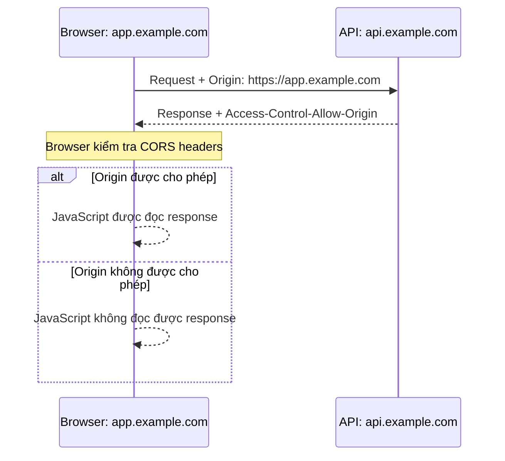

# Credentials không đi cùng wildcard origin

Trong chương **CORS và browser API** của module `SECURITY_API_SECURITY`, một cấu hình cần nhớ là: response cho request có credentials không được dùng `Access-Control-Allow-Origin: *`. Khi browser xử lý request với credentials mode `include`, server phải trả về origin cụ thể đã được kiểm tra và phải cho phép credentials bằng `Access-Control-Allow-Credentials: true`.

Quy tắc này giúp giới hạn website nào có thể đọc response của một request mang thông tin xác thực của người dùng. Nếu server phản chiếu mọi giá trị `Origin` hoặc dùng wildcard một cách tùy tiện, một website không đáng tin có thể đọc dữ liệu riêng tư từ API thông qua browser của người dùng.

## CORS giải quyết vấn đề gì?

Same-Origin Policy (SOP) là cơ chế bảo vệ của browser, giới hạn cách một document hoặc script ở một origin truy cập tài nguyên của origin khác. Một origin được xác định bởi bộ ba **scheme, host và port**. Ví dụ, các địa chỉ sau là những origin khác nhau:

- `https://app.example.com`
- `http://app.example.com`
- `https://api.example.com`
- `https://app.example.com:8443`

Cross-Origin Resource Sharing (CORS) là cơ chế cho phép server khai báo những origin nào được browser cho phép đọc response. CORS chủ yếu là chính sách do browser thực thi; nó không phải cơ chế xác thực người dùng và cũng không thay thế authorization ở API.

Khi JavaScript từ `https://app.example.com` gọi `https://api.example.com`, browser gửi request cross-origin. Server có thể trả các response header như `Access-Control-Allow-Origin` để cho browser biết origin đó có được đọc response hay không.



Server vẫn có thể nhận và xử lý request trước khi browser quyết định có cho JavaScript đọc response hay không. Đây là lý do không được dùng CORS như lớp bảo vệ duy nhất cho thao tác thay đổi dữ liệu.

## Credentials trong browser request là gì?

Trong Fetch API, thuộc tính `credentials` xác định browser có gửi credentials gắn với request và có xử lý `Set-Cookie` từ response hay không. Các giá trị phổ biến:

| Giá trị | Hành vi |
|---|---|
| `omit` | Không gửi credentials do browser quản lý và không xử lý cookie từ response |
| `same-origin` | Chỉ gửi credentials cho request cùng origin; đây là giá trị mặc định của Fetch |
| `include` | Cho phép gửi credentials cho cả request cross-origin, tùy các chính sách cookie và browser |

Credentials có thể bao gồm cookie, thông tin HTTP authentication được browser quản lý và TLS client certificate. Ví dụ request dùng cookie phiên đăng nhập:

```javascript
const response = await fetch("https://api.example.com/me", {
  method: "GET",
  credentials: "include"
});
```

Với XMLHttpRequest, thuộc tính tương ứng là `xhr.withCredentials = true`.

Một ứng dụng cũng có thể tự đặt header `Authorization: Bearer ...`. Header này thường khiến request cần preflight và phải được server cho phép trong `Access-Control-Allow-Headers`. Cần phân biệt header do ứng dụng chủ động đặt với credentials mode của Fetch; không suy luận rằng chỉ cần có hoặc không có `Authorization` là browser sẽ tự bật hay tắt chế độ credentials.

Ngay cả khi Fetch đặt `credentials: "include"`, cookie cross-site vẫn phải tuân theo thuộc tính cookie và chính sách của browser. Cookie dùng trong bối cảnh cross-site thường cần `SameSite=None; Secure`; một số browser hoặc chế độ riêng tư vẫn có thể chặn third-party cookies. `Access-Control-Allow-Credentials` không thể ghi đè các chính sách cookie đó.

## Quy tắc cốt lõi: credentialed request cần origin cụ thể

Khi request có credentials mode `include`, browser yêu cầu response thỏa mãn hai điều kiện quan trọng:

```http
Access-Control-Allow-Origin: https://app.example.com
Access-Control-Allow-Credentials: true
```

Giá trị của `Access-Control-Allow-Origin` phải là đúng origin được cho phép, bao gồm scheme, host và port khi có. Header `Access-Control-Allow-Credentials` phải có giá trị chính xác là chữ thường `true`.

Response sau đây không hợp lệ đối với credentialed request:

```http
Access-Control-Allow-Origin: *
Access-Control-Allow-Credentials: true
```

Browser sẽ không cho JavaScript đọc response đó. Wildcard có nghĩa là mọi origin, trong khi credentials có thể mang theo phiên đăng nhập hoặc danh tính người dùng; hai ý nghĩa này không thể kết hợp trong CORS credential check.

Một số điểm cần nhớ:

- `Access-Control-Allow-Origin` chỉ chứa một origin hoặc `*`; không liệt kê nhiều origin bằng dấu phẩy.
- `Access-Control-Allow-Credentials` không phải cách bật cookie ở client. Client phải dùng credentials mode phù hợp và cookie vẫn phải được browser cho phép gửi.
- Nếu không cần credentials, API public có thể dùng `Access-Control-Allow-Origin: *` và thường không cần `Access-Control-Allow-Credentials`.
- Nếu API trả dữ liệu riêng tư hoặc phụ thuộc phiên đăng nhập, hãy dùng allowlist origin cụ thể.
- Không trả `Access-Control-Allow-Credentials: true` cho mọi route chỉ vì một phần ứng dụng cần cookie.

## Cách chọn origin an toàn

Khi có nhiều frontend được phép, server thường phải đọc `Origin`, đối chiếu allowlist rồi trả lại chính origin đã được chấp thuận. Đây là cách phản hồi origin động, nhưng chỉ an toàn nếu việc kiểm tra được thực hiện chặt chẽ.

### 1. Dùng allowlist chính xác

Ví dụ danh sách được phép:

```text
https://app.example.com
https://admin.example.com
https://partner.example.net
```

Khi nhận `Origin: https://app.example.com`, server kiểm tra exact match và mới trả:

```http
Access-Control-Allow-Origin: https://app.example.com
Access-Control-Allow-Credentials: true
Vary: Origin
```

Không dùng cách kiểm tra chuỗi đơn giản như `origin.endsWith("example.com")`. Kiểu kiểm tra này có thể chấp nhận `https://evil-example.com` hoặc một hostname không thuộc miền dự kiến. Cũng không nên dùng regex rộng như `.*example.com`.

Origin là tuple scheme/host/port, không phải URL tùy ý có path. Cách kiểm tra nên parse origin, chuẩn hóa theo quy tắc URL/IDN mà hệ thống hỗ trợ và so sánh với danh sách origin đã cấu hình. Không tự suy ra origin hợp lệ chỉ vì hostname có chứa một chuỗi tin cậy.

### 2. Không phản chiếu Origin một cách mù quáng

Đoạn xử lý nguy hiểm:

```javascript
// Không an toàn: mọi website đều được phản chiếu lại.
response.setHeader("Access-Control-Allow-Origin", request.headers.origin);
response.setHeader("Access-Control-Allow-Credentials", "true");
```

Nếu attacker kiểm soát một website và nạn nhân đang đăng nhập vào API, browser có thể gửi cookie theo request cross-origin. Khi server phản chiếu origin của attacker và cho phép credentials, JavaScript của website đó có thể đọc response riêng tư nếu các điều kiện cookie/browser khác cũng cho phép.

Phải kiểm tra trước khi phản hồi:

```javascript
const allowedOrigins = new Set([
  "https://app.example.com",
  "https://admin.example.com"
]);

const origin = request.headers.origin;

if (origin && allowedOrigins.has(origin)) {
  response.setHeader("Access-Control-Allow-Origin", origin);
  response.setHeader("Access-Control-Allow-Credentials", "true");
  response.setHeader("Vary", "Origin");
}
```

Đây là ví dụ minh họa logic allowlist; trong ứng dụng thực tế cần bảo đảm header `Vary` được hợp nhất với các giá trị `Vary` khác thay vì ghi đè chúng, và CORS middleware phải xử lý cả preflight lẫn response lỗi.

### 3. Xử lý origin `null` thận trọng

Browser có thể gửi `Origin: null` trong một số ngữ cảnh opaque origin như tài liệu sandbox, `file:` hoặc một số URL đặc biệt. Không thêm `null` vào allowlist chỉ để làm một request hoạt động. Nếu có yêu cầu nghiệp vụ thật sự cần hỗ trợ, phải phân tích threat model và giới hạn riêng cho trường hợp đó.

### 4. CORS policy không phải authorization

Header `Origin` không phải bằng chứng xác thực người dùng. Client ngoài browser có thể tự gửi hoặc giả mạo header này. Server vẫn phải xác thực token/session, kiểm tra quyền chức năng và quyền trên đối tượng dữ liệu ở mỗi request.

Không dùng việc origin nằm trong allowlist làm điều kiện duy nhất để đọc hoặc cập nhật dữ liệu của tenant. CORS chỉ điều khiển khả năng JavaScript của browser đọc response; nó không chứng minh caller có quyền nghiệp vụ.

## Preflight và credentialed request

Browser gửi preflight `OPTIONS` trước một số request cross-origin, chẳng hạn request dùng method không thuộc nhóm CORS-safelisted hoặc có header tùy chỉnh như `Authorization`, `X-CSRF-Token` hay `Idempotency-Key`.

Ví dụ preflight:

```http
OPTIONS /api/transfers HTTP/1.1
Origin: https://app.example.com
Access-Control-Request-Method: POST
Access-Control-Request-Headers: authorization,content-type,idempotency-key
```

Preflight request không mang credentials của request thực tế. Tuy nhiên, nếu request thực tế sẽ dùng credentials mode `include`, response preflight vẫn phải thể hiện chính sách cho phép origin cụ thể và credentials:

```http
HTTP/1.1 204 No Content
Access-Control-Allow-Origin: https://app.example.com
Access-Control-Allow-Credentials: true
Access-Control-Allow-Methods: POST, OPTIONS
Access-Control-Allow-Headers: Authorization, Content-Type, Idempotency-Key
Access-Control-Max-Age: 600
Vary: Origin, Access-Control-Request-Method, Access-Control-Request-Headers
```

Sau khi preflight thành công, browser mới gửi request thực tế. Response của request thực tế cũng phải có CORS header phù hợp để JavaScript đọc được dữ liệu.

Các nguyên tắc cho preflight:

- Không yêu cầu cookie session để trả lời `OPTIONS`, vì preflight không gửi credentials. Có thể áp dụng policy theo origin và route mà không thực hiện nghiệp vụ.
- Chỉ cho phép method và header thật sự cần thiết; không mở `PUT`, `DELETE` hoặc header tùy ý cho mọi origin.
- Nếu frontend dùng `Authorization`, phải cho phép header đó một cách tường minh.
- Không thực hiện side effect trong preflight.
- Bảo đảm gateway, WAF và security middleware không chặn `OPTIONS` trước khi CORS handler xử lý.
- Nếu cache preflight, khai báo các trường request ảnh hưởng đến response trong `Vary` và đặt `Access-Control-Max-Age` phù hợp. Khi policy thay đổi, cân nhắc thời gian cache còn hiệu lực.

Với credentialed request, không dùng wildcard cho `Access-Control-Allow-Headers` hoặc `Access-Control-Allow-Methods` với ý định cho phép mọi thứ. Hãy liệt kê rõ các header và method cần dùng. Tương tự, nếu JavaScript cần đọc response header không thuộc nhóm safelisted, hãy liệt kê tên cụ thể trong `Access-Control-Expose-Headers`.

## CORS không thay thế CSRF protection

CORS và Cross-Site Request Forgery (CSRF) giải quyết hai vấn đề khác nhau:

- CORS quyết định JavaScript ở origin khác có được đọc response hay không.
- CSRF là việc trình duyệt của nạn nhân bị lợi dụng để gửi một request có thể thay đổi trạng thái trong khi nạn nhân đang có phiên đăng nhập.

Một số request đơn giản, chẳng hạn form submission với content type phù hợp, có thể được browser gửi mà không cần preflight. Nếu server thực hiện side effect trước khi browser chặn JavaScript đọc response, dữ liệu vẫn có thể bị thay đổi. Vì vậy, cấu hình CORS từ chối origin lạ không đủ để ngăn CSRF.

Với API dùng cookie session:

- Dùng CSRF token hoặc cơ chế chống CSRF phù hợp với kiến trúc.
- Đặt cookie `Secure` và `HttpOnly`; chọn `SameSite` phù hợp. `SameSite=None` cần `Secure` và chỉ nên dùng khi thực sự cần cross-site cookie.
- Kiểm tra `Origin` hoặc `Referer` cho request thay đổi trạng thái như một lớp phòng vệ bổ sung, với chính sách xử lý khi header bị thiếu rõ ràng.
- Không dùng `GET` để tạo, sửa hoặc xóa dữ liệu.
- Kiểm tra authentication và authorization ở server cho từng thao tác.

Custom header có thể buộc browser thực hiện preflight, nhưng không nên coi nó là CSRF token thay thế trong mọi trường hợp. Hãy thiết kế CSRF protection theo cơ chế xác thực và cách browser gửi credentials của ứng dụng.

## Cấu hình Spring Security với origin cụ thể

Ví dụ dưới đây dùng Spring Security và `CorsConfigurationSource` để chỉ cho phép frontend đã đăng ký gọi API bằng cookie/session:

```java
@Bean
CorsConfigurationSource corsConfigurationSource() {
    CorsConfiguration configuration = new CorsConfiguration();
    configuration.setAllowedOrigins(List.of(
        "https://app.example.com",
        "https://admin.example.com"
    ));
    configuration.setAllowedMethods(List.of(
        "GET", "POST", "PUT", "PATCH", "DELETE", "OPTIONS"
    ));
    configuration.setAllowedHeaders(List.of(
        "Content-Type", "Authorization", "X-CSRF-Token", "Idempotency-Key"
    ));
    configuration.setExposedHeaders(List.of(
        "Location", "X-Request-Id"
    ));
    configuration.setAllowCredentials(true);
    configuration.setMaxAge(600L);

    UrlBasedCorsConfigurationSource source =
        new UrlBasedCorsConfigurationSource();
    source.registerCorsConfiguration("/api/**", configuration);
    return source;
}
```

Trong `SecurityFilterChain`, bật tích hợp CORS để Spring Security dùng cấu hình đã khai báo:

```java
@Bean
SecurityFilterChain securityFilterChain(HttpSecurity http) throws Exception {
    return http
        .cors(Customizer.withDefaults())
        .authorizeHttpRequests(auth -> auth
            .requestMatchers("/api/public/**").permitAll()
            .requestMatchers("/api/**").authenticated()
            .anyRequest().denyAll()
        )
        .build();
}
```

Đây là ví dụ khung; cần điều chỉnh matcher, CSRF policy, authentication và authorization theo ứng dụng. Nếu dùng cookie session, không tắt CSRF chỉ vì đã cấu hình CORS. CORS processing phải diễn ra đủ sớm để preflight `OPTIONS` được xử lý trước bước yêu cầu authentication của request thực tế.

Không thay `setAllowedOrigins` bằng `setAllowedOriginPatterns(List.of("*"))` cho API chứa dữ liệu riêng tư. Một số framework có thể phản chiếu origin đã khớp pattern thay vì phát literal wildcard, nhưng pattern quá rộng vẫn biến allowlist thành cho phép mọi website. Nếu cần nhiều origin, khai báo từng origin hoặc quản lý danh sách cấu hình có kiểm soát.

## Caching và response header

Khi server phản hồi origin cụ thể dựa trên request `Origin`, cache cần biết response phụ thuộc vào header đó. Thêm:

```http
Vary: Origin
```

Nếu preflight response thay đổi theo method và request headers, cân nhắc:

```http
Vary: Origin, Access-Control-Request-Method, Access-Control-Request-Headers
```

Thiếu `Vary: Origin` có thể khiến shared cache phục vụ response có CORS header của một origin cho origin khác. Với response chứa dữ liệu theo user/session, cần cấu hình cache phù hợp như `Cache-Control: private` hoặc `no-store`; `Vary: Origin` không thay thế việc phân tách cache theo danh tính và quyền truy cập.

CORS header nên được xử lý nhất quán trên response thành công và lỗi `401`/`403` của origin hợp lệ. Điều này giúp frontend đáng tin cậy đọc được mã lỗi cần thiết. Tuy nhiên, không thêm wildcard hoặc phản chiếu origin vào response lỗi từ một proxy chỉ để browser không báo lỗi CORS.

## Khi nào wildcard origin phù hợp?

Wildcard có thể phù hợp với tài nguyên thực sự công khai, không phụ thuộc cookie hoặc credentials của người dùng, ví dụ một tệp ảnh public hoặc dữ liệu tra cứu công khai. Ví dụ:

```http
Access-Control-Allow-Origin: *
```

Trong trường hợp này, không gửi `Access-Control-Allow-Credentials: true` và không thiết kế endpoint dựa trên session người dùng. Nếu một route có thể trả dữ liệu khác nhau theo cookie, tenant hoặc quyền của caller, không nên coi nó là tài nguyên public chỉ vì muốn dùng wildcard.

Tách route public và route cần credentials giúp policy dễ hiểu hơn:

| Loại endpoint | CORS gợi ý |
|---|---|
| Tài nguyên public, không credentials | Có thể dùng `Access-Control-Allow-Origin: *` |
| API riêng tư dùng cookie/session | Exact origin allowlist và `Access-Control-Allow-Credentials: true` |
| API dùng bearer token do frontend đặt | Allow origin theo nhu cầu; cho phép `Authorization` qua preflight; vẫn kiểm tra token và quyền ở server |
| API nội bộ chỉ gọi server-to-server | Không cần CORS nếu không có browser client |

## Kiểm thử CORS và credential behavior

`curl` có thể gửi header `Origin` và giúp kiểm tra response header, nhưng nó không thực thi Same-Origin Policy hay CORS. Kết quả `curl` thành công không chứng minh JavaScript trong browser có thể đọc response. Cần có browser integration test cho các luồng quan trọng.

| Tình huống | Kết quả mong đợi |
|---|---|
| Origin hợp lệ, request có credentials | ACAO trả đúng origin; ACAC là `true`; browser cho JavaScript đọc response |
| Origin không nằm trong allowlist | Không cấp quyền CORS; không phản chiếu origin |
| ACAO là `*`, request credentials mode `include` | Browser từ chối cho JavaScript đọc response |
| Origin là `null` | Bị từ chối trừ khi có chính sách đặc biệt được phê duyệt |
| Preflight từ origin hợp lệ | OPTIONS trả method/header cụ thể; không cần cookie và không tạo side effect |
| Preflight yêu cầu header không được phép | Browser không gửi request thực tế |
| Request simple có thể thay đổi trạng thái từ origin lạ | CSRF protection phía server vẫn ngăn thao tác trái phép |
| Cookie cross-site bị browser chặn | Ứng dụng không giả định ACAC có thể vượt chính sách cookie |
| Response được cache cho nhiều origin | Cache tôn trọng `Vary: Origin`; dữ liệu riêng tư không bị shared cache dùng chung |
| Response `401` hoặc `403` từ origin hợp lệ | Frontend đọc được lỗi theo CORS policy mà không lộ chi tiết nội bộ |
| API gọi từ server-to-server | CORS không được dùng thay authentication/authorization |

Nên kiểm tra cả browser hiện đại, luồng cookie thực tế, preflight cache, redirect, response lỗi và cấu hình CDN/gateway. Test cần xác nhận cả response có được đọc hay không lẫn server có thực hiện side effect không.

## Những sai lầm thường gặp

- Dùng `Access-Control-Allow-Origin: *` cùng `Access-Control-Allow-Credentials: true` và kỳ vọng browser chấp nhận.
- Phản chiếu mọi giá trị `Origin` mà không kiểm tra allowlist.
- Dùng `endsWith`, substring hoặc regex rộng để kiểm tra domain.
- Nghĩ rằng `Access-Control-Allow-Credentials: true` tự làm browser gửi cookie.
- Coi CORS là authentication, authorization hoặc CSRF protection.
- Cho rằng preflight có cookie và bắt buộc đăng nhập mới được trả lời `OPTIONS`.
- Cho phép mọi method và header dù client chỉ cần một tập nhỏ.
- Quên `Vary: Origin` khi response thay đổi theo origin.
- Chỉ kiểm tra bằng `curl`, không chạy browser test.
- Cho phép wildcard origin trên endpoint trả dữ liệu theo user hoặc tenant.

## Checklist triển khai

- [ ] Phân loại endpoint public, credentialed browser API và server-to-server.
- [ ] Credentialed request chỉ nhận origin cụ thể từ allowlist.
- [ ] Không phản chiếu `Origin` trước khi kiểm tra; không cho phép `null` tùy tiện.
- [ ] `Access-Control-Allow-Credentials` chỉ được đặt `true` khi cần và có origin cụ thể.
- [ ] Method, request header và exposed response header được khai báo tường minh.
- [ ] Preflight `OPTIONS` được xử lý trước authentication, không tạo side effect.
- [ ] Cookie có `Secure`, `HttpOnly`, `SameSite` phù hợp và có CSRF protection.
- [ ] Authentication và object/function authorization luôn được thực hiện ở server.
- [ ] Dynamic origin response có `Vary: Origin`; cache dữ liệu riêng tư được cấu hình đúng.
- [ ] CORS header trên response lỗi nhất quán và không làm lộ thông tin nội bộ.
- [ ] Có browser integration test cho origin hợp lệ/không hợp lệ, credentials, preflight và CSRF.

Credentials và wildcard origin không được kết hợp trong CORS. Hãy xác định rõ endpoint nào thực sự cần cookie hoặc credentials, dùng allowlist origin chính xác cho các endpoint đó, và giữ authentication, authorization cùng CSRF protection ở phía server. Cấu hình như vậy giúp browser chỉ cho frontend đáng tin cậy đọc dữ liệu mà API trả về.
