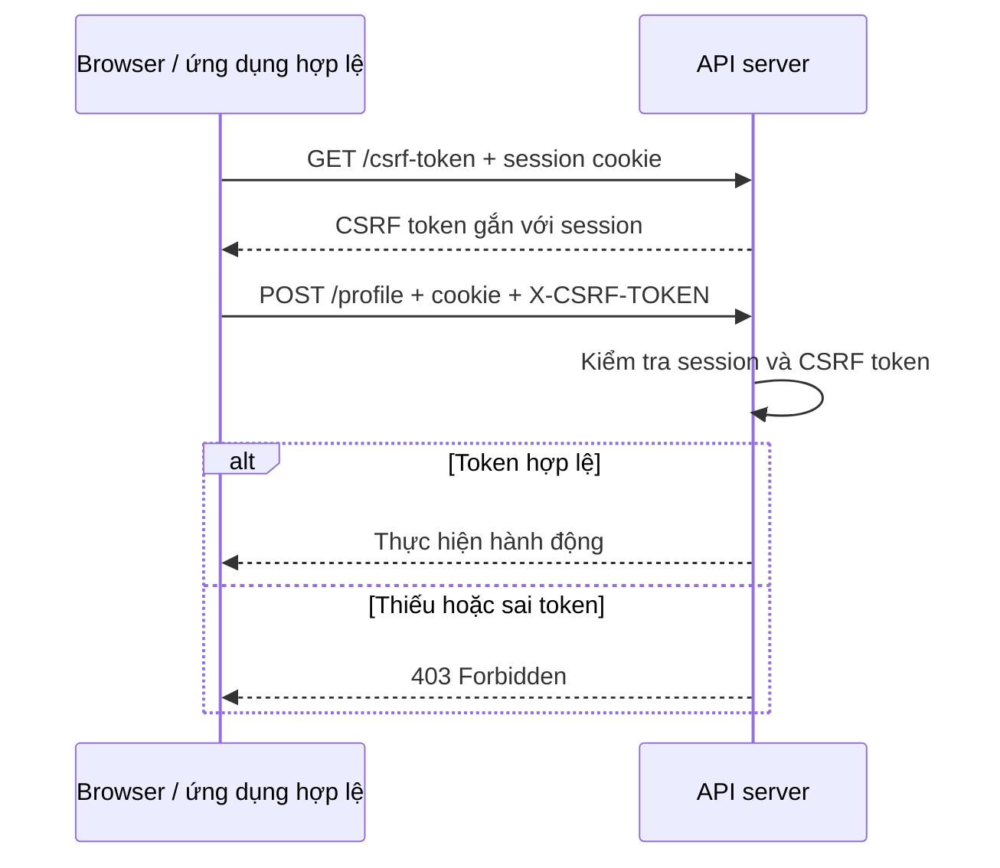

# CSRF với cookie-based API

Cookie-based API thường dùng session cookie hoặc access token được lưu trong cookie để nhận diện người dùng. Trình duyệt tự động gửi cookie phù hợp theo domain, path, thời hạn và chính sách SameSite khi request được tạo. Đặc tính tiện lợi này cũng tạo ra rủi ro: một trang web độc hại có thể khiến trình duyệt của nạn nhân gửi request đến API đang đăng nhập, dù nạn nhân không chủ động thực hiện hành động đó.

Đây là nền tảng của **Cross-Site Request Forgery (CSRF)**. Attacker lợi dụng trạng thái đăng nhập sẵn có trong browser để kích hoạt hành động như đổi email, tạo giao dịch, cập nhật địa chỉ hoặc thay đổi cấu hình. API có thể nhận cookie hợp lệ và nhầm request đó là hành động do người dùng khởi tạo.

Với cookie-based API, cần bảo vệ mọi thao tác làm thay đổi trạng thái bằng một hoặc nhiều lớp kiểm soát: CSRF token, cookie `SameSite`, kiểm tra `Origin`/`Referer`, Fetch Metadata và CORS được cấu hình đúng. Không lớp nào trong số này thay thế authentication, authorization hoặc kiểm tra nghiệp vụ. CORS chủ yếu quyết định JavaScript ở origin khác có được đọc response hay không; nó không tự ngăn mọi request cross-site được gửi đến server.

## 1. CSRF xảy ra như thế nào?

Giả sử người dùng đăng nhập vào `https://bank.example.com`. Server cấp session cookie `SESSION`, và browser lưu cookie đó. Khi người dùng mở một trang không đáng tin cậy tại `https://evil.example`, trang này có thể tạo một form gửi request đến ngân hàng.

Nếu browser gửi cookie phiên cùng request và API không có CSRF defense, server có thể thấy session hợp lệ rồi thực hiện hành động. Attacker thường không cần đọc response; chỉ cần kích hoạt side effect là đủ.

```mermaid
sequenceDiagram
    participant U as Browser của người dùng
    participant B as bank.example.com
    participant E as evil.example
    U->>B: Đăng nhập
    B-->>U: Set-Cookie: SESSION=...; HttpOnly
    U->>E: Mở trang không tin cậy
    E-->>U: HTML chứa form gửi POST đến bank.example.com
    U->>B: POST /transfer + cookie SESSION tự động
    B->>B: Kiểm tra session nhưng thiếu CSRF defense
    B-->>U: Thực hiện transfer
```

Điều kiện thường gặp để CSRF thành công:

- Người dùng đang có phiên đăng nhập hoặc cookie xác thực còn hiệu lực.
- Browser tự động gửi cookie đến API đích.
- Attacker có thể khiến browser gửi request phù hợp, ví dụ qua form HTML, navigation hoặc script.
- Server không xác minh được request có xuất phát từ một tương tác hợp lệ của ứng dụng hay không.
- Hành động có thể được thực hiện mà không cần thêm bằng chứng như CSRF token hoặc xác nhận giao dịch.

CSRF không đồng nghĩa với đánh cắp cookie. Cookie có thể vẫn được bảo vệ bằng `HttpOnly` và `Secure`, nhưng browser vẫn tự gửi cookie trong request. `HttpOnly` ngăn JavaScript đọc cookie; nó không ngăn browser đính kèm cookie vào request.

## 2. Vì sao cookie-based API dễ bị CSRF?

Với session cookie, browser tự động gửi credential theo quy tắc cookie. Server thường không phân biệt được request do ứng dụng chính gửi hay do một trang khác khiến browser gửi.

Ví dụ form độc hại có thể gửi request đơn giản:

```html
<form action="https://bank.example.com/profile/email" method="POST">
  <input type="hidden" name="email" value="attacker@example.net">
  <button type="submit">Continue</button>
</form>
```

Nếu endpoint chấp nhận `application/x-www-form-urlencoded`, cookie được gửi và server không kiểm tra CSRF token, hành động có thể xảy ra. Một số request dùng `multipart/form-data` hoặc `text/plain` cũng có thể được gửi từ form mà không cần CORS preflight.

Cookie-based JWT hoặc refresh token cũng có rủi ro tương tự. Việc token là JWT, có chữ ký hợp lệ hay được lưu trong cookie không làm request tự động an toàn trước CSRF. Nếu browser tự gửi cookie chứa credential, server vẫn cần xác minh ý định request.

### 2.1. So sánh cookie với Bearer token trong Authorization header

| Cách gửi credential | Hành vi browser | Rủi ro CSRF |
| --- | --- | --- |
| Session cookie | Browser tự động gửi cookie phù hợp | Có rủi ro CSRF; cần defense phù hợp. |
| JWT trong cookie | Browser tự động gửi cookie | Vẫn có rủi ro CSRF như session cookie. |
| Bearer token trong `Authorization` header do JavaScript chủ động gắn | Browser không tự thêm token chỉ vì request đến domain đó | Giảm rủi ro CSRF cổ điển; cần bảo vệ token khỏi XSS và kiểm soát CORS. |
| Refresh token trong cookie, access token trong memory | Refresh endpoint nhận cookie tự động | Refresh endpoint vẫn cần CSRF defense. |

Không nên chuyển token sang `localStorage` chỉ để tránh CSRF mà bỏ qua rủi ro XSS. JavaScript bị chèn có thể đọc token trong `localStorage`; cookie `HttpOnly` hạn chế việc đọc credential trực tiếp nhưng vẫn cần CSRF protection.

## 3. Phân biệt CSRF với CORS và XSS

Ba vấn đề này thường bị nhầm lẫn:

| Cơ chế | Vấn đề chính | Kiểm soát tiêu biểu |
| --- | --- | --- |
| CSRF | Trang khác kích hoạt request bằng credential browser tự gửi | CSRF token, SameSite, Origin validation, Fetch Metadata. |
| CORS | Browser có cho JavaScript ở origin khác đọc response hay không | Allowlist origin, method, header và credential policy. |
| XSS | Attacker chạy JavaScript trong origin được tin cậy | Output encoding, sanitization, CSP, tránh DOM injection và kiểm soát dependency. |

### 3.1. Vì sao CORS không phải CSRF protection?

CORS là cơ chế do browser thực thi để kiểm soát việc script ở một origin đọc response cross-origin. Với request đơn giản như form POST, browser có thể gửi request đến server rồi chỉ chặn JavaScript đọc response. Nếu server thực hiện side effect trước khi response bị browser chặn, CSRF vẫn thành công.

Với request không đơn giản, browser thường gửi preflight `OPTIONS` trước. Nếu preflight không được chấp nhận, browser không gửi request thực tế. Tuy nhiên, attacker vẫn có thể dùng form hoặc request đơn giản để kích hoạt một số thao tác. Vì vậy, không được dựa vào preflight như lớp CSRF duy nhất.

### 3.2. XSS có thể vượt qua nhiều CSRF defense

Nếu attacker chạy được JavaScript trong origin hợp lệ của ứng dụng, script đó có thể đọc CSRF token mà ứng dụng được phép đọc, gửi request với header hợp lệ và sử dụng session của nạn nhân. Do đó CSRF token không thay thế phòng chống XSS. Cần bảo vệ cả hai lớp.

## 4. Cookie SameSite

Thuộc tính `SameSite` yêu cầu browser hạn chế gửi cookie trong một số ngữ cảnh cross-site. Đây là lớp giảm rủi ro quan trọng, nhưng cần hiểu đúng khái niệm *site* và *origin*.

- **Origin** gồm scheme, host và port, ví dụ `https://app.example.com:443`.
- **Site** thường được xác định theo scheme và registrable domain (eTLD+1), ví dụ `https://app.example.com` và `https://api.example.com` có thể là same-site dù khác origin.

Do đó, một subdomain bị chiếm quyền hoặc không đáng tin cậy có thể vẫn là same-site với API. `SameSite` không thay thế kiểm tra origin chính xác hoặc CSRF token trong những hệ thống có nhiều subdomain.

### 4.1. Các giá trị SameSite

| Giá trị | Hành vi tổng quát | Khi nào cân nhắc |
| --- | --- | --- |
| `Strict` | Hạn chế cookie trong điều hướng/request cross-site | Phù hợp khi cần mức hạn chế cao và không làm hỏng luồng đăng nhập/điều hướng ngoài. |
| `Lax` | Cho phép cookie trong một số top-level navigation an toàn, thường là GET; hạn chế nhiều request cross-site khác | Lựa chọn cân bằng thường gặp cho session cookie. |
| `None` | Cho phép cookie trong ngữ cảnh cross-site nếu browser hỗ trợ và cookie có `Secure` | Chỉ dùng khi thực sự cần cookie cross-site, ví dụ một số mô hình frontend/API khác site hoặc tích hợp. |

Browser hiện đại thường áp dụng mặc định gần với `Lax` khi thuộc tính bị bỏ qua, nhưng không nên dựa vào default không đồng nhất. Hãy đặt giá trị tường minh và kiểm thử các browser/luồng được hỗ trợ. `SameSite=None` yêu cầu `Secure`; cookie cross-site cũng có thể bị chính sách chặn third-party cookie của browser hạn chế.

### 4.2. Ví dụ session cookie

```http
Set-Cookie: __Host-SESSION=opaque-session-id; Path=/; Secure; HttpOnly; SameSite=Lax
```

Prefix `__Host-` yêu cầu cookie có `Secure`, `Path=/` và không có thuộc tính `Domain`, giúp giới hạn cookie ở host đã phát hành. Nếu ứng dụng cần phạm vi domain rộng hơn, không thể dùng prefix này và phải cân nhắc rủi ro cookie injection từ subdomain.

Các nguyên tắc khác:

- Dùng HTTPS và `Secure` cho session cookie.
- Dùng `HttpOnly` để JavaScript không đọc được session credential.
- Đặt `SameSite` rõ ràng theo luồng nghiệp vụ.
- Hạn chế `Domain`; ưu tiên host-only cookie nếu có thể.
- Đặt `Path` cần thiết, nhưng không xem Path là ranh giới bảo mật.
- Rotate session ID sau login, thay đổi quyền hoặc nâng privilege.
- Hủy session server-side khi logout hoặc thu hồi phiên.

`SameSite=Strict` có thể làm gián đoạn callback từ nhà cung cấp đăng nhập, liên kết xác minh hoặc điều hướng từ website khác. `Lax` thường thuận tiện hơn cho top-level GET navigation nhưng không cho phép dùng GET để thay đổi dữ liệu. Luồng OAuth/OIDC cần được thiết kế và kiểm thử riêng, không nới lỏng toàn bộ cookie chỉ để một callback hoạt động.

## 5. CSRF token theo mô hình Synchronizer Token

Synchronizer Token Pattern dùng một token ngẫu nhiên do server tạo và gắn với session. Ứng dụng hợp lệ lấy token từ server rồi gửi lại trong header hoặc request body ở các thao tác thay đổi trạng thái. Trang độc hại ở origin khác không thể đọc token do Same-Origin Policy, nên khó tạo request hợp lệ.

Luồng cơ bản:

1. Người dùng đăng nhập và nhận session cookie.
2. Server tạo CSRF token khó đoán, liên kết với session hiện tại.
3. Ứng dụng lấy token qua HTML, meta tag hoặc endpoint bootstrap đã được bảo vệ.
4. Với request thay đổi trạng thái, ứng dụng gửi token qua custom header như `X-CSRF-TOKEN`.
5. Server so sánh token nhận được với token gắn với session và từ chối nếu thiếu hoặc sai.



### 5.1. Yêu cầu với CSRF token

- Sinh bằng bộ tạo số ngẫu nhiên mật mã, đủ entropy (ví dụ tối thiểu 128 bit ngẫu nhiên).
- Liên kết với session hoặc security context đang xác thực.
- Không thể suy ra từ user ID, timestamp, email hoặc giá trị dễ đoán.
- Không đặt token trong URL/query string vì có thể lọt vào history, log, analytics và Referer.
- Không ghi token vào application log hoặc telemetry.
- Kiểm tra token ở server cho mọi thao tác thay đổi trạng thái cần bảo vệ.
- Rotate hoặc làm mất hiệu lực token khi session được tạo lại, đăng nhập, logout hoặc thay đổi privilege theo thiết kế.
- Không chấp nhận token từ một session khác.

Token có thể là per-session hoặc per-request. Per-session dễ triển khai và phù hợp với nhiều ứng dụng; per-request có thể giảm cửa sổ replay nhưng làm phức tạp tab song song, retry và back/forward navigation. Chọn mô hình theo threat model và khả năng hỗ trợ của framework.

### 5.2. Truyền token qua custom header

Với SPA, ứng dụng có thể lấy token từ endpoint cùng origin rồi gửi trong header:

```http
POST /api/profile/email HTTP/1.1
Host: api.example.com
Cookie: __Host-SESSION=opaque-session-id
X-CSRF-TOKEN: random-session-bound-token
Content-Type: application/json

{"email":"new-address@example.net"}
```

Header custom thường khiến request cross-origin cần CORS preflight, nhưng đó chỉ là lớp bổ sung. Server vẫn phải xác minh token; không được chấp nhận request chỉ vì có header `X-CSRF-TOKEN` nếu giá trị không hợp lệ.

Không cho phép CORS origin tùy ý đọc endpoint cấp CSRF token. Endpoint này cần cùng authentication/session policy và không được cache công khai. Nếu dùng CDN hoặc reverse proxy, đảm bảo token không bị chia sẻ giữa user.

## 6. Double Submit Cookie Pattern

Double Submit Cookie là lựa chọn thường dùng cho API stateless hoặc SPA khi server không lưu CSRF token trong session. Server phát một cookie chứa token; ứng dụng đọc cookie đó rồi gửi cùng giá trị trong custom header hoặc body. Server kiểm tra giá trị cookie và request khớp nhau.

Ví dụ:

```http
Set-Cookie: XSRF-TOKEN=random-csrf-value; Path=/; Secure; SameSite=Lax
```

Ứng dụng đọc cookie `XSRF-TOKEN` rồi gửi:

```http
POST /api/orders HTTP/1.1
Cookie: __Host-SESSION=opaque-session-id; XSRF-TOKEN=random-csrf-value
X-XSRF-TOKEN: random-csrf-value
Content-Type: application/json
```

Session cookie vẫn nên là `HttpOnly`. Cookie chứa CSRF token có thể cần đọc được bởi JavaScript nên không đặt `HttpOnly` cho cookie token này; token không phải credential đăng nhập, nhưng vẫn cần bảo vệ khỏi rò rỉ và injection.

### 6.1. Tránh double-submit không ký

Một triển khai đơn giản chỉ so sánh cookie và header có thể bị tấn công nếu attacker có khả năng đặt cookie cho domain mục tiêu, ví dụ qua subdomain không đáng tin cậy, cookie injection hoặc một lỗ hổng khác. Attacker có thể ép browser gửi giá trị mà họ biết ở cả hai nơi.

Ưu tiên **signed double-submit**: token được ký bằng HMAC với secret phía server và gắn với session identifier hoặc một giá trị ràng buộc tương đương. Server xác minh chữ ký và binding, đồng thời so sánh token trong cookie với token trong header. Dùng so sánh constant-time cho MAC/token nhạy cảm khi phù hợp với thư viện.

Không dùng session ID làm CSRF token; không để JavaScript đọc session cookie chỉ để xây dựng double-submit. Token CSRF phải có mục đích và vòng đời riêng.

## 7. Kiểm tra Origin và Referer

Server có thể kiểm tra `Origin` của request để xác định trang khởi tạo request. Với thao tác thay đổi trạng thái, so sánh origin với allowlist chính xác của ứng dụng.

Ví dụ origin hợp lệ:

```text
https://app.example.com
https://admin.example.com
```

Không dùng kiểm tra chuỗi con như `endsWith("example.com")` hoặc `contains("example.com")`, vì các host như `evil-example.com` hoặc `example.com.attacker.net` có thể vượt qua kiểm tra sai. So sánh scheme, hostname và port theo origin đã chuẩn hóa.

### 7.1. Xử lý Origin bị thiếu hoặc null

Một số request không có `Origin`, hoặc có `Origin: null` tùy ngữ cảnh sandbox, file URL và client. Với browser-facing cookie API, nên từ chối origin `null` trừ khi có use case được xác minh rõ. Nếu `Origin` vắng mặt, có thể dùng `Referer` làm tín hiệu thay thế sau khi parse URL an toàn và so sánh origin chính xác; nếu cả hai đều thiếu, yêu cầu CSRF token hợp lệ hoặc từ chối theo policy.

Không tin `Origin`/`Referer` như authentication. Client ngoài browser có thể tự đặt header; các kiểm tra này nhằm chống browser-based CSRF, còn API vẫn cần authentication và authorization bình thường.

### 7.2. Reverse proxy và scheme/host gốc

Nếu TLS kết thúc ở proxy, backend có thể nhìn thấy scheme nội bộ là HTTP. Chỉ sử dụng `Forwarded` hoặc `X-Forwarded-*` từ proxy đã được tin cậy và cấu hình đúng; loại bỏ giá trị do client bên ngoài tự gửi. So sánh origin với cấu hình canonical, không tự tạo allowlist từ `Host` request chưa xác minh.

## 8. Fetch Metadata headers

Browser hiện đại gửi một số header mô tả ngữ cảnh fetch, ví dụ:

- `Sec-Fetch-Site`: `same-origin`, `same-site`, `cross-site` hoặc `none`.
- `Sec-Fetch-Mode`: `navigate`, `cors`, `no-cors`, `same-origin`.
- `Sec-Fetch-Dest`: loại đích như `document`, `image`, `empty`.

Server có thể dùng `Sec-Fetch-Site: cross-site` để chặn các request thay đổi trạng thái đến từ site khác, trừ các route được phép rõ ràng. Ví dụ `GET` navigation có thể cần chính sách riêng, trong khi `POST`, `PUT`, `PATCH`, `DELETE` thường không nên được chấp nhận từ cross-site context nếu không có lý do.

Fetch Metadata là tín hiệu bổ sung. Một subdomain không đáng tin có thể là `same-site`; client cũ hoặc non-browser có thể không gửi header; header cũng không thay thế CSRF token. Nên kết hợp với Origin validation, SameSite và token theo threat model.

## 9. Không thay đổi trạng thái qua GET hoặc HEAD

HTTP `GET` và `HEAD` được định nghĩa là safe methods. Browser, crawler, link preview, prefetcher và hệ thống cache có thể tự động gửi các request này. Nếu `GET /api/account/delete` hoặc `GET /api/transfer/confirm` làm thay đổi dữ liệu, hệ thống có thể bị kích hoạt ngoài ý muốn và dễ bị CSRF.

Các quy tắc:

- Chỉ dùng `GET`/`HEAD` để đọc representation hoặc metadata.
- Dùng `POST`, `PUT`, `PATCH` hoặc `DELETE` cho hành động thay đổi trạng thái theo contract.
- Không để query parameter như `?confirm=true` biến GET thành command.
- Không thực hiện side effect nghiệp vụ trong redirect hoặc image/link endpoint.
- Đảm bảo health check, preview và crawler không thể kích hoạt hành động.

Đổi method sang POST không tự động giải quyết CSRF; POST vẫn cần token hoặc defense tương ứng.

## 10. Cấu hình CORS khi API dùng cookie

Nếu frontend và API khác origin, browser cần CORS policy để JavaScript đọc response. Khi dùng cookie cross-origin, frontend phải gửi request với credentials và server phải cho phép origin cụ thể cùng credentials.

Ví dụ response CORS:

```http
Access-Control-Allow-Origin: https://app.example.com
Access-Control-Allow-Credentials: true
Access-Control-Allow-Methods: GET, POST, PATCH, DELETE
Access-Control-Allow-Headers: Content-Type, X-CSRF-TOKEN
Vary: Origin
```

Không dùng `Access-Control-Allow-Origin: *` cùng `Access-Control-Allow-Credentials: true`; browser không chấp nhận cấu hình này cho response credentialed. Không phản chiếu bất kỳ `Origin` nào mà không kiểm tra allowlist. `Vary: Origin` giúp cache phân biệt response theo origin khi response header phụ thuộc origin.

Ở phía browser, request có thể cần `credentials: "include"`:

```javascript
const response = await fetch("https://api.example.com/api/profile", {
  method: "PATCH",
  credentials: "include",
  headers: {
    "Content-Type": "application/json",
    "X-CSRF-TOKEN": csrfToken
  },
  body: JSON.stringify({ displayName: "New name" })
});
```

`credentials: "include"` yêu cầu browser gửi credential cross-origin khi cookie policy cho phép. Nó không vượt qua `SameSite`, third-party cookie restrictions hoặc CSRF validation phía server. CORS allowlist chỉ cho origin được phép đọc response; server vẫn phải kiểm tra CSRF token và authorization.

### 10.1. Same-site khác origin

Ví dụ frontend `https://app.example.com` và API `https://api.example.com` là khác origin nên cần CORS, nhưng có thể là same-site. Cookie `SameSite=Lax` có thể được gửi trong request phù hợp giữa hai subdomain; điều đó không có nghĩa mọi subdomain đều đáng tin. Hãy dùng allowlist origin cụ thể, token và cookie host-only nếu kiến trúc cho phép.

Nếu frontend và API khác site, cookie thường cần `SameSite=None; Secure`, và browser có thể áp dụng chính sách third-party cookie. Trước khi chọn kiến trúc này, cân nhắc BFF hoặc same-site deployment để giảm phụ thuộc vào third-party cookies.

## 11. Spring Security cho cookie-based API

Spring Security bật CSRF protection mặc định cho nhiều cấu hình web. Không tắt CSRF chỉ vì endpoint trả JSON hoặc vì API được gọi bằng AJAX. Nếu browser xác thực bằng cookie, request thay đổi trạng thái vẫn có thể bị CSRF.

### 11.1. Session cookie với synchronizer token

Với ứng dụng server-rendered, có thể dùng CSRF token do Spring Security quản lý và đưa vào form/header. Ví dụ cấu hình cơ bản:

```java
@Bean
SecurityFilterChain securityFilterChain(HttpSecurity http) throws Exception {
    http
        .csrf(Customizer.withDefaults())
        .authorizeHttpRequests(auth -> auth
            .requestMatchers("/login", "/assets/**").permitAll()
            .anyRequest().authenticated()
        );

    return http.build();
}
```

Với form do Spring MVC/Thymeleaf render, tích hợp Spring Security có thể tự thêm hidden CSRF input khi dùng form tag phù hợp. Nếu tự tạo HTML hoặc gửi AJAX, cần lấy token và gửi lại theo tên parameter/header mà ứng dụng cấu hình. Không giả định mọi request JSON đều tự có token.

### 11.2. SPA dùng CookieCsrfTokenRepository

Với SPA, `CookieCsrfTokenRepository` có thể lưu CSRF token trong cookie `XSRF-TOKEN` và nhận token qua header `X-XSRF-TOKEN`. Cookie CSRF cần được JavaScript đọc, trong khi session cookie vẫn nên là `HttpOnly`.

```java
@Bean
SecurityFilterChain spaSecurity(HttpSecurity http) throws Exception {
    CookieCsrfTokenRepository repository =
        CookieCsrfTokenRepository.withHttpOnlyFalse();

    http
        .csrf(csrf -> csrf
            .csrfTokenRepository(repository)
        )
        .authorizeHttpRequests(auth -> auth
            .requestMatchers("/api/public/**").permitAll()
            .anyRequest().authenticated()
        );

    return http.build();
}
```

Đây là cấu hình khung. Cần cấu hình CORS allowlist riêng, kiểm tra cách SPA lấy token sau khi session được tạo và kiểm thử behavior theo phiên bản Spring Security. Một số phiên bản dùng deferred token và BREACH protection/XOR request handler; SPA có thể cần handler tùy chỉnh để xử lý token cookie dạng plain text đúng cách. Không sao chép cấu hình handler từ phiên bản khác mà chưa kiểm thử.

Nếu dùng cookie repository, cần bảo đảm response đầu tiên sau authentication hoặc endpoint bootstrap thực sự phát hành CSRF cookie để SPA đọc. Khi logout hoặc session rotation, token cũ phải hết hiệu lực theo session mới. Không expose endpoint lấy CSRF token cho origin không tin cậy qua CORS.

### 11.3. Không tắt CSRF bằng stateless flag một cách máy móc

`SessionCreationPolicy.STATELESS` không tự chứng minh không có CSRF. Nếu browser vẫn gửi JWT hoặc refresh token trong cookie, request vẫn có credential tự động. Chỉ cân nhắc bỏ CSRF cho một chain khi authentication thực sự dựa trên credential mà browser không tự gửi (ví dụ bearer token chủ động gắn trong Authorization header) và không có cookie auth hoặc cookie refresh endpoint trong phạm vi đó.

Nếu ứng dụng có nhiều loại client, có thể tách `SecurityFilterChain` theo path/host và authentication mechanism. Cần bảo đảm matcher không để cookie-based route rơi vào chain đã tắt CSRF.

## 12. Các luồng đặc biệt cần đánh giá

### 12.1. Login CSRF

Attacker có thể khiến browser của nạn nhân đăng nhập vào tài khoản do attacker kiểm soát. Sau đó nạn nhân có thể nhập dữ liệu cá nhân hoặc thông tin thanh toán vào tài khoản attacker. Login endpoint cũng cần chống CSRF bằng token, Origin validation hoặc cơ chế phù hợp.

### 12.2. Logout CSRF

Request logout bị kích hoạt từ site khác có thể làm người dùng bị đăng xuất ngoài ý muốn. Đây thường ít nghiêm trọng hơn chuyển tiền hoặc thay email, nhưng vẫn ảnh hưởng trải nghiệm và có thể được dùng trong chuỗi tấn công. Không dùng GET để logout; bảo vệ endpoint logout bằng CSRF policy.

### 12.3. OAuth/OIDC callback

Trong authorization code flow, dùng `state` ngẫu nhiên và gắn với phiên đăng nhập để chống login CSRF và callback injection. PKCE bảo vệ authorization code khỏi bị chặn sử dụng bởi client khác, nhưng không thay thế `state` trong vai trò chống CSRF của authorization response. Cookie SameSite cần được kiểm thử với redirect từ identity provider; có thể cần thiết kế transaction cookie/state riêng có thời hạn ngắn thay vì nới lỏng session cookie toàn cục.

### 12.4. WebSocket và các giao thức nâng cấp

Browser có thể gửi cookie trong WebSocket handshake. CORS không bảo vệ WebSocket theo cùng cơ chế CORS fetch thông thường. Server cần xác thực handshake, kiểm tra `Origin` bằng allowlist và áp dụng authorization cho message/action. Không tin `Origin` một mình như authentication; với hành động nhạy cảm, cần token hoặc cơ chế chống CSRF phù hợp với thiết kế WebSocket.

## 13. Kiểm thử CSRF cho cookie-based API

Kiểm thử phải chạy trong browser thực hoặc browser automation với ít nhất hai origin khác nhau. Unit test controller thường không tái hiện đầy đủ việc browser tự gửi cookie, SameSite và CORS.

| Kịch bản | Request/context | Kết quả mong đợi |
| --- | --- | --- |
| Request hợp lệ | Same-origin request có session và CSRF token hợp lệ | Thực hiện thao tác theo authorization. |
| Thiếu token | Cookie hợp lệ nhưng không có CSRF token | `403`; không có side effect. |
| Token sai | Token không khớp session hoặc chữ ký sai | `403`; không có side effect. |
| Token từ session khác | Dùng token của user/session khác | `403`. |
| Cross-site form POST | Form từ origin độc hại gửi cookie nếu browser policy cho phép | Bị chặn bởi SameSite hoặc CSRF/Origin defense; không có side effect. |
| Cross-site simple request | `text/plain` hoặc form content type | Server không thực hiện hành động khi thiếu CSRF defense. |
| Origin không tin cậy | `Origin` ngoài allowlist | Từ chối thao tác thay đổi trạng thái. |
| Origin null | Sandbox/file context không được hỗ trợ | Từ chối theo policy. |
| Fetch Metadata cross-site | `Sec-Fetch-Site: cross-site` trên POST/PATCH/DELETE | Bị chặn trừ ngoại lệ đã định nghĩa. |
| Same-site subdomain không tin cậy | Request từ subdomain bị kiểm soát | Origin/token defense vẫn chặn. |
| CORS wildcard | Origin bất kỳ với credentials | Cấu hình bị từ chối trong review/test; không phản chiếu origin. |
| Session rotation | Login hoặc privilege change | Session ID và CSRF token cũ không còn dùng được theo policy. |
| Login CSRF | Cross-site login submission | Không gắn nạn nhân vào tài khoản do attacker kiểm soát. |
| Logout CSRF | Cross-site GET/POST đến logout | GET không logout; POST thiếu token bị từ chối. |
| OAuth callback | State thiếu, sai hoặc đã dùng | Callback bị từ chối. |
| WebSocket origin | Handshake từ origin lạ kèm cookie | Bị từ chối; không mở session WebSocket. |

### 13.1. Kiểm tra side effect, không chỉ status code

Với request bị CSRF từ chối, xác minh database không thay đổi, không tạo đơn hàng, không gửi email, không phát hành transfer, không cập nhật địa chỉ và không tạo message/event. Một API trả `403` sau khi đã thực hiện side effect vẫn là lỗi nghiêm trọng.

Kiểm tra cả redirect, retry và asynchronous processing. CSRF request có thể kích hoạt command được đưa vào queue trước khi validation hoàn tất nếu thứ tự middleware/service sai.

### 13.2. Ví dụ browser automation

Có thể dựng hai origin trong môi trường test, ví dụ `https://app.test` và `https://attacker.test`. Đăng nhập ở app, mở trang attacker rồi thử submit form đến endpoint nhạy cảm. Kiểm tra cookie có được gửi theo SameSite policy, request bị từ chối đúng lớp và trạng thái server không đổi. Không dùng dữ liệu hoặc credential production cho thử nghiệm.

## 14. Logging và giám sát

Ghi nhận CSRF failure theo route template, method, decision, reason code, origin đã chuẩn hóa, `Sec-Fetch-Site`, client/session reference ở dạng pseudonymous và correlation ID. Không ghi session cookie, CSRF token hoặc access token.

Theo dõi:

- Tỷ lệ request thay đổi trạng thái bị thiếu/sai CSRF token.
- Origin ngoài allowlist và `Sec-Fetch-Site: cross-site` trên route nhạy cảm.
- CSRF failure tăng đột biến sau thay đổi frontend, cookie hoặc reverse proxy.
- Session cookie bị gửi trong luồng cross-site không dự kiến.
- CORS preflight failure và lỗi credentials do cấu hình sai.
- Login/logout CSRF pattern và callback OAuth có state không hợp lệ.

Một số request thiếu token có thể đến từ frontend cũ hoặc client integration bị lỗi. Phân biệt lỗi tương thích với hành vi tấn công; không tự động whitelist một origin rộng chỉ để làm giảm số cảnh báo.

## 15. Checklist bảo vệ cookie-based API khỏi CSRF

- [ ] Xác định mọi credential browser tự gửi, gồm session cookie, JWT cookie và refresh token cookie.
- [ ] Không dùng GET/HEAD để thay đổi trạng thái.
- [ ] Bật CSRF protection cho mọi endpoint cookie-auth thay đổi trạng thái.
- [ ] Dùng synchronizer token hoặc signed double-submit phù hợp kiến trúc.
- [ ] Token có entropy cao, gắn với session, không đặt trong URL hoặc log.
- [ ] Cookie session có `Secure`, `HttpOnly`, `SameSite` tường minh và phạm vi domain hẹp.
- [ ] Dùng host-only cookie hoặc `__Host-` prefix nếu kiến trúc cho phép.
- [ ] Kiểm tra `Origin` chính xác; xử lý `Referer` fallback và `null` theo policy.
- [ ] Dùng Fetch Metadata như lớp bổ sung, không thay thế token.
- [ ] CORS chỉ allowlist origin cần thiết; không phản chiếu origin tùy ý hoặc dùng wildcard với credentials.
- [ ] Hiểu rõ `SameSite` theo site, không nhầm với origin; đánh giá rủi ro subdomain.
- [ ] Không tắt CSRF chỉ vì API trả JSON hoặc đặt session policy stateless.
- [ ] Kiểm tra login, logout, OAuth callback, refresh token và WebSocket handshake.
- [ ] Test bằng browser với cross-site form/simple request và xác minh không có side effect.
- [ ] Log reason code nhưng không ghi cookie/token/CSRF secret.

CSRF với cookie-based API xuất phát từ việc browser tự động gửi credential cùng request. Khi session cookie được cấu hình `SameSite` phù hợp, thao tác thay đổi trạng thái yêu cầu CSRF token, origin được xác minh và CORS được giới hạn đúng, API có thể phân biệt request hợp lệ từ ứng dụng với request bị trang khác kích hoạt. Các lớp này cần được kiểm thử trong browser thực tế và kết hợp với authorization cùng kiểm soát nghiệp vụ ở server.
