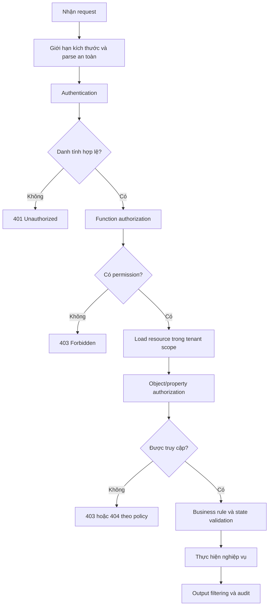

# Authorization phải kiểm tra ở server

CORS (Cross-Origin Resource Sharing) quy định trình duyệt có được phép cho JavaScript ở một origin đọc response từ origin khác hay không. CORS không xác định người gọi là ai, không quyết định họ có quyền xem một đơn hàng hay thực hiện thao tác quản trị, và không chặn mọi client ngoài trình duyệt. Vì vậy, authorization luôn phải được thực thi ở server cho từng endpoint, hành động và resource.

Một API có thể cấu hình CORS rất chặt nhưng vẫn bị truy cập qua curl, Postman, ứng dụng mobile, backend khác hoặc một chương trình chạy ngoài browser. Ngược lại, CORS có thể cho phép một frontend đọc response nhưng user của frontend đó vẫn phải được xác thực và phân quyền ở backend. Hai cơ chế giải quyết hai bài toán khác nhau.

## 1. Phân biệt CORS, authentication và authorization

| Cơ chế | Câu hỏi | Nơi thực thi chính | Ví dụ |
|---|---|---|---|
| CORS | JavaScript ở origin nào được phép đọc response cross-origin? | Trình duyệt dựa trên response header | Cho `https://app.example.com` đọc response từ API |
| Authentication | Request đại diện cho user, client hoặc workload nào? | Server hoặc identity provider tin cậy | Xác minh access token, session hoặc mTLS identity |
| Authorization | Chủ thể đã xác thực được phép làm gì trên resource nào? | Server tại endpoint/service | Chỉ user thuộc tenant sở hữu đơn hàng mới được đọc đơn đó |
| CSRF protection | Request có được khởi tạo từ ngữ cảnh người dùng đã đăng nhập một cách hợp lệ không? | Server và cơ chế bảo vệ ứng dụng | CSRF token, SameSite cookie và kiểm tra Origin theo threat model |

CORS không thay thế ba cơ chế còn lại. `Access-Control-Allow-Origin` chỉ là một phần của cách trình duyệt xử lý response. Server không được suy ra quyền từ header `Origin` hoặc cho phép request chỉ vì origin nằm trong allowlist.

## 2. CORS kiểm soát điều gì?

Origin là bộ ba scheme, host và port. Ví dụ:

- `https://app.example.com` và `https://api.example.com` là hai origin khác nhau.
- `https://app.example.com` và `http://app.example.com` khác origin do scheme khác.
- `https://app.example.com` và `https://app.example.com:8443` khác origin do port khác.
- Hai path khác nhau trên cùng scheme, host và port vẫn cùng origin.

Khi JavaScript gửi request cross-origin, trình duyệt áp dụng CORS để quyết định có cho phép script đọc response hay không. Với một số request không đơn giản, trình duyệt gửi preflight `OPTIONS` trước để hỏi server có chấp nhận origin, method và header dự kiến không.

Ví dụ response CORS:

```http
HTTP/1.1 200 OK
Access-Control-Allow-Origin: https://app.example.com
Vary: Origin
Content-Type: application/json

{"status":"ok"}
```

Response này cho phép JavaScript ở origin được nêu đọc response theo chính sách trình duyệt. Nó không có nghĩa mọi user của website đó được quyền truy cập mọi dữ liệu trong API.

### 2.1. Preflight không phải kiểm tra quyền nghiệp vụ

Một preflight request có thể trông như sau:

```http
OPTIONS /api/orders/ORD-42 HTTP/1.1
Origin: https://app.example.com
Access-Control-Request-Method: DELETE
Access-Control-Request-Headers: authorization,content-type
```

Trình duyệt hỏi server liệu origin có thể gửi request `DELETE` với các header nêu trên hay không. Server có thể trả:

```http
HTTP/1.1 204 No Content
Access-Control-Allow-Origin: https://app.example.com
Access-Control-Allow-Methods: GET, POST, PATCH
Access-Control-Allow-Headers: Authorization, Content-Type
Vary: Origin
```

Trong ví dụ này, `DELETE` không được công bố là method được phép cho origin. Tuy nhiên, ngay cả khi preflight cho phép `DELETE`, request thực tế vẫn phải qua authentication và authorization. Preflight không chứng minh user có `orders:cancel`, có quyền trên `ORD-42` hoặc đơn hàng đang ở trạng thái có thể hủy.

### 2.2. Request đơn giản có thể được gửi dù response không được đọc

Không phải mọi cross-origin request đều có preflight. Một số request đơn giản có thể được trình duyệt gửi đi, nhưng JavaScript có thể không đọc được response nếu CORS header không phù hợp.

Điều này rất quan trọng với API có side effect. Không được giả định “CORS chặn frontend khác origin nên request không thể tới server”. Server có thể đã nhận và xử lý request trước khi trình duyệt chặn script đọc response.

Do đó, CORS không phải lớp bảo vệ chống ghi dữ liệu trái phép và cũng không phải biện pháp CSRF đầy đủ. Với cookie-based session, cần đánh giá CSRF riêng vì trình duyệt có thể tự gửi cookie cùng request trong một số ngữ cảnh.

## 3. Vì sao không thể dựa vào CORS để phân quyền?

CORS là chính sách do trình duyệt thực thi. Nhiều client không chịu sự kiểm soát này:

- `curl`, Postman và công cụ kiểm thử HTTP.
- Ứng dụng mobile hoặc desktop.
- Backend service gọi API qua mạng.
- Script chạy trực tiếp trên server hoặc máy của attacker.
- Một browser extension hoặc môi trường có quyền đặc biệt.
- Request được gửi trực tiếp tới backend nếu network policy cho phép.

Ví dụ, server có thể chỉ cho `https://app.example.com` đọc response. Attacker vẫn có thể gửi:

```bash
curl -i https://api.example.com/api/admin/users \
  -H "Authorization: Bearer <attacker-token>"
```

`curl` không cần xin phép CORS. Nếu server chỉ dựa vào việc origin không nằm trong allowlist mà không xác thực token và kiểm tra permission, endpoint vẫn có thể trả dữ liệu hoặc thực hiện hành động.

Header `Origin` cũng không phải danh tính đáng tin cậy. Client ngoài browser có thể tự đặt hoặc bỏ header này. Server không được coi `Origin: https://app.example.com` là bằng chứng user thuộc ứng dụng đó hoặc có quyền quản trị.

## 4. Luôn thực hiện authorization ở server

Mỗi endpoint nghiệp vụ cần xác định actor, action, resource và policy tương ứng. Một pipeline điển hình:



Thứ tự cụ thể có thể điều chỉnh để tránh tiết lộ sự tồn tại của resource hoặc bảo vệ tài nguyên sớm, nhưng mọi side effect phải xảy ra sau các kiểm tra bảo mật bắt buộc. CORS có thể được xử lý trong filter chain hoặc gateway như một concern riêng; nó không thay thế bất kỳ bước authorization nào.

### 4.1. Kiểm tra quyền chức năng

Quyền chức năng xác định actor có được gọi hành động hay không. Không dùng một quyền chung như `authenticated` hoặc `user` cho mọi endpoint nhạy cảm.

| Endpoint | Permission cần có |
|---|---|
| `GET /api/orders` | `orders:read` |
| `POST /api/orders` | `orders:create` |
| `PATCH /api/orders/{id}` | `orders:update` |
| `POST /api/orders/{id}/cancel` | `orders:cancel` |
| `POST /api/payments/{id}/refund` | `payments:refund` |
| `POST /api/users/{id}/roles` | `roles:assign` |

Quyền đọc không tự động bao gồm quyền sửa, hủy hoặc phê duyệt. Mỗi method và hành động nghiệp vụ cần policy phù hợp.

### 4.2. Kiểm tra quyền trên đúng đối tượng

Có `orders:read` không có nghĩa user được đọc mọi đơn hàng. Server phải xác minh đơn thuộc tenant, owner hoặc quan hệ mà actor được phép truy cập.

Ví dụ:

```java
public Order getOrder(UUID orderId, AuthenticatedActor actor) {
    Order order = orderRepository
            .findByIdAndTenantId(orderId, actor.tenantId())
            .orElseThrow(NotFoundException::new);

    authorization.requireCanReadOrder(actor, order);
    return order;
}
```

Ví dụ truy vấn giới hạn tenant giúp thu hẹp phạm vi dữ liệu ngay từ đầu. Policy vẫn cần xét quan hệ sở hữu, vai trò hỗ trợ hoặc quyền chia sẻ nếu nghiệp vụ có các trường hợp đó. Không nhận `tenantId` từ query/body làm căn cứ duy nhất cho quyết định.

### 4.3. Kiểm tra quyền ở mức thuộc tính và trạng thái

Một actor có thể đọc đơn hàng nhưng không được xem thông tin thanh toán đầy đủ; có thể sửa ghi chú khi đơn còn `DRAFT` nhưng không được thay đổi địa chỉ sau khi đã `SHIPPED`.

Server cần kiểm tra field nào được trả, field nào được phép cập nhật, trạng thái hiện tại có cho phép hành động không, chuyển trạng thái có cần phê duyệt bổ sung không và thao tác ghi có được bảo vệ trước race condition không.

Ẩn nút trên frontend hoặc không hiển thị field trong form không ngăn client gửi request trực tiếp với field đó.

## 5. CORS allowlist không phải allowlist người dùng

Một origin được CORS cho phép chỉ có nghĩa browser có thể cho script từ origin đó đọc response theo chính sách. Một origin có thể phục vụ nhiều user, trong đó có user không có quyền đọc dữ liệu hoặc thực hiện thao tác.

Ví dụ:

- `https://app.example.com` được phép đọc API response.
- User A có access token và permission `orders:read`.
- User B đăng nhập nhưng chỉ có `profile:read`.
- User C không có token.

Cả ba có thể truy cập cùng origin, nhưng server phải trả kết quả khác nhau theo danh tính và quyền. CORS không phân biệt A, B và C.

Không viết logic kiểu:

```java
if (allowedOrigins.contains(request.getHeader("Origin"))) {
    allowAdminAction(); // Sai: origin không chứng minh quyền admin.
}
```

Thay vào đó, xác minh principal và permission:

```java
authorization.requirePermission(actor, "users:lock");
authorization.requireCanManageUser(actor, targetUser);
userService.lock(targetUser);
```

Kiểm tra CORS và authorization có thể cùng tồn tại trong một request pipeline, nhưng mỗi cơ chế phải có mục đích và test riêng.

## 6. Cấu hình CORS đúng mà vẫn giữ authorization

CORS nên dùng allowlist origin cụ thể và chỉ công bố method/header cần thiết. Ví dụ cấu hình Spring minh họa:

```java
@Bean
CorsConfigurationSource corsConfigurationSource() {
    CorsConfiguration config = new CorsConfiguration();
    config.setAllowedOrigins(List.of("https://app.example.com"));
    config.setAllowedMethods(List.of(
            "GET", "POST", "PATCH", "DELETE", "OPTIONS"));
    config.setAllowedHeaders(List.of(
            "Authorization", "Content-Type", "Idempotency-Key"));
    config.setExposedHeaders(List.of("X-Request-Id"));
    config.setAllowCredentials(false);
    config.setMaxAge(3600L);

    UrlBasedCorsConfigurationSource source =
            new UrlBasedCorsConfigurationSource();
    source.registerCorsConfiguration("/api/**", config);
    return source;
}
```

Đây chỉ là ví dụ. Nếu dùng cookie/session, `allowCredentials` và cookie policy cần được cấu hình theo đúng kiến trúc; không thể dùng wildcard origin cùng credential theo cách không hợp lệ. Nếu dùng bearer token trong `Authorization` do JavaScript chủ động gửi, cần cho phép header đó trong CORS nhưng vẫn phải xác minh token ở server.

Một `SecurityFilterChain` có thể bật CORS và authorization cùng lúc:

```java
@Bean
SecurityFilterChain apiSecurity(HttpSecurity http) throws Exception {
    return http
        .cors(Customizer.withDefaults())
        .authorizeHttpRequests(auth -> auth
            .requestMatchers(HttpMethod.GET, "/api/orders/**")
                .hasAuthority("orders:read")
            .requestMatchers(HttpMethod.PATCH, "/api/orders/**")
                .hasAuthority("orders:update")
            .requestMatchers(HttpMethod.POST, "/api/orders/*/cancel")
                .hasAuthority("orders:cancel")
            .anyRequest().denyAll()
        )
        .build();
}
```

Trong ứng dụng thực tế, cần bảo đảm `CorsConfigurationSource` được đăng ký đúng, method matcher không bị rule rộng bắt trước và service vẫn kiểm tra object-level authorization. `OPTIONS` preflight có thể cần được xử lý trước bước yêu cầu authentication tùy framework, nhưng điều đó không làm request nghiệp vụ được miễn authorization.

## 7. CORS không phải CSRF protection

CSRF (Cross-Site Request Forgery) xảy ra khi trình duyệt gửi request tới một site mà user đã đăng nhập, kèm credential tự động như cookie, trong khi user không chủ ý thực hiện hành động đó.

CORS không giải quyết đầy đủ CSRF vì một số request đơn giản có thể được gửi mà không cần preflight; browser có thể gửi request nhưng chặn JavaScript đọc response; và CSRF thường lợi dụng credential được trình duyệt tự động đính kèm.

Với cookie-based authentication, đánh giá CSRF theo threat model và dùng các biện pháp phù hợp:

- CSRF token gắn với session hoặc cơ chế double-submit được triển khai đúng.
- Cookie `SameSite` phù hợp (`Lax`, `Strict` hoặc `None; Secure` theo nhu cầu).
- `Secure` và `HttpOnly` cho session cookie khi phù hợp.
- Kiểm tra `Origin` hoặc `Referer` như lớp phòng vệ bổ sung, không dùng làm authorization.
- Không dùng `GET` cho thao tác thay đổi trạng thái.
- Kiểm tra content type và custom header theo thiết kế, nhưng không coi custom header đơn lẻ là đủ trong mọi kiến trúc.

Với bearer token được lưu và gửi chủ động bởi JavaScript, rủi ro CSRF có thể khác cookie-based session, nhưng token vẫn cần được bảo vệ khỏi XSS và rò rỉ. Không có một cấu hình CORS duy nhất giải quyết mọi rủi ro xác thực phía browser.

## 8. Cẩn trọng với wildcard origin và credentials

Không phản chiếu mọi giá trị `Origin` vào `Access-Control-Allow-Origin` mà không kiểm tra allowlist. Cấu hình kiểu “đọc Origin rồi trả lại chính Origin đó” có thể cho phép website độc hại đọc response.

Một số quy tắc:

- Không dùng `Access-Control-Allow-Origin: *` cho response cần credentials.
- Nếu bật credentials, chỉ cho phép origin cụ thể và đáng tin cậy.
- Không dùng regex origin quá rộng như `.*example.com` nếu nó có thể khớp `evil-example.com` hoặc domain không mong muốn.
- So khớp scheme, host và port theo parser origin chuẩn, không dùng substring.
- Chỉ expose response header mà frontend thực sự cần.
- Thêm `Vary: Origin` khi response CORS thay đổi theo request origin và có thể được cache.
- Không cho phép origin `null` một cách tùy tiện; sandboxed document hoặc file origin có thể tạo origin `null`.

CORS misconfiguration có thể làm lộ response cho website khác, nhưng sửa CORS không loại bỏ nhu cầu authorization. Tương tự, authorization đúng không có nghĩa cấu hình CORS rộng là vô hại: nếu browser được phép đọc dữ liệu nhạy cảm bằng credential của user, origin độc hại có thể khai thác quyền đó.

## 9. Gateway, backend và direct access

API gateway có thể thực thi CORS, xác thực token ở biên và chặn request thiếu scope. Nhưng backend có thể được gọi qua mạng nội bộ, service-to-service, queue consumer hoặc một ingress khác.

Vì vậy:

- Gateway không được là nơi duy nhất thực thi authorization.
- Backend cần xác minh token hoặc trusted identity context đến từ gateway/workload được xác thực.
- Backend không được tin header `X-User-Id`, `X-Role` hoặc `X-Tenant-Id` do client tự gửi.
- Network policy/mTLS có thể giới hạn đường gọi trực tiếp nhưng không thay thế authorization nghiệp vụ.
- Mỗi service cần kiểm tra permission và phạm vi resource trước khi tạo side effect.
- CORS nên được xử lý tại một tầng có trách nhiệm rõ ràng để tránh response header mâu thuẫn.

Nếu gateway xác minh token rồi chuyển identity qua header nội bộ, phải xóa các header cùng tên do client gửi trước khi tạo giá trị tin cậy. Backend chỉ tin context từ kênh nội bộ đã xác thực và cần kiểm tra audience hoặc integrity protection phù hợp.

## 10. Phản hồi khi thiếu xác thực hoặc quyền

Thông thường:

- `401 Unauthorized`: thiếu hoặc không có credential hợp lệ.
- `403 Forbidden`: đã xác thực nhưng không có quyền thực hiện hành động.
- `404 Not Found`: có thể dùng để che giấu sự tồn tại của resource theo chính sách nhất quán.

Không trả response `200` chỉ vì origin được CORS cho phép. Cũng không trả `403` chỉ vì origin không được allowlist nếu request đến từ một client không phải browser; CORS policy và authorization policy là hai quyết định riêng.

Ví dụ user có token hợp lệ nhưng thiếu quyền hủy đơn:

```http
POST /api/orders/ORD-42/cancel HTTP/1.1
Authorization: Bearer <read-only-token>
Origin: https://app.example.com
```

Server phải từ chối do thiếu `orders:cancel`, dù origin được phép qua CORS. Nếu response `403` có CORS header phù hợp, frontend được phép đọc thông báo lỗi. Nếu origin không được phép, browser có thể không cho script đọc response; điều đó không thay đổi quyết định authorization phía server.

## 11. Kiểm thử CORS và authorization riêng biệt

Không nên có một test duy nhất “CORS hoạt động” rồi coi API an toàn. Cần tách test browser policy, authentication và authorization.

| Test | Cách thực hiện | Kết quả cần xác minh |
|---|---|---|
| Origin được allowlist | Gửi request browser từ origin hợp lệ | Response có CORS header đúng; server vẫn kiểm tra token/quyền |
| Origin không được allowlist | Gửi request browser từ origin lạ | Browser không được đọc response; server không dựa vào Origin để cấp quyền |
| Không có token | Gọi endpoint từ origin hợp lệ | Server trả `401` hoặc response theo hợp đồng |
| Token hợp lệ nhưng thiếu scope | Gọi endpoint nhạy cảm | Server trả `403`; CORS không cấp thêm quyền |
| Có scope nhưng sai tenant/owner | Truy cập resource khác phạm vi | Object authorization từ chối |
| User chỉ đọc gọi PATCH/DELETE | Dùng token read-only | Bị từ chối; dữ liệu không thay đổi |
| Gọi bằng curl/Postman | Không gửi Origin hoặc tự đặt Origin | Authorization vẫn hoạt động như bình thường |
| Preflight cho method nhạy cảm | Gửi OPTIONS với `Access-Control-Request-Method` | Chỉ phản hồi CORS; không chạy nghiệp vụ |
| Simple cross-origin request | Gửi request có thể không preflight | Nếu request tới server, authorization/CSRF vẫn bảo vệ side effect |
| Cookie-based session | Kiểm thử request cross-site | CSRF protection hoạt động độc lập với CORS |
| Wildcard + credentials | Kiểm tra cấu hình và response | Không phát hành cấu hình không hợp lệ hoặc quá rộng |
| Origin `null` và subdomain giả | Gửi origin đặc biệt/na ná | Không khớp allowlist ngoài ý muốn |
| Direct backend access | Gọi backend bỏ qua gateway | Backend vẫn xác thực và phân quyền |
| Header identity giả | Gửi `X-Role: ADMIN` | Không thay đổi principal hoặc quyền hiệu lực |

### 11.1. Kiểm tra server bằng curl

Ví dụ kiểm tra endpoint với token chỉ đọc:

```bash
curl -i -X POST \
  "https://api.example.com/api/orders/ORD-42/cancel" \
  -H "Authorization: Bearer $READ_ONLY_TOKEN" \
  -H "Origin: https://app.example.com" \
  -H "Content-Type: application/json"
```

Kết quả cần là từ chối do thiếu permission, bất kể origin có trong CORS allowlist hay không. Có thể lặp lại request mà không gửi `Origin` để xác minh authorization không phụ thuộc header này.

Preflight có thể được kiểm tra riêng:

```bash
curl -i -X OPTIONS \
  "https://api.example.com/api/orders/ORD-42/cancel" \
  -H "Origin: https://app.example.com" \
  -H "Access-Control-Request-Method: POST" \
  -H "Access-Control-Request-Headers: authorization,content-type"
```

Lệnh `curl` chỉ hiển thị response; nó không mô phỏng việc browser có cho JavaScript đọc response hay không. Để kiểm tra hành vi CORS đầy đủ, cần integration test trên browser thật hoặc automation browser. Để kiểm tra authorization, test HTTP trực tiếp tới server là phù hợp.

## 12. Giám sát và audit

Log nên ghi được hai quyết định riêng:

- CORS decision hoặc origin policy outcome ở tầng browser-facing/gateway khi cần.
- Authentication và authorization decision ở server, gồm actor, action, resource, permission và kết quả.

Metadata hữu ích gồm route template, method, principal/client ID, tenant, status code, policy ID, correlation ID và lý do từ chối ở dạng mã. Không ghi access token, cookie, API key hoặc body nhạy cảm.

Theo dõi request tới endpoint nhạy cảm với token thiếu/scope không phù hợp, truy cập object ngoài tenant, origin lạ gửi request có side effect, tỷ lệ preflight/CORS error tăng, gateway allow nhưng backend deny, và request không có Origin thực hiện chức năng đặc quyền.

Request không có Origin không mặc nhiên đáng ngờ: curl, mobile app và backend client thường không gửi header này. Không dùng sự hiện diện hoặc vắng mặt của Origin làm tiêu chí cấp quyền.

## 13. Checklist triển khai

- [ ] CORS được hiểu và cấu hình như chính sách browser cross-origin, không phải authorization.
- [ ] Mọi endpoint nghiệp vụ đều xác thực principal ở server.
- [ ] Mỗi method/action có function permission phù hợp.
- [ ] Object-level authorization kiểm tra owner, tenant hoặc quan hệ truy cập.
- [ ] Property authorization và business state được kiểm tra trước khi đọc/ghi trường nhạy cảm.
- [ ] Không tin `Origin` hoặc custom header do client gửi làm bằng chứng danh tính/quyền.
- [ ] Preflight `OPTIONS` không chạy side effect và không cấp quyền nghiệp vụ.
- [ ] Simple request vẫn được bảo vệ bằng authorization và CSRF protection khi cần.
- [ ] Cookie-based authentication có CSRF strategy riêng.
- [ ] CORS origin dùng allowlist chính xác; credentials, methods và headers được giới hạn.
- [ ] Gateway và backend cùng bảo vệ request; backend direct access không bypass policy.
- [ ] Có test với browser, curl, token thiếu quyền, sai tenant và request không có Origin.
- [ ] Log phân biệt CORS outcome với authorization outcome mà không ghi lộ credential.

## 14. Nguyên tắc thiết kế

CORS giúp trình duyệt kiểm soát việc JavaScript đọc response cross-origin. Nó không xác thực user, không cấp permission, không kiểm tra owner hoặc tenant và không thay thế CSRF protection. Request vẫn có thể đến server từ client không áp dụng CORS; một số request đơn giản còn có thể được browser gửi dù script không đọc được response.

Hãy xác thực caller ở server, kiểm tra permission theo method và chức năng, kiểm tra quyền trên resource/tenant/property, rồi áp dụng business rule trước side effect. Cấu hình CORS allowlist cụ thể để bảo vệ dữ liệu trong browser, đồng thời giữ CSRF defense riêng cho cookie-based session. **Origin được phép chỉ cho biết browser có thể đọc response; chỉ authorization phía server mới quyết định caller được phép làm gì.**
