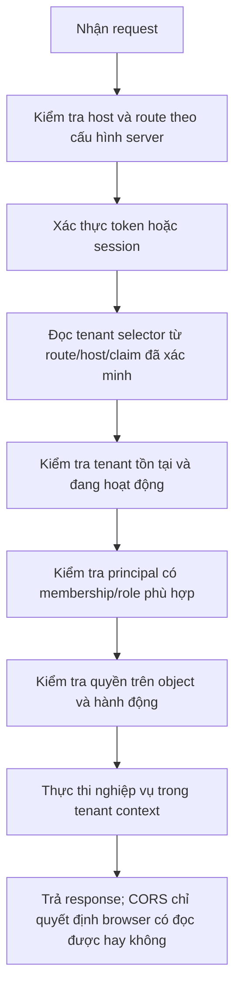

# Không cho client quyết định tenant bằng CORS

Trong ứng dụng multi-tenant, một API thường phục vụ nhiều tổ chức trên cùng hệ thống. Mỗi tenant có thể có dữ liệu, người dùng, cấu hình và domain frontend riêng. CORS (Cross-Origin Resource Sharing) thường được cấu hình để chỉ cho phép frontend của tenant gọi API từ trình duyệt. Tuy nhiên, **CORS không xác thực người dùng và không quyết định người dùng thuộc tenant nào**.

`Origin` cho biết trang web nào khởi tạo request trong ngữ cảnh trình duyệt. Trình duyệt dùng CORS để quyết định JavaScript có được đọc response cross-origin hay không. `Origin` không phải credential, không chứng minh quyền sở hữu tenant và không đáng tin như một nguồn authorization. Một client ngoài trình duyệt có thể tự đặt header `Origin`; một request có thể được gửi tới server dù trình duyệt sau đó không cho JavaScript đọc response.

Vì vậy, không dùng CORS allowlist, `Origin` hoặc một giá trị tenant suy ra từ `Origin` làm cơ chế phân quyền. Tenant phải được xác định theo một quy tắc server-side có kiểm soát, sau đó server xác thực principal và kiểm tra membership, role, object scope cùng quyền nghiệp vụ trong tenant đó.

## 1. CORS giải quyết vấn đề gì?

Origin của một trang web được xác định bởi bộ ba scheme, host và port. Ví dụ:

```text
https://app.example.com
https://tenant-a.example.com
http://localhost:3000
```

Ba origin trên khác nhau. Một trang ở `https://app.example.com` gọi API tại `https://api.example.com` là request cross-origin dù hai host cùng thuộc một domain gốc.

Same-Origin Policy của trình duyệt hạn chế JavaScript đọc response từ origin khác. CORS là cơ chế server công bố origin nào được phép đọc response và trong điều kiện nào. Ví dụ response:

```http
HTTP/1.1 200 OK
Access-Control-Allow-Origin: https://app.example.com
Vary: Origin
Content-Type: application/json

{"items": []}
```

Trình duyệt kiểm tra `Access-Control-Allow-Origin` để quyết định có cho script ở origin yêu cầu đọc response hay không. CORS không phải firewall cho API và không phải bước xác minh danh tính người gọi.

## 2. CORS không phải authentication hoặc authorization

Ba cơ chế trả lời các câu hỏi khác nhau:

| Cơ chế | Câu hỏi | Ví dụ |
|---|---|---|
| CORS | JavaScript từ origin nào được trình duyệt cho phép đọc response? | `https://app.tenant-a.example` được phép đọc response API |
| Authentication | Ai đang gọi API? | Access token xác định user `user-42` |
| Tenant authorization | User có quyền truy cập tenant nào và dữ liệu nào? | `user-42` là member của `tenant-a`, được phép đọc order thuộc tenant đó |

Một origin nằm trong CORS allowlist chỉ có nghĩa trình duyệt được phép đọc response theo policy CORS. Nó không có nghĩa mọi người dùng từ origin đó đều được truy cập mọi tenant. Ngược lại, một request không được CORS cho phép vẫn có thể được gửi tới server bởi curl, backend service, ứng dụng di động hoặc một số loại request từ trình duyệt.

Nếu server dựa vào CORS để cho phép thao tác nhạy cảm, client ngoài trình duyệt có thể bỏ qua hoàn toàn giới hạn đó. API vẫn phải yêu cầu authentication và authorization cho từng endpoint.

## 3. Vì sao không được lấy tenant từ `Origin`?

Một cách triển khai sai thường có dạng:

```java
// Không an toàn: Origin không phải bằng chứng tenant membership.
String origin = request.getHeader("Origin");
Tenant tenant = tenantRepository.findByFrontendOrigin(origin)
    .orElseThrow(AccessDeniedException::new);

return orderService.listOrders(tenant.getId());
```

Đoạn code trên coi `Origin` là căn cứ chọn tenant. Điều này có nhiều vấn đề:

- Client không phải trình duyệt có thể tự gửi `Origin: https://tenant-a.example.com`.
- Một người dùng hợp lệ của tenant A có thể thử đổi `Origin` thành tenant B.
- `Origin` có thể vắng mặt ở request không phải browser hoặc ở một số luồng cùng origin.
- Giá trị `null` có thể xuất hiện với opaque origin như sandboxed document hoặc một số scheme đặc biệt.
- Domain frontend có thể dùng chung cho nhiều tenant; origin không xác định được user membership.
- Một tenant có thể có nhiều frontend origin, custom domain hoặc ứng dụng đối tác.

Ngay cả khi trình duyệt chuẩn tự quản lý `Origin` và JavaScript không thể tùy ý sửa header này, server không thể giả định mọi caller đều là trình duyệt chuẩn. Header là dữ liệu request, không phải credential có chữ ký.

`Origin` có thể được dùng để áp dụng CORS policy hoặc làm một tín hiệu phụ trong kiểm soát luồng browser. Không dùng nó làm nguồn duy nhất để chọn tenant, cấp role, bỏ qua token hay quyết định quyền trên object.

## 4. Không đồng nhất CORS allowlist với danh sách tenant

Hai tập dữ liệu có thể liên quan nhưng có ý nghĩa khác nhau:

| Dữ liệu | Mục đích | Có cấp quyền truy cập dữ liệu không? |
|---|---|---|
| Tenant registry | Quản lý tenant, trạng thái, domain và cấu hình | Không tự cấp quyền cho user |
| Tenant membership | Xác định user/service thuộc tenant và vai trò nào | Là đầu vào của authorization |
| CORS origin allowlist | Xác định browser origin được đọc response | Không |
| Custom domain mapping | Ánh xạ hostname đã xác minh tới tenant hoặc frontend | Không tự chứng minh caller có quyền |
| OAuth client registration | Nhận diện ứng dụng/client và redirect/origin được đăng ký | Không tự cấp quyền trên mọi tenant |

Ví dụ, `https://portal.customer-a.com` có thể là frontend origin được phép đọc response của API tenant A. Điều đó không có nghĩa bất kỳ ai mở trang web này đều được đọc dữ liệu tenant A. Người dùng vẫn phải đăng nhập và được kiểm tra membership. Nếu user thuộc tenant B nhưng gọi route tenant A, server phải từ chối dù browser origin được CORS cho phép.

Không tái sử dụng một bảng `allowed_origins` như bảng authorization. Cấu hình CORS có thể tham chiếu metadata domain của tenant, nhưng quyết định membership và quyền phải đến từ policy riêng.

## 5. Quy trình xác định tenant an toàn

Tenant context cần được xác định bằng một quy tắc rõ ràng và có thể xác minh. Các cách thường gặp:

- Tenant nằm trong path, ví dụ `/tenants/{tenantId}/orders`.
- Tenant nằm trong subdomain/hostname đã được xác minh, ví dụ `tenant-a.api.example.com`.
- Tenant được chọn trong request body/header như một selector, nhưng server phải kiểm tra user có membership hợp lệ.
- Tenant được gắn trong token/claim do authorization server phát hành và resource server đã xác minh.
- Tenant được suy ra từ resource đã tra cứu trong phạm vi user có quyền, thay vì tin ID do client gửi.

Không có cách nào tự động an toàn chỉ vì tenant được đặt ở path, host hay claim. Điểm quan trọng là server xác minh nguồn gốc và quyền đối với tenant đó.

### Luồng xử lý đề xuất



Thứ tự chi tiết có thể khác theo kiến trúc, nhưng CORS không được thay thế bước authentication hoặc authorization. Với preflight `OPTIONS`, server có thể xử lý CORS trước khi yêu cầu user token; request nghiệp vụ thực tế vẫn phải qua các bước xác thực và phân quyền.

## 6. Tenant trong path: selector không phải quyền

Ví dụ:

```http
GET /api/v1/tenants/tenant-a/orders
Authorization: Bearer <access-token>
Origin: https://portal.customer-a.com
```

`tenant-a` trong path là tenant selector. Server phải xác minh token, sau đó kiểm tra user có membership và quyền đọc order của tenant A hay không. Không được coi việc caller biết hoặc đoán được tenant ID là bằng chứng quyền truy cập.

Ví dụ pseudocode:

```java
public Page<OrderResponse> listOrders(
        UUID tenantId,
        AuthenticatedPrincipal principal,
        Pageable pageable) {

    tenantAccessPolicy.requireActiveTenant(tenantId);
    tenantAccessPolicy.requireMembership(principal.userId(), tenantId);
    tenantAccessPolicy.requireAuthority(principal, tenantId, "orders:read");

    return orderRepository.findByTenantId(tenantId, pageable)
        .map(orderMapper::toResponse);
}
```

Repository cần luôn lọc theo tenant context đã được kiểm tra. Không tải order theo ID toàn cục rồi chỉ kiểm tra tenant ở giao diện. Với thao tác trên một object, query có thể kết hợp cả `orderId` và `tenantId` để giảm nguy cơ IDOR/cross-tenant access.

## 7. Tenant trong subdomain hoặc custom domain

Một số sản phẩm dùng `tenant-a.api.example.com` hoặc custom domain của khách hàng để định tuyến tenant. Server có thể ánh xạ hostname tới tenant, nhưng phải xác minh hostname là domain đã được tenant đăng ký và chứng minh quyền sở hữu theo quy trình quản lý domain.

Một quy trình phù hợp có thể gồm:

1. Chuẩn hóa hostname theo quy tắc DNS/URI; xử lý chữ thường, port và dấu chấm cuối một cách nhất quán.
2. Kiểm tra host nằm trong danh sách domain do hệ thống quản lý hoặc mapping đã được xác minh.
3. Nếu là custom domain, yêu cầu tenant chứng minh quyền sở hữu trước khi kích hoạt mapping.
4. Chỉ chấp nhận host được cấu hình cho environment và trạng thái tenant hiện tại.
5. Xác thực user/client như bình thường.
6. Kiểm tra membership và quyền của principal trong tenant được ánh xạ.

Không lấy `Host` hoặc `X-Forwarded-Host` tùy ý làm tenant context. Khi có reverse proxy, forwarded host chỉ được tin từ proxy đã xác minh và phải được kiểm tra với domain registry. Chống Host Header Injection và đảm bảo backend không thể bị gọi trực tiếp để giả mạo forwarded host.

Custom domain mapping giúp định tuyến và chọn CORS policy phù hợp; nó không biến domain thành credential của người dùng.

## 8. Tenant claim trong access token

Một số hệ thống phát hành token chứa tenant claim. Ví dụ:

```json
{
  "iss": "https://identity.example.com",
  "sub": "user-42",
  "aud": ["orders-api"],
  "tenant_id": "tenant-a",
  "scope": "orders:read",
  "exp": 1795008000
}
```

Resource server chỉ được dùng claim sau khi xác minh chữ ký, issuer, audience, expiry và các điều kiện token profile. Claim tenant phải được phát hành bởi authorization server dựa trên membership đã xác minh; không nhận một JWT do client tự tạo hoặc chỉ decode payload mà không xác minh chữ ký.

Nếu user có thể làm việc trong nhiều tenant, token có thể đại diện cho tenant đang được chọn tại thời điểm phát hành. Khi request chỉ được phép truy cập tenant trong claim, server phải so sánh tenant selector với claim theo policy. Nếu token không có tenant claim, server có thể kiểm tra membership server-side. Không cho client tự thay claim bằng header `X-Tenant-Id` rồi tin giá trị đó.

Token claim có thể cũ nếu membership hoặc role bị thu hồi. Với quyền nhạy cảm, cần cân nhắc token lifetime, introspection, authorization lookup hoặc cơ chế cập nhật quyền có hiệu lực nhanh.

## 9. Header `X-Tenant-ID` chỉ là selector

Một số API dùng header:

```http
X-Tenant-ID: tenant-a
```

Header này có thể thuận tiện khi client chọn tenant hiện hành, nhưng giá trị vẫn do caller cung cấp. Server phải xác thực principal và kiểm tra membership trước khi tạo tenant context.

Không làm như sau:

```java
// Không an toàn: header được dùng như bằng chứng quyền.
UUID tenantId = UUID.fromString(request.getHeader("X-Tenant-ID"));
return orderRepository.findByTenantId(tenantId);
```

Hãy xử lý như một selector:

```java
UUID requestedTenant = tenantHeaderParser.requireValid(request);
AuthenticatedPrincipal principal = authentication.requirePrincipal();

TenantContext tenant = tenantResolver.resolveActiveTenant(requestedTenant);
membershipPolicy.requireMember(principal.subject(), tenant.id());
authorizationPolicy.require(principal, tenant, "orders:read");

return orderService.listOrders(tenant, principal);
```

`TenantContext` chỉ được tạo sau khi xác minh. Có thể dùng một immutable request-scoped context để các service phía sau nhận tenant đã được xác thực, nhưng không cho controller hoặc code tùy ý tự gán context từ header.

## 10. CORS policy theo tenant vẫn chỉ là browser policy

Trong hệ thống có custom frontend domain, server có thể tra cứu origin được phép theo tenant để tạo response CORS. Ví dụ:

```text
Tenant A:
  https://portal.customer-a.com
  https://admin.customer-a.com

Tenant B:
  https://app.customer-b.net
```

Khi request có `Origin`, CORS layer kiểm tra exact origin có nằm trong danh sách phù hợp hay không. Nếu được phép, server trả `Access-Control-Allow-Origin` bằng origin cụ thể đó và thêm `Vary: Origin` khi response thay đổi theo Origin.

Tuy nhiên, kết quả CORS không được truyền thành quyền tenant. Request từ `https://portal.customer-a.com` vẫn cần token hợp lệ và membership trong tenant A nếu thao tác nhắm tới tenant A. Nếu user thuộc tenant B, CORS không làm user trở thành member tenant A.

Nếu origin được ánh xạ tới tenant, mapping chỉ nên dùng để xác định CORS response hoặc kiểm tra tính nhất quán của frontend context. Authorization vẫn phải kiểm tra principal, tenant và object độc lập.

## 11. Credentialed CORS và cookie session

Nếu frontend dùng cookie/session cross-origin, response thường cần:

```http
Access-Control-Allow-Origin: https://portal.customer-a.com
Access-Control-Allow-Credentials: true
Vary: Origin
```

Khi cho phép credentials, không dùng `Access-Control-Allow-Origin: *`. Server phải trả một origin cụ thể đã được kiểm tra. Browser cũng có các quy tắc cookie như `SameSite`, `Secure` và domain/path; CORS không tự làm cookie được gửi hoặc an toàn.

Credentialed CORS làm tăng tầm quan trọng của CSRF protection vì browser có thể tự đính kèm cookie theo quy tắc của nó. CORS không phải CSRF defense đầy đủ. Cần dùng `SameSite` phù hợp, CSRF token hoặc custom request header theo mô hình ứng dụng, kiểm tra Origin/Referer như lớp bổ sung và không thực hiện thao tác thay đổi trạng thái qua GET.

Đặc biệt, một request simple hoặc form submission có thể được gửi dù JavaScript không đọc được response. Vì vậy, không dựa vào việc CORS chặn response để ngăn thao tác trái phép.

## 12. Preflight không phải kiểm tra quyền

Trình duyệt gửi preflight `OPTIONS` khi request cross-origin cần kiểm tra method/header theo CORS. Ví dụ:

```http
OPTIONS /api/v1/tenants/tenant-a/orders HTTP/1.1
Origin: https://portal.customer-a.com
Access-Control-Request-Method: POST
Access-Control-Request-Headers: authorization, content-type, x-tenant-id
```

Server trả các header CORS phù hợp:

```http
HTTP/1.1 204 No Content
Access-Control-Allow-Origin: https://portal.customer-a.com
Access-Control-Allow-Methods: GET, POST
Access-Control-Allow-Headers: Authorization, Content-Type, X-Tenant-ID
Access-Control-Max-Age: 600
Vary: Origin, Access-Control-Request-Method, Access-Control-Request-Headers
```

Preflight chỉ xác nhận browser có thể gửi request theo quy tắc CORS. Nó không xác thực token, không xác minh user membership và không chứng minh caller có quyền `orders:create`. Một số preflight không mang cookie hoặc bearer credential của request thực tế; không nên bắt preflight đi qua cùng logic authorization nghiệp vụ như request POST.

Request `POST` sau preflight phải tự xác thực và phân quyền. Client ngoài trình duyệt có thể bỏ qua preflight hoàn toàn.

## 13. Không phản chiếu Origin tùy ý

Một cấu hình nguy hiểm là:

```java
response.setHeader("Access-Control-Allow-Origin", request.getHeader("Origin"));
response.setHeader("Access-Control-Allow-Credentials", "true");
```

Đoạn code trên phản chiếu mọi origin mà caller gửi. Nếu browser gửi cookie, một website độc hại có thể được phép đọc response chứa dữ liệu của người dùng đang đăng nhập.

Hãy so sánh exact origin với allowlist đã được quản lý. Không dùng kiểm tra chuỗi đơn giản như `endsWith("example.com")` vì có thể chấp nhận `evil-example.com` hoặc hostname có cấu trúc đánh lừa. Parse origin thành scheme/host/port, chuẩn hóa và so khớp chính xác theo policy.

Không cho phép wildcard rộng, `null` origin hoặc mọi subdomain chỉ để giảm công việc vận hành. Nếu cần wildcard subdomain, phải có quy tắc domain boundary chính xác, kiểm soát việc cấp subdomain và đánh giá nguy cơ subdomain takeover. Chỉ cho phép các scheme/port cần thiết.

## 14. CORS và CSRF trong ứng dụng multi-tenant

CORS và CSRF liên quan tới browser nhưng xử lý rủi ro khác nhau:

| Cơ chế | Mục tiêu | Không bảo vệ khỏi |
|---|---|---|
| CORS | Giới hạn JavaScript browser đọc response cross-origin | Client server-side giả mạo header; mọi thao tác CSRF |
| CSRF token | Chứng minh request thay đổi trạng thái có token chống giả mạo gắn với phiên | User bị XSS hoặc credential bị đánh cắp |
| SameSite cookie | Giới hạn một số trường hợp cookie được gửi cross-site | Mọi kiểu cross-site hoặc same-site request |
| Authentication | Xác định principal | Principal không có quyền trên tenant/object |
| Tenant authorization | Giới hạn principal trong tenant và tài nguyên được cấp | XSS trong origin đã được tin cậy nếu attacker hành động bằng phiên user |

Nếu dùng cookie authentication, hãy đánh giá CSRF cho mọi endpoint thay đổi trạng thái. `Origin` check có thể là một tín hiệu bổ sung, nhưng không nên là cơ chế duy nhất nếu request có thể đến từ client không phải browser hoặc header bị bỏ qua trong một luồng hợp lệ.

Với bearer token lưu trong JavaScript và gửi qua `Authorization`, CSRF truyền thống có thể ít phù hợp hơn vì browser không tự động gắn header đó vào mọi request; tuy vậy XSS và token theft vẫn là rủi ro. Không dùng CORS để thay thế bảo vệ token hoặc XSS.

## 15. Ví dụ cấu hình Spring Security CORS

Ví dụ cấu hình allowlist exact origin:

```java
@Bean
CorsConfigurationSource corsConfigurationSource() {
    CorsConfiguration config = new CorsConfiguration();
    config.setAllowedOrigins(List.of(
        "https://portal.customer-a.com",
        "https://app.customer-b.net"
    ));
    config.setAllowedMethods(List.of("GET", "POST", "PATCH", "DELETE"));
    config.setAllowedHeaders(List.of(
        "Authorization", "Content-Type", "X-Tenant-ID", "X-CSRF-TOKEN"
    ));
    config.setExposedHeaders(List.of("ETag", "X-Request-Id"));
    config.setAllowCredentials(true);
    config.setMaxAge(Duration.ofMinutes(10));

    UrlBasedCorsConfigurationSource source =
        new UrlBasedCorsConfigurationSource();
    source.registerCorsConfiguration("/api/**", config);
    return source;
}

@Bean
SecurityFilterChain securityFilterChain(HttpSecurity http) throws Exception {
    return http
        .cors(Customizer.withDefaults())
        .authorizeHttpRequests(auth -> auth
            .requestMatchers(HttpMethod.OPTIONS, "/api/**").permitAll()
            .anyRequest().authenticated())
        .build();
}
```

Đây là ví dụ cơ bản, cần dependency và import Spring Security phù hợp. CORS phải được xử lý trước các bước authentication có thể chặn preflight. `OPTIONS permitAll` không có nghĩa mọi thao tác API được phép; nó chỉ tránh yêu cầu user authentication cho preflight. Request nghiệp vụ vẫn cần authorization ở service.

Trong production multi-tenant, danh sách origin có thể được tải từ cấu hình đã xác minh hoặc domain registry. Nếu dùng `CorsConfigurationSource` động, cần cache có TTL/invalidation, giới hạn số origin và không phản chiếu origin chưa được kiểm tra. Không truy vấn một mapping tùy ý từ `Origin` rồi dùng kết quả đó làm tenant authorization.

## 16. Ví dụ tenant authorization độc lập với CORS

Một service có thể tách các bước:

```java
@GetMapping("/api/v1/tenants/{tenantId}/orders")
public Page<OrderResponse> getOrders(
        @PathVariable UUID tenantId,
        @AuthenticationPrincipal Jwt jwt,
        Pageable pageable) {

    UUID userId = UUID.fromString(jwt.getSubject());
    Tenant tenant = tenantService.requireActive(tenantId);

    membershipService.requireMember(userId, tenant.getId());
    permissionService.require(userId, tenant.getId(), "orders:read");

    return orderService.findByTenant(tenant.getId(), pageable);
}
```

Trong ví dụ này:

- CORS layer quyết định origin browser có được đọc response hay không.
- Spring Security xác thực JWT và tạo principal.
- Tenant service xác minh tenant tồn tại và active.
- Membership/permission service xác minh user có quyền trong tenant.
- Repository chỉ truy vấn dữ liệu trong tenant đã được kiểm tra.

Trong code thực tế, có thể dùng method security, policy engine hoặc tenant context immutable. Dù chọn cách nào, không lấy `tenantId` từ `Origin` và không bỏ qua membership chỉ vì request đến từ frontend domain đã allowlist.

## 17. Xử lý nhiều frontend origin cho một tenant

Một tenant có thể có nhiều frontend:

- Portal chính và trang quản trị.
- Ứng dụng staging/preview.
- Domain cũ trong thời gian migration.
- Ứng dụng đối tác được tích hợp.

Không nên cho phép toàn bộ `*.customer-a.com` nếu tenant có thể tự tạo subdomain hoặc một subdomain có thể bị takeover. Lưu exact origin gồm scheme, host và port; xác minh domain ownership; có trạng thái active/revoked và ngày hết hạn cho domain tạm thời.

Origin staging không nên tự động được phép gọi API production. Tách allowlist theo environment. Khi domain bị gỡ, xóa mapping CORS và cache liên quan; đồng thời kiểm tra custom host mapping và certificate để tránh domain cũ vẫn được phục vụ.

Một origin được phép cho tenant A không nên tự động được dùng cho tenant B chỉ vì cùng tổ chức. Nhưng ngay cả origin được gắn tenant A cũng không cấp membership cho user trong tenant A.

## 18. Caching CORS response đúng cách

Nếu `Access-Control-Allow-Origin` thay đổi theo request `Origin`, response cần có `Vary: Origin` để cache trung gian không dùng response của origin này cho origin khác.

Với preflight, response có thể phụ thuộc vào:

- `Origin`
- `Access-Control-Request-Method`
- `Access-Control-Request-Headers`

Do đó, cần `Vary` tương ứng nếu response được cache. `Access-Control-Max-Age` cho phép browser cache kết quả preflight trong thời gian nhất định; khi policy thay đổi, thời gian cache dài có thể làm browser tiếp tục dùng quyết định cũ tới khi hết hạn.

Đối với response chứa dữ liệu tenant/user, cache policy phải được thiết kế độc lập với CORS. `Vary: Origin` không phân vùng dữ liệu theo user hoặc tenant. Cần cache key phù hợp hoặc `Cache-Control: private/no-store` theo độ nhạy cảm. Không để CDN cache response có credentials hoặc dữ liệu riêng tư dùng chung cho nhiều principal.

## 19. Những lỗi triển khai thường gặp

| Cấu hình/lỗi | Rủi ro | Cách sửa |
|---|---|---|
| Dùng `Origin` để chọn tenant | Caller giả mạo tenant bằng header | Dùng tenant selector có kiểm tra membership server-side |
| Origin allowlist được coi là authorization | Bất kỳ user nào từ origin hợp lệ có thể bị cấp quyền quá rộng | Authentication và tenant/object authorization độc lập |
| Phản chiếu mọi Origin | Website độc hại có thể đọc response credentialed | Exact allowlist và không phản chiếu tùy ý |
| `Access-Control-Allow-Origin: *` cùng credentials | Cấu hình không hợp lệ theo browser và thể hiện policy quá rộng | Trả origin cụ thể đã kiểm tra |
| Chỉ kiểm tra preflight | Client ngoài browser bỏ qua preflight | Kiểm tra request thực tế ở server |
| Bỏ CSRF vì đã cấu hình CORS | Cookie tự động được gửi trong một số request cross-site | CSRF token, SameSite và kiểm soát request thay đổi trạng thái |
| Tin `X-Tenant-ID` không kiểm tra | Cross-tenant data access | Xác thực principal và membership/permission |
| Tin `X-Forwarded-Host` từ mọi peer | Host spoofing và tenant mapping sai | Chỉ tin proxy được xác minh, kiểm tra domain registry |
| Dùng wildcard subdomain rộng | Subdomain takeover hoặc origin ngoài ý muốn | Exact origin, ownership verification và lifecycle |
| Cache không có `Vary: Origin` | CORS response bị dùng sai origin | Thêm Vary và kiểm tra cache key |

## 20. Kiểm thử CORS và tenant authorization

Test cần phân biệt hành vi của browser với hành vi của API server. CORS được thực thi bởi browser; gọi API bằng curl không mô phỏng quyết định browser có cho JavaScript đọc response hay không.

| Nhóm test | Tình huống | Kết quả mong đợi |
|---|---|---|
| Allowed origin | Browser từ origin trong allowlist gọi API | CORS headers đúng; request vẫn qua authz |
| Disallowed origin | Browser từ origin ngoài allowlist | Browser không được đọc response; server vẫn xử lý auth/authz theo policy |
| Forged Origin | curl gửi `Origin` của tenant A nhưng token không thuộc tenant A | Không được truy cập tenant A |
| Missing Origin | Client server-side không gửi Origin | Authorization vẫn hoạt động bình thường |
| Tenant path tampering | User tenant A đổi path sang tenant B | Bị từ chối nếu không có membership/quyền |
| Tenant header tampering | Đổi `X-Tenant-ID` sang tenant khác | Bị từ chối; không đọc dữ liệu chéo tenant |
| Host tampering | Gửi Host/X-Forwarded-Host không được đăng ký | Host bị từ chối hoặc không tạo tenant context |
| Token claim | Token sai issuer/audience/expiry hoặc tenant claim không khớp | Authentication/authorization từ chối |
| Preflight | OPTIONS với method/header được hoặc không được phép | CORS response đúng; không cấp quyền nghiệp vụ |
| Credentialed CORS | Cookie session và exact allowed origin | Credentials chỉ được browser xử lý theo policy; CSRF vẫn được kiểm tra |
| CSRF | Cross-site request thay đổi trạng thái bằng cookie | Bị chặn bởi CSRF control phù hợp |
| Cache | Hai origin/tenant nhận response khác nhau | Không dùng nhầm CORS/data response từ cache |
| Object scope | User cùng tenant nhưng không có quyền trên order cụ thể | Bị từ chối theo object authorization |

Ví dụ test server-side với MockMvc có thể gửi `Origin` giả để chứng minh nó không thay đổi tenant authorization:

```java
mockMvc.perform(get("/api/v1/tenants/{tenantId}/orders", tenantB)
        .header("Origin", "https://portal.tenant-a.example")
        .with(jwt().jwt(jwt -> jwt.subject(userA.toString()))))
    .andExpect(status().isForbidden());
```

Test trên xác minh server không dùng Origin làm bằng chứng membership. Ngoài ra cần browser integration test để xác nhận CORS headers thực sự được browser thực thi. Một test MockMvc đơn lẻ không mô phỏng Same-Origin Policy.

## 21. Checklist thiết kế multi-tenant không dựa vào CORS

- [ ] CORS chỉ được dùng để kiểm soát browser đọc response cross-origin.
- [ ] `Origin` không được dùng làm credential, user identity hoặc bằng chứng tenant membership.
- [ ] CORS allowlist được quản lý riêng với tenant membership và authorization policy.
- [ ] Tenant selector từ path, host, header hoặc token được xác minh server-side.
- [ ] Host/custom domain được xác minh ownership và chỉ tin forwarded host từ proxy đáng tin.
- [ ] Access token được xác minh chữ ký, issuer, audience, expiry và claim theo profile.
- [ ] User/service principal có membership và permission phù hợp trong tenant.
- [ ] Query và object access luôn được ràng buộc tenant; có kiểm tra object-level.
- [ ] Preflight không bị coi là authentication hoặc authorization.
- [ ] Request thực tế luôn kiểm tra auth và quyền dù CORS đã cho phép origin.
- [ ] Credentialed CORS dùng exact origin; không dùng wildcard với credentials.
- [ ] Cookie authentication có CSRF protection, SameSite và Secure phù hợp.
- [ ] Không phản chiếu Origin tùy ý hoặc dùng wildcard subdomain không kiểm soát.
- [ ] Dynamic CORS mapping có cache invalidation, environment separation và audit.
- [ ] Cache response có `Vary: Origin` khi cần; dữ liệu tenant được cache theo principal/tenant hoặc không cache.
- [ ] Test bao gồm forged Origin, missing Origin, tenant tampering, custom host và browser CORS behavior.

## Kết luận

CORS là chính sách của trình duyệt về việc JavaScript từ origin nào được đọc response. Nó không chứng minh ai đang gọi API và không cấp quyền vào tenant. Hãy xem tenant trong path, host, header hoặc token là selector/context cần xác minh; xác thực principal, kiểm tra membership và permission, rồi ràng buộc mọi truy vấn vào tenant cùng object scope. CORS allowlist có thể tham chiếu domain của tenant để tạo response browser phù hợp, nhưng phải tách biệt với authorization. Khi kết hợp CORS đúng cách với authentication, tenant authorization, object-level checks và CSRF protection, API multi-tenant không bị phụ thuộc vào một header mà caller có thể tự tạo.
