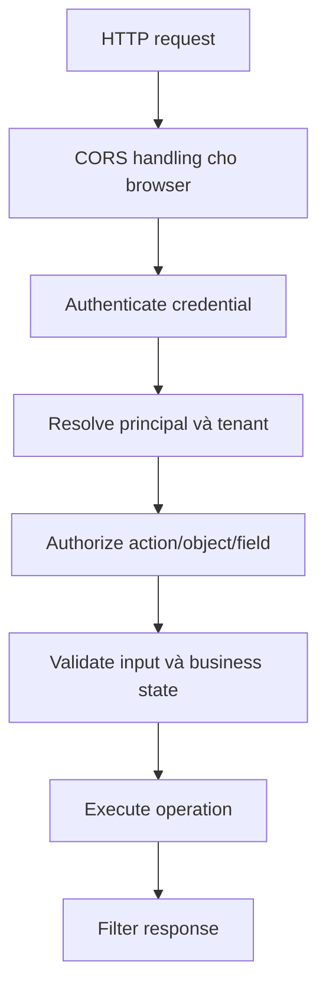

# Credential policy và access policy là hai lớp khác nhau

Một ứng dụng web gọi API từ `https://app.example.com` tới `https://api.example.com`. Trình duyệt có thể gửi cookie hoặc access token, nhưng việc gửi credential và việc API cho phép đọc/sửa dữ liệu là hai quyết định khác nhau. CORS quyết định JavaScript ở một origin có được phép đọc response cross-origin hay không. Authentication xác định caller là ai; authorization quyết định caller được phép thực hiện action nào trên resource nào.

Nếu cấu hình `Access-Control-Allow-Credentials: true` rồi cho rằng API đã an toàn, hệ thống có thể vẫn cho user đọc dữ liệu của tenant khác. Nếu chỉ chặn origin lạ bằng CORS rồi coi đó là authorization, một script chạy ngoài trình duyệt hoặc một request trực tiếp có thể bỏ qua hoàn toàn kiểm soát này. Ngược lại, nếu API authorization đúng nhưng CORS cấu hình sai, trình duyệt có thể không cho frontend hợp lệ đọc response hoặc có thể chia sẻ response riêng tư cho một website không được phép.

**Credential policy kiểm soát trình duyệt có gửi credential trong request hay không và server có cho phép response được chia sẻ trong ngữ cảnh credentialed hay không. Access policy kiểm tra danh tính, quyền và phạm vi dữ liệu ở server. CORS không cấp quyền truy cập dữ liệu và không thay thế authentication, authorization hoặc CSRF protection.**

## 1. Phân biệt credential policy, CORS và access policy

Các khái niệm này nằm ở những lớp khác nhau:

| Lớp | Câu hỏi | Cơ chế điển hình |
|---|---|---|
| Browser credential policy | Trình duyệt có gửi cookie, HTTP authentication hoặc client certificate theo request mode không? | Fetch `credentials`, cookie policy, SameSite |
| CORS policy | JavaScript ở origin nào được phép đọc response cross-origin? | `Access-Control-Allow-Origin`, `Access-Control-Allow-Credentials`, preflight headers |
| Authentication | Credential có hợp lệ và đại diện cho principal nào? | Session cookie, bearer access token, mTLS, API key theo thiết kế |
| Authorization | Principal có được thực hiện action trên object/tenant/field cụ thể không? | RBAC, ABAC, ReBAC, policy engine, business rules |
| CSRF protection | Request bị trình duyệt tự động gửi có thể bị website khác lợi dụng để thực hiện action không? | CSRF token, SameSite, Origin/Referer validation, custom request controls |

Ví dụ, `Access-Control-Allow-Credentials: true` không có nghĩa “mọi user có cookie đều được đọc mọi account”. Header này chỉ tham gia vào quyết định CORS của trình duyệt đối với response credentialed. API vẫn phải xác minh session và kiểm tra user có quyền trên account được yêu cầu hay không.

### 1.1. CORS là cơ chế của trình duyệt

Cross-Origin Resource Sharing (CORS) là cơ chế để server khai báo origin nào được browser cho phép chia sẻ response với script. Nó mở rộng cách browser áp dụng Same-Origin Policy cho một số request cross-origin.

CORS chủ yếu điều khiển khả năng JavaScript đọc response. Nó không phải firewall cho API và không ngăn mọi request cross-origin được gửi đi. Các công cụ như `curl`, Postman, mobile app hoặc server-to-server client không bị browser CORS enforcement ràng buộc.

### 1.2. Credential không đồng nghĩa với quyền

Cookie session hợp lệ chứng minh browser đang mang một credential gắn với session. Bearer token hợp lệ chứng minh token được issuer tin cậy cấp cho một principal/client theo claims đã xác minh. Cả hai chỉ giúp authentication; chúng không tự quyết định principal có được đọc invoice `inv-100` hoặc gọi `payment:refund` hay không.

Một user đã đăng nhập vẫn có thể bị từ chối vì:

- Không có permission cho action.
- Object thuộc user hoặc tenant khác.
- Field nhạy cảm không nằm trong quyền đọc.
- Giao dịch vượt hạn mức hoặc trạng thái nghiệp vụ không hợp lệ.
- Session/token đã bị thu hồi, hết hạn hoặc không đạt mức xác thực cần thiết.

## 2. Browser gửi credential như thế nào?

Trong Fetch API, thuộc tính `credentials` điều khiển việc browser gửi credential và cách xử lý `Set-Cookie` từ response. Các giá trị phổ biến:

| Giá trị | Hành vi khái quát |
|---|---|
| `omit` | Không gửi credential và không xử lý credential từ response theo chế độ thông thường của Fetch |
| `same-origin` | Gửi credential cho request same-origin; đây là giá trị mặc định của Fetch |
| `include` | Cho phép gửi credential cả trong request cross-origin, nếu các chính sách cookie/trình duyệt khác cho phép |

Ví dụ:

```javascript
// Không gửi cookie cross-origin theo credentials mode.
fetch("https://api.example.com/profile", {
  credentials: "omit"
});

// Yêu cầu browser gửi cookie phù hợp cho request cross-origin.
fetch("https://api.example.com/profile", {
  credentials: "include"
});
```

`credentials: "include"` là yêu cầu của ứng dụng, không phải lệnh buộc browser bỏ qua cookie policy. Cookie vẫn chịu các thuộc tính `SameSite`, `Secure`, domain/path, expiry và chính sách chặn third-party cookies của browser.

### 2.1. Cookie và SameSite

Cookie session có thể được gửi tự động bởi browser khi điều kiện domain/path và SameSite phù hợp. Ba giá trị SameSite thường gặp:

- `Strict`: hạn chế gửi cookie trong các ngữ cảnh cross-site.
- `Lax`: cho phép một số điều hướng top-level an toàn, nhưng hạn chế nhiều request cross-site khác.
- `None`: cho phép cookie trong ngữ cảnh cross-site; cookie phải có `Secure` theo yêu cầu của browser hiện đại.

Ví dụ cookie session:

```http
Set-Cookie: __Host-session=opaque-value; Path=/; Secure; HttpOnly; SameSite=Lax
```

Cookie `HttpOnly` không thể được JavaScript đọc trực tiếp, nhưng browser vẫn có thể tự gửi cookie phù hợp. `HttpOnly` giảm khả năng lấy cookie qua JavaScript trong một số tình huống XSS; nó không ngăn CSRF và không thay thế authorization.

Nếu frontend và API thực sự cross-site và cần cookie cross-site, có thể phải dùng `SameSite=None; Secure`, nhưng điều này làm tăng yêu cầu bảo vệ CSRF và vẫn chịu third-party cookie restrictions. “Cross-origin” và “cross-site” là hai khái niệm khác nhau: hai subdomain khác nhau có thể cross-origin nhưng cùng site theo quy tắc schemeful site.

### 2.2. Authorization header và bearer token

Ứng dụng có thể gửi bearer access token trong header:

```http
GET /api/orders HTTP/1.1
Host: api.example.com
Authorization: Bearer <access-token>
```

Header `Authorization` do JavaScript thêm thường khiến request cross-origin cần preflight vì đây không phải CORS-safelisted request header. CORS phải cho phép header này trong `Access-Control-Allow-Headers` nếu frontend được phép gửi.

Bearer token không tự động được browser gửi như cookie. JavaScript hoặc networking layer của ứng dụng phải gắn token vào request. Tuy nhiên, nếu token bị lưu ở nơi JavaScript có thể đọc và trang bị XSS, attacker có thể lấy token; CORS không ngăn được mã độc đã chạy trong origin hợp lệ.

### 2.3. Client certificate và HTTP authentication

Browser có thể tham gia TLS client authentication hoặc dùng HTTP authentication theo cấu hình. Đây cũng là credential, nhưng không nên suy ra quyền nghiệp vụ từ việc handshake hoặc credential được chấp nhận. Server vẫn phải map credential thành principal và kiểm tra access policy.

## 3. CORS kiểm soát việc chia sẻ response

Một origin được xác định bởi scheme, host và port. Ví dụ:

```text
https://app.example.com
https://api.example.com
http://app.example.com
https://app.example.com:8443
```

Các URL trên không nhất thiết cùng origin. CORS response headers cho browser biết origin nào được phép đọc response. Header quan trọng:

| Header | Vai trò |
|---|---|
| `Access-Control-Allow-Origin` | Origin được phép đọc response, hoặc `*` cho response không credentialed theo semantics CORS |
| `Access-Control-Allow-Credentials` | Cho phép chia sẻ response trong credentialed CORS khi giá trị là `true` |
| `Access-Control-Allow-Methods` | Các method được phép trong preflight response |
| `Access-Control-Allow-Headers` | Các request header được phép trong preflight response |
| `Access-Control-Expose-Headers` | Các response header bổ sung mà JavaScript được phép đọc |
| `Access-Control-Max-Age` | Thời gian browser có thể cache kết quả preflight theo giới hạn hỗ trợ |

Ví dụ response cho một frontend cụ thể:

```http
Access-Control-Allow-Origin: https://app.example.com
Access-Control-Allow-Credentials: true
Access-Control-Allow-Methods: GET, POST, PATCH
Access-Control-Allow-Headers: Authorization, Content-Type, X-CSRF-Token
Access-Control-Expose-Headers: X-Request-Id, ETag
Vary: Origin
```

Các header này không xác thực user và không xác minh user có quyền đọc object. Chúng chỉ điều khiển browser response sharing.

### 3.1. Credentialed CORS không được dùng wildcard origin

Nếu request dùng credentials mode `include`, server không thể trả:

```http
Access-Control-Allow-Origin: *
Access-Control-Allow-Credentials: true
```

Browser sẽ không cho JavaScript đọc response theo cấu hình này. Server cần trả đúng origin cụ thể đã được kiểm tra, ví dụ `https://app.example.com`, cùng `Access-Control-Allow-Credentials: true` nếu thực sự cần credentialed cross-origin access.

Không phản chiếu tùy ý giá trị `Origin` thành `Access-Control-Allow-Origin`. Cách an toàn là parse origin, so khớp chính xác với allowlist đã cấu hình rồi mới echo lại. Nếu không khớp, không cấp CORS permission.

### 3.2. Wildcard không phải cách viết tắt cho allowlist

Các cấu hình như `https://*.example.com` không phải cú pháp wildcard origin chuẩn của `Access-Control-Allow-Origin`. Framework có thể hỗ trợ pattern ở cấu hình nội bộ, nhưng cần hiểu chính xác semantics và tránh match nhầm `evil-example.com`, subdomain do user kiểm soát hoặc môi trường preview không tin cậy.

Origin allowlist nên xác định scheme, host và port. Không dùng substring match kiểu:

```pseudo
if origin contains "example.com": allow
```

Điều kiện này có thể cho phép `https://example.com.attacker.test`. Hãy parse origin và so khớp tuple đã chuẩn hóa với danh sách chính xác.

### 3.3. Origin `null`

Một số ngữ cảnh có thể gửi `Origin: null`, ví dụ sandboxed document hoặc các scheme opaque/file tùy browser. Không cho phép `null` chỉ để làm một ứng dụng local hoặc test hoạt động nếu không hiểu rõ nguồn request. Nếu cần hỗ trợ, hãy giới hạn vào môi trường và use case được kiểm soát.

## 4. Simple request và preflight

Browser có thể gửi một số CORS request mà không cần preflight. Các request khác sẽ được kiểm tra trước bằng một request `OPTIONS` gọi là preflight.

Preflight thường xảy ra khi request dùng method không thuộc nhóm safelisted, có header không safelisted như `Authorization`, hoặc `Content-Type` không thuộc các giá trị safelisted theo Fetch/CORS rules.

### 4.1. Ví dụ preflight

Frontend muốn gửi:

```http
PATCH /api/profile HTTP/1.1
Origin: https://app.example.com
Authorization: Bearer <access-token>
Content-Type: application/json
```

Browser có thể gửi trước:

```http
OPTIONS /api/profile HTTP/1.1
Origin: https://app.example.com
Access-Control-Request-Method: PATCH
Access-Control-Request-Headers: authorization, content-type
```

Server trả lời:

```http
HTTP/1.1 204 No Content
Access-Control-Allow-Origin: https://app.example.com
Access-Control-Allow-Methods: GET, PATCH
Access-Control-Allow-Headers: Authorization, Content-Type
Access-Control-Max-Age: 600
Vary: Origin, Access-Control-Request-Method, Access-Control-Request-Headers
```

Sau khi preflight thành công, browser mới gửi request thực tế. Request thực tế vẫn cần authentication, authorization, CSRF protection phù hợp và validation.

### 4.2. Preflight không phải bước đăng nhập

CORS preflight request không mang credentials theo cơ chế preflight của Fetch. Vì vậy, nếu middleware authentication bắt buộc cookie hoặc bearer token trên mọi request và từ chối `OPTIONS` trước khi CORS middleware xử lý, browser có thể không gửi được request thực tế.

Điểm cần phân biệt: preflight không mang cookie/session credential, nhưng nếu request thực tế được gửi với credentials mode `include`, response preflight vẫn phải cho phép origin cụ thể và khai báo `Access-Control-Allow-Credentials: true` để browser cho phép bước tiếp theo. Response của request thực tế cũng phải đáp ứng các điều kiện CORS credentialed tương ứng. Không cần đưa cookie vào preflight và không được coi preflight thành công là bằng chứng user đã đăng nhập.

Có thể cho phép preflight được xử lý bởi CORS middleware với cấu hình method/header/origin chính xác, không thực hiện side effect nghiệp vụ. Điều này **không** có nghĩa endpoint thật được miễn authentication. Request `PATCH` sau preflight vẫn phải xác minh token/session và quyền cập nhật profile.

### 4.3. Preflight cache

`Access-Control-Max-Age` cho phép browser cache kết quả preflight trong thời gian nhất định, theo giới hạn của browser. TTL quá dài có thể làm thay đổi CORS policy chậm có hiệu lực ở client đã cache preflight. TTL ngắn làm tăng số request OPTIONS.

Preflight cache không phải cache authorization decision. Nó không chứng minh user còn đăng nhập, token chưa bị thu hồi hoặc user còn quyền trên object. Mỗi request thực tế vẫn phải được kiểm tra ở server.

## 5. CORS không ngăn request được gửi và không chống CSRF

Đây là khác biệt bảo mật quan trọng nhất. CORS chủ yếu quyết định browser có chia sẻ response cho JavaScript hay không. Một số request cross-origin đơn giản có thể được browser gửi mà không cần preflight, dù JavaScript không được đọc response.

Nếu một endpoint dùng cookie session tự động gửi và thực hiện side effect, website độc hại có thể cố khiến browser của nạn nhân gửi request. CORS không tự ngăn request đó được gửi tới server. Vì vậy, API dùng cookie cần đánh giá CSRF riêng.

Ví dụ nguy hiểm:

```html
<form action="https://bank.example.com/api/transfer" method="POST">
  <input name="to" value="attacker-account">
  <input name="amount" value="1000">
</form>
```

Nếu endpoint chấp nhận form request, browser có thể gửi request và đính kèm cookie phù hợp theo cookie policy. Việc attacker không đọc được response không ngăn side effect đã xảy ra.

### 5.1. Các lớp bảo vệ CSRF

Tùy kiến trúc cookie/session, có thể kết hợp:

- CSRF token gắn với session và được xác minh phía server.
- `SameSite` cookie phù hợp, nhưng không coi đây là lớp duy nhất.
- Kiểm tra `Origin` hoặc `Referer` cho request thay đổi trạng thái theo policy.
- Custom request header cho API chỉ được gọi bởi script hợp lệ, kết hợp CORS preflight và server validation.
- Không dùng GET cho thao tác thay đổi dữ liệu.
- Yêu cầu re-authentication/step-up cho thao tác nhạy cảm.

Không có một header CORS nào thay thế CSRF token trong mọi kiến trúc. Hãy xác định cookie nào được browser tự gửi và endpoint nào tạo side effect.

### 5.2. Bearer token trong Authorization header

API dùng bearer token do frontend gắn vào `Authorization` header thường giảm một số rủi ro CSRF vì browser không tự động gắn header bearer vào form request cross-site thông thường. Tuy vậy, token có thể bị đánh cắp qua XSS, storage không an toàn hoặc logging. Nếu token được đặt trong cookie, request lại có tính chất credential tự động gửi và cần đánh giá CSRF.

Không nên kết luận “dùng JWT là không có CSRF” hoặc “CORS chặn CSRF”. Cần xem credential được browser gửi theo cách nào và endpoint xử lý request ra sao.

## 6. Origin header không phải bằng chứng authentication

Browser gửi `Origin` trong nhiều request cross-origin, nhưng server-to-server client hoặc công cụ tùy ý có thể tự tạo header này. Vì vậy:

- Không xác thực user bằng `Origin`.
- Không cấp quyền đọc object chỉ vì origin nằm trong allowlist CORS.
- Không coi request không có `Origin` là request nội bộ đáng tin.
- Không dựa vào CORS để bảo vệ API khỏi `curl`, mobile app hoặc bot.
- Không dùng `Origin` thay token issuer/audience hoặc workload identity.

Origin allowlist có ích cho browser response sharing và có thể là một tín hiệu bổ sung trong CSRF defense. Nó không phải credential có proof-of-possession và không xác định principal.

## 7. Access policy phải được kiểm tra ở server

Một API request cần qua các bước độc lập:



Thứ tự triển khai cụ thể có thể khác tùy framework và request type, đặc biệt với preflight. Nhưng request thực tế không được bỏ qua authentication, authorization hoặc validation chỉ vì CORS đã cho phép origin.

### 7.1. Authentication

Server cần xác minh credential theo cơ chế tương ứng:

- Session cookie: tra session store, kiểm tra expiry/revocation và trạng thái user.
- JWT access token: xác minh chữ ký, issuer, audience, thời hạn và claims theo profile.
- Opaque token: introspection hoặc kiểm tra trạng thái theo thiết kế.
- API key: xác minh key ID/secret, owner, scope, quota và vòng đời.
- mTLS: xác minh peer certificate/workload identity ở trust boundary phù hợp.

Không tin `userId`, `role`, `tenantId` hoặc `authenticated=true` do client tự gửi trong body/header nếu không được ràng buộc bằng credential/assertion đã xác minh.

### 7.2. Authorization

Sau authentication, kiểm tra quyền trên action và resource:

```pseudo
principal = authenticate(request)
order = orderRepository.findWithinTenant(orderId, principal.tenantId)

if order is missing:
    denyAccordingToDisclosurePolicy

if not policy.can(principal, "order:read", order):
    deny

return orderResponseFor(principal, order)
```

Một origin được CORS cho phép vẫn có thể chứa user không có quyền đọc order này. Ngược lại, một client không phải browser có thể gọi API hợp lệ dù không có CORS header, miễn là authentication và authorization hợp lệ.

### 7.3. Quyền đọc field

Ngay cả khi user có quyền đọc object, response cần lọc field theo policy. Không trả `bankAccount`, `internalNote`, `riskScore` hoặc secret chỉ vì CORS đã cho phép frontend truy cập API.

## 8. Cấu hình credentialed CORS an toàn

Chỉ bật credentialed CORS khi frontend thực sự cần browser-managed credentials cross-origin. Nếu dùng bearer token do JavaScript gắn và không dùng cookie/client certificate, có thể không cần `Access-Control-Allow-Credentials: true` tùy cách gửi credential và browser flow.

Một cấu hình allowlist có thể gồm:

```text
Allowed origins:
  https://app.example.com
  https://admin.example.com

Allowed methods:
  GET, POST, PATCH

Allowed request headers:
  Authorization, Content-Type, X-CSRF-Token

Allow credentials:
  true

Exposed response headers:
  X-Request-Id, ETag
```

### 8.1. Allowlist origin chính xác

Khi dùng dynamic origin:

1. Parse `Origin` thành scheme/host/port.
2. So khớp chính xác với allowlist đã cấu hình.
3. Chỉ echo origin đã match vào `Access-Control-Allow-Origin`.
4. Thêm `Vary: Origin` nếu response thay đổi theo origin.
5. Nếu không match, không cấp CORS permission; vẫn để authentication/authorization của API hoạt động theo thiết kế.

Không phản chiếu mọi origin, không dùng regex quá rộng và không cho phép subdomain do người dùng tự tạo nếu không có trust boundary rõ. Cẩn thận với môi trường preview, tenant subdomain và domain hết hạn có thể bị chiếm.

### 8.2. Không dùng wildcard cho credentials

Với credentialed request, `Access-Control-Allow-Origin` phải là origin cụ thể. `Access-Control-Allow-Credentials` phải có giá trị chính xác `true` (phân biệt chữ hoa/thường theo CORS processing). Không thêm header này khi không cần.

Với credentialed requests, cũng nên khai báo tường minh methods, allowed headers và exposed headers thay vì dựa vào wildcard semantics. Một số wildcard không có ý nghĩa wildcard thông thường khi credentials mode là `include`.

### 8.3. Không cho phép `null` hoặc wildcard theo thói quen

Chỉ cho phép `Origin: null` nếu đã xác định được các caller hợp lệ và chấp nhận được rủi ro. Không dùng `*` cho API trả dữ liệu riêng tư chỉ vì muốn hỗ trợ mọi frontend. Public, unauthenticated, read-only resource có thể dùng wildcard nếu response thực sự công khai và không chứa dữ liệu theo user.

## 9. Cache và CORS response

Nếu server trả `Access-Control-Allow-Origin` khác nhau tùy request origin, cache phải biết response thay đổi theo `Origin`.

Ví dụ:

```http
Access-Control-Allow-Origin: https://app.example.com
Vary: Origin
```

Nếu thiếu `Vary: Origin`, shared cache có thể lưu response được tạo cho origin này rồi trả cho origin khác. Khi response còn chứa dữ liệu riêng tư theo user/session, cần thêm cache policy như `Cache-Control: private` hoặc `no-store` theo yêu cầu.

Với preflight, response có thể thay đổi theo `Origin`, `Access-Control-Request-Method` và `Access-Control-Request-Headers`; cache trung gian cần `Vary` tương ứng nếu caching được sử dụng. Browser có preflight cache riêng, không đồng nghĩa CDN được phép cache mọi response OPTIONS.

Không coi `Vary: Origin` là authorization. Nó chỉ giúp cache phân biệt representation theo origin; user/object permission vẫn phải được xác minh.

## 10. CORS middleware và thứ tự xử lý

Framework cần xử lý CORS đủ sớm để preflight hợp lệ không bị authentication middleware chặn nhầm. Nhưng request thực tế vẫn đi qua security filters.

Một luồng khái niệm:

```text
Incoming request
    |
    +-- Is this a CORS preflight OPTIONS?
    |       |
    |       +-- Validate Origin + requested method + requested headers
    |       +-- Return CORS preflight response (no business side effect)
    |
    +-- Actual request
            |
            +-- Apply CORS response policy
            +-- Authenticate credential
            +-- Authorize action/resource
            +-- Validate and execute
            +-- Return response with appropriate CORS headers
```

Không nên mở toàn bộ `OPTIONS` hoặc mọi route mà không kiểm tra CORS request headers. Preflight chỉ nên trả các method/header cần thiết cho origin được phép. Request thực tế cần access policy đầy đủ.

### 10.1. CORS trên error response

Nếu request thực tế bị 401/403 nhưng response không có CORS headers phù hợp, browser có thể chỉ hiển thị lỗi CORS cho JavaScript thay vì cho frontend đọc status/body. Điều này làm khó debug và có thể khiến client retry sai.

Có thể thêm CORS headers cho error response từ origin hợp lệ sau khi origin đã match allowlist. Điều này không có nghĩa trả chi tiết authorization nhạy cảm. Body lỗi vẫn phải tuân error contract và không tiết lộ object ngoài quyền caller.

### 10.2. CORS không nên thay thế authentication filter

Một số framework cho phép cấu hình CORS riêng ở gateway và ứng dụng. Hãy xác định một source of truth hoặc kiểm tra response cuối cùng để tránh header trùng như hai giá trị `Access-Control-Allow-Origin`. Browser có thể từ chối response có header mâu thuẫn; không nên nối nhiều origin thành một chuỗi tùy tiện.

## 11. Ví dụ triển khai

### 11.1. Express/Node.js với allowlist

Ví dụ minh họa dùng allowlist chính xác và xử lý preflight:

```javascript
const allowedOrigins = new Set([
  "https://app.example.com",
  "https://admin.example.com"
]);

function corsForTrustedOrigins(req, res, next) {
  const origin = req.get("Origin");

  if (origin && allowedOrigins.has(origin)) {
    res.setHeader("Access-Control-Allow-Origin", origin);
    res.setHeader("Access-Control-Allow-Credentials", "true");
    res.setHeader("Vary", "Origin");
    res.setHeader("Access-Control-Expose-Headers", "X-Request-Id, ETag");
  }

  if (req.method === "OPTIONS" && req.get("Access-Control-Request-Method")) {
    if (!origin || !allowedOrigins.has(origin)) {
      return res.sendStatus(403);
    }

    res.setHeader("Access-Control-Allow-Methods", "GET, POST, PATCH");
    res.setHeader("Access-Control-Allow-Headers", "Authorization, Content-Type, X-CSRF-Token");
    res.setHeader("Access-Control-Max-Age", "600");
    res.vary("Access-Control-Request-Method");
    res.vary("Access-Control-Request-Headers");
    return res.sendStatus(204);
  }

  next();
}

app.use(corsForTrustedOrigins);
app.use(authenticationMiddleware);
app.use(authorizationMiddleware);
```

Đây là skeleton để giải thích trách nhiệm, không phải middleware production hoàn chỉnh. Cần bảo đảm framework xử lý duplicate Origin/header đúng, `Vary` không bị ghi đè, preflight không thực hiện business action và mọi route thực tế đều qua authentication/authorization. Không đặt middleware CORS sau middleware đã trả response lỗi nếu muốn browser đọc error response.

### 11.2. Spring Security

Trong Spring Security, CORS cần được cấu hình trong security chain để preflight được xử lý trước khi authentication filter yêu cầu credential. Ví dụ khái niệm:

```java
@Bean
CorsConfigurationSource corsConfigurationSource() {
    CorsConfiguration config = new CorsConfiguration();
    config.setAllowedOrigins(List.of(
        "https://app.example.com",
        "https://admin.example.com"
    ));
    config.setAllowedMethods(List.of("GET", "POST", "PATCH"));
    config.setAllowedHeaders(List.of(
        "Authorization", "Content-Type", "X-CSRF-Token"
    ));
    config.setExposedHeaders(List.of("X-Request-Id", "ETag"));
    config.setAllowCredentials(true);
    config.setMaxAge(Duration.ofMinutes(10));

    UrlBasedCorsConfigurationSource source =
        new UrlBasedCorsConfigurationSource();
    source.registerCorsConfiguration("/api/**", config);
    return source;
}
```

Security chain có thể bật `.cors(...)` và vẫn giữ authentication, authorization cho request thực tế. Cách cấu hình CSRF phụ thuộc việc ứng dụng dùng session cookie hay bearer token trong Authorization header; không tắt CSRF toàn cục chỉ vì đã bật CORS. Kiểm tra tài liệu đúng phiên bản Spring Security đang dùng.

### 11.3. Fetch với cookie và CSRF token

```javascript
const response = await fetch("https://api.example.com/profile", {
  method: "PATCH",
  credentials: "include",
  headers: {
    "Content-Type": "application/json",
    "X-CSRF-Token": csrfToken
  },
  body: JSON.stringify({ displayName: "An" })
});
```

Trong ví dụ, browser được yêu cầu gửi cookie cross-origin nếu cookie policy cho phép. CSRF token được gửi riêng và server phải xác minh nó gắn với session phù hợp. CORS allowlist chỉ cho browser hợp lệ đọc response; API vẫn cần xác minh session, CSRF token, quyền cập nhật profile và validation.

## 12. Các lỗi cấu hình thường gặp

| Lỗi | Rủi ro | Cách khắc phục |
|---|---|---|
| Coi CORS là authentication | API vẫn bị gọi bởi non-browser client hoặc request trực tiếp | Xác thực credential ở server |
| Coi allowlisted origin là user được phép | User từ frontend hợp lệ vẫn có thể đọc object tenant khác | Authorization theo principal/object/tenant |
| Echo mọi Origin | Website attacker có thể đọc response credentialed nếu cookie được gửi | Exact allowlist, không reflect tùy ý |
| `Access-Control-Allow-Origin: *` cùng credentials | Browser từ chối credentialed response; cấu hình sai | Trả origin cụ thể đã xác minh |
| Bật credentials không cần thiết | Tăng rủi ro chia sẻ response gắn với cookie/session | Chỉ bật khi use case cần |
| Cho phép `Origin: null` rộng | Cho phép ngữ cảnh opaque không mong muốn | Từ chối mặc định hoặc allowlist use case riêng |
| CORS preflight bị auth filter chặn | Frontend hợp lệ không gọi được API | Xử lý OPTIONS preflight đúng, actual request vẫn auth |
| Cho rằng CORS ngăn CSRF | Browser vẫn có thể gửi một số request cross-origin | CSRF token, SameSite và kiểm tra request phù hợp |
| CORS chỉ cấu hình ở gateway nhưng origin có đường khác | Direct API path có behavior khác | Bảo vệ origin và kiểm thử mọi ingress |
| Thiếu `Vary: Origin` khi echo origin | Cache có thể trả response sai origin | Thêm Vary và kiểm tra shared cache |
| Cho phép mọi method/header | Mở rộng browser capability ngoài nhu cầu | Allowlist method/header tối thiểu |
| Dùng substring/regex origin rộng | Domain giả hoặc subdomain không tin cậy được phép | Parse và exact match scheme/host/port |
| CORS error response không có header | Frontend chỉ thấy lỗi CORS, khó xử lý 401/403 | Áp CORS cho error response hợp lệ, giữ body an toàn |
| Tắt CSRF vì đã có CORS | Cookie-authenticated action có thể bị CSRF | Thiết kế CSRF riêng theo credential model |

## 13. Kiểm thử credential policy và access policy

Kiểm thử cần tách câu hỏi browser có đọc response được không khỏi câu hỏi server có cho phép action không. Một test CORS pass không chứng minh authorization pass.

### 13.1. Ma trận CORS/browser

| Tình huống | Kết quả mong đợi |
|---|---|
| Origin trong allowlist, request không credentials | Browser đọc response nếu các CORS headers phù hợp |
| Origin trong allowlist, credentials mode `include`, server cho credentials | Browser đọc response nếu origin cụ thể và các điều kiện khác hợp lệ |
| Origin ngoài allowlist | Browser không được đọc response cross-origin |
| Credentialed request nhưng ACAO là `*` | Browser không cho JavaScript đọc response |
| `Access-Control-Allow-Credentials` không đúng giá trị `true` | Credentialed CORS không được chấp nhận |
| Method/header không nằm trong preflight policy | Browser không gửi actual request sau preflight fail |
| Preflight OPTIONS không có cookie | CORS middleware vẫn xử lý preflight theo policy |
| Origin `null` | Bị từ chối trừ khi use case được cho phép rõ |
| Response origin-specific qua cache | Cache phân biệt bằng `Vary: Origin` |

### 13.2. Ma trận authentication/authorization

| Credential | Principal/resource | Kết quả mong đợi |
|---|---|---|
| Không có credential | API private | 401 hoặc phản hồi auth theo contract |
| Token sai chữ ký/issuer/audience/expired | Bất kỳ object | Authentication từ chối |
| Session hợp lệ | Object của user khác | Authorization từ chối hoặc che giấu theo policy |
| Token hợp lệ, thiếu scope/action permission | Action nhạy cảm | Authorization từ chối |
| User role hợp lệ nhưng sai tenant | Resource tenant khác | Object/tenant authorization từ chối |
| User được đọc object nhưng không được đọc field nhạy cảm | Response có field nhạy cảm | Field bị omit/mask hoặc request bị từ chối theo contract |
| Origin hợp lệ nhưng user không có quyền | Action nghiệp vụ | Vẫn bị từ chối |
| Origin ngoài allowlist nhưng token hợp lệ từ non-browser client | API machine-to-machine | Quyết định theo authentication/authorization API; CORS không áp dụng cho client đó |

### 13.3. Kiểm thử CSRF

- Gửi form POST cross-site tới endpoint dùng cookie và xác minh CSRF defense chặn request.
- Kiểm tra cookie SameSite trong browser thực tế và các luồng top-level navigation.
- Thử request thiếu/sai CSRF token.
- Kiểm tra endpoint GET không tạo side effect.
- Kiểm tra Origin/Referer validation theo policy và hành vi khi header bị thiếu.
- Xác minh CORS preflight pass không làm actual request bỏ qua CSRF/authentication.

### 13.4. Kiểm thử bằng browser và non-browser client

Dùng browser automation để kiểm tra CORS thực tế vì `curl` không thực thi CORS enforcement. Dùng `curl`/integration test riêng để xác minh API không dựa vào CORS làm access control. Thử cả request có/không `Origin`, credential hợp lệ/không hợp lệ, và đường truy cập trực tiếp origin nếu được phép trong môi trường test.

## 14. Logging, monitoring và vận hành

Log nên phân biệt CORS decision với authentication/authorization decision:

- Origin header đã chuẩn hóa và CORS policy ID/version.
- Preflight result, requested method và requested headers.
- Credential mode không nhất thiết được server biết trực tiếp; không suy diễn từ header nếu không có tín hiệu đáng tin.
- Authentication result, principal/client ID và token/session status theo identifier an toàn.
- Authorization action, object/tenant scope và reason code.
- CSRF validation result cho endpoint dùng cookie.
- Request ID, route, method, status, latency và cache behavior.

Không log cookie, access token, refresh token, CSRF secret hoặc full Authorization header. Origin có thể là dữ liệu giúp điều tra nhưng không phải định danh user; chỉ lưu theo mục đích và retention phù hợp.

Các tín hiệu cần theo dõi:

- CORS deny tăng đột biến sau deploy.
- Origin lạ liên tục yêu cầu credentialed response.
- Preflight failure theo method/header hoặc frontend version.
- 401/403 tăng dù preflight vẫn thành công.
- CSRF validation failure hoặc cookie/session anomaly.
- Request direct-to-origin không có ingress identity dự kiến.
- Cache response có `Access-Control-Allow-Origin` không khớp request origin.

Không tự động block user chỉ vì Origin lạ. Non-browser clients có thể không gửi Origin; browser extension, privacy feature và navigation context cũng có thể tạo khác biệt. Kết hợp tín hiệu với authentication, rate limit và hành vi nghiệp vụ.

## 15. Checklist thiết kế

- [ ] Phân biệt browser credential mode, CORS response policy, authentication, authorization và CSRF.
- [ ] Chỉ bật `credentials: include` và `Access-Control-Allow-Credentials: true` khi use case thực sự cần.
- [ ] Credentialed CORS dùng origin cụ thể đã allowlist; không kết hợp ACAO `*` với credentials.
- [ ] Parse và exact-match scheme/host/port; không reflect Origin tùy ý hoặc dùng substring match.
- [ ] Từ chối `Origin: null` theo mặc định trừ use case đã được phê duyệt.
- [ ] Allowlist method, request header và exposed response header ở mức tối thiểu.
- [ ] Xử lý preflight OPTIONS trước auth middleware khi cần; preflight không có business side effect.
- [ ] Actual request luôn qua authentication, authorization, validation và business policy.
- [ ] API dùng cookie có CSRF defense phù hợp; không coi CORS là CSRF protection.
- [ ] Cookie có `Secure`, `HttpOnly`, `SameSite` và domain/path phù hợp.
- [ ] Response thay đổi theo Origin có `Vary: Origin`; cache riêng tư được cấu hình đúng.
- [ ] Error response cho origin hợp lệ có CORS headers phù hợp nhưng không lộ dữ liệu nhạy cảm.
- [ ] Origin không dựa vào Origin header để xác thực user hoặc cấp quyền.
- [ ] Có browser tests cho CORS và server-side tests cho authentication/authorization/CSRF.
- [ ] Log/metric phân biệt CORS, authN, authZ và CSRF; không ghi credential.

## 16. Nguyên tắc cần ghi nhớ

Credential policy trả lời browser có gửi credential hay không và server có cho phép response credentialed được chia sẻ cho origin đó hay không. CORS là browser response-sharing policy. Authentication xác minh principal; authorization quyết định principal có quyền thực hiện action trên object/tenant/field nào; CSRF protection giảm nguy cơ website khác lợi dụng credential tự động gửi của browser.

Một origin được allowlist không biến mọi user từ origin đó thành administrator. Một request bị browser chặn đọc response vẫn có thể đã được gửi và có thể đã tạo side effect nếu endpoint dùng cookie mà thiếu CSRF protection. Một API được gọi bởi `curl` hoặc service-to-service client không bị CORS enforcement, vì vậy server phải tự bảo vệ.

Hãy dùng exact origin allowlist, bật credentials chỉ khi cần, xử lý preflight đúng và kiểm tra cache variation. Quan trọng nhất, mọi request thực tế vẫn phải xác minh credential, authorization trên resource cụ thể, validation và business rules. Đó là ranh giới bảo mật mà CORS không thể thay thế.

## Tài liệu tham khảo

- WHATWG Fetch Standard — CORS protocol, credentials mode, CORS-preflight fetch và response sharing.
- MDN Web Docs — Cross-Origin Resource Sharing (CORS), credentials và preflight requests.
- RFC 6454 — The Web Origin Concept.
- OWASP Cross-Site Request Forgery Prevention Cheat Sheet.
- OWASP HTML5 Security Cheat Sheet — CORS và browser storage considerations.
- OWASP Authorization Cheat Sheet — deny by default và authorization ở server.
- RFC 6265bis / HTTP State Management Mechanism — cookie attributes và SameSite behavior (tham chiếu bản đặc tả hiện hành khi triển khai).
