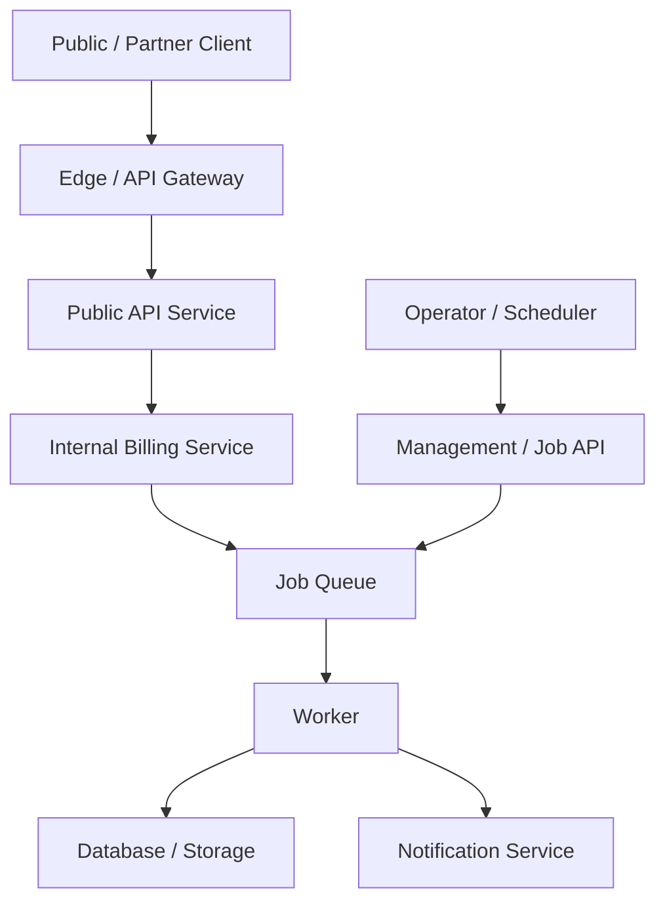
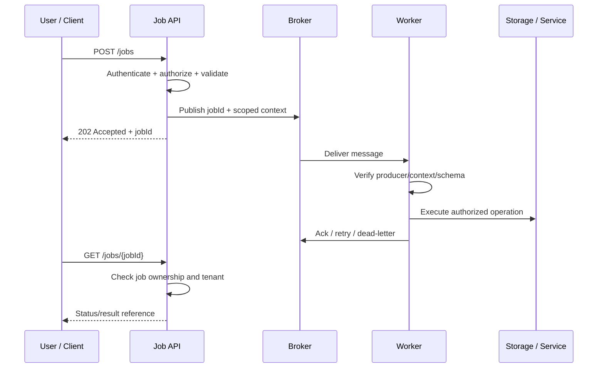

# Rà soát endpoint nội bộ và job

Một endpoint không xuất hiện trong tài liệu public, chỉ được route qua mạng private hoặc không trả `Access-Control-Allow-Origin` vẫn có thể bị gọi trái phép. Một service khác có thể bị xâm nhập, một workload có thể có credential quá rộng, một ingress phụ có thể vô tình public route quản trị, hoặc một worker có thể nhận message do principal không được phép tạo. Từ góc nhìn bảo mật, nhãn “internal” mô tả vị trí triển khai; nó không chứng minh caller có quyền.

CORS chỉ điều khiển việc browser có được chia sẻ response cross-origin cho JavaScript hay không. Nó không chặn `curl`, mobile app, backend service, worker, script tự động hoặc request đi trực tiếp tới private network. Vì vậy, rà soát endpoint nội bộ và background job phải tập trung vào authentication, authorization, workload identity, tenant boundary và quyền trên từng hành động.

Trong module `SECURITY_API_SECURITY`, cần thiết kế bảo mật theo endpoint, đối tượng dữ liệu và luồng nghiệp vụ. Bài này hướng dẫn lập inventory cho route nội bộ, kiểm tra trust boundary, xác minh quyền service-to-service và bảo vệ toàn bộ vòng đời job: tạo, xếp hàng, thực thi, xem trạng thái, tải kết quả, hủy, retry và callback.

## Mục tiêu học tập

Sau bài này, người học có thể:

- Giải thích vì sao private network, hidden route và CORS policy không thay thế authorization.
- Lập inventory endpoint nội bộ từ source code, gateway, ingress, service mesh và runtime.
- Phân loại endpoint public, partner, internal, admin, diagnostic và machine-to-machine.
- Thiết kế workload identity, audience, scope và authorization cho service-to-service call.
- Phát hiện confused deputy, quyền service quá rộng và lỗi tin tưởng header do caller tự gửi.
- Rà soát API tạo job, job status, result download, cancel, retry và scheduler.
- Ngăn IDOR, cross-tenant access, replay và message injection trong hệ thống queue/worker.
- Xây dựng test matrix và monitoring để phát hiện endpoint/job bị expose hoặc cấp quyền sai.

## 1. “Internal” không đồng nghĩa với “được phép”

### 1.1. CORS không kiểm soát mọi loại caller

Browser áp dụng same-origin policy và CORS khi một trang web muốn đọc response từ origin khác. Các client ngoài browser không bị ràng buộc bởi CORS theo cách đó. Một request không có `Origin`, hoặc có `Origin` giả do client tự tạo, vẫn có thể tới endpoint nếu network route và server cho phép.

Do đó, các giả định sau đều không an toàn:

- “Endpoint không bật CORS nên attacker không gọi được.”
- “Route chỉ có DNS nội bộ nên không cần authentication.”
- “Service nằm trong cùng VPC/VNet nên mọi service đều tin nhau.”
- “Endpoint không có trong OpenAPI public nên không ai biết.”
- “Job chỉ được worker nội bộ xử lý nên không cần kiểm tra message producer.”
- “Job ID đủ dài và khó đoán nên ai biết ID cũng được xem kết quả.”

Mỗi request vẫn phải được xác thực và kiểm tra quyền tại server. Network restriction giảm số đường có thể tiếp cận; nó không thay thế việc xác định caller là ai và caller được làm gì.

### 1.2. Endpoint nội bộ vẫn có thể bị tiếp cận qua nhiều đường

Một endpoint nội bộ có thể bị lộ hoặc bị gọi từ:

- Workload khác trong cùng cluster, VPC hoặc subnet.
- Service bị xâm nhập rồi dùng quyền mạng để gọi service kế tiếp.
- VPN, bastion, corporate network hoặc máy developer.
- Ingress/controller phụ, port quản trị hoặc load balancer cũ.
- Gateway route rewrite, DNS alias, IPv4/IPv6 listener hoặc hostname staging.
- SSRF trong một service có quyền truy cập mạng nội bộ.
- Queue producer, scheduler, event bus hoặc automation account.
- CI/CD runner, monitoring agent và integration partner.

Vì vậy, cần rà soát cả HTTP endpoint lẫn message/job entry point. Một job consumer không có HTTP route vẫn là một giao diện nhận lệnh và phải có trust boundary, authorization và validation.

### 1.3. Defense in depth cho endpoint nội bộ

Một thiết kế tốt thường kết hợp:

1. Network segmentation và egress/ingress policy để giới hạn đường kết nối.
2. Workload identity để xác minh service hoặc process gọi.
3. Authentication ở mỗi trust boundary, kể cả khi request đi trong private network.
4. Authorization theo action, resource, tenant và data scope.
5. Validation schema và business rule phía nhận.
6. Audit, rate/concurrency limit và monitoring.

Không cần mọi endpoint có cùng cơ chế. Endpoint health tối thiểu, endpoint admin, API nội bộ xử lý dữ liệu khách hàng và queue consumer có rủi ro khác nhau. Hãy chọn policy dựa trên tác động khi endpoint bị gọi sai.

## 2. Lập inventory endpoint nội bộ

### 2.1. Vì sao inventory dễ bị thiếu?

Tài liệu OpenAPI public thường chỉ liệt kê API dành cho client. Các route khác có thể được thêm trong controller, actuator, management port, internal gateway, service mesh, batch service hoặc một module cũ. Một số endpoint chỉ tồn tại trong môi trường production hoặc chỉ được tạo bởi cấu hình deployment.

Inventory phải bao gồm cả:

- REST/HTTP endpoints, GraphQL, gRPC và WebSocket.
- Management, health, metrics, debug và admin endpoints.
- Internal callbacks, webhook receiver và service-to-service routes.
- Job submission, job status, result download, cancel và retry APIs.
- Queue/topic consumers, scheduled jobs, cron tasks và event handlers.
- Presigned upload/download và object storage callbacks.
- Legacy routes, alternate API versions và route alias.

### 2.2. Nguồn phát hiện

| Nguồn | Có thể phát hiện | Giới hạn |
|---|---|---|
| Source code và route annotations | Controller, filter, router, RPC method | Có thể bỏ sót route được tạo từ config hoặc plugin |
| OpenAPI/AsyncAPI/protobuf | Contract được công bố | Có thể cũ hoặc chỉ mô tả public surface |
| API gateway/ingress config | Public/private route, host, path rewrite, listener | Không thấy endpoint chỉ gọi nội bộ hoặc queue consumer |
| Service mesh/service registry | Service identity, destination và traffic giữa workload | Không mô tả đầy đủ quyền nghiệp vụ |
| Runtime access logs/traces | Route thực sự được gọi, caller và tần suất | Không chứng minh route chưa thấy là không tồn tại |
| DNS/cloud/network inventory | Private hostname, load balancer, port và security group | Có thể có tài nguyên cũ hoặc không còn active |
| Scheduler/queue/broker config | Job producer, consumer, topic, retry và dead-letter queue | Cần nối message với code handler và owner |
| CI/CD và deployment manifests | Port, environment, replica, service account và secret mount | Có thể khác runtime nếu drift |

Kết hợp nhiều nguồn để đối chiếu. Không xem một nguồn đơn lẻ là danh sách đầy đủ. Mọi endpoint hoặc consumer mới nên được đưa vào inventory qua review code/deployment và cập nhật owner.

### 2.3. Phân loại exposure

Có thể dùng các nhóm sau:

| Nhóm | Caller dự kiến | Kiểm soát tối thiểu cần xem xét |
|---|---|---|
| Public API | Browser, mobile, public integration | User/client authentication, function/object authorization, validation, abuse controls |
| Partner API | Đối tác đã đăng ký | Client identity, audience/scope, partner/tenant isolation, quota |
| Internal service API | Workload được chỉ định | Workload identity, service/action authorization, network policy |
| Admin/operations | Operator hoặc automation được ủy quyền | Strong authentication, privileged role, audit, restricted network và step-up khi cần |
| Diagnostic/management | Monitoring hoặc operator | Chỉ expose thông tin tối thiểu, authentication và network restriction |
| Job/message entry point | Producer/scheduler/event source | Broker ACL, producer identity, message validation, replay/idempotency |
| Worker-to-service call | Workload xử lý job | Workload identity và quyền tối thiểu cho operation cụ thể |

“Private” là thuộc tính network exposure, còn “internal service API” là nhóm caller và trust relationship. Hai khái niệm này có liên quan nhưng không đồng nhất.

### 2.4. Các trường cần có trong endpoint inventory

Mỗi entry nên ghi tối thiểu:

- Service, route/operation và version.
- Owner kỹ thuật và owner nghiệp vụ.
- Exposure class, hostname/listener và đường đi qua gateway/ingress.
- Caller/workload được phép và cách xác minh identity.
- Authentication mechanism, issuer, audience và credential lifetime.
- Action, resource, tenant scope và authorization policy.
- Data classification, field nhạy cảm và side effect.
- Rate, concurrency, body/message size và timeout limits.
- Logging/audit, alert, retention và runbook.
- Lifecycle: active, deprecated, temporary, ownerless hoặc planned removal.

Ví dụ inventory rút gọn:

```yaml
service: billing-api
operation: POST /internal/invoices/{invoiceId}/recalculate
exposure: internal-service
owner: billing-team
callers:
  - workload: invoice-scheduler
    identity: workload-token
    audience: billing-api
    actions: [invoice:recalculate]
authorization:
  resource: invoice
  tenant_scope: required
  server_side_check: true
limits:
  request_bytes: 32768
  concurrency_per_tenant: 2
audit:
  required: true
```

Đây là ví dụ cấu trúc để thảo luận; tên service, action và giới hạn cần được thay bằng contract thật của hệ thống. Không lưu secret hoặc token trong inventory.

## 3. Rà soát trust boundary và network exposure

### 3.1. Vẽ đường đi thực tế của request

Với từng endpoint, xác định:

1. Caller bắt đầu ở đâu: Internet, partner network, cluster, scheduler hay CI/CD?
2. DNS name, listener, port và protocol nào được dùng?
3. Request có đi qua CDN, WAF, gateway, ingress hoặc service mesh không?
4. Có thể gọi trực tiếp origin/backend bỏ qua lớp kiểm soát không?
5. Proxy có rewrite path, host hoặc forwarding header không?
6. Backend dựa vào credential nào để xác minh caller?
7. Service downstream nhận identity gốc, identity của service trung gian hay cả hai?



Sơ đồ cần thể hiện các đường gọi trực tiếp, không chỉ đường đi “đúng thiết kế”. Hãy tìm ingress phụ, port quản trị, service account dùng chung, queue producer ngoài dự kiến và direct-origin path.

### 3.2. Network policy là lớp giảm exposure

Network policy, security group, firewall và private endpoint có thể giới hạn nguồn kết nối. Ví dụ chỉ cho gateway gọi application listener hoặc chỉ worker thuộc namespace được phép kết nối broker.

Tuy nhiên, nếu một workload hợp lệ bị xâm nhập, attacker có thể thừa hưởng network reachability của workload đó. Vì vậy, backend vẫn cần xác minh workload identity và quyền operation. Không dùng subnet hoặc source IP làm danh tính duy nhất cho service.

### 3.3. Không tin forwarded header hoặc metadata tự khai báo

Các header như `X-Internal-Caller`, `X-User-Id`, `X-Tenant-Id`, `X-Forwarded-For` hoặc `X-Original-URL` không tự chứng minh caller có quyền. Nếu client có thể gửi trực tiếp hoặc proxy không xóa/ghi đè header, attacker có thể giả mạo danh tính hoặc route.

Thông tin actor/tenant cần lấy từ token đã xác minh hoặc security context do một trust boundary đáng tin tạo ra. Nếu service trung gian truyền context người dùng, phải xác minh chữ ký, issuer, audience, thời hạn và mục đích sử dụng; không tin một JSON header chỉ vì tên của nó có chữ “internal”.

### 3.4. Health, metrics và management port

Health endpoint nên trả thông tin tối thiểu cần cho load balancer. Diagnostics sâu như environment, configuration properties, beans, mappings, heap dump, thread dump, database detail và dependency topology chỉ nên dành cho operator/monitoring đã xác thực và có network policy phù hợp.

Rà soát cả management port riêng, actuator path, debug listener và endpoint do framework tự động tạo. Một route không nằm dưới `/api/**` vẫn có thể truy cập qua cùng hostname hoặc listener khác. Tắt endpoint không cần thiết; không chỉ dựa vào việc giấu path.

## 4. Workload identity cho service-to-service

### 4.1. Xác minh workload gọi là ai

Service-to-service authentication cần xác minh workload/process, không chỉ kiểm tra request đến từ private IP. Một số lựa chọn:

- Mutual TLS với certificate riêng cho workload/service.
- OAuth 2.0 client credentials hoặc token exchange với access token ngắn hạn.
- Workload identity do nền tảng cấp và có thể đổi lấy token cho audience cụ thể.
- Signed request cho một số giao thức/tích hợp cần xác minh tính toàn vẹn request.

Mỗi cơ chế cần có lifecycle: issuance, rotation, expiry, revocation và audit. Tránh API key dùng chung lâu dài cho cả cluster hoặc nhiều service vì khó xác định nguồn khi credential bị lộ.

### 4.2. Audience, issuer, expiry và scope

Khi dùng access token, service nhận cần xác minh ít nhất:

- Chữ ký và thuật toán được phép.
- Issuer (`iss`) đúng trust configuration.
- Audience (`aud`) dành cho service đang nhận.
- Thời hạn (`exp`, `nbf`) và clock skew trong giới hạn.
- Subject/client identity (`sub`, `client_id`) phù hợp workload.
- Scope/role/permission cần cho operation.
- Tenant hoặc delegation context nếu contract yêu cầu.

Token cấp cho `report-service` không nên tự động dùng được tại `billing-service`. Audience giúp ngăn token bị replay sang service khác. Scope nên giới hạn theo action, ví dụ `invoice:read` hoặc `invoice:recalculate`, thay vì quyền tổng quát `admin`.

### 4.3. mTLS xác thực peer, không tự cấp quyền nghiệp vụ

mTLS xác minh hai đầu kết nối có certificate được tin cậy. Nó có thể chứng minh request đến từ workload `invoice-scheduler`, nhưng không có nghĩa workload đó được phép đọc mọi invoice hoặc thực hiện refund.

Service nhận cần ánh xạ workload identity sang permission cụ thể và kiểm tra resource/tenant. Nếu service mesh tự động thiết lập mTLS, cần xác minh policy authorization của mesh và application; mã hóa kết nối không đồng nghĩa đã kiểm tra quyền.

### 4.4. Service identity và user identity

Trong một request thay mặt người dùng, có thể có hai identity:

- **Actor/user:** người đã yêu cầu hành động.
- **Caller/workload:** service đang thực hiện network call.

Không nên ghi đè một identity lên identity còn lại. Audit cần giữ được ai khởi tạo hành động và service nào thực thi. Authorization cần xác định service được phép gọi operation đó và user có quyền trên resource hay không.

Ví dụ: `order-api` gọi `billing-api` để tạo invoice thay mặt user. `billing-api` cần xác minh `order-api` là workload được phép gọi `invoice:create`, đồng thời kiểm tra user/tenant context được ủy quyền có quyền tạo invoice cho order tương ứng. Nếu chỉ tin `X-User-Id` do `order-api` gửi, một service bị xâm nhập có thể giả mạo user khác.

### 4.5. Ngăn confused deputy

Confused deputy xảy ra khi một service có quyền rộng sử dụng quyền đó theo chỉ thị của caller không đủ quyền. Ví dụ một internal export service có thể đọc mọi tenant; public API nhận `tenantId` từ client rồi yêu cầu export service tải dữ liệu tenant đó mà không xác minh quyền của user.

Biện pháp:

- Không để caller tự chọn tenant/resource tùy ý rồi service đặc quyền thực hiện.
- Ràng buộc token với audience, scope và delegation context.
- Service có quyền rộng phải kiểm tra authorization theo actor và resource.
- Ưu tiên API hẹp như `export-my-tenant-report` thay vì endpoint tổng quát nhận tên bảng/query tùy ý.
- Giới hạn dữ liệu trả về và ghi audit actor, caller, tenant, resource và purpose.
- Không dùng service account admin chung cho mọi worker.

## 5. Authorization cho endpoint nội bộ

### 5.1. Kiểm tra theo action và resource

Mỗi endpoint cần trả lời:

- Principal nào được gọi?
- Principal được thực hiện action nào?
- Trên loại resource nào và resource cụ thể nào?
- Có tenant, owner, region hoặc data classification constraint không?
- Có cần điều kiện trạng thái hoặc approval không?

Ví dụ:

| Endpoint | Caller được phép | Authorization cần có |
|---|---|---|
| `GET /internal/customers/{id}` | `support-case-service` | Scope đọc hồ sơ và tenant/case context hợp lệ |
| `POST /internal/invoices/{id}/recalculate` | `invoice-scheduler` | Action recalculate, invoice đúng tenant và trạng thái cho phép |
| `POST /internal/users/{id}/disable` | `identity-admin-service` | Action disable, reason/audit và approval theo policy |
| `GET /actuator/health` | Load balancer | Chỉ trạng thái tối thiểu, không có diagnostics sâu |
| `GET /actuator/env` | Không public; operator cụ thể nếu thật sự cần | Strong auth, privileged role, audit và network restriction |

Endpoint nội bộ không nên có một rule chung kiểu “mọi service trong cluster đều được gọi”. Hãy định nghĩa allowlist caller và action theo operation.

### 5.2. Least privilege theo service

Tạo identity riêng cho từng workload hoặc nhóm workload có cùng chức năng. Cấp quyền tối thiểu:

- Chỉ gọi service đích cần thiết.
- Chỉ dùng method/action cần thiết.
- Chỉ truy cập resource/tenant trong phạm vi nhiệm vụ.
- Chỉ đọc hoặc ghi field cần thiết.
- Chỉ publish/consume topic cần thiết.
- Chỉ dùng secret và database permission cần cho operation.

Tránh credential `internal-admin` được mount vào mọi pod. Nếu một worker chỉ cần đọc invoice và ghi file export, nó không cần quyền quản lý user hoặc truy cập toàn bộ database.

### 5.3. Authorization tại service nhận

Gateway hoặc service gọi trước đó có thể thực hiện một phần authorization, nhưng service sở hữu resource nên tự kiểm tra quyền cần thiết. Đây là nơi biết resource, tenant và trạng thái nghiệp vụ chính xác nhất.

Không tin `X-Authorized: true`, role do client gửi hoặc quyết định authorization được truyền qua một header không ký. Nếu dùng authorization decision token, cần có issuer đáng tin, audience, expiry và context đủ hẹp; service nhận vẫn phải bảo đảm token áp dụng đúng resource/action.

### 5.4. Admin và operational endpoints

Các route admin thường có tác động lớn: thay đổi feature flag, replay event, purge cache, chạy migration, tạo user, xem config hoặc trigger job. Cần:

- Tách admin API khỏi public API nếu có thể.
- Strong authentication và role/permission riêng.
- Network restriction bổ sung, không dùng làm kiểm soát duy nhất.
- Step-up/MFA hoặc approval cho thao tác rủi ro cao.
- Audit actor, target, reason, timestamp và kết quả.
- Rate limit, confirmation và protection chống thao tác lặp.
- Không expose debug/diagnostic endpoint chỉ để tiện support.

## 6. Background job là một API bất đồng bộ

### 6.1. Job có nhiều điểm vào và điểm đọc kết quả

Một job thường đi qua các thành phần:

1. Client hoặc scheduler yêu cầu tạo job.
2. API xác thực caller và kiểm tra quyền tạo loại job.
3. Service ghi job record và publish message vào broker.
4. Worker xác minh message, workload identity và job context.
5. Worker gọi service/storage khác để thực thi.
6. Worker cập nhật trạng thái và lưu output.
7. Client gọi API xem trạng thái, tải kết quả, hủy hoặc retry.
8. Hệ thống có thể gửi callback/webhook khi job hoàn tất.

Mỗi bước là một trust boundary. Việc API tạo job đã authorization không tự động bảo đảm mọi thao tác sau đó an toàn; message có thể bị sửa, replay, publish bởi producer khác hoặc worker có quyền rộng hơn caller ban đầu.



### 6.2. Phân loại job theo mức rủi ro

| Loại job | Ví dụ | Kiểm soát chính |
|---|---|---|
| Read/export | Tạo báo cáo, export dữ liệu | Tenant/object authorization, data minimization, quota, result access |
| Write/update | Đồng bộ hồ sơ, cập nhật trạng thái | Action authorization, idempotency, state validation, audit |
| Privileged/admin | Disable account, purge hoặc replay | Strong caller identity, approval, scope hẹp, audit |
| Scheduled/system | Reconcile, cleanup, billing run | Workload identity riêng, fixed scope, safe parameters |
| External callback | Gửi webhook hoặc gọi partner | Destination allowlist, signing, retry policy, SSRF controls |

Job “system” vẫn cần owner, purpose, permission và giới hạn. Không dùng nhãn system để bỏ qua kiểm tra.

## 7. Bảo vệ API tạo job

### 7.1. Xác minh quyền trước khi enqueue

Trước khi tạo job, kiểm tra:

- Caller đã được xác thực.
- Caller được phép tạo đúng loại job/action.
- Resource và tenant thuộc phạm vi caller.
- Các field đầu vào nằm trong contract và không chứa quyền do client tự cấp.
- Job không vượt quota, concurrency hoặc giới hạn cost.
- Có idempotency key nếu client có thể retry sau timeout.

Không enqueue job rồi mới kiểm tra quyền ở worker nếu việc enqueue đã tạo side effect hoặc chiếm quota. Worker vẫn cần kiểm tra lại trust context, nhưng API phải từ chối yêu cầu không hợp lệ ngay từ đầu.

### 7.2. Không nhận tên job hoặc class tùy ý

Không tạo endpoint dạng:

```json
{
  "jobType": "com.example.jobs.DeleteAllCustomersJob",
  "parameters": {"tenantId": "..."}
}
```

Client không được chọn class, handler, shell command hoặc tên queue tùy ý. Hãy dùng một tập operation ID cố định do server định nghĩa, mỗi operation có schema, permission và resource scope riêng.

Ví dụ:

```http
POST /api/reports/export
Content-Type: application/json
Idempotency-Key: 7dcb...

{
  "reportType": "monthly-usage",
  "period": "2026-10"
}
```

Server lấy tenant và actor từ security context đã xác minh, sau đó kiểm tra user có quyền export loại report này. Không tin `tenantId`, `ownerId` hoặc `requestedBy` nếu client gửi chúng trong body.

### 7.3. Ghi job record và publish message nhất quán

Nếu database ghi job thành công nhưng publish message thất bại, job có thể bị treo. Nếu publish message thành công nhưng transaction database rollback, worker có thể nhận một job record không tồn tại. Có thể dùng transactional outbox hoặc cơ chế tương đương để lưu job và event trong cùng transaction, rồi publisher đáng tin chuyển event sang broker.

Outbox không thay thế authorization. Producer vẫn phải kiểm tra quyền; publisher cần broker credential riêng; consumer phải xác minh schema, event type và job reference trước khi thực thi.

## 8. Authorization trong worker và message broker

### 8.1. Broker ACL và producer identity

Queue/topic là một giao diện nhận lệnh. Cần giới hạn:

- Workload nào được publish vào topic nào.
- Workload nào được consume và ack/retry/dead-letter.
- Ai được tạo queue, binding, subscription hoặc consumer group.
- Ai được đọc dead-letter queue vì message có thể chứa dữ liệu nhạy cảm.
- Ai được purge, replay hoặc thay đổi retention.

Không để mọi service dùng chung broker credential có quyền publish/consume mọi topic. Dùng identity riêng và ACL theo topic/operation; mã hóa kết nối và xác thực broker khi phù hợp.

### 8.2. Xác minh message ở consumer

Worker nên kiểm tra:

- Message schema và version.
- Event/job type nằm trong allowlist.
- Job record tồn tại và trạng thái cho phép thực thi.
- Tenant, actor và resource reference được ràng buộc với record đã tạo.
- Producer identity hoặc provenance phù hợp với topic.
- Timestamp, expiry và replay/deduplication key.
- Payload size và parameter constraints.

Không coi message là đáng tin chỉ vì nó đến từ broker. Producer có thể bị xâm nhập, message có thể cũ, bị replay hoặc được publish nhầm topic. Với message nội bộ, broker ACL và authenticated producer là nền tảng; consumer vẫn cần kiểm tra semantic context.

### 8.3. Giữ actor và workload identity tách biệt

Message nên lưu actor đã yêu cầu job và workload producer/worker dưới các trường riêng, ví dụ:

```json
{
  "eventId": "evt_01J...",
  "jobId": "job_01J...",
  "jobType": "monthly-usage-export",
  "actor": {"subjectId": "user-42", "tenantId": "tenant-7"},
  "producer": "report-api",
  "requestedAt": "2026-11-18T09:30:00Z",
  "expiresAt": "2026-11-18T10:00:00Z",
  "schemaVersion": 1
}
```

Ví dụ chỉ minh họa cấu trúc. Không đưa access token, cookie hoặc secret vào message. Actor context phải do server tạo từ identity đã xác minh, không lấy nguyên `actor` object do client gửi.

Worker dùng workload identity riêng để gọi downstream. Nếu operation thay mặt user, worker cần thực thi đúng delegation/scope được lưu và kiểm tra lại điều kiện cần thiết. Không biến worker thành service account có quyền admin chỉ vì job chạy nền.

### 8.4. Revalidate quyền khi job thực thi

Quyền có thể thay đổi giữa lúc job được tạo và lúc worker chạy: user bị khóa, tenant bị suspend, resource đổi owner hoặc approval bị thu hồi. Với job nhạy cảm hoặc chạy lâu, cần xác định policy revalidation:

- Job đọc dữ liệu riêng tư: xác minh actor/tenant còn quyền trước khi truy xuất hoặc trước khi phát hành kết quả.
- Job thay đổi trạng thái: kiểm tra lại state transition và invariant tại thời điểm commit.
- Job admin/financial: kiểm tra approval, scope và trạng thái credential gần thời điểm thực thi.
- Job có snapshot semantics rõ ràng: lưu policy/version và phạm vi được duyệt, nhưng phải định nghĩa khi nào snapshot hết hiệu lực.

Không mặc định role snapshot lúc enqueue có hiệu lực vô thời hạn. Ngược lại, nếu nghiệp vụ yêu cầu hoàn tất một giao dịch đã được chấp thuận, hãy định nghĩa rõ quyền và thời điểm commit để tránh thay đổi giữa chừng gây kết quả không nhất quán.

## 9. Bảo vệ job status, result, cancel và retry APIs

### 9.1. Job ID không phải authorization

Một endpoint như `GET /jobs/{jobId}` có thể bị IDOR nếu chỉ kiểm tra job ID tồn tại. UUID khó đoán giúp giảm khả năng dò ID nhưng không thay thế authorization.

Mỗi lần đọc hoặc thay đổi job cần kiểm tra:

- Job thuộc actor/tenant nào?
- Caller có permission xem loại job đó không?
- Job có chứa dữ liệu của nhiều tenant không?
- Caller có quyền xem kết quả hay chỉ xem trạng thái tổng quát?
- Job đang ở trạng thái nào và action có hợp lệ không?

Không trả thông tin job của tenant khác, kể cả tên file, report type, số record hoặc error detail. Tùy policy, có thể trả `404` để che sự tồn tại hoặc `403` khi contract cho phép phân biệt.

### 9.2. Result download

Kết quả export thường nhạy cảm hơn status. Hãy:

- Kiểm tra authorization tại thời điểm tải.
- Ràng buộc object storage key với job/tenant record do server quản lý.
- Dùng bucket private và URL ký có thời hạn ngắn nếu cần presigned download.
- Không để client truyền object key tùy ý để tải file.
- Thiết lập content type, filename và cache policy an toàn.
- Thu hồi/xóa file theo retention và yêu cầu privacy.
- Tránh đưa PII hoặc dữ liệu export vào log.

Presigned URL là bearer capability: ai có URL có thể dùng trong thời hạn và phạm vi được ký. Không log URL đầy đủ, không cấp thời hạn dài không cần thiết và không tái sử dụng URL cho nhiều tenant.

### 9.3. Cancel và retry là operation có quyền riêng

`POST /jobs/{id}/cancel` và `POST /jobs/{id}/retry` cần authorization riêng. Không phải ai xem được status cũng được hủy hoặc retry. Retry có thể tạo chi phí, gửi email, tạo payment hoặc thực thi side effect lần nữa.

Kiểm tra state machine:

| Trạng thái hiện tại | Action | Điều kiện |
|---|---|---|
| `QUEUED` | Cancel | Actor có quyền trên job; worker chưa claim |
| `RUNNING` | Cancel | Có cơ chế cooperative cancellation và operation cho phép dừng |
| `SUCCEEDED` | Retry | Chỉ khi job type idempotent hoặc có workflow replay được duyệt |
| `FAILED` | Retry | Retry count, error class, quota và permission còn hợp lệ |
| `CANCELLED` | Retry | Chỉ theo policy; không tự động phục hồi side effect đã xảy ra |
| `EXPIRED` | Download | Từ chối hoặc yêu cầu tạo job mới theo retention policy |

Việc hủy một job không đảm bảo side effect đã được rollback. API cần trả trạng thái rõ như `CANCEL_REQUESTED` và worker phải xử lý cancellation tại các điểm an toàn.

### 9.4. Tenant isolation trong job result

Job record, queue message, object storage path và audit event phải giữ tenant context nhất quán. Không xây dựng storage key chỉ từ file name do client gửi. Với batch chứa nhiều tenant, phải có policy riêng, approval và partitioning rõ; tránh worker có quyền đọc toàn bộ tenant rồi lọc ở cuối.

## 10. Idempotency, replay và concurrency

### 10.1. Job submission cần idempotency

Client có thể retry `POST /jobs` khi timeout mà không biết server đã tạo job hay chưa. Idempotency key giúp request lặp trả về cùng job/result thay vì tạo nhiều job.

Key cần được scope theo actor/tenant và operation; payload hash phải khớp. Không cho một tenant dùng key của tenant khác để đọc job. TTL cần phù hợp với thời gian retry và retention.

### 10.2. Consumer phải chịu được delivery lặp

Broker thường có semantics at-least-once hoặc có thể redeliver khi worker mất kết nối. Consumer cần:

- Deduplicate theo event/job execution ID.
- Lưu trạng thái claim/lease nguyên tử.
- Giới hạn retry và dùng backoff.
- Phân loại transient/permanent error.
- Đưa poison message vào dead-letter queue có quyền truy cập hạn chế.
- Đảm bảo side effect idempotent hoặc có transaction/outbox.

Không coi “broker chỉ gửi một lần” là giả định an toàn nếu nền tảng không bảo đảm exactly-once end-to-end. Ngay cả broker có exactly-once semantics cũng không tự đảm bảo database và external API side effect chỉ xảy ra một lần.

### 10.3. Concurrency và quota

Giới hạn số job theo actor, tenant, job type và global capacity. Một user không nên có thể enqueue hàng nghìn export chỉ vì mỗi HTTP request nhỏ. Dùng atomic quota reservation khi enqueue; release hoặc consume reservation theo trạng thái terminal. Worker cần concurrency limit và timeout để job không chiếm worker vô hạn.

Với job tài chính hoặc thao tác một lần, dùng business idempotency key và invariant ở database. Không dựa riêng vào queue deduplication để bảo vệ thanh toán, refund hoặc chuyển trạng thái quan trọng.

## 11. Scheduler, cron và administrative job

### 11.1. Scheduler là principal

Cron, workflow engine và scheduler cũng là workload cần identity. Mỗi scheduled task nên có:

- Owner nghiệp vụ/kỹ thuật.
- Schedule và môi trường được phép chạy.
- Workload identity riêng.
- Permission/action và tenant/resource scope cố định.
- Timeout, concurrency, retry và maximum runtime.
- Audit cho lần chạy, tham số và kết quả.
- Cách disable/rollback an toàn.

Không dùng credential admin chung cho mọi cron job. Job reconcile invoice không cần quyền disable user; cleanup job không cần quyền gửi payment.

### 11.2. Không nhận tham số shell hoặc query tùy ý

Scheduler API không nên nhận shell command, class name, SQL query hoặc script path do caller cung cấp. Nếu cần tham số, dùng schema typed và allowlist enum/range. Tránh nối input vào shell, SQL hoặc template expression.

Ví dụ an toàn hơn là operation `reconcile-invoices` với `period` đã validate, thay vì endpoint `POST /internal/run?command=...`. Các operation đặc quyền cần approval và audit.

### 11.3. Environment separation

Job production không được lấy queue, secret hoặc database của staging theo cấu hình nhầm; staging không được dùng credential production. Tách broker namespace, service account, secret, storage bucket và network policy theo environment. Không cho developer hoặc CI job có quyền chạy arbitrary production job nếu không có quy trình phê duyệt.

## 12. Callback, webhook và job output

Một số job gửi callback khi hoàn tất hoặc tải dữ liệu từ URL do caller cung cấp. Đây là outbound request và có thể tạo SSRF.

Nếu job nhận callback URL:

- Ưu tiên destination allowlist hoặc partner registration.
- Chỉ cho scheme/port cần thiết; kiểm tra DNS/IP và redirect theo SSRF policy.
- Không cho callback tới loopback, private, link-local hoặc metadata endpoint.
- Không forward internal token/cookie tới callback URL.
- Ký callback bằng secret/key riêng cho recipient và thêm timestamp/event ID để chống replay.
- Retry có giới hạn, backoff, timeout và circuit breaker.
- Không để callback response điều khiển arbitrary job state.

Nếu worker tải file hoặc tài liệu từ URL, áp dụng cùng policy SSRF: canonicalize, resolve/validate/pin destination, kiểm tra redirect từng hop, giới hạn bytes và timeout. Queue không làm URL trở nên đáng tin hơn.

Output của job cũng phải được lọc. Không trả stack trace, SQL, internal hostname hoặc credential trong `errorMessage`. Dùng error code ổn định và correlation/job ID; diagnostic đầy đủ nằm trong log có kiểm soát.

## 13. Rà soát bằng authorization matrix

Với endpoint nội bộ và job, tạo ma trận principal-action-resource. Ví dụ:

| Principal | Submit export | Read status | Download result | Cancel | Retry |
|---|---:|---:|---:|---:|---:|
| User thuộc tenant A | Có, theo scope | Job tenant A của mình/được chia sẻ | Theo quyền dữ liệu | Job của mình nếu còn queued | Theo policy |
| User tenant B | Chỉ job tenant B | Không xem job A | Không tải result A | Không hủy job A | Không retry job A |
| `report-api` workload | Tạo job theo delegated user | Đọc record cần thiết | Không tự cấp quyền user | Theo workflow | Không mặc định |
| `report-worker` workload | Không submit arbitrary job | Cập nhật execution state | Ghi output vào key được cấp | Cooperative cancel | Retry nội bộ theo policy |
| Operator | Theo role/approval | Theo phạm vi vận hành | Chỉ khi được phê duyệt | Theo incident/change policy | Có audit và reason |

Ma trận thực tế cần thêm job type, data classification, tenant scope và trạng thái. Không để quyền của operator hoặc worker tự động được kế thừa bởi mọi caller.

## 14. Ví dụ Spring Security cho internal endpoint

### 14.1. Bảo vệ route theo workload scope

Ví dụ minh họa Spring Security resource server với JWT scope:

```java
@Bean
SecurityFilterChain internalApi(HttpSecurity http) throws Exception {
    return http
        .securityMatcher("/internal/**")
        .oauth2ResourceServer(oauth -> oauth.jwt(Customizer.withDefaults()))
        .authorizeHttpRequests(auth -> auth
            .requestMatchers(HttpMethod.POST,
                "/internal/invoices/*/recalculate")
                .hasAuthority("SCOPE_invoice:recalculate")
            .requestMatchers(HttpMethod.GET, "/internal/invoices/**")
                .hasAuthority("SCOPE_invoice:read")
            .anyRequest().denyAll()
        )
        .build();
}
```

Ví dụ chỉ thể hiện function-level permission. Resource server vẫn phải cấu hình issuer/audience/claim validation đúng; service method cần kiểm tra invoice thuộc tenant/scope của caller. Không coi `hasAuthority` là object authorization đầy đủ.

### 14.2. Kiểm tra object và tenant trong service

```java
Invoice invoice = invoiceRepository.findById(invoiceId)
    .orElseThrow(NotFoundException::new);

WorkloadPrincipal caller = currentWorkloadPrincipal();
if (!caller.canRecalculateInvoices()) {
    throw new AccessDeniedException("Action not allowed");
}

if (!caller.allowedTenantIds().contains(invoice.getTenantId())) {
    throw new AccessDeniedException("Resource outside caller scope");
}

invoiceService.recalculate(invoice);
```

Trong hệ thống có nhiều tenant, tránh nạp object bất kỳ rồi quên check. Có thể truy vấn trực tiếp theo ID và tenant scope, ví dụ `findByIdAndTenantId`, để giảm nguy cơ trả nhầm resource. Không đưa tenant ID do client tự gửi vào principal.

### 14.3. Tách security chain cho management endpoint

Nếu dùng management port hoặc actuator riêng, cấu hình network binding và security chain riêng theo framework version. Chỉ expose health tối thiểu cho load balancer; endpoint diagnostics cần authentication/authorization và network policy. Không `permitAll()` toàn bộ actuator chỉ để probe hoạt động.

## 15. Kiểm thử endpoint nội bộ và job

Kiểm thử phải xác minh cả đường gọi hợp lệ và đường gọi vượt trust boundary.

| Nhóm kiểm thử | Kịch bản | Kết quả mong đợi |
|---|---|---|
| CORS misconception | Gọi endpoint nội bộ bằng client không phải browser, không có Origin | Server vẫn yêu cầu authentication/authorization |
| Direct route | Gọi backend port/hostname bỏ qua gateway | Network policy chặn hoặc backend vẫn xác minh identity và quyền |
| Spoofed header | Gửi `X-Internal-Caller`, `X-User-Id`, `X-Tenant-Id` giả | Bị bỏ qua hoặc từ chối; identity lấy từ credential đã xác minh |
| Workload identity | Token sai issuer/audience/expiry/signature | Request bị từ chối |
| Scope | Service A gọi action chỉ cấp cho service B | `403` hoặc từ chối tương ứng |
| Object authorization | Workload có scope nhưng truy cập resource ngoài tenant | Bị từ chối |
| Confused deputy | Caller yêu cầu service quyền rộng truy xuất tenant khác | Service kiểm tra actor/delegation/resource và từ chối |
| Admin endpoint | Anonymous hoặc service thường gọi endpoint admin | Bị từ chối; action có audit |
| Diagnostic endpoint | Public client gọi env/beans/heapdump | Không thể truy cập |
| Job submission | User tạo job type hoặc tenant ngoài scope | Không enqueue và không tiêu thụ quota |
| Job IDOR | User B đọc job ID của user/tenant A | Không lộ status/result hoặc metadata |
| Result download | Client truyền object key tùy ý | Chỉ tải key gắn với job được authorize |
| Cancel/retry | User không sở hữu job hoặc state không hợp lệ | Bị từ chối theo state machine |
| Queue ACL | Workload không được phép publish vào topic | Broker từ chối |
| Message tampering | Message sai schema, tenant/job mismatch hoặc producer không hợp lệ | Consumer reject/quarantine, không thực thi |
| Replay/duplicate | Broker redeliver cùng event/job ID | Side effect không bị nhân đôi |
| Revocation | User/tenant bị khóa sau enqueue | Revalidation policy ngăn job nhạy cảm tiếp tục hoặc phát hành kết quả |
| Scheduler | Principal khác trigger job admin | Bị từ chối; scheduler identity có scope riêng |
| Callback SSRF | Callback URL trỏ tới private/metadata hoặc redirect nội bộ | Destination policy từ chối trước khi kết nối |
| Resource abuse | Enqueue hàng nghìn job hoặc payload quá lớn | Quota, concurrency, size và timeout được áp dụng |
| Error disclosure | Worker lỗi và job status được truy vấn | Client chỉ thấy mã lỗi an toàn, không thấy stack/SQL/topology |

### 15.1. Kiểm thử quyền theo ma trận

Với mỗi endpoint/job action, chạy ít nhất các principal:

- Anonymous.
- User hợp lệ cùng tenant.
- User hợp lệ khác tenant.
- Service đúng identity nhưng thiếu scope.
- Service đúng scope nhưng resource ngoài tenant.
- Operator có quyền phù hợp.
- Credential hết hạn/thu hồi hoặc sai audience.

Kiểm tra cả HTTP route và message path. Nếu cùng một use case có thể được kích hoạt qua API, scheduler và queue replay, mọi đường vào phải có policy tương đương.

## 16. Logging, monitoring và incident response

### 16.1. Log/audit cần có

Với internal endpoint và job, ghi:

- Request ID, trace ID, job ID và event ID.
- Workload identity, actor/user identity và tenant đã xác minh.
- Action, resource reference và authorization decision.
- Producer/topic/consumer identity và schema version.
- Job state transition, retry count, cancellation và result access.
- Policy denial reason, source service và destination service.
- Approval/change reference cho thao tác đặc quyền.

Không log access token, API key, cookie, secret, raw job payload hoặc file output. Với dữ liệu nhạy cảm, log ID tham chiếu và metadata đủ điều tra; giới hạn quyền đọc và retention.

### 16.2. Metrics và cảnh báo

Theo dõi:

- Internal endpoint traffic theo caller/service/action.
- Request từ source không nằm trong caller allowlist.
- 401/403 tăng đột biến hoặc token audience/scope mismatch.
- Direct-origin attempt và truy cập management/diagnostic route.
- Job enqueue, queue depth, oldest message age, execution duration và failure rate.
- Job theo tenant/actor/type, retry, cancel và result download.
- Cross-tenant denial, job IDOR attempt và message schema rejection.
- DLQ growth, replay, duplicate event và broker ACL failure.
- Worker privilege use, callback destination denial và outbound egress anomaly.

Không dùng job ID, user ID hoặc raw path làm metric label có cardinality vô hạn. Dùng route template, job type, service identity và error category.

### 16.3. Khi phát hiện endpoint/job bị truy cập trái phép

1. Xác định endpoint, job type, actor, workload, tenant và đường gọi.
2. Thu thập audit event, token metadata, broker event và trace liên quan.
3. Thu hồi credential/workload identity bị lộ và thu hẹp network/broker ACL.
4. Dừng scheduler hoặc consumer có hành vi bất thường nếu cần.
5. Đánh giá job đã đọc dữ liệu, tạo side effect hoặc phát hành file nào.
6. Thu hồi presigned URL, xóa output nhạy cảm hoặc khóa result access khi phù hợp.
7. Kiểm tra downstream service và tenant khác có bị ảnh hưởng không.
8. Thêm regression test, sửa inventory và cập nhật permission owner.

Không chỉ chặn một IP hoặc xóa queue message rồi kết thúc. Cần xác định credential nào đã được dùng và phạm vi dữ liệu/side effect đã xảy ra.

## 17. Checklist trước khi phát hành

- [ ] Inventory gồm public, partner, internal, admin, diagnostic, job API, queue consumer và scheduler.
- [ ] Mỗi endpoint/job có owner, exposure class, caller, action, resource và tenant scope.
- [ ] Private network, hidden path và CORS không được dùng thay authentication/authorization.
- [ ] Direct origin, ingress phụ, management port, IPv4/IPv6 và legacy route đã được rà soát.
- [ ] Workload identity riêng, token audience/issuer/expiry và scope được xác minh.
- [ ] mTLS hoặc service mesh identity không bị nhầm với business authorization.
- [ ] Actor và workload identity được giữ riêng trong request context, audit và job message.
- [ ] Service có quyền rộng kiểm tra delegation/resource để tránh confused deputy.
- [ ] Internal endpoint có function, object, tenant và property authorization phù hợp.
- [ ] Admin/diagnostic endpoints có strong auth, least privilege, network restriction và audit.
- [ ] Job submission kiểm tra permission, schema, tenant, quota và idempotency trước enqueue.
- [ ] Client không thể chọn class, command, handler, topic hoặc SQL tùy ý.
- [ ] Broker ACL giới hạn producer, consumer, replay, purge và DLQ access.
- [ ] Worker xác minh message schema, provenance, job record, expiry và replay/deduplication.
- [ ] Quyền được revalidate tại thời điểm thực thi/phát hành kết quả theo risk.
- [ ] Job status, result download, cancel và retry có authorization riêng; job ID không được coi là quyền.
- [ ] Object storage key, presigned URL và retention được ràng buộc với job/tenant.
- [ ] Scheduler có workload identity và permission riêng; không dùng admin credential chung.
- [ ] Callback/URL fetch tuân thủ SSRF policy và không nhận internal credential.
- [ ] Job có quota, concurrency, timeout, retry limit và state machine rõ ràng.
- [ ] Logs/metrics đủ điều tra nhưng không lộ token, secret, payload hoặc file output.
- [ ] Có test cross-tenant, IDOR, spoofed header, token audience, queue ACL, replay, revocation và direct-origin.

## Kết luận

Rà soát endpoint nội bộ và job cần xem mọi route, message consumer và scheduler như một giao diện có thể nhận lệnh. Private network, CORS và URL khó đoán chỉ giảm một phần khả năng tiếp cận; quyền phải được xác minh tại service sở hữu operation và resource. Lập inventory đầy đủ, dùng workload identity riêng, giữ actor và caller tách biệt, kiểm tra tenant/object scope và bảo vệ mọi bước của job lifecycle giúp ngăn service bị xâm nhập hoặc worker quyền rộng trở thành đường vượt authorization.
