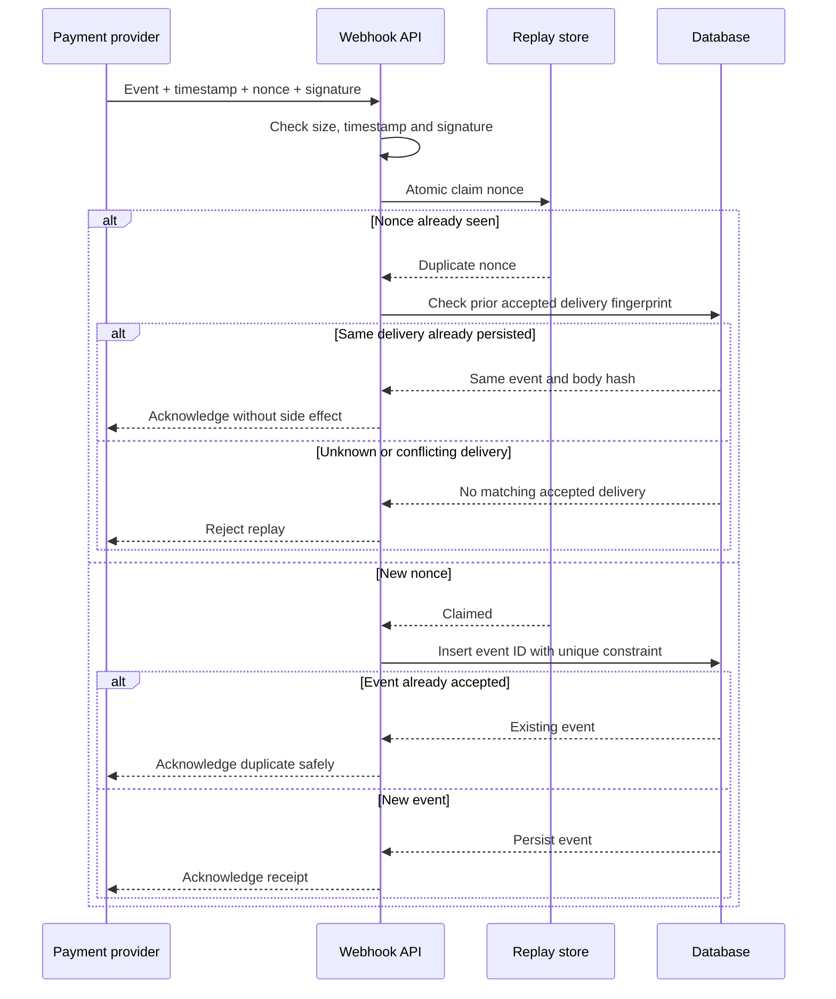
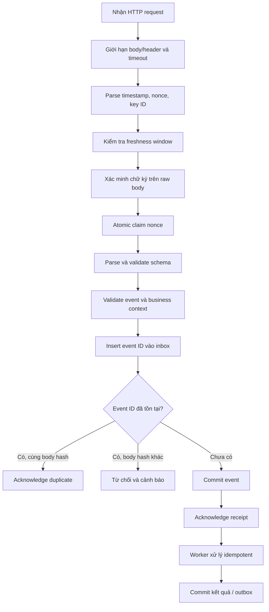

# Timestamp, nonce và replay protection

Trong chương **Webhook và callback** của module `SECURITY_API_SECURITY`, xác minh chữ ký chỉ giải quyết câu hỏi payload có được tạo bởi bên giữ secret và có bị sửa hay không. Nó chưa chứng minh request là mới. Một attacker có thể ghi lại một webhook hợp lệ rồi gửi lại nhiều lần để lặp thao tác như cộng số dư, tạo đơn hàng, phát hành quyền hoặc chuyển trạng thái giao dịch.

**Replay attack** là việc gửi lại một request hoặc thông điệp đã được chấp nhận trước đó. Để giảm rủi ro, webhook thường kết hợp timestamp, nonce, chữ ký ràng buộc các giá trị đó và cơ chế idempotency dựa trên event ID. Mỗi cơ chế giải quyết một phần khác nhau:

- Timestamp giới hạn khoảng thời gian một thông điệp có thể được chấp nhận.
- Nonce giúp nhận diện một lần gửi cụ thể và phát hiện cùng thông điệp bị phát lại trong cửa sổ thời gian.
- Chữ ký bảo đảm timestamp, nonce và nội dung không bị thay đổi sau khi bên gửi ký.
- Event ID/idempotency giúp xử lý an toàn các lần giao lại hợp lệ của cùng một sự kiện nghiệp vụ.

Không nên xem một trong các cơ chế này là đủ. Timestamp đơn lẻ vẫn cho phép phát lại trong freshness window; nonce không được ký có thể bị thay thế; còn idempotency không xác minh nguồn gửi. Cần kết hợp chúng thành một quy trình rõ ràng.

## Replay attack trong webhook

Giả sử nhà cung cấp thanh toán gửi webhook báo giao dịch đã thanh toán:

```http
POST /webhooks/payment HTTP/1.1
Content-Type: application/json
X-Provider-Timestamp: 1795000000
X-Provider-Nonce: 9b2d6a4f0c8e1d7a
X-Provider-Signature: v1=...

{
  "eventId": "evt_82a1",
  "type": "payment.succeeded",
  "paymentId": "pay_123",
  "amount": "250000.00",
  "currency": "VND"
}
```

Server xác minh chữ ký và cộng trạng thái thanh toán cho đơn hàng. Nếu attacker lấy được request này từ log, proxy, máy bị xâm nhập hoặc một điểm quan sát khác rồi gửi lại, server có thể xử lý cùng một sự kiện lần nữa nếu không có replay protection và idempotency.

Một webhook được ký đúng vẫn có thể bị phát lại. Chữ ký chứng minh tính toàn vẹn và nguồn gốc theo cơ chế secret/public key; nó không tự chứng minh request chưa từng được xử lý.



## Timestamp: giới hạn độ mới của request

Timestamp cho biết thời điểm bên gửi tạo hoặc ký thông điệp. Server so sánh timestamp đó với đồng hồ hiện tại và chỉ chấp nhận request trong một khoảng thời gian cho phép, thường gọi là *freshness window* hoặc *tolerance window*.

Ví dụ, nếu chính sách cho phép sai lệch tối đa 5 phút, timestamp phải nằm trong khoảng:

\[
now - 5\text{ phút} \le timestamp \le now + 5\text{ phút}
\]

Giới hạn quá rộng làm tăng thời gian attacker có thể phát lại một request đã ghi được. Giới hạn quá hẹp có thể từ chối webhook hợp lệ do độ trễ mạng, hàng đợi của nhà cung cấp hoặc clock skew. Hãy chọn giá trị dựa trên tài liệu nhà cung cấp, đặc tính delivery và mức độ nhạy cảm của nghiệp vụ; không sao chép một con số mặc định cho mọi tích hợp.

### Kiểm tra timestamp đúng cách

- Dùng Unix epoch theo đơn vị được hợp đồng quy định (giây hay mili giây); không tự đoán đơn vị dựa trên độ dài chuỗi.
- Dùng UTC để so sánh thời điểm. Không dùng timezone local của máy chủ.
- Từ chối timestamp sai định dạng, overflow, quá cũ hoặc nằm quá xa trong tương lai.
- Chấp nhận một mức clock skew nhỏ, có giới hạn rõ ràng.
- Đưa timestamp vào dữ liệu được ký. Nếu timestamp nằm ngoài chữ ký, attacker có thể thay nó để làm mới request đã bị chặn.
- Kiểm tra timestamp trước khi thực hiện bất kỳ side effect nào.

Ví dụ kiểm tra thời gian bằng Java:

```java
static Instant validateTimestamp(String value, Clock clock)
        throws SecurityException {
    final long epochSeconds;
    try {
        epochSeconds = Long.parseLong(value);
    } catch (NumberFormatException ex) {
        throw new SecurityException("Invalid webhook timestamp");
    }

    final Instant signedAt;
    try {
        signedAt = Instant.ofEpochSecond(epochSeconds);
    } catch (DateTimeException ex) {
        throw new SecurityException("Invalid webhook timestamp");
    }

    Duration skew = Duration.between(signedAt, clock.instant()).abs();
    if (skew.compareTo(Duration.ofMinutes(5)) > 0) {
        throw new SecurityException("Webhook timestamp is outside the allowed window");
    }
    return signedAt;
}
```

`Clock` được truyền vào giúp kiểm thử thời gian mà không phụ thuộc đồng hồ thật. Giá trị 5 phút chỉ là ví dụ. Nếu nhà cung cấp quy định cửa sổ khác, phải theo đúng hợp đồng và có kiểm thử tương ứng.

### Đồng bộ đồng hồ và vận hành

Timestamp chỉ hữu ích khi đồng hồ của các máy đủ chính xác. Các instance nhận webhook nên đồng bộ thời gian bằng NTP hoặc dịch vụ thời gian tin cậy, theo dõi độ lệch và cảnh báo khi vượt ngưỡng. Không dùng giờ local theo timezone tùy máy.

`Instant.now()` hoặc `Clock` phù hợp để so sánh với Unix timestamp. Đồng hồ monotonic như `System.nanoTime()` phù hợp đo thời lượng trong một tiến trình, không phải đối chiếu timestamp epoch từ bên ngoài.

Nếu các node trong cluster lệch thời gian đáng kể, cùng một webhook có thể được node này chấp nhận và node khác từ chối. Vì vậy, freshness window phải tính tới clock skew giữa các node, đồng thời cần giám sát chất lượng đồng hồ.

## Nonce: nhận diện một lần gửi

Nonce (number used once) là giá trị duy nhất cho một lần gửi thông điệp. Nhà cung cấp thường sinh nonce ngẫu nhiên hoặc một request ID đủ duy nhất, đưa nó vào header và ký cùng timestamp/body. Server lưu nonce đã chấp nhận trong một kho dùng chung để phát hiện request trùng.

Nonce cần đáp ứng các yêu cầu:

- Có entropy đủ cao và không dễ đoán nếu được sinh ngẫu nhiên; ví dụ 128 bit từ bộ sinh số ngẫu nhiên mật mã.
- Không bị tái sử dụng trong phạm vi mà server kiểm tra.
- Có giới hạn độ dài và định dạng để tránh lạm dụng tài nguyên.
- Được ràng buộc với provider/account/endpoint hoặc key ID phù hợp để tránh va chạm giữa các integration độc lập.
- Được đưa vào chữ ký. Nếu không, attacker có thể đổi nonce của request đã ghi và vượt qua kiểm tra trùng nonce.
- Được lưu bằng thao tác atomic, tránh hai instance cùng lúc đều kết luận nonce chưa tồn tại.

Không nên chỉ giữ nonce trong một `HashSet` hoặc bộ nhớ của một process. Trong môi trường nhiều instance, mỗi node sẽ có trạng thái riêng; request phát lại tới node khác có thể được chấp nhận. Dùng shared store hoặc database có unique constraint và thao tác ghi nguyên tử.

### Phạm vi và thời hạn lưu nonce

Nonce thường được giữ trong thời gian request còn có thể vượt qua timestamp validation. Nếu freshness window cho phép timestamp lệch cả về quá khứ lẫn tương lai, TTL cần đủ dài để nonce vẫn tồn tại cho toàn bộ khoảng mà request có thể còn hợp lệ, cộng thêm biên clock skew và độ trễ giữa các node.

Ví dụ, với cửa sổ ±5 phút, TTL bảo thủ có thể ít nhất khoảng 10 phút cộng margin vận hành. Đây chỉ là cách tính tham khảo; phải tính theo chính sách timestamp thực tế, cách provider retry và độ lệch đồng hồ.

Khóa lưu nonce nên có scope rõ ràng, chẳng hạn `providerAccountId + endpointId + nonce`. Nếu provider bảo đảm nonce duy nhất trên toàn account, scope có thể rộng hơn theo hợp đồng. Không dùng nonce từ một integration để vô tình chặn request của integration khác.

Thao tác claim nonce cần atomic, ví dụ Redis `SET key value NX EX ttl` hoặc insert vào bảng có unique key. Nếu thao tác claim thất bại vì nonce đã tồn tại, từ chối request như replay. Nếu replay store không khả dụng, không nên mặc định cho request đi qua; với webhook có tác động nhạy cảm, hãy fail closed và trả lỗi tạm thời để provider retry theo hợp đồng.

## Chữ ký phải ràng buộc timestamp, nonce và raw body

Server cần xác minh chữ ký trên đúng byte sequence mà nhà cung cấp đã ký. Với JSON, không parse rồi serialize lại trước khi xác minh vì khoảng trắng, thứ tự field, encoding hoặc cách escape có thể thay đổi byte sequence.

Quy trình tổng quát:

1. Đọc raw body trong giới hạn kích thước.
2. Lấy timestamp, nonce, key ID và signature theo header/hợp đồng của provider.
3. Kiểm tra cú pháp và freshness của timestamp.
4. Dùng secret/public key đã đăng ký cho integration để xác minh chữ ký theo đúng signing algorithm và canonicalization của provider.
5. Đảm bảo chữ ký ràng buộc timestamp, nonce và raw body; nếu giao thức hỗ trợ, ràng buộc thêm method, path, content type hoặc audience để tránh dùng chữ ký cho endpoint khác.
6. Chỉ sau khi chữ ký hợp lệ mới claim nonce trong replay store.
7. Sau đó mới parse payload, validate schema và kiểm tra nghiệp vụ.

Thứ tự và định dạng signing input phụ thuộc vào nhà cung cấp. Không tự thay đổi thuật toán hoặc tự tạo một canonicalization khác với tài liệu chính thức. Ví dụ dưới đây chỉ minh họa một scheme HMAC tự định nghĩa, không phải định dạng chung cho mọi webhook:

```text
signing_input = timestamp + "." + nonce + "." + raw_body
signature = HMAC-SHA256(secret, signing_input)
```

Nếu provider dùng RSA/ECDSA, HTTP Message Signatures hoặc một format riêng, phải dùng đúng quy trình của provider. Không được hạ cấp sang thuật toán yếu khi xác minh thất bại.

### Ví dụ Java minh họa HMAC

Đoạn code sau cho thấy nguyên tắc ký timestamp, nonce và raw body, sau đó so sánh chữ ký theo cách constant-time:

```java
static boolean verifyHmac(
        byte[] secret,
        String timestamp,
        String nonce,
        byte[] rawBody,
        String suppliedSignature
) throws GeneralSecurityException, IOException {
    ByteArrayOutputStream input = new ByteArrayOutputStream();
    input.write(timestamp.getBytes(StandardCharsets.US_ASCII));
    input.write('.');
    input.write(nonce.getBytes(StandardCharsets.US_ASCII));
    input.write('.');
    input.write(rawBody);

    Mac mac = Mac.getInstance("HmacSHA256");
    mac.init(new SecretKeySpec(secret, "HmacSHA256"));
    byte[] expected = mac.doFinal(input.toByteArray());

    final byte[] supplied;
    try {
        supplied = Base64.getDecoder().decode(suppliedSignature);
    } catch (IllegalArgumentException ex) {
        return false;
    }
    return MessageDigest.isEqual(expected, supplied);
}
```

Ví dụ giả định header signature chỉ chứa Base64 của HMAC. Khi tích hợp thực tế, parser header, prefix/version, key ID, thuật toán và signing input phải theo tài liệu provider. Giới hạn độ dài header trước khi decode và chọn key từ cấu hình tin cậy; không tải key từ URL tùy ý do request cung cấp.

Không xác minh chữ ký bằng `String.equals()` hoặc phép so sánh dừng ngay tại byte khác biệt. Dùng hàm constant-time phù hợp của thư viện mật mã. Không log secret, chữ ký đầy đủ hoặc raw body trong lỗi xác minh.

## Replay protection và idempotency không giống nhau

Hai khái niệm này thường bị nhầm:

| Cơ chế | Phát hiện điều gì? | Phạm vi lưu |
|---|---|---|
| Timestamp | Request quá cũ hoặc ở tương lai ngoài giới hạn | Không cần lưu từng request |
| Nonce store | Cùng một nonce được dùng lại trong freshness window | Ngắn hạn, dùng chung giữa các instance |
| Event ID / idempotency | Cùng một sự kiện nghiệp vụ được giao lại nhiều lần | Bền vững theo thời hạn retry và yêu cầu nghiệp vụ |

Nhà cung cấp có thể retry webhook hợp lệ khi timeout hoặc không nhận được acknowledgement. Mỗi lần giao lại có thể tạo timestamp và nonce mới, trong khi `eventId` vẫn giữ nguyên. Khi đó:

- Nonce mới: không bị replay store từ chối.
- Timestamp mới: vượt qua freshness validation.
- Event ID cũ: hệ thống nhận ra đây là cùng một sự kiện và không thực hiện side effect lần thứ hai.

Ngược lại, nếu cùng timestamp, nonce và signature bị gửi lại, request phải bị nhận diện là replay. Vì thế không nên dùng nonce làm idempotency key nghiệp vụ duy nhất.

### Lưu event ID bền vững

Sau khi xác minh chữ ký, freshness và nonce, lưu event vào bảng inbox hoặc kho idempotency có unique constraint. Key nên có scope như `provider + account + eventId`, tránh trùng ID giữa các provider hoặc tenant.

Một bản ghi event có thể lưu:

- Provider/account và event ID.
- Event type, resource ID và timestamp nghiệp vụ.
- Hash của raw body để phát hiện cùng event ID nhưng nội dung khác nhau.
- Trạng thái `RECEIVED`, `PROCESSING`, `PROCESSED` hoặc `FAILED_RETRYABLE`.
- Thời điểm nhận đầu tiên, số lần giao lại và thời điểm xử lý.

Nếu event ID đã tồn tại và body hash giống nhau, đây thường là delivery lặp lại hợp lệ; có thể acknowledgement thành công mà không lặp side effect. Nếu cùng event ID nhưng body hash khác, không xử lý như duplicate bình thường: từ chối theo chính sách, ghi cảnh báo bảo mật và điều tra sự bất nhất.

Giữ event ID lâu hơn nonce. Thời hạn lưu phải ít nhất bao phủ thời gian provider có thể retry và khoảng thời gian nghiệp vụ cần chống xử lý lặp. Với thanh toán hoặc cấp quyền, có thể cần lưu dấu idempotency lâu dài theo chính sách audit và vòng đời giao dịch.

## Xử lý nguyên tử và tránh side effect lặp

Một lỗi phổ biến là kiểm tra event ID rồi mới insert theo hai thao tác riêng:

```text
if eventId does not exist:
    process event
    save eventId
```

Hai request đồng thời có thể cùng thấy event ID chưa tồn tại và cùng thực hiện side effect. Phải dựa vào unique constraint hoặc thao tác atomic để chỉ một request giành quyền xử lý.

Một mẫu xử lý bền vững:

1. Xác minh chữ ký, timestamp và nonce.
2. Trong transaction, insert event vào inbox với unique key. Nếu vi phạm unique constraint, đọc bản ghi cũ và so sánh body hash.
3. Commit việc nhận event trước khi trả acknowledgement, nếu xử lý nghiệp vụ diễn ra bất đồng bộ.
4. Worker lấy event ở trạng thái có thể xử lý, dùng transaction và cơ chế khóa/claim để tránh nhiều worker xử lý cùng lúc.
5. Ghi kết quả nghiệp vụ và đánh dấu event đã xử lý trong cùng transaction khi có thể.
6. Với side effect tới hệ thống ngoài database, dùng outbox hoặc idempotency key ở dịch vụ đích; không giả định transaction database bao trùm được network call.

Không có bảo đảm exactly-once tổng quát qua mạng. Mục tiêu thực tế là delivery at-least-once kết hợp idempotent processing để đạt hiệu ứng nghiệp vụ một lần. Nếu webhook cần phản hồi đồng bộ, vẫn phải ghi nhận event một cách bền vững trước khi trả `2xx`.

## Luồng xử lý webhook đề xuất



Chi tiết có thể khác theo giao thức của provider. Điểm quan trọng là không thực hiện nghiệp vụ trước khi xác minh nguồn, độ mới, nonce và tính hợp lệ của payload; đồng thời không để hai delivery đồng thời tạo side effect trùng.

## Xử lý lỗi và retry

Phản hồi webhook cần phù hợp với retry policy của provider:

- Timestamp quá cũ hoặc chữ ký sai: từ chối; không yêu cầu provider retry vô hạn một request không thể trở nên hợp lệ.
- Nonce đã tồn tại: không chạy lại nghiệp vụ. Nếu kho lưu được fingerprint cho thấy chính delivery này đã được nhận bền vững trước đó, có thể trả `2xx` để kết thúc retry; nếu không xác định được lần nhận trước hoặc dữ liệu xung đột, từ chối và điều tra. Provider cần cấp timestamp/nonce mới khi retry một delivery chưa được nhận thành công theo hợp đồng.
- Event ID đã xử lý, body hash giống nhau: thường trả `2xx` để provider dừng retry.
- Event ID đã tồn tại nhưng body khác: ghi cảnh báo, không thực hiện side effect; response cụ thể theo hợp đồng và quy trình incident.
- Replay store/database tạm thời không khả dụng: trả lỗi tạm thời theo retry contract; không bypass kiểm soát để tiếp tục.
- Event đã được lưu bền vững nhưng worker chưa xử lý: có thể trả `2xx` sau khi commit inbox và để worker retry nội bộ.

Không trả thông tin chi tiết về secret, chữ ký mong đợi, cấu trúc nội bộ hoặc lý do xác minh nhạy cảm cho caller. Log nội bộ có thể ghi mã lỗi phân loại và correlation ID để điều tra.

## Key rotation và nhiều provider

Mỗi integration nên có key/secret riêng hoặc ít nhất có phạm vi tách biệt. Nếu dùng chung một secret cho nhiều endpoint, một endpoint yếu có thể ảnh hưởng tới toàn bộ tích hợp.

Khi xoay key:

- Có key ID để xác định key theo cấu hình đã đăng ký.
- Cho phép key cũ và key mới cùng hợp lệ trong cửa sổ chuyển đổi được kiểm soát nếu provider hỗ trợ.
- Không chấp nhận key ID tùy ý dẫn tới URL hoặc nguồn key không tin cậy.
- Ghi nhận key version đã xác minh để hỗ trợ audit mà không log secret.
- Thu hồi key cũ đúng hạn và cảnh báo khi vẫn có request dùng key sắp hết hiệu lực.

Replay store phải scope theo provider/account/key hoặc endpoint như hợp đồng quy định. Khi xoay key, cân nhắc việc nonce cùng giá trị có thể xuất hiện ở hai key khác nhau; chính sách scope phải ngăn va chạm ngoài ý muốn mà vẫn phát hiện replay trong đúng miền tin cậy.

## Kiểm thử replay protection

Test cần bao gồm cả request hợp lệ, request bị phát lại và retry hợp lệ:

| Tình huống | Kết quả mong đợi |
|---|---|
| Timestamp nằm trong freshness window, signature đúng, nonce mới | Chấp nhận và ghi event |
| Timestamp quá cũ hoặc quá xa trong tương lai | Từ chối trước side effect |
| Attacker sửa timestamp nhưng giữ signature cũ | Chữ ký không hợp lệ |
| Attacker thay nonce nhưng giữ signature cũ | Chữ ký không hợp lệ |
| Cùng nonce và signature được gửi lại | Replay bị phát hiện |
| Cùng nonce tới hai instance đồng thời | Chỉ một instance claim thành công |
| Replay store không khả dụng | Fail closed theo chính sách; không xử lý nghiệp vụ |
| Cùng event ID, timestamp/nonce mới và body giống nhau | Acknowledge duplicate, không lặp side effect |
| Cùng event ID nhưng body khác | Từ chối và tạo cảnh báo |
| Hai request cùng event ID tới đồng thời | Unique constraint chỉ cho một event được nhận |
| Provider retry sau timeout | Xử lý idempotent và trả response theo hợp đồng |
| Clock của một node lệch | Phát hiện qua monitoring; không tạo quyết định trái nhau ngoài policy |
| Secret/key ID không hợp lệ hoặc đã thu hồi | Từ chối xác minh |
| Raw body có whitespace/encoding khác | Chữ ký được xác minh trên đúng raw bytes, không parse-reserialize trước |

Kiểm thử race condition bằng nhiều request đồng thời, không chỉ gọi tuần tự. Kiểm tra side effect trong database, message broker, email hoặc dịch vụ thanh toán để chắc chắn một event không được thực hiện nhiều lần.

## Giám sát và audit

Theo dõi các metric:

- Số webhook bị từ chối do timestamp quá cũ/tương lai.
- Số chữ ký không hợp lệ theo provider và key ID.
- Số nonce trùng, event ID trùng và event ID có body hash khác.
- Độ trễ giữa timestamp ký và thời điểm nhận.
- Tỷ lệ retry, thời gian xử lý inbox và số event tồn đọng.
- Clock skew giữa các instance và tình trạng replay store.

Không ghi raw body, secret, token hoặc chữ ký đầy đủ vào log thông thường. Dùng event ID, correlation ID, provider/account ID, mã lỗi và hash phù hợp để truy vết. Giới hạn quyền truy cập replay store và inbox; đây là dữ liệu vận hành nhạy cảm có thể tiết lộ luồng giao dịch và định danh khách hàng.

## Checklist triển khai

- [ ] Timestamp dùng UTC/epoch theo hợp đồng, có freshness window rõ ràng.
- [ ] Đồng hồ server được đồng bộ và giám sát clock skew.
- [ ] Timestamp và nonce được ràng buộc trong chữ ký cùng raw body.
- [ ] Chữ ký được xác minh theo đúng thuật toán/canonicalization của provider.
- [ ] Chữ ký được so sánh constant-time và key được lấy từ cấu hình tin cậy.
- [ ] Nonce có entropy/format phù hợp, scope rõ ràng và được claim atomic trong shared store.
- [ ] TTL nonce bao phủ toàn bộ thời gian request còn có thể hợp lệ.
- [ ] Event ID được lưu bền vững với unique constraint và body hash.
- [ ] Retry hợp lệ được xử lý idempotent; duplicate không lặp side effect.
- [ ] Event được lưu bền vững trước acknowledgement nếu xử lý bất đồng bộ.
- [ ] Replay store hoặc database lỗi không làm bypass replay protection.
- [ ] Có test timestamp cũ/tương lai, nonce replay, race condition, duplicate event và key rotation.
- [ ] Log/metric không làm lộ secret, token hoặc raw payload nhạy cảm.

Timestamp giới hạn thời gian một webhook có thể được chấp nhận; nonce phát hiện cùng lần gửi bị sử dụng lại; chữ ký ràng buộc những giá trị này với nội dung; event ID giúp hệ thống xử lý retry mà không lặp side effect. Kết hợp các lớp đó với lưu trữ atomic, đồng bộ đồng hồ và kiểm thử concurrency sẽ giúp webhook an toàn hơn trước replay attack và lỗi giao nhận lặp.
