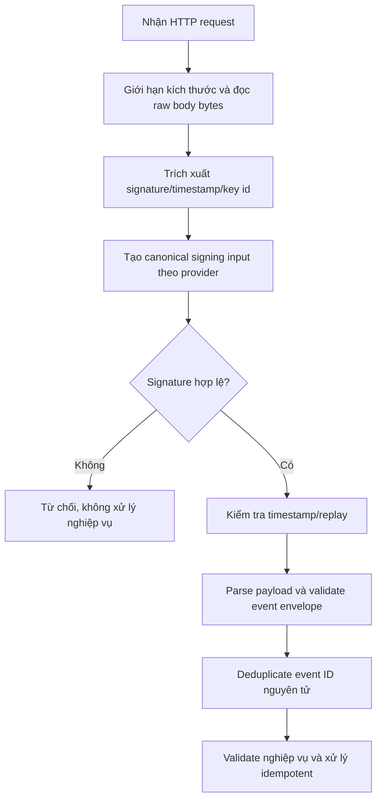

# Canonical request trước khi verify

Webhook provider gửi một HTTP request tới endpoint của bạn kèm chữ ký. Server cần tạo lại đúng dữ liệu đã được ký rồi mới xác minh chữ ký. Nếu provider ký raw body nhưng server parse JSON rồi serialize lại, hai bên có thể tạo ra byte khác nhau dù JSON nhìn giống nhau. Nếu proxy đổi path, middleware giải nén body hoặc code tự chuẩn hóa query/header không đúng quy tắc, chữ ký có thể sai; nguy hiểm hơn, hai thành phần có thể hiểu cùng một request theo hai cách khác nhau.

**Canonical request** là biểu diễn request theo một quy tắc xác định, không mơ hồ, để bên ký và bên xác minh tạo ra cùng một signing input. Với webhook, canonicalization phải tuân theo chính xác giao thức chữ ký của provider. Không có một cách chuẩn hóa JSON, URL hay HTTP header dùng chung cho mọi nhà cung cấp.

Trong API Security, việc tạo canonical request là bước quan trọng trước khi verify HMAC hoặc HTTP message signature. Server phải biết chính xác thành phần nào được ký, byte nào được dùng, cách xử lý thứ tự/encoding/whitespace và request đã đi qua những middleware nào. Chỉ sau khi chữ ký hợp lệ mới nên parse payload thành dữ liệu nghiệp vụ và thực hiện side effect.

Sau bài học, người đọc có thể:

- Giải thích canonical request và vì sao hai JSON tương đương về ý nghĩa vẫn có thể khác chữ ký.
- Phân biệt raw request bytes, parsed object và canonical signing input.
- Xác định đúng method, path, query, header, timestamp và body mà provider ký.
- Tránh lỗi do proxy rewrite, URL normalization, duplicate header và content encoding.
- Tạo/verify HMAC bằng constant-time comparison theo đúng định dạng provider.
- Hiểu cách HTTP Message Signatures (RFC 9421) tạo signature base.
- Kết hợp signature verification với timestamp, replay protection và idempotent event processing.
- Viết test vector và negative test cho các trường hợp canonicalization sai lệch.

## 1. Vì sao phải tạo canonical request?

Chữ ký số hoặc HMAC không được tính trên khái niệm trừu tượng “một JSON object”. Nó được tính trên một chuỗi byte hoặc một signature base được định nghĩa. Nếu hai bên tạo input khác nhau dù payload có vẻ tương đương, chữ ký sẽ không khớp.

Ví dụ hai JSON sau thường biểu diễn cùng dữ liệu:

```json
{"event":"payment.succeeded","amount":125000,"currency":"VND"}
```

```json
{
  "currency": "VND",
  "amount": 125000,
  "event": "payment.succeeded"
}
```

Nhưng byte của hai body khác nhau do thứ tự property, khoảng trắng và newline. Nếu provider ký byte body nhận được, server phải xác minh đúng byte đó. Parse JSON rồi serialize lại có thể thay đổi:

- Thứ tự property.
- Khoảng trắng, newline và dấu escape.
- Cách biểu diễn số như `1`, `1.0` hoặc `1e0`.
- Unicode literal so với `\\u` escape.
- Cách xử lý duplicate key.
- Dấu `/`, dấu thập phân hoặc quy tắc serializer riêng.

Canonicalization giải quyết vấn đề này bằng một quy tắc được cả signer và verifier tuân theo. Với một số webhook, quy tắc rất đơn giản: chữ ký được tính trên timestamp nối với raw body bytes. Với giao thức khác, signing input có thể gồm method, path, query, một số header và digest của body.

### 1.1. Ba dạng dữ liệu cần phân biệt

| Dạng | Mô tả | Dùng ở đâu |
|---|---|---|
| Raw request representation | Byte body và các thành phần HTTP như method, target, header theo cách server nhận được | Nguồn để trích xuất dữ liệu đã ký |
| Parsed request/object | JSON đã được deserialize thành object hoặc map | Xử lý nghiệp vụ sau khi xác minh |
| Canonical signing input | Chuỗi byte/format được tạo đúng quy tắc chữ ký | Đầu vào của HMAC hoặc thuật toán signature |

Không nhầm canonical signing input với JSON đã parse. Không mặc định canonical request luôn là `method + path + body`; công thức thực tế phụ thuộc provider hoặc chuẩn chữ ký được sử dụng.

## 2. Quy tắc của provider là nguồn sự thật

Trước khi viết code, hãy đọc tài liệu chữ ký của provider và ghi rõ:

1. Thuật toán: HMAC-SHA256, RSA/ECDSA, HTTP Message Signatures hay cơ chế riêng?
2. Key: shared secret, public key, key ID hay certificate nào được dùng?
3. Thành phần được ký: raw body, timestamp, method, path, query, host, content digest hoặc header nào?
4. Thứ tự và dấu phân cách giữa các thành phần là gì?
5. Encoding: UTF-8, ASCII, Base64, hex, Base64URL hay Structured Fields?
6. Có chuẩn hóa URL, header hoặc JSON không? Nếu có, quy tắc cụ thể nào?
7. Timestamp/nonce/event ID nằm ở đâu và được xác minh ra sao?
8. Key rotation và nhiều phiên bản chữ ký được hỗ trợ như thế nào?

Ví dụ các nhà cung cấp có thể dùng các công thức khác nhau:

```text
Provider A:
  HMAC-SHA256(secret, timestamp + "." + raw_body)

Provider B:
  HMAC-SHA256(secret, raw_body)

Provider C:
  Signature over a canonical HTTP request containing
  method, path, selected headers and content digest
```

Đây là các ví dụ minh họa, không phải công thức chuẩn cho mọi provider. Không tự chọn một công thức rồi kỳ vọng chữ ký sẽ hợp lệ. Nếu tài liệu provider không nói rõ body representation hoặc canonicalization, cần làm rõ bằng test vector chính thức hoặc SDK/reference implementation.

## 3. Raw body phải được giữ nguyên

Với webhook ký raw body, hãy lấy đúng byte body trước khi JSON parser, object mapper hoặc middleware biến đổi nội dung.

Không làm theo cách sau:

```java
// Sai với giao thức ký raw body: deserialize rồi serialize lại.
PaymentEvent event = objectMapper.readValue(requestBody, PaymentEvent.class);
String json = objectMapper.writeValueAsString(event);
byte[] signingInput = json.getBytes(StandardCharsets.UTF_8);
verifySignature(signingInput, signature);
```

Code này có thể đổi thứ tự property, whitespace, number format hoặc escape sequence. Chữ ký phải được kiểm tra trên byte representation mà provider đã ký, không phải một serialization mới.

Thứ tự an toàn:



Thứ tự timestamp và signature có thể thay đổi theo giao thức, nhưng payload không được tạo side effect trước khi xác minh. Có thể kiểm tra cú pháp header, giới hạn body và timestamp range sơ bộ trước HMAC; quyết định tin cậy chỉ được đưa ra sau khi verify.

### 3.1. UTF-8 và byte conversion

Nếu provider quy định body là UTF-8 text, vẫn phải hiểu họ ký byte nào. Một JSON body truyền qua HTTP thường là byte sequence; khi verify raw body, dùng chính byte array server nhận được. Không decode sang `String` rồi encode lại nếu giao thức không yêu cầu. Nếu cần tạo một phần signing input dạng text như timestamp, encode đúng charset mà provider quy định và nối byte theo đúng thứ tự.

Không dùng charset mặc định của JVM. Dùng `StandardCharsets.UTF_8` hoặc charset cụ thể trong tài liệu giao thức. Không tự chuẩn hóa Unicode NFC/NFD nếu signer không làm vậy.

### 3.2. Content-Encoding và transfer framing

HTTP server thường loại bỏ transfer framing như chunk boundaries trước khi ứng dụng đọc body. Với `Content-Encoding: gzip`, middleware có thể giải nén trước khi controller nhận dữ liệu. Provider có thể ký entity bytes trước giải nén hoặc representation đã giải nén theo giao thức riêng.

Phải xác minh chính xác byte representation được ký. Không tự giải nén hoặc nén lại trước khi verify. Nếu provider ký compressed bytes, cần lấy đúng compressed representation; nếu provider ký body sau một bước giải mã được định nghĩa, phải cấu hình middleware để tái tạo đúng bước đó. Không suy luận từ việc controller thấy JSON đã giải nén.

## 4. Canonicalize từng thành phần HTTP như thế nào?

Nếu chữ ký bao gồm nhiều thành phần request, mỗi thành phần cần quy tắc rõ ràng. Những điểm dưới đây là các vùng dễ sai; quy tắc thực tế vẫn phải theo giao thức đã chọn.

### 4.1. HTTP method

Method là thành phần được ký trong một số giao thức. Dùng đúng method mà giao thức quy định. Không tự chuyển method sang chữ thường hoặc chuẩn hóa alias. HTTP method token có tính phân biệt chữ hoa/thường theo ngữ nghĩa HTTP; các method thông dụng thường viết hoa như `POST`.

Nếu proxy rewrite method hoặc ứng dụng nhận method override qua header, cần xác định signer đã ký method nào. Không dùng method sau override nếu provider ký method trên wire.

### 4.2. Path và request target

Path có thể bị thay đổi bởi reverse proxy, API gateway hoặc framework routing. Các dạng sau có thể không tương đương về byte:

```text
/v1/events/a%2Fb
/v1/events/a/b
/v1/events/%61
/v1/events/a
```

Không tự decode rồi encode lại path, gộp dấu slash, bỏ dot segment hoặc đổi chữ hoa/thường trong percent-encoding nếu giao thức không yêu cầu. `%2F` có thể mang ý nghĩa khác `/`; decode sai có thể thay đổi tài nguyên được xác định.

Xác định provider ký raw request-target, path đã chuẩn hóa theo một chuẩn cụ thể hay path được dựng từ base URL. Nếu proxy rewrite prefix, ví dụ `/webhooks/provider` thành `/internal/events`, verifier cần dùng đúng path mà signer đã dùng. Không lấy path nội bộ sau rewrite rồi giả định đó là path đã ký.

### 4.3. Query string

Query string có nhiều trường hợp dễ tạo canonicalization mismatch:

- Thứ tự parameter khác nhau.
- Parameter lặp như `tag=a&tag=b`.
- Parameter không có giá trị so với giá trị rỗng: `flag` và `flag=`.
- Encoding `+` so với `%20`.
- Percent-encoding chữ hoa/thường.
- Dấu `&`, `=`, Unicode và ký tự reserved.

Không tự sort, decode hoặc loại bỏ duplicate query parameter nếu giao thức không quy định. Nếu protocol yêu cầu sort, phải biết sort theo byte hay theo decoded name/value, xử lý duplicate ra sao và encoding trước hay sau sort.

### 4.4. Header

Tên HTTP header không phân biệt hoa thường, nhưng cách chuẩn hóa giá trị, whitespace và nhiều field cùng tên phụ thuộc giao thức chữ ký. Cần xác định:

- Header nào được đưa vào signing input.
- Tên header có được lowercase không.
- Leading/trailing whitespace có được trim không.
- Nhiều giá trị được nối bằng dấu phân cách nào.
- Duplicate header được giữ riêng, kết hợp hay từ chối.
- Header có thể bị proxy thêm, bỏ hoặc sửa hay không.

Không dùng `getHeader()` một cách mù quáng nếu container gộp duplicate header theo quy tắc khác với signer. Với header quan trọng như timestamp, signature hoặc key ID, nên từ chối trường hợp duplicate/ambiguous nếu provider protocol yêu cầu một giá trị duy nhất.

### 4.5. Host, port và forwarded headers

Một số giao thức ký `host`, `:authority` hoặc URL đầy đủ. Reverse proxy có thể thay host nội bộ; `X-Forwarded-Host` và `Forwarded` có thể do proxy thêm. Không tin các forwarded header từ client ngoài nếu proxy chưa xóa và ghi đè chúng.

Chỉ dùng metadata forwarded từ proxy được cấu hình tin cậy, với danh sách proxy rõ ràng. Nếu provider ký host public nhưng ứng dụng chỉ thấy host nội bộ, cần giữ lại original host một cách đáng tin cậy hoặc xác minh tại edge nơi request target còn nguyên.

### 4.6. Timestamp, nonce và content digest

Timestamp thường được ký để giới hạn replay. Phải dùng đúng đơn vị và format: Unix seconds, milliseconds, HTTP-date hay chuỗi ISO 8601. Không parse rồi format lại theo timezone hoặc precision khác nếu giao thức yêu cầu byte gốc.

Nếu giao thức ký digest, xác định thuật toán hash, encoding và header chứa digest. Tính digest trên đúng byte representation được chỉ định. Digest không mã hóa nội dung; nó chỉ ràng buộc nội dung vào signature.

## 5. Định dạng canonical input phải không mơ hồ

Khi giao thức là custom HMAC, các thành phần thường được nối với nhau bằng delimiter. Nếu delimiter có thể xuất hiện trong dữ liệu, hai request khác nhau có thể tạo cùng chuỗi ghép hoặc gây hiểu nhầm về ranh giới field.

Ví dụ cách nối thiếu quy tắc:

```text
ab + c  -> abc
a + bc  -> abc
```

Nếu giao thức do tổ chức tự thiết kế, nên dùng một định dạng không mơ hồ, chẳng hạn:

- Length-prefix cho từng thành phần.
- Dấu phân cách được escape theo một quy tắc chặt.
- Structured Fields hoặc một định dạng canonical đã được chuẩn hóa.
- Phiên bản canonicalization được đưa vào signing input.

Ví dụ minh họa length-prefix:

```text
v1\n
method:4:POST
path:12:/v1/webhooks
timestamp:10:1730000000
body-sha256:64:<lowercase-hex-digest>
```

Đây chỉ là ví dụ thiết kế nội bộ, không phải format của một provider cụ thể. Không tự đổi format đang được provider sử dụng. Nếu thiết kế giao thức mới, cần có tài liệu byte-level, test vector và versioning để tránh signer/verifier triển khai khác nhau.

## 6. Ví dụ HMAC ký timestamp và raw body

Giả sử tài liệu provider quy định:

```text
signing_input = ASCII(timestamp) + "." + raw_body_bytes
expected_signature = HMAC-SHA256(secret, signing_input)
header = Base64(expected_signature)
```

Server phải lấy timestamp đúng header, giữ nguyên raw body và tính HMAC trên cùng byte sequence. Ví dụ Java:

```java
static byte[] buildSigningInput(String timestamp, byte[] rawBody) {
    byte[] prefix = (timestamp + ".").getBytes(StandardCharsets.US_ASCII);
    byte[] input = Arrays.copyOf(prefix, prefix.length + rawBody.length);
    System.arraycopy(rawBody, 0, input, prefix.length, rawBody.length);
    return input;
}

static byte[] hmacSha256(byte[] secret, byte[] signingInput)
        throws GeneralSecurityException {
    Mac mac = Mac.getInstance("HmacSHA256");
    mac.init(new SecretKeySpec(secret, "HmacSHA256"));
    return mac.doFinal(signingInput);
}

static boolean verifyBase64Signature(
        byte[] expected,
        String suppliedBase64) {
    final byte[] supplied;
    try {
        supplied = Base64.getDecoder().decode(suppliedBase64);
    } catch (IllegalArgumentException ex) {
        return false;
    }

    return supplied.length == expected.length
            && MessageDigest.isEqual(expected, supplied);
}
```

Ví dụ chỉ đúng với format giả định ở trên. Một provider có thể dùng hex, Base64URL, prefix `sha256=`, nhiều chữ ký hoặc công thức khác. Phải parse header theo grammar của provider, giới hạn độ dài input và từ chối định dạng không hợp lệ. Không so sánh signature bằng `String.equals()` hoặc vòng lặp tự viết có thể dừng sớm; dùng constant-time comparison của thư viện mật mã sau khi kiểm tra định dạng/độ dài.

HMAC xác minh rằng bên gửi có shared secret và nội dung không bị thay đổi theo signing input. HMAC không mã hóa body, không tự ngăn replay và không chứng minh event hợp lệ về nghiệp vụ.

## 7. HTTP Message Signatures và canonical signature base

Nếu hệ thống dùng HTTP Message Signatures (RFC 9421), không tự phát minh format ghép method/path/header. Chuẩn định nghĩa cách chọn covered components, tạo signature base và biểu diễn tham số chữ ký qua Structured Fields.

Một signature có thể bao phủ các thành phần như:

- `@method` — HTTP method.
- `@target-uri` hoặc các derived component phù hợp — target URI.
- Các header được chọn như `content-digest`, `content-type` hoặc `host`/`:authority` theo ngữ cảnh.
- Các tham số signature như `created`, `expires`, `nonce`, `keyid` và `alg` theo profile.

Verifier cần tái tạo signature base đúng RFC và đúng danh sách covered components mà chữ ký khai báo, sau đó xác minh bằng key/algorithm phù hợp. Không bỏ qua thành phần bắt buộc hoặc tự thêm một header không được signer bao phủ. Kiểm tra key ID, thuật toán được phép và thời gian hiệu lực; không chấp nhận thuật toán do request chọn nếu nó nằm ngoài policy.

`Content-Digest` (RFC 9530) có thể được dùng để ràng buộc nội dung message; chữ ký cần bao phủ digest header nếu muốn bảo vệ digest khỏi bị thay đổi. Tính digest trên đúng message content bytes theo chuẩn. Digest hợp lệ một mình không xác thực nguồn gửi.

## 8. Reverse proxy và middleware có thể làm thay đổi request

Webhook thường đi qua CDN, WAF, API gateway, ingress và framework trước khi tới controller. Mỗi tầng có thể:

- Rewrite path hoặc host.
- Giải nén `Content-Encoding`.
- Chuẩn hóa hoặc gộp header.
- Thay đổi query string hoặc encoding.
- Thêm `Forwarded`/`X-Forwarded-*`.
- Buffer hoặc chuyển tiếp body theo cách khác.

Hãy xác định điểm nào là nguồn sự thật cho từng thành phần đã ký. Có thể verify tại edge trước khi rewrite; hoặc cấu hình proxy giữ nguyên original request target và truyền metadata qua một trust channel được bảo vệ. Không nhận header “original URL” từ client ngoài làm dữ liệu tin cậy.

Nếu proxy và ứng dụng nhìn thấy request khác nhau, kiểm thử trên toàn đường đi production-like. Unit test controller không phát hiện được path rewrite hoặc duplicate header do proxy tạo ra.

### 8.1. Chỉ tin forwarded headers từ proxy tin cậy

Không dùng `X-Forwarded-Host`, `X-Forwarded-Proto` hoặc `Forwarded` để dựng signing input nếu request có thể đi trực tiếp từ Internet và client tự đặt các header đó. Proxy tin cậy phải xóa header do client gửi rồi ghi lại giá trị của chính nó; ứng dụng chỉ chấp nhận từ hop đã xác thực.

Nếu signer ký public host nhưng app nhận internal host, cấu hình trusted proxy và header handling phải nhất quán. Không fallback sang `Host` hoặc `X-Forwarded-Host` theo cách tùy request vì attacker có thể chọn đường làm canonical input khác nhau.

## 9. Đọc raw body trong Spring Boot

Một controller có thể nhận `byte[]` để giữ nguyên body bytes theo representation mà HTTP message converter cung cấp:

```java
@RestController
class ProviderWebhookController {
    private final WebhookVerifier verifier;
    private final ObjectMapper objectMapper;
    private final WebhookInbox inbox;

    @PostMapping(
            path = "/webhooks/provider",
            consumes = MediaType.APPLICATION_JSON_VALUE)
    ResponseEntity<Void> receive(
            @RequestHeader("X-Provider-Timestamp") String timestamp,
            @RequestHeader("X-Provider-Signature") String signature,
            @RequestBody byte[] rawBody) throws IOException {

        verifier.verify(timestamp, signature, rawBody);

        ProviderEvent event = objectMapper.readValue(rawBody, ProviderEvent.class);
        inbox.acceptVerifiedEvent(event);
        return ResponseEntity.accepted().build();
    }
}
```

`WebhookVerifier` phải thực hiện parse header, kiểm tra timestamp, tạo signing input đúng tài liệu provider và verify signature trước khi `ObjectMapper` parse payload nghiệp vụ. `WebhookInbox` cần lưu/deduplicate event một cách nguyên tử. Đoạn code minh họa thứ tự; cần xác minh converter và filter thực tế không giải nén hoặc biến đổi body trước khi controller nhận.

Với body lớn hoặc cần kiểm soát stream, đọc raw bytes qua filter/wrapper có giới hạn kích thước. Không đọc input stream một lần trong filter rồi để controller nhận stream rỗng; nếu cần cache body, dùng wrapper an toàn có giới hạn và tránh lưu body nhạy cảm lâu hơn cần thiết.

### 9.1. Giới hạn kích thước trước khi tính HMAC

Không đọc body không giới hạn chỉ để xác minh signature. Đặt giới hạn tại gateway/proxy và ứng dụng; từ chối body quá lớn trước khi cấp nhiều bộ nhớ hoặc CPU. Giới hạn cũng cần phù hợp với provider và loại event. Không log toàn bộ body khi signature sai.

## 10. Verify signature, timestamp và replay theo thứ tự

Một quy trình webhook thường gồm:

1. Xác định endpoint/provider và key set được cấu hình cho endpoint đó.
2. Kiểm tra kích thước request, content type và cú pháp header.
3. Parse timestamp/key ID theo định dạng chính xác; không tin giá trị chỉ vì parse được.
4. Tạo canonical signing input từ thành phần request đã xác định.
5. Tính signature với key và thuật toán được phép.
6. So sánh constant-time với signature được gửi.
7. Kiểm tra timestamp nằm trong cửa sổ chấp nhận; nếu protocol ký timestamp thì nó đã được bảo vệ bởi signature.
8. Parse payload sau khi verify và validate event envelope đủ để xác định event ID.
9. Lưu deduplication record nguyên tử theo event ID/nonce.
10. Validate business invariants và xử lý nghiệp vụ idempotent hoặc đưa vào queue đã được bảo vệ.

Thứ tự chi tiết có thể phụ thuộc giao thức, nhưng không được thực hiện business side effect trước khi xác minh chữ ký. Nếu cần đọc event ID trước khi verify để tìm key, chỉ dùng nó như dữ liệu chưa tin cậy; không thực hiện hành động dựa trên nó.

### 10.1. Timestamp không thay thế event deduplication

Timestamp giới hạn khoảng thời gian một request được chấp nhận, nhưng cùng một request có thể được phát lại nhiều lần trong cửa sổ đó. Provider cũng có thể retry một event hợp lệ khi không nhận được response.

Hãy dùng event ID hoặc nonce theo giao thức, lưu với unique constraint và xử lý nguyên tử. Nếu cùng event ID đã xử lý, trả response theo hợp đồng idempotent mà không lặp side effect. Nếu event ID trùng nhưng payload digest khác, ghi nhận anomaly và xử lý theo policy; không âm thầm coi là retry hợp lệ.

### 10.2. Key rotation và key ID

Nếu provider gửi `keyid`, chỉ dùng nó để chọn một key trong tập key đã cấu hình cho đúng provider/endpoint. Không dùng key ID để tải URL hoặc secret reference tùy ý. Trong giai đoạn rotation, có thể cho phép key hiện tại và key trước đó trong khoảng overlap có kiểm soát; audit key nào đã verify thành công và thu hồi key cũ theo lịch.

## 11. Lỗi thường gặp khi canonicalize

| Lỗi | Hậu quả | Cách xử lý |
|---|---|---|
| Parse JSON rồi serialize lại | Byte body thay đổi, chữ ký mismatch hoặc logic ký không nhất quán | Verify raw body bytes theo provider |
| Dùng charset mặc định | Byte signing input khác giữa môi trường | Dùng charset được định nghĩa tường minh |
| Tự sort query parameter | Thay đổi thứ tự hoặc ý nghĩa duplicate parameter | Chỉ sort nếu protocol yêu cầu, đúng thuật toán |
| Decode/re-encode path | `%2F`, Unicode hoặc reserved character thay đổi | Dùng đúng request target representation |
| Lấy path sau proxy rewrite | Signer và verifier ký hai path khác nhau | Verify tại edge hoặc giữ original target đáng tin cậy |
| Tin `X-Forwarded-*` từ client | Attacker điều khiển host/proto/path trong signing input | Chỉ tin proxy đã xác thực và ghi đè header |
| Gộp duplicate header tùy tiện | Ambiguous canonical input | Từ chối duplicate hoặc xử lý đúng spec |
| Giải nén body trước khi verify | Byte body khác representation đã ký | Verify đúng byte trước/sau decode theo spec |
| So sánh signature bằng `equals` | Timing behavior không phù hợp | Dùng constant-time comparison |
| Không kiểm tra timestamp/event ID | Request hợp lệ có thể bị replay | Timestamp window và dedupe nguyên tử |
| Dùng key từ request không giới hạn | Key substitution hoặc truy cập secret tùy ý | Key ID chỉ ánh xạ vào key registry tin cậy |
| Xử lý nghiệp vụ trước verify | Payload giả mạo tạo side effect | Verify trước parse/use/dispatch |

## 12. Kiểm thử canonical request bằng test vector

Canonicalization phải được kiểm thử ở mức byte, không chỉ so sánh object JSON. Mỗi provider integration nên lưu test vector gồm raw request components, canonical input mong đợi, key test và signature mong đợi. Chỉ dùng secret giả lập trong test.

### 12.1. Positive test

- Raw body chính xác và signature hợp lệ.
- Timestamp hợp lệ trong cửa sổ cho phép.
- Key ID ánh xạ tới key đang hoạt động.
- Header có chữ hoa/thường khác nhau theo quy tắc HTTP nhưng canonicalization vẫn đúng nếu protocol yêu cầu.
- Query/path có percent-encoding được xử lý theo đúng test vector.
- Rotation: chữ ký hợp lệ với key cũ trong giai đoạn overlap được cho phép.

### 12.2. Negative test

| Thay đổi | Kết quả mong đợi |
|---|---|
| Đổi một byte body | Signature không hợp lệ |
| Thêm whitespace/newline vào body đã ký raw | Signature không hợp lệ nếu byte body thay đổi |
| Đổi timestamp | Signature không hợp lệ hoặc timestamp ngoài cửa sổ |
| Đổi method/path/query được ký | Signature không hợp lệ |
| Đổi header được ký | Signature không hợp lệ |
| Duplicate signature/timestamp header | Từ chối theo quy tắc header của provider |
| Base64/hex sai định dạng hoặc sai độ dài | Từ chối an toàn |
| Unknown key ID | Từ chối; không thử tải key tùy ý |
| Token/signature từ provider khác | Từ chối do key scope không khớp |
| Replay cùng event ID | Không lặp side effect |
| Body quá lớn | Từ chối trước khi tiêu tốn tài nguyên quá mức |
| Proxy rewrite path/host | Test xác minh canonical input vẫn đúng hoặc request bị từ chối |
| Gzip/Content-Encoding khác | Xử lý đúng representation được ký; không đoán |

### 12.3. Test byte-level trong Java

Có thể cố định test vector bằng byte literal hoặc file fixture và so sánh byte array:

```java
assertThat(buildSigningInput("1730000000", rawBodyFixture))
        .containsExactly(expectedSigningInputFixture);

assertThat(hmacSha256(testSecret, expectedSigningInputFixture))
        .containsExactly(expectedSignatureFixture);
```

Không chỉ assert hai JSON object bằng nhau sau parse. Test phải bắt được khác biệt về whitespace, newline, Unicode, encoding, query order, duplicate parameter và header normalization khi các thành phần đó thuộc signing input.

### 12.4. Integration test qua proxy

Chạy request qua cùng loại gateway/ingress như production để kiểm tra:

- Original host/path được giữ hay rewrite.
- Header duplicate được xử lý thế nào.
- Body có bị giải nén, chuyển charset hoặc thay đổi không.
- Request trực tiếp bypass proxy có bị từ chối không.
- Header forwarded giả mạo từ Internet có bị proxy xóa không.

Unit test verifier không thể chứng minh đường đi HTTP thực tế bảo toàn representation đã ký.

## 13. Log, lỗi và dữ liệu nhạy cảm

Khi signature sai, log đủ thông tin để điều tra nhưng không ghi secret hoặc payload đầy đủ. Các trường hữu ích:

- Provider ID và endpoint ID.
- Key ID đã chọn, không phải key material.
- Request/correlation ID.
- Signature algorithm và canonicalization version.
- Lý do phân loại như malformed header, unknown key, timestamp expired hoặc signature mismatch.
- Kích thước body và content type.
- Kết quả replay/deduplication.

Không log shared secret, private key, raw signature nếu policy coi đó là dữ liệu nhạy cảm, token hoặc payload có dữ liệu cá nhân. Có thể ghi body digest để liên kết sự kiện nếu phù hợp, nhưng digest cũng có thể cho phép đối chiếu payload có entropy thấp; bảo vệ như metadata nhạy cảm.

Response cho provider nên tuân theo retry contract. Ví dụ signature sai thường trả lỗi xác thực và không xử lý; event hợp lệ đã nhận có thể trả `2xx` để provider ngừng retry; lỗi tạm thời nội bộ có thể trả lỗi retryable. Không trả stack trace hoặc chi tiết canonical input/secret về bên gửi.

## 14. Checklist trước khi phát hành webhook verifier

- [ ] Đã xác định đúng provider protocol và phiên bản signature.
- [ ] Có tài liệu byte-level về thành phần được ký, delimiter, encoding và thứ tự.
- [ ] Raw body được giữ nguyên tới bước verify; không parse/serialize lại trước đó.
- [ ] Content-Encoding và transfer handling khớp representation provider ký.
- [ ] Method/path/query/header/host chỉ được canonicalize theo đúng spec.
- [ ] Duplicate header, whitespace, percent-encoding và forwarded header có quy tắc rõ.
- [ ] Proxy rewrite được xử lý tại điểm có original request data đáng tin cậy.
- [ ] HMAC/signature dùng thuật toán và key được allowlist; so sánh constant-time.
- [ ] Key ID chỉ tra cứu trong registry tin cậy; có rotation/revocation.
- [ ] Timestamp window và event ID/nonce chống replay được thực thi.
- [ ] Không có business side effect trước khi verify thành công.
- [ ] Payload size, parser depth và content type được giới hạn.
- [ ] Có byte-level test vectors, negative tests và integration test qua proxy.
- [ ] Log/trace không chứa secret, token hoặc payload nhạy cảm.
- [ ] Retry/idempotency contract được xác định rõ cho event trùng và lỗi tạm thời.

## Kết luận

Canonical request là biểu diễn byte-level hoặc signature base được tạo theo đúng quy tắc của giao thức để signer và verifier xác minh cùng một request. Với webhook ký raw body, giữ nguyên byte body và không serialize lại JSON; với chữ ký bao phủ method, path, query hoặc header, chuẩn hóa từng thành phần đúng spec và tính đến proxy/middleware. Sau khi verify thành công mới parse và xử lý nghiệp vụ, đồng thời kiểm tra timestamp, replay và idempotency. Test vector ở mức byte và integration test qua toàn đường HTTP giúp phát hiện sai lệch mà kiểm thử JSON object đơn thuần không thể thấy.
