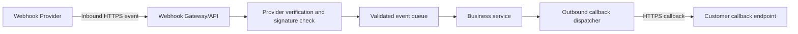

# Allowlist provider và endpoint callback

Webhook giúp một hệ thống gửi sự kiện đến hệ thống khác mà không cần bên nhận liên tục polling. Một provider có thể gửi event đến API của doanh nghiệp; ngược lại, nền tảng cũng có thể gửi callback đến URL do khách hàng đăng ký. Cả hai chiều đều tạo ra một ranh giới mạng cần kiểm soát: inbound webhook phải đến từ provider hợp lệ, còn outbound callback chỉ được gửi đến endpoint đã được xác minh và nằm trong phạm vi cấu hình được phép.

**Allowlist provider và endpoint callback** là việc xác định rõ nhà cung cấp nào được phép gửi webhook, địa chỉ/hostname nào được phép nhận callback, và điều kiện nào phải được đáp ứng trước khi chấp nhận hoặc tạo kết nối. Allowlist giảm bề mặt tấn công, nhưng không thay thế chữ ký webhook, xác thực service, authorization, chống replay hay kiểm soát SSRF.

Trong phạm vi `SECURITY_API_SECURITY`, webhook cần được thiết kế theo endpoint, tenant, event type và luồng nghiệp vụ. Cần phân biệt hai luồng: provider gửi vào hệ thống (inbound) và hệ thống gửi ra callback của khách hàng (outbound). Mỗi luồng có trust model và cách quản lý allowlist khác nhau.

## 1. Hai chiều webhook và ranh giới tin cậy



| Luồng | Ai khởi tạo kết nối? | Allowlist kiểm soát điều gì? | Bằng chứng xác thực chính |
|---|---|---|---|
| Inbound webhook | Provider gọi endpoint của doanh nghiệp | Provider network ranges/egress identity và endpoint route được chấp nhận | Chữ ký payload, timestamp, event ID; có thể thêm mTLS |
| Outbound callback | Hệ thống gọi URL do tenant đăng ký | Hostname, scheme, port, DNS/IP và path callback được phép | Endpoint ownership/verification, TLS và secret/signature của callback sender |

Không nên nhập hai danh sách này làm một. IP provider gửi webhook là nguồn kết nối inbound; URL callback là đích kết nối outbound. Một provider có thể dùng nhiều IP hoặc CDN thay đổi theo thời gian, trong khi callback endpoint có thể do từng tenant tự quản lý.

## 2. Allowlist provider cho inbound webhook

Inbound webhook endpoint thường public trên Internet để provider có thể gọi. Hệ thống cần xác định provider hợp lệ và event nào provider đó được phép gửi.

### 2.1. Danh mục provider được hỗ trợ

Quản lý provider trong registry cấu hình phía server, ví dụ:

| Provider ID | Inbound route | Cơ chế xác minh | Event được chấp nhận |
|---|---|---|---|
| `payment-a` | `/webhooks/payment-a` | HMAC signature + timestamp | `payment.succeeded`, `payment.failed` |
| `shipping-b` | `/webhooks/shipping-b` | Public-key signature | `shipment.updated`, `shipment.delivered` |
| `identity-c` | `/webhooks/identity-c` | mTLS + signature theo hợp đồng | `identity.changed` |

Các tên trên chỉ là ví dụ. Mỗi provider cần có owner, tài liệu giao thức, secret/key version, endpoint route, event allowlist, retry semantics và quy trình rotation. Không nhận `providerId` từ body rồi tin đó là nguồn phát hành. Provider phải được xác định bởi route/cấu hình và bằng chứng xác thực tương ứng.

### 2.2. IP allowlist của provider

Nếu provider công bố dải IP nguồn ổn định, có thể giới hạn inbound traffic theo CIDR ở firewall, load balancer, API gateway hoặc reverse proxy. Cách này giúp giảm traffic không liên quan trước khi request vào ứng dụng.

Khi dùng IP allowlist:

- Lấy dải IP từ tài liệu hoặc kênh hỗ trợ chính thức của provider.
- Lưu nguồn thông tin, thời điểm xác minh, owner và thời điểm review tiếp theo.
- Hỗ trợ nhiều CIDR/IPv4/IPv6 nếu provider công bố.
- Cập nhật trước khi provider thay đổi IP; theo dõi thông báo thay đổi mạng.
- Dùng firewall/gateway để lọc sớm, tránh chỉ kiểm tra trong controller.
- Có quy trình rollback nếu cập nhật CIDR làm mất webhook hợp lệ.
- Không tự mở rộng dải IP quá rộng để xử lý sự cố tạm thời.

IP allowlist là một tín hiệu nguồn mạng, không chứng minh payload chưa bị sửa và không chứng minh event thuộc tenant nào. IP có thể được chia sẻ qua cloud egress, CDN hoặc proxy; một địa chỉ được phép cũng có thể bị dùng bởi workload khác trong cùng hạ tầng. Vì vậy, vẫn phải xác minh chữ ký và event context.

### 2.3. Không dùng IP allowlist làm lớp xác thực duy nhất

Nếu attacker có thể gửi request từ một IP được phép, ví dụ thông qua hạ tầng dùng chung hoặc một máy bị xâm nhập, họ có thể vượt qua IP filter. Chữ ký HMAC hoặc chữ ký số trên raw request body giúp xác minh payload được tạo bởi bên giữ key tương ứng.

Với HMAC:

- Mỗi provider hoặc endpoint nên có secret riêng.
- So sánh chữ ký bằng constant-time comparison.
- Tính chữ ký trên đúng raw body/chuỗi canonical theo tài liệu provider.
- Không parse rồi serialize JSON trước khi verify nếu giao thức ký raw bytes.
- Hỗ trợ key ID/version để rotation và chọn đúng secret.
- Không log secret hoặc signature đầy đủ nếu không cần.

Với public-key signature, provider ký bằng private key và hệ thống xác minh bằng public key đã tin cậy. Quản lý key ID, thuật toán được phép, issuer, rotation và thời hạn tin cậy. Không lấy public key URL tùy ý từ payload rồi tự động tin nó.

### 2.4. mTLS và identity ở tầng kết nối

Mutual TLS có thể xác minh client certificate của provider tại gateway hoặc service. Certificate phải được kiểm tra chain, SAN/identity, expiry, revocation và trust store phù hợp. Không chỉ kiểm tra certificate do một CA công cộng bất kỳ cấp; cần ràng buộc identity với provider cụ thể.

mTLS bảo vệ identity của kết nối, còn signature có thể bảo vệ tính toàn vẹn của event qua proxy/queue và hỗ trợ xác minh ở application layer. Có thể dùng cả hai nếu threat model yêu cầu. Không giả định TLS termination tại load balancer đồng nghĩa application đã xác minh provider identity; cần truyền identity qua kênh tin cậy hoặc xác minh lại tại service.

## 3. Inbound endpoint phải gắn provider với route và event type

Nên dùng route riêng cho từng provider hoặc một route chung nhưng có registry và verifier lựa chọn provider rõ ràng. Route riêng thường giúp giới hạn cấu hình, key và parser theo giao thức.

Ví dụ:

```text
POST /webhooks/provider-a
POST /webhooks/provider-b
POST /webhooks/provider-c
```

Không dùng một endpoint nhận mọi payload rồi tự đoán provider chỉ dựa vào field `source` trong JSON. Nếu cần endpoint chung, phải xác minh credential trước khi chấp nhận `providerId`, và mỗi provider phải có schema/event allowlist riêng.

Sau khi xác minh chữ ký, tiếp tục kiểm tra:

- Event type có nằm trong danh sách provider được phép không?
- Event ID và timestamp có hợp lệ không?
- Account/merchant/project reference có map đến tenant đã đăng ký không?
- Resource ID có thuộc tenant và integration tương ứng không?
- Event có phù hợp trạng thái nghiệp vụ hiện tại không?
- Payload có đúng schema/version, giới hạn kích thước và content type không?

Một chữ ký hợp lệ chỉ chứng minh event được ký bởi bên giữ key; nó không tự cấp quyền cho event thay đổi mọi object trong hệ thống. Cần kiểm tra tenant/object scope và business invariant trước side effect.

## 4. Quản lý allowlist CIDR và cập nhật provider IP an toàn

Dải IP provider có thể thay đổi do mở rộng region, chuyển CDN hoặc thay hạ tầng. Một quy trình cập nhật nên có:

1. Nguồn chính thức và chữ ký/xác thực nếu provider cung cấp feed.
2. Kiểm tra định dạng CIDR, loại địa chỉ và phạm vi hợp lý.
3. Review thay đổi bất thường, đặc biệt khi dải mới quá rộng hoặc bao gồm private/reserved space.
4. Lưu version và thời điểm hiệu lực của allowlist.
5. Cập nhật firewall/gateway theo cách atomic hoặc có overlap được kiểm soát.
6. Theo dõi tỷ lệ webhook bị từ chối và provider delivery failures.
7. Có rollback về version trước nếu phát hiện lỗi.

Không tải danh sách IP từ URL do request hoặc tenant cung cấp. Nếu cần tự động đồng bộ từ provider, endpoint nguồn phải được cấu hình cố định, xác minh TLS/issuer và kiểm tra nội dung. Feed cập nhật CIDR là dữ liệu có ảnh hưởng đến network trust nên cần quyền thay đổi hạn chế và audit.

Không nên cache allowlist không thời hạn hoặc để nhiều gateway instance có version khác nhau kéo dài. Cần quan sát version đang hoạt động trên từng node và cảnh báo khi cấu hình drift.

## 5. Allowlist endpoint callback cho outbound webhook

Outbound callback thường cho phép tenant đăng ký URL để hệ thống gửi event. Đây là chức năng nhạy cảm vì backend sẽ mở kết nối đến địa chỉ do khách hàng cung cấp. Nếu không kiểm soát, callback URL có thể trở thành SSRF primitive để truy cập metadata endpoint, private network hoặc service quản trị.

### 5.1. Lưu callback endpoint dưới dạng resource được quản lý

Một callback endpoint nên có metadata rõ ràng:

| Trường | Mục đích |
|---|---|
| `endpoint_id` | Định danh nội bộ, không phải secret |
| `tenant_id` | Chủ sở hữu endpoint |
| `url` | URL đã parse/normalize và được mã hóa/lưu theo policy |
| `status` | `PENDING_VERIFICATION`, `ACTIVE`, `PAUSED`, `REVOKED` |
| `allowed_events` | Event type tenant được đăng ký nhận |
| `verification_method` | Challenge, secret proof hoặc quy trình xác minh ownership |
| `secret_version` | Phiên bản signing secret dùng ký callback |
| `created_at`, `verified_at` | Audit lifecycle |
| `last_delivery_at` | Theo dõi hoạt động gần nhất |
| `failure_count` | Tín hiệu vận hành, không dùng đơn lẻ để kết luận abuse |

Không để client gửi `tenant_id` rồi ghi trực tiếp vào bản ghi endpoint mà không xác minh quyền. Tenant được lấy từ principal/context tin cậy. Chỉ user/service có quyền quản lý integration của tenant mới được tạo, sửa, verify hoặc revoke callback endpoint.

### 5.2. URL policy và scheme

Với callback công khai, ưu tiên chỉ cho phép `https`. Chỉ cho phép `http` trong môi trường local/test hoặc use case đã được phê duyệt rõ; không để production tenant tự chọn HTTP vì payload có thể chứa dữ liệu nghiệp vụ.

Parse URL bằng thư viện chuẩn, kiểm tra:

- Scheme được phép.
- Hostname hợp lệ sau canonicalization.
- Port thuộc allowlist, thường là 443 cho HTTPS.
- Không có userinfo như `user:password@host`.
- Không có fragment hoặc thành phần không cần thiết.
- Path nằm trong giới hạn độ dài và không chứa ký tự/control sequence bất thường.
- URL không chứa credential trong query string.

Không kiểm tra URL bằng `startsWith("https://")` hoặc regex đơn giản. URL parser khác nhau có thể diễn giải userinfo, Unicode/IDN, IPv6 literal, percent encoding và dấu chấm cuối hostname khác nhau. Dùng một parser canonical, lưu representation chuẩn và dùng chính representation đó ở lúc dispatch.

### 5.3. Chặn địa chỉ nội bộ và SSRF

Nếu callback URL được phép là hostname tùy ý, mỗi lần gửi cần resolve DNS và kiểm tra toàn bộ A/AAAA record. Từ chối đích loopback, private, link-local, unspecified, multicast, reserved và các subnet nội bộ của tổ chức. Xử lý IPv4-mapped IPv6 và các dạng địa chỉ IP đặc biệt bằng thư viện IP/CIDR đáng tin cậy.

Không chỉ kiểm tra DNS khi tenant đăng ký endpoint. DNS có thể thay đổi sau khi verify; attacker có thể dùng DNS rebinding để trả public IP lúc đăng ký rồi trả private IP khi callback được gửi. Cần kiểm tra tại thời điểm kết nối và đảm bảo HTTP client kết nối đúng IP đã xác minh, trong khi vẫn giữ TLS hostname verification và SNI cho hostname gốc.

Nếu không thể pin destination đã kiểm tra một cách an toàn, dùng egress proxy chuyên dụng có SSRF protection. Kết hợp network firewall chặn private/link-local/metadata và subnet quản trị. Không dựa vào application URL validation làm lớp duy nhất.

### 5.4. Redirect và callback destination

Tắt auto-follow redirect cho callback delivery theo mặc định. Redirect có thể chuyển từ hostname public đã verify sang internal IP hoặc domain ngoài allowlist. Nếu sản phẩm cần hỗ trợ redirect:

- Giới hạn số hop nhỏ.
- Validate lại scheme, host, port, DNS/IP và policy cho từng `Location`.
- Không forward signing secret, authorization header hoặc cookie sang origin mới.
- Giữ tổng timeout và byte budget cho toàn chuỗi.
- Ghi audit host redirect đã được chuẩn hóa, không ghi signed query secret.

Redirect không phải cách hợp lệ để tenant chuyển callback sang endpoint khác mà không qua quy trình cập nhật và verify. Tốt hơn là yêu cầu tenant sửa endpoint và xác minh lại.

## 6. Xác minh quyền sở hữu callback endpoint

Trước khi gửi dữ liệu thật, cần chứng minh tenant kiểm soát endpoint hoặc được phép cấu hình endpoint đó. Một số phương pháp:

### 6.1. Challenge verification

Hệ thống tạo challenge ngẫu nhiên, thời hạn ngắn và gửi đến callback URL. Endpoint của tenant phải trả lại challenge theo một response format đã định nghĩa. Challenge cần gắn với `endpoint_id`, tenant và expiry; không tái sử dụng cho endpoint khác.

Challenge chỉ chứng minh endpoint có thể nhận và phản hồi challenge tại thời điểm xác minh. Nó không chứng minh endpoint luôn thuộc tenant hoặc an toàn về network trong tương lai. Mọi lần delivery vẫn cần SSRF destination check.

### 6.2. DNS TXT hoặc domain ownership proof

Nếu sản phẩm yêu cầu custom domain, có thể yêu cầu tenant tạo DNS TXT record hoặc thực hiện một challenge ở domain. Xác minh domain ownership giúp chứng minh quyền kiểm soát domain, nhưng không tự động chứng minh mọi path/port trên host an toàn. Nếu tenant có thể trỏ DNS đến IP nội bộ sau đó, vẫn cần DNS/IP validation tại thời điểm kết nối.

### 6.3. Secret proof hoặc signed challenge

Có thể gửi challenge có chữ ký hoặc yêu cầu endpoint chứng minh sở hữu secret được cấp qua kênh quản trị. Secret dùng cho callback verification phải riêng theo endpoint/tenant, có rotation và revoke. Không gửi secret qua URL hoặc ghi vào log.

### 6.4. Endpoint lifecycle

Endpoint chỉ chuyển sang `ACTIVE` khi verification thành công. Nếu URL thay đổi, quay lại `PENDING_VERIFICATION` và xác minh destination mới. Khi tenant bị khóa, integration bị revoke hoặc endpoint có dấu hiệu bị lạm dụng, có thể pause/revoke endpoint. Mọi chuyển trạng thái cần actor, timestamp, lý do và audit event.

## 7. Allowlist hostname và mô hình callback cho tenant

Có ba mô hình phổ biến:

| Mô hình | Cách hoạt động | Độ linh hoạt và kiểm soát |
|---|---|---|
| Provider-managed destinations | Chỉ gửi đến hostname cố định của đối tác | Kiểm soát cao, ít SSRF surface |
| Tenant allowlisted domains | Tenant đăng ký domain, chứng minh ownership và được duyệt | Linh hoạt vừa phải, cần lifecycle và DNS check |
| Arbitrary public HTTPS URL | Tenant có thể đăng ký gần như mọi URL public | Linh hoạt cao nhưng cần SSRF-safe fetcher và egress isolation mạnh |

Nếu nghiệp vụ không cần URL tùy ý, không cung cấp khả năng đó. Ví dụ tenant có thể chọn một integration provider đã cấu hình sẵn thay vì nhập URL. Khi phải hỗ trợ URL tùy ý, giới hạn nó ở public HTTPS endpoint, cấm private/internal destination và áp dụng kiểm tra ở mỗi lần dispatch.

Không cho phép callback đến hostname nội bộ chỉ vì tenant nói đó là endpoint hợp lệ. Nếu có use case private connectivity với đối tác, cần một mô hình kết nối riêng như VPN/private link, workload identity hoặc egress connector được quản trị; không mở chung private IP cho mọi tenant.

## 8. Chữ ký callback outbound

Khi gửi callback, provider nên ký payload để receiver xác minh nguồn và tính toàn vẹn. Một định dạng phổ biến gồm:

```http
POST /hooks/events HTTP/1.1
Content-Type: application/json
X-Webhook-Id: evt_01J...
X-Webhook-Timestamp: 1795000000
X-Webhook-Key-Id: key_v3
X-Webhook-Signature: v1=...
```

Chữ ký có thể được tính trên timestamp kết hợp raw body theo giao thức đã công bố, ví dụ:

```text
signed_payload = timestamp + "." + raw_request_body
signature = HMAC_SHA256(endpoint_secret, signed_payload)
```

Receiver cần:

- Chọn secret theo endpoint/key ID đã đăng ký.
- Tính lại chữ ký trên đúng bytes và so sánh constant-time.
- Kiểm tra timestamp nằm trong cửa sổ chấp nhận.
- Kiểm tra event ID chưa được xử lý để chống replay.
- Xác thực content type và giới hạn body size.
- Xử lý idempotent vì webhook có thể được gửi lại.

Không ký JSON đã parse rồi serialize lại nếu hai bên không có canonical JSON specification giống nhau. Thứ tự key, khoảng trắng và encoding có thể làm chữ ký khác. Dùng raw body hoặc canonicalization được đặc tả rõ.

Secret callback cần riêng cho từng endpoint hoặc ít nhất từng tenant/integration, không dùng một secret toàn hệ thống. Hỗ trợ rotation có thời hạn: receiver có thể xác minh key cũ và mới trong cửa sổ được công bố, sau đó key cũ bị revoke. Nếu secret bị lộ, thu hồi khẩn cấp thay vì giữ overlap vô hạn.

## 9. Inbound signature, timestamp và chống replay

Với webhook inbound, kiểm tra chữ ký trước khi tin bất kỳ field nào trong payload. Trình tự tham khảo:

1. Kiểm tra request size, content type và method.
2. Xác định provider theo route/cấu hình.
3. Lấy raw body và signature headers theo giao thức.
4. Xác minh chữ ký và key ID.
5. Kiểm tra timestamp và cửa sổ thời gian.
6. Kiểm tra event ID/idempotency để phát hiện replay.
7. Parse payload và validate schema/event type.
8. Map provider account/reference đến tenant/object đã xác minh.
9. Enqueue hoặc thực hiện nghiệp vụ idempotent.

Không xử lý business side effect trước khi verify signature. Nếu cần trả `2xx` nhanh để provider ngừng retry, có thể xác minh và ghi durable event vào queue/outbox trước, sau đó xử lý bất đồng bộ.

### 9.1. Timestamp window

Timestamp giúp giới hạn việc replay request cũ. Cửa sổ phải tính đến clock skew và retry policy của provider. Không dùng timestamp đơn lẻ làm replay defense: attacker có thể gửi lại cùng payload trong cửa sổ còn hợp lệ. Kết hợp event ID đã lưu với unique constraint/idempotency store.

### 9.2. Event ID và idempotency

Đặt unique key theo provider + event ID hoặc namespace tương đương. Nếu event đã xử lý, trả response phù hợp theo giao thức mà không thực hiện side effect lần nữa. Lưu trạng thái đủ lâu theo retry/replay window và yêu cầu audit. Cùng event ID nhưng payload/signature khác cần được xem là bất thường và điều tra.

### 9.3. Không tin IP, User-Agent hoặc provider name trong body

IP source, User-Agent và field `provider` là metadata phụ. Chúng không thay chữ ký. Nếu proxy ghi đè `X-Forwarded-For`, chỉ tin header từ proxy được cấu hình; không dùng giá trị do Internet client tự gửi để quyết định provider.

## 10. Retry, timeout và delivery policy outbound

Webhook delivery có thể thất bại do endpoint khách hàng tạm thời không sẵn sàng. Cần retry có giới hạn và tránh tạo retry storm.

- Dùng connect/read/total timeout rõ ràng.
- Dùng exponential backoff kèm jitter.
- Tôn trọng retry window và delivery policy đã công bố.
- Giới hạn số lần retry và thời gian lưu event chờ gửi.
- Dùng event ID ổn định qua mọi lần retry.
- Không tạo delivery song song không giới hạn cho một endpoint.
- Có dead-letter/failure state và cơ chế replay có kiểm soát.
- Tách queue/concurrency theo tenant hoặc endpoint để một endpoint lỗi không chiếm hết worker.

Chỉ coi status code theo delivery contract. Ví dụ `2xx` thường được xem là đã nhận; `4xx` có thể không retry hoặc chỉ retry theo mã cụ thể; `5xx`/timeout có thể retry. Không áp một quy tắc chung nếu provider/receiver contract quy định khác.

Nếu endpoint trả redirect, mặc định coi là delivery failure và yêu cầu tenant cập nhật URL. Việc tự động follow redirect vừa có thể thay đổi destination vừa làm khó kiểm soát SSRF và credential forwarding.

## 11. Tenant isolation và authorization cho callback endpoint

Callback endpoint là tài nguyên thuộc tenant. Các thao tác quản trị cần permission cụ thể:

| Action | Permission gợi ý | Kiểm tra bổ sung |
|---|---|---|
| Tạo endpoint | `webhooks:endpoints:create` | Quota endpoint/tenant, URL policy |
| Xem metadata | `webhooks:endpoints:read` | Tenant scope, không trả secret |
| Cập nhật URL | `webhooks:endpoints:update` | Ownership verification lại |
| Chọn event type | `webhooks:subscriptions:update` | Chỉ event tenant được phép nhận |
| Xoay secret | `webhooks:secrets:rotate` | Secret chỉ hiển thị một lần, audit |
| Pause/revoke | `webhooks:endpoints:manage` | Xác minh owner và trạng thái |
| Replay delivery | `webhooks:deliveries:replay` | Kiểm tra quyền, idempotency và quota |

Không cho tenant A đọc, sửa, pause hoặc replay endpoint của tenant B bằng cách thay `endpoint_id`. Truy vấn endpoint phải scope theo tenant từ principal, ví dụ `findByIdAndTenantId`, và policy service phải kiểm tra owner/action. Endpoint ID không phải secret và không thay object authorization.

Không trả callback signing secret qua list/detail API. Chỉ hiển thị khi tạo hoặc rotate đúng một lần; nếu mất secret, phát hành secret mới. Audit event cần ghi actor, tenant, endpoint ID, action và kết quả nhưng không ghi secret.

## 12. Callback URL validation không dừng ở lúc đăng ký

Một lỗi thường gặp là chỉ kiểm tra URL khi tenant tạo endpoint rồi tin rằng URL đó an toàn mãi mãi. DNS, CNAME, redirect, domain ownership và network routing có thể thay đổi. Vì vậy:

- Kiểm tra URL khi create/update.
- Thực hiện ownership challenge.
- Revalidate DNS/IP ngay trước mỗi delivery hoặc theo một cơ chế pin/lease ngắn có kiểm soát.
- Kết nối đến destination đã kiểm tra, giữ TLS hostname verification.
- Không follow redirect tự động.
- Chặn private/link-local/metadata ở egress firewall.
- Revoke hoặc pause endpoint nếu policy không còn đáp ứng.

Nếu callback URL trỏ đến hostname hợp lệ nhưng DNS trả cả public và private address, policy cần từ chối hoặc chọn địa chỉ đã được kiểm chứng theo thiết kế fetcher. Không để HTTP client tự chọn một record bất kỳ sau khi application đã kiểm tra record khác.

## 13. Giới hạn tài nguyên và chống abuse webhook

Webhook endpoint và callback dispatcher đều có thể bị lạm dụng để tiêu thụ tài nguyên.

Inbound:

- Giới hạn body size, header size, số event và tốc độ theo provider.
- Giới hạn concurrent request và thời gian verify signature.
- Rate limit ở gateway; không chỉ dựa IP vì provider có thể dùng CDN/shared egress.
- Kiểm tra event ID và idempotency để tránh xử lý trùng.
- Enqueue vào bounded queue; không để queue tăng vô hạn.

Outbound:

- Quota số endpoint và số event/giờ theo tenant.
- Giới hạn concurrency theo endpoint/tenant và tổng worker.
- Giới hạn payload size, retry count và delivery retention.
- Cooldown hoặc pause endpoint lỗi liên tục theo policy.
- Không cho tenant tạo hàng loạt callback URL nhằm biến hệ thống thành network scanner.
- Theo dõi chi phí outbound và queue backlog.

Không dùng một ngưỡng IP duy nhất để khóa tất cả webhook từ provider lớn. Hãy kết hợp provider identity, signature, event rate, tenant mapping và global capacity.

## 14. Logging, audit và monitoring

Ghi nhận các trường cần thiết để vận hành:

- Provider ID hoặc tenant/endpoint ID đã xác minh.
- Inbound/outbound direction, event type và event ID.
- Signature verification result, key version và timestamp check result.
- Source IP hoặc destination hostname/IP đã chuẩn hóa theo chính sách log.
- CORS/route/network policy decision nếu có liên quan.
- Delivery attempt, response status, latency và retry count.
- Operation/correlation ID, trạng thái queue và kết quả business processing.
- Actor thực hiện create/update/verify/rotate/pause/revoke endpoint.

Không log signing secret, Authorization header, cookie, full signature nếu không cần, signed query URL hoặc toàn bộ payload chứa dữ liệu nhạy cảm. Với URL callback, log hostname/path đã lọc; query string có thể chứa token hoặc signed parameter.

Alert nên bao gồm:

- Webhook đến từ IP/provider chưa được nhận diện.
- Chữ ký sai tăng đột biến hoặc timestamp ngoài cửa sổ.
- Event ID bị replay hoặc cùng ID có payload khác.
- Provider CIDR allowlist thay đổi bất thường.
- Callback endpoint resolve đến private/link-local/metadata address.
- Redirect bị từ chối hoặc DNS/IP thay đổi bất thường.
- Endpoint có tỷ lệ timeout/5xx cao hoặc retry backlog lớn.
- Tenant tạo nhiều endpoint hoặc subscription bất thường.
- Secret được rotate/revoke hoặc endpoint bị đổi URL.

Audit log cần có quyền truy cập hạn chế, retention và khả năng truy vết. Không dùng raw IP/hostname có cardinality cao làm metric label nếu hệ thống metrics không phù hợp; dùng log có kiểm soát hoặc nhóm theo provider/tenant/route.

## 15. Kiểm thử allowlist provider và callback endpoint

Kiểm thử phải xác minh cả quyết định policy và kết nối thực tế. Dùng provider giả lập và canary server trong môi trường test cô lập.

| Tình huống | Kết quả mong đợi |
|---|---|
| Inbound từ CIDR provider được duyệt, chữ ký hợp lệ | Được tiếp nhận sau khi kiểm tra timestamp/event/schema |
| Inbound từ IP ngoài allowlist | Bị chặn ở gateway/firewall nếu policy dùng IP filter |
| IP hợp lệ nhưng chữ ký sai | Bị từ chối; không side effect |
| Chữ ký hợp lệ nhưng event type không cho phép | Bị từ chối hoặc quarantine theo policy |
| Timestamp quá cũ/quá xa tương lai | Bị từ chối theo replay window |
| Event ID đã xử lý | Không thực hiện side effect lần nữa |
| Cùng event ID nhưng payload khác | Cảnh báo và xử lý như bất thường |
| Provider IP list thay đổi | Rollout version có audit, gateway nodes đồng bộ |
| Tenant A sửa endpoint tenant B | Bị từ chối bởi object/tenant authorization |
| Callback URL dùng `http` hoặc scheme lạ | Bị từ chối theo policy production |
| Callback URL là loopback/private/link-local | Bị từ chối |
| DNS trả public và private A/AAAA | Bị từ chối hoặc xử lý theo pinning policy đã chứng minh an toàn |
| DNS rebinding giữa verify và dispatch | Kết nối không thể đi đến IP cấm |
| URL redirect sang private IP | Redirect bị từ chối; không mở kết nối đích |
| Callback endpoint đổi URL | Quay lại pending verification và revalidate |
| Endpoint owner verification thất bại | Endpoint không chuyển sang ACTIVE |
| Callback receiver trả timeout/5xx | Retry có giới hạn, backoff và jitter |
| Endpoint liên tục lỗi | Pause/cooldown theo policy, không chiếm toàn bộ worker |
| Callback payload có secret | Log không ghi secret; signature vẫn verify được |
| Nhiều event đồng thời | Bounded queue và concurrency limit được thực thi |

### 15.1. Test network path thực tế

Không chỉ unit test `isAllowedIp()`. Dựng canary ở loopback/private/link-local giả lập trong mạng test và xác nhận không có kết nối đến đó. Test đường đi qua proxy, service mesh, IPv4/IPv6 và DNS rebinding. Kiểm tra socket thực tế kết nối đúng IP đã xác minh và TLS vẫn kiểm tra hostname gốc.

### 15.2. Test provider rotation

Mô phỏng provider thay CIDR hoặc signing key:

1. Thêm version mới đã xác minh.
2. Cho phép overlap theo lịch nếu an toàn.
3. Gửi event test từ nguồn mới và xác nhận signature.
4. Theo dõi traffic từ version cũ.
5. Thu hồi CIDR/key cũ đúng hạn.
6. Xác nhận request dùng credential cũ bị từ chối.

Nếu key hoặc hạ tầng cũ bị compromise, bỏ qua overlap thông thường và thu hồi khẩn cấp.

## 16. Những lỗi triển khai thường gặp

| Lỗi | Hệ quả | Cách xử lý |
|---|---|---|
| Chỉ tin IP provider | Request từ IP được phép nhưng payload giả vẫn có thể được nhận | Verify signature/mTLS và event context |
| Dùng IP allowlist quá rộng | Attacker từ nhiều nguồn không liên quan được vào endpoint | CIDR chính xác, review và audit |
| Lấy provider từ JSON body | Caller tự khai tên provider để chọn verifier | Route/credential registry quyết định provider |
| Tin `X-Forwarded-For` từ Internet | Giả mạo source IP và bypass filter | Trust proxy chain, overwrite header tại edge |
| Cho callback URL tùy ý không kiểm tra | SSRF đến private/metadata/service nội bộ | HTTPS policy, DNS/IP validation và egress isolation |
| Chỉ validate callback URL lúc tạo | DNS rebinding sau đó dẫn đến private IP | Revalidate tại thời điểm dispatch |
| Auto-follow redirect | Callback bị chuyển sang destination cấm | Tắt redirect hoặc validate từng hop |
| Chỉ challenge domain ownership | Domain có thể đổi DNS sang IP nội bộ | Ownership proof cộng DNS/IP policy liên tục |
| Dùng chung signing secret | Lộ một tenant ảnh hưởng mọi tenant | Secret riêng theo endpoint/tenant |
| Không chống replay/idempotency | Event cũ tạo side effect lặp | Timestamp + event ID + durable deduplication |
| Tenant ID lấy từ request | Tenant A có thể quản lý endpoint tenant B | Tenant scope từ principal và repository query |
| Retry vô hạn | Queue/worker quá tải | Retry budget, bounded queue và pause policy |

## 17. Checklist review provider allowlist và callback endpoint

- [ ] Provider registry có owner, route, event allowlist và verifier riêng.
- [ ] CIDR provider đến từ nguồn chính thức, có version, review và lịch cập nhật.
- [ ] IP allowlist chỉ là lớp lọc mạng; signature hoặc mTLS vẫn xác minh provider.
- [ ] Raw body được verify đúng giao thức; secret/key không bị log.
- [ ] Timestamp, event ID, replay protection và idempotency được áp dụng.
- [ ] Provider/account/event được map đến tenant/object bằng dữ liệu tin cậy.
- [ ] Callback endpoint có tenant owner, lifecycle và permission quản trị rõ.
- [ ] URL dùng scheme/port allowlist; parser canonical và hostname policy rõ.
- [ ] Endpoint ownership được xác minh trước khi ACTIVE.
- [ ] DNS A/AAAA, IP literal, private/link-local/metadata và IPv6 được kiểm tra.
- [ ] DNS rebinding/TOCTOU được xử lý ở thời điểm kết nối; TLS hostname verification vẫn bật.
- [ ] Redirect tắt mặc định hoặc từng hop được kiểm tra lại.
- [ ] Proxy/egress firewall chặn mạng nội bộ và không có đường bypass.
- [ ] Không forward credential nội bộ hoặc secret sang callback destination.
- [ ] Callback signing secret riêng theo endpoint/tenant, có rotation/revoke.
- [ ] Inbound/outbound body size, timeout, concurrency, quota và retry có giới hạn.
- [ ] Tenant isolation được kiểm tra trên create/read/update/replay/revoke.
- [ ] Audit/log không chứa secret, signed query hoặc payload nhạy cảm.
- [ ] Có test thực tế cho IP/signature, replay, DNS rebinding, redirect, proxy và network canary.
- [ ] Có alert cho CIDR/key drift, invalid signature, destination block và delivery backlog.

Allowlist provider và endpoint callback hiệu quả khi nó gắn với identity, tenant và luồng nghiệp vụ cụ thể. Với inbound webhook, CIDR giúp lọc nguồn nhưng chữ ký, timestamp, event ID và authorization mới xác minh event có thể được xử lý. Với outbound callback, URL cần được xác minh ownership, kiểm tra DNS/IP ngay trước kết nối, giới hạn redirect và egress, đồng thời ký payload để receiver kiểm chứng. Kết hợp các lớp này giúp webhook giao tiếp với đối tác linh hoạt mà không biến endpoint public hoặc callback dispatcher thành đường truy cập trái phép vào hệ thống nội bộ.
