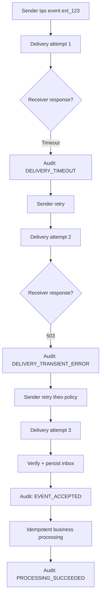

# Audit event hợp lệ, lỗi và bị từ chối

Webhook giúp một hệ thống gửi sự kiện đến endpoint của hệ thống khác khi có thay đổi nghiệp vụ. Ví dụ, payment provider gửi thông báo thanh toán thành công, nền tảng thương mại điện tử gửi sự kiện đơn hàng đã giao hoặc dịch vụ định danh gửi callback khi người dùng hoàn tất xác minh. Vì webhook đi qua ranh giới tin cậy giữa các hệ thống, receiver cần ghi lại được sự kiện nào đã đến, nguồn gửi có hợp lệ không, chữ ký và timestamp có được xác minh không, request được chấp nhận hay từ chối, và lỗi xảy ra ở bước nào.

**Audit event hợp lệ, lỗi và bị từ chối** là cách ghi nhận có cấu trúc toàn bộ kết quả xử lý webhook/callback để hỗ trợ điều tra, đối soát và giám sát. Audit phải phân biệt được một delivery hợp lệ đã được nhận, một delivery lỗi do hạ tầng hoặc xử lý nghiệp vụ, và một request bị từ chối vì không đáp ứng kiểm soát bảo mật. Một HTTP status đơn lẻ không đủ mô tả toàn bộ kết quả.

Trong API Security, audit webhook cần bảo đảm tính toàn vẹn, khả năng truy vết và tính tối thiểu của dữ liệu. Ghi lại bằng chứng cần thiết như event ID, delivery ID, endpoint, key ID, kết quả xác minh, reason code và correlation ID; không ghi raw secret, access token, chữ ký đầy đủ hoặc payload nhạy cảm nguyên vẹn. Audit log cũng phải được bảo vệ như một tài sản bảo mật vì nó có thể tiết lộ hoạt động và dữ liệu nghiệp vụ.

## 1. Vì sao webhook cần audit riêng?

Một request webhook có thể đi qua nhiều bước trước khi tạo ra kết quả nghiệp vụ:

1. Request đến đúng endpoint và được giới hạn kích thước.
2. Receiver đọc raw body và các header cần thiết.
3. Receiver xác minh chữ ký, key ID và timestamp.
4. Receiver kiểm tra event ID, loại event, tenant và cấu trúc payload.
5. Receiver kiểm tra idempotency để chống xử lý lặp.
6. Receiver ghi nhận event vào kho bền vững hoặc inbox.
7. Worker xử lý nghiệp vụ và cập nhật trạng thái.
8. Receiver hoặc worker ghi kết quả cuối cùng và phát event downstream nếu cần.

Lỗi ở từng bước có ý nghĩa khác nhau. Chữ ký sai là request bị từ chối vì không xác thực được nguồn gửi. Database tạm thời không sẵn sàng sau khi chữ ký hợp lệ là lỗi xử lý có thể retry. Event hợp lệ nhưng đơn hàng đã bị hủy có thể là kết quả nghiệp vụ bị từ chối hoặc đưa vào trạng thái cần đối soát. Nếu chỉ ghi `webhook failed`, đội vận hành khó biết cần rotate secret, sửa payload, khôi phục database hay điều tra replay.

Audit giúp:

- Truy vết một event từ lần gửi đầu tiên qua nhiều delivery attempt.
- Phân biệt lỗi xác thực, lỗi schema, lỗi nghiệp vụ và lỗi hạ tầng.
- Chứng minh request nào đã được chấp nhận, từ chối hoặc xử lý lặp.
- Đối soát sự kiện với trạng thái đơn hàng, thanh toán, subscription hoặc tài nguyên liên quan.
- Phát hiện replay, chữ ký sai hàng loạt, key rotation lỗi hoặc endpoint bị dò quét.
- Hỗ trợ incident response mà không phải lưu toàn bộ payload nhạy cảm.

## 2. Phân biệt event, delivery attempt và business processing

Một event nghiệp vụ có thể được gửi nhiều lần. Sender có thể retry vì timeout, network failure hoặc response không nhận được. Receiver có thể nhận cùng event ở nhiều delivery attempt nhưng chỉ được áp dụng side effect một lần.

Ba khái niệm cần tách:

| Khái niệm | Ý nghĩa | Định danh nên có |
| --- | --- | --- |
| Event | Sự kiện nghiệp vụ logic, ví dụ `payment.succeeded` | `event_id` ổn định qua các lần gửi lại. |
| Delivery attempt | Một lần sender gửi event đến một endpoint | `delivery_id` hoặc `attempt_id`, số lần thử và thời điểm gửi. |
| Business processing | Công việc receiver thực hiện sau khi nhận event | `processing_id`, resource ID và trạng thái xử lý. |

Ví dụ event `evt_123` có thể có ba lần delivery: lần 1 timeout, lần 2 nhận `503`, lần 3 được chấp nhận. Cả ba lần cần có audit record riêng để thể hiện lịch sử delivery, nhưng receiver chỉ nên tạo một payment transaction cho event logic đó.



Không dùng `event_id` và `delivery_id` thay thế cho nhau. `event_id` giúp chống xử lý nghiệp vụ lặp; `delivery_id` giúp điều tra từng lần truyền tải và retry.

## 3. Thiết kế taxonomy cho kết quả audit

Nên định nghĩa tập outcome và reason code ổn định. Outcome mô tả kết quả tổng quát; reason code giải thích vì sao có kết quả đó. Không dùng message tự do làm khóa phân tích chính vì nội dung message dễ thay đổi theo ngôn ngữ hoặc phiên bản ứng dụng.

### 3.1. Nhóm outcome chính

| Outcome | Ý nghĩa | Ví dụ |
| --- | --- | --- |
| `RECEIVED` | Request đã đến endpoint và vượt kiểm tra transport cơ bản | Request có method/path hợp lệ, body chưa vượt giới hạn. |
| `AUTHENTICATED` | Chữ ký và nguồn gửi đã được xác minh | HMAC hợp lệ, key ID thuộc sender đã đăng ký, timestamp trong cửa sổ cho phép. |
| `ACCEPTED` | Event được receiver chấp nhận và ghi nhận bền vững | Inbox record được commit; receiver có thể trả 2xx. |
| `DUPLICATE` | Event đã được nhận trước đó và không tạo side effect mới | Cùng `event_id` được gửi lại sau timeout. |
| `REJECTED` | Request/event bị từ chối do policy hoặc dữ liệu không hợp lệ | Chữ ký sai, timestamp quá cũ, event type không được phép, schema invalid. |
| `PROCESSING` | Event đã được nhận và đang xử lý bất đồng bộ | Inbox worker đang xử lý. |
| `PROCESSED` | Xử lý nghiệp vụ hoàn tất | Payment state được cập nhật và audit đã ghi kết quả. |
| `PROCESSING_FAILED` | Event đã được nhận nhưng xử lý nghiệp vụ thất bại | Database/downstream lỗi hoặc invariant nghiệp vụ không thỏa. |
| `DELIVERY_FAILED` | Không thể hoàn tất bước nhận hoặc truyền tải | Timeout, connection reset, queue unavailable. |
| `QUARANTINED` | Event được giữ lại để kiểm tra thủ công hoặc tự động | Sender hợp lệ nhưng event bất thường hoặc không thể đối soát. |

`AUTHENTICATED` là một mốc xác minh, không nhất thiết là kết quả cuối cùng. `ACCEPTED` nên có nghĩa event đã được lưu bền vững theo hợp đồng endpoint; không nên trả thành công chỉ vì request đã vào memory. `PROCESSED` là kết quả nghiệp vụ có thể xảy ra sau đó.

### 3.2. Nhóm reason code

| Nhóm | Reason code ví dụ | Ý nghĩa |
| --- | --- | --- |
| Transport | `METHOD_NOT_ALLOWED`, `BODY_TOO_LARGE`, `CONTENT_TYPE_UNSUPPORTED` | Request sai method, vượt giới hạn hoặc media type không hỗ trợ. |
| Source/authentication | `UNKNOWN_SENDER`, `UNKNOWN_KEY_ID`, `SIGNATURE_MISSING`, `SIGNATURE_INVALID`, `TIMESTAMP_OUT_OF_WINDOW` | Không xác minh được nguồn gửi hoặc bằng chứng chữ ký. |
| Replay/idempotency | `REPLAY_DETECTED`, `DUPLICATE_EVENT`, `IDEMPOTENCY_CONFLICT` | Event bị phát lại, đã xử lý hoặc cùng key nhưng payload khác. |
| Schema/policy | `EVENT_TYPE_NOT_ALLOWED`, `SCHEMA_INVALID`, `TENANT_MISMATCH`, `ENDPOINT_DISABLED` | Event không thuộc contract hoặc phạm vi được phép. |
| Business | `RESOURCE_NOT_FOUND`, `STATE_TRANSITION_INVALID`, `AMOUNT_MISMATCH`, `EVENT_NOT_APPLICABLE` | Event hợp lệ về nguồn nhưng không thỏa điều kiện nghiệp vụ. |
| Infrastructure | `INBOX_UNAVAILABLE`, `DATABASE_TIMEOUT`, `DOWNSTREAM_UNAVAILABLE`, `QUEUE_PUBLISH_FAILED` | Lỗi kỹ thuật cần retry hoặc xử lý sự cố. |
| Configuration | `SECRET_VERSION_MISMATCH`, `KEY_ROTATION_INCOMPLETE`, `CLOCK_SKEW_EXCEEDED` | Cấu hình receiver/sender hoặc đồng hồ không đồng bộ. |

Reason code phải đủ chi tiết để vận hành nhưng không tiết lộ cho caller các quy tắc phát hiện gian lận hoặc thông tin nội bộ nhạy cảm. Có thể trả một error code tổng quát trong HTTP response và lưu reason code chi tiết trong audit nội bộ.

## 4. Những thời điểm cần ghi audit

Không chỉ ghi event khi xử lý thành công. Các request bị từ chối cũng có giá trị bảo mật vì chúng thể hiện hành vi dò tìm, replay hoặc lỗi tích hợp. Tuy nhiên, cần tránh ghi một record quá chi tiết cho mọi request rác có thể tạo log flood.

Các điểm audit quan trọng:

1. **Ingress:** request đến endpoint nào, method, sender/client đã nhận diện được hay chưa, kích thước body và thời điểm nhận.
2. **Authentication:** key ID được chọn, thuật toán, kết quả chữ ký, timestamp và sender identity đã xác minh.
3. **Replay/idempotency:** event ID đã tồn tại hay chưa, payload fingerprint có khớp không, event được xử lý lặp hay bị conflict.
4. **Contract validation:** event type/version, schema, tenant và các trường bắt buộc.
5. **Authorization/policy:** sender có quyền gửi event type đó đến endpoint/tenant này hay không.
6. **Durable acceptance:** inbox/event record đã commit hay chưa; transaction hoặc message reference.
7. **Business processing:** trạng thái trước/sau, quyết định nghiệp vụ, resource reference và side effect.
8. **Delivery response:** HTTP status, latency, response category và retry guidance nếu có.
9. **Operational recovery:** retry, dead-letter, replay thủ công, quarantine, reprocess hoặc reconciliation.

Mỗi record cần có timestamp đáng tin cậy từ server. Nếu hệ thống phân tán, ghi cả `occurred_at` (nếu có từ event và đã được xem là metadata không tin cậy cho tới khi xác minh) và `received_at`/`recorded_at` do receiver tạo. Không dùng timestamp do sender gửi làm thời gian audit duy nhất.

## 5. Schema audit event

Audit record nên có schema version để có thể mở rộng theo thời gian. Ví dụ JSON rút gọn:

```json
{
  "audit_id": "aud_01JXYZ8K3M",
  "schema_version": 1,
  "recorded_at": "2026-11-18T13:10:22.450Z",
  "service": "billing-webhook-receiver",
  "endpoint_ref": "payment-provider-primary",
  "sender_ref": "provider-acme",
  "event_id": "evt_123",
  "delivery_id": "dlv_456",
  "attempt": 3,
  "event_type": "payment.succeeded",
  "event_version": "2026-04",
  "key_id": "whsec-v3",
  "signature_result": "VALID",
  "timestamp_result": "VALID",
  "payload_fingerprint": "hmac-sha256:8c1f...",
  "outcome": "ACCEPTED",
  "reason_code": "NONE",
  "http_status": 202,
  "latency_ms": 24,
  "correlation_id": "corr_789"
}
```

Các trường có thể điều chỉnh theo hệ thống:

| Trường | Mục đích |
| --- | --- |
| `audit_id` | ID duy nhất của audit record. |
| `schema_version` | Phiên bản schema audit. |
| `recorded_at` | Thời điểm receiver ghi record. |
| `service` / `endpoint_ref` | Service và webhook endpoint được xử lý. |
| `sender_ref` | Sender đã xác minh hoặc giá trị `UNKNOWN`. |
| `event_id` / `delivery_id` / `attempt` | Liên kết event logic với từng lần gửi. |
| `event_type` / `event_version` | Phân loại contract và schema event. |
| `key_id` | Key ID đã dùng để xác minh, không phải secret. |
| `signature_result` / `timestamp_result` | Kết quả kiểm tra xác thực và freshness. |
| `payload_fingerprint` | Fingerprint an toàn để đối chiếu payload mà không lưu raw body. |
| `outcome` / `reason_code` | Kết quả và nguyên nhân chuẩn hóa. |
| `http_status` / `latency_ms` | Kết quả transport và thời gian xử lý. |
| `correlation_id` | Liên kết log, trace, inbox và downstream processing. |

Không phải trường nào cũng có ở mọi giai đoạn. Ví dụ request có chữ ký sai có thể chưa xác định được `sender_ref` hoặc `event_type` đáng tin cậy. Ghi `UNKNOWN`/null theo schema thay vì lấy claim chưa xác minh làm danh tính. `delivery_id` lấy từ header cũng là dữ liệu do caller cung cấp trừ khi header đó được bao phủ trong chữ ký theo contract; có thể lưu dưới dạng `claimed_delivery_id` chưa xác minh và tạo `audit_id`/`attempt_id` nội bộ để truy vết chắc chắn.

### 5.1. Payload fingerprint

Nếu cần chứng minh hai delivery có cùng nội dung, có thể lưu digest của raw body. Tuy nhiên, hash thường có thể bị dò offline nếu payload có entropy thấp hoặc chứa tập giá trị dễ đoán. Với payload nhạy cảm hoặc có cấu trúc dễ đoán, cân nhắc HMAC fingerprint bằng audit key riêng, tách biệt signing secret của webhook.

Fingerprint phải được tạo trên đúng raw bytes đã dùng để xác minh chữ ký, không parse JSON rồi serialize lại trước khi tính vì thứ tự field, whitespace hoặc encoding có thể thay đổi. Không lưu signing secret, CSRF secret hoặc toàn bộ signature trong audit record.

## 6. Audit chữ ký và timestamp

Webhook thường dùng HMAC hoặc asymmetric signature để receiver xác minh nguồn gửi và tính toàn vẹn payload. Audit cần ghi kết quả xác minh, key ID và thuật toán đã được cấu hình, nhưng không ghi bí mật ký.

Với HMAC:

1. Đọc raw request body đúng một lần hoặc dùng cơ chế cache an toàn của framework.
2. Lấy timestamp, signature và key ID từ header theo contract của sender.
3. Chọn secret từ registry đã cấu hình cho sender/endpoint; không lấy secret từ request.
4. Tính MAC trên đúng message format đã thỏa thuận, thường gồm timestamp và raw body.
5. So sánh bằng constant-time comparison.
6. Kiểm tra timestamp trong cửa sổ freshness cho phép.
7. Chỉ sau khi xác minh mới tin event metadata và tiếp tục schema/policy validation.

Audit nên ghi `signature_result=VALID/INVALID/MISSING`, `key_id`, thuật toán cấu hình và reason code. Không ghi header chữ ký đầy đủ vì nó có thể được dùng lại trong cửa sổ replay hoặc hỗ trợ tấn công offline tùy thiết kế.

### 6.1. Không ghi dữ liệu chưa xác minh như sự thật

Trước khi chữ ký hợp lệ, `event_id`, `event_type`, `tenant_id` và `sender` trong body đều là dữ liệu do request cung cấp. Có thể ghi một giá trị đã chuẩn hóa để hỗ trợ điều tra, nhưng cần gắn trạng thái `unverified` hoặc không dùng làm danh tính có thẩm quyền. Không cho phép một payload chưa xác minh tạo audit entry giả mạo sender khác.

Sau khi chữ ký hợp lệ, các claim trong payload vẫn cần validation schema và authorization. Chữ ký chỉ chứng minh payload được ký bởi key tương ứng và không bị thay đổi; nó không tự chứng minh sender được phép thực hiện mọi hành động hoặc tenant/resource trong payload là hợp lệ.

## 7. Phân biệt REJECTED với FAILED

Đây là điểm quan trọng khi vận hành webhook:

- **REJECTED:** receiver chủ động từ chối request/event vì vi phạm kiểm soát hoặc contract. Ví dụ signature invalid, timestamp quá cũ, event type không được phép hoặc tenant không khớp.
- **FAILED:** receiver muốn xử lý nhưng gặp lỗi kỹ thuật hoặc lỗi tạm thời. Ví dụ database timeout, queue unavailable hoặc dependency không phản hồi.
- **BUSINESS_REJECTED:** nguồn gửi hợp lệ và event được xác thực, nhưng nghiệp vụ không chấp nhận thay đổi. Ví dụ payment amount không khớp order, state transition không hợp lệ hoặc resource đã đóng.
- **DUPLICATE:** event đã được nhận/hoàn tất trước đó. Đây thường là kết quả idempotent chứ không phải lỗi bảo mật.

Không nên gộp tất cả thành `400` hoặc `500`. Phân loại đúng giúp sender quyết định retry và đội vận hành biết ai cần hành động.

### 7.1. HTTP response và retry

HTTP response cần phù hợp với hợp đồng retry của sender. Một quy ước thường gặp:

| Response | Ý nghĩa thường gặp | Hành vi sender thường mong đợi |
| --- | --- | --- |
| `2xx` | Receiver đã nhận và lưu event theo contract | Không retry delivery đó. |
| `400` hoặc `422` | Payload/schema không hợp lệ hoặc request không thể xử lý | Thường không retry cùng payload; cần sửa integration. |
| `401` hoặc `403` | Chữ ký, sender identity hoặc quyền không hợp lệ | Không retry vô hạn; cần sửa credential/policy. |
| `409` | Conflict, ví dụ idempotency key gắn payload khác | Điều tra conflict; không tạo event mới để né kiểm tra. |
| `429` | Vượt rate limit hoặc receiver yêu cầu giảm tốc | Retry theo `Retry-After` nếu sender hỗ trợ. |
| `5xx` | Lỗi tạm thời ở receiver hoặc dependency | Sender thường retry với exponential backoff và jitter. |

Đây là quy ước phổ biến, không phải hợp đồng bắt buộc cho mọi provider. Phải đọc retry semantics của sender cụ thể. Một số sender retry với mọi response ngoài `2xx`; số khác phân biệt `4xx` và `5xx`. Không trả `500` cho chữ ký sai nếu điều đó khiến sender retry vô hạn; không trả `2xx` trước khi event được ghi bền vững nếu receiver chưa có cơ chế phục hồi tương ứng.

### 7.2. Chấp nhận bất đồng bộ

Nếu receiver chỉ xác minh và ghi event vào inbox/queue bền vững, có thể trả `202 Accepted` hoặc `200 OK` theo contract. Sau đó worker xử lý nghiệp vụ. Nếu worker thất bại, audit ghi `PROCESSING_FAILED`, retry nội bộ hoặc đưa vào dead-letter/quarantine; không yêu cầu sender gửi lại nếu receiver đã xác nhận nhận event và có trách nhiệm xử lý tiếp.

Điều kiện quan trọng là việc lưu inbox và audit acceptance phải bền vững. Nếu trả `2xx` rồi process chết trước khi lưu event, sender sẽ không retry và event có thể bị mất.

## 8. Idempotency và audit duplicate/replay

Sender có thể gửi lại event hợp lệ vì timeout hoặc không nhận được response. Receiver cần phân biệt duplicate delivery hợp lệ với replay đáng ngờ.

### 8.1. Duplicate event hợp lệ

Nếu cùng `event_id` và payload fingerprint giống nhau đã được nhận, receiver có thể trả response thành công theo contract mà không lặp side effect. Audit thêm record `DUPLICATE_EVENT` hoặc `DUPLICATE_DELIVERY`, liên kết với lần xử lý đầu tiên.

### 8.2. Idempotency conflict

Nếu cùng `event_id` nhưng payload fingerprint khác nhau, đây không còn là retry bình thường. Có thể là lỗi sender, event ID bị tái sử dụng hoặc hành vi giả mạo. Từ chối theo policy, ghi `IDEMPOTENCY_CONFLICT`, giữ bằng chứng an toàn và cảnh báo nếu xảy ra lặp lại.

### 8.3. Replay cùng chữ ký

Timestamp trong chữ ký giới hạn cửa sổ sử dụng; event ID/inbox unique constraint ngăn cùng event tạo side effect nhiều lần. Hai cơ chế bổ sung cho nhau:

- Freshness window giảm khả năng dùng lại request cũ sau một khoảng thời gian.
- Idempotency bảo đảm event đã nhận không bị xử lý lặp trong thời gian lưu deduplication.

Không chỉ dựa vào timestamp vì attacker có thể replay trong cửa sổ hợp lệ. Không chỉ dựa vào event ID nếu event ID chưa được ràng buộc với sender và payload đã xác minh.

## 9. Ví dụ Java ghi audit theo kết quả xác minh

Nên tạo một audit service dùng schema và reason code tập trung. Ví dụ dưới đây minh họa luồng ghi nhận kết quả; phần verify HMAC và persistence cần được triển khai bằng thư viện và repository của hệ thống.

```java
public enum WebhookOutcome {
    RECEIVED,
    AUTHENTICATED,
    ACCEPTED,
    DUPLICATE,
    REJECTED,
    PROCESSING,
    PROCESSED,
    PROCESSING_FAILED,
    DELIVERY_FAILED,
    QUARANTINED
}

public record WebhookAuditCommand(
    String endpointRef,
    String senderRef,
    String eventId,
    String deliveryId,
    String keyId,
    String eventType,
    WebhookOutcome outcome,
    String reasonCode,
    int httpStatus,
    String payloadFingerprint,
    String correlationId
) {}

@Service
public class WebhookAuditService {
    private final WebhookAuditRepository repository;
    private final Clock clock;

    public WebhookAuditService(
            WebhookAuditRepository repository,
            Clock clock) {
        this.repository = repository;
        this.clock = clock;
    }

    public void record(WebhookAuditCommand command) {
        WebhookAuditRecord record = new WebhookAuditRecord(
            UUID.randomUUID(),
            clock.instant(),
            command.endpointRef(),
            command.senderRef(),
            command.eventId(),
            command.deliveryId(),
            command.keyId(),
            command.eventType(),
            command.outcome(),
            command.reasonCode(),
            command.httpStatus(),
            command.payloadFingerprint(),
            command.correlationId()
        );

        repository.append(record);
    }
}
```

Trong production, `repository.append` nên ghi vào kho có durability và kiểm soát integrity phù hợp. Với acceptance, cần phối hợp inbox record và audit record trong cùng transaction database nếu chúng cùng datastore; nếu dùng event stream, cân nhắc transactional outbox để không có event được nhận nhưng audit bị mất hoặc ngược lại.

### 9.1. Ví dụ handler có phân loại kết quả

```java
@PostMapping("/webhooks/provider")
ResponseEntity<Void> receive(
        @RequestHeader(value = "X-Provider-Signature", required = false) String signature,
        @RequestHeader(value = "X-Provider-Timestamp", required = false) String timestamp,
        @RequestHeader(value = "X-Provider-Key-Id", required = false) String keyId,
        @RequestBody byte[] rawBody,
        HttpServletRequest request) {

    String attemptId = UUID.randomUUID().toString();
    String claimedDeliveryId = request.getHeader("X-Delivery-Id");
    String correlationId = correlationIds.fromTrustedContext(request);

    VerificationResult verification = verifier.verify(
        rawBody, timestamp, signature, keyId);

    if (!verification.valid()) {
        auditService.record(auditFactory.rejected(
            attemptId, claimedDeliveryId, keyId,
            verification.reasonCode(), correlationId));
        return ResponseEntity.status(401).build();
    }

    VerifiedWebhookEvent event = eventParser.parseAndValidate(rawBody);
    InboxResult inboxResult = inboxService.accept(event);

    if (inboxResult.duplicate()) {
        auditService.record(auditFactory.duplicate(
            event, attemptId, claimedDeliveryId,
            verification.keyId(), correlationId));
        return ResponseEntity.ok().build();
    }

    auditService.record(auditFactory.accepted(
        event, attemptId, claimedDeliveryId,
        verification.keyId(), correlationId));
    return ResponseEntity.accepted().build();
}
```

Đây là pseudo-code minh họa, không phải controller có thể sao chép nguyên trạng. Cần đọc raw body đúng cách để chữ ký được tính trên byte gốc; trong Spring MVC, `@RequestBody byte[]` có thể phù hợp nếu message converter và giới hạn body được cấu hình. Header chữ ký/timestamp/key ID cần được kiểm tra bắt buộc theo contract bên trong verifier; để `required = false` ở binding giúp handler có thể ghi audit cho trường hợp thiếu header thay vì bị framework trả lỗi trước khi audit. Parser chỉ tạo `VerifiedWebhookEvent` sau khi xác minh chữ ký và schema. `deliveryId` ở ví dụ vẫn là giá trị claim cho tới khi được xác minh theo contract; không dùng nó làm identity đáng tin cậy hoặc làm khóa duy nhất của audit. `InboxResult` phải dựa trên unique constraint và transaction để chống race condition. Lỗi parse, database hoặc audit persistence phải được xử lý riêng, không để exception vô tình trả `2xx`.

Ngoài ra, không nên trả `401` hay `403` theo một quy tắc cứng cho mọi provider; hãy dùng status và retry semantics đã thỏa thuận. Một số provider coi `401` là lỗi cấu hình và dừng delivery; số khác có thể retry. Reason code chi tiết vẫn được lưu nội bộ.

## 10. Audit tính toàn vẹn và lưu trữ

Audit log có thể được dùng làm bằng chứng trong incident response, vì vậy cần bảo vệ khỏi sửa hoặc xóa trái phép.

Các biện pháp:

- Ghi append-only hoặc dùng datastore hỗ trợ immutable/WORM retention khi yêu cầu.
- Tách quyền ghi audit khỏi quyền đọc và quyền quản trị; service thường không được xóa lịch sử của chính nó.
- Dùng transaction/outbox để giảm nguy cơ business event đã commit nhưng audit không có.
- Gắn timestamp từ server, event ID duy nhất và sequence/version nếu cần phát hiện thiếu record.
- Đồng bộ thời gian hệ thống bằng nguồn tin cậy và theo dõi clock drift.
- Bảo vệ dữ liệu at rest và in transit; phân quyền truy cập theo vai trò điều tra/vận hành.
- Audit mọi lần truy cập, export, thay đổi retention hoặc thao tác reprocess thủ công.
- Sao lưu và kiểm tra khả năng khôi phục theo chính sách.
- Có retention rõ ràng; không lưu vô thời hạn nếu không có căn cứ nghiệp vụ/pháp lý.

Nếu cần chống sửa đổi ở mức cao, có thể dùng hash chaining hoặc chữ ký/MAC cho batch audit. Ví dụ mỗi record/batch chứa hash của phần trước; tuy nhiên cần quản lý key, checkpoint và quy trình xác minh độc lập. Hash chain không tự bảo vệ nếu attacker có quyền viết lại toàn bộ dữ liệu và checkpoint.

## 11. Bảo vệ dữ liệu nhạy cảm trong audit

Webhook payload thường chứa email, địa chỉ, thông tin đơn hàng, mã giao dịch hoặc dữ liệu thanh toán. Ghi toàn bộ body vào log làm tăng nguy cơ rò rỉ và kéo dài phạm vi ảnh hưởng nếu log store bị xâm nhập.

Nên áp dụng:

- Chỉ lưu metadata cần thiết để truy vết: event ID, event type, sender, resource reference và kết quả xử lý.
- Không lưu raw signature, shared secret, API key, bearer token, cookie hoặc private key.
- Không ghi số thẻ đầy đủ, CVV, mật khẩu, OTP, refresh token hoặc dữ liệu xác thực.
- Mask/pseudonymize email, phone, account reference khi định danh trực tiếp không cần thiết.
- Dùng payload fingerprint bằng HMAC nếu cần đối chiếu nội dung; giữ HMAC key riêng với signing key webhook.
- Nếu cần giữ payload để reprocess, lưu trong encrypted inbox/object store có quyền truy cập hạn chế và retention riêng; audit log chỉ tham chiếu ID.
- Không đưa payload vào exception message, tracing span hoặc dead-letter dashboard không được bảo vệ.

Không dùng raw payload làm label metric hoặc alert title. Dữ liệu audit chi tiết nên nằm trong kho có phân quyền; metrics chỉ dùng dimension có cardinality và độ nhạy phù hợp.

## 12. Audit retry, dead-letter và replay thủ công

Retry có thể xảy ra ở sender, receiver hoặc worker nội bộ. Mỗi lần retry cần giữ liên kết với event gốc và ghi rõ ai khởi tạo, lý do và kết quả.

Các sự kiện vận hành cần audit:

- `RETRY_SCHEDULED`: retry được lên lịch, kèm attempt và thời điểm dự kiến.
- `RETRY_STARTED`: một attempt bắt đầu.
- `RETRY_SUCCEEDED` / `RETRY_FAILED`: kết quả attempt.
- `DEAD_LETTERED`: event chuyển sang dead-letter sau khi hết retry hoặc lỗi không thể phục hồi.
- `QUARANTINED`: event bị giữ để review.
- `MANUAL_REPLAY_REQUESTED`: operator yêu cầu replay, có actor, ticket/reason và phạm vi.
- `MANUAL_REPLAY_COMPLETED` / `MANUAL_REPLAY_REJECTED`: kết quả replay.
- `RECONCILIATION_COMPLETED`: đối soát event với trạng thái nghiệp vụ.

Manual replay có thể tạo side effect tài chính hoặc gửi thông báo lặp. Chỉ operator có quyền riêng mới được replay; yêu cầu phải ghi lý do, event ID, payload fingerprint, môi trường và người phê duyệt nếu cần dual control. Replay phải đi qua cùng xác minh schema, authorization và idempotency như luồng bình thường. Không sửa trực tiếp audit record để “làm sạch” trạng thái.

## 13. Giám sát và phát hiện bất thường từ audit

Audit event là nguồn dữ liệu cho security monitoring. Các metric và cảnh báo có thể gồm:

- Tỷ lệ signature invalid/missing theo sender, endpoint và key ID.
- Tỷ lệ timestamp ngoài cửa sổ hoặc clock skew tăng bất thường.
- Số `UNKNOWN_KEY_ID`, key rotation mismatch hoặc unknown sender.
- Số duplicate event, replay detected và idempotency conflict.
- Tỷ lệ event accepted, rejected, quarantined và processing failed.
- Số lượng `4xx`, `5xx`, timeout và delivery retry theo sender/endpoint.
- Độ trễ từ `received_at` đến `processed_at`.
- Số event nằm trong inbox/dead-letter quá lâu.
- Số manual replay và các thao tác audit/export bất thường.

Ví dụ:

| Tín hiệu | Điều tra có thể cần |
| --- | --- |
| Signature invalid tăng đột ngột sau khi rotate secret | Sender và receiver có cùng secret version chưa; có request giả mạo không? |
| Unknown key ID liên tục | Sender đang dùng key mới chưa được đăng ký hay attacker đang dò key ID? |
| Duplicate event tăng cao | Sender retry do response timeout, receiver chậm hay có replay? |
| `ACCEPTED` tăng nhưng `PROCESSED` giảm | Worker, queue hoặc downstream đang lỗi; inbox backlog có tăng không? |
| `BUSINESS_REJECTED` tăng | Sender gửi dữ liệu không còn phù hợp với trạng thái nghiệp vụ hay contract đã đổi? |
| Manual replay tăng bất thường | Có incident, quy trình vận hành lỗi hoặc lạm dụng quyền operator không? |

Không kết luận tấn công chỉ từ một metric. Kết hợp sender identity, event type, delivery attempt, reason code, lịch triển khai và trạng thái dependency để phân biệt lỗi tích hợp với hành vi độc hại.

## 14. Kiểm thử audit event

Kiểm thử phải xác minh cả event record và side effect. Một test chỉ kiểm tra response `401` không chứng minh audit đã ghi đúng reason code hoặc không làm lộ dữ liệu.

| Kịch bản | Audit mong đợi | Side effect mong đợi |
| --- | --- | --- |
| Chữ ký hợp lệ, event mới | `AUTHENTICATED`, sau đó `ACCEPTED` | Inbox được commit đúng một lần. |
| Chữ ký thiếu/sai | `REJECTED` với `SIGNATURE_MISSING/INVALID` | Không tạo inbox hoặc thay đổi nghiệp vụ. |
| Timestamp quá cũ | `REJECTED` với `TIMESTAMP_OUT_OF_WINDOW` | Không xử lý event. |
| Key ID không biết | `REJECTED` với `UNKNOWN_KEY_ID` | Không tự tải secret hoặc chấp nhận token. |
| Payload schema sai | `REJECTED` với `SCHEMA_INVALID` sau khi xác minh nguồn | Không tạo side effect nghiệp vụ. |
| Event trùng cùng payload | `DUPLICATE` liên kết event trước | Không lặp side effect. |
| Event ID trùng, payload khác | `REJECTED` với `IDEMPOTENCY_CONFLICT` | Không ghi đè event gốc. |
| Inbox/database tạm thời lỗi | `DELIVERY_FAILED` hoặc `FAILED` với reason kỹ thuật | Không trả thành công nếu chưa nhận bền vững. |
| Worker downstream lỗi | `PROCESSING_FAILED` | Event vẫn được giữ để retry/quarantine. |
| Event nghiệp vụ không hợp lệ | `BUSINESS_REJECTED` với reason code | Không thực hiện transition không hợp lệ. |
| Audit store không sẵn sàng | Có hành vi fail/queue theo policy đã định nghĩa | Không âm thầm mất audit quan trọng. |
| Manual replay | Có actor, reason, approval và kết quả | Idempotency ngăn lặp side effect. |
| Payload chứa secret/PII | Audit chỉ chứa metadata/fingerprint an toàn | Không có dữ liệu nhạy cảm trong log/trace. |

### 14.1. Kiểm thử tính nhất quán giữa inbox và audit

Nếu inbox và audit cùng database, kiểm tra transaction bảo đảm cả hai cùng commit hoặc cùng rollback. Nếu audit được gửi qua event stream, kiểm tra transactional outbox và khả năng consumer xử lý lặp. Mô phỏng process crash ở các điểm: sau xác minh chữ ký, sau ghi inbox, sau ghi audit và trước khi trả response. Sau khi phục hồi, phải xác định event đang ở trạng thái nào và không được tạo side effect trùng.

### 14.2. Kiểm thử log không rò rỉ dữ liệu

Dùng payload fixture có marker giả lập secret như `TEST_SECRET_123`, email và account number giả. Gửi request thành công, chữ ký sai, schema lỗi và exception downstream; sau đó tìm marker trong application log, audit store, tracing và dead-letter view. Marker bí mật không được xuất hiện nguyên vẹn ở nơi không được phép.

## 15. Checklist audit webhook/callback

- [ ] Có schema audit versioned và taxonomy outcome/reason code ổn định.
- [ ] Phân biệt event ID, delivery ID, attempt ID và processing ID.
- [ ] Ghi nhận ingress, authentication, replay, schema, authorization, durable acceptance và business processing.
- [ ] Dữ liệu từ payload chưa xác minh được đánh dấu untrusted; không dùng làm identity có thẩm quyền.
- [ ] Audit ghi key ID và kết quả chữ ký nhưng không ghi secret hoặc signature đầy đủ.
- [ ] Ghi timestamp server-side; phân biệt event time, received time và processed time.
- [ ] Phân biệt `REJECTED`, `FAILED`, `BUSINESS_REJECTED` và `DUPLICATE`.
- [ ] HTTP response và retry semantics phù hợp với sender contract.
- [ ] Inbox/idempotency dùng unique constraint hoặc cơ chế nguyên tử để ngăn race condition.
- [ ] Acceptance chỉ được xác nhận sau khi event được lưu bền vững.
- [ ] Audit store có access control, integrity protection, retention và backup.
- [ ] Payload fingerprint không làm lộ dữ liệu; HMAC key cho fingerprint tách khỏi webhook secret.
- [ ] Retry, dead-letter, quarantine và manual replay đều có audit riêng.
- [ ] Dashboard theo dõi signature failure, replay, duplicate, backlog và processing latency.
- [ ] Test bao gồm crash/retry, side effect, transaction consistency và log leakage.

Audit webhook cần phản ánh chính xác từng giai đoạn từ request đến, xác minh nguồn, chấp nhận event cho tới xử lý nghiệp vụ. Khi outcome và reason code được chuẩn hóa, event/delivery/processing được định danh riêng, audit được ghi bền vững và dữ liệu nhạy cảm được giảm thiểu, đội phát triển có thể điều tra lỗi tích hợp, phát hiện replay và chứng minh hành động đã xảy ra mà không biến log thành một nguồn rò rỉ mới.
