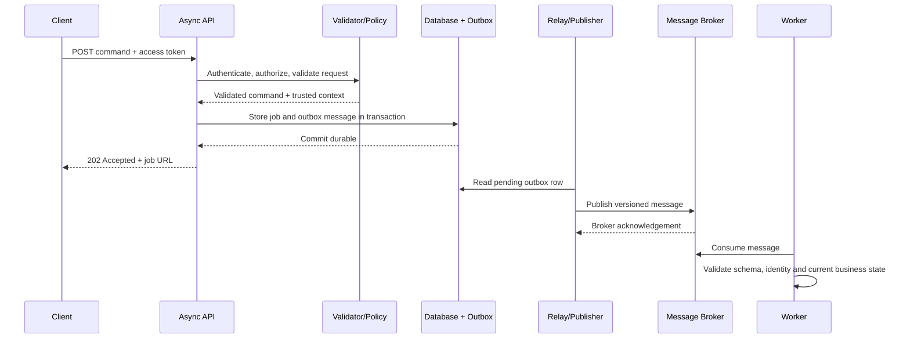

# Validate schema trước khi enqueue

API bất đồng bộ thường nhận một yêu cầu, đưa công việc vào queue hoặc broker rồi trả `202 Accepted` để client theo dõi kết quả sau. Vì xử lý diễn ra ở thời điểm khác và có thể do worker khác thực hiện, một message sai cấu trúc có thể nằm trong queue, được retry nhiều lần, làm worker lỗi liên tục hoặc trở thành poison message. Nếu message chứa tenant, actor, loại thao tác hay dữ liệu không hợp lệ, lỗi còn có thể dẫn tới truy cập chéo tenant hoặc thực thi sai nghiệp vụ.

Vì vậy, producer cần **xác thực schema trước khi enqueue**. API phải kiểm tra request theo contract đã công bố, giới hạn kích thước và độ phức tạp, xác thực danh tính/quyền, sau đó tạo message nội bộ có cấu trúc rõ ràng và xác minh message đó trước khi ghi vào hàng đợi. Consumer vẫn cần kiểm tra lại schema và policy ở phía nhận để phòng message giả mạo, lỗi phiên bản, producer bị xâm nhập hoặc dữ liệu lưu trữ bị hỏng.

Validation trước enqueue giúp từ chối lỗi đồng bộ ngay tại API, tránh đưa dữ liệu chắc chắn không xử lý được vào queue và tạo ranh giới rõ giữa request không hợp lệ với lỗi phát sinh trong quá trình xử lý nền.

## 1. Vì sao phải validate trước khi enqueue?

Giả sử API nhận yêu cầu tạo báo cáo:

```http
POST /api/v1/report-jobs HTTP/1.1
Authorization: Bearer <access-token>
Content-Type: application/json
Idempotency-Key: 8a2d...

{
  "reportType": "monthly-sales",
  "from": "2026-10-01",
  "to": "2026-10-31",
  "format": "CSV"
}
```

API kiểm tra request, tạo job, enqueue message và trả:

```http
HTTP/1.1 202 Accepted
Location: /api/v1/report-jobs/job-123
Content-Type: application/json

{
  "jobId": "job-123",
  "status": "QUEUED"
}
```

Nếu API chỉ parse JSON sơ bộ rồi enqueue mọi payload, worker có thể nhận `from` là object thay vì ngày, `format` là giá trị không hỗ trợ hoặc `reportType` tùy ý. Worker có thể crash, retry cùng message nhiều lần và làm queue bị tắc.

Những hậu quả thường gặp:

- **Poison message:** message luôn gây lỗi khi consumer xử lý, bị retry và chiếm tài nguyên.
- **Queue pollution:** dữ liệu sai schema tích tụ, làm tăng backlog và chi phí vận hành.
- **Lỗi bảo mật:** payload có tenant/owner/role do client tự khai báo, event type ngoài allowlist hoặc trường nhạy cảm không được phép.
- **Không rõ trách nhiệm:** API đã trả `202` nhưng message không thể xử lý từ đầu.
- **Khó retry và điều tra:** cùng một lỗi được phát lại nhiều lần, log không chỉ ra producer đã chấp nhận dữ liệu sai.

Validation trước enqueue không đảm bảo tác vụ chắc chắn thành công. Nó đảm bảo dữ liệu đã vượt qua các kiểm tra có thể thực hiện tại thời điểm nhận request và phù hợp với contract của message được tạo.

## 2. Phân biệt request validation, message schema validation và business validation

Ba lớp kiểm tra có mục tiêu khác nhau:

| Lớp | Kiểm tra điều gì? | Thời điểm |
|---|---|---|
| Request validation | Body HTTP có đúng kiểu, field, format, giới hạn và quy tắc đầu vào của endpoint không? | Trước khi tạo job/message |
| Message schema validation | Message nội bộ/envelope được serialize có đúng contract mà consumer hiểu không? | Trước khi enqueue hoặc publish |
| Business validation | Hành động có hợp lệ với trạng thái dữ liệu và quy tắc nghiệp vụ hiện tại không? | Một phần trước enqueue; phần phụ thuộc trạng thái phải kiểm tra lại khi consumer xử lý |

Ví dụ, request có thể hợp lệ về schema vì `accountId` là UUID và `amount` là số dương. Nhưng tài khoản có thể đã bị khóa hoặc số dư thay đổi trước khi worker thực thi. Không thể xem schema validation là bằng chứng giao dịch được phép thực hiện.

Một quy trình thường có:

1. Xác thực caller và xác định tenant/actor từ nguồn đáng tin cậy.
2. Kiểm tra quyền gọi chức năng và quyền trên object.
3. Kiểm tra cú pháp, schema, format, kích thước và độ phức tạp của request.
4. Kiểm tra các điều kiện nghiệp vụ có thể xác nhận an toàn ở thời điểm nhận.
5. Tạo message/envelope từ dữ liệu đã xác minh, không chuyển nguyên payload tùy ý.
6. Validate message theo schema version mà consumer hỗ trợ.
7. Lưu job và message/outbox một cách bền vững rồi mới trả `202`.
8. Consumer xác minh message, quyền/ngữ cảnh cần thiết và trạng thái nghiệp vụ trước side effect.

## 3. Schema là hợp đồng dữ liệu, không phải authorization policy

Schema mô tả hình dạng dữ liệu: field nào bắt buộc, kiểu dữ liệu, giới hạn độ dài, enum, cấu trúc lồng nhau và phiên bản. Schema không thể tự chứng minh caller được phép sử dụng dữ liệu đó.

Ví dụ schema có thể cho phép `tenantId` là chuỗi UUID, nhưng điều đó không có nghĩa client được quyền chọn tenant bất kỳ. Tenant cần được lấy từ principal đã xác thực hoặc selector đã được kiểm tra membership. Tương tự, schema có thể cho phép `priority` nhận `NORMAL` hoặc `HIGH`, nhưng quyền tạo job ưu tiên cao phải được policy kiểm tra riêng.

Không đặt quyền truy cập chỉ trong validation annotation hoặc JSON Schema. Authorization phải được thực hiện ở server dựa trên principal, action, resource và context. Không dùng schema để cho phép client chọn class Java, tên queue, tên topic hoặc loại event nội bộ tùy ý.

## 4. Những gì cần kiểm tra trước enqueue

Một bộ kiểm tra đầu vào có thể gồm:

| Nhóm | Kiểm tra ví dụ |
|---|---|
| Syntax | JSON hợp lệ, encoding được hỗ trợ, không có cấu trúc mơ hồ |
| Required fields | Có đủ trường bắt buộc, không nhận thiếu hoặc null trái contract |
| Type | String, integer, decimal, boolean, array và object đúng kiểu |
| Format | UUID, email, date, timestamp, enum và identifier theo định dạng đã công bố |
| Range | Số dương, ngày bắt đầu trước ngày kết thúc, page/batch trong giới hạn |
| Length | Giới hạn độ dài chuỗi, số field, số phần tử và độ sâu nested object |
| Unknown fields | Từ chối hoặc xử lý theo quy tắc rõ ràng, tránh silently accepting field nguy hiểm |
| Cross-field rules | Trường A bắt buộc khi trường B có giá trị; các khoảng thời gian không được chồng lấn |
| Tenant/object | Object ID thuộc tenant và phạm vi caller được phép |
| Resource cost | Giới hạn số record, dung lượng, thời gian dự kiến và số tác vụ tạo ra |
| Message contract | Event type, schema version, envelope và metadata nằm trong allowlist |

Không nhất thiết mọi kiểm tra đều nằm trong một JSON Schema. Có thể dùng schema cho cấu trúc và validator/service policy cho quan hệ giữa các field, authorization hoặc quy tắc nghiệp vụ.

## 5. Ví dụ JSON Schema cho request bất đồng bộ

Một schema có thể quy định field bắt buộc, kiểu dữ liệu, enum, giới hạn và cấm field ngoài dự kiến:

```json
{
  "$schema": "https://json-schema.org/draft/2020-12/schema",
  "$id": "https://schemas.example.com/report-job-request/1.0.0",
  "type": "object",
  "additionalProperties": false,
  "required": ["reportType", "from", "to", "format"],
  "properties": {
    "reportType": {
      "type": "string",
      "enum": ["monthly-sales", "inventory-summary"]
    },
    "from": { "type": "string", "format": "date" },
    "to": { "type": "string", "format": "date" },
    "format": { "type": "string", "enum": ["CSV", "PDF"] },
    "filters": {
      "type": "object",
      "maxProperties": 10,
      "additionalProperties": false,
      "properties": {
        "region": { "type": "string", "maxLength": 40 },
        "categoryIds": {
          "type": "array",
          "maxItems": 100,
          "items": { "type": "string", "format": "uuid" }
        }
      }
    }
  }
}
```

Schema trên là ví dụ cho request, không chứa `tenantId`, `ownerId`, `status`, `queueName` hay `priority` do server quản lý. `additionalProperties: false` giúp từ chối field không nằm trong contract; nếu cần mở rộng, hãy version hóa schema và thêm field có kiểm soát.

Lưu ý: một số validator chỉ kiểm tra `format` nếu bật format assertion. Cần cấu hình thư viện để xác minh `date`, `uuid` và các format được dùng; không giả định chỉ khai báo `format` là mọi validator đều từ chối giá trị sai.

## 6. Cấm field điều khiển nội bộ do client cung cấp

Client chỉ nên gửi dữ liệu cần thiết cho nghiệp vụ. Các field sau thường phải do server tạo hoặc xác định:

- `tenantId`, `ownerId`, `createdBy`, `actorId`.
- `status`, `attempt`, `retryCount`, `processedAt`.
- `queue`, `topic`, `routingKey`, `consumerGroup`.
- `eventType` hoặc command class nội bộ nếu không có allowlist.
- `priority`, `delay`, `timeout` hoặc resource budget đặc quyền.
- `approvedBy`, `isAdmin`, `trusted`, `signatureVerified`.

Nếu API cần cho client chọn một option như mức ưu tiên, hãy biểu diễn bằng enum công khai và kiểm tra quyền/plan cho option đó. Không map thẳng một field client vào thuộc tính nội bộ của message.

Ví dụ không an toàn:

```java
// Không nên: nhận nguyên object có cả metadata nội bộ.
@PostMapping("/jobs")
public ResponseEntity<?> enqueue(@RequestBody InternalJobMessage message) {
    queuePublisher.publish(message.getQueueName(), message);
    return ResponseEntity.accepted().build();
}
```

API không nên để client quyết định queue, event type, tenant, actor hay trạng thái. Hãy nhận một request DTO công khai, xác minh caller, rồi server tạo internal command/envelope theo cấu hình.

## 7. Kiểm tra kích thước và độ phức tạp trước parse sâu

Schema validation thường diễn ra sau khi HTTP body đã được đọc và parse. Vì vậy, cần giới hạn trước và trong quá trình parse:

- Request body tối đa theo endpoint, có thể kiểm tra sớm `Content-Length` nhưng vẫn đếm byte thực tế.
- Giới hạn số phần tử array, tổng node/token và số property.
- Giới hạn nesting depth để tránh parser hoặc code đệ quy bị cạn stack.
- Giới hạn string length, number token length và số lỗi validation trả về.
- Timeout cho parse/validation và giới hạn request đồng thời.
- Giới hạn tổng cost của batch; không chỉ giới hạn số item ở lớp ngoài cùng.

Không đợi schema validator chạy xong mới phát hiện payload quá lớn. Với body streaming/chunked, phải đếm byte trong lúc đọc. Khi vượt giới hạn, dừng đọc và trả lỗi phù hợp; không buffer toàn bộ body vào heap.

## 8. Không tải schema động từ dữ liệu không tin cậy

Một lỗi nguy hiểm là để request chỉ định URL schema rồi server tải schema đó để validate. Ví dụ `schemaUrl` có thể trỏ tới địa chỉ nội bộ, metadata endpoint hoặc host độc hại, biến bước validation thành SSRF.

Hãy:

- Chọn schema từ registry/configuration được quản lý, dựa trên loại operation đã allowlist.
- Không cho client truyền URL `$ref`, schema URL hoặc class name tùy ý.
- Pin/allowlist schema ID và version; cache schema đã xác minh.
- Nếu schema dùng `$ref`, chỉ resolve tới registry/local bundle được tin cậy; tắt remote resolution ngoài allowlist.
- Kiểm tra chữ ký hoặc integrity metadata nếu schema artifact được phân phối qua nhiều hệ thống.
- Quản lý quyền publish schema và review thay đổi trước khi đưa vào production.

Schema registry là nguồn contract, không phải một endpoint công khai mà validator được tự do truy cập theo URL trong payload.

## 9. Version hóa schema và tương thích producer/consumer

Producer và consumer có thể được deploy ở thời điểm khác nhau. Nếu producer bắt đầu gửi field mới trước khi consumer được nâng cấp, message có thể không xử lý được. Ngược lại, consumer mới có thể nhận message cũ từ queue tồn đọng hoặc replay.

Mỗi message nên xác định contract version rõ ràng, ví dụ:

```json
{
  "messageId": "01JQ7N8W6M5Y4K3P2R1S0T9U8V",
  "type": "report.generate",
  "schemaVersion": "1.0.0",
  "occurredAt": "2026-11-18T10:30:00Z",
  "tenantId": "tenant-123",
  "data": {
    "reportType": "monthly-sales",
    "from": "2026-10-01",
    "to": "2026-10-31",
    "format": "CSV"
  }
}
```

Envelope này do server tạo sau khi xác thực và mapping request. `tenantId`, `messageId`, `occurredAt`, `type` và `schemaVersion` không nên được nhận nguyên vẹn từ client.

### Compatibility thường gặp

| Thay đổi schema | Tác động có thể có |
|---|---|
| Thêm field optional có default/consumer bỏ qua unknown field | Thường dễ tương thích hơn, nhưng phụ thuộc format và consumer policy |
| Thêm field required | Consumer cũ hoặc producer cũ có thể không đáp ứng |
| Xóa field | Consumer cũ có thể vẫn cần field đó |
| Đổi kiểu field | Có thể làm producer/consumer không tương thích |
| Đổi enum hoặc ý nghĩa field | Consumer cũ có thể không hiểu hoặc xử lý sai |
| Đổi tên field | Thường là breaking change nếu không có alias/migration |

Quy định compatibility mode phù hợp với format/registry, ví dụ backward, forward hoặc full compatibility. Các thuật ngữ này có semantics khác nhau tùy registry và serializer; phải kiểm tra đúng công cụ đang dùng. Không coi mọi thay đổi thêm field là an toàn.

### Chiến lược rollout

1. Đăng ký và review schema mới.
2. Xác minh consumer có thể đọc message mới và message cũ còn trong queue.
3. Deploy consumer tương thích trước nếu thay đổi yêu cầu.
4. Deploy producer gửi version mới.
5. Theo dõi lỗi deserialize/validation và backlog.
6. Chỉ ngừng schema cũ khi queue retention, replay window và producer cũ đã hết.

## 10. JSON Schema, Avro và Protobuf

Các định dạng message có cách mô tả contract khác nhau:

| Format | Đặc điểm | Điểm cần lưu ý về validation |
|---|---|---|
| JSON + JSON Schema | Dễ đọc, linh hoạt, phù hợp HTTP API và message JSON | Cần cấu hình draft, format assertion, `$ref`, unknown fields và giới hạn parser |
| Avro | Schema rõ, binary encoding, thường dùng với schema registry | Kiểm tra schema ID/version, compatibility và writer/reader schema resolution |
| Protocol Buffers | Typed message, binary, field number và wire format | Kiểm tra required business fields ở application; proto3 scalar default có thể không phân biệt absent với default nếu không dùng presence phù hợp |

Serialization thành công không đồng nghĩa dữ liệu hợp lệ về nghiệp vụ. Protobuf parser có thể parse một message nhưng `account_id` vẫn rỗng hoặc amount không hợp lệ. Avro reader có thể resolve schema nhưng actor/tenant vẫn không được phép. Mọi format đều cần business validation và authorization ở application.

Không tái sử dụng trực tiếp một schema message nội bộ làm public request contract nếu nó chứa field nội bộ hoặc metadata producer quản lý. Tách external request schema và internal message schema giúp giới hạn những gì client có thể điều khiển.

## 11. Validate trước enqueue và validate lại ở consumer

Producer/API là tuyến kiểm tra đầu tiên, consumer là tuyến kiểm tra độc lập trước khi thực hiện side effect.

Consumer cần xác minh:

- Message envelope có đúng cấu trúc và schema version được hỗ trợ không?
- `type` có thuộc allowlist của consumer không?
- Producer/service identity có được phép publish loại message này không, theo broker ACL hoặc chữ ký/context tin cậy?
- Tenant, actor và delegation metadata có nguồn gốc đáng tin cậy không?
- Payload có giới hạn kích thước, depth và số item không?
- Message có bị phát lại, trùng `messageId` hoặc vượt hạn xử lý không?
- Trạng thái nghiệp vụ hiện tại có cho phép thực hiện không?

Không bỏ validation ở consumer chỉ vì producer đã validate. Message có thể đến từ producer cũ, topic khác, replay tool, migration job, dead-letter replay hoặc tài khoản broker bị lạm dụng.

Nếu consumer nhận message sai schema, không nên retry vô hạn. Phân loại lỗi permanent/transient; lỗi schema không thể sửa bằng retry thường nên được quarantine hoặc đưa vào DLQ theo chính sách.

## 12. Quy trình enqueue an toàn

Một luồng điển hình:



Không trả `202 Accepted` chỉ vì ứng dụng đã tạo object trong RAM hoặc gọi hàm `send()` nhưng chưa biết message có được lưu bền vững hay không. Cần định nghĩa rõ điểm chấp nhận: transaction database/outbox đã commit hoặc broker đã xác nhận durable publish theo mức bảo đảm mà hệ thống công bố.

## 13. Ví dụ Spring Boot với request DTO và Bean Validation

Tạo DTO riêng cho request công khai:

```java
public record CreateReportJobRequest(
    @NotBlank
    @Size(max = 40)
    @Pattern(regexp = "monthly-sales|inventory-summary")
    String reportType,

    @NotNull
    LocalDate from,

    @NotNull
    LocalDate to,

    @NotNull
    ReportFormat format
) {}

public enum ReportFormat {
    CSV, PDF
}
```

Controller:

```java
@PostMapping("/api/v1/report-jobs")
public ResponseEntity<CreateJobResponse> create(
        @Valid @RequestBody CreateReportJobRequest request,
        @AuthenticationPrincipal Jwt jwt,
        @RequestHeader("Idempotency-Key") String idempotencyKey) {

    UUID userId = UUID.fromString(jwt.getSubject());
    CreateJobResponse job = reportJobService.create(
        userId, request, idempotencyKey);

    return ResponseEntity.accepted()
        .location(URI.create("/api/v1/report-jobs/" + job.jobId()))
        .body(job);
}
```

Service cần kiểm tra chéo field và quyền:

```java
@Transactional
public CreateJobResponse create(
        UUID userId,
        CreateReportJobRequest request,
        String idempotencyKey) {

    if (request.from().isAfter(request.to())) {
        throw new RequestValidationException("INVALID_DATE_RANGE");
    }

    if (ChronoUnit.DAYS.between(request.from(), request.to()) > 366) {
        throw new RequestValidationException("DATE_RANGE_TOO_LARGE");
    }

    TenantContext tenant = tenantResolver.requireCurrentTenant(userId);
    authorization.require(userId, tenant.id(), "report:create");
    reportPolicy.requireAllowedFormat(userId, tenant, request.format());

    return jobCommandService.createAndRecordOutbox(
        userId, tenant, request, idempotencyKey);
}
```

Đây là code minh họa; cần dependency/import phù hợp và xử lý validation exception theo error contract của API. `TenantContext` phải được resolve từ membership/claim đã xác minh, không lấy trực tiếp từ request body. Các giới hạn ngày chỉ là ví dụ nghiệp vụ. Nếu quyền hoặc trạng thái tài khoản có thể thay đổi trước khi worker chạy, consumer phải kiểm tra lại điều kiện cần thiết.

## 14. Validate internal message sau khi mapping

Không nên serialize request DTO trực tiếp thành message nếu message có contract khác. Hãy map sang một command/envelope nội bộ:

```java
public record ReportJobMessage(
    UUID messageId,
    String type,
    String schemaVersion,
    Instant occurredAt,
    UUID tenantId,
    UUID requestedBy,
    String reportType,
    LocalDate from,
    LocalDate to,
    ReportFormat format
) {}
```

Factory tạo metadata server-side:

```java
ReportJobMessage message = new ReportJobMessage(
    UUID.randomUUID(),
    "report.generate",
    "1.0.0",
    clock.instant(),
    tenant.id(),
    principal.userId(),
    request.reportType(),
    request.from(),
    request.to(),
    request.format()
);

messageSchemaValidator.validate("report.generate", "1.0.0", message);
```

Schema validator cần kiểm tra đúng schema version và loại message được cấu hình. Không cho client quyết định `type`, `schemaVersion`, `tenantId`, `requestedBy` hoặc `messageId`. Nếu cần lưu actor gốc và service caller, hãy dùng các field được định nghĩa rõ và lấy từ security context đã xác minh.

## 15. Lưu job và message bằng Transactional Outbox

Một lỗi phổ biến là lưu job vào database rồi publish message riêng, hoặc publish message rồi mới lưu job. Nếu một bước thành công và bước còn lại thất bại, hệ thống có thể có job không được xử lý hoặc message trỏ tới job không tồn tại.

Transactional Outbox giải quyết khoảng trống này bằng cách ghi business record và outbox row trong cùng database transaction:

```sql
CREATE TABLE async_jobs (
    id UUID PRIMARY KEY,
    tenant_id UUID NOT NULL,
    requested_by UUID NOT NULL,
    status VARCHAR(30) NOT NULL,
    created_at TIMESTAMPTZ NOT NULL
);

CREATE TABLE outbox_messages (
    id UUID PRIMARY KEY,
    aggregate_id UUID NOT NULL,
    message_type VARCHAR(120) NOT NULL,
    schema_version VARCHAR(40) NOT NULL,
    payload JSONB NOT NULL,
    created_at TIMESTAMPTZ NOT NULL,
    published_at TIMESTAMPTZ,
    publish_attempts INTEGER NOT NULL DEFAULT 0
);
```

Trong một transaction:

1. Kiểm tra idempotency key và request fingerprint.
2. Tạo job ở trạng thái `QUEUED` hoặc `PENDING_PUBLISH`.
3. Tạo message đã được validate và serialize vào outbox.
4. Commit transaction.
5. Relay đọc outbox, publish tới broker và đánh dấu đã publish sau khi nhận acknowledgement.

Relay có thể publish lặp nếu crash sau broker ack nhưng trước khi cập nhật `published_at`. Vì vậy consumer cần idempotency/deduplication theo `messageId`; outbox không tự tạo exactly-once end-to-end.

`202 Accepted` có thể được trả sau khi transaction outbox commit nếu API contract định nghĩa việc job đã được nhận bền vững tại thời điểm đó. Response nên cho client biết job đang chờ publish/queue nếu cần, không khẳng định worker đã bắt đầu xử lý.

## 16. Idempotency và validation khi retry request

Client có thể retry `POST` do timeout và vô tình tạo nhiều job. Idempotency key giúp nhận diện cùng một thao tác:

- Key phải được giới hạn độ dài và ký tự.
- Phạm vi key nên gắn với principal/tenant và endpoint.
- Server lưu request fingerprint để phát hiện cùng key nhưng payload khác.
- Cùng key và cùng fingerprint trả lại kết quả/job đã tạo.
- Cùng key nhưng payload khác phải bị từ chối, thường bằng `409 Conflict`.
- Record idempotency và job/outbox phải được tạo nhất quán trong transaction.

Không dùng idempotency key làm bằng chứng authentication. Kẻ tấn công có thể tự tạo key mới; quyền và quota vẫn phải kiểm tra cho mỗi request.

## 17. Consumer phải validate và kiểm tra business state lại

Schema validation trước enqueue không thay thế kiểm tra khi xử lý. Giữa thời điểm enqueue và consume, dữ liệu hoặc quyền có thể thay đổi:

- User bị khóa hoặc membership trong tenant bị thu hồi.
- Tài khoản bị đóng, số dư thay đổi hoặc hạn mức đã bị dùng hết.
- Đơn hàng đã bị hủy hoặc đã được xử lý bởi một worker khác.
- Schema version bị ngừng hỗ trợ hoặc message được replay từ nguồn cũ.
- Producer credential bị thu hồi hoặc topic có producer không được phép.

Consumer cần xác minh schema/envelope, producer identity theo mô hình tin cậy, message type, tenant context và điều kiện nghiệp vụ tại thời điểm thực thi. Với thao tác tài chính hoặc thay đổi quyền, không chỉ dựa vào quyết định đã có từ lúc enqueue nếu policy yêu cầu kiểm tra lại.

Đối với user delegation, cần lưu actor/requester theo cơ chế có thể kiểm chứng và chỉ giữ những claim cần thiết. Nếu token hết hạn trước khi worker chạy, không nên lưu raw access token để dùng lại; hãy lưu identity/delegation reference an toàn hoặc áp dụng policy xử lý theo thời điểm chấp nhận và thời điểm thực thi.

## 18. Poison message, retry và Dead Letter Queue

Message sai schema thường là lỗi permanent: retry cùng payload không làm nó hợp lệ. Consumer nên phân loại lỗi:

| Loại lỗi | Ví dụ | Hành vi thường phù hợp |
|---|---|---|
| Permanent schema error | Thiếu field bắt buộc, version không hỗ trợ, kiểu dữ liệu sai | Không retry vô hạn; quarantine/DLQ và cảnh báo |
| Permanent authorization/policy error | Tenant không hợp lệ, producer không được phép, command bị thu hồi | Từ chối xử lý, ghi audit; DLQ hoặc terminal state theo policy |
| Transient dependency error | Database tạm unavailable, network timeout | Retry có backoff và giới hạn số lần |
| Business conflict | Đơn đã hoàn tất hoặc trạng thái không còn phù hợp | Đánh dấu terminal/conflict hoặc chạy quy trình bù trừ |
| Unknown processing error | Bug hoặc exception chưa phân loại | Retry giới hạn; sau ngưỡng chuyển DLQ và cảnh báo |

DLQ là vùng cách ly để điều tra và xử lý message không thể tiêu thụ bình thường. DLQ không phải nơi để bỏ qua validation. Khi replay, phải xác minh lại schema, nguồn gốc, tenant, quyền và trạng thái nghiệp vụ; không phát lại trực tiếp payload thô vào production mà không có kiểm soát.

Giới hạn retry count, backoff, message age và DLQ retention. Không để một poison message gây vòng lặp retry nhanh làm cạn CPU, network hoặc broker.

## 19. Error response khi validation thất bại trước enqueue

Nếu request sai schema hoặc business input không hợp lệ, API nên từ chối đồng bộ và không tạo job/message. Status code phụ thuộc contract:

| Tình huống | HTTP status thường dùng | Ví dụ code |
|---|---:|---|
| JSON sai cú pháp hoặc body không parse được | `400 Bad Request` | `MALFORMED_REQUEST` |
| Thiếu field, sai kiểu/format theo contract | `400` hoặc `422` | `SCHEMA_VALIDATION_FAILED` |
| Payload vượt kích thước | `413 Content Too Large` | `REQUEST_BODY_TOO_LARGE` |
| Caller không có quyền tạo loại job | `403 Forbidden` | `ACCESS_DENIED` |
| Object không thuộc tenant/phạm vi | `403` hoặc `404` theo policy | `RESOURCE_NOT_ACCESSIBLE` |
| Idempotency key dùng lại với payload khác | `409 Conflict` | `IDEMPOTENCY_KEY_CONFLICT` |
| Rate limit/quota hết | `429 Too Many Requests` | `QUOTA_EXCEEDED` |
| Queue/outbox dependency không thể nhận bền vững | `503 Service Unavailable` | `ENQUEUE_UNAVAILABLE` |

Validation error nên có field path và mã lỗi máy đọc được nhưng không phản chiếu password, token, secret hoặc toàn bộ rejected value. Không trả `202` rồi mới phát hiện schema request sai ở worker nếu lỗi đó có thể phát hiện trước enqueue.

## 20. Quan sát và audit validation/enqueue

Nên theo dõi:

- Số request bị từ chối theo schema version, endpoint và error code.
- Tỷ lệ request hợp lệ được enqueue thành công.
- Thời gian validation, thời gian ghi outbox và thời gian broker acknowledgement.
- Số message không hỗ trợ schema version, deserialize failure và poison message.
- Queue depth, oldest message age, retry count và DLQ rate.
- Schema version theo producer/consumer và số message cũ còn trong queue.
- Tỷ lệ idempotency replay và conflict.
- Producer/service identity, tenant và job type ở dạng metadata đã được kiểm soát.

Audit cần nối được request ID, job ID, message ID, schema version, actor và kết quả validation. Không ghi raw access token, API key, cookie hoặc payload nhạy cảm. Nếu cần lưu payload để replay, cần mã hóa, giới hạn quyền đọc, retention và quy trình xóa phù hợp.

## 21. Kiểm thử schema trước enqueue

Test nên xác nhận cả validation result và việc có/không có side effect enqueue:

| Nhóm test | Ca kiểm thử |
|---|---|
| Required/type | Thiếu field, null, sai kiểu, sai enum, sai format |
| Boundary | String/array/body vừa đạt giới hạn và vượt một đơn vị |
| Nested payload | Depth, node count, batch size và số lỗi vượt giới hạn |
| Unknown fields | Field nội bộ như `tenantId`, `queueName`, `status`, `retryCount` bị từ chối/ignore theo contract đã chọn |
| Cross-field | Ngày bắt đầu sau ngày kết thúc, field phụ thuộc bị thiếu |
| Authorization | User không có scope hoặc membership thử tạo job |
| Tenant tampering | Payload/header cố chọn tenant khác principal được phép |
| Event type | Client cố gửi type/topic/queue ngoài allowlist |
| Schema version | Producer gửi version chưa đăng ký hoặc consumer không hỗ trợ |
| Registry safety | `$ref` ngoài allowlist, schema URL giả mạo hoặc registry unavailable |
| Enqueue boundary | Validation fail thì không có job/outbox/broker message |
| Durable acceptance | Chỉ trả `202` sau điểm commit/ack đã công bố |
| Idempotency | Cùng key/payload không tạo job thứ hai; cùng key/payload khác bị conflict |
| Outbox | Crash trước/sau publish ack không làm mất job; consumer xử lý duplicate an toàn |
| Consumer | Message sai schema/producer/tenant không tạo side effect |
| DLQ/replay | Permanent error không retry vô hạn; replay phải validate lại |

Test tích hợp nên dùng broker/test container hoặc fake broker có thể mô phỏng acknowledgement, timeout và duplicate. Với schema registry, test compatibility trước khi deploy producer/consumer mới.

## 22. Checklist validate schema trước enqueue

- [ ] Authentication và authorization được thực hiện độc lập với schema validation.
- [ ] Tenant, actor và service context được lấy từ nguồn đã xác minh, không tin field client tự khai báo.
- [ ] Request DTO tách khỏi internal message/envelope.
- [ ] Schema xác định required field, type, format, enum, range và unknown-field policy.
- [ ] Có giới hạn body bytes, nesting depth, node count, array size, string length và validation time.
- [ ] Cross-field/business checks được thực hiện ở thời điểm phù hợp; trạng thái có thể đổi được kiểm tra lại ở consumer.
- [ ] Client không chọn tùy ý event type, topic, queue, routing key hoặc schema URL.
- [ ] Schema được lấy từ registry/configuration tin cậy; `$ref` không resolve tùy ý ra mạng.
- [ ] Message envelope có message ID, type, schema version, timestamp và tenant/actor context do server tạo.
- [ ] Producer validate message sau mapping trước khi enqueue/publish.
- [ ] Consumer tiếp tục validate schema, producer, authorization context và business state.
- [ ] Schema evolution có compatibility policy và rollout plan cho message cũ trong queue.
- [ ] Job và outbox được lưu nguyên tử; `202` chỉ trả sau điểm nhận bền vững đã định nghĩa.
- [ ] Idempotency, retry, duplicate delivery và consumer deduplication được thiết kế rõ.
- [ ] Permanent schema errors không retry vô hạn; DLQ/replay có kiểm soát.
- [ ] Test xác nhận validation fail không tạo job/message hoặc side effect.
- [ ] Log, metric và audit theo dõi được schema version/job/message mà không lưu secret.

## Kết luận

Validate schema trước enqueue giúp API từ chối request sai ngay khi còn có thể trả lỗi đồng bộ, tránh đưa poison message vào queue và bảo vệ worker khỏi payload vượt giới hạn hoặc chứa metadata nguy hiểm. Hãy tách request schema khỏi internal message schema, xác thực caller và tenant độc lập, kiểm tra cấu trúc/độ phức tạp, tạo envelope do server kiểm soát, quản lý version và lưu job/message theo cách bền vững. Consumer vẫn phải xác minh schema, nguồn producer và business state trước side effect vì message có thể bị replay, đến từ phiên bản cũ hoặc bị thay đổi sau khi enqueue. Khi producer, broker và consumer cùng tuân thủ contract có version và được kiểm thử, xử lý bất đồng bộ sẽ dễ vận hành và an toàn hơn.
