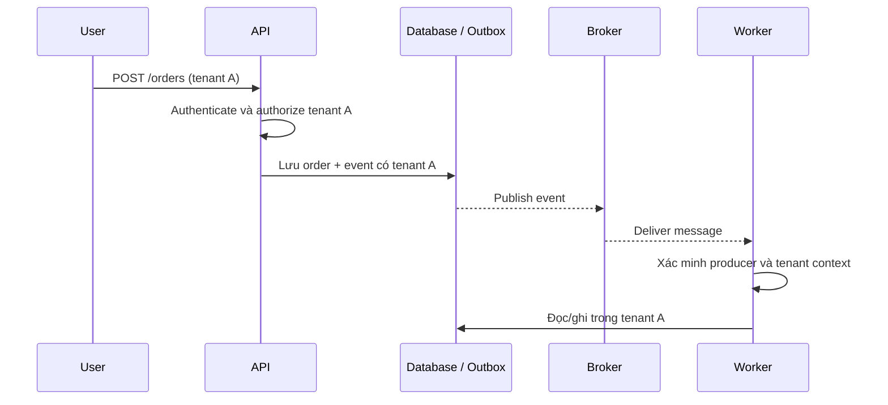
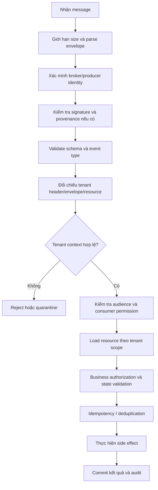
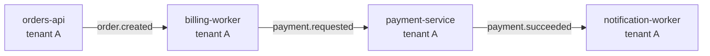

# Tenant context trong message

Trong hệ thống đa tenant, một message bất đồng bộ có thể kích hoạt thay đổi dữ liệu sau khi request HTTP ban đầu đã kết thúc. Ví dụ, API nhận yêu cầu tạo đơn của tenant A, ghi event vào broker và worker xử lý event vài giây sau. Nếu worker không giữ đúng tenant context, hoặc tin một `tenantId` do producer/client tự khai báo, nó có thể đọc hay ghi dữ liệu của tenant B.

Tenant context là thông tin xác định message và hành động xử lý thuộc phạm vi tenant nào. Nó phải được lấy từ nguồn đã xác thực, gắn với event một cách có thể kiểm chứng, truyền xuyên suốt qua broker/worker và được dùng trong authorization cũng như truy vấn dữ liệu. Chỉ thêm trường `tenantId` vào JSON chưa tạo ra ranh giới bảo mật.

## 1. Vì sao tenant context quan trọng trong async API?

Trong request đồng bộ, ứng dụng thường lấy tenant từ principal đã xác thực hoặc từ session được bảo vệ. Khi chuyển công việc sang queue, execution context của HTTP request không còn tồn tại. Worker có thể chạy trên instance khác, thread khác, service khác hoặc vào thời điểm user đã đăng xuất.

Một luồng phổ biến:



Nếu message thiếu tenant context, worker có thể dùng tenant mặc định, tenant lấy từ dữ liệu không tin cậy hoặc context còn sót trong thread trước. Nếu tenant context bị thay đổi trên đường truyền, event hợp lệ của tenant A có thể được xử lý dưới tenant B.

Rủi ro thường gặp:

- Consumer truy vấn theo `resourceId` mà không giới hạn tenant.
- Producer đưa `tenantId` từ request body vào message mà không đối chiếu với principal.
- Worker dùng một service account có quyền toàn hệ thống nhưng không kiểm tra tenant.
- Message retry hoặc chuyển sang DLQ làm mất metadata tenant.
- Thread pool tái sử dụng thread và giữ lại tenant context của message trước.
- Cache, idempotency record hoặc object storage không đưa tenant vào khóa.
- Một batch chứa message của nhiều tenant nhưng được xử lý dưới một context duy nhất.

Tenant isolation phải tồn tại trong toàn bộ vòng đời message, từ lúc tạo, publish, route, consume, retry, dead-letter đến redrive.

## 2. Phân biệt tenant context với dữ liệu nghiệp vụ

Tenant context là metadata bảo mật định danh phạm vi xử lý. Dữ liệu nghiệp vụ là nội dung mà event mô tả. Hai phần có thể cùng xuất hiện trong một envelope nhưng cần có nguồn gốc và quy tắc kiểm tra riêng.

Ví dụ event:

```json
{
  "eventId": "evt_01J8YQ7K3F5M",
  "eventType": "order.created",
  "schemaVersion": "1.2",
  "tenantContext": {
    "tenantId": "tenant-42",
    "scope": "TENANT"
  },
  "producer": "orders-api",
  "occurredAt": "2026-11-18T10:15:00Z",
  "data": {
    "orderId": "ord_01J8YQ7K3F5M",
    "customerId": "cus_123",
    "totalAmount": 500000,
    "currency": "VND"
  }
}
```

Envelope trên minh họa cách phân tách metadata và payload. `tenantId` trong message vẫn là một claim cần được ràng buộc với danh tính producer và resource thực tế. Consumer không được coi nó là đáng tin chỉ vì schema cho phép trường đó.

Nên xác định rõ:

- Tenant nào sở hữu event và resource liên quan.
- Producer nào được phép phát loại event đó cho tenant này.
- Consumer/service nào được phép nhận và xử lý event.
- Tenant context có được ký hoặc bảo vệ tính toàn vẹn qua broker hay không.
- Có phải event thuộc phạm vi tenant hay là sự kiện nền tảng toàn hệ thống.
- Quy tắc xử lý khi metadata tenant thiếu, sai hoặc mâu thuẫn.

## 3. Lấy tenant từ nguồn đáng tin cậy

Tenant context phải được xác định từ danh tính đã xác thực và dữ liệu có thẩm quyền. Không dùng trực tiếp tenant do client gửi trong body, query string hoặc header tùy ý.

Các nguồn có thể dùng:

| Nguồn | Cách sử dụng an toàn |
|---|---|
| Principal/access token đã xác minh | Lấy tenant claim sau khi kiểm tra issuer, audience, signature, expiry và scope |
| API key/client registry | Ánh xạ client credential tới tenant và quyền publish được cấp |
| Workload identity/mTLS | Xác định service producer và tenant scope của workload |
| Resource trong database | Tải resource trong phạm vi đã được kiểm tra rồi lấy tenant từ bản ghi có thẩm quyền |
| Job definition được quản trị | Lấy tenant từ cấu hình job đã xác thực và có audit |

Ví dụ, request có thể chứa `orderId`, nhưng server phải tải order bằng truy vấn giới hạn tenant của principal. Tenant trong message được lấy từ order đã tải hoặc principal đã xác minh, không lấy từ một trường `tenantId` do client tự chọn.

```java
public void createOrder(CreateOrderRequest request, AuthenticatedActor actor) {
    TenantId tenantId = actor.requireTenantId();
    authorization.require(actor, "orders:create", tenantId);

    Order order = orderService.create(tenantId, request);
    outboxRepository.save(OrderCreatedEvent.from(order, tenantId));
}
```

Ví dụ trên giả định actor đã được xác thực và tenant membership đã được xác minh. Nếu user có thể thuộc nhiều tenant, API phải xác minh tenant được chọn nằm trong danh sách tenant mà user được phép hoạt động và token/session được ràng buộc đúng ngữ cảnh.

### 3.1. Không tin tenant header do client tự khai báo

Header như `X-Tenant-Id` thường hữu ích để chọn tenant trong một API, nhưng giá trị của nó chỉ là đầu vào. Server phải đối chiếu với principal hoặc client credential trước khi sử dụng.

Không viết logic kiểu:

```java
// Không an toàn: client có thể tự chọn tenant khác.
TenantId tenantId = TenantId.of(request.getHeader("X-Tenant-Id"));
```

Hãy kiểm tra membership/scope:

```java
TenantId requestedTenant = tenantResolver.parse(request.getHeader("X-Tenant-Id"));
TenantId tenantId = authorization.requireTenantAccess(actor, requestedTenant);
```

Nếu API không cần client chọn tenant, tốt hơn là lấy tenant trực tiếp từ principal. Nếu gateway thêm tenant header nội bộ, gateway phải xóa giá trị cùng tên do client gửi trước khi tạo header đã xác minh; backend chỉ tin context qua kênh nội bộ được xác thực.

### 3.2. Không suy tenant từ dữ liệu không tin cậy

Không lấy tenant từ tên file, message topic do client chọn, URL callback, JSON path hoặc một `customerId` chưa được xác minh. Nếu tenant cần được suy ra từ resource ID, phải tải resource bằng một truy vấn an toàn, kiểm tra quan hệ và lấy tenant từ bản ghi có thẩm quyền.

Nếu resource không tồn tại hoặc không thuộc phạm vi caller, từ chối request. Không fallback sang tenant mặc định để “cho job chạy tiếp”.

## 4. Gắn tenant context vào event envelope

Định nghĩa envelope chung giúp producer và consumer xử lý metadata thống nhất. Có thể gồm:

| Trường | Mục đích | Quy tắc |
|---|---|---|
| `eventId` | Nhận diện một event | Duy nhất theo phạm vi đã định nghĩa; dùng cho deduplication |
| `eventType` | Xác định loại nghiệp vụ | Allowlist theo producer và consumer |
| `schemaVersion` | Chọn schema | Chỉ nhận version được hỗ trợ |
| `tenantId` | Phạm vi tenant | Lấy từ principal/resource đã xác minh |
| `tenantScope` | Phân biệt event tenant và event nền tảng | Enum rõ ràng, không dùng null hoặc `*` mơ hồ |
| `producerId` | Danh tính producer | Được ràng buộc với credential/workload identity |
| `audience` | Consumer/service đích | Consumer kiểm tra event dành cho mình |
| `occurredAt` | Thời điểm phát sinh nghiệp vụ | Không dùng một mình làm bằng chứng chống replay |
| `correlationId` | Liên kết các bước xử lý | Chỉ phục vụ tracing, không phải quyền truy cập |
| `data` | Payload nghiệp vụ | Validate theo schema và business rule |

Tên field và cấu trúc cần được thống nhất trong schema của hệ thống. Có thể dùng broker header hoặc message attributes cho một số metadata, nhưng phải có quy tắc bảo vệ tính toàn vẹn và xử lý khi metadata giữa header với body mâu thuẫn.

### 4.1. Một nguồn tenant canonical

Nếu tenant xuất hiện ở cả broker header, envelope và payload, consumer phải biết trường nào là nguồn canonical. Tốt nhất chỉ có một giá trị tenant có thẩm quyền trong envelope bảo mật; các bản sao phục vụ indexing hoặc routing phải được đối chiếu với nó.

Nếu `tenantId` trong header khác `tenantId` trong body, từ chối hoặc quarantine message. Không tùy tiện chọn giá trị đầu tiên hoặc cuối cùng vì các thành phần khác nhau có thể đã route message theo hai tenant khác nhau.

### 4.2. Bảo vệ tính toàn vẹn của tenant context

Broker header hoặc message attribute không tự động đáng tin. Producer có quyền publish có thể đặt metadata giả nếu broker ACL không giới hạn đúng. Consumer cần có cơ sở xác minh nguồn và tính toàn vẹn, ví dụ:

- Broker authentication và ACL ràng buộc producer với topic/queue được phép.
- mTLS hoặc workload identity giữa producer và broker.
- Event envelope được ký hoặc bảo vệ bằng cơ chế integrity phù hợp khi cần provenance end-to-end.
- Gateway/ingress đã xác minh producer và tạo context nội bộ theo hợp đồng.

Không lấy `producerId` hoặc `tenantId` trong JSON làm bằng chứng danh tính độc lập. Chúng phải khớp với credential, signature hoặc metadata do broker tin cậy cung cấp.

## 5. Xác thực producer và quyền publish theo tenant

Producer không được publish tùy ý event cho mọi tenant chỉ vì nó có thể kết nối broker. Cần kiểm tra cả quyền gửi message và phạm vi tenant.

Một quyết định publish có thể xét:

- Workload/client identity đã xác thực.
- Producer được phép publish topic hoặc event type nào.
- Producer được phép hoạt động trên tenant nào.
- Resource thuộc tenant nào.
- Event có đúng audience và schema version không.
- Producer có được phép phát sự kiện nền tảng hay chỉ sự kiện tenant-scoped.

Broker ACL nên giới hạn publish/consume theo topic, exchange, queue hoặc subscription. Tuy nhiên, topic-level ACL không nhất thiết biểu diễn được tenant scope nếu nhiều tenant dùng chung topic; khi đó producer và consumer cần policy bổ sung ở application layer.

Không dùng một service account có quyền publish mọi event cho mọi tenant nếu mỗi producer chỉ cần một tập nhỏ. Tách workload identity theo service hoặc chức năng giúp thu hồi và audit dễ hơn.

## 6. Consumer phải xác minh tenant trước khi xử lý

Consumer không nên tin rằng event đã được producer kiểm tra là đủ. Nó cần xác minh message thuộc phạm vi xử lý của chính consumer và tenant context hợp lệ.

Một pipeline tiêu thụ:



Thứ tự chi tiết có thể thay đổi theo giao thức, nhưng tenant phải được xác minh trước khi consumer dùng nó để chọn database, schema, storage bucket hoặc gọi service khác. Không để một message chưa xác minh chọn tài nguyên hạ tầng tùy ý.

### 6.1. Kiểm tra tenant với resource thực tế

Giả sử event có `tenantId=tenant-A` và `orderId=ORD-42`. Consumer cần tải order trong tenant A:

```sql
SELECT id, tenant_id, status, total_amount
FROM orders
WHERE id = :order_id
  AND tenant_id = :tenant_id;
```

Nếu không tìm thấy resource trong tenant đó, không thử truy vấn lại chỉ theo `id` rồi xử lý. Nếu resource tồn tại nhưng thuộc tenant khác, ghi nhận sự kiện mismatch và từ chối.

Khi tạo resource mới, tenant của bản ghi phải lấy từ tenant context đã xác minh. Không bind `tenantId` từ payload nghiệp vụ vào entity một cách tự động.

### 6.2. Consumer identity cũng cần được giới hạn

Consumer service có thể được phép xử lý event `order.created` cho tenant A nhưng không được đọc dữ liệu thanh toán hoặc thay đổi role người dùng. Phân quyền cần xét cả service principal, event type, tenant và hành động downstream.

Không dùng quyền admin toàn hệ thống làm mặc định cho worker. Nếu một worker thực sự cần xử lý nhiều tenant, cấp quyền platform-scoped có mục đích, audit đầy đủ và giới hạn loại thao tác.

## 7. Không dựa vào quyền của producer để thay quyền của consumer

Producer đã được phép tạo event không có nghĩa mọi consumer được phép thực hiện mọi hành động từ event đó. Có ít nhất hai quyết định riêng:

1. Producer có quyền phát event này cho tenant/resource này không?
2. Consumer có quyền xử lý event và tạo side effect tương ứng không?

Ví dụ, `orders-api` có thể phát `order.created`, nhưng `billing-worker` chỉ được tạo payment intent theo trạng thái đơn hàng. Nó không được tự động hoàn tiền hoặc sửa thông tin chủ sở hữu chỉ vì message đến từ producer tin cậy.

### 7.1. Event là fact hay command?

Phân biệt event mô tả điều đã xảy ra với command yêu cầu thực hiện hành động:

| Loại message | Ý nghĩa | Kiểm soát |
|---|---|---|
| Domain event | Fact đã xảy ra, ví dụ `order.created` | Xác minh nguồn, tenant, schema; consumer quyết định xử lý theo subscription và trạng thái hiện tại |
| Command | Yêu cầu thực hiện hành động, ví dụ `payment.refund.requested` | Xác minh caller/producer, permission cụ thể, tenant, resource và business rule trước side effect |
| Integration event | Thông tin chia sẻ giữa bounded context hoặc hệ thống | Xác định audience, trường được công bố và quyền của consumer |

Không đặt tên event như một fact nếu thực chất nó là lệnh có thể kích hoạt side effect. Với command, phải xác định ai có quyền ra lệnh và ai chịu trách nhiệm thực thi.

### 7.2. User context trong message

Đôi khi worker cần biết user nào đã khởi tạo hành động để audit hoặc áp dụng quy tắc “on behalf of”. Có thể đưa `actorId`, `initiatedBy` hoặc decision reference vào envelope, nhưng đây là thông tin attribution, không tự động là credential.

Không forward access token của user vào queue như một cách đơn giản để giữ quyền. Token có thể hết hạn, bị lộ trong broker/DLQ và có audience không phù hợp với consumer. Nếu consumer cần đánh giá quyền thay mặt user, dùng cơ chế delegation/token exchange có audience, scope và thời hạn giới hạn, hoặc re-evaluate policy từ danh tính và trạng thái hiện tại.

## 8. Tenant context trong database và storage

Xác minh tenant ở message layer chưa đủ nếu câu truy vấn hoặc cache không giới hạn tenant.

### 8.1. Tenant-aware query

Mọi truy vấn đọc/ghi tenant-scoped cần mang tenant context:

```sql
UPDATE orders
SET status = :new_status,
    updated_at = CURRENT_TIMESTAMP
WHERE id = :order_id
  AND tenant_id = :tenant_id
  AND status = :expected_status;
```

Kiểm tra số dòng được cập nhật. Nếu bằng 0, resource có thể không tồn tại trong tenant, đã đổi trạng thái hoặc không còn thỏa điều kiện. Không tiếp tục phát event thành công nếu update không được áp dụng.

Có thể dùng row-level security hoặc database role riêng để tạo thêm lớp bảo vệ. Nếu dùng session variable cho tenant trong connection pool, phải set tenant trước mỗi transaction và reset/clear khi trả connection; nếu không, connection tái sử dụng có thể giữ tenant của message trước.

### 8.2. Cache, lock và idempotency key

Tenant phải là một phần của khóa cache, distributed lock, deduplication và idempotency khi trạng thái có phạm vi tenant.

Ví dụ:

```text
cache:tenant-42:order:ORD-42
lock:tenant-42:payment:PAY-100
dedup:tenant-42:orders-api:event:evt-123
idempotency:tenant-42:billing-worker:refund:K-456
```

Nếu chỉ dùng `order:ORD-42`, hai tenant có thể đụng khóa nếu ID không globally unique hoặc cache namespace bị dùng chung. Nếu cùng một event ID được tạo bởi các producer khác nhau, deduplication key cần bao gồm producer và tenant theo hợp đồng.

### 8.3. Object storage và search index

Đường dẫn file, bucket, index hoặc partition có thể mang tenant context. Không dùng tenant ID trong message để ghép trực tiếp thành đường dẫn tùy ý. Hãy ánh xạ tenant đã xác minh sang namespace/bucket/index được cấu hình, kiểm tra quyền và tránh path traversal.

Search query phải thêm tenant filter ở server. Không cho consumer gửi nguyên filter do message cung cấp rồi bỏ qua tenant scope. Với export hoặc file output, quyền đọc file cần được kiểm tra lại theo tenant khi client tải xuống.

## 9. Truyền tenant context qua chuỗi event

Một consumer có thể phát event tiếp theo. Tenant context cần được bảo toàn từ event gốc hoặc từ resource đã xác minh, không lấy lại từ trường payload chưa tin cậy.

Ví dụ:



Mỗi service phải:

- Xác minh message đầu vào và tenant context.
- Thực hiện authorization cho hành động của chính service.
- Lấy tenant từ context đã xác minh hoặc resource có thẩm quyền.
- Gắn tenant context tương ứng vào event mới.
- Giữ `originalProducer`, `eventId` hoặc correlation/provenance metadata khi cần audit.
- Ghi rõ service hiện tại là producer của event mới, không giả mạo producer gốc.

Nếu consumer phát event cho tenant khác hoặc chuyển quyền sở hữu resource giữa tenant, đó là thao tác đặc biệt cần workflow và authorization rõ ràng. Không được chỉ đổi `tenantId` trong envelope rồi coi như đã chuyển tenant hợp lệ.

## 10. Event toàn hệ thống và thao tác nhiều tenant

Không dùng `tenantId=null`, chuỗi `*` hoặc tenant giả như `global` để biểu diễn nhiều ý nghĩa khác nhau. Những giá trị này dễ tạo nhánh logic bỏ qua tenant filter.

Nếu cần event cấp nền tảng, định nghĩa scope rõ ràng, ví dụ:

```json
{
  "eventType": "platform.maintenance.started",
  "tenantScope": "PLATFORM",
  "producer": "platform-operations",
  "audience": "maintenance-workers",
  "data": {"maintenanceId":"maint-42"}
}
```

Consumer chỉ chấp nhận `PLATFORM` event nếu workload identity được cấp quyền platform-scoped cho event type đó. Với event tenant-scoped, `tenantId` phải có và hợp lệ. Thiếu tenant không được tự động biến thành platform event.

Với thao tác fan-out cho nhiều tenant, cân nhắc tạo một message riêng cho từng tenant hoặc một job có danh sách tenant được ký/ủy quyền và giới hạn rõ. Không gửi một wildcard event rồi để mọi consumer tự suy đoán phạm vi. Với batch có nhiều tenant, phân nhóm và đánh giá quyền cho từng tenant; không xử lý cả batch dưới context của phần tử đầu tiên.

## 11. Retry, dead-letter queue và redrive

Tenant context phải được giữ nguyên trong retry và DLQ. Nếu broker chuyển message sang dead-letter queue mà bỏ header hoặc consumer metadata, người vận hành có thể redrive message dưới tenant sai.

Các nguyên tắc:

- Giữ nguyên envelope tenant và event identity khi retry.
- Không cho operator sửa tenant metadata thủ công trong DLQ mà không có workflow phê duyệt và audit.
- DLQ cần ACL riêng; message có thể chứa dữ liệu nhạy cảm của tenant.
- Redrive phải xác minh lại producer/provenance, schema, tenant scope và business state.
- Deduplication phải ngăn redrive tạo side effect lần hai ngoài chủ đích.
- Quarantine message tenant mismatch hoặc signature failure để điều tra, không tự động chuyển sang tenant mặc định.
- Retention và quyền truy cập DLQ phải phù hợp với yêu cầu dữ liệu của từng tenant.

Nếu worker đã commit side effect nhưng chết trước khi ack message, broker có thể giao lại. Consumer cần idempotency key hoặc unique event record có tenant scope để tránh xử lý trùng.

## 12. Context propagation trong thread và async runtime

Một số framework dùng `ThreadLocal`, request context hoặc MDC để truyền tenant qua các lớp. Các cơ chế này tiện cho logging nhưng không tự động an toàn khi chuyển sang thread pool, reactive pipeline hoặc message consumer.

Lỗi thường gặp:

1. Worker xử lý message của tenant A và set `ThreadLocal`.
2. Code kết thúc nhưng không clear context.
3. Thread được tái sử dụng cho message tenant B.
4. Một service đọc tenant A còn sót và truy vấn nhầm dữ liệu.

Hãy truyền tenant context một cách tường minh trong message handler/service method hoặc dùng context propagation đã được framework hỗ trợ. Nếu dùng ThreadLocal, phải set trước xử lý và clear trong `finally`:

```java
public void handle(OrderCreatedEvent event) {
    TenantContext.set(event.verifiedTenantId());
    try {
        orderProjectionService.update(event);
    } finally {
        TenantContext.clear();
    }
}
```

`verifiedTenantId` ở ví dụ phải được tạo sau khi xác minh producer, envelope và resource. Không lấy trực tiếp giá trị thô từ payload rồi set context. Với reactive framework, không dựa vào ThreadLocal vì một request có thể chạy qua nhiều thread; dùng context mechanism tương ứng và test propagation.

MDC chỉ nên chứa tenant reference đã được xác minh và cần tuân thủ chính sách log. Không dùng giá trị MDC làm nguồn authorization; logging context không phải security context.

## 13. Schema, signature và provenance của tenant context

Schema message cần định nghĩa tenant field, scope, producer và audience. Consumer phải từ chối field thiếu, sai kiểu hoặc giá trị mâu thuẫn. Với hệ thống có yêu cầu integrity end-to-end, chữ ký event nên bao phủ tenant context cùng event ID, type, version và payload digest.

Không ký payload rồi để broker/proxy thay tenant header mà chữ ký không bao phủ. Không cho `kid`, `producer` hoặc `tenantId` điều khiển việc tải khóa hay chọn endpoint xác minh tùy ý.

Nếu broker identity được xem là đủ cho trust boundary, phải cấu hình ACL sao cho chỉ producer được ủy quyền có thể publish lên topic đó, đồng thời bảo vệ quyền quản trị broker. Khi message đi qua nhiều broker hoặc lưu trữ rồi chuyển tiếp, đánh giá lại liệu broker metadata có còn chứng minh producer gốc hay cần signed envelope.

## 14. Kiểm thử tenant isolation cho async message

Test phải chứng minh message tenant A không thể làm worker đọc/ghi dữ liệu tenant B, kể cả khi payload, header, retry hoặc context propagation bị thao túng.

| Tình huống | Kết quả cần xác minh |
|---|---|
| Producer hợp lệ phát event cho tenant được cấp | Message mang tenant context đúng và được xử lý trong phạm vi đó |
| Client gửi `tenantId` khác principal | API từ chối hoặc dùng tenant đã xác minh; không phát event sang tenant khác |
| Header và envelope tenant không khớp | Reject/quarantine; không chọn một giá trị tùy tiện |
| Producer identity không có quyền publish event type | Broker/application authorization từ chối |
| Producer hợp lệ nhưng tenant ngoài scope | Bị từ chối trước publish hoặc consume |
| Event tenant A tham chiếu resource tenant B | Không đọc/ghi resource B; ghi nhận mismatch |
| Tenant context bị thiếu | Reject/quarantine; không fallback default |
| Message có scope PLATFORM | Chỉ workload platform-scoped và event type được cấp mới xử lý |
| Worker xử lý liên tiếp tenant A rồi B trên cùng thread | Context được thay và clear chính xác; không rò tenant |
| Retry hoặc DLQ redrive | Tenant, event identity và authorization được giữ/kiểm tra lại |
| Duplicate event cùng tenant | Side effect chỉ xảy ra một lần |
| Duplicate event ID nhưng tenant/producer khác | Phát hiện xung đột; không gộp nhầm record |
| Cache/idempotency key thiếu tenant | Test phát hiện va chạm hoặc cross-tenant result |
| Database query chỉ lọc resource ID | Test bảo đảm tenant predicate/RLS ngăn truy cập chéo |
| Batch chứa nhiều tenant | Từng phần tử được phân vùng và authorize đúng; không dùng context chung |
| Consumer gọi downstream service | Tenant context được truyền qua kênh tin cậy và downstream kiểm tra lại |
| Operator redrive message | Có audit, quyền riêng và xác minh lại tenant trước xử lý |

Nên chạy integration test với broker thật hoặc môi trường tương đương, nhiều consumer instance, thread pool tái sử dụng, database/cache dùng chung và DLQ. Unit test cho hàm `setTenant()` không đủ để chứng minh toàn bộ luồng không rò tenant.

## 15. Audit và giám sát

Log/trace cần nối được producer, broker và consumer mà không ghi secret hoặc toàn bộ payload nhạy cảm. Metadata hữu ích gồm:

- Tenant ID đã chuẩn hóa hoặc tenant reference được phép log.
- Producer/workload identity đã xác minh.
- Consumer identity và event type.
- Event ID, schema version, audience và correlation ID.
- Kết quả tenant validation và authorization.
- Topic/queue, retry count, DLQ reference và thời điểm xử lý.
- Resource reference và kết quả side effect.

Không log access token, API key, HMAC secret hoặc nội dung nhạy cảm của message. Metric không nên dùng tenant ID không giới hạn làm label nếu gây cardinality quá cao; có thể dùng aggregate, sampling hoặc dashboard theo tenant ở hệ thống phân tích được kiểm soát.

Theo dõi tenant mismatch, message thiếu tenant, producer gửi sai event type, số lần reject/quarantine, DLQ tăng, duplicate rate và worker truy cập resource ngoài tenant. Đây là các tín hiệu có thể cho thấy lỗi tích hợp hoặc hành vi tấn công.

## 16. Checklist thiết kế tenant context

- [ ] Tenant được lấy từ principal, workload identity hoặc resource có thẩm quyền.
- [ ] Tenant do client gửi được xác minh với membership/scope; không tin trực tiếp body/header.
- [ ] Event envelope có tenant scope rõ và một nguồn tenant canonical.
- [ ] Producer identity được ràng buộc với quyền publish topic/event type/tenant.
- [ ] Broker ACL và service identity giới hạn producer/consumer phù hợp.
- [ ] Consumer xác minh tenant, producer, audience, schema và provenance trước xử lý.
- [ ] Resource được tải và cập nhật với tenant predicate hoặc RLS.
- [ ] Consumer kiểm tra permission và business state riêng; không chỉ dựa vào quyền producer.
- [ ] User attribution không bị nhầm với credential hoặc authorization delegation.
- [ ] Cache, lock, deduplication, idempotency và storage namespace bao gồm tenant.
- [ ] Tenant context được truyền qua thread/reactive runtime và được clear đúng cách.
- [ ] Event platform-scoped và multi-tenant fan-out có policy riêng; không dùng wildcard mơ hồ.
- [ ] Retry, DLQ và redrive giữ nguyên tenant context và được kiểm tra lại.
- [ ] Có integration test chống cross-tenant access, duplicate, context leakage và batch mixing.
- [ ] Audit/monitoring ghi được provenance và tenant decision mà không lộ secret.

## 17. Nguyên tắc thiết kế

Tenant context trong message là một phần của ranh giới bảo mật đa tenant. Hãy lấy tenant từ danh tính đã xác thực hoặc resource có thẩm quyền, gắn vào event envelope theo một schema rõ ràng và bảo vệ tính toàn vẹn qua broker. Producer phải có quyền publish event cho tenant tương ứng; consumer phải xác minh nguồn, audience, tenant và quyền thực hiện hành động của chính mình trước khi xử lý.

Truyền tenant xuyên suốt tới database, cache, lock, idempotency, storage, retry và DLQ. Không fallback sang tenant mặc định khi context thiếu, không tin header/body tự khai báo và không dùng quyền admin toàn hệ thống cho worker thông thường. **Một message chỉ được xử lý khi tenant context đã được xác minh, khớp với resource và nằm trong phạm vi quyền của cả producer lẫn consumer.**
