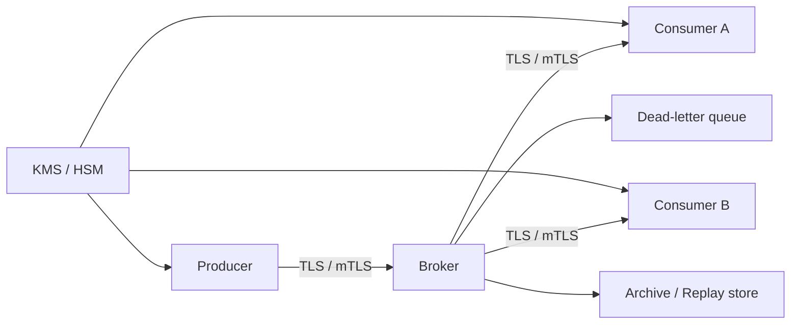
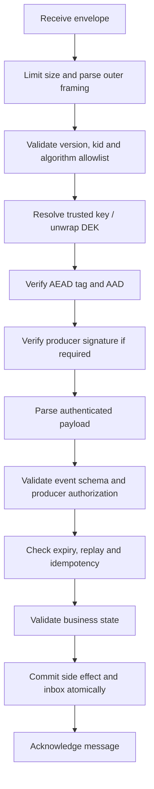

# Encryption, integrity và key rotation

Trong hệ thống async/message API, producer gửi event hoặc command vào broker, queue hay stream; consumer có thể xử lý sau vài giây, vài giờ hoặc replay từ kho lưu trữ. Message có thể đi qua nhiều broker, replica, connector, dead-letter queue (DLQ), log và hệ thống phân tích. TLS bảo vệ một kết nối, nhưng message có thể tiếp tục tồn tại sau khi kết nối kết thúc và được nhiều consumer đọc ở những thời điểm khác nhau.

Vì vậy, cần phân biệt ba mục tiêu:

- **Confidentiality (bí mật):** chỉ thành phần được phép mới đọc được nội dung message.
- **Integrity (toàn vẹn):** phát hiện message bị sửa đổi hoặc bị thay thế trong quá trình truyền/lưu trữ.
- **Authenticity (xác thực nguồn):** xác định message được tạo bởi producer hoặc principal có key hợp lệ.

Encryption có thể bảo vệ confidentiality; authenticated encryption như AES-GCM còn kiểm tra integrity và xác thực dữ liệu bằng key đối xứng. HMAC hoặc digital signature có thể chứng minh message được tạo bởi bên nắm giữ key tương ứng. Các cơ chế này không tự ngăn replay, duplicate delivery hoặc consumer xử lý sai nghiệp vụ. Chúng cần kết hợp với identity, authorization, event ID, idempotency và key lifecycle.

**Key rotation là một phần của vòng đời message:** hệ thống phải biết message cũ được mã hóa/ký bằng key nào, consumer nào còn cần key đó, thời điểm nào có thể ngừng sử dụng và cách phản ứng nếu key bị lộ.

## 1. Threat model cho message bất đồng bộ

Trước khi chọn thuật toán, hãy xác định message đi qua đâu, ai có thể đọc/sửa/phát lại và thành phần nào được phép giải mã hoặc xác minh.

Một luồng điển hình:



Các rủi ro thường gặp:

- Người có quyền đọc broker hoặc backup đọc được payload chứa dữ liệu cá nhân, thông tin tài chính hoặc secret.
- Một producer bị xâm nhập phát event giả với nội dung hợp lệ về cú pháp nhưng sai nguồn.
- Message bị sửa header, tenant, event type, amount hoặc recipient sau khi ký/mã hóa.
- Attacker phát lại một message hợp lệ để tạo side effect lần thứ hai.
- Một consumer có quyền đọc topic nhưng không nên đọc mọi field nhạy cảm.
- Key nằm trong source code, image, environment dump, log hoặc file cấu hình bị lộ.
- Consumer cũ không còn giải mã được message sau khi key bị xóa quá sớm.
- Key compromise khiến attacker giải mã ciphertext đã thu thập hoặc giả mạo message mới.
- Message được chuyển sang DLQ, archive hoặc replay tool nhưng các đường này không áp dụng cùng chính sách bảo vệ.

### 1.1. Phân loại dữ liệu và consumer

Không phải mọi message đều cần cùng mức bảo vệ. Hãy phân loại payload và lập danh sách consumer theo mục đích:

| Loại dữ liệu | Ví dụ | Hướng bảo vệ |
|---|---|---|
| Công khai hoặc ít nhạy cảm | Sự kiện cập nhật catalog công khai | TLS, broker ACL, integrity theo threat model |
| Nội bộ | Trạng thái job, metadata vận hành | TLS/mTLS, ACL theo topic, integrity |
| Dữ liệu cá nhân | Email, địa chỉ, thông tin tài khoản | Giới hạn consumer, encryption at rest/in transit, có thể message-level encryption |
| Tài chính hoặc nhạy cảm cao | Payment instruction, số tài khoản, dữ liệu định danh | Message-level AEAD, key access riêng, audit, retention ngắn |
| Bí mật xác thực | Password, API key, refresh token | Tránh đưa vào event; nếu nghiệp vụ bắt buộc, dùng secret reference hoặc thiết kế chuyên biệt |

Một consumer có quyền subscribe topic không đồng nghĩa nó cần giải mã mọi field. Nếu nhiều nhóm consumer có nhu cầu khác nhau, cân nhắc tách topic, tách payload hoặc mã hóa field nhạy cảm riêng.

## 2. TLS, encryption at rest và message-level encryption

Ba lớp này bảo vệ những ranh giới khác nhau:

| Cơ chế | Bảo vệ | Không tự bảo vệ khỏi |
|---|---|---|
| TLS giữa producer và broker | Người nghe lén/sửa traffic trên kết nối | Broker admin, consumer có quyền đọc, dữ liệu lưu trong broker/backup |
| TLS/mTLS giữa broker và consumer | Kết nối broker-consumer và danh tính workload ở transport layer | Consumer được cấp quyền quá rộng hoặc payload bị lộ sau giải mã |
| Broker encryption at rest | Disk, snapshot hoặc storage bị truy cập trái phép theo threat model | Broker process/admin có quyền đọc plaintext |
| Message-level encryption | Payload vẫn được mã hóa khi nằm trong broker, DLQ hoặc archive | Metadata không mã hóa, key bị lộ, consumer hợp lệ bị xâm nhập |
| Digital signature/HMAC | Phát hiện thay đổi và xác minh nguồn theo key model | Confidentiality, replay hoặc business authorization |

TLS vẫn cần thiết kể cả khi message-level encryption được sử dụng. TLS bảo vệ credential, metadata và key exchange; message encryption bảo vệ payload qua nhiều hop và thời gian lưu trữ.

### 2.1. Khi nào cần message-level encryption?

Hãy cân nhắc mã hóa payload ở producer trước khi publish nếu:

- Broker operator không được phép đọc payload.
- Message đi qua nhiều hệ thống hoặc vùng trust khác nhau.
- Message được giữ lâu trong archive/backup/DLQ.
- Chỉ một số consumer được phép đọc dữ liệu nhạy cảm.
- Chính sách yêu cầu bảo vệ dữ liệu kể cả khi broker hoặc connector bị truy cập trái phép.

Nếu broker cần lọc hoặc định tuyến theo event type, tenant hoặc partition key, có thể giữ metadata tối thiểu ở dạng rõ và mã hóa payload. Metadata vẫn có thể tiết lộ hoạt động, tenant, kích thước và thời điểm; hãy giới hạn hoặc làm mờ thông tin đó nếu nhạy cảm.

### 2.2. Không mã hóa toàn bộ message một cách mù quáng

Mã hóa toàn bộ message có thể khiến broker không đọc được routing key, schema version hoặc event type. Trước khi chọn, xác định trường nào cần broker xử lý và trường nào cần giữ bí mật. Tránh đưa email, tên đầy đủ, số tài khoản hoặc token vào header/partition key chỉ vì payload đã được mã hóa.

Một envelope thường giữ metadata cần thiết như `kid`, algorithm profile, event type/version, message ID và wrapped data key; payload được mã hóa. Metadata phải tối thiểu, không chứa secret và được ràng buộc với ciphertext qua authenticated additional data (AAD) hoặc chữ ký.

## 3. Chọn primitive mật mã đúng

Không tự thiết kế thuật toán mã hóa hoặc protocol. Dùng thư viện chuẩn và profile đã được review.

### 3.1. Authenticated encryption (AEAD)

AEAD vừa mã hóa plaintext vừa xác thực ciphertext và additional authenticated data. Một lựa chọn phổ biến là AES-GCM với tag 128-bit và nonce 96-bit. ChaCha20-Poly1305 cũng là một AEAD phổ biến khi môi trường hỗ trợ tốt.

AEAD cung cấp:

- Confidentiality của plaintext.
- Integrity của ciphertext và AAD.
- Xác nhận message không bị sửa nếu tag verification thành công.

AEAD không tự chứng minh một producer cụ thể nếu nhiều producer cùng dùng một symmetric key. Bất kỳ bên nào giữ key đều có thể tạo ciphertext/tag hợp lệ. Nếu cần xác minh riêng producer trong mô hình nhiều consumer, cân nhắc digital signature hoặc key riêng theo producer.

### 3.2. HMAC

HMAC (ví dụ HMAC-SHA-256) tạo message authentication code bằng shared secret. Consumer có thể xác minh rằng message được tạo bởi một bên có cùng key và chưa bị sửa.

HMAC phù hợp khi các bên được phép cùng tin cậy một shared secret. Nhưng mọi bên có key đều có khả năng tạo MAC; consumer không thể chứng minh với bên thứ ba rằng chỉ producer cụ thể đã tạo message. Nếu có nhiều consumer độc lập, chia sẻ cùng HMAC key có thể mở rộng phạm vi giả mạo khi một consumer bị xâm nhập.

### 3.3. Digital signature

Digital signature dùng private key để ký và public key để xác minh. Producer giữ private signing key; consumer chỉ cần public key. Điều này phù hợp khi nhiều consumer cần xác minh nguồn mà không được phép tạo chữ ký.

Ví dụ thuật toán có thể gồm Ed25519 hoặc RSA-PSS theo policy và thư viện được hỗ trợ. ECDSA cũng được dùng rộng rãi nhưng cần implementation quản lý nonce ký an toàn. Chọn thuật toán theo chuẩn, khả năng tương thích và hướng dẫn mật mã của tổ chức.

Chữ ký chứng minh dữ liệu được ký bởi một key, không tự chứng minh người vận hành hoặc user cụ thể đã phê duyệt nghiệp vụ. Cần gắn key với producer identity, tenant, topic và quyền publish trong registry đáng tin cậy.

### 3.4. Phân biệt integrity, authenticity và authorization

| Kiểm soát | Câu hỏi được trả lời |
|---|---|
| AEAD/HMAC/signature | Dữ liệu có bị sửa không? Có key hợp lệ nào tạo ra nó không? |
| Producer identity | Key này thuộc producer/service nào? |
| Topic ACL / publish authorization | Producer đó có quyền gửi loại event này vào topic không? |
| Consumer authorization | Consumer có quyền nhận và giải mã loại dữ liệu này không? |
| Business validation | Event có hợp lệ với trạng thái nghiệp vụ hiện tại không? |
| Idempotency/replay protection | Event đã được xử lý hoặc hết hạn chưa? |

Một message có chữ ký hợp lệ vẫn có thể là command không được phép, event cũ bị phát lại hoặc dữ liệu nghiệp vụ không hợp lệ. Consumer cần thực hiện tất cả bước phù hợp.

## 4. Envelope encryption và quản lý data key

Trong hệ thống message có lưu trữ lâu dài hoặc nhiều consumer, envelope encryption giúp tách key dùng mã hóa dữ liệu khỏi key dùng bảo vệ key.

- **DEK (Data Encryption Key):** key mã hóa payload thực tế.
- **KEK (Key Encryption Key):** key trong KMS/HSM dùng để wrap/unwrap DEK.
- **Wrapped DEK:** DEK đã được mã hóa bằng KEK và có thể lưu trong message envelope.

Luồng mã hóa:

1. Producer yêu cầu KMS tạo DEK hoặc tạo DEK theo cơ chế được phê duyệt.
2. Producer nhận plaintext DEK và wrapped DEK.
3. Producer dùng DEK với AEAD để mã hóa payload và AAD.
4. Producer xóa/giải phóng plaintext DEK khỏi phạm vi sử dụng tốt nhất có thể.
5. Message chứa ciphertext, nonce, tag (nếu tách riêng), wrapped DEK, key version và metadata tối thiểu.

Luồng giải mã:

1. Consumer xác minh message envelope và kiểm tra metadata/algorithm profile được phép.
2. Consumer xác định KEK version từ key reference đã được trust registry cho phép.
3. Consumer yêu cầu KMS unwrap DEK với workload identity và quyền decrypt phù hợp.
4. Consumer xác minh AEAD tag/AAD trước khi sử dụng plaintext.
5. Consumer parse và validate payload sau khi xác thực mật mã thành công.

### 4.1. Ví dụ message envelope

```json
{
  "envelopeVersion": 1,
  "eventType": "PaymentAuthorized",
  "schemaVersion": 2,
  "messageId": "evt-01J...",
  "producerId": "payments-service",
  "tenantRef": "tenant-17",
  "encryption": {
    "algorithm": "A256GCM",
    "keyEncryptionAlgorithm": "KMS-ENVELOPE",
    "kekRef": "payments-data-key-v4",
    "wrappedDek": "base64...",
    "nonce": "base64...",
    "tagLength": 128
  },
  "ciphertext": "base64...",
  "signature": {
    "algorithm": "Ed25519",
    "kid": "payments-producer-sign-v3",
    "value": "base64..."
  }
}
```

Đây là cấu trúc minh họa, không phải chuẩn wire format. Trong một số thư viện, tag được nối vào cuối ciphertext; trong ví dụ khác, tag được lưu riêng. Consumer và producer phải thống nhất một encoding canonical, giới hạn kích thước và version rõ ràng.

Không đặt DEK hoặc KEK plaintext vào message, header, log hay schema registry. `kekRef` chỉ là identifier để tra cứu trong allowlist/KMS policy, không phải URL tùy ý do message điều khiển. Key ID của encryption/KEK và signing key nên là các trường riêng; không dùng một `kid` mơ hồ để chọn key cho nhiều purpose.

### 4.2. DEK theo message hay theo batch?

DEK riêng cho mỗi message giúp giới hạn blast radius và đơn giản hóa quản lý nonce theo key, nhưng tăng số lần gọi KMS hoặc chi phí wrap/unwrap. Có thể cache/derive data key theo một profile được review hoặc dùng key cho batch, nhưng khi đó cần nonce uniqueness, giới hạn số message/bytes mỗi key và xử lý rotation rõ ràng.

Không tự dùng một DEK và một nonce cố định cho nhiều plaintext. Với AES-GCM, tái sử dụng nonce dưới cùng key có thể phá vỡ confidentiality và authenticity. Nếu retry publish cùng ciphertext đã tạo, hãy gửi lại chính bytes đã lưu; không mã hóa plaintext khác bằng cùng cặp key/nonce.

### 4.3. KEK rotation và DEK rotation khác nhau

Nếu chỉ xoay KEK, có thể re-wrap DEK bằng KEK mới mà không cần giải mã và mã hóa lại toàn bộ payload, nếu KMS và format hỗ trợ. Nếu DEK hoặc thuật toán payload bị compromise/không còn phù hợp, có thể cần decrypt rồi encrypt lại payload bằng DEK mới.

Phân biệt rõ:

- Xoay KEK bảo vệ việc lưu trữ/kiểm soát DEK.
- Xoay DEK thay key trực tiếp bảo vệ payload.
- Xoay signing key thay key xác minh nguồn message.
- Xoay TLS certificate bảo vệ kết nối transport.

Một loại rotation không tự động hoàn thành các loại còn lại.

## 5. Nonce, AAD và encoding message

### 5.1. Nonce phải duy nhất dưới cùng một key

Với AES-GCM, nonce không được lặp lại dưới cùng key. Đây là yêu cầu mật mã cốt lõi, không phải tối ưu hiệu năng.

Thực hành:

- Dùng nonce 96-bit theo profile AES-GCM phổ biến.
- Tạo nonce bằng CSPRNG hoặc cơ chế counter/sequence được quản lý để bảo đảm uniqueness.
- Nếu dùng counter, cần bảo đảm không trùng giữa process, instance, restart, failover và producer cùng key.
- Nếu dùng random nonce, đánh giá xác suất collision theo tổng số message/key và giới hạn usage theo khuyến nghị của thư viện/chuẩn.
- Theo dõi key usage và rotate trước giới hạn của thuật toán/profile.
- Không tái sử dụng nonce khi re-encrypt hoặc retry với plaintext thay đổi.

Per-message DEK có thể làm đơn giản hóa quản lý nonce nhưng không nên dùng nó làm lý do bỏ kiểm soát nonce. Lưu nonce trong envelope; nonce không cần bí mật nhưng phải được xác thực cùng ciphertext.

### 5.2. Additional authenticated data (AAD)

AAD là metadata không được mã hóa nhưng được AEAD xác thực. Có thể ràng buộc ciphertext với:

Với message có thể được chuyển sang retry topic hoặc DLQ, hãy bind AAD với logical topic gốc của event. Consumer cần giữ metadata tin cậy về topic ban đầu để tái tạo AAD khi replay; không lấy tên queue vật lý hiện tại thay cho logical origin topic.

- Topic hoặc logical channel.
- Event type và schema version.
- Message ID.
- Tenant identifier đã được xác định theo trust model.
- Producer identity hoặc key context.
- Envelope version.

Ví dụ canonical AAD:

```text
aad = encodeLengthPrefixed(
  envelopeVersion,
  logicalOriginTopic,
  eventType,
  schemaVersion,
  messageId,
  tenantRef
)
```

Không nối chuỗi tùy tiện như `topic + eventType + id` nếu không có delimiter/length encoding rõ ràng; hai bộ giá trị khác nhau có thể tạo cùng chuỗi. Dùng encoding canonical có schema cố định hoặc length-prefix.

Khi consumer giải mã, phải tạo lại đúng AAD từ metadata được nhận và metadata đáng tin cậy của subscription/routing context. Nếu attacker đổi `tenantRef`, `topicName` hoặc `eventType`, tag verification phải thất bại. Không lấy AAD từ nguồn client khác với metadata đã được xác minh.

### 5.3. Ký đúng bytes, không ký object đã serialize lại tùy tiện

Với HMAC hoặc digital signature, producer và consumer phải thống nhất chính xác bytes được ký. Nếu producer ký JSON serialization A còn consumer parse rồi serialize thành JSON B, thứ tự key, whitespace, escaping hoặc number formatting có thể khác.

Các lựa chọn:

- Ký raw payload bytes cùng các header được chọn theo một canonical signing format.
- Dùng canonical serialization đã được chuẩn hóa và version hóa.
- Dùng message signing standard/profile đã được review, quy định rõ covered components.

Không parse rồi tái tạo JSON trước khi verify nếu chữ ký được tạo trên raw bytes ban đầu. Không để proxy hoặc middleware sửa header/payload đã nằm trong signing input mà không cập nhật chữ ký.

## 6. Mã hóa và giải mã bằng Java

Ví dụ dưới đây minh họa AES-GCM với JCA. Quản lý key thực tế nên dùng KMS/HSM hoặc secret/key management service, không hard-code key trong source.

### 6.1. Mã hóa

```java
import javax.crypto.Cipher;
import javax.crypto.SecretKey;
import javax.crypto.spec.GCMParameterSpec;
import java.security.SecureRandom;

public final class MessageCrypto {
    private static final int NONCE_BYTES = 12;
    private static final int TAG_BITS = 128;
    private static final SecureRandom RNG = new SecureRandom();

    public record Encrypted(byte[] nonce, byte[] ciphertextAndTag) {}

    public static Encrypted encrypt(
            SecretKey dek,
            byte[] plaintext,
            byte[] aad
    ) throws Exception {
        byte[] nonce = new byte[NONCE_BYTES];
        RNG.nextBytes(nonce);

        Cipher cipher = Cipher.getInstance("AES/GCM/NoPadding");
        cipher.init(
            Cipher.ENCRYPT_MODE,
            dek,
            new GCMParameterSpec(TAG_BITS, nonce)
        );
        cipher.updateAAD(aad);

        byte[] ciphertextAndTag = cipher.doFinal(plaintext);
        return new Encrypted(nonce, ciphertextAndTag);
    }
}
```

JCA thường trả ciphertext kèm authentication tag trong `doFinal`; format envelope phải ghi rõ cách tách/lưu tag nếu hệ thống cần tách riêng. Nonce ngẫu nhiên 96-bit là cách minh họa phổ biến, nhưng ở throughput rất lớn cần tính toán collision probability và giới hạn số lần dùng mỗi key; có thể dùng per-message DEK hoặc nonce allocation có bảo đảm uniqueness theo profile được review.

### 6.2. Giải mã và xác minh tag

```java
public static byte[] decrypt(
        SecretKey dek,
        byte[] nonce,
        byte[] ciphertextAndTag,
        byte[] aad
) throws Exception {
    if (nonce == null || nonce.length != 12) {
        throw new SecurityException("Invalid nonce length");
    }

    Cipher cipher = Cipher.getInstance("AES/GCM/NoPadding");
    cipher.init(
        Cipher.DECRYPT_MODE,
        dek,
        new GCMParameterSpec(128, nonce)
    );
    cipher.updateAAD(aad);

    // AEADBadTagException hoặc lỗi xác thực phải làm message bị từ chối.
    return cipher.doFinal(ciphertextAndTag);
}
```

Không sử dụng plaintext nếu `doFinal` chưa hoàn tất thành công. Không bắt lỗi tag rồi tiếp tục parse một phần dữ liệu. Khi tag sai, coi message là không đáng tin, đưa vào quarantine/DLQ theo policy và phát alert phù hợp.

### 6.3. Các lưu ý cho code production

- Xác minh `kid`, algorithm profile và key purpose bằng registry tin cậy trước khi gọi KMS.
- Giới hạn kích thước envelope, nonce, wrapped key và ciphertext trước khi cấp phát bộ nhớ lớn.
- Dùng key có độ dài phù hợp với AES profile; không tự cắt hoặc hash key tùy tiện.
- Không tái sử dụng `Cipher` instance không đúng cách giữa các thread/message.
- Không log plaintext, key, wrapped key nhạy cảm hoặc exception dump chứa dữ liệu.
- Phân biệt lỗi tạm thời của KMS với lỗi mật mã vĩnh viễn như tag sai/unknown key.
- Có test vector cố định để kiểm tra interoperability giữa producer và consumer.

## 7. HMAC và digital signature cho message

AEAD đã xác thực ciphertext đối với các bên giữ encryption key. Nếu cần chữ ký producer độc lập với encryption, có thể thêm signature trên message envelope/canonical bytes.

### 7.1. HMAC minh họa trong Java

```java
import javax.crypto.Mac;
import javax.crypto.SecretKey;
import java.security.MessageDigest;

static byte[] hmacSha256(SecretKey key, byte[] message) throws Exception {
    Mac mac = Mac.getInstance("HmacSHA256");
    mac.init(key);
    return mac.doFinal(message);
}

static boolean verifyHmac(
        SecretKey key,
        byte[] message,
        byte[] receivedMac
) throws Exception {
    byte[] expected = hmacSha256(key, message);
    return MessageDigest.isEqual(expected, receivedMac);
}
```

`MessageDigest.isEqual` được dùng để so sánh constant-time trong API Java tương ứng; không dùng `Arrays.equals` cho MAC/secret comparison nếu timing leakage là mối quan tâm. Trong hệ thống nhiều consumer, cân nhắc key riêng hoặc signature để một consumer không thể giả mạo message của producer.

### 7.2. Ký envelope

Một signature có thể bao phủ canonical representation gồm:

```text
signatureInput = encodeWithFixedSchema(
  envelopeVersion,
  producerId,
  signingKeyId,
  topic,
  eventType,
  schemaVersion,
  messageId,
  createdAt,
  payloadDigest
)
```

Producer ký `signatureInput` bằng private key; consumer lấy public key từ trust registry và xác minh. Nếu payload được mã hóa, `payloadDigest` có thể là digest của ciphertext/envelope bytes. Hãy định nghĩa chính xác byte range được ký, thứ tự encoding và cách xử lý header thay đổi.

Không coi `producerId` do message tự khai báo là đáng tin chỉ vì nó nằm trong signature input. Sau khi xác minh chữ ký, consumer phải map key ID tới producer identity và kiểm tra producer đó có quyền publish event type/topic tương ứng.

### 7.3. Kết hợp encryption và signature

Nếu cần cả confidentiality lẫn bằng chứng nguồn producer, phải định nghĩa rõ signature bao phủ plaintext hay ciphertext và thứ tự xử lý. Ví dụ, ký ciphertext/envelope cho phép consumer xác minh producer trước khi gọi KMS giải mã; ký plaintext yêu cầu giải mã trước rồi mới verify. Mỗi cách có semantics và metadata exposure khác nhau.

Không tự ghép `sign-then-encrypt` hoặc `encrypt-then-sign` bằng cách nối bytes tùy ý. Dùng một chuẩn/profile đã được review (ví dụ cấu trúc JWE/JWS hoặc container mật mã phù hợp) và quy định rõ canonical bytes, key purpose, algorithm allowlist, AAD, signature coverage và error behavior. Với đa số message API, AEAD đã đủ để phát hiện sửa đổi đối với các bên giữ DEK; chỉ thêm signature khi threat model cần xác minh producer độc lập với consumer.

### 7.4. Signature không ngăn replay

Một message có chữ ký hợp lệ vẫn có thể được gửi lại nhiều lần. Consumer cần kiểm tra `messageId`/event ID, thời gian, expiry, sequence hoặc business idempotency. Signature xác minh nguồn và integrity, không chứng minh message chưa từng được xử lý.

## 8. Thứ tự xử lý ở consumer

Consumer không nên deserialize và thực thi business command trước khi xác minh mật mã. Một luồng tham khảo:



Trình tự chi tiết phụ thuộc giao thức. Ví dụ signature trên ciphertext có thể được verify trước khi gọi KMS unwrap để giảm việc xử lý ciphertext giả; AEAD tag vẫn phải được xác minh trước khi dùng plaintext. Dù chọn thứ tự nào, không parse hoặc thực thi payload chưa được xác thực mật mã.

### 8.1. Kiểm tra key và algorithm trước khi giải mã

- Chỉ chấp nhận envelope version đã hỗ trợ.
- `kid` phải tồn tại trong registry cho issuer/producer/topic phù hợp.
- Algorithm phải nằm trong allowlist và khớp key type/purpose.
- Từ chối `alg` do message chọn nếu không phù hợp policy.
- Không thử hàng loạt key hoặc algorithm như fallback.
- Unknown key hoặc algorithm cần được phân loại rõ: có thể là message mới đến sớm trước key distribution, hoặc message giả mạo. Chỉ retry trong một cửa sổ có giới hạn nếu có bằng chứng rotation đang diễn ra.

### 8.2. Parse sau khi xác minh

Sau khi AEAD/signature thành công, parse payload theo schema version. Vẫn phải kiểm tra kiểu dữ liệu, kích thước, enum, nested depth, tenant, producer permission và business invariants. Một message đã ký hợp lệ có thể chứa dữ liệu lỗi do producer bug hoặc producer bị compromise.

## 9. Replay, duplicate delivery và idempotency

Message broker thường cung cấp at-least-once delivery; một message có thể được giao lại khi consumer crash, ack timeout hoặc network failure. Encryption và signature không loại bỏ duplicate delivery.

Các trường nên có:

- `messageId` hoặc `eventId` duy nhất và ổn định qua retry.
- `createdAt` hoặc issued time đã được ký/xác thực.
- `expiresAt` hoặc TTL nếu message có thời hạn nghiệp vụ.
- `producerId`, `eventType`, `schemaVersion`.
- Idempotency/business key phù hợp với side effect.

Consumer có thể dùng inbox table với unique constraint trên `(producer_id, message_id)` hoặc key tương đương. Ghi nhận message đã xử lý và side effect trong cùng transaction khi có thể. Nếu downstream nằm ngoài transaction, cần idempotency key/reconciliation.

Không dùng timestamp một mình làm chống replay; message hợp lệ trong cửa sổ thời gian vẫn có thể được phát lại nhiều lần. Không tạo message ID mới mỗi lần retry nếu đó là cùng một logical event.

## 10. Key lifecycle và phân quyền key

Key cần lifecycle rõ ràng từ tạo, phân phối, sử dụng, rotation, thu hồi tới destruction.

| Trạng thái | Mục đích | Quy tắc |
|---|---|---|
| `PREPARED` | Key đã tạo nhưng chưa được dùng | Phân phối public key/reference và cấp quyền đúng purpose trước khi activate |
| `ACTIVE_WRITE` | Key được phép thực hiện purpose ghi đã gán (encrypt hoặc sign) | Chỉ producer/service được cấp quyền mới sử dụng |
| `ACTIVE_READ` | Key được phép thực hiện purpose đọc đã gán (decrypt hoặc verify) | Consumer chỉ được cấp đúng key/topic/tenant cần thiết |
| `READ_ONLY` | Không dùng cho message mới; chỉ decrypt hoặc verify dữ liệu đã tạo | Giữ tới khi backlog, archive và replay window không còn phụ thuộc key |
| `REVOKED` | Key không còn được tin hoặc bị compromise | Từ chối sử dụng theo incident policy; đánh giá dữ liệu liên quan |
| `DESTROYED` | Key material đã bị hủy theo policy | Không thể giải mã dữ liệu chỉ phụ thuộc key này |

Một key có thể có trạng thái riêng theo purpose. Signing key, encryption key, KEK và TLS key không nên dùng chung chỉ để giảm số lượng key.

### 10.1. Least privilege cho KMS

Tách quyền:

- Producer có quyền tạo/nhận DEK hoặc encrypt bằng key phù hợp; không có quyền quản trị key.
- Consumer chỉ có quyền decrypt key/topic/tenant cần thiết.
- Key administrator quản lý policy/rotation nhưng không mặc định có quyền đọc payload nghiệp vụ.
- Auditor có quyền xem metadata và log, không có quyền export key material.
- CI/CD chỉ được triển khai reference/policy cần thiết, không nhận plaintext master key.

Dùng workload identity/role thay vì key tĩnh trong source hoặc environment chung. Giới hạn key theo environment, tenant, topic và purpose. Ghi audit mọi thao tác create, encrypt/decrypt, grant/revoke, rotate và destroy.

### 10.2. Bảo vệ key trong process

Không log key, không đưa key vào exception message, heap dump, debug endpoint hoặc support bundle. Giới hạn thời gian plaintext key tồn tại trong memory, tránh cache vô thời hạn và bảo vệ quyền truy cập vào process/host. Với Java, không thể luôn bảo đảm xóa triệt để mọi bản sao do GC/JIT; hãy dựa vào KMS/HSM và giảm exposure thay vì tuyên bố đã zeroize tuyệt đối.

### 10.3. Không đặt key trong message hoặc schema registry

Message chỉ nên mang key reference, key version hoặc wrapped DEK. Không gửi symmetric key plaintext, private key hay password tới broker. Schema registry lưu schema và metadata; không biến nó thành kho bí mật.

## 11. Quy trình rotation định kỳ

Rotation bình thường cần overlap để producer và consumer chuyển đổi mà không làm mất khả năng đọc message đang nằm trong queue.

### 11.1. Rotation symmetric encryption/KEK

1. Tạo KEK/DEK version mới trong KMS và gắn identifier rõ ràng.
2. Cấp quyền decrypt cho consumer cần đọc message mới; xác minh key access bằng workload identity.
3. Deploy consumer có thể đọc key version cũ và mới.
4. Xác minh KMS/key registry propagation trước khi producer dùng key mới.
5. Chuyển producer sang mã hóa/wrap DEK bằng version mới.
6. Theo dõi tỷ lệ message theo `kid`/key version và lỗi decrypt.
7. Giữ key cũ ở chế độ decrypt-only cho backlog, retry, DLQ, archive và replay còn hợp lệ.
8. Re-wrap DEK hoặc re-encrypt dữ liệu lưu lâu nếu policy yêu cầu.
9. Khi không còn dữ liệu phụ thuộc key cũ và retention cho phép, thu hồi rồi hủy key theo quy trình.

### 11.2. Rotation signing key

Với asymmetric signature:

1. Tạo key pair mới; private key ở KMS/HSM, public key được phân phối qua trust registry/JWKS nội bộ.
2. Consumer nhận public key mới trước khi producer bắt đầu ký.
3. Producer chuyển sang ký bằng private key mới và ghi `kid` mới vào envelope.
4. Consumer tạm thời xác minh cả key cũ và mới.
5. Chờ message cũ hết retention/replay window hoặc xác định cách verify archive.
6. Retire public key cũ khi không còn message hợp lệ cần xác minh bằng key đó.

Nếu consumer cần xác minh message cũ trong nhiều năm, có thể cần giữ public key cũ lâu hơn private key. Public key không bí mật nhưng cần giữ metadata tin cậy và lịch sử key để audit.

### 11.3. Rotation TLS certificate

TLS certificate được rotate theo PKI/workload identity policy. Với mTLS, cần đảm bảo trust bundle của peer nhận certificate mới trước khi certificate cũ hết hạn hoặc bị thu hồi. Đây là rotation transport, không thay thế rotation của message encryption/signing key.

## 12. Emergency rotation khi key bị compromise

Nếu key bị lộ, ưu tiên ngăn tiếp tục sử dụng và đánh giá tác động. Không giữ key compromise ở trạng thái active chỉ để consumer cũ không lỗi.

### 12.1. Nếu encryption key/KEK bị lộ

- Ngừng producer dùng key bị lộ; tạo key mới và giới hạn quyền decrypt.
- Thu hồi quyền KMS, session hoặc workload credential có liên quan.
- Xác định ciphertext, wrapped DEK, backup, DLQ và archive có thể bị đọc.
- Nếu attacker có ciphertext và key/KEK tương ứng, giả định confidentiality của dữ liệu đó đã bị ảnh hưởng.
- Re-encrypt dữ liệu lưu trữ bằng key mới nếu cần bảo vệ bản lưu tiếp theo; việc này không thể làm cho bản ciphertext cũ đã bị attacker lấy trở nên bí mật trở lại.
- Kiểm tra log truy cập KMS, broker và consumer để xác định phạm vi.

### 12.2. Nếu signing/HMAC key bị lộ

- Ngừng ký message mới bằng key bị lộ.
- Thu hồi key khỏi trust registry và phân phối key mới.
- Xác định khoảng thời gian message có thể bị giả mạo.
- Không coi mọi message có chữ ký hợp lệ bằng key bị lộ trong khoảng đó là đáng tin tuyệt đối; cần đối chiếu producer logs, event source và business state.
- Nếu HMAC key dùng chung cho nhiều consumer, đánh giá mọi bên giữ key vì bất kỳ bên nào cũng có thể tạo MAC.
- Reprocess/quarantine message rủi ro theo incident plan; không tự động thực thi side effect.

### 12.3. Không xóa key trước khi biết dữ liệu phụ thuộc

Emergency revoke có thể cần từ chối ngay cả message hợp lệ để bảo vệ hệ thống. Nhưng phải xác định tác động tới backlog và recovery. Có thể giữ key material trong kho cách ly chỉ phục vụ điều tra/khôi phục theo phê duyệt, nhưng không để nó tiếp tục được dùng trong đường xử lý thông thường.

## 13. Backlog, retry, DLQ và archive trong thời gian rotation

Message bất đồng bộ có thể tồn tại lâu hơn access token hoặc phiên bản service. Rotation phải tính tới mọi nơi message được giữ:

- Queue/topic đang hoạt động và replica.
- Retry topic hoặc delayed queue.
- DLQ và quarantine store.
- Event archive, object storage, backup và snapshot.
- Consumer local buffer hoặc batch đang chạy.
- Export phục vụ replay hoặc disaster recovery.

Consumer cần biết key version nào còn được phép đọc và tới thời điểm nào. Đừng xóa key cũ chỉ vì producer đã chuyển sang key mới; backlog có thể vẫn chứa message được mã hóa bằng key cũ.

### 13.1. Re-wrap hay re-encrypt?

Nếu message dùng envelope encryption và DEK chưa bị lộ, có thể chỉ re-wrap DEK bằng KEK mới. Ciphertext payload giữ nguyên. Điều này giảm chi phí và tránh phải parse/serialize payload.

Nếu DEK bị lộ hoặc thuật toán/payload encryption profile cần thay, phải giải mã rồi mã hóa lại bằng DEK mới. Khi làm vậy, giữ nguyên message ID và business identity, nhưng tạo envelope/version mới và audit quan hệ giữa bản cũ/mới. Không tạo hai logical event khiến consumer xử lý side effect hai lần.

### 13.2. DLQ không phải nơi bỏ qua kiểm soát

DLQ có thể chứa message không giải mã được, tag sai hoặc schema lỗi. Giới hạn ai được đọc DLQ; giữ encryption và retention phù hợp; không xuất plaintext vào dashboard hoặc log. Công cụ replay cần xác minh key/policy và chống replay trước khi đưa message trở lại topic.

Message có AEAD tag sai hoặc signature invalid không nên được retry vô hạn như lỗi mạng. Phân loại lỗi mật mã là lỗi vĩnh viễn hoặc cần quarantine; chỉ retry khi lỗi KMS/network có tính tạm thời và có giới hạn.

## 14. Multi-tenant và nhiều consumer

Trong hệ thống multi-tenant, một key dùng chung cho mọi tenant có thể làm tăng blast radius. Tùy yêu cầu, có thể dùng key riêng theo tenant hoặc key hierarchy:

```text
Root / platform KEK (KMS/HSM)
    |
    +-- Tenant KEK A --> wrapped DEK for tenant A messages
    |
    +-- Tenant KEK B --> wrapped DEK for tenant B messages
    |
    +-- Tenant KEK C --> wrapped DEK for tenant C messages
```

Key riêng theo tenant tăng isolation nhưng làm tăng số key, policy, rotation và chi phí vận hành. Có thể dùng envelope key hierarchy và KMS policy theo tenant context. Consumer không được tự chọn tenant key chỉ từ `tenantId` do message khai báo; phải xác minh tenant trong trust context và AAD.

### 14.1. Fan-out tới nhiều consumer

Nếu một event được gửi cho nhiều consumer với quyền dữ liệu khác nhau, có một số lựa chọn:

- Tách topic/payload theo consumer group hoặc data classification.
- Mã hóa payload bằng DEK rồi wrap DEK cho từng nhóm consumer được phép.
- Mã hóa field nhạy cảm riêng, để consumer khác chỉ đọc phần công khai.
- Dùng broker ACL và consumer identity kết hợp với KMS decrypt authorization.

Không chia sẻ cùng một symmetric signing key cho mọi consumer nếu một consumer bị compromise có thể giả mạo producer. Có thể dùng signature asymmetric để mọi consumer xác minh bằng public key mà không có quyền ký.

### 14.2. Routing metadata vẫn có thể bị giả mạo

Broker thường định tuyến theo topic, partition key hoặc header. Nếu metadata không được xác thực, attacker có thể đổi routing context hoặc đưa message vào sai consumer. Hãy ràng buộc metadata quan trọng vào AAD/signature và kiểm tra topic/producer ACL. Consumer cần xác minh message thực sự thuộc subscription và tenant context của nó.

## 15. Error handling và failure policy

Không phải mọi lỗi giải mã đều có cùng nguyên nhân:

| Lỗi | Phân loại | Hành vi gợi ý |
|---|---|---|
| KMS timeout hoặc throttling tạm thời | Transient | Retry có backoff/jitter, giới hạn số lần và giữ message |
| Unknown `kid` trong lúc rotation | Có thể transient hoặc invalid | Refresh key registry có giới hạn; nếu vẫn không biết thì quarantine/reject |
| AEAD tag invalid | Integrity/authentication failure | Không dùng plaintext; quarantine/DLQ và alert |
| Wrong AAD/topic/tenant | Context mismatch hoặc tampering | Từ chối; điều tra producer/routing |
| Signature invalid | Authenticity failure | Không thực thi; quarantine và audit |
| Unsupported algorithm/envelope version | Contract/configuration issue | Không fallback yếu; giữ hoặc DLQ theo policy |
| Payload schema invalid sau decrypt | Producer bug hoặc malicious input | Reject/quarantine; không tạo side effect |
| Key revoked do compromise | Security incident | Dừng xử lý message phụ thuộc key và theo incident policy |

Không ack message trước khi đã xác minh và lưu kết quả theo delivery semantics. Nhưng cũng không để message lỗi mật mã bị redeliver vô hạn gây poison-message loop. Dùng retry budget, DLQ/quarantine và cảnh báo.

## 16. Logging, audit và monitoring

Log/audit cần giúp điều tra mà không tạo thêm đường rò rỉ dữ liệu.

Có thể ghi:

- Message ID, event type, schema version và topic/partition.
- Producer identity, consumer workload identity và tenant reference đã xác minh.
- Key ID/version và algorithm profile, không ghi key material.
- Kết quả encrypt/decrypt/verify, reason code và correlation ID.
- KMS operation latency, throttling, error và key access decision.
- Rotation state, thời điểm chuyển producer, consumer adoption và key retirement.
- DLQ/quarantine count, retry count và backlog theo key version.
- Replay/dedup decision và idempotency outcome.

Không log plaintext payload, DEK/KEK, private key, HMAC secret, wrapped key nếu không cần thiết, hoặc toàn bộ ciphertext vào hệ thống có retention rộng. Ciphertext vẫn có thể tiết lộ metadata, kích thước và tần suất; giới hạn quyền và retention.

Metrics hữu ích:

- Message encryption/decryption/verification success và failure rate.
- AEAD tag failure, signature invalid và unknown `kid` rate.
- KMS encrypt/decrypt latency, throttling và availability.
- Message count theo key version, producer và topic.
- Backlog/DLQ còn phụ thuộc key cũ.
- Rotation propagation lag và số consumer chưa nhận key mới.
- Key usage theo thời gian và cảnh báo vượt ngưỡng.
- Replay/duplicate detection và message expiry.

Không tạo metric label cardinality không giới hạn bằng message ID hoặc user ID. Dùng nhóm/identifier phù hợp và giữ chi tiết trong log có kiểm soát.

## 17. Kiểm thử encryption, integrity và key rotation

Kiểm thử cần bao gồm cả crypto primitive, interoperability, broker pipeline và lifecycle.

### 17.1. Ma trận mật mã

| Tình huống | Kết quả mong đợi |
|---|---|
| Encrypt/decrypt với key hợp lệ và AAD đúng | Khôi phục đúng plaintext |
| Thay một byte ciphertext | AEAD verification thất bại |
| Thay nonce hoặc tag | Decrypt thất bại |
| Thay tenant/topic/event type trong AAD | Decrypt/tag verification thất bại |
| Dùng key sai | Decrypt thất bại |
| Unknown `kid` | Không fallback sang key tùy ý |
| Algorithm ngoài allowlist | Từ chối |
| Signature đúng | Verify thành công và producer mapping hợp lệ |
| Thay payload/header nằm trong signing input | Signature verification thất bại |
| HMAC compare | Dùng constant-time comparison API phù hợp |
| Nonce allocation qua restart/failover | Không trùng dưới cùng key |
| Envelope quá lớn hoặc malformed | Từ chối trước khi cấp phát tài nguyên lớn |

### 17.2. Ma trận rotation

| Tình huống | Kết quả mong đợi |
|---|---|
| Consumer nhận key mới trước producer | Có thể xác minh/giải mã message mới khi producer chuyển |
| Producer dùng key mới, backlog dùng key cũ | Consumer đọc được cả hai trong overlap |
| Key cũ ở trạng thái decrypt-only | Không tạo message mới bằng key cũ |
| Re-wrap DEK | Ciphertext không đổi, DEK được bảo vệ bằng KEK mới |
| Re-encrypt payload | Plaintext sau giải mã giống nội dung gốc; message identity không đổi |
| Key cũ đã retire | Message còn phụ thuộc key được xử lý theo retention/recovery policy |
| Emergency revoke | Key bị compromise không còn dùng để encrypt/sign/verify theo policy |
| Consumer chưa có key mới | Không ack như thành công; retry có giới hạn hoặc quarantine |
| KMS outage | Backoff, circuit breaker và failure policy hoạt động |

### 17.3. Ma trận message pipeline

- Message được publish lại cùng ciphertext không tạo side effect trùng.
- Message hợp lệ bị replay với cùng ID được deduplicate.
- Message ID bị thay nhưng payload giữ nguyên không bypass idempotency/business key.
- Message ký hợp lệ nhưng producer không có quyền publish topic bị từ chối.
- Consumer không có quyền decrypt tenant khác bị KMS từ chối.
- DLQ/replay tool giữ nguyên encryption, integrity và authorization policy.
- Message schema cũ vẫn được đọc trong retention window.
- Message hết hạn hoặc quá cũ bị xử lý theo policy.

### 17.4. Kiểm thử rotation với backlog thật

Trong staging, tạo message bằng key cũ, giữ chúng trong queue/DLQ, sau đó rotate key và chuyển producer. Xác minh consumer mới đọc được message mới lẫn backlog cũ. Tiếp tục retire key cũ theo mô phỏng và xác nhận không còn message cần key đó. Kiểm thử cả retry, replay, archive restore và consumer restart.

## 18. Checklist triển khai

- [ ] Xác định threat model, data classification và consumer cần đọc payload.
- [ ] Dùng TLS/mTLS cho producer-broker và broker-consumer.
- [ ] Xác định broker encryption at rest có đáp ứng threat model hay cần message-level encryption.
- [ ] Chọn AEAD chuẩn như AES-GCM hoặc ChaCha20-Poly1305 theo profile được phê duyệt.
- [ ] Không tự thiết kế cipher, signature format hoặc key derivation.
- [ ] Quản lý DEK/KEK bằng KMS/HSM; không hard-code hoặc gửi plaintext key trong message.
- [ ] Định nghĩa envelope version, `kid`, algorithm allowlist, nonce, AAD và encoding canonical.
- [ ] Bảo đảm nonce uniqueness dưới cùng key; có test qua restart/failover/scale-out.
- [ ] Ràng buộc topic, tenant, event type, schema version và message ID bằng AAD/signature khi phù hợp.
- [ ] Xác minh AEAD tag/signature trước khi parse và thực thi payload.
- [ ] Phân biệt AEAD integrity với producer identity và topic authorization.
- [ ] Có event ID, expiry/replay policy và inbox/idempotency cho duplicate delivery.
- [ ] Tách key theo purpose, environment, tenant hoặc producer khi threat model yêu cầu.
- [ ] Có lifecycle state, rotation schedule, overlap, decrypt-only và retirement criteria.
- [ ] Tính tới backlog, retry, DLQ, archive, backup và replay khi retire key.
- [ ] Có emergency rotation procedure cho encryption, signing/HMAC và TLS keys.
- [ ] Phân loại lỗi KMS transient với tag/signature invalid; giới hạn retry và quarantine.
- [ ] Log key ID/reason code nhưng không log key hoặc plaintext.
- [ ] Có test tamper, wrong key, AAD mismatch, replay, tenant isolation và rotation.

## 19. Nguyên tắc cần ghi nhớ

TLS bảo vệ kết nối; message-level encryption bảo vệ payload qua broker, DLQ và archive; AEAD cung cấp confidentiality cùng integrity; HMAC/signature hỗ trợ xác minh nguồn theo mô hình key. Những cơ chế này không thay thế producer authorization, consumer authorization, replay protection hoặc business validation.

Envelope encryption giúp tách DEK và KEK, giới hạn quyền decrypt và hỗ trợ re-wrap khi xoay KEK. Với AES-GCM, nonce phải duy nhất dưới cùng key; AAD nên ràng buộc metadata quan trọng như topic, tenant, event type, schema version và message ID. Consumer chỉ sử dụng plaintext sau khi tag/signature được xác minh thành công.

Rotation phải tính cả producer, consumer, key registry/KMS, backlog, retry, DLQ, archive và replay. Deploy consumer có khả năng đọc key mới trước khi producer chuyển; giữ key cũ ở decrypt-only khi còn message hợp lệ; chỉ retire khi đã chứng minh không còn dữ liệu phụ thuộc. Nếu key bị compromise, dùng quy trình khẩn cấp và không giữ key đó chỉ vì tương thích.

Một phép kiểm tra thực tế là publish message bằng key cũ, giữ trong backlog, chuyển producer sang key mới, xác minh consumer đọc được cả hai, sau đó retire key cũ và kiểm tra DLQ/archive. Đồng thời thử sửa ciphertext, AAD, signature và phát lại event. Nếu một message bị sửa hoặc không xác minh được vẫn có thể tạo side effect, lớp integrity chưa được áp dụng đúng.

## Tài liệu tham khảo

- NIST SP 800-57 Part 1 — Recommendation for Key Management.
- NIST SP 800-38D — Recommendation for Block Cipher Modes of Operation: Galois/Counter Mode (GCM) and GMAC.
- NIST SP 800-56C — Recommendation for Key-Derivation Methods in Key-Establishment Schemes.
- RFC 5116 — An Interface and Algorithms for Authenticated Encryption.
- RFC 2104 — HMAC: Keyed-Hashing for Message Authentication.
- RFC 8032 — Edwards-Curve Digital Signature Algorithm (EdDSA).
- RFC 8446 — The Transport Layer Security (TLS) Protocol Version 1.3.
- OWASP Cryptographic Storage Cheat Sheet — key management, encryption and storage practices.
- OWASP Key Management Cheat Sheet — key lifecycle and operational controls.
