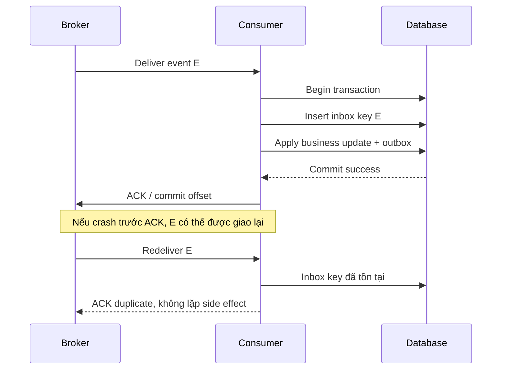

# Ordering, replay và idempotent consumer

API bất đồng bộ thường nhận request, ghi một message vào broker rồi xử lý ở worker hoặc service khác. Cách làm này giúp tách tải và giảm thời gian chờ, nhưng cũng đưa vào các vấn đề mà request/response đồng bộ ít gặp hơn: message có thể đến trễ, sai thứ tự, được giao nhiều lần, consumer có thể crash giữa chừng hoặc một operator có thể replay dữ liệu cũ để khôi phục hệ thống. Nếu consumer xử lý cùng một message nhiều lần hoặc áp dụng event cũ sau event mới, dữ liệu nghiệp vụ có thể sai, thanh toán bị thực hiện trùng hoặc trạng thái tài nguyên bị quay ngược.

**Ordering, replay và idempotent consumer** là ba phần liên quan của thiết kế xử lý message đáng tin cậy. Ordering xác định thứ tự nào cần được giữ; replay là khả năng phát lại message để phục hồi hoặc tái xử lý; idempotent consumer bảo đảm một message được giao lại hoặc phát lại không tạo side effect trùng ngoài ý muốn.

Trong phạm vi `SECURITY_API_SECURITY`, message phải được xem là một đầu vào không tin cậy cho đến khi xác minh producer, tính toàn vẹn, schema, tenant và quyền thực hiện action. Đảm bảo idempotency không thay authorization; một event hợp lệ về chữ ký vẫn có thể đã hết hiệu lực nghiệp vụ hoặc không còn được phép áp dụng. Mỗi consumer cần kiểm tra nguồn, phạm vi và trạng thái trước khi thay đổi dữ liệu.

## 1. Vì sao message có thể đến trễ, trùng hoặc sai thứ tự?

Broker và consumer thường ưu tiên khả năng chịu lỗi và thông lượng. Khi có retry, nhiều partition, nhiều worker hoặc mạng chập chờn, thứ tự quan sát ở consumer có thể khác thứ tự phát sinh ở producer.

Các nguyên nhân phổ biến:

- Producer gửi message nhưng không nhận được ACK do timeout, nên gửi lại dù broker đã nhận message đầu tiên.
- Broker giao lại message khi consumer xử lý xong nhưng crash trước khi ACK/commit offset.
- Nhiều consumer cùng xử lý các message thuộc một aggregate.
- Message được đưa vào retry queue hoặc dead-letter queue rồi quay lại sau message mới hơn.
- Consumer xử lý song song và hoàn tất theo thứ tự khác với thứ tự nhận.
- Network partition, broker failover hoặc rebalance làm thay đổi thời điểm giao message.
- Một operator replay event cũ để khôi phục dữ liệu hoặc sửa lỗi.
- Producer gửi event từ nhiều instance, đồng hồ khác nhau hoặc transaction commit không theo thứ tự timestamp.

Ví dụ một order có hai event:

```text
OrderCreated(version=1)
OrderCancelled(version=2)
```

Nếu consumer nhận `OrderCancelled` trước rồi mới nhận `OrderCreated`, một consumer chỉ ghi đè trạng thái theo event cuối cùng đến có thể đưa order từ `CANCELLED` trở lại `CREATED`. Đây là lỗi ordering; deduplication đơn thuần không giải quyết được vì cả hai event đều có ID khác nhau và đều hợp lệ.

### 1.1. Phân biệt các khái niệm

| Khái niệm | Ý nghĩa | Vấn đề cần giải quyết |
|---|---|---|
| Delivery semantics | Broker/producer giao message một lần hay có thể nhiều lần | Duplicate delivery |
| Processing semantics | Consumer áp dụng nghiệp vụ bao nhiêu lần | Side effect trùng hoặc mất |
| Ordering | Quan hệ thứ tự giữa các message | Event cũ ghi đè event mới |
| Replay | Phát lại message đã lưu hoặc đã xử lý | Phục hồi, backfill và xử lý lại có kiểm soát |
| Idempotency | Thực hiện lại cùng operation không đổi kết quả ngoài ý muốn | An toàn khi retry/replay |
| Authorization | Principal có được phép thực hiện action tại thời điểm xử lý không | Message hợp lệ nhưng hành động trái quyền |

Không nên gộp tất cả thành khái niệm “exactly once”. Broker có thể cung cấp tính năng exactly-once trong một phạm vi nhất định, nhưng side effect ngoài broker như database, email, payment provider hoặc HTTP callback vẫn cần thiết kế idempotency và transaction riêng.

## 2. Chọn phạm vi ordering cần bảo đảm

Không phải hệ thống nào cũng cần thứ tự toàn cục. Ordering toàn cục làm giảm khả năng song song và thường không cần thiết. Hãy xác định aggregate hoặc resource nào cần xử lý tuần tự.

Ví dụ:

- Các event của cùng một order cần theo thứ tự version.
- Các giao dịch của cùng một account có thể cần tuần tự để tính số dư.
- Các event của hai customer độc lập có thể xử lý song song.
- Email notification có thể không cần strict ordering nếu nội dung không gây thay đổi trạng thái.

### 2.1. Ordering toàn cục

Global ordering có nghĩa mọi message trong một stream được xử lý theo một thứ tự duy nhất. Cách này dễ suy luận nhưng có thể yêu cầu một partition hoặc một consumer tuần tự, làm giảm throughput và tạo bottleneck. Chỉ dùng khi nghiệp vụ thật sự cần một trình tự duy nhất trên toàn hệ thống.

### 2.2. Ordering theo key/aggregate

Phổ biến hơn là bảo đảm thứ tự trong cùng một key, ví dụ `orderId`, `accountId` hoặc `tenantId + resourceId`. Producer gửi cùng key vào cùng partition; broker giữ thứ tự trong partition; consumer xử lý tuần tự trong partition hoặc bảo đảm không xử lý đồng thời cùng key.

```text
partition = hash(aggregate_id) % partition_count
```

Đây là mô hình khái niệm. Cần dùng partitioning/keying mechanism của broker thực tế. Nếu số partition thay đổi, cách ánh xạ key có thể thay đổi; cần hiểu tác động đến ordering khi scale topic.

### 2.3. Chọn key đúng

Key quá rộng như `tenantId` có thể dồn mọi event của tenant vào một partition, gây hotspot. Key quá hẹp như `eventId` khiến event của cùng order phân tán, không còn ordering theo order. Hãy chọn key theo aggregate có invariant cần bảo vệ.

| Nghiệp vụ | Key có thể phù hợp |
|---|---|
| Vòng đời order | `orderId` |
| Số dư account | `accountId` |
| Trạng thái shipment | `shipmentId` hoặc `orderId` theo model |
| Cấu hình tenant | `tenantId` nếu mọi thay đổi tenant cần tuần tự |
| Notification độc lập | Có thể không cần ordering theo aggregate |

Không chọn key dựa trên convenience nếu nó không phản ánh invariant nghiệp vụ. Nếu hai aggregate cần cập nhật nguyên tử cùng nhau, partition ordering đơn lẻ không giải quyết transaction phân tán; cần workflow/saga hoặc transaction boundary phù hợp.

## 3. Định danh và metadata cho message

Message cần đủ metadata để consumer xác minh nguồn, liên kết operation, phát hiện duplicate và xử lý ordering.

Ví dụ schema khái niệm:

```json
{
  "messageId": "msg-01J...",
  "eventType": "order.cancelled",
  "schemaVersion": 2,
  "occurredAt": "2026-11-18T12:30:15.123Z",
  "publishedAt": "2026-11-18T12:30:15.410Z",
  "producer": {
    "service": "order-service",
    "environment": "production"
  },
  "tenantId": "tenant-15",
  "aggregate": {
    "type": "order",
    "id": "order-8421",
    "version": 7
  },
  "operationId": "op-cancel-8421",
  "correlationId": "corr-01J...",
  "causationId": "msg-order-cancel-requested",
  "payload": {
    "reasonCode": "CUSTOMER_REQUEST"
  }
}
```

Đây là ví dụ minh họa. Chỉ đưa vào message các trường cần thiết; không gửi access token, API key, password, private key hoặc dữ liệu cá nhân không cần thiết. `tenantId`, `producer` và `aggregate.version` phải được tạo từ context tin cậy phía server, không lấy nguyên giá trị do client tự khai.

### 3.1. Message ID và event ID

`messageId` định danh một lần publish/envelope. `eventId` có thể định danh sự kiện nghiệp vụ gốc. Tùy kiến trúc, hai giá trị có thể giống nhau, nhưng cần quy định rõ:

- Retry publish cùng một event có giữ nguyên `eventId` không?
- Một event có thể được đóng gói thành nhiều message cho nhiều topic không?
- Consumer deduplicate theo event ID, message ID hay operation ID?
- Replay tạo message mới hay giữ ID gốc?

Với deduplication nghiệp vụ, thường cần một định danh ổn định cho event/operation qua các lần delivery và replay. Nếu mỗi retry tạo ID mới, consumer không thể nhận ra đây là cùng một hành động.

### 3.2. Aggregate version/sequence number

Producer có thể gắn `aggregateVersion` tăng đơn điệu cho mỗi thay đổi trên aggregate. Consumer lưu version đã áp dụng và kiểm tra:

- `incomingVersion == currentVersion + 1`: event kế tiếp, có thể áp dụng.
- `incomingVersion <= currentVersion`: event cũ hoặc duplicate; cần xác định đã áp dụng hay cần audit.
- `incomingVersion > currentVersion + 1`: có gap; cần chờ, retry, lấy snapshot hoặc yêu cầu replay phần thiếu.

Version phải được cấp phát nguyên tử tại nơi sở hữu aggregate. Không dùng timestamp đơn thuần làm sequence number vì clock skew, precision và concurrent writer có thể làm timestamp không phản ánh thứ tự commit.

## 4. Ordering tại producer và broker

Consumer không thể tự sửa mọi lỗi ordering nếu producer phát event không nhất quán. Producer nên tạo event sau khi thay đổi nghiệp vụ được commit và gắn version/sequence từ nguồn sự thật.

### 4.1. Transactional outbox

Nếu cập nhật database và publish message là hai thao tác riêng, có thể xảy ra:

- Database commit nhưng publish thất bại: consumer không biết thay đổi đã xảy ra.
- Publish thành công nhưng database rollback: consumer nhận event cho thay đổi không tồn tại.
- Producer timeout sau khi broker nhận message và gửi lại: duplicate publish.

Transactional Outbox giải quyết sự không nhất quán giữa database và broker bằng cách ghi business state và outbox record trong cùng transaction:

1. Cập nhật aggregate và tăng version.
2. Ghi outbox event với event ID, aggregate key và version.
3. Commit transaction.
4. Publisher đọc outbox và gửi message.
5. Đánh dấu outbox record đã publish; nếu crash, có thể gửi lại.
6. Consumer deduplicate vì publisher có thể giao lại cùng event.

Outbox thường cung cấp at-least-once publication, không tự động bảo đảm consumer chỉ xử lý một lần. Ordering của outbox publisher cũng cần được thiết kế: không publish version 8 trước version 7 cho cùng aggregate nếu consumer dựa vào thứ tự publish.

### 4.2. Publisher nhiều instance

Nếu nhiều publisher đọc cùng outbox, cần claim/lease hoặc partition theo aggregate để tránh gửi cùng một aggregate sai thứ tự. Có thể dùng sequence/locking, database advisory lock hoặc broker partition key tùy hệ thống. Claim phải có expiry để phục hồi khi publisher crash.

Không giữ transaction database mở trong thời gian chờ broker lâu. Thường claim batch ngắn, publish, rồi cập nhật trạng thái; consumer idempotency xử lý trường hợp publisher crash sau khi publish nhưng trước khi đánh dấu thành công.

### 4.3. Broker partition và ordering guarantee

Đọc đúng guarantee của broker: thứ tự có thể chỉ được bảo đảm trong một partition/queue, không phải giữa các partition hoặc topic. Producer phải dùng key nhất quán; consumer không được xử lý song song message trong cùng partition theo cách làm đảo thứ tự nếu nghiệp vụ cần strict ordering.

Khi rebalance, failover hoặc thay số partition, cần kiểm tra cách broker giữ offset và ordering. Đừng giả định thứ tự publish ở hai producer instance là thứ tự nghiệp vụ nếu producer không đồng bộ version/sequence.

## 5. Consumer xử lý message đúng thứ tự

Có nhiều chiến lược. Chọn theo hậu quả của event cũ hoặc event thiếu.

### 5.1. Tuần tự theo partition

Consumer xử lý lần lượt từng message trong partition, chỉ commit/ack sau khi xử lý xong. Cách này tận dụng ordering của broker nhưng có thể làm một message chậm chặn các message sau trong cùng partition (head-of-line blocking).

Nếu cần concurrency, có thể chạy song song giữa các partition hoặc key, nhưng giữ tuần tự trong cùng aggregate. Phải bảo đảm một aggregate không bị hai worker xử lý đồng thời.

### 5.2. Optimistic version check

Consumer có thể cập nhật dữ liệu với điều kiện version hiện tại đúng như kỳ vọng:

```sql
UPDATE orders
SET status = 'CANCELLED', version = 7
WHERE id = 'order-8421'
  AND tenant_id = 'tenant-15'
  AND version = 6;
```

Nếu số hàng cập nhật là 0, có thể do event đã cũ, có gap, object không tồn tại hoặc tenant scope không khớp. Consumer cần phân biệt các trường hợp bằng dữ liệu nội bộ và policy; không trả chi tiết nhạy cảm qua message response công khai.

Version check giúp ngăn event stale ghi đè state mới. Tuy nhiên, cần xác định cách xử lý khi update thất bại: retry có giới hạn, fetch snapshot, quarantine hoặc báo lỗi nghiệp vụ.

### 5.3. Buffer event đến sớm

Nếu nhận version 9 khi current version là 7, có thể buffer event 9 trong thời gian ngắn để chờ version 8. Buffer phải có giới hạn số event, dung lượng và thời gian. Nếu gap không được lấp đầy, chuyển sang resync/replay hoặc quarantine.

Không giữ message trong memory vô hạn để chờ một event bị mất. Bounded buffer và timeout bảo vệ tài nguyên.

### 5.4. Snapshot và state-based event

Một số event mô tả thay đổi (`OrderAddressChanged`), số khác mang snapshot trạng thái (`OrderSnapshotUpdated`). Event snapshot có thể cho phép bỏ qua version cũ nếu version mới hơn, nhưng chỉ khi snapshot đầy đủ và semantics được xác định. Event delta thường cần đúng thứ tự vì bỏ một event có thể làm sai trạng thái cuối.

Không áp dụng quy tắc “chỉ lấy event có timestamp mới nhất” cho mọi loại event. Với tài chính, inventory hoặc ledger, cần giữ đầy đủ từng movement và invariant; không thể bỏ event cũ chỉ vì có event mới hơn.

## 6. Idempotent consumer là gì?

Consumer idempotent có nghĩa xử lý lại cùng một logical operation không tạo thêm side effect ngoài kết quả đã được định nghĩa. Điều này rất quan trọng vì nhiều broker và hệ thống phân tán sử dụng at-least-once delivery.

Ví dụ:

- Nhận `payment.capture.requested` hai lần không được capture hai lần.
- Nhận `invoice.created` lặp không tạo hai invoice.
- Nhận webhook `subscription.cancelled` lặp không gửi nhiều lệnh hủy hoặc email ngoài ý muốn.
- Replay `account.debited` không trừ số dư lần nữa.

Idempotency không nhất thiết có nghĩa mọi lần gọi trả cùng response bytes. Nó có nghĩa cùng operation không lặp side effect và trạng thái cuối tuân theo contract. Có thể trả `already_processed`, kết quả đã lưu hoặc bỏ qua duplicate.

### 6.1. Deduplication key

Chọn một key ổn định như:

```text
consumer_name + producer_id + event_id
```

hoặc:

```text
tenant_id + operation_id + action
```

Key cần đủ scope để tránh collision giữa tenant/provider khác nhau. Không dùng payload hash đơn thuần nếu hai hành động hợp lệ có payload giống nhau. Không dùng delivery attempt ID vì mỗi lần retry sẽ khác.

### 6.2. Inbox/deduplication table

Một consumer có thể lưu event đã xử lý trong bảng inbox:

```sql
CREATE TABLE consumer_inbox (
    consumer_name VARCHAR(100) NOT NULL,
    producer_id VARCHAR(100) NOT NULL,
    event_id VARCHAR(150) NOT NULL,
    processed_at TIMESTAMP NOT NULL,
    result_code VARCHAR(50),
    PRIMARY KEY (consumer_name, producer_id, event_id)
);
```

Khi nhận message, trong cùng transaction:

1. Xác thực message và xác định producer/tenant.
2. Insert inbox key.
3. Nếu unique conflict, message đã được xử lý; không chạy side effect lần nữa.
4. Nếu insert thành công, kiểm tra authorization, version và business invariant.
5. Áp dụng thay đổi nghiệp vụ.
6. Ghi outbox event nếu cần phát sinh message tiếp theo.
7. Commit transaction rồi ACK/commit offset.

Inbox record và business update phải cùng transaction nếu cùng database. Nếu ghi inbox trước rồi xử lý business ở transaction khác, crash giữa hai bước có thể làm message bị coi là đã xử lý dù side effect chưa xảy ra. Ngược lại, nếu side effect commit rồi inbox chưa ghi, retry có thể lặp side effect.

### 6.3. Ví dụ pseudo-code

```java
@Transactional
public ProcessResult consume(OrderCancelled event, VerifiedProducer producer) {
    authorization.requireCanPublishEvent(producer, event.type());
    tenantPolicy.requireTenantMatch(producer, event.tenantId());

    boolean firstDelivery = inboxRepository.insertIfAbsent(
        "billing-consumer", producer.id(), event.eventId());

    if (!firstDelivery) {
        return ProcessResult.duplicate();
    }

    Order order = orderRepository.findByIdAndTenantId(
        event.orderId(), event.tenantId())
        .orElseThrow(OrderNotFoundException::new);

    if (event.aggregateVersion() != order.version() + 1) {
        throw new OrderingGapException();
    }

    order.cancel(event.reasonCode());
    orderRepository.save(order);
    outboxRepository.save(BillingEvent.from(order));

    return ProcessResult.applied();
}
```

Đây là ví dụ khái niệm. Thứ tự insert inbox và kiểm tra version cần được thiết kế cùng transaction/retry policy. Nếu phát hiện ordering gap rồi rollback toàn transaction, inbox record cũng phải rollback để message có thể được thử lại. Không bắt exception rồi commit inbox như thể event đã xử lý thành công.

## 7. ACK, offset commit và transaction boundary

Consumer thường có ba bước: nhận message, thực hiện nghiệp vụ, ACK/commit offset. Thứ tự này quyết định rủi ro mất hoặc lặp message.

### 7.1. ACK trước khi commit business transaction

Nếu ACK message rồi database transaction rollback hoặc process crash trước khi commit, broker nghĩ message đã hoàn tất và không giao lại. Kết quả là mất xử lý.

### 7.2. Commit business trước ACK

Nếu database commit thành công nhưng consumer crash trước ACK, broker có thể giao lại. Đây là duplicate delivery; inbox/idempotency phải ngăn side effect trùng.

### 7.3. Chọn thứ tự an toàn

Với side effect nằm trong database cùng consumer, thường commit business state + inbox/outbox trong một transaction rồi mới ACK/commit offset. Nếu crash sau commit trước ACK, message được giao lại và dedup nhận ra đã xử lý.



Với external side effect như payment provider, email hoặc HTTP callback, database transaction không thể atomically commit cùng hệ thống ngoài. Dùng operation ID/idempotency key của provider, state machine, outbox và reconciliation. Không tuyên bố exactly-once end-to-end chỉ vì broker hỗ trợ transactional producer.

## 8. Exactly-once và giới hạn thực tế

“Exactly once” có thể chỉ đúng trong một phạm vi hẹp như transaction giữa broker và offset hoặc trong một stream processor. Khi message kích hoạt database write, payment, email và một API khác, các hệ thống có transaction boundary khác nhau.

Các bảo đảm thường gặp:

| Delivery model | Ý nghĩa | Yêu cầu ở consumer |
|---|---|---|
| At-most-once | Message không được giao lại; có thể mất khi lỗi | Chấp nhận khả năng mất hoặc có reconciliation |
| At-least-once | Message được retry đến khi ACK; có thể duplicate | Idempotency/deduplication bắt buộc |
| Exactly-once trong broker scope | Broker/stream transaction giới hạn duplicate trong phạm vi được hỗ trợ | Vẫn cần idempotency cho external side effect |
| Effectively-once business processing | Duplicate được nhận diện và không lặp side effect | Stable operation ID, atomic inbox/state hoặc provider idempotency |

Thiết kế thực tế thường nhắm tới effectively-once business effect bằng at-least-once delivery và idempotent processing. Cần mô tả rõ phạm vi guarantee, retention của dedup key và hành vi khi store idempotency bị lỗi.

## 9. Replay: mục đích hợp lệ và rủi ro

Replay là phát lại message đã lưu hoặc đã nhận để khôi phục, backfill, sửa lỗi consumer hoặc xây lại projection. Đây là công cụ vận hành hữu ích nhưng có thể gây rủi ro nếu không kiểm soát.

Use case hợp lệ:

- Khôi phục message sau consumer bug đã được sửa.
- Xây lại read model/projection từ event log.
- Backfill một field mới hoặc một consumer mới.
- Replay message trong dead-letter queue sau khi xử lý nguyên nhân lỗi.
- Đối soát dữ liệu giữa service sau sự cố.

Rủi ro:

- Side effect như capture payment, gửi email hoặc cấp quyền bị thực hiện lại.
- Event cũ ghi đè trạng thái mới.
- Message từ tenant này bị replay vào consumer/tenant khác.
- Replay bypass authorization hoặc bỏ qua validation hiện tại.
- Operator dùng công cụ replay không có approval/audit.
- Replay số lượng lớn làm cạn database, worker hoặc downstream API.
- Event schema cũ được parse sai bởi consumer version mới.

Replay không đồng nghĩa replay attack. Replay vận hành là hành động có chủ đích, được authorize và có phạm vi; replay attack là gửi lại một message/request đã hợp lệ trước đó nhằm lặp hành động trái phép hoặc vượt freshness window. Cả hai đều cần event ID, timestamp, idempotency và policy rõ ràng, nhưng operational replay có thể có chế độ xử lý khác được kiểm soát.

## 10. Thiết kế replay có kiểm soát

### 10.1. Tách replay tool khỏi public API

Không cho client Internet tự gửi `replay=true`, thay offset hoặc gọi endpoint nội bộ để phát lại message tùy ý. Replay thường là thao tác vận hành có rủi ro cao, chỉ dành cho role/service được cấp quyền riêng.

Một replay request cần có:

- Actor/operator hoặc automation identity.
- Consumer và topic/stream được phép.
- Khoảng thời gian, partition, offset hoặc event ID cụ thể.
- Tenant/resource scope nếu áp dụng.
- Lý do và incident/change reference.
- Chế độ replay: rebuild projection, retry failed event hay re-run business command.
- Batch size, rate limit, concurrency và deadline.
- Approval/dual control khi replay có thể tạo side effect tài chính hoặc đặc quyền.

Không nên cho operator chọn một topic production bất kỳ và replay toàn bộ bằng một nút duy nhất. Công cụ phải hiển thị phạm vi, số lượng ước tính, loại side effect và policy trước khi thực thi.

### 10.2. Replay mode và side effect

Phân biệt các chế độ:

| Chế độ | Mục đích | Side effect |
|---|---|---|
| Projection rebuild | Tạo lại read model từ event history | Chỉ ghi vào projection/rebuild target; không gửi payment/email |
| Retry failed delivery | Thử lại event chưa được xử lý thành công | Có thể tạo side effect, cần idempotency |
| Historical backfill | Tính toán dữ liệu mới từ event cũ | Ghi dữ liệu mới theo migration plan; không phát lại command cũ |
| Business command replay | Thực hiện lại command nghiệp vụ | Rủi ro cao; cần approval, idempotency và state validation |

Nếu chỉ muốn xây lại read model, consumer nên chạy ở chế độ projection-only hoặc ghi vào một read model mới rồi swap sau khi xác minh. Không gọi lại payment provider hoặc gửi email chỉ vì event cũ xuất hiện trong stream.

### 10.3. Replay marker và provenance

Có thể gắn metadata như `replayRunId`, `replayedBy`, `replayedAt`, `sourceEventId` hoặc `replayReason` ở envelope/telemetry. Metadata này phải được tạo bởi replay service tin cậy, không lấy từ payload do client gửi. Consumer dùng nó để chọn policy đã định nghĩa, nhưng không được bỏ qua authentication/authorization hoặc integrity verification chỉ vì message được đánh dấu replay.

Giữ nguyên event ID gốc để deduplicate cùng logical event. Nếu cần định danh một lần chạy replay, dùng `replayRunId` riêng. Không thay event ID để né deduplication; điều đó có thể làm side effect chạy lại.

### 10.4. Rate limit và blast radius

Replay cần bounded batch, concurrency và throughput. Có thể replay từng tenant, partition hoặc khoảng thời gian; theo dõi downstream capacity và dừng tự động khi error/latency vượt ngưỡng. Cần có pause/resume và checkpoint để tiếp tục mà không lặp side effect.

## 11. Authorization và trust boundary tại consumer

Broker authentication chỉ xác minh workload nào kết nối đến broker hoặc queue. Nó không tự chứng minh mọi message trong queue được phép thay đổi mọi object.

Consumer cần xác minh:

1. Producer/workload có được phép publish event type này vào topic/queue không?
2. Message có integrity và schema version hợp lệ không?
3. Tenant ID và resource reference có được xác minh từ producer context không?
4. Event/command có thuộc phạm vi consumer xử lý không?
5. Action còn hợp lệ theo trạng thái nghiệp vụ hiện tại không?
6. Nếu message đại diện cho user action, delegation context có issuer, audience, scope và expiry hợp lệ không?
7. Replay operator/service có quyền với consumer, tenant và event range không?

Không tin `userId`, `role`, `tenantId` hoặc `isAdmin` chỉ vì chúng nằm trong message body. Nếu cần giữ user attribution, dùng signed delegation/token đã xác minh hoặc audit context được producer tin cậy phát hành. Trace/correlation ID chỉ phục vụ liên kết, không cấp quyền.

### 11.1. Quyền publish và consume

Broker ACL nên giới hạn workload nào được publish/consume topic nào. Tách topic theo trust boundary và dữ liệu nhạy cảm khi cần. Tránh một service account có quyền đọc/ghi mọi topic. Tuy nhiên, broker ACL không thay policy ở consumer; một producer được phép gửi `order.updated` vẫn có thể gửi payload sai tenant hoặc event version cũ.

### 11.2. Schema validation và payload integrity

Validate event type, schema version, kích thước, required field và dữ liệu nghiệp vụ trước khi xử lý. Nếu message đi qua trust boundary hoặc broker không đảm bảo nguồn, dùng chữ ký/MAC hoặc cơ chế integrity phù hợp. Không deserialize payload không tin cậy thành polymorphic class tùy ý; giới hạn type registry và parser.

## 12. Out-of-order event, duplicate và stale event

Consumer cần phân biệt ba trường hợp:

- **Duplicate:** cùng event ID/operation đã được áp dụng.
- **Stale:** event có version nhỏ hơn hoặc bằng version hiện tại, có thể đã được thay thế bởi state mới.
- **Gap:** event đến có version lớn hơn version kế tiếp mong đợi.

Không xử lý cả ba trường hợp như duplicate đơn giản.

| Điều kiện | Hành động tham khảo |
|---|---|
| Event ID đã có trong inbox | ACK duplicate, không lặp side effect |
| Version nhỏ hơn current và event đã được xử lý | ACK stale/duplicate, ghi metric |
| Version nhỏ hơn current nhưng event ID chưa có | Điều tra replay/out-of-order; có thể bỏ qua nếu event semantics cho phép |
| Version đúng kế tiếp | Áp dụng transactionally |
| Version cao hơn kế tiếp | Buffer/retry/resync/quarantine theo policy |
| Cùng version nhưng payload khác | Cảnh báo integrity/producer bug; không tự chọn một payload |

Nếu event là snapshot đầy đủ, có thể áp dụng snapshot mới hơn và bỏ qua snapshot cũ theo contract. Nếu event là delta hoặc ledger entry, bỏ qua event có thể làm mất dữ liệu; cần phục hồi gap thay vì chỉ giữ state mới nhất.

## 13. Dead-letter queue và poison message

Message có thể thất bại lặp lại do schema lỗi, dữ liệu không hợp lệ, dependency không sẵn sàng hoặc bug consumer. Sau số lần retry giới hạn, có thể chuyển sang dead-letter queue (DLQ) để điều tra.

DLQ cần:

- Giữ original event ID, producer, tenant, schema version và causation/correlation metadata.
- Ghi reason code và số lần delivery; tránh lưu secret không cần thiết.
- Có quyền đọc/replay riêng, audit operator và retention rõ.
- Giới hạn payload size và access vì DLQ có thể chứa dữ liệu nhạy cảm.
- Không tự động replay toàn bộ DLQ theo lịch mà không phân loại nguyên nhân.

Poison message là message luôn làm consumer fail. Nếu retry không có backoff/limit, nó có thể chặn partition hoặc tạo retry storm. Cần phân loại lỗi transient và permanent; lỗi schema/authentication thường không nên retry vô hạn. Với lỗi transient, retry có backoff và jitter; với lỗi vĩnh viễn, quarantine/DLQ và alert.

Không bỏ qua message chỉ vì nó gây lỗi nếu message đại diện cho một movement tài chính hoặc event quan trọng. Cần quy trình reconciliation hoặc sửa dữ liệu để đảm bảo invariant.

## 14. Retention và vòng đời deduplication state

Inbox/deduplication record cần được giữ đủ lâu để bao phủ mọi khả năng redelivery, retry và operational replay được hỗ trợ. Nếu xóa dedup record quá sớm, replay event cũ có thể tạo side effect trùng.

Thiết kế retention cần xem xét:

- Broker retention và thời gian message có thể được replay.
- Retry window của producer/provider.
- DLQ retention và thời gian operator có thể replay.
- Disaster recovery và restore từ backup.
- Idempotency window của external provider.
- Quy định lưu trữ dữ liệu và quyền riêng tư.

Nếu event history được lưu nhiều năm nhưng inbox chỉ giữ vài ngày, replay lịch sử có thể không còn được deduplicate. Khi đó cần chế độ replay projection-only, một namespace consumer mới có chủ đích hoặc ledger kiểm tra side effect riêng. Không xóa inbox chỉ để giảm storage nếu chưa hiểu replay horizon.

Có thể partition/archive deduplication store theo thời gian và consumer, nhưng cần giữ unique semantics trong khoảng replay được phép. Với side effect tài chính, một ledger nghiệp vụ hoặc unique operation constraint có thể là lớp bảo vệ lâu dài hơn inbox ngắn hạn.

## 15. Schema evolution và replay dữ liệu lịch sử

Consumer mới có thể phải đọc message được phát từ nhiều tháng trước. Schema version cần được quản lý rõ:

- Message mang `schemaVersion` hoặc content type version.
- Consumer hỗ trợ các version còn trong retention/replay window.
- Có adapter chuyển schema cũ sang internal model hiện tại.
- Không giả định field mới luôn tồn tại trong event cũ.
- Không diễn giải lại semantics cũ chỉ bằng cách đổi tên field.
- Kiểm thử replay với fixture đại diện cho các schema lịch sử.

Nếu event schema cũ có lỗi bảo mật, không tiếp tục tin dữ liệu chỉ vì nó đã được lưu trong broker. Xác minh producer/integrity theo khả năng hiện có, quarantine event không thể xác thực và áp policy hiện hành khi thực hiện side effect.

Không thay đổi nội dung event cũ trong event store để “sửa” schema. Dùng upcaster/adapter hoặc migration có audit để giữ nguồn gốc dữ liệu.

## 16. Ví dụ xử lý message idempotent với Spring

Một cách tổ chức là tách listener khỏi application service. Listener chỉ xác thực envelope, chuyển message vào service transactional và ACK theo cấu hình container sau khi xử lý thành công.

```java
@Component
class OrderEventListener {
    private final OrderEventConsumer consumer;

    OrderEventListener(OrderEventConsumer consumer) {
        this.consumer = consumer;
    }

    @KafkaListener(topics = "order-events", groupId = "billing-v2")
    public void onMessage(ConsumerRecord<String, OrderEvent> record) {
        VerifiedMessage<OrderEvent> message =
            messageVerifier.verify(record);
        consumer.process(message);
    }
}
```

Application service:

```java
@Service
class OrderEventConsumer {

    @Transactional
    public void process(VerifiedMessage<OrderEvent> message) {
        authorization.requireProducerCanPublish(
            message.producer(), message.eventType());
        tenantPolicy.requireAllowedTenant(
            message.producer(), message.tenantId());

        if (!inbox.insertIfAbsent(
                "billing-v2", message.producerId(), message.eventId())) {
            return;
        }

        OrderEvent event = message.payload();
        Order order = orders.findByIdAndTenantId(
            event.orderId(), message.tenantId())
            .orElseThrow(OrderNotFoundException::new);

        order.apply(event, message.aggregateVersion());
        orders.save(order);
        outbox.append(BillingEvent.from(order));
    }
}
```

Đây là ví dụ minh họa, không phải cấu hình Kafka hoàn chỉnh. Cần cấu hình ACK/offset commit phù hợp với transaction boundary, xử lý deserialization failure, retry/DLQ và rebalance. `messageVerifier` phải xác minh producer/integrity/schema; `authorization` và `tenantPolicy` phải dựa trên trust context đã xác minh. `inbox`, business update và outbox phải dùng cùng database transaction nếu muốn atomicity ở tầng database.

Không để exception ordering gap bị nuốt rồi ACK như thành công. Nếu consumer cần retry, transaction chứa inbox insert phải rollback; nếu cần quarantine, ghi trạng thái lỗi có chủ đích và audit trước khi ACK/DLQ theo policy.

## 17. Kiểm thử ordering, replay và idempotency

Test cần bao gồm delivery bình thường, duplicate, out-of-order, crash window và replay vận hành.

| Kịch bản | Kết quả mong đợi |
|---|---|
| Cùng event ID được giao hai lần | Business side effect chỉ xảy ra một lần |
| Crash sau DB commit trước ACK | Redelivery được nhận diện; không lặp side effect |
| Crash trước DB commit | Transaction rollback; message có thể retry |
| ACK trước business commit trong test lỗi | Test phát hiện nguy cơ mất message; production config không dùng thứ tự sai |
| Version 2 đến trước version 1 | Consumer buffer/retry/resync hoặc áp dụng theo snapshot policy; không quay state về cũ |
| Version gap không được lấp đầy | Có timeout, alert và quarantine/resync; không chờ vô hạn |
| Cùng version nhưng payload khác | Bị cảnh báo/quarantine; không ghi đè tùy ý |
| Replay event đã xử lý | Không tạo lại payment/email/permission side effect |
| Replay projection-only | Chỉ rebuild projection, không gọi external side effect |
| Replay từ DLQ | Có operator authorization, audit và idempotency |
| Message sai producer hoặc signature | Bị từ chối trước business side effect |
| Tenant ID giả mạo | Bị từ chối hoặc map theo context tin cậy |
| Event type không thuộc consumer | Bị từ chối/quarantine theo policy |
| Message schema cũ | Adapter xử lý đúng hoặc quarantine có lý do |
| Inbox retention hết hạn rồi replay | Side effect vẫn được bảo vệ bằng policy/ledger hoặc replay bị giới hạn |
| Retry storm/poison message | Retry budget, backoff và DLQ bảo vệ consumer |
| Consumer rebalance/scale | Ordering theo aggregate vẫn được giữ |
| Hai worker xử lý cùng aggregate | Lock/version constraint ngăn cập nhật đồng thời sai |
| Operator replay sai tenant/range | Authorization chặn; không phát lại dữ liệu ngoài scope |

### 17.1. Fault injection

Chủ động tạo crash tại các điểm:

1. Sau khi broker giao message nhưng trước khi bắt đầu transaction.
2. Sau khi insert inbox nhưng trước business update.
3. Sau business update nhưng trước outbox insert.
4. Sau transaction commit nhưng trước ACK.
5. Sau external provider đã thực hiện side effect nhưng trước khi consumer lưu kết quả.

Xác minh mỗi điểm có kết quả rõ: rollback, retry, deduplication, provider idempotency hoặc reconciliation. Đây là cách phát hiện khoảng trống mà unit test happy path không thể thấy.

### 17.2. Property/invariant tests

Với nghiệp vụ tài chính hoặc inventory, kiểm tra invariant qua mọi thứ tự delivery:

- Số dư không bị trừ hai lần cho cùng operation ID.
- Tổng debit/credit khớp ledger.
- Version aggregate không giảm.
- Một order không quay từ terminal state về trạng thái trước đó.
- Một webhook/event chỉ tạo một fulfillment hoặc refund.
- Mọi event áp dụng đều thuộc đúng tenant và producer được phép.

Có thể sinh nhiều hoán vị message và duplicate để xác minh consumer bảo vệ invariant, thay vì chỉ kiểm tra một thứ tự lý tưởng.

## 18. Giám sát và runbook vận hành

Theo dõi các chỉ số:

- Consumer lag và tuổi message cũ nhất.
- Duplicate delivery và tỷ lệ dedup hit.
- Ordering gap/stale event theo aggregate hoặc topic.
- Retry count, retry delay và DLQ volume.
- Thời gian xử lý, transaction rollback và ACK latency.
- Inbox/outbox backlog và thời gian publish.
- Số replay run, actor/operator, event range và throughput.
- Side effect bị ngăn do idempotency hoặc provider duplicate.
- Message bị từ chối do producer, signature, schema, tenant hoặc authorization.
- Tỷ lệ event schema version cũ và consumer adapter usage.

Runbook replay nên có các bước:

1. Xác định incident/root cause và consumer bị ảnh hưởng.
2. Xác định event range, tenant, partition và schema version.
3. Chọn projection rebuild, retry failed delivery hay business replay.
4. Ước lượng số message và side effect có thể xảy ra.
5. Xác minh operator permission/approval và tạo replay run ID.
6. Chạy canary/batch nhỏ, quan sát deduplication, ordering và downstream load.
7. Mở rộng theo batch có giới hạn; pause khi metric vượt ngưỡng.
8. Đối soát kết quả và lưu audit report.

Không dùng replay để che một lỗi dữ liệu chưa được hiểu. Nếu consumer bug đã làm sai ledger hoặc gửi payment trùng, cần reconciliation/compensation plan trước khi replay.

## 19. Những lỗi triển khai thường gặp

| Lỗi | Hệ quả | Cách xử lý |
|---|---|---|
| Giả định broker luôn giao đúng thứ tự toàn cục | Event của aggregate có thể đến sai thứ tự | Xác định ordering scope và partition key |
| Dùng timestamp làm sequence duy nhất | Clock skew và concurrent write làm sai thứ tự | Aggregate version/sequence được cấp nguyên tử |
| ACK trước khi business commit | Crash có thể làm mất xử lý | Commit inbox/state/outbox rồi ACK |
| Chỉ dựa vào broker exactly-once | External side effect vẫn có thể lặp | Idempotency tại DB/provider và reconciliation |
| Tạo event ID mới mỗi retry | Deduplication không nhận ra duplicate | Stable event/operation ID |
| Ghi inbox tách transaction business | Có thể đánh dấu processed nhưng chưa cập nhật hoặc ngược lại | Atomic inbox + business state + outbox |
| Replay bằng cách đổi event ID | Bypass dedup và lặp side effect | Giữ source event ID, dùng replayRunId riêng |
| Replay mọi event vào consumer nghiệp vụ | Gửi lại payment/email hoặc command cũ | Chế độ projection-only và replay policy |
| Buffer gap vô hạn | Cạn memory và giữ partition | Bounded buffer, timeout và resync |
| DLQ tự động replay vô hạn | Poison message và retry storm | Phân loại lỗi, retry budget và operator workflow |
| Tin tenant/user trong payload | Cross-tenant processing hoặc attribution giả | Verified producer/delegation và tenant mapping |
| Dedup retention ngắn hơn replay horizon | Event cũ có thể tạo side effect trùng | Align retention hoặc giới hạn replay/ledger |

## 20. Checklist review ordering, replay và idempotent consumer

- [ ] Xác định aggregate/invariant cần ordering; không yêu cầu global ordering nếu không cần.
- [ ] Producer dùng partition key nhất quán và sequence/version được cấp nguyên tử.
- [ ] Message có stable event ID, producer ID, tenant, schema version và correlation/causation metadata.
- [ ] Outbox ghi cùng transaction với business state; publisher xử lý duplicate và ordering.
- [ ] Consumer xác minh producer, message integrity, schema, tenant và authorization trước side effect.
- [ ] Consumer dùng inbox/deduplication key ổn định và atomic với business update.
- [ ] Version check xử lý duplicate, stale và gap riêng biệt.
- [ ] ACK/offset commit chỉ sau khi transaction bền vững theo semantics đã chọn.
- [ ] External side effect dùng provider idempotency key, operation state hoặc reconciliation.
- [ ] Replay tách khỏi public API, có operator permission, scope, reason, approval và audit.
- [ ] Replay mode phân biệt projection rebuild, retry delivery, backfill và business command.
- [ ] Replay giữ source event ID và có replayRunId riêng.
- [ ] DLQ, retry, poison message và bounded queue có policy rõ.
- [ ] Inbox/dedup retention bao phủ retry, DLQ, replay và disaster recovery horizon.
- [ ] Schema evolution hỗ trợ message lịch sử hoặc quarantine có kiểm soát.
- [ ] Có test duplicate, out-of-order, crash window, replay, tenant isolation và side effect.
- [ ] Monitoring có lag, duplicate, ordering gap, DLQ, replay throughput và authorization failure.

Ordering xác định thứ tự nghiệp vụ cần được giữ; replay cho phép khôi phục hoặc tái xử lý có kiểm soát; idempotent consumer bảo vệ side effect khi message được giao lại. Khi kết hợp aggregate key/version, transactional outbox, inbox deduplication, transaction boundary rõ ràng, authorization tại consumer và replay workflow có audit, hệ thống bất đồng bộ có thể chịu retry và phục hồi mà không làm sai trạng thái hoặc lặp hành động nhạy cảm.
