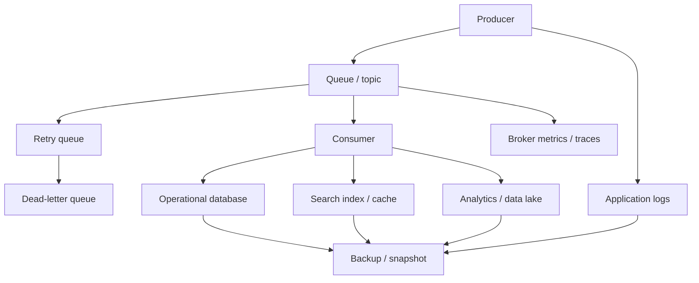

# Xóa message và log theo retention policy

Trong chương **Async và message API** của module `SECURITY_API_SECURITY`, dữ liệu được gửi qua queue, topic, event stream và worker cần có thời hạn lưu rõ ràng. Message có thể chứa thông tin cá nhân, dữ liệu giao dịch, access token, định danh tenant hoặc trạng thái nghiệp vụ. Nếu giữ vô thời hạn, dữ liệu cũ tiếp tục tồn tại trong broker, dead-letter queue (DLQ), log, bản sao của consumer và backup, làm tăng tác động khi xảy ra rò rỉ hoặc truy cập trái phép.

**Retention policy** quy định dữ liệu nào được giữ, giữ trong bao lâu, thời điểm bắt đầu tính thời hạn, ai được phép truy cập và cách dữ liệu hết hạn được xóa hoặc làm mất khả năng truy cập. Đây là một kiểm soát bảo mật và quản trị dữ liệu, không chỉ là cấu hình dọn dẹp dung lượng.

Một chính sách hoàn chỉnh phải theo dữ liệu qua toàn bộ vòng đời: từ lúc producer tạo message, broker lưu và phân phối, consumer xử lý, retry/DLQ, tới log, trace, kho phân tích và backup. Xóa message khỏi queue không đồng nghĩa mọi bản sao đã biến mất.

## Vì sao cần retention policy?

Giữ dữ liệu lâu hơn nhu cầu làm tăng nhiều rủi ro:

- **Rò rỉ dữ liệu:** message cũ trong queue, DLQ hoặc log có thể bị đọc khi tài khoản vận hành hay broker bị xâm nhập.
- **Lộ bí mật:** token, session ID, API key hoặc thông tin xác thực vô tình được ghi vào payload/log có thể vẫn dùng được sau khi nghiệp vụ kết thúc.
- **Vi phạm quyền riêng tư:** dữ liệu cá nhân tiếp tục tồn tại trong bản sao và hệ thống phụ trợ dù mục đích xử lý đã kết thúc.
- **Replay và xử lý lại:** event cũ được lưu trong stream hoặc archive có thể bị phát lại, gây side effect nếu consumer không idempotent.
- **Tăng bề mặt tấn công:** DLQ và archive thường ít được giám sát hơn queue chính nhưng vẫn chứa dữ liệu có giá trị.
- **Lãng phí tài nguyên:** dữ liệu không còn cần thiết làm tăng chi phí lưu trữ, backup, tìm kiếm và khôi phục.

Retention quá ngắn cũng có rủi ro. Message có thể hết hạn trước khi consumer xử lý, dữ liệu phục vụ đối soát hoặc điều tra có thể mất, và việc khôi phục sau sự cố trở nên khó khăn. Vì vậy, thời hạn phải dựa trên mục đích, yêu cầu nghiệp vụ, hợp đồng, nghĩa vụ pháp lý và mức độ nhạy cảm của dữ liệu.

## Phân biệt các hành động thường bị gọi chung là “xóa”

Các hệ thống message và storage có semantics khác nhau. Cần định nghĩa rõ hành động nào được thực hiện:

| Khái niệm | Ý nghĩa | Điều không nên giả định |
|---|---|---|
| Acknowledge (ACK) | Consumer xác nhận đã nhận/xử lý message theo giao thức broker | ACK không xóa bản sao ở consumer, log, DLQ hoặc backup |
| Expiration / TTL | Message hoặc dữ liệu hết hạn sau thời gian cấu hình | Hết TTL không có nghĩa byte được ghi đè vật lý ngay lập tức |
| Delete | Đánh dấu hoặc yêu cầu broker/storage loại bỏ một bản ghi | Không phải broker nào cũng hỗ trợ xóa từng message; bản sao/backup có thể còn |
| Purge | Xóa hàng loạt message hoặc dữ liệu trong một queue/store | Có thể xóa cả message chưa xử lý; cần xác nhận phạm vi trước khi chạy |
| Tombstone | Marker biểu thị một key đã bị xóa trong log-compacted stream | Tombstone không nhất thiết xóa ngay mọi bản ghi cũ và replica |
| Retention cleanup | Tác vụ nền loại bỏ dữ liệu đã quá thời hạn | Thời điểm dọn vật lý có thể trễ so với thời điểm hết hạn |
| Cryptographic erasure | Hủy key mã hóa để dữ liệu không còn giải mã được | Chỉ hiệu quả nếu mọi bản sao đều được mã hóa bằng key thuộc phạm vi hủy |

ACK là trạng thái giao nhận; TTL là quy tắc thời gian; delete/purge là thao tác loại bỏ; tombstone là một cơ chế biểu diễn xóa trong một số hệ thống log. Không dùng các khái niệm này thay thế cho nhau trong tài liệu vận hành.

## Xây dựng retention policy theo loại dữ liệu

Không nên áp dụng một thời hạn duy nhất cho mọi message và log. Trước tiên, phân loại dữ liệu và xác định mục đích lưu.

### 1. Phân loại payload

Một cách phân loại thực tế:

| Nhóm dữ liệu | Ví dụ | Nguyên tắc lưu |
|---|---|---|
| Public/technical event | Cache invalidation, tín hiệu cập nhật public catalog | Lưu theo nhu cầu vận hành ngắn hạn; tránh đưa dữ liệu cá nhân vào payload |
| Operational event | Job state, notification status, retry metadata | Giữ đủ để worker hoàn tất, retry và hỗ trợ điều tra sự cố |
| Business record | Payment status, order event, invoice reference | Theo vòng đời nghiệp vụ, đối soát và nghĩa vụ lưu trữ áp dụng |
| Personal data | Email, số điện thoại, địa chỉ, user ID có thể liên kết cá nhân | Giảm thiểu trường dữ liệu; đặt thời hạn và quy trình xóa theo mục đích |
| Secret/credential | Access token, refresh token, API key, session cookie | Không đưa vào message/log nếu có thể; nếu buộc phải có thì mã hóa, giới hạn quyền và thời hạn rất ngắn |
| Security/audit metadata | Actor, action, resource ID, thời điểm, kết quả | Giữ theo yêu cầu điều tra/audit; giới hạn trường và quyền truy cập |

Định danh giả danh (pseudonymous ID) vẫn có thể là dữ liệu cá nhân nếu có thể liên kết lại với một người. Hash không tự động làm dữ liệu trở thành vô danh, đặc biệt khi miền giá trị nhỏ hoặc có thể dò ngược.

### 2. Xác định thời điểm bắt đầu tính retention

Chính sách phải nói rõ đồng hồ retention bắt đầu từ sự kiện nào:

- `createdAt`: thời điểm producer tạo event.
- `publishedAt`: thời điểm broker chấp nhận message.
- `processedAt`: thời điểm consumer xử lý thành công.
- `closedAt`: thời điểm giao dịch hoặc hồ sơ nghiệp vụ kết thúc.
- `lastAccessAt`: thời điểm dữ liệu được truy cập gần nhất, chỉ dùng khi có mục đích rõ ràng.

Ví dụ, queue retry có thể cần tính TTL từ lúc publish để message không tồn tại mãi khi consumer bị lỗi. Bản ghi đối soát có thể cần tính thời hạn từ lúc giao dịch đóng. Nếu không định nghĩa mốc bắt đầu, các service có thể tính retention khác nhau và tạo ra bản sao tồn tại lâu hơn dự kiến.

### 3. Mỗi policy cần có owner và hành động hết hạn

Một policy nên mô tả tối thiểu:

- Loại dữ liệu, topic/queue/table/index hoặc log stream áp dụng.
- Mục đích xử lý và phân loại dữ liệu.
- Trigger bắt đầu tính thời hạn và thời gian giữ.
- Hành động khi hết hạn: expire, delete, purge, compact, redact hoặc crypto-erase.
- Các bản sao phải xử lý: retry queue, DLQ, archive, consumer database, search index, analytics và backup.
- Owner, quyền phê duyệt và người vận hành.
- Exception/legal hold, điều kiện giải phóng và ngày rà soát.
- Bằng chứng hoàn tất, cách retry khi xóa một phần và metric theo dõi.

Ví dụ cấu hình minh họa:

```yaml
retentionPolicies:
  notification-command:
    classification: operational
    retentionFrom: publishedAt
    brokerMaxAge: 3d
    retryMaxAge: 3d
    deadLetterMaxAge: 14d
    payloadLogging: false
    consumerArchiveMaxAge: 7d
    onExpiry: delete
    owner: messaging-platform

  payment-audit-event:
    classification: business-audit
    retentionFrom: transactionClosedAt
    brokerMaxAge: 7d
    deadLetterMaxAge: 30d
    payloadLogging: false
    auditMetadataMaxAge: 365d
    onExpiry: purge-after-hold-check
    owner: payments
```

Các con số trên chỉ là ví dụ để minh họa cấu trúc policy, không phải thời hạn tuân thủ mặc định. Thời hạn thực tế phải được chủ sở hữu dữ liệu, bảo mật, pháp chế và vận hành phê duyệt theo mục đích và nghĩa vụ áp dụng.

## Retention ở broker: queue và event stream khác nhau

Không thể dùng một thao tác xóa giống nhau cho mọi công nghệ. Cần hiểu semantics của broker trước khi đặt policy.

### 1. Queue có ACK và TTL

Trong queue truyền thống, message thường được giữ cho đến khi consumer nhận và ACK thành công, hoặc đến khi message hết TTL/theo chính sách broker. Nếu consumer chết trước ACK, broker có thể giao lại message. Vì vậy:

- ACK chỉ xác nhận giao nhận theo semantics của broker; cần kiểm tra message còn được lưu trong retry/DLQ hay không.
- TTL nên giới hạn tuổi tối đa của message để queue không tích lũy dữ liệu vô thời hạn.
- Retry cần có số lần tối đa, backoff và thời hạn tổng thể; tránh một message được retry vô hạn.
- DLQ phải có retention riêng. Message chuyển sang DLQ không nên mặc nhiên được giữ lâu hơn queue chính.
- Purge queue có thể xóa message chưa xử lý. Chỉ chạy khi đã xác định rõ mục tiêu, phạm vi và tác động nghiệp vụ.

### 2. Log-based stream

Một số event streaming platform lưu record theo log append-only. Consumer thường đọc theo offset; việc consumer commit offset không xóa record khỏi log. Dữ liệu được dọn theo retention time, retention size hoặc chính sách compaction của topic/partition.

Với log-compacted topic, record mới nhất theo key được giữ lại để biểu diễn trạng thái. Một tombstone (record có key và value null theo semantics của nền tảng) có thể đánh dấu key đã bị xóa. Tuy nhiên, tombstone chỉ được giữ trong một khoảng thời gian cấu hình trước khi compaction loại bỏ tombstone và các record cũ liên quan. Vì vậy, tombstone không đồng nghĩa xóa vật lý tức thời khỏi mọi segment, replica hoặc backup.

Khi thiết kế stream:

- Chọn retention time/size theo nhu cầu replay, khôi phục và xử lý chậm của consumer.
- Xác định consumer group nào cần đọc lại dữ liệu và khoảng thời gian tối đa có thể bị offline.
- Không giữ event chứa PII vô thời hạn chỉ vì muốn replay toàn bộ lịch sử.
- Nếu cần xóa theo subject hoặc tenant, thiết kế key, tombstone và quy trình xóa downstream ngay từ đầu; không giả định retention theo thời gian giải quyết được yêu cầu xóa từng đối tượng.
- Kiểm tra semantics compaction, tombstone retention, segment cleanup, replica và backup của broker đang dùng.

### 3. Retry queue và DLQ

DLQ là nơi message không xử lý được sau một số lần thử được chuyển tới để điều tra hoặc xử lý lại. DLQ thường bị bỏ quên trong retention policy, trong khi nó có thể chứa payload lỗi, dữ liệu nhạy cảm và stack/context chi tiết.

Áp dụng các nguyên tắc:

- Giữ payload tối thiểu; ưu tiên lưu event ID, mã lỗi, schema version và tham chiếu tới bản ghi được bảo vệ.
- Giới hạn thời gian lưu DLQ và số lượng message.
- Che hoặc loại bỏ token, secret và PII không cần cho điều tra.
- Quy định ai được xem, export và redrive message.
- Trước khi redrive, xác minh schema/version, quyền truy cập và trạng thái nghiệp vụ; không phát lại mù quáng event cũ.
- Sau khi hết hạn, xóa message và mọi bản sao DLQ/archive theo policy.

## Xóa dữ liệu ở consumer và hệ thống phụ trợ

Khi consumer đã xử lý message, payload có thể được sao chép sang nhiều nơi. Xóa ở broker chỉ giải quyết một phần vòng đời.

Hãy lập data-flow inventory cho mỗi loại event:



Với từng node, xác định dữ liệu được lưu ở đâu, ai sở hữu, retention bao lâu và cơ chế xóa nào được hỗ trợ. Các bản sao thường bị bỏ sót gồm:

- Database của consumer và bảng idempotency/inbox.
- Outbox table và transactional event archive.
- Retry queue, DLQ, replay topic và object storage.
- Search index, cache, materialized view và bản xuất báo cáo.
- Data lake, warehouse và bản sao cho môi trường test.
- Log, trace, error tracking, crash dump và support attachment.
- Backup, snapshot, replica và bản lưu bất biến.

### 1. Xử lý yêu cầu xóa theo subject hoặc tenant

Khi có yêu cầu xóa dữ liệu cá nhân hoặc đóng tenant, cần một quy trình điều phối xóa xuyên hệ thống:

1. Xác minh yêu cầu và phạm vi subject/tenant theo danh tính tin cậy; không nhận ID tùy ý rồi xóa mà không kiểm tra quyền.
2. Tạo deletion job có ID duy nhất, policy version, phạm vi và thời hạn xử lý.
3. Phát sự kiện xóa hoặc gửi command tới các hệ thống sở hữu bản sao.
4. Mỗi consumer xác thực command, xóa hoặc ẩn danh dữ liệu trong phạm vi của mình và ghi nhận kết quả.
5. Retry các bước lỗi theo cách idempotent; theo dõi trạng thái `PENDING`, `IN_PROGRESS`, `COMPLETED`, `PARTIAL` hoặc `BLOCKED_BY_HOLD`.
6. Xác minh các bản sao, index, cache và export đã được xử lý; báo rõ những nơi chỉ có thể hết hạn theo chu kỳ backup.
7. Lưu bằng chứng tối thiểu về việc hoàn tất, không lưu lại payload hoặc PII đã yêu cầu xóa.

Sự kiện xóa không nên chứa dữ liệu cá nhân đầy đủ. Dùng subject reference hoặc token định danh được bảo vệ, có scope và thời hạn; chỉ consumer có quyền mới có thể ánh xạ reference đó sang dữ liệu nội bộ.

### 2. Đừng để sự kiện xóa bị mất

Deletion command là một thông điệp nghiệp vụ quan trọng. Nó cần durable delivery, retry, idempotency và monitoring tương tự các message khác. Nếu command xóa bị mất, dữ liệu có thể còn trong hệ thống phụ trợ dù broker chính đã hết TTL.

Có thể dùng transactional outbox để ghi nhận deletion job cùng transaction với trạng thái yêu cầu xóa. Publisher đọc outbox và gửi command cho từng consumer. Consumer lưu deletion job ID để xử lý lặp an toàn. Một reconciliation job định kỳ so sánh danh sách hệ thống cần xác nhận với trạng thái thực tế để phát hiện nơi chưa phản hồi.

Không xóa bản ghi điều phối quá sớm trước khi tất cả consumer hoàn tất hoặc có exception được phê duyệt. Bản thân deletion ledger chỉ nên giữ metadata tối thiểu, ví dụ job ID, hệ thống đích, trạng thái, thời điểm và mã kết quả.

## Retention policy cho application log, trace và audit log

Log giúp phát hiện lỗi, điều tra sự cố và chứng minh hoạt động, nhưng cũng là một nguồn lưu trữ dữ liệu nhạy cảm lớn. Cần phân biệt ít nhất ba loại:

| Loại | Mục đích | Cách quản lý |
|---|---|---|
| Application log | Debug và vận hành ứng dụng | Không ghi payload mặc định; redaction, access control và TTL ngắn theo môi trường |
| Distributed trace/telemetry | Theo dõi latency, dependency và lỗi giữa service | Không gắn token/PII vào span; sampling và retention theo nhu cầu quan sát |
| Security/audit log | Truy vết actor, hành động, resource và kết quả | Trường dữ liệu tối thiểu, quyền ghi/đọc tách biệt, chống sửa đổi và retention theo nghĩa vụ |

### 1. Không log toàn bộ message theo mặc định

Tránh ghi raw message body, authorization header, cookie, access token, refresh token, API key, thông tin thanh toán hoặc dữ liệu cá nhân vào log. Khi cần điều tra, log metadata có kiểm soát:

- Event ID hoặc correlation ID không chứa PII trực tiếp.
- Provider/tenant/service ID theo dạng định danh nội bộ phù hợp.
- Event type, schema version và queue/topic.
- Thời điểm nhận, thời gian xử lý, số lần retry và trạng thái.
- Error code đã chuẩn hóa, không phải stack trace chứa dữ liệu request.
- Hash/fingerprint khi cần đối chiếu payload, với đánh giá nguy cơ dò ngược.

Redaction phải được thực hiện trước khi dữ liệu đi vào log sink. Chỉ che ở dashboard là chưa đủ vì bản gốc vẫn có thể nằm trong agent buffer, collector hoặc storage. Cũng cần kiểm tra exception message, HTTP client debug log, message broker client log và tracing instrumentation.

### 2. Đặt thời hạn riêng cho từng loại log

Không nhất thiết application log, trace và audit log có cùng thời hạn. Ví dụ:

- Debug log có thể giữ ngắn và chỉ bật có thời hạn.
- Operational log giữ đủ để phân tích xu hướng và xử lý sự cố.
- Security audit log giữ theo yêu cầu điều tra, hợp đồng và nghĩa vụ áp dụng.
- Log chứa dữ liệu nhạy cảm ngoài ý muốn cần được cô lập, hạn chế truy cập và xóa theo quy trình incident.

Không dùng thời hạn dài của audit log làm lý do giữ toàn bộ payload. Audit log nên lưu ai đã làm gì, với đối tượng nào, khi nào và kết quả ra sao; không cần sao chép toàn bộ message.

### 3. Bảo vệ log và tác vụ purge

Log store cần mã hóa khi truyền/lưu, kiểm soát quyền theo vai trò, tách quyền quản trị retention khỏi quyền đọc log và ghi lại hoạt động export/delete. Với audit log cần tính toàn vẹn cao, dùng storage chống sửa đổi hoặc cơ chế phát hiện sửa đổi; retention dài không có nghĩa mọi người vận hành đều được đọc.

Tác vụ purge nên:

- Chạy bằng service identity có quyền xóa đúng dataset và phạm vi tenant.
- Dùng batch có giới hạn để tránh khóa bảng hoặc làm quá tải storage.
- Có dry-run/preview cho thao tác diện rộng và kiểm tra policy version.
- Tôn trọng legal hold và exception còn hiệu lực.
- Có retry idempotent, checkpoint và metric về số bản ghi đã xử lý.
- Không ghi lại payload bị xóa vào log của chính tác vụ purge.

## Backup, snapshot và xóa vật lý

Backup thường có vòng đời riêng và có thể không hỗ trợ xóa từng record ngay khi nhận yêu cầu. Vì vậy, policy cần nêu rõ:

- Backup nào chứa dữ liệu: database snapshot, broker snapshot, object versioning, archive, replica và bản backup off-site.
- Chu kỳ tạo, thời hạn lưu, vị trí, mã hóa và người có quyền restore.
- Khi nào backup hết hạn và bị xóa theo lifecycle.
- Cách áp dụng lại deletion request sau khi restore một backup cũ.
- Có thể dùng cryptographic erasure hay không và key nào phải hủy.

Nếu dữ liệu đã xóa ở production nhưng backup cũ còn tồn tại, cần bảo đảm backup được bảo vệ, không được dùng như bản dữ liệu đang hoạt động và khi restore phải chạy deletion ledger/reconciliation trước khi mở lại truy cập. Không khôi phục dữ liệu đã bị yêu cầu xóa trở lại môi trường phục vụ mà không áp dụng lại các yêu cầu tương ứng.

Cryptographic erasure có thể hữu ích khi mỗi tenant hoặc nhóm dữ liệu được mã hóa bằng key riêng và mọi bản sao đều chỉ có thể giải mã bằng key đó. Hủy key làm dữ liệu không thể giải mã theo thiết kế. Nhưng nếu có plaintext copy, export hoặc backup dùng key khác, việc hủy một key không xóa được những bản sao đó. Cần chứng minh phạm vi mã hóa và quy trình key destruction trước khi dựa vào phương pháp này.

Không nên hứa “xóa ngay lập tức khỏi mọi backup” nếu kiến trúc chỉ hỗ trợ expiry theo chu kỳ. Hãy công bố rõ thời hạn tối đa để backup hết vòng đời, biện pháp bảo vệ trong thời gian chờ và cách xử lý restore.

## Legal hold và ngoại lệ retention

Một số dữ liệu có thể phải được giữ lại để phục vụ tranh chấp, kiểm toán hoặc nghĩa vụ pháp lý. Legal hold cần là một ngoại lệ có kiểm soát:

- Có căn cứ, phạm vi dữ liệu và người phê duyệt.
- Có thời điểm bắt đầu, người chịu trách nhiệm và lịch rà soát.
- Chỉ giữ đúng dữ liệu thuộc phạm vi hold; không dừng purge toàn bộ hệ thống.
- Hạn chế quyền truy cập và ghi lại mọi lần truy cập/export.
- Khi hold được giải phóng, đưa dữ liệu trở lại lịch purge bình thường và xác minh hoàn tất.

Không dùng legal hold như một nhãn chung để trì hoãn xóa vô thời hạn. Nếu có xung đột giữa yêu cầu xóa và nghĩa vụ lưu trữ, cần chuyển tới chủ sở hữu dữ liệu/pháp chế để quyết định theo quy định áp dụng; hệ thống phải ghi nhận trạng thái `BLOCKED_BY_HOLD` thay vì âm thầm bỏ qua.

## Ví dụ quy trình purge định kỳ

Một worker dọn dữ liệu hết hạn có thể hoạt động theo quy trình:

```text
repeat:
    batch = claim records where expires_at <= now
            and legal_hold = false
            and deletion_state is not completed
            order by expires_at
            with a bounded batch size

    for record in batch:
        mark deletion_state = IN_PROGRESS
        delete payload from the owning store
        delete or invalidate derived copies according to policy
        mark deletion_state = COMPLETED
        record minimal audit metadata

    stop when no eligible records remain
```

Đây là pseudocode mô tả luồng, không phải câu lệnh SQL dùng trực tiếp. Khi triển khai, cần dùng transaction/locking phù hợp với database, tránh hai worker xử lý cùng record, và tách việc xóa trong hệ thống ngoài database qua outbox/job có retry. Nếu một bước thất bại, lưu checkpoint để chạy lại an toàn.

Với queue hoặc broker không hỗ trợ xóa từng message, có thể cần chờ TTL/retention cleanup, tạo topic/queue mới rồi chuyển traffic, hoặc dùng cơ chế tombstone/compaction theo semantics nền tảng. Không thực hiện purge toàn queue để đáp ứng một yêu cầu xóa của một subject nếu queue còn message hợp lệ của subject khác.

## Kiểm thử retention và deletion

Retention là hành vi cần được kiểm thử tự động và kiểm tra trong vận hành:

| Tình huống | Kết quả mong đợi |
|---|---|
| Message còn trong retention window | Vẫn được xử lý theo policy và quyền truy cập |
| Message vượt TTL | Không được phân phối như message còn hiệu lực; cleanup diễn ra theo semantics broker |
| Consumer ACK message | Broker xử lý theo giao thức; bản sao downstream vẫn tuân policy riêng |
| Message chuyển sang DLQ | Áp dụng DLQ retention và access policy riêng |
| Retry kéo dài quá max age | Dừng retry hoặc chuyển trạng thái theo policy; không tồn tại vô hạn |
| Event được lưu trong compacted stream | Tombstone/compaction được kiểm tra theo thời hạn và semantics broker |
| Yêu cầu xóa subject/tenant | Mọi consumer đã đăng ký nhận deletion job và báo trạng thái |
| Một consumer offline khi deletion event phát ra | Job được retry/reconcile; không đánh dấu hoàn tất toàn cục sớm |
| Purge job chạy đồng thời nhiều instance | Không bỏ sót hoặc xóa lặp gây side effect ngoài ý muốn |
| Legal hold đang hiệu lực | Chỉ dữ liệu thuộc phạm vi hold được giữ; có audit trail |
| Legal hold được giải phóng | Dữ liệu trở lại lịch purge và được xử lý |
| Backup cũ được restore | Deletion ledger được áp dụng trước khi mở dữ liệu cho người dùng |
| Log có token hoặc PII | Redaction ngăn dữ liệu đi vào log sink; sự cố được xử lý theo quy trình |
| Purge store tạm thời lỗi | Checkpoint giữ lại, retry có kiểm soát và cảnh báo khi quá hạn |

Kiểm tra cả kết quả và side effect: message có còn được consume không, dữ liệu có còn trong DLQ/index/cache không, log có còn payload không, backup restore có làm dữ liệu quay lại không. Chỉ kiểm tra số lượng record trong queue là chưa đủ.

## Giám sát và bằng chứng vận hành

Theo dõi tối thiểu:

- Số message hết TTL và tuổi message lớn nhất theo queue/topic.
- Backlog, số lần retry, số lượng và tuổi message trong DLQ.
- Số record hết hạn nhưng chưa purge và độ trễ purge.
- Số deletion job theo trạng thái `PENDING`, `PARTIAL`, `COMPLETED`, `BLOCKED_BY_HOLD`.
- Tỷ lệ consumer phản hồi deletion command và số hệ thống chưa xác nhận.
- Dung lượng log/archive/backup và thời điểm lifecycle cleanup gần nhất.
- Số lần restore backup và kết quả áp dụng deletion ledger.
- Số lần phát hiện secret/PII trong log và thời gian xử lý.

Audit metadata nên đủ để chứng minh policy đã chạy: policy version, dataset, phạm vi, thời điểm, số lượng xử lý, kết quả và actor/service identity. Không lưu lại payload hoặc thông tin cá nhân không cần thiết chỉ để chứng minh đã xóa dữ liệu.

## Những sai lầm thường gặp

- Nghĩ rằng ACK đồng nghĩa dữ liệu đã bị xóa khỏi mọi nơi.
- Chỉ đặt TTL cho queue chính mà quên retry queue, DLQ và archive.
- Coi commit offset trong event stream là xóa record khỏi broker.
- Cho rằng tombstone xóa vật lý ngay lập tức khỏi segment, replica và backup.
- Ghi toàn bộ payload vào application log để dễ debug rồi giữ log vô thời hạn.
- Xóa message khỏi broker nhưng quên consumer database, search index, cache, data lake và export.
- Đánh dấu deletion job hoàn tất khi một consumer chưa xác nhận.
- Dùng một retention period cho mọi loại dữ liệu và mọi mục đích.
- Chạy purge diện rộng mà không preview phạm vi, kiểm tra tenant hoặc legal hold.
- Restore backup cũ mà không áp dụng lại các deletion request đã hoàn tất.
- Dùng legal hold để giữ toàn bộ dữ liệu không có ngày rà soát.

## Checklist triển khai

- [ ] Có inventory dữ liệu qua producer, broker, consumer, retry, DLQ, log, archive và backup.
- [ ] Phân loại dữ liệu và xác định mục đích lưu cho từng loại message/log.
- [ ] Retention policy có trigger, thời hạn, hành động hết hạn, owner và exception rõ ràng.
- [ ] TTL/retention của queue, topic, retry và DLQ được cấu hình riêng theo nhu cầu.
- [ ] Hiểu rõ semantics ACK, TTL, purge, compaction và tombstone của broker đang dùng.
- [ ] Consumer database, cache, search index, analytics và outbox có quy trình retention/xóa.
- [ ] Deletion job có ID, trạng thái, retry idempotent và reconciliation.
- [ ] Application log/trace không ghi payload, secret hoặc PII ngoài nhu cầu đã phê duyệt.
- [ ] Audit log tách biệt, có kiểm soát truy cập, tính toàn vẹn và retention phù hợp.
- [ ] Backup có lifecycle, mã hóa và quy trình áp dụng deletion ledger sau restore.
- [ ] Legal hold có phạm vi, phê duyệt, lịch rà soát và quy trình giải phóng.
- [ ] Purge job dùng least privilege, batch giới hạn, checkpoint và audit metadata tối thiểu.
- [ ] Có test cho TTL, DLQ, consumer copies, deletion propagation, backup restore và partial failure.
- [ ] Dashboard theo dõi purge lag, backlog, DLQ age và deletion job chưa hoàn tất.

Retention policy chỉ có hiệu lực khi được áp dụng xuyên suốt vòng đời dữ liệu. Hãy giảm thiểu payload ngay từ producer, cấu hình TTL và retention phù hợp ở broker, xóa hoặc ẩn danh các bản sao downstream, giới hạn log, quản lý backup và xác minh kết quả. Cách làm này giảm lượng dữ liệu nhạy cảm còn tồn tại, đồng thời giữ đủ thông tin cần thiết cho vận hành, audit và khôi phục.
