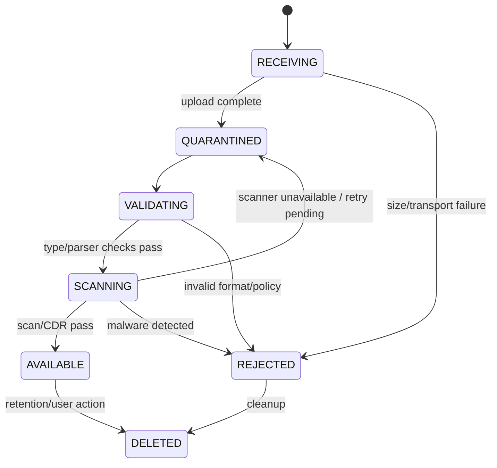

# Content-Type và extension không đủ tin cậy

Khi nhận file qua API, server thường nhìn thấy tên file, phần mở rộng và header `Content-Type` do client gửi. Những giá trị này chỉ là metadata khai báo; người gửi có thể tự sửa chúng. Một file thực thi có thể được đặt tên thành `.jpg`, một file HTML có thể khai báo `image/png`, hoặc nội dung thực tế có thể không khớp với cả tên lẫn MIME type.

Vì vậy, không được quyết định file an toàn chỉ dựa trên extension hoặc `Content-Type`. API upload cần kiểm tra nhiều lớp: allowlist loại file theo nghiệp vụ, kích thước và số lượng, chữ ký định dạng (magic bytes), cấu trúc bằng parser phù hợp, chính sách malware scanning/CDR, tenant/object authorization và cách lưu trữ/phục vụ file. Mỗi lớp giải quyết một nhóm rủi ro khác nhau; không có một phép kiểm tra MIME nào chứng minh file hoàn toàn an toàn.

Trong API Security, file upload là một đường đưa dữ liệu không tin cậy vào hệ thống. File có thể được tải xuống, xem trước, parse, giải nén, OCR, index hoặc chuyển tiếp tới service khác. Một file chỉ gây hại khi được mở hoặc xử lý cũng có thể tiêu hao CPU/RAM, khai thác parser hoặc làm lộ dữ liệu tenant khác. Do đó, validation phải gắn với toàn bộ vòng đời của file, từ lúc nhận đến lúc xóa.

## 1. Vì sao extension và Content-Type có thể bị giả mạo?

Extension là phần tên sau dấu chấm, ví dụ `.png`, `.pdf` hoặc `.docx`. Nó không phải bằng chứng về định dạng thực tế. Người dùng có thể đổi tên bất kỳ bytes nào thành `invoice.pdf` mà không cần chuyển đổi nội dung.

`Content-Type` trong multipart thường nằm ở header của từng part:

```http
Content-Disposition: form-data; name="file"; filename="avatar.png"
Content-Type: image/png

...file bytes...
```

Client kiểm soát `filename` và thường kiểm soát cả `Content-Type`. Header `Content-Type` của toàn request chỉ mô tả định dạng request body (ví dụ `multipart/form-data`), còn part-level `Content-Type` là metadata về từng file. Cả hai đều không xác thực nội dung file.

Các trường hợp có thể xảy ra:

- File executable được đổi tên thành `photo.jpg`.
- File HTML/JavaScript khai báo `image/png`.
- File PDF hợp lệ có extension `.txt` hoặc ngược lại.
- File có nhiều phần mở rộng như `report.pdf.exe`.
- File polyglot có thể được diễn giải theo nhiều định dạng bởi các parser khác nhau.
- File nén chứa nội dung nguy hiểm hoặc dữ liệu giải nén vượt xa kích thước upload.
- File ảnh có header hợp lệ nhưng phần dữ liệu phía sau bị lỗi hoặc được tạo để khai thác parser.

Vì vậy, `MultipartFile.getContentType()`, `getOriginalFilename()` và phần mở rộng chỉ là tín hiệu đầu vào để đối chiếu; không phải căn cứ duy nhất để cho phép lưu hoặc phục vụ file.

## 2. Rủi ro khi tin metadata file

| Rủi ro | Ví dụ | Hậu quả có thể xảy ra |
|---|---|---|
| MIME spoofing | Nội dung HTML khai báo `image/png` | Trình duyệt hoặc downstream parser xử lý sai giả định |
| Extension spoofing | Executable đổi tên thành `.jpg` | File nguy hiểm lọt qua allowlist dựa trên đuôi |
| Stored XSS | Upload HTML/SVG rồi phục vụ cùng origin với ứng dụng | Script chạy trong browser của người tải |
| Parser exploit | File ảnh/PDF/Office được chế tạo khai thác lỗi parser | RCE, crash hoặc đọc dữ liệu trong tiến trình xử lý |
| Archive bomb | File nén nhỏ bung ra dữ liệu rất lớn hoặc nhiều entry | Cạn CPU, memory, disk hoặc worker |
| Path traversal | Filename chứa `../` hoặc đường dẫn tuyệt đối | Ghi đè file hoặc ghi ra ngoài thư mục dự kiến nếu dùng filename làm path |
| Zip Slip | Entry trong archive chứa đường dẫn thoát khỏi thư mục giải nén | Ghi file ngoài staging directory |
| Data leakage | File được lưu dưới URL công khai hoặc object key đoán được | Người không có quyền tải dữ liệu |
| Cross-tenant access | Object ID hợp lệ nhưng thiếu tenant check | User tenant A đọc/xóa file tenant B |
| Resource exhaustion | Upload nhiều file lớn hoặc nhiều part | Cạn băng thông, disk, memory và connection |

Một file vượt qua kiểm tra extension/MIME vẫn có thể chứa dữ liệu độc hại hoặc kích hoạt lỗi ở phần mềm xử lý. Validation định dạng là một lớp giảm rủi ro, không phải malware detection tuyệt đối.

## 3. Xây dựng allowlist theo nghiệp vụ

Không nên cho phép mọi định dạng rồi cố gắng chặn từng định dạng nguy hiểm. Hãy xác định rõ chức năng cần loại file nào và từ chối phần còn lại.

Ví dụ:

| Chức năng | Định dạng có thể cho phép | Định dạng nên cân nhắc từ chối |
|---|---|---|
| Avatar người dùng | JPEG, PNG, WebP | SVG, HTML, executable, archive |
| Tài liệu hóa đơn | PDF | HTML, script, executable, archive không cần thiết |
| Import dữ liệu | CSV hoặc XLSX theo schema | Macro-enabled Office nếu không có nhu cầu |
| Tệp đính kèm hỗ trợ | PDF, JPEG, PNG, TXT theo policy | HTML, SVG, executable, file nén không cần thiết |
| Video | Container/codec đã hỗ trợ rõ ràng | Định dạng không được parser/transcoder kiểm soát |

Allowlist cần được xác định cho từng endpoint và mục đích. Không dùng một allowlist rộng cho mọi chức năng. Ví dụ endpoint avatar không cần chấp nhận PDF hoặc ZIP.

Nếu sản phẩm cần SVG, HTML, Office hoặc archive, phải có quy trình xử lý riêng vì các định dạng này có thể chứa script, macro, external reference, embedded object hoặc nhiều file con. Có thể chuyển đổi sang định dạng raster/PDF an toàn hơn, dùng Content Disarm and Reconstruction (CDR), hoặc chỉ cho tải xuống dạng attachment từ origin tách biệt.

## 4. Kiểm tra extension nhưng không tin extension

Extension có thể dùng để kiểm tra tính nhất quán và chọn policy, nhưng không thể xác nhận nội dung. Khi kiểm tra:

- Chuẩn hóa extension theo quy tắc rõ ràng và so sánh không phân biệt hoa/thường.
- Chỉ chấp nhận extension nằm trong allowlist của endpoint.
- Từ chối tên không có extension nếu nghiệp vụ yêu cầu định dạng xác định.
- Xử lý tên nhiều dấu chấm theo policy; không chỉ lấy chuỗi sau dấu chấm cuối rồi tin nó.
- Không cho phép extension kép mơ hồ như `.jpg.exe`.
- Không dùng filename gốc làm đường dẫn lưu trữ.
- Không cố “sửa” extension bằng cách đổi tên file rồi coi nội dung đã an toàn.

Ví dụ `invoice.pdf.exe` không được chấp nhận chỉ vì filename có chứa `.pdf`. Nếu policy chỉ cho PDF, extension cuối và định dạng nội dung phải khớp PDF; tốt hơn là lưu object bằng ID do server tạo và giữ filename gốc như metadata đã làm sạch để hiển thị.

## 5. Kiểm tra magic bytes và file signature

Nhiều định dạng có byte signature ở đầu file, thường gọi là magic bytes hoặc file signature. Ví dụ một số định dạng phổ biến:

| Định dạng | Dấu hiệu bytes thường gặp | Lưu ý |
|---|---|---|
| PNG | `89 50 4E 47 0D 0A 1A 0A` | Cần parse cấu trúc PNG, không chỉ so 8 bytes đầu |
| JPEG | Thường bắt đầu `FF D8 FF` | Có nhiều marker/segment; cần decoder kiểm tra đầy đủ |
| PDF | Thường có `%PDF-` ở đầu | Header không chứng minh cấu trúc PDF an toàn |
| ZIP | `50 4B 03 04` hoặc biến thể ZIP hợp lệ | DOCX/XLSX/JAR cũng là container ZIP; cần kiểm tra nội dung archive |
| GIF | `GIF87a` hoặc `GIF89a` | Vẫn cần decoder và giới hạn dimension/frame |
| WebP | `RIFF....WEBP` | Kiểm tra RIFF length và cấu trúc chunk |

Magic bytes hữu ích để phát hiện metadata khai báo không khớp nội dung. Tuy nhiên:

- Một số định dạng có nhiều biến thể signature hoặc container phức tạp.
- File polyglot có thể có signature hợp lệ nhưng được parser khác diễn giải theo cách khác.
- Header có thể hợp lệ nhưng phần còn lại bị lỗi hoặc độc hại.
- File nén và Office cần kiểm tra cấu trúc bên trong.
- Không tự viết parser phức tạp cho định dạng nhị phân nếu có thư viện được duy trì tốt.

Hãy dùng signature detection như một bước trong pipeline. Sau đó, parser/decoder phù hợp phải đọc được cấu trúc và áp dụng giới hạn tài nguyên. Nếu MIME detector trả về `application/octet-stream` hoặc không xác định, đừng tự suy ra file an toàn; từ chối hoặc chuyển sang quy trình kiểm tra riêng theo nghiệp vụ.

## 6. So khớp nhiều tín hiệu: extension, MIME và parser

Một quyết định upload có thể dựa trên các tín hiệu độc lập:

1. Extension nằm trong allowlist của endpoint.
2. MIME detector phía server nhận diện định dạng dựa trên nội dung.
3. Magic bytes phù hợp với định dạng mong đợi.
4. Parser/decoder đọc được file và xác nhận cấu trúc cơ bản.
5. Policy malware scan/CDR đạt yêu cầu.
6. Kích thước, số lượng, dimension, archive expansion và thời gian parse nằm trong giới hạn.

Ví dụ với avatar PNG:

```text
Endpoint policy: avatar chỉ cho PNG/JPEG/WebP
Filename extension: .png
Client Content-Type: image/png
Server detector: image/png
PNG signature: hợp lệ
Image decoder: decode thành công trong giới hạn pixel/frame
Malware/policy scan: PASS
=> Có thể chuyển file sang trạng thái AVAILABLE
```

Nếu client khai `image/png` nhưng detector nhận `text/html`, từ chối. Nếu extension `.png` nhưng parser không đọc được, từ chối hoặc cách ly theo policy; không chỉ đổi tên. Nếu các tín hiệu mâu thuẫn, không chọn tín hiệu thuận tiện nhất để cho phép.

Không phải mọi định dạng đều có một MIME hoặc signature duy nhất. Với định dạng phức tạp, định nghĩa rõ parser/version và policy chấp nhận. Tránh tự suy ra `Content-Type` từ extension rồi xem kết quả đó là kiểm tra độc lập.

## 7. Dùng MIME detector phía server một cách an toàn

Thư viện như Apache Tika có thể nhận diện loại nội dung từ bytes và metadata. Ví dụ khái niệm:

```java
Tika tika = new Tika();
String detectedType = tika.detect(inputStream, safeFilename);
```

Không coi kết quả detector là bằng chứng cuối cùng. Detector có thể dựa trên magic bytes, heuristic hoặc parser; file polyglot và định dạng phức tạp vẫn cần policy riêng. Đặt giới hạn kích thước, thời gian và memory khi nhận diện; cập nhật thư viện để nhận bản vá bảo mật.

Không truyền URL do client cung cấp cho detector hoặc parser để thư viện tự tải nội dung. Việc đó có thể tạo SSRF. Chỉ phân tích bytes đã được nhận vào vùng quarantine hoặc nguồn lưu trữ do server kiểm soát.

Khi cần MIME để phục vụ download, lấy giá trị từ kết quả xác minh server-side và allowlist. Không trả lại nguyên `Content-Type` do client khai báo.

## 8. Kiểm tra cấu trúc bằng parser phù hợp

Magic bytes chỉ kiểm tra một dấu hiệu ban đầu. Parser chuyên biệt giúp xác minh cấu trúc định dạng sâu hơn và có thể phát hiện file bị cắt, malformed hoặc có đặc điểm vượt policy.

Ví dụ:

- **Ảnh:** decode bằng thư viện ảnh; kiểm tra width, height, tổng pixel, số frame, color profile và metadata; cân nhắc re-encode thành ảnh raster chuẩn.
- **PDF:** parse trong process/container cô lập; kiểm tra cấu trúc, object count, kích thước và tính năng active content theo policy; cân nhắc CDR.
- **Office:** kiểm tra ZIP entries, macro/VBA, embedded object, external relationship và kích thước giải nén; chỉ cho phép định dạng cần thiết.
- **CSV:** giới hạn số dòng/cột và độ dài cell; khi export lại, xử lý CSV formula injection cho giá trị bắt đầu bằng `=`, `+`, `-` hoặc `@` theo policy consumer.
- **Audio/video:** giới hạn duration, codec, resolution, frame rate và số track; chạy transcoder trong môi trường cô lập.
- **Archive:** kiểm tra entry count, đường dẫn, nested archive, compression ratio và tổng kích thước sau giải nén.

Parser là bề mặt tấn công. Nên dùng phiên bản thư viện được cập nhật, chạy với quyền tối thiểu, giới hạn CPU/RAM/time và không cho parser truy cập network hoặc filesystem tùy ý.

## 9. Không dùng filename gốc làm đường dẫn lưu trữ

`getOriginalFilename()` là dữ liệu do client kiểm soát. Filename có thể chứa path traversal, ký tự điều khiển, Unicode khó nhìn, dấu phân cách khác hệ điều hành hoặc tên gây nhầm lẫn.

Ví dụ nguy hiểm:

```text
../../../../var/www/html/shell.jsp
C:\\Windows\\System32\\file.dll
report.pdf.exe
invoice\u0000.pdf
```

Không nối filename trực tiếp vào filesystem path:

```java
// Không an toàn
Path destination = uploadDir.resolve(file.getOriginalFilename());
```

Thay vào đó:

- Tạo object ID hoặc storage key ngẫu nhiên phía server.
- Lưu file trong vùng staging/quarantine riêng, không nằm trong webroot.
- Lưu original filename đã làm sạch như metadata hiển thị, không dùng làm path.
- Chuẩn hóa Unicode/control characters và giới hạn chiều dài filename.
- Không cho phép filename quyết định bucket, tenant, directory hoặc quyền truy cập.
- Khi giải nén archive, chuẩn hóa từng entry và bảo đảm path sau resolve vẫn nằm trong thư mục đích.

Ví dụ:

```java
String objectId = UUID.randomUUID().toString();
Path destination = quarantineRoot.resolve(objectId).normalize();

if (!destination.startsWith(quarantineRoot.normalize())) {
    throw new InvalidUploadException();
}
```

Trong thực tế, `quarantineRoot` phải là path đã được cấu hình tin cậy và kiểm soát symlink/race condition phù hợp. Với object storage, dùng key do server tạo và bucket private; không dùng filename client làm object key.

## 10. Giới hạn kích thước, số lượng và tài nguyên multipart

Multipart upload có thể tiêu hao tài nguyên trước khi nội dung được validate. Cần đặt giới hạn ở nhiều lớp:

- Tổng request body size.
- Kích thước từng file/part.
- Số lượng part và số file trong một request.
- Kích thước field text và header multipart.
- Thời gian upload và tốc độ tối thiểu nếu hạ tầng hỗ trợ.
- Disk quota của temporary directory và vùng quarantine.
- Số upload đồng thời theo user/tenant/IP/API key.
- Tổng dung lượng tenant được phép lưu.
- Giới hạn parser, antivirus và CDR sau upload.

Giới hạn ở application có thể quá muộn nếu reverse proxy đã buffer toàn bộ request. Hãy cấu hình đồng bộ tại CDN/load balancer/API gateway, web server, servlet container và Spring application. Tránh cấu hình gateway cho phép payload rất lớn trong khi ứng dụng chỉ có memory/disk nhỏ.

Không đọc toàn bộ file vào `byte[]` chỉ để kiểm tra MIME nếu file có thể lớn. Dùng streaming hoặc temporary file có quota, tính hash khi stream và dừng ngay khi vượt giới hạn. Đảm bảo temporary file được xóa khi request bị hủy hoặc validation thất bại.

## 11. Archive bomb, nested archive và Zip Slip

File ZIP có thể rất nhỏ nhưng giải nén ra dữ liệu lớn, chứa hàng trăm nghìn entry hoặc nhiều tầng archive. Giới hạn kích thước upload không đủ để bảo vệ tài nguyên giải nén.

Khi xử lý archive, cần giới hạn:

- Tổng số entry.
- Tổng uncompressed bytes.
- Kích thước tối đa mỗi entry.
- Compression ratio theo policy.
- Độ sâu nested archive.
- Thời gian CPU và thời gian giải nén.
- Đường dẫn entry sau khi normalize.
- Symlink, absolute path và path traversal entry.

Zip Slip xảy ra khi tên entry như `../../outside.txt` được dùng trực tiếp để tạo file bên ngoài thư mục giải nén. Mỗi entry phải được resolve và kiểm tra nằm bên trong destination root trước khi ghi. Không tin path trong archive chỉ vì archive có chữ ký ZIP hợp lệ.

Nếu sản phẩm không cần nhận archive, từ chối ZIP/TAR/7z sẽ giảm đáng kể độ phức tạp. Nếu cần, xử lý trong worker/container cô lập, không mount thư mục nhạy cảm và không cấp network access.

## 12. SVG, HTML và nội dung có thể thực thi

Một số định dạng nhìn giống tài liệu/ảnh nhưng có thể chứa nội dung chủ động:

- SVG có thể chứa script, event handler, external reference hoặc nội dung nhúng tùy cách phục vụ và browser.
- HTML có thể chạy JavaScript và tải tài nguyên bên ngoài.
- PDF có thể chứa action, embedded file hoặc nội dung active tùy viewer.
- Office có thể chứa macro, embedded object và external relationship.

Nếu chức năng chỉ cần ảnh hiển thị, ưu tiên JPEG/PNG/WebP và decode/re-encode sang định dạng raster đã hỗ trợ. Nếu cần SVG, sanitize bằng parser chuyên dụng và phục vụ từ origin tách biệt với ứng dụng; không chỉ đổi extension thành `.png`.

Với file có thể thực thi trong browser:

- Lưu trên domain riêng không chia sẻ cookie với ứng dụng chính.
- Phục vụ `Content-Disposition: attachment` nếu không cần inline.
- Gửi `X-Content-Type-Options: nosniff`.
- Không tin MIME do client khai báo; dùng MIME đã xác minh.
- Cân nhắc CSP sandbox hoặc cơ chế viewer cô lập khi phải hiển thị.
- Không cho file upload trở thành nội dung cùng origin có quyền đọc session/token của ứng dụng.

## 13. Malware scanning và Content Disarm and Reconstruction

Với file được tải lên từ người dùng hoặc đối tác, antivirus/malware scanner có thể là một lớp kiểm soát bổ sung. Pipeline có thể gồm:

1. Nhận file và lưu vào quarantine private.
2. Tính hash và ghi metadata upload.
3. Kiểm tra extension/MIME/signature/parser theo allowlist.
4. Gửi file tới scanner trong môi trường cô lập.
5. Nếu cần, chạy CDR để tái tạo tài liệu bỏ active content hoặc thành phần không được phép.
6. Xác minh output sau CDR bằng parser và policy lần nữa.
7. Chỉ promote file sang trạng thái `AVAILABLE` khi toàn bộ kiểm tra đạt.
8. Nếu lỗi, timeout hoặc kết quả không xác định, giữ `QUARANTINED` hoặc từ chối; không tự động coi là sạch.

Scanner không bảo đảm phát hiện mọi malware. File sạch ở thời điểm upload cũng có thể bị khai thác bởi parser lỗi thời khi được mở sau này. Cần cập nhật scanner/parser, sandbox, quyền tối thiểu và monitoring.

CDR có thể thay đổi nội dung/định dạng và làm mất một số tính năng tài liệu. Hãy thông báo rõ cho người dùng, lưu hash nguồn/output và kiểm tra output trước khi công bố. Không ghi đè bản gốc trong quarantine bằng output chưa được xác minh.

## 14. Thiết kế trạng thái upload

Không nên làm file có thể tải ngay khi request multipart vừa hoàn tất. Một state machine đơn giản:



API có thể trả `202 Accepted` cùng file ID và trạng thái `QUARANTINED` khi kiểm tra bất đồng bộ. Endpoint download phải từ chối mọi file chưa ở trạng thái `AVAILABLE`. Không để client đoán file ID và tải file của tenant khác; mỗi lần đọc/tải cần object authorization.

Trạng thái scanner timeout hoặc unavailable không phải `CLEAN`. Hãy retry có giới hạn hoặc yêu cầu xử lý thủ công, giữ file ở quarantine và cảnh báo nếu backlog tăng.

## 15. Ví dụ Spring Boot multipart configuration

Spring Boot cho phép giới hạn kích thước multipart request và từng file:

```yaml
spring:
  servlet:
    multipart:
      max-file-size: 10MB
      max-request-size: 12MB
      file-size-threshold: 0B
      location: /var/app/upload-tmp
```

Các giá trị trên chỉ minh họa. Thư mục temporary phải có quota, quyền filesystem tối thiểu, không nằm trong webroot và được dọn dẹp an toàn. Giới hạn cần thống nhất với proxy/gateway phía trước.

Controller nên kiểm tra authorization và giới hạn trước khi chuyển file vào quarantine:

```java
@RestController
@RequestMapping("/api/files")
@RequiredArgsConstructor
class FileUploadController {
    private final FileUploadService uploadService;

    @PostMapping(consumes = MediaType.MULTIPART_FORM_DATA_VALUE)
    @PreAuthorize("hasAuthority('SCOPE_files:upload')")
    ResponseEntity<UploadAccepted> upload(
            @AuthenticationPrincipal Jwt jwt,
            @RequestPart("file") MultipartFile file) {

        UUID tenantId = UUID.fromString(
                jwt.getClaimAsString("tenant_id"));
        UploadAccepted result = uploadService.accept(
                tenantId, jwt.getSubject(), file);
        return ResponseEntity.accepted().body(result);
    }
}
```

Service cần thực hiện kiểm tra thật, không tin MIME/filename của part:

```java
UploadAccepted accept(
        UUID tenantId, String subject, MultipartFile file) {

    authorization.requireUploadPermission(subject, tenantId);
    if (file == null || file.isEmpty()) {
        throw new InvalidUploadException();
    }
    if (file.getSize() > MAX_FILE_BYTES) {
        throw new UploadTooLargeException();
    }

    String safeDisplayName = filenamePolicy.sanitize(
            file.getOriginalFilename());
    String extension = extensionPolicy.requireAllowed(
            safeDisplayName, UploadPurpose.ATTACHMENT);

    UUID fileId = UUID.randomUUID();
    QuarantineObject stored = quarantineStorage.store(
            tenantId, fileId, file.getInputStream(), MAX_FILE_BYTES);

    uploadJobService.enqueueValidation(
            tenantId, fileId, stored.sha256(), extension);

    return new UploadAccepted(fileId, "QUARANTINED");
}
```

Đây là ví dụ khung. `quarantineStorage.store` phải stream và tự dừng khi vượt giới hạn, tính hash, ghi private object với key do server tạo và xử lý cleanup khi lỗi. `filenamePolicy` chỉ tạo tên hiển thị an toàn; không dùng tên đó làm storage key. `extensionPolicy` là bước sàng lọc ban đầu; worker vẫn phải phát hiện MIME, kiểm tra signature, parse và scan.

Trong triển khai thật, cần xử lý exception từ `getInputStream()`, giới hạn tổng request ở proxy/container, kiểm tra quota tenant, chống upload trùng theo idempotency policy và ghi metadata trong transaction/outbox phù hợp. Nếu upload trực tiếp tới object storage bằng pre-signed URL, chỉ cấp quyền PUT cho một object key quarantine cụ thể, TTL ngắn, giới hạn content length/checksum nếu provider hỗ trợ và không cho object trở nên public trước khi scan.

## 16. Kiểm tra nội dung trong worker

Worker validation có thể thực hiện các bước độc lập:

```java
void validateAndScan(QuarantinedFile file) {
    byte[] prefix = storage.readPrefix(file.objectKey(), 8192);
    DetectedType type = typeDetector.detect(prefix, file.safeName());

    filePolicy.requireAllowed(type, file.expectedPurpose());
    parserValidator.validateWithinLimits(file.objectKey(), type);
    malwareScanner.requireClean(file.objectKey());

    storage.promoteToAvailable(
            file.tenantId(), file.fileId(), file.sha256(), type);
}
```

Pseudocode trên không phải triển khai parser/scanner đầy đủ. Với file lớn, detector/parser cần stream hoặc đọc từ private object storage trong sandbox. Worker phải xác minh tenant, file ID, trạng thái hiện tại và hash trước khi promote. Không nhận object key hoặc tenant ID tùy ý từ queue message mà không đối chiếu job record đáng tin cậy.

Trước khi promote, kiểm tra file trong storage vẫn có cùng hash với file đã scan. Điều này tránh tình huống file bị thay thế giữa lúc scan và lúc publish (*time-of-check to time-of-use*). Có thể dùng immutable object/version ID hoặc copy sang object key mới sau khi scan đạt.

## 17. Download cũng cần bảo vệ

Validation upload không thay thế authorization lúc download. Mỗi lần tải cần:

- Xác thực caller và kiểm tra quyền trên file/object.
- Kiểm tra file thuộc tenant hiện tại và trạng thái `AVAILABLE`.
- Không dùng object ID đoán được làm bằng chứng quyền.
- Chọn `Content-Type` từ kết quả xác minh server-side.
- Dùng `Content-Disposition: attachment` khi không cần inline.
- Gửi `X-Content-Type-Options: nosniff`.
- Đặt cache policy phù hợp, thường là private/no-store cho file nhạy cảm.
- Kiểm soát signed URL bằng scope hẹp, TTL ngắn và audit.
- Không để response chứa filename/header có CRLF hoặc ký tự điều khiển.

Ví dụ response:

```http
HTTP/1.1 200 OK
Content-Type: application/pdf
Content-Disposition: attachment; filename="invoice.pdf"
X-Content-Type-Options: nosniff
Cache-Control: private, no-store
```

Nếu cần inline preview, ưu tiên viewer cô lập hoặc origin riêng. Không phục vụ HTML/SVG chưa được sanitize cùng origin với ứng dụng chứa session cookie. Tên file trong `Content-Disposition` cần được encode/sanitize theo chuẩn HTTP, không nối trực tiếp chuỗi do client gửi.

## 18. Tenant isolation và metadata file

File là object có quyền sở hữu và vòng đời riêng. Metadata nên lưu tenant, owner, purpose, verified type, size, hash, scan status, storage key do server tạo và retention. Không lấy tenant từ filename, form field hoặc object key do client gửi.

Các quy tắc:

- Storage bucket/prefix private; không bật public access mặc định.
- Object key ngẫu nhiên và không suy ra từ tenant name hoặc filename.
- Mọi truy vấn file đều có tenant filter và object authorization.
- Queue job, scanner và download worker kiểm tra tenant/file relationship.
- Cache key có tenant/security context; không dùng file ID đơn lẻ nếu response phụ thuộc quyền.
- Khi tenant bị offboard, xử lý file quarantine, available, export và backup theo retention policy.
- Signed URL chỉ được cấp sau authorization và không sống lâu hơn chính sách thu hồi mong muốn.

Một file được upload bởi Alice không tự động được chia sẻ với mọi người trong tenant của Alice. Quyền đọc có thể phụ thuộc owner, project, ticket hoặc explicit grant.

## 19. Kiểm thử file upload security

Test cần xác minh metadata giả mạo, nội dung malformed, resource limit, storage isolation và download behavior.

| Tình huống | Kết quả cần xác minh |
|---|---|
| PNG hợp lệ, extension/MIME/signature khớp | Được nhận và chuyển AVAILABLE sau parser/scan |
| Executable đổi tên `.jpg`, khai `image/jpeg` | Bị từ chối bởi signature/parser/policy |
| HTML khai `image/png` | Bị từ chối; không được phục vụ inline |
| Extension không nằm trong allowlist | Từ chối trước khi lưu/publish |
| MIME header bị giả mạo | Quyết định dựa trên detector/parser phía server |
| Magic bytes đúng nhưng cấu trúc malformed | Parser validation thất bại; không AVAILABLE |
| File polyglot hoặc SVG có active content | Bị từ chối, sanitize/CDR hoặc phục vụ trong isolation theo policy |
| File vượt max size/request size | Bị từ chối; không để temporary/quarantine file mồ côi |
| Quá nhiều multipart part | Bị từ chối theo giới hạn server/proxy |
| ZIP bomb/nested archive quá sâu | Worker dừng theo uncompressed size/entry/depth/time limit |
| Zip Slip entry `../` | Không ghi ra ngoài staging root |
| Filename có path, CRLF, null/control hoặc Unicode bất thường | Không ảnh hưởng storage path/header/log |
| Scanner timeout/unavailable | File vẫn QUARANTINED; không được download |
| Malware scanner báo infected | File REJECTED/cách ly; không promote |
| File bị thay đổi sau scan | Hash/version mismatch ngăn promote hoặc download |
| User tenant A đoán file ID của tenant B | Bị từ chối bởi object/tenant authorization |
| File chưa scan được gọi download | Bị từ chối |
| Download file HTML/SVG/PDF | Header MIME, disposition, nosniff và origin policy đúng |
| Upload bị hủy giữa chừng | Temporary file và quota được giải phóng |
| Concurrent upload vượt quota | Reservation/quota xử lý nguyên tử; không vượt giới hạn |

Có thể dùng file kiểm thử vô hại theo chuẩn EICAR trong môi trường scanner test nếu công cụ hỗ trợ; không dùng malware thật. Test cần chạy qua reverse proxy, multipart parser, application, quarantine storage, scanner worker và download API để kiểm tra giới hạn ở toàn pipeline.

## 20. Logging và monitoring

Ghi metadata cần thiết để điều tra mà không lưu file hoặc payload nhạy cảm vào log:

- Upload ID/file ID, tenant reference và principal reference.
- Kích thước, hash, extension khai báo và MIME được phát hiện.
- Kết quả signature/parser/scan/CDR và policy version.
- Thời gian xử lý, scanner queue age, retry và trạng thái quarantine.
- Số upload bị từ chối theo reason code.
- Dung lượng quarantine/available, disk pressure và worker saturation.
- Download authorization decision và object reference an toàn.

Không log raw file bytes, secret, signed URL đầy đủ, filename chưa làm sạch hoặc payload có dữ liệu cá nhân không cần thiết. Hash file có thể là dữ liệu nhạy cảm trong một số tình huống (ví dụ xác định file đã biết); giới hạn quyền truy cập và retention phù hợp.

Alert khi upload lớn bất thường, tỷ lệ MIME mismatch tăng, scanner backlog kéo dài, quarantine storage gần đầy, parser timeout tăng, nhiều request thử extension không cho phép hoặc có pattern truy cập file chéo tenant.

## 21. Checklist triển khai

- [ ] Mỗi endpoint có allowlist file theo mục đích nghiệp vụ.
- [ ] Không tin `Content-Type`, extension, filename hoặc form field do client gửi.
- [ ] So khớp extension, MIME detector, magic bytes và parser theo định dạng.
- [ ] Có policy riêng cho SVG, HTML, PDF, Office, archive và định dạng active content.
- [ ] Filename chỉ là metadata hiển thị; storage key do server tạo.
- [ ] Upload vào private quarantine ngoài webroot trước khi scan/publish.
- [ ] Giới hạn request/file/part count, timeout, concurrency, disk, quota và parser resource.
- [ ] Archive có giới hạn entry, expansion size, compression ratio, nesting và Zip Slip defense.
- [ ] Malware scan/CDR chạy trong môi trường cô lập; scanner lỗi không được coi là sạch.
- [ ] Hash/version được kiểm tra để ngăn file thay đổi giữa scan và promote.
- [ ] File chỉ ở trạng thái AVAILABLE sau khi toàn bộ policy đạt.
- [ ] Download kiểm tra authentication, object/tenant authorization và file state.
- [ ] Download dùng MIME đã xác minh, Content-Disposition phù hợp và `nosniff`.
- [ ] Cache, signed URL, bucket và tenant offboarding có policy rõ.
- [ ] Có test MIME spoofing, malformed/polyglot, oversized, archive bomb, path traversal và cross-tenant access.
- [ ] Monitoring không ghi raw file hoặc credential; có alert cho scanner/quarantine/resource pressure.

## Kết luận

Extension và `Content-Type` là metadata do client khai báo nên không thể chứng minh định dạng hay độ an toàn của file. API upload cần allowlist theo nghiệp vụ, kiểm tra signature/magic bytes, phát hiện MIME phía server, parse cấu trúc trong giới hạn tài nguyên và dùng malware scanning/CDR khi phù hợp. File nên được lưu vào quarantine private bằng object key do server tạo, chỉ chuyển sang `AVAILABLE` sau khi toàn bộ kiểm tra đạt. Download tiếp tục phải kiểm tra quyền trên object và tenant, dùng MIME đã xác minh cùng header an toàn. Khi validation, storage, scanner, authorization và monitoring được thiết kế như một pipeline thống nhất, file multipart không còn là đường đưa dữ liệu không tin cậy thẳng vào hệ thống.
