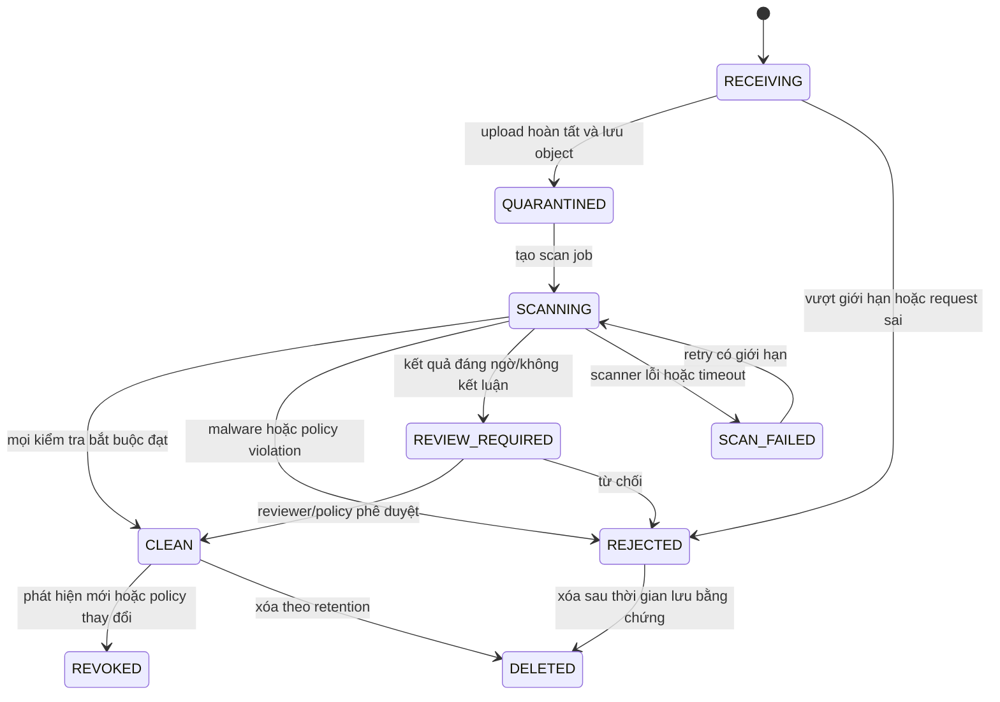

# Virus scan và content inspection

API nhận file từ người dùng hoặc đối tác phải coi nội dung tải lên là dữ liệu chưa tin cậy, kể cả khi request đã được xác thực và file có phần mở rộng hợp lệ. File có thể chứa malware, macro độc hại, script, nội dung giả mạo định dạng, archive nén quá mức hoặc cấu trúc khiến parser tiêu tốn tài nguyên. Nếu file được lưu vào vùng public hoặc cho phép tải/xử lý ngay sau upload, một request hợp lệ có thể đưa nội dung nguy hiểm vào hệ thống.

**Virus scanning** tìm dấu hiệu malware bằng signature, heuristic hoặc sandbox. **Content inspection** kiểm tra định dạng thực tế, cấu trúc, metadata, nội dung chủ động và các quy tắc an toàn của loại file. Hai bước bổ sung cho nhau: antivirus không chứng minh file hoàn toàn an toàn, còn kiểm tra MIME/magic bytes không phát hiện được mọi malware.

Trong API Security, upload cần có vòng đời rõ ràng: file mới nhận phải ở trạng thái quarantine; scanner kiểm tra đúng phiên bản object đã lưu; chỉ file đạt policy mới được chuyển sang vùng có thể tải hoặc xử lý. Mọi đường download, preview, export và downstream processing phải kiểm tra trạng thái hiện tại cùng quyền truy cập object.

Sau bài học, người đọc có thể:

- Thiết kế lifecycle upload với quarantine, scanning, clean, rejected và review.
- Phân biệt MIME type do client khai báo với định dạng thực tế của file.
- Kết hợp antivirus, file signature inspection, parser validation, sandbox và Content Disarm and Reconstruction (CDR).
- Giới hạn archive, parser, kích thước, độ sâu và tài nguyên xử lý.
- Ngăn TOCTOU bằng object version/hash và trạng thái scan gắn với đúng nội dung.
- Bảo vệ storage, scanner credential, download và preview.
- Xử lý scanner timeout, lỗi, kết quả không xác định và false positive an toàn.
- Kiểm thử file độc hại, file giả định dạng, archive bomb, race condition và đường truy cập phụ.

## 1. Vì sao cần virus scan và content inspection?

File upload thường đi qua nhiều thành phần: API gateway, ứng dụng, object storage, antivirus engine, document parser, preview service, OCR, hệ thống tìm kiếm và người nhận tải xuống. Một file nguy hiểm có thể tác động tới bất kỳ thành phần nào trong chuỗi này.

Ví dụ:

- File thực thi được đổi tên thành `report.pdf` để vượt kiểm tra phần mở rộng.
- Tài liệu Office chứa macro hoặc embedded object độc hại.
- PDF có JavaScript, file đính kèm hoặc cấu trúc khai thác lỗi parser.
- SVG/HTML chứa script khi được preview cùng origin với ứng dụng.
- ZIP chứa hàng nghìn file nhỏ hoặc dữ liệu giải nén lớn hơn nhiều lần so với file gốc.
- File có header giống ảnh PNG nhưng phần nội dung sau đó chứa dữ liệu khác (polyglot hoặc file malformed).
- Tệp bị thay thế sau khi scan nhưng trước khi download.
- Scanner bị lỗi hoặc timeout, ứng dụng vẫn cho phép tải file vì muốn tránh gián đoạn.

Mục tiêu không phải là khẳng định một file “an toàn tuyệt đối”. Mục tiêu là giảm xác suất nội dung độc hại đi vào các hệ thống tin cậy, giới hạn thiệt hại nếu phát hiện muộn và bảo đảm file chưa được kiểm tra không thể được sử dụng như file sạch.

### 1.1. Các lớp kiểm tra có mục tiêu khác nhau

| Lớp | Câu hỏi | Ví dụ |
|---|---|---|
| Upload validation | Request có nằm trong giới hạn và đúng contract không? | Body size, số part, quyền upload |
| Type identification | Nội dung thực tế là định dạng gì? | Magic bytes, parser nhận diện format |
| Structural inspection | File có cấu trúc hợp lệ và nằm trong giới hạn không? | PDF object count, ZIP entry count |
| Antivirus/malware scan | Có dấu hiệu malware đã biết hoặc đáng ngờ không? | Signature, heuristic, reputation |
| Sandbox/dynamic analysis | Khi chạy trong môi trường cách ly, file có hành vi nguy hiểm không? | Macro spawn process, network behavior |
| CDR/sanitization | Có thể loại bỏ active content và tạo bản an toàn hơn không? | Rebuild PDF, loại macro |
| Access control | Ai được xem, tải hoặc xử lý file? | Owner, tenant, trạng thái và quyền |

Không lớp nào thay thế toàn bộ các lớp còn lại. Một file sạch theo antivirus vẫn có thể là file quá lớn, sai định dạng, chứa dữ liệu không được phép hoặc thuộc object mà caller không có quyền truy cập.

## 2. Thiết kế vòng đời file: quarantine trước, publish sau

Không lưu file upload trực tiếp vào thư mục hoặc bucket public rồi mới chạy scan. File mới nhận phải được đặt ở vùng quarantine riêng tư và không có đường tải xuống thông thường.

Một lifecycle mẫu:



Các trạng thái có thể được đặt tên khác nhau, nhưng ý nghĩa phải rõ:

| Trạng thái | Ý nghĩa | Download/preview thông thường |
|---|---|---|
| `RECEIVING` | Đang nhận dữ liệu, chưa hoàn tất | Không |
| `QUARANTINED` | Đã lưu riêng tư, chờ kiểm tra | Không |
| `SCANNING` | Scanner/inspector đang xử lý | Không |
| `CLEAN` | Đã vượt qua policy kiểm tra hiện hành | Có, sau khi authorization thành công |
| `REJECTED` | Phát hiện malware hoặc vi phạm policy | Không |
| `REVIEW_REQUIRED` | Kết quả chưa rõ hoặc cần quyết định bổ sung | Không |
| `SCAN_FAILED` | Không có kết quả tin cậy do lỗi scanner | Không |
| `REVOKED` | File từng sạch nhưng bị thu hồi do cảnh báo/policy mới | Không |
| `DELETED` | Đã xóa theo retention | Không |

**Không coi `SCAN_FAILED` là `CLEAN`.** Scanner không trả kết quả không có nghĩa là file không có malware. Nếu nghiệp vụ cần tiếp tục, có thể cho phép người dùng xem trạng thái chờ hoặc tải lên file khác; không được âm thầm bỏ qua bước kiểm tra bắt buộc.

### 2.1. Quy tắc chuyển trạng thái

Chỉ cho phép các transition đã định nghĩa. Ví dụ:

- `QUARANTINED` chỉ chuyển sang `SCANNING` khi scan job tham chiếu đúng object version.
- `SCANNING` chỉ chuyển sang `CLEAN` khi mọi scanner/policy bắt buộc trả kết quả hợp lệ.
- `SCAN_FAILED` chỉ retry trong giới hạn; không tự chuyển sang `CLEAN` sau một số lần retry.
- `REVIEW_REQUIRED` chỉ được phê duyệt bởi role/workflow phù hợp và phải audit.
- `CLEAN` chuyển `REVOKED` khi threat intelligence mới, scanner update hoặc incident xác định file cần cách ly lại.

Transition nên được cập nhật nguyên tử bằng version/state condition để hai worker không ghi đè kết quả của nhau. Ghi lại lý do, scanner version, policy version, thời điểm và object digest đã được kiểm tra.

## 3. Kiểm tra upload trước khi đưa vào scanner

Upload endpoint cần xác thực và authorization trước khi cấp tài nguyên hoặc tạo object. Kiểm tra tối thiểu:

- Caller có quyền upload vào đúng object, folder, tenant hoặc workflow không?
- Số lượng file/part có nằm trong giới hạn không?
- Kích thước từng file và tổng request có nằm trong giới hạn không?
- Tên file, path, content disposition và metadata có được xử lý an toàn không?
- Content type và phần mở rộng có phù hợp với contract dự kiến không?
- Quota lưu trữ, số upload đồng thời và tốc độ upload có bị vượt không?
- Upload có bị timeout hoặc để lại multipart tạm thời không?

Đặt giới hạn ở nhiều tầng: reverse proxy/gateway, web server, multipart parser và application. Chỉ kiểm tra `Content-Length` không đủ vì request có thể dùng streaming/chunked transfer hoặc khai báo không chính xác. Cần đếm số byte thực tế khi stream và dừng ngay khi vượt giới hạn.

### 3.1. Tên file là dữ liệu không tin cậy

Không dùng tên file client gửi làm đường dẫn lưu trực tiếp. Tên như `../../config.yml`, tên có ký tự điều khiển, dấu phân cách khác nền tảng hoặc Unicode khó nhìn có thể gây path traversal, ghi đè hoặc nhầm lẫn trong log/UI.

Hãy tạo object key ngẫu nhiên/ID nội bộ và lưu tên gốc như metadata đã được làm sạch để hiển thị. Khi trả filename qua `Content-Disposition`, encode theo chuẩn phù hợp, loại bỏ CR/LF và ký tự điều khiển; không cho tên file tạo header injection.

### 3.2. Content-Type do client khai báo không đáng tin

Header `Content-Type: image/png` do client gửi không chứng minh body là PNG. Phần mở rộng `.pdf` cũng không chứng minh nội dung là PDF. Các giá trị này chỉ là gợi ý để kiểm tra chéo.

Nên kết hợp:

1. Allowlist loại file theo nghiệp vụ.
2. Phần mở rộng được chuẩn hóa và đối chiếu với loại dự kiến.
3. Magic bytes/file signature để nhận diện sơ bộ.
4. Parser chuyên dụng xác minh cấu trúc thực tế.
5. Policy nội dung, ví dụ không cho macro, script hoặc embedded file.

Magic bytes không phải bằng chứng cuối cùng. Một file có thể bắt đầu bằng signature hợp lệ nhưng chứa payload nối thêm, polyglot hoặc cấu trúc parser xử lý khác nhau. Hãy kiểm tra bằng parser phù hợp trong môi trường cách ly.

## 4. Antivirus scan: khả năng và giới hạn

Antivirus engine thường dùng nhiều kỹ thuật:

- **Signature-based detection:** so khớp hash/byte pattern với malware đã biết.
- **Heuristic detection:** tìm cấu trúc hoặc đặc điểm đáng ngờ.
- **Reputation:** đối chiếu hash/domain/certificate với nguồn threat intelligence.
- **Emulation/sandbox:** phân tích hành vi khi nội dung được mở hoặc thực thi trong môi trường cách ly.

Kết quả scan thường được phân loại thành clean, infected, suspicious, unsupported hoặc error. Cần định nghĩa rõ mapping sang lifecycle của ứng dụng.

Antivirus có thể bỏ sót malware mới, file được mã hóa, payload ẩn, nội dung chưa được giải nén hoặc file có cấu trúc scanner không hiểu. Kết quả `clean` có nghĩa là không phát hiện theo engine/signature/policy tại thời điểm scan, không phải cam kết file tuyệt đối an toàn.

### 4.1. Scanner phải chạy trong vùng cách ly

Scanner và parser là phần mềm xử lý input do attacker kiểm soát. Chúng cũng có thể có lỗ hổng. Nên chạy scanner:

- Trong container/VM hoặc workload tách biệt, quyền tối thiểu.
- Không có quyền truy cập trực tiếp database nghiệp vụ hoặc secret không cần thiết.
- Hạn chế network egress; không cho file upload điều khiển scanner truy cập mạng nội bộ.
- Giới hạn CPU, memory, disk, process, file descriptor và thời gian xử lý.
- Mount file ở chế độ read-only nếu scanner không cần ghi.
- Dùng thư mục tạm riêng, dọn sạch sau job.
- Cập nhật engine/signature theo quy trình và theo dõi phiên bản.

Không chạy file upload trên máy chủ ứng dụng để “xem có mở được không”. Nếu sandbox cần thực thi nội dung, phải tách biệt mạnh, không chứa credential thật và có kiểm soát mạng.

### 4.2. Scanner version và policy version

Kết quả scan cần gắn với:

- SHA-256 hoặc digest của object đã quét.
- Object version/generation.
- Scanner engine và signature database version.
- Policy/ruleset version.
- Thời điểm bắt đầu/kết thúc.
- Kết quả, lý do và loại phát hiện.

Những metadata này giúp biết file đã được kiểm tra bằng phiên bản nào, hỗ trợ audit và quyết định rescan khi threat intelligence hoặc policy thay đổi. Không lưu secret scanner hoặc thông tin cấu hình nhạy cảm vào record kết quả.

## 5. Content inspection theo định dạng thực tế

Content inspection kiểm tra file có đúng định dạng dự kiến, cấu trúc có hợp lệ và có chứa nội dung bị cấm hay không. Quy tắc phụ thuộc loại file và mục đích sử dụng.

| Loại file | Nội dung cần chú ý | Kiểm tra gợi ý |
|---|---|---|
| Ảnh PNG/JPEG | Metadata EXIF, payload nối thêm, kích thước pixel rất lớn | Decode bằng thư viện cập nhật, giới hạn pixel/dimension, loại metadata không cần |
| SVG | Script, external reference, event handler, embedded HTML | Không inline vào origin ứng dụng; sanitize hoặc rasterize |
| PDF | JavaScript, embedded file, launch action, cấu trúc lỗi | Parser/sandbox, policy active content, CDR khi phù hợp |
| Office Open XML | Macro, external link, embedded OLE object | Kiểm tra macro/embedded object, policy loại file `.docm`/`.xlsm` nếu không cần |
| ZIP/TAR | Path traversal, symlink, archive bomb, nested archive | Giới hạn entry, depth, expanded bytes và đường dẫn |
| HTML/XML | Script, external entity, remote resource | Parser an toàn, disable external entity/DTD, sanitize theo mục đích |
| Audio/video | Codec/parser exploit, duration hoặc dimension bất thường | Decode trong sandbox, giới hạn thời lượng/độ phân giải |
| CSV | Formula injection khi mở trong spreadsheet | Escape/neutralize cell bắt đầu bằng `=`, `+`, `-`, `@` theo export policy |

Không cố gắng “làm sạch” mọi loại file bằng một regex chung. Dùng parser/sanitizer được thiết kế cho định dạng đó, cập nhật thường xuyên và giới hạn tài nguyên.

### 5.1. Active content và file preview

SVG, HTML, PDF và Office document có thể chứa nội dung chủ động hoặc tham chiếu ngoài. Nếu preview file ngay trên origin của ứng dụng, script hoặc nội dung độc hại có thể chạy trong trust context của ứng dụng.

Các lựa chọn giảm rủi ro:

- Không preview loại file có active content nếu không cần.
- Rasterize hoặc chuyển sang representation an toàn bằng worker cách ly.
- Phục vụ preview từ origin riêng, không chia sẻ cookie/session với ứng dụng chính.
- Dùng `Content-Disposition: attachment` cho file không cần inline.
- Đặt `X-Content-Type-Options: nosniff` và CSP phù hợp cho trang preview.
- Không cho file tự chọn response header hoặc content type tùy ý.

`nosniff` là lớp bổ sung, không thay thế việc xác định loại file và sanitize nội dung. Không inline HTML/SVG không tin cậy trong origin chứa session của người dùng.

### 5.2. XML và parser external entity

Nếu hệ thống xử lý XML, cần cấu hình parser tắt external general entities, external parameter entities và DTD nếu nghiệp vụ không cần. Nếu không, file XML có thể khiến parser truy cập file local hoặc URL nội bộ (XXE/SSRF). Chạy parser trong sandbox và giới hạn số node, độ sâu, kích thước text và thời gian.

### 5.3. CSV và formula injection

CSV không thường chứa macro như Office, nhưng dữ liệu bắt đầu bằng ký tự `=`, `+`, `-` hoặc `@` có thể được spreadsheet diễn giải thành công thức khi người dùng mở file. Nếu API tạo CSV từ dữ liệu người dùng, cần có export policy để neutralize formula injection; không dựa vào việc file đã qua antivirus.

## 6. Archive bomb và giới hạn giải nén

Archive có thể nhỏ khi upload nhưng giải nén thành lượng dữ liệu rất lớn. Ví dụ một ZIP 5 MB có thể bung ra hàng chục GB hoặc chứa hàng trăm nghìn entry. Nếu scanner giải nén không giới hạn, nó có thể làm cạn CPU, RAM, disk và worker capacity.

Áp dụng giới hạn:

- Kích thước archive đầu vào.
- Tổng kích thước sau giải nén (expanded bytes).
- Số lượng entry/file.
- Độ sâu nested archive.
- Tỷ lệ nén tối đa hoặc ngưỡng bất thường.
- Kích thước một entry.
- Thời gian giải nén và scan.
- Số file đồng thời được xử lý.

Không chỉ dựa vào compression ratio: một archive có ratio bình thường vẫn có thể có tổng expanded size quá lớn. Đếm byte thực tế trong quá trình giải nén và dừng khi chạm bất kỳ giới hạn nào.

### 6.1. Zip Slip và symlink

Không giải nén entry theo cách nối trực tiếp tên entry vào thư mục đích. Entry như `../../app/config.yml` có thể ghi ra ngoài thư mục tạm (Zip Slip). Normalize path, xác minh path cuối cùng vẫn nằm bên trong root được cấp và từ chối absolute path, traversal, drive prefix hoặc separator bất thường.

Xử lý symlink theo policy an toàn; không theo symlink trỏ ra ngoài thư mục giải nén. Tạo thư mục tạm riêng cho mỗi job và không cho entry ghi đè file khác hoặc file hệ thống.

### 6.2. Archive được mã hóa hoặc có mật khẩu

Scanner không thể kiểm tra nội dung bên trong archive nếu không giải mã được. Không coi archive password-protected là clean chỉ vì scanner không thấy malware. Tùy nghiệp vụ, từ chối, yêu cầu tải file không mã hóa qua kênh an toàn hoặc chuyển `REVIEW_REQUIRED`. Không yêu cầu người dùng gửi mật khẩu qua log hoặc query string.

## 7. Content Disarm and Reconstruction (CDR)

CDR tạo một bản mới từ nội dung được phép, loại bỏ hoặc tái tạo các thành phần có thể chứa active content. Ví dụ, hệ thống có thể dựng lại PDF từ các trang đã render, loại macro khỏi tài liệu Office hoặc rasterize ảnh/SVG.

CDR hữu ích khi cần chia sẻ tài liệu với người dùng nhưng muốn giảm rủi ro từ macro, script, embedded file hoặc metadata. Tuy nhiên:

- CDR có thể làm mất chức năng, chữ ký số, form, comment hoặc metadata nghiệp vụ.
- Parser/renderer của CDR cũng là phần mềm xử lý file không tin cậy và cần sandbox.
- Bản đầu ra phải được kiểm tra lại, vì quá trình tái tạo có thể sinh lỗi hoặc vẫn giữ nội dung không mong muốn.
- Phải giữ quan hệ giữa original và sanitized artifact bằng ID/version/hash.
- Không ghi đè bản gốc một cách âm thầm nếu cần audit hoặc điều tra.

Một policy có thể lưu original trong quarantine/restricted storage, còn bản sanitized được chuyển sang vùng clean. Khi download, chỉ cấp bản đã được phê duyệt. Nếu nghiệp vụ yêu cầu giữ file gốc, chỉ role chuyên trách mới được truy cập và phải audit.

## 8. Chống TOCTOU: scan đúng object sẽ được sử dụng

TOCTOU (time-of-check to time-of-use) xảy ra khi file được scan ở một thời điểm nhưng nội dung được tải hoặc xử lý sau đó đã khác. Ví dụ:

1. User upload file A vào object key `uploads/123`.
2. Scanner kiểm tra A và ghi trạng thái `CLEAN`.
3. User hoặc một API khác ghi đè object key đó bằng file B.
4. Download service chỉ kiểm tra status `CLEAN` theo key, rồi trả file B.

Kết quả là nội dung chưa scan được phục vụ dưới trạng thái của file khác.

### 8.1. Gắn kết quả scan với version và digest

Mỗi upload nên có object ID/version bất biến và digest tính trên byte thực tế. Scan job tham chiếu đúng tuple:

```text
file_id = FILE-123
object_key = quarantine/tenant-7/FILE-123
object_version = generation-0042
sha256 = 8f...d2
```

Kết quả chỉ áp dụng cho đúng object version và digest đó. Khi download, storage layer phải trả cùng version đã scan hoặc một sanitized artifact có quan hệ hash/version rõ ràng. Nếu object bị thay đổi, kết quả `CLEAN` cũ không còn hiệu lực.

### 8.2. Immutable object và state transition có điều kiện

Ưu tiên object key mới cho mỗi lần upload, bật versioning hoặc dùng storage API có generation/version ID. Không cho client ghi đè trực tiếp object đã hoàn tất. Cập nhật trạng thái bằng điều kiện version/state:

```sql
UPDATE uploaded_file
SET status = 'CLEAN',
    scanned_sha256 = :scannedHash,
    scanned_object_version = :scannedVersion,
    scanner_version = :scannerVersion,
    scanned_at = CURRENT_TIMESTAMP,
    row_version = row_version + 1
WHERE id = :fileId
  AND status = 'SCANNING'
  AND object_version = :scannedVersion
  AND sha256 = :scannedHash;
```

Nếu update không tác động đúng một record, kết quả scan đã cũ hoặc trạng thái đã thay đổi; không publish file. Cần xác minh hash được tính trên cùng byte sequence scanner thực sự đọc, không chỉ tin metadata do client gửi.

### 8.3. Kiểm tra trạng thái tại mọi điểm sử dụng

Không chỉ endpoint download cần kiểm tra `CLEAN`. Các consumer khác cũng phải kiểm tra:

- Thumbnail/preview generator.
- OCR, indexing và search pipeline.
- Document converter.
- Email attachment và export.
- Batch processor, data import và downstream service.
- Webhook hoặc callback báo file đã sẵn sàng.

Một file `QUARANTINED` không được gửi sang pipeline nghiệp vụ chỉ vì worker có quyền đọc bucket. Mỗi consumer phải nhận object reference có trạng thái và xác minh policy trước khi xử lý.

## 9. Storage isolation và quyền truy cập scanner

Thiết kế storage thành vùng rõ ràng:

| Vùng | Mục đích | Quyền truy cập |
|---|---|---|
| Quarantine | Lưu file mới upload/chưa scan | Upload service ghi; scanner đọc; không public/download |
| Scanner workspace | Tạm thời phân tích/giải nén | Worker riêng, giới hạn tài nguyên, tự dọn |
| Clean storage | Lưu bản đã được policy chấp nhận | Download/processor được cấp quyền theo service identity |
| Rejected/restricted | Cách ly bằng chứng hoặc file cần điều tra | Security/ops role được phép, audit và retention rõ |

Bucket/container nên private mặc định. Không cấp public ACL cho object upload; không dùng URL đoán được; không cho user chọn object key. Scanner chỉ cần quyền đọc quarantine và ghi kết quả/clean artifact theo API hẹp. Scanner không cần quyền đọc toàn bộ dữ liệu khách hàng hoặc lấy secret của ứng dụng.

### 9.1. Presigned upload URL

Presigned URL chỉ cấp quyền upload trong phạm vi được giới hạn, không đồng nghĩa file đã được kiểm tra hoặc được phép download. Nên:

- Tạo object key ngẫu nhiên và gắn với upload session/file ID đã xác thực.
- Giới hạn thời hạn URL, method và bucket/key cụ thể.
- Dùng giới hạn size/checksum nếu storage provider hỗ trợ; vẫn xác minh byte thực tế sau upload.
- Không cho client upload trực tiếp vào clean bucket.
- Không tái sử dụng URL để ghi đè object đã scan.
- Sau upload, backend xác minh object version, size và digest rồi mới tạo scan job.

### 9.2. Không tin callback scanner chỉ qua file ID

Nếu scanner gọi callback hoặc publish event, xác minh workload identity/mTLS hoặc chữ ký message theo thiết kế. Callback cần gắn provider/scan job ID, object version, digest và policy version. Không cho một client bên ngoài gửi `status=CLEAN` để thay đổi trạng thái file.

Callback phải idempotent, kiểm tra transition hợp lệ và từ chối kết quả cho object version không còn hiện hành. Audit scanner identity, job ID và kết quả.

## 10. Download và preview chỉ sau khi file được chấp nhận

Download endpoint cần kiểm tra đồng thời:

1. Caller đã được xác thực.
2. Caller có quyền trên file, tenant và quan hệ owner/share.
3. Trạng thái file hiện tại là `CLEAN` hoặc trạng thái được policy cho phép.
4. Object version/digest đang được phục vụ khớp kết quả scan.
5. Content type và disposition được server xác định từ inspection, không tin header client.
6. Quyền truy cập và trạng thái vẫn còn hiệu lực khi cấp URL hoặc bắt đầu stream.

Ví dụ response download:

```http
HTTP/1.1 200 OK
Content-Type: application/pdf
Content-Disposition: attachment; filename="report.pdf"
X-Content-Type-Options: nosniff
Cache-Control: private, no-store
```

Header minh họa; filename phải được encode an toàn. Với dữ liệu nhạy cảm, `no-store` phù hợp hơn shared cache. Nếu dùng signed download URL, URL phải ngắn hạn, scope đúng object version, chỉ được cấp sau authorization và scan-state check; cân nhắc khả năng thu hồi nếu file chuyển `REVOKED`.

### 10.1. Preview khác download

Preview thường đưa nội dung vào browser context, do đó có rủi ro cao hơn việc tải file về. Không preview file chưa scan. Với HTML/SVG hoặc loại có active content, ưu tiên sanitize/rasterize và phục vụ trên origin cách ly không chia sẻ cookie với ứng dụng chính. Đặt CSP và `nosniff`; không để content type do client khai báo quyết định cách browser thực thi.

### 10.2. File đã clean có thể bị thu hồi

Một file từng được đánh dấu `CLEAN` có thể cần rescan hoặc chuyển `REVOKED` khi:

- Scanner cập nhật signature và phát hiện malware mới.
- Policy thay đổi, ví dụ cấm macro hoặc loại file trước đây được chấp nhận.
- Có incident liên quan tới hash/file family.
- Phát hiện lỗi scanner hoặc kết quả trước đó bị gắn nhầm object version.

Hệ thống cần có khả năng tìm file theo hash, xác định các bản sao và downstream artifact, thu hồi signed URL nếu có thể và chặn các lần truy cập tiếp theo.

## 11. Đồng bộ hay bất đồng bộ?

Quét file có thể mất thời gian, đặc biệt với archive, PDF phức tạp hoặc sandbox. Chọn mô hình theo UX và mức độ rủi ro.

| Mô hình | Cách hoạt động | Phù hợp |
|---|---|---|
| Synchronous | API giữ request cho tới khi scan xong | File nhỏ, scanner nhanh và timeout có thể dự đoán |
| Asynchronous | Upload lưu quarantine, trả `202 Accepted`, worker scan sau | File lớn, nhiều loại parser hoặc sandbox |
| Hybrid | Kiểm tra nhanh đồng bộ, kiểm tra sâu bất đồng bộ | Cần phản hồi sớm nhưng vẫn cần phân tích sâu |

Với async, response có thể trả:

```http
HTTP/1.1 202 Accepted
Location: /api/files/FILE-123/status
Retry-After: 3
Content-Type: application/json

{
  "fileId": "FILE-123",
  "status": "QUARANTINED",
  "statusUrl": "/api/files/FILE-123/status"
}
```

Client có thể polling status hoặc nhận notification khi scan hoàn tất. Status endpoint chỉ trả metadata cần thiết; không trả storage key, scanner internals hoặc đường dẫn quarantine.

### 11.1. Không fallback sang unscanned khi scanner lỗi

Nếu scanner timeout hoặc unavailable:

- Giữ file ở `SCAN_FAILED` hoặc `QUARANTINED`.
- Retry có giới hạn, backoff và dead-letter queue cho job không xử lý được.
- Hiển thị trạng thái chờ hoặc lỗi tạm thời cho caller.
- Alert khi queue age, failure rate hoặc scanner capacity vượt ngưỡng.
- Không tạo signed download URL và không gửi file vào downstream processor.

Fail closed đối với việc sử dụng file có nghĩa là không phục vụ nội dung chưa được kiểm tra. Điều đó không nhất thiết có nghĩa phải từ chối toàn bộ hệ thống upload; có thể tiếp nhận vào quarantine và xử lý sau khi scanner phục hồi.

### 11.2. Retry và job idempotency

Scan job cần có ID ổn định, object version/hash, policy version và trạng thái. Retry cùng job không được tạo nhiều bản clean artifact hoặc nhiều side effect. Worker cần xử lý duplicate message, timeout sau khi scan xong nhưng trước khi ack và callback đến muộn.

Nếu scanner kết quả khác nhau giữa các lần chạy, lưu lịch sử và áp dụng policy rõ ràng; không để worker cuối cùng ghi đè một kết quả `REJECTED` bằng `CLEAN` mà không có quy trình review.

## 12. Ví dụ xử lý upload với Spring Boot

Ví dụ controller chỉ tiếp nhận file, lưu vào quarantine và tạo scan job; không trả file ngay:

```java
@PostMapping(path = "/api/files", consumes = MediaType.MULTIPART_FORM_DATA_VALUE)
ResponseEntity<UploadAcceptedResponse> upload(
        @RequestPart("file") MultipartFile file,
        @AuthenticationPrincipal ApiPrincipal principal) throws IOException {

    authorizationService.requireCanUpload(principal);

    if (file.isEmpty() || file.getSize() > MAX_UPLOAD_BYTES) {
        throw new InvalidUploadException();
    }

    UploadReceipt receipt = quarantineStorage.storeNewObject(
            principal.tenantId(),
            file.getInputStream(),
            MAX_UPLOAD_BYTES);

    scanJobService.enqueue(
            receipt.fileId(),
            receipt.objectVersion(),
            receipt.sha256());

    return ResponseEntity.accepted().body(
            new UploadAcceptedResponse(receipt.fileId(), "QUARANTINED"));
}
```

Đây là skeleton minh họa. Trong production:

- `MultipartFile.getSize()` không thay thế đếm byte khi stream; storage service phải dừng khi vượt giới hạn thực tế.
- Tên file và MIME client gửi chỉ là metadata không tin cậy; object key do server tạo.
- `storeNewObject` phải ghi private quarantine object và trả version/digest được tính trên byte đã lưu.
- Ghi metadata DB và enqueue job cần outbox hoặc cơ chế nhất quán để tránh object đã lưu nhưng scan job bị mất.
- Xác minh quota, số upload đồng thời, timeout và quyền upload theo object/tenant.
- Không cho endpoint khác đọc object quarantine.

### 12.1. Worker cập nhật kết quả có điều kiện

```java
ScanResult result = scanner.inspect(
        quarantineStorage.openReadOnly(job.objectKey(), job.objectVersion()),
        scanLimits);

if (result.isClean()) {
    fileRepository.markCleanIfUnchanged(
            job.fileId(),
            job.objectVersion(),
            job.sha256(),
            result.engineVersion(),
            result.policyVersion());
} else if (result.isMalicious()) {
    fileRepository.markRejectedIfUnchanged(
            job.fileId(), job.objectVersion(), job.sha256(), result.reasonCode());
} else {
    fileRepository.markReviewOrFailedIfUnchanged(
            job.fileId(), job.objectVersion(), job.sha256(), result.reasonCode());
}
```

`mark...IfUnchanged` phải cập nhật theo state/version/hash và kiểm tra số row thay đổi. Nếu object không còn đúng version, kết quả không được publish. Scanner output phải được xác thực từ workload tin cậy; không nhận kết quả scan từ request user.

## 13. Xử lý false positive, false negative và yêu cầu review

Một scanner có thể đánh dấu file hợp lệ là suspicious (false positive), hoặc bỏ sót malware (false negative). Cần có quy trình:

- Mã lý do và mức độ phát hiện có cấu trúc, không chỉ một chuỗi message tự do.
- Kênh review có phân quyền và audit.
- Không cho uploader tự phê duyệt file của mình nếu policy yêu cầu separation of duties.
- Không allowlist chỉ theo filename hoặc extension.
- Nếu allowlist theo hash, chỉ áp dụng cho đúng digest, loại file, tenant/use case và thời hạn được phê duyệt.
- Re-scan khi engine/policy thay đổi hoặc có threat intelligence mới.
- Lưu bằng chứng theo retention phù hợp, hạn chế truy cập file bị nghi ngờ.

Không tự động bỏ qua một phát hiện malware chỉ vì người dùng báo file quan trọng. Nếu cần ngoại lệ, phải có owner, lý do, phạm vi, thời hạn, kiểm soát bù và phê duyệt có audit. Với file nguy hiểm, phương án an toàn có thể là yêu cầu nguồn gửi cung cấp bản khác hoặc dùng một kênh chia sẻ được kiểm soát.

## 14. Quan sát và ứng phó sự cố

Theo dõi các chỉ số:

- Số file upload, bytes và số file theo loại/môi trường/tenant.
- Tỷ lệ `CLEAN`, `REJECTED`, `REVIEW_REQUIRED`, `SCAN_FAILED`.
- Scan latency p50/p95/p99 và queue age.
- Scanner availability, engine/signature age và lỗi parser.
- Archive expanded bytes, entry count và số job bị dừng do giới hạn.
- Số file bị `REVOKED` sau khi đã publish.
- Số download/preview bị chặn do trạng thái chưa clean.
- Số lần callback scanner sai version/hash hoặc transition không hợp lệ.

Log/audit nên có file ID, object version, digest, uploader/tenant, scanner job ID, engine/policy version, verdict và request ID. Không log nội dung file, token, secret hoặc thông tin cá nhân không cần thiết. Digest có thể là dữ liệu liên kết nhạy cảm; giới hạn quyền truy cập.

Khi phát hiện file đã clean nhưng sau đó bị xác định độc hại:

1. Chuyển các object liên quan sang `REVOKED` hoặc quarantine.
2. Chặn download, preview và downstream processing.
3. Tìm bản sao theo hash và xác định người nhận/consumer đã truy cập.
4. Thu hồi signed URL hoặc credential truy cập nếu có thể.
5. Rescan bằng engine/policy đã cập nhật.
6. Điều tra scanner version, lỗi TOCTOU hoặc storage path.
7. Thông báo theo incident process và giữ bằng chứng có kiểm soát.
8. Bổ sung test regression cho đường rò rỉ đã phát hiện.

## 15. Kiểm thử bảo mật upload và inspection

| Tình huống | Cách kiểm tra | Kết quả mong đợi |
|---|---|---|
| File hợp lệ | Upload file được allowlist | Quarantine, scan và chỉ publish sau verdict clean |
| Extension/MIME giả | Đổi tên executable thành `.pdf`, khai `image/png` | Type inspection phát hiện mismatch và từ chối/review |
| EICAR test file | Dùng test signature chuẩn trong môi trường test | Scanner phát hiện, không publish |
| File malformed | Cấu trúc PDF/ảnh/XML lỗi | Parser từ chối trong sandbox, không crash service |
| Macro/active content | Tài liệu có macro hoặc SVG script | Policy phát hiện, reject hoặc CDR theo quy tắc |
| ZIP bomb | Archive có expanded size lớn | Dừng theo expanded-byte/time/entry limits |
| Zip Slip | Entry chứa `../` hoặc absolute path | Không ghi ra ngoài workspace |
| Archive encrypted | File không thể inspect | `REVIEW_REQUIRED` hoặc reject theo policy |
| Body quá lớn | Stream vượt giới hạn | Dừng đọc và dọn multipart temp/object tạm |
| Scanner timeout | Mô phỏng scanner không phản hồi | File vẫn quarantine/failed; không download |
| Scanner callback giả | Gửi callback `CLEAN` từ caller không tin cậy | Bị từ chối |
| TOCTOU overwrite | Thay object sau khi scan | Version/hash mismatch, không publish/download |
| Duplicate scan event | Gửi cùng job nhiều lần | Kết quả idempotent, không tạo side effect trùng |
| File bị revoke | Chuyển `CLEAN` sang `REVOKED` | Download/preview/signed URL mới bị chặn |
| Cross-tenant access | User tenant A đoán file ID tenant B | Không lộ metadata hoặc nội dung |
| Cache/preview | Gọi preview khi file chưa clean | Không tạo hoặc phục vụ preview |

### 15.1. Kiểm thử EICAR và dữ liệu mẫu

EICAR là chuỗi kiểm thử được thiết kế để kiểm tra phản ứng của antivirus mà không cần dùng malware thật. Chỉ dùng mẫu test theo hướng dẫn của scanner và trong môi trường kiểm thử được kiểm soát; không dùng mẫu malware thật trong hệ thống production. Test phải xác minh file không chuyển sang `CLEAN`, không tạo preview và không thể download.

### 15.2. Kiểm thử mọi đường truy cập

Đừng chỉ test endpoint upload/download chính. Kiểm tra thumbnail, OCR, search index, export, email attachment, admin endpoint, direct object URL, CDN và signed URL. Một đường phụ bỏ qua trạng thái scan có thể làm vô hiệu toàn bộ quarantine lifecycle.

## 16. Checklist trước khi phát hành

- [ ] File mới luôn được lưu ở quarantine private.
- [ ] Upload authorization, size, count, quota và timeout được kiểm tra ở nhiều tầng.
- [ ] Object key do server tạo; filename client chỉ là metadata đã làm sạch.
- [ ] Content-Type/extension không được coi là bằng chứng định dạng.
- [ ] Magic bytes được kết hợp với parser và policy nội dung.
- [ ] Antivirus engine và signature database được cập nhật, theo dõi version.
- [ ] Scanner/parser chạy cách ly, quyền tối thiểu và giới hạn tài nguyên.
- [ ] Archive có giới hạn expanded size, entry count, depth, ratio và thời gian.
- [ ] XML/HTML/SVG/PDF/Office có policy active content phù hợp.
- [ ] CDR output được kiểm tra lại và liên kết với original bằng hash/version.
- [ ] Scan verdict gắn với object version và digest bất biến.
- [ ] Scanner error/timeout không chuyển thành `CLEAN`.
- [ ] Mọi download, preview, export và downstream consumer kiểm tra trạng thái hiện tại.
- [ ] Signed URL chỉ được cấp sau authorization và scan-state check, có scope/expiry phù hợp.
- [ ] Callback scanner có authentication, integrity, idempotency và transition validation.
- [ ] Có quy trình false positive, revoke, rescan và incident response.
- [ ] Test EICAR, file giả định dạng, archive bomb, Zip Slip, TOCTOU và cross-tenant access.

## Kết luận

Virus scan và content inspection là hai lớp cần thiết trong pipeline nhận file, nhưng kết quả chỉ có ý nghĩa khi gắn với đúng nội dung và được thực thi trên mọi đường sử dụng. Hãy đưa file mới vào quarantine, xác minh định dạng và cấu trúc, scan trong môi trường cách ly, giới hạn archive/parser, rồi chỉ publish khi policy đạt. Gắn verdict với object version và digest để chống TOCTOU; nếu scanner lỗi hoặc kết quả chưa rõ, tiếp tục cách ly. Download, preview và downstream processing vẫn phải kiểm tra quyền trên object và trạng thái hiện tại. Cách làm này giảm nguy cơ malware đi vào hệ thống và giúp thu hồi file khi threat hoặc policy thay đổi.
