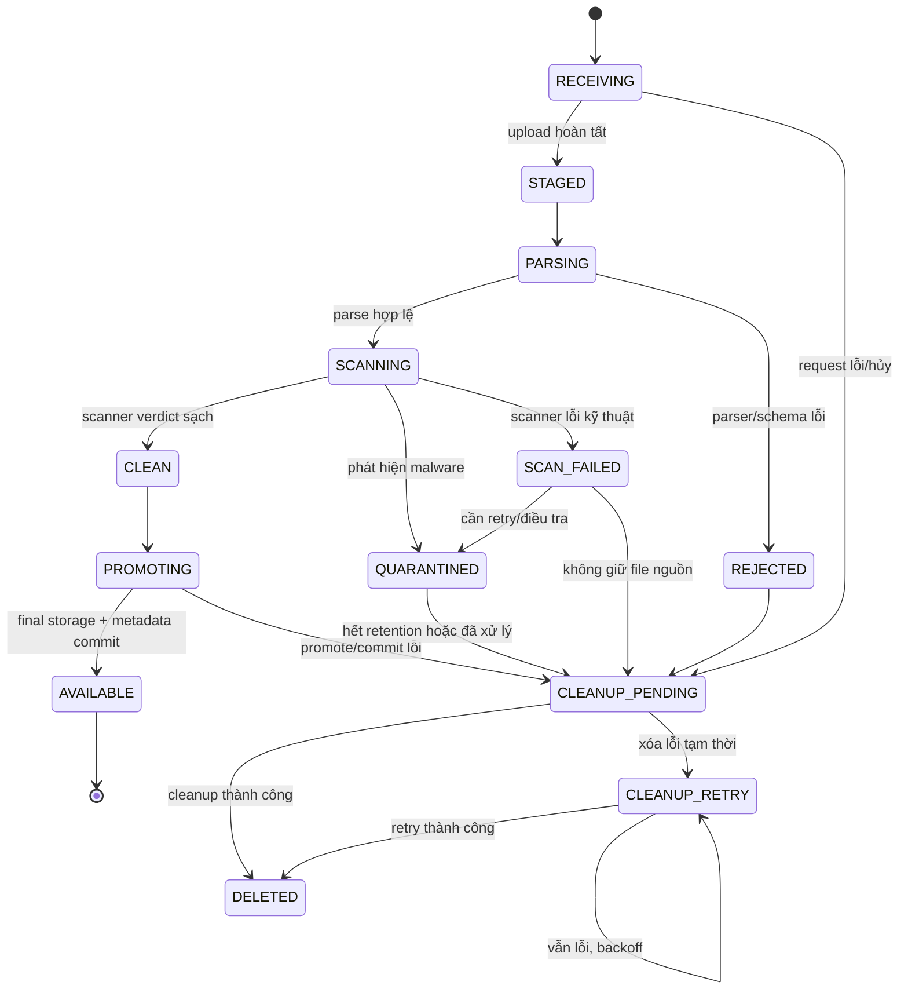

# Xóa file tạm khi parser hoặc scan thất bại

File upload thường đi qua nhiều bước trước khi được phép sử dụng: nhận multipart request, ghi file vào vùng staging, parse metadata hoặc nội dung, giải nén nếu cần, quét malware, kiểm tra policy và cuối cùng mới chuyển sang storage chính thức. Trong quá trình này, ứng dụng có thể tạo ra nhiều file tạm: bản upload ban đầu, file giải nén, thumbnail, bản chuyển đổi, file scanner tạo ra và dữ liệu trung gian của parser.

Nếu parser lỗi hoặc antivirus scanner thất bại mà file tạm vẫn còn, dữ liệu chưa được xác minh có thể chiếm dung lượng, bị truy cập ngoài ý muốn hoặc bị xử lý lại sai trạng thái. Nếu xóa quá sớm, worker bất đồng bộ có thể mất dữ liệu đang xử lý; nếu xóa nhầm vùng storage chính thức, ứng dụng có thể mất file hợp lệ. Vì vậy, cleanup cần gắn với vòng đời upload và quyền sở hữu rõ ràng.

**Xóa file tạm khi parser hoặc scan thất bại** là bảo đảm mọi artifact chỉ dùng trong quá trình xử lý được dọn dẹp khi luồng kết thúc, kể cả khi có exception, timeout, cancellation hoặc process crash. File chưa được xác minh không được publish cho người dùng. Nếu cần giữ bằng chứng hoặc chờ scanner hoạt động lại, phải chuyển file sang vùng quarantine/staging bền vững có kiểm soát và thời hạn riêng; không để nó tồn tại vô hạn trong thư mục tạm dùng chung.

Trong API Security, cleanup không chỉ là thao tác giải phóng disk. Nó là một phần của kiểm soát dữ liệu chưa tin cậy, ngăn file độc hại tồn tại trong vùng có thể được phục vụ, giảm nguy cơ storage exhaustion và bảo đảm audit phản ánh đúng kết quả xử lý.

## 1. File tạm xuất hiện ở đâu?

Một request multipart có thể tạo artifact ở nhiều tầng:

- **Servlet/container multipart staging:** framework hoặc servlet container có thể buffer file upload xuống disk trước khi controller đọc `MultipartFile`.
- **Application staging:** ứng dụng copy raw bytes sang file riêng để kiểm tra chữ ký, hash, parser hoặc scanner.
- **Parser workspace:** thư viện PDF, Office, image hoặc archive tạo file phụ, cache, thumbnail, extracted text và temporary index.
- **Archive extraction:** ZIP/TAR hoặc định dạng container tạo một file cho mỗi entry.
- **Antivirus workspace:** scanner có thể tạo bản copy, unpack archive hoặc cache signature/scan result.
- **Conversion pipeline:** thumbnailer, OCR, document converter và media transcoder tạo output trung gian.
- **Object storage multipart:** upload nhiều phần có thể để lại multipart session hoặc object staging chưa hoàn tất.
- **Async worker:** worker có thể tạo file tạm riêng trong quá trình retry, scan hoặc xử lý lại.

Không phải mọi artifact đều do controller tạo. Vì vậy, chỉ gọi `Files.delete(tempFile)` trong controller không đủ nếu parser hoặc container tạo thêm file ở nơi khác. Cần cấu hình thư mục tạm, workspace riêng và lifecycle của từng thành phần.

### 1.1. Phân biệt file tạm, quarantine và file chính thức

Ba loại lưu trữ cần có mục đích và quyền truy cập khác nhau:

| Loại | Mục đích | Quyền truy cập và vòng đời |
| --- | --- | --- |
| Temporary workspace | Xử lý trong một request/job: parse, extract, scan, convert | Chỉ service/worker sở hữu job được đọc; xóa khi job kết thúc. |
| Quarantine/staging bền vững | Giữ file chưa có verdict, file bị phát hiện độc hại hoặc cần điều tra | Không public; truy cập hạn chế, mã hóa, audit và TTL/retention riêng. |
| Final storage | File đã qua validation và scan, được phép cung cấp theo nghiệp vụ | Chỉ công bố sau khi policy đạt; quyền đọc được kiểm tra ở mỗi lần truy cập. |

Không dùng thư mục quarantine làm thư mục public với một URL khó đoán. Không dùng temp directory như kho lưu trữ dài hạn cho worker. Một file bị phát hiện malware có thể cần giữ trong quarantine theo quy trình incident, nhưng working copy và extracted artifacts vẫn phải được dọn dẹp.

## 2. Những trường hợp phải cleanup

Cleanup cần chạy khi luồng xử lý kết thúc theo mọi nhánh, không chỉ khi thành công.

| Tình huống | Ví dụ | Hành động với workspace tạm |
| --- | --- | --- |
| Parser thành công, scan sạch | PDF parse được và scanner trả CLEAN | Dọn raw copy, extracted files và parser artifacts sau khi file cần thiết đã được promote. |
| Parser lỗi | File hỏng, định dạng không hỗ trợ, parser ném exception | Xóa workspace và mọi artifact; chỉ giữ metadata/fingerprint cần audit. |
| Parser timeout hoặc crash | File gây parser treo hoặc process bị kill | Dừng worker, dọn workspace sau khi process đã kết thúc; job được đánh dấu lỗi. |
| Scanner phát hiện malware | Verdict INFECTED/MALICIOUS | Không publish; chuyển bản cần giữ sang quarantine theo policy, sau đó dọn working workspace. |
| Scanner timeout/unavailable | Không nhận được verdict đáng tin cậy | Fail closed; không publish. Dọn working copy, hoặc chuyển nguồn sang quarantine bền vững có TTL nếu cần retry. |
| Schema/policy validation thất bại | MIME không hợp lệ, kích thước giải nén vượt ngưỡng | Xóa workspace; audit reason code. |
| Client hủy request | Client disconnect khi upload hoặc parse | Hủy xử lý nếu có thể và dọn workspace. |
| Database/storage lỗi | Không thể ghi trạng thái hoặc promote file | Dọn temp theo ownership; xử lý orphan object/staging bằng compensation và sweeper. |
| Process bị restart | JVM/container dừng đột ngột | Sweeper tìm workspace mồ côi quá TTL và dọn theo lease/state. |

Điểm quan trọng là phân biệt **malware detected** với **scan failed**. Malware detected là verdict từ scanner; scan failed nghĩa là chưa có verdict. Cả hai đều không được đưa file vào final storage, nhưng chính sách quarantine và retry có thể khác nhau.

## 3. Thiết kế lifecycle và trạng thái upload

Không nên quyết định cleanup chỉ dựa trên tên file hoặc việc một exception xuất hiện. Mỗi upload/job cần có trạng thái, owner và mốc thời gian để xác định file nào đang được sử dụng và file nào đã hết vòng đời.

Một state machine tham khảo:



Các trạng thái cần được định nghĩa theo semantics của hệ thống. Ví dụ `AVAILABLE` chỉ được đặt sau khi file đã được promote và metadata cần thiết commit thành công. `QUARANTINED` không có nghĩa file được phép tải xuống. `CLEANUP_PENDING` cho biết artifact cần xóa nhưng chưa xác nhận xóa xong.

### 3.1. Mỗi upload có workspace riêng

Tạo một thư mục ngẫu nhiên riêng cho mỗi request hoặc job, nằm ngoài web root và chỉ service account có quyền truy cập. Tất cả raw upload copy, parser output, extracted file và thumbnail trung gian phải được tạo trong workspace này nếu thư viện cho phép.

Không đặt file tạm theo tên do client cung cấp. Tên như `../../public/avatar.jpg`, tên Unicode bất thường hoặc hai upload cùng tên không được quyết định đường dẫn lưu trữ. Dùng UUID/random name cho workspace và artifact; giữ original filename chỉ như metadata đã được encode/sanitize khi hiển thị.

Ví dụ cấu trúc:

```text
private-temp/
  upload-6f9b.../
    source.bin
    parser/
      extracted-001.tmp
      thumbnail.tmp
    scanner/
      scan-copy.tmp
```

Workspace cần có quyền truy cập hẹp, dung lượng và quota được giới hạn, không được mount read-write vào web server public. Với môi trường container, có thể dùng ephemeral volume riêng và giới hạn disk/inode.

### 3.2. Ràng buộc quyền sở hữu

Mỗi workspace nên gắn với `uploadId`, `jobId`, `ownerService`, trạng thái và thời điểm tạo. Chỉ worker đang sở hữu lease hoặc cleanup service được phép xóa workspace đó. Không cho một request khác xóa file bằng cách truyền đường dẫn hoặc tên workspace tùy ý.

Nếu xử lý bất đồng bộ, không chuyển đường dẫn temp local từ request thread sang worker khác rồi đóng workspace ngay. Thay vào đó, chuyển quyền sở hữu rõ ràng bằng job record và durable staging/quarantine object, hoặc giữ workspace theo lease cho worker cùng volume. Worker chỉ cleanup sau khi trạng thái terminal và không còn consumer sử dụng file.

## 4. Cleanup trong Java bằng try-with-resources

`try/finally` hoặc `try-with-resources` giúp cleanup khi code thoát do success hay exception. Một lớp workspace triển khai `AutoCloseable` làm cho vòng đời file tạm dễ nhìn và khó quên hơn.

Ví dụ tạo workspace riêng trên filesystem:

```java
public final class TempWorkspace implements AutoCloseable {
    private final Path directory;
    private boolean closed;

    private TempWorkspace(Path directory) {
        this.directory = directory;
    }

    public static TempWorkspace create(Path trustedTempRoot) throws IOException {
        Path root = trustedTempRoot.toRealPath();
        Path directory;

        try {
            FileAttribute<Set<PosixFilePermission>> permissions =
                PosixFilePermissions.asFileAttribute(
                    PosixFilePermissions.fromString("rwx------"));
            directory = Files.createTempDirectory(root, "upload-", permissions);
        } catch (UnsupportedOperationException ex) {
            // Trên hệ điều hành không hỗ trợ POSIX attributes,
            // áp dụng ACL tương đương tại tầng triển khai.
            directory = Files.createTempDirectory(root, "upload-");
        }

        if (!directory.toAbsolutePath().normalize().getParent().equals(root)) {
            throw new IOException("Temporary workspace escaped configured root");
        }
        return new TempWorkspace(directory);
    }

    public Path directory() {
        if (closed) {
            throw new IllegalStateException("Workspace is closed");
        }
        return directory;
    }

    public Path createFile(String suffix) throws IOException {
        if (closed) {
            throw new IllegalStateException("Workspace is closed");
        }
        return Files.createTempFile(directory, "artifact-", suffix);
    }

    @Override
    public void close() throws IOException {
        if (closed) {
            return;
        }
        if (Files.isSymbolicLink(directory)) {
            throw new IOException("Workspace path unexpectedly became a symbolic link");
        }
        if (!Files.exists(directory, LinkOption.NOFOLLOW_LINKS)) {
            closed = true;
            return;
        }

        Files.walkFileTree(directory, new SimpleFileVisitor<>() {
            @Override
            public FileVisitResult visitFile(Path file, BasicFileAttributes attrs)
                    throws IOException {
                Files.deleteIfExists(file);
                return FileVisitResult.CONTINUE;
            }

            @Override
            public FileVisitResult postVisitDirectory(Path dir, IOException error)
                    throws IOException {
                if (error != null) {
                    throw error;
                }
                Files.deleteIfExists(dir);
                return FileVisitResult.CONTINUE;
            }
        });
        closed = true;
    }
}
```

Ví dụ minh họa cần được điều chỉnh theo OS và filesystem thực tế. POSIX permission `rwx------` giới hạn quyền cho owner trên Linux/Unix; Windows cần ACL tương đương. Thư mục gốc `trustedTempRoot` phải do deployment tạo và bảo vệ, không nằm dưới web root, không cho user không tin cậy tạo symlink hoặc thay đổi parent. `walkFileTree` mặc định không theo symlink; visitor xóa symlink như một entry thay vì đi vào đích của nó. Không thêm `FOLLOW_LINKS` khi dọn workspace chứa file không tin cậy.

Trong Java, các import chính của ví dụ gồm `java.io.IOException`, `java.nio.file.*`, `java.nio.file.attribute.*`, `java.nio.file.FileVisitResult`, `java.nio.file.SimpleFileVisitor` và `java.nio.file.attribute.BasicFileAttributes`.

### 4.1. Vì sao dùng try-with-resources?

```java
UploadResult processUpload(MultipartFile upload) throws IOException {
    try (TempWorkspace workspace = TempWorkspace.create(privateTempRoot)) {
        Path source = workspace.createFile(".bin");
        try (InputStream input = upload.getInputStream()) {
            Files.copy(input, source, StandardCopyOption.REPLACE_EXISTING);
        }

        ParsedDocument parsed = parser.parse(source, workspace.directory());
        ScanResult scan = scanner.scan(source);

        if (!scan.isClean()) {
            throw new UploadRejectedException("File did not pass security scan");
        }

        return fileService.storeValidatedContent(source, parsed);
    }
}
```

Khi parser ném exception, scanner timeout hoặc business validation từ chối file, `close()` vẫn được gọi. Nếu cả phần xử lý và cleanup cùng ném exception, Java giữ exception chính và ghi cleanup exception dưới dạng suppressed exception. Cần log suppressed exception ở mức phù hợp và đánh dấu cleanup retry nếu file vẫn còn.

`storeValidatedContent` trong ví dụ phải copy/stream nội dung sang final storage an toàn trước khi workspace đóng; không trả về `Path` trỏ vào workspace rồi dùng sau khi method kết thúc. Nếu lưu file và metadata qua hai hệ thống khác nhau, cần xử lý orphan object/metadata bằng compensation hoặc outbox.

### 4.2. Không nuốt cleanup exception

Tránh viết:

```java
try {
    Files.deleteIfExists(tempFile);
} catch (IOException ignored) {
    // ignored
}
```

Nếu xóa thất bại mà bị bỏ qua, hệ thống không biết file còn tồn tại và sweeper không có thông tin để retry. Hãy ghi nhận `CLEANUP_FAILED`, workspace ID, loại lỗi và số lần retry; không cần đưa raw file path hoặc dữ liệu người dùng vào log.

## 5. Xóa thư mục đệ quy an toàn

Parser hoặc archive extractor có thể tạo nhiều file lồng nhau. Chỉ xóa file nguồn không đủ; cần xóa toàn bộ artifact do job tạo ra trong workspace.

Khi xóa đệ quy:

- Chỉ xóa dưới workspace được tạo bởi service, không nhận root path từ request.
- Chuẩn hóa path và kiểm tra workspace nằm dưới trusted temp root.
- Không theo symbolic link khi walk.
- Không đi vào mount point hoặc storage ngoài phạm vi nếu môi trường có thể tạo mount lồng.
- Không dùng tên file do user cung cấp làm đường dẫn xóa.
- Xử lý lỗi từng entry và ghi nhận cleanup retry.
- Không dùng `Files.walk(...).sorted(reverseOrder())` một cách tùy tiện nếu cần kiểm soát symlink, lỗi traversal và race; `walkFileTree` visitor dễ kiểm soát hơn.

Archive entry có thể chứa `../`, đường dẫn tuyệt đối hoặc symbolic link. Khi extract, phải kiểm tra `target.normalize().startsWith(workspaceRoot)` và từ chối entry thoát khỏi workspace; đồng thời từ chối symlink/hardlink nếu thư viện không thể xử lý an toàn. Cleanup chỉ giới hạn thiệt hại khi extraction có lỗi, không thay thế kiểm tra Zip Slip.

Ví dụ kiểm tra đích extract:

```java
Path root = workspace.directory().toRealPath();
Path target = root.resolve(entryName).normalize();

if (!target.startsWith(root)) {
    throw new IOException("Archive entry escapes extraction workspace");
}

Files.createDirectories(target.getParent());
// Chỉ ghi entry sau khi kiểm tra loại entry và không cho phép symlink.
```

Kiểm tra `startsWith` là điều kiện cần, nhưng không đủ nếu attacker có thể thay đổi filesystem giữa lúc kiểm tra và lúc ghi. Workspace phải riêng tư, không cho user khác ghi vào; với threat model cao, dùng API filesystem an toàn chống TOCTOU và chạy parser/extractor trong sandbox.

## 6. Parser thất bại: xóa artifact và giữ trạng thái rõ ràng

Parser là thành phần xử lý dữ liệu không tin cậy. File có thể bị hỏng, định dạng giả mạo, cấu trúc lồng sâu, object quá lớn hoặc khai thác lỗ hổng của thư viện parser.

Khi parser thất bại:

1. Ngừng mọi bước xử lý tiếp theo; không gọi scanner hoặc converter trên output chưa hợp lệ nếu policy không yêu cầu.
2. Hủy parser task/process nếu timeout; chờ xác nhận process đã dừng trước khi xóa file nó còn mở.
3. Đóng stream, file handle, archive handle và parser resource.
4. Xóa toàn bộ workspace gồm raw copy, extracted files, thumbnail và parser cache do job sở hữu.
5. Ghi audit `PARSER_FAILED` với reason code như `UNSUPPORTED_FORMAT`, `CORRUPT_FILE`, `PARSER_TIMEOUT` hoặc `RESOURCE_LIMIT_EXCEEDED`.
6. Trả lỗi an toàn cho client; không trả stack trace, đường dẫn temp hoặc tên thư viện nội bộ.

Không nhất thiết giữ file lỗi trong quarantine. Nếu cần phục vụ điều tra, hãy tạo một bản evidence riêng qua luồng có phê duyệt, mã hóa, giới hạn người truy cập và retention ngắn. Không giữ mọi file parser lỗi vô thời hạn vì attacker có thể lợi dụng để lấp đầy disk.

### 6.1. Giới hạn parser để cleanup không đến quá muộn

Cleanup sau exception không ngăn được parser tiêu thụ CPU, RAM hoặc disk trước khi lỗi xảy ra. Cần giới hạn:

- Kích thước upload và tổng request body.
- Số lượng archive entry và tổng kích thước sau giải nén.
- Compression ratio và độ sâu nested archive.
- Thời gian parse, CPU, memory, thread và số file được tạo.
- Loại MIME/format được hỗ trợ và phiên bản parser đã vá.
- Quyền filesystem của process parser và khả năng truy cập mạng.

Đối với parser rủi ro cao, chạy trong process/container riêng với filesystem read-only cho code, workspace write riêng, không có network egress và quota CPU/RAM/disk. Khi timeout, terminate process trong sandbox rồi mới dọn workspace.

## 7. Scanner thất bại: phân biệt malware với scanner unavailable

Không phải mọi lỗi scan đều có nghĩa file bị nhiễm. Receiver cần phân loại verdict:

| Kết quả scan | Ý nghĩa | Hành động với file |
| --- | --- | --- |
| `CLEAN` | Scanner hoàn tất và không phát hiện mối đe dọa theo policy | Có thể tiếp tục validation/promotion. Dọn bản scan working sau khi hoàn tất. |
| `INFECTED` / `MALICIOUS` | Scanner xác định file độc hại | Không publish. Chuyển bản nguồn cần điều tra vào quarantine nếu policy yêu cầu; dọn workspace và extracted copies. |
| `TIMEOUT` | Không có verdict trong thời gian cho phép | Fail closed. Không publish; dọn working copies, giữ bản nguồn trong durable quarantine chỉ khi có retry/điều tra hợp lệ. |
| `UNAVAILABLE` | Scanner service/process không hoạt động | Không bỏ qua scan. Đưa job về retry/quarantine theo policy; dọn workspace sau khi nguồn đã được chuyển an toàn hoặc khi quyết định loại bỏ. |
| `ERROR` / `UNKNOWN` | Scanner trả kết quả không xác định hoặc lỗi protocol | Xem như chưa được xác minh; không publish và không coi là CLEAN. |

Nếu parser giải nén archive hoặc tạo ra file dẫn xuất sẽ được ứng dụng sử dụng, cần bảo đảm scanner kiểm tra cả nội dung thực sự được promote. Có thể dùng scanner hỗ trợ quét archive đệ quy hoặc quét từng extracted file trong workspace. Chỉ quét file ZIP gốc không đủ nếu pipeline sau đó lấy một entry ra dùng mà scanner không kiểm tra entry đó.

### 7.1. Malware detected

Khi scanner trả verdict độc hại, không promote file sang storage public hoặc khu vực ứng dụng đọc tự do. Có thể:

- Ghi audit với scanner engine/version, signature database version, verdict code và fingerprint.
- Chuyển raw source sang quarantine storage riêng nếu cần phân tích hoặc đáp ứng quy trình incident.
- Xóa extracted files, thumbnails, converted files và working copies.
- Chặn user tải file hoặc chia sẻ link đã tạo trước đó; thu hồi URL tạm nếu có.
- Hạn chế quyền đọc quarantine cho security/incident response; mọi lần truy cập phải audit.
- Xóa quarantine khi hết retention hoặc sau khi điều tra hoàn tất theo policy.

Không ghi tên malware hoặc chi tiết detection vào response public nếu điều đó làm lộ rule nội bộ. Có thể trả lỗi tổng quát như `FILE_REJECTED` và correlation ID.

### 7.2. Scanner unavailable hoặc timeout

Nếu scanner không trả verdict, file vẫn là dữ liệu chưa được xác minh. Không được coi timeout là CLEAN, không bypass scan để đáp ứng SLA và không cho client truy cập file.

Nếu cần retry khi scanner hoạt động lại, chuyển file nguồn sang durable quarantine/staging object có encryption, access control, retention và trạng thái `SCAN_PENDING`. Sau khi xác nhận bản sao đã được lưu bền vững, xóa workspace tạm. Worker retry scan từ staging theo backoff và giới hạn. Nếu không cần retry, xóa nguồn và ghi audit theo retention policy.

### 7.3. Bảo đảm file được promote chính là file đã scan

Verdict `CLEAN` chỉ có ý nghĩa với đúng bytes mà scanner đã kiểm tra. Không để parser, worker khác hoặc client có thể sửa file sau scan nhưng trước khi promote. Dùng staging object bất biến hoặc workspace chỉ worker sở hữu được ghi; tính fingerprint trước/sau scan và xác minh không thay đổi. Khi nội dung thay đổi, scan lại. Khi promote, copy đúng object/version đã scan và gắn scan result với fingerprint, scanner version và policy version trong metadata.

## 8. Không để cleanup chạy đua với worker

Với xử lý bất đồng bộ, request thread có thể kết thúc trước khi parser/scanner worker hoàn tất. Nếu `finally` của request xóa workspace ngay, worker sẽ đọc file đã bị xóa. Ngược lại, nếu request và worker cùng nghĩ mình sở hữu file, cả hai có thể xóa hoặc di chuyển file trong lúc bên kia đang sử dụng.

Giải pháp là ownership/lease rõ ràng:

- Upload handler tạo `uploadId` và workspace; sau khi staging hoàn tất, ghi job state.
- Worker claim job bằng lease có expiry và chuyển state sang `PARSING`/`SCANNING`.
- Request handler chỉ chuyển quyền sở hữu hoặc durable reference; không cleanup workspace đã được worker nhận.
- Worker đóng tất cả handle trước khi chuyển sang terminal state và cleanup.
- Sweeper chỉ xóa workspace có lease hết hạn, state không còn active và age vượt safety window.
- Cleanup idempotent: chạy nhiều lần không gây xóa nhầm file chính thức hoặc lỗi trạng thái không thể phục hồi.

Không chỉ dựa vào một file lock hoặc biến `boolean processing` trong JVM nếu nhiều instance cùng xử lý. Dùng state/lease trong datastore hoặc queue claim có cơ chế visibility timeout. Có thể dùng fencing token/version để worker cũ không tiếp tục promote file sau khi lease đã được worker khác nhận.

## 9. Multipart upload và object storage

Với object storage, file tạm có thể tồn tại ngoài local filesystem. Multipart upload chưa hoàn tất thường giữ các part và chi phí lưu trữ cho đến khi abort hoặc lifecycle rule xử lý.

Các nguyên tắc:

- Khi upload thất bại, gọi API abort multipart upload với upload ID do server quản lý.
- Khi scan/parser lỗi, xóa staging object hoặc chuyển sang quarantine theo policy.
- Chỉ copy/promote sang final object key sau khi scan sạch và policy đạt.
- Không dùng object key do client tự chọn làm quyền truy cập; server tạo key ngẫu nhiên và lưu mapping trong database.
- Đặt lifecycle rule để abort incomplete multipart upload và xóa staging/quarantine object quá TTL.
- Audit `abort`, `delete`, `copy/promote` và cleanup failure; retry các thao tác idempotent.
- Kiểm tra versioning/object lock/retention để hiểu `delete` có thực sự xóa dữ liệu hay chỉ tạo delete marker.

Nếu final object được tạo nhưng database commit thất bại, có thể xuất hiện orphan object. Dùng trạng thái `PROMOTING`, transactional outbox hoặc reconciliation job để tìm object không có metadata hợp lệ và xóa sau safety window. Không xóa object chỉ vì chưa thấy database row tức thời; transaction hoặc replication có thể chưa hoàn tất.

## 10. Dọn temp file của framework và thư viện

Ứng dụng cần biết thư viện nào tự quản lý temporary file:

- **Servlet multipart:** cấu hình `location`, `file-size-threshold`, `max-file-size`, `max-request-size` và cleanup behavior của container. Kiểm tra thư mục temp của Tomcat/Jetty/Undertow và quyền truy cập.
- **Apache Tika/PDF/image parser:** kiểm tra cách thư viện tạo temp file, giới hạn tài nguyên, parser timeout và tùy chọn temp directory theo phiên bản.
- **Archive library:** cấu hình extraction directory riêng và bảo đảm cleanup khi lỗi giữa chừng.
- **Antivirus daemon/client:** xác định file scanner có copy sang thư mục riêng hay không, ai chịu trách nhiệm xóa và thời điểm process kết thúc.
- **Image/video converter/OCR:** chạy trong workspace riêng, giới hạn output và dọn tất cả artifact phụ.
- **Object storage SDK:** abort multipart session và dọn staging object khi upload/scan thất bại.

Không thay đổi `java.io.tmpdir` toàn cục trong từng request để cô lập parser; thuộc tính JVM ảnh hưởng toàn process và có thể gây race giữa request. Ưu tiên API cho phép truyền workspace path hoặc chạy parser trong process/container riêng có temp root được cấu hình lúc khởi động.

## 11. Cleanup failure và orphan sweeper

`finally` không bảo đảm file luôn xóa được. File có thể đang bị process khác mở, filesystem read-only, disk lỗi, permission thay đổi hoặc container bị kill trước khi cleanup. Vì vậy cần kết hợp cleanup đồng bộ với background sweeper.

Một cleanup record có thể gồm:

| Trường | Ý nghĩa |
| --- | --- |
| `workspace_id` | ID nội bộ, không phải path do client cung cấp. |
| `upload_id` / `job_id` | Liên kết với upload/job. |
| `storage_kind` | Local temp, staging object, quarantine hoặc multipart session. |
| `state` | `PENDING`, `IN_PROGRESS`, `DELETED`, `RETRY` hoặc `MANUAL_REVIEW`. |
| `created_at` / `last_attempt_at` | Thời điểm tạo và lần cleanup gần nhất. |
| `attempt_count` / `next_attempt_at` | Số lần và thời điểm retry tiếp theo. |
| `reason_code` | Parser failure, scan failure, request cancelled, expired lease... |
| `owner` / `lease_until` | Service/worker chịu trách nhiệm và hạn lease. |

Sweeper nên:

1. Chọn workspace có state terminal hoặc lease hết hạn và age vượt safety window.
2. Claim cleanup record bằng transaction/lease để chỉ một worker xóa tại một thời điểm.
3. Xác minh workspace nằm dưới configured temp root và không phải final/quarantine object đang active.
4. Xóa idempotently; với object storage, abort multipart hoặc delete đúng staging key.
5. Ghi `DELETED` khi xác minh không còn artifact; nếu lỗi, tăng attempt và backoff.
6. Chuyển sang `MANUAL_REVIEW` khi vượt số lần retry hoặc gặp lỗi permission/path bất thường.
7. Phát metric/alert cho dung lượng temp, số workspace quá TTL và cleanup failure.

Không cho sweeper nhận một đường dẫn filesystem tùy ý từ database mà không xác minh root. Record có thể bị lỗi hoặc bị sửa; chỉ dùng ID rồi dựng lại path từ mapping server-side an toàn.

### 11.1. TTL và giới hạn dung lượng

Đặt TTL cho từng loại artifact:

- Workspace request đồng bộ: thời gian xử lý cộng safety margin ngắn.
- Workspace async: theo job timeout, lease và retry window.
- Quarantine scan pending: theo SLA khôi phục scanner và retention đã phê duyệt.
- Malware evidence: theo incident/legal retention riêng.
- Incomplete multipart: abort sau thời gian không hoạt động.

TTL không thay thế cleanup ngay khi thất bại; nó là lớp dự phòng cho orphan. Giới hạn tổng dung lượng, số file, inode và quota theo tenant để một client không thể lấp đầy temp volume. Alert trước khi filesystem gần đầy.

## 12. Audit và logging cho cleanup

Cleanup là một hành động bảo mật và vận hành cần truy vết. Có thể dùng các event:

- `TEMP_WORKSPACE_CREATED`
- `PARSER_STARTED`, `PARSER_SUCCEEDED`, `PARSER_FAILED`
- `SCAN_STARTED`, `SCAN_CLEAN`, `SCAN_INFECTED`, `SCAN_UNAVAILABLE`, `SCAN_TIMEOUT`
- `FILE_QUARANTINED`, `FILE_PROMOTED`
- `TEMP_CLEANUP_STARTED`, `TEMP_CLEANUP_SUCCEEDED`, `TEMP_CLEANUP_FAILED`
- `ORPHAN_FOUND`, `ORPHAN_DELETED`, `CLEANUP_RETRY_SCHEDULED`
- `MULTIPART_ABORTED`, `STAGING_OBJECT_DELETED`

Audit nên có `upload_id`, `job_id`, workspace ID, stage, outcome, reason code, scanner/parser version, thời điểm và correlation ID. Không log raw payload, access token, signed URL đầy đủ hoặc file path chứa username/tenant nhạy cảm. Nếu cần path để điều tra, chỉ lưu ở log bảo vệ cao hoặc lưu reference nội bộ có quyền truy cập hạn chế.

Các metric hữu ích:

- Số workspace đang hoạt động và số workspace quá TTL.
- Dung lượng temp/quarantine/staging theo service và tenant tier.
- Parser/scan success, failure, timeout và latency.
- Cleanup success/failure và số lần retry.
- Số multipart upload chưa abort.
- Số orphan object và thời gian tồn tại.
- Số file bị quarantine và thời gian chờ verdict.

Tránh dùng `upload_id`, filename hoặc user ID làm metric label có cardinality cao. Dùng route, stage, outcome và nhóm dung lượng; định danh chi tiết nằm trong audit store có phân quyền.

## 13. Kiểm thử cleanup khi parser hoặc scan thất bại

Kiểm thử phải xác minh artifact thực sự biến mất, không chỉ kiểm tra exception hoặc HTTP status. Dùng temp root riêng cho test để có thể liệt kê và xác minh mọi file sau mỗi tình huống.

| Kịch bản | Kết quả mong đợi |
| --- | --- |
| Parser thành công, scan CLEAN | File được promote đúng; workspace và parser artifacts bị xóa. |
| Parser ném exception | Workspace, raw copy và artifact phụ bị xóa. |
| Parser timeout | Process bị dừng; workspace được cleanup hoặc đưa vào retry nếu handle chưa đóng. |
| Scanner trả INFECTED | File không được publish; working artifacts bị xóa; quarantine copy chỉ tồn tại theo policy. |
| Scanner timeout/unavailable | Không publish; working copy bị dọn sau khi chuyển nguồn sang durable quarantine hoặc quyết định loại bỏ. |
| Scanner trả UNKNOWN/ERROR | Xử lý như chưa có verdict; không coi là CLEAN. |
| Client disconnect | Upload bị hủy và temp file được dọn. |
| Disk full khi cleanup | Audit cleanup failure; sweeper retry; alert dung lượng. |
| Permission denied | Không đánh dấu DELETED; tạo retry/manual review. |
| Symlink trong workspace | Cleanup xóa symlink entry nhưng không đi theo và xóa đích bên ngoài. |
| Archive Zip Slip | Entry thoát khỏi workspace bị từ chối; không ghi file ngoài root; workspace được dọn. |
| Async worker còn dùng file | Request handler không xóa workspace trước khi worker release lease. |
| Worker crash/lease hết hạn | Sweeper claim job và dọn workspace mồ côi sau safety window. |
| Race cleanup hai worker | Chỉ một worker claim; cleanup lặp an toàn và không xóa final object. |
| Final storage thành công, DB lỗi | Orphan object được ghi nhận và reconciliation xử lý sau safety window. |
| Multipart upload bị bỏ dở | SDK abort hoặc lifecycle rule xóa parts hết hạn. |

### 13.1. Ví dụ JUnit kiểm tra cleanup khi parser lỗi

```java
@Test
void parserFailureRemovesTemporaryWorkspace() throws Exception {
    Path tempRoot = Files.createTempDirectory("upload-test-root-");
    AtomicReference<Path> workspacePath = new AtomicReference<>();

    TempWorkspaceFactory factory = root -> {
        TempWorkspace workspace = TempWorkspace.create(root);
        workspacePath.set(workspace.directory());
        return workspace;
    };

    UploadProcessor processor = new UploadProcessor(
        tempRoot,
        factory,
        file -> { throw new IOException("invalid document"); },
        file -> ScanResult.clean(),
        fileService
    );

    assertThrows(IOException.class, () -> processor.process(testUpload));

    assertThat(workspacePath.get()).isNotNull();
    assertThat(Files.exists(workspacePath.get(), LinkOption.NOFOLLOW_LINKS)).isFalse();
}
```

Đây là test minh họa; kiểu `TempWorkspaceFactory`, `UploadProcessor` và fixture cần khớp với implementation. Bổ sung test cho `close()` ném lỗi để xác minh lỗi cleanup không bị nuốt, và test crash/sweeper ở cấp integration.

### 13.2. Kiểm thử không xóa file ngoài workspace

Tạo một file sentinel bên ngoài temp root, tạo symlink trong workspace trỏ đến sentinel, sau đó cleanup workspace. Xác minh symlink bị xóa nhưng sentinel vẫn còn. Test này giúp phát hiện việc dùng recursive delete có follow symlink hoặc root path không được giới hạn.

## 14. Checklist triển khai

- [ ] Mỗi upload/job có workspace riêng, random ID và owner rõ ràng.
- [ ] Temp root nằm ngoài web root, quyền truy cập hẹp và có quota.
- [ ] Không dùng original filename hoặc path từ client để tạo/xóa file.
- [ ] Parser, extractor và scanner ghi artifact trong workspace được kiểm soát.
- [ ] Raw upload, extracted file, thumbnail và conversion output đều có lifecycle.
- [ ] Parser/scan failure, timeout, cancellation và exception đều kích hoạt cleanup.
- [ ] Malware detected khác với scanner unavailable; cả hai đều không được publish.
- [ ] Quarantine là storage riêng, encrypted, access-controlled, audited và có TTL.
- [ ] Dùng try-with-resources/finally; không nuốt cleanup exception.
- [ ] Recursive cleanup không follow symlink và chỉ xóa dưới trusted temp root.
- [ ] Async worker dùng lease/ownership; request thread không xóa file worker còn dùng.
- [ ] Có sweeper xử lý orphan, cleanup retry và multipart abort.
- [ ] Final object chỉ được publish sau khi parse, scan và policy validation đạt.
- [ ] Có compensation/reconciliation cho orphan object hoặc metadata commit thất bại.
- [ ] Audit cleanup outcome và metric dung lượng/temp age; không log payload/secret.
- [ ] Test parser error, scan error, timeout, symlink, race, crash, disk full và no-side-effect.

Cleanup đáng tin cậy cần kết hợp dọn dẹp đồng bộ trong vòng đời request/job với sweeper xử lý orphan sau crash. Parser lỗi thì workspace và artifact phụ phải được xóa; scanner phát hiện malware thì không publish và chỉ giữ bản quarantine nếu có lý do; scanner unavailable thì fail closed và chỉ giữ nguồn trong staging bền vững có TTL khi cần retry. Khi quyền sở hữu file, trạng thái job, audit và cleanup retry được thiết kế rõ ràng, file chưa xác minh không bị lộ và temp storage không trở thành điểm gây cạn tài nguyên.
