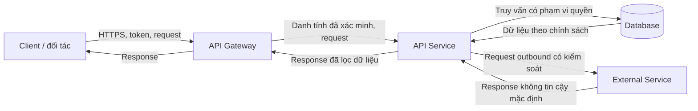

# Thiết kế contract và threat model trước implementation

Trong chương **Vòng đời API** của module `SECURITY_API_SECURITY`, thiết kế contract và threat model là công việc cần hoàn thành trước khi viết endpoint. Mục tiêu của bảo mật API là bảo vệ từng endpoint, từng đối tượng dữ liệu và từng luồng nghiệp vụ; đăng nhập thành công hay sử dụng HTTPS mới chỉ giải quyết một phần của bài toán. Vì vậy, contract phải mô tả rõ cách xác thực, phân quyền ở mức chức năng và đối tượng, kiểm tra dữ liệu, giới hạn tài nguyên, bảo vệ thông tin và ghi nhận hoạt động. Threat model giúp xác định những cách một tác nhân có thể lạm dụng các luồng đó, sau đó chuyển rủi ro thành yêu cầu và ca kiểm thử cụ thể.

## 1. Vì sao phải thiết kế trước khi implementation?

API contract là thỏa thuận có thể kiểm tra được giữa bên gọi và bên cung cấp API. Nó mô tả endpoint làm gì, nhận dữ liệu nào, trả dữ liệu nào, yêu cầu danh tính và quyền gì, có thể phát sinh lỗi nào và giới hạn sử dụng ra sao. Contract tốt giúp frontend, mobile app, service khác, tester và nhóm vận hành cùng hiểu một hành vi.

Threat model trả lời những câu hỏi khác: dữ liệu nào cần bảo vệ, ai có thể tương tác với hệ thống, ranh giới tin cậy nằm ở đâu, đầu vào nào có thể bị kiểm soát, và điều gì xảy ra nếu người gọi cố tình vượt quyền hoặc làm cạn tài nguyên?

Hai công việc này bổ trợ nhau:

- Contract xác định hành vi được phép và các điều kiện để thực hiện hành vi đó.
- Threat model kiểm tra xem hành vi và điều kiện ấy có bị khai thác qua một luồng tấn công thực tế hay không.
- Yêu cầu bảo mật liên kết kết quả phân tích với implementation, kiểm thử và giám sát.

Nếu chỉ bổ sung bảo mật sau khi API đã được sử dụng, nhóm phát triển có thể phải thay đổi schema, mã lỗi, quyền truy cập hoặc quy tắc nghiệp vụ. Những thay đổi đó dễ gây lỗi tương thích và để lại các endpoint có chính sách không đồng nhất. Làm rõ các quyết định ngay từ đầu giúp tránh khoảng trống này.

## 2. Chốt bối cảnh nghiệp vụ và phạm vi API

Trước khi chọn URL hay schema, hãy mô tả luồng nghiệp vụ mà API phục vụ. Một endpoint không nên được thiết kế chỉ từ tên bảng dữ liệu hoặc màn hình giao diện. Cần biết ai thực hiện hành động, hành động tác động lên đối tượng nào, đối tượng đang ở trạng thái nào và kết quả có ảnh hưởng đến hệ thống khác hay không.

Với mỗi luồng, ghi lại ít nhất:

| Nội dung | Câu hỏi cần trả lời | Ví dụ |
|---|---|---|
| Tác nhân | Ai gọi API? | Khách hàng, nhân viên hỗ trợ, quản trị viên, service nội bộ |
| Mục đích | Người gọi muốn thực hiện hành động nào? | Xem đơn hàng, hủy đơn, cập nhật địa chỉ |
| Đối tượng | Dữ liệu nào bị đọc hoặc thay đổi? | Đơn hàng, hồ sơ khách hàng, tệp đính kèm |
| Phạm vi sở hữu | Đối tượng thuộc về ai hoặc tenant nào? | Người tạo đơn và tổ chức sở hữu đơn |
| Trạng thái | Khi nào hành động hợp lệ? | Chỉ hủy đơn đang chờ xử lý |
| Dữ liệu nhạy cảm | Trường nào cần hạn chế? | Địa chỉ, số điện thoại, thông tin thanh toán |
| Tác động phụ | Có gọi service hoặc tạo tác vụ khác không? | Hoàn tiền, gửi email, gọi dịch vụ vận chuyển |

Phân biệt rõ các loại tác nhân. Một người dùng đã đăng nhập không mặc nhiên có quyền quản trị. Một service nội bộ cũng không nên được tin cậy vô điều kiện chỉ vì nó nằm trong mạng riêng. Mỗi danh tính cần có mục đích, phạm vi quyền và cách xác minh phù hợp.

Xác định cả những luồng ngoài dự kiến nhưng có thể xảy ra: người dùng đổi `orderId` trong URL, gửi trường `tenantId` giả, phát lại một yêu cầu thanh toán, gửi một URL trỏ vào địa chỉ nội bộ, hoặc gửi hàng nghìn yêu cầu tìm kiếm có chi phí cao. Đây là đầu vào quan trọng cho threat model.

## 3. Thiết kế API contract có thể kiểm tra

### 3.1. Định nghĩa endpoint theo hành động nghiệp vụ

Mỗi endpoint nên có một mục đích rõ ràng. Chọn HTTP method theo ngữ nghĩa của hành động: `GET` để đọc, `POST` để tạo tài nguyên hoặc thực hiện một lệnh nghiệp vụ, `PUT` để thay thế, `PATCH` để cập nhật một phần và `DELETE` để xóa theo chính sách đã công bố.

Không nên gom nhiều hành động khác nhau vào một endpoint tổng quát chỉ vì chúng cùng tác động lên một bảng. Ví dụ, hủy đơn hàng có điều kiện trạng thái, quyền và tác động phụ riêng; nó cần được mô tả như một hành động nghiệp vụ có quy tắc rõ ràng.

Với mỗi endpoint, contract cần ghi:

- Method, path, phiên bản API và mục đích nghiệp vụ.
- Path parameter, query parameter, header và body được chấp nhận.
- Schema, kiểu dữ liệu, trường bắt buộc, độ dài, miền giá trị và giới hạn kích thước.
- Quy tắc xác thực và quyền chức năng.
- Điều kiện truy cập đối tượng và quyền đọc/ghi từng thuộc tính.
- Dạng response, trường được phép trả về và mã lỗi có thể phát sinh.
- Giới hạn tần suất, thời gian xử lý, kích thước trang và các giới hạn tài nguyên khác.
- Quy tắc idempotency, xử lý đồng thời và tác động phụ nếu có.

### 3.2. Tách xác thực khỏi các lớp phân quyền

Xác thực (authentication) xác định danh tính người hoặc service đang gọi. Phân quyền (authorization) quyết định danh tính đó được làm gì trên tài nguyên nào. Một access token hợp lệ chỉ chứng minh danh tính và một số thuộc tính của phiên truy cập; nó không chứng minh người gọi được phép đọc mọi đối tượng có thể đoán được ID.

Hãy mô tả ít nhất ba lớp quyền sau:

1. **Quyền chức năng (function-level authorization):** người gọi có được phép thực hiện hành động này không? Ví dụ, chỉ nhân viên có quyền `orders:refund` mới được hoàn tiền.
2. **Quyền đối tượng (object-level authorization):** người gọi có được phép thao tác trên đúng đối tượng này không? Ví dụ, khách hàng chỉ được xem đơn hàng thuộc tài khoản hoặc tenant của mình.
3. **Quyền thuộc tính (property-level authorization):** người gọi được đọc hoặc thay đổi những trường nào? Ví dụ, khách hàng có thể cập nhật địa chỉ giao hàng nhưng không thể tự sửa `price`, `role` hay `tenantId`.

Scope trong token có thể biểu đạt một phần quyền chức năng, nhưng thường không đủ để quyết định quyền trên một đối tượng cụ thể. Kiểm tra quyền đối tượng phải dựa trên quan hệ giữa danh tính đã xác thực và tài nguyên được yêu cầu. Kiểm tra quyền thuộc tính cần áp dụng cho cả dữ liệu đầu vào lẫn dữ liệu trả về.

Không lấy danh tính hoặc tenant từ một trường do client tự gửi nếu giá trị đó phải được xác định từ token hay ngữ cảnh server. Nếu request có `tenantId`, server phải kiểm tra nó theo chính sách và danh tính đã xác thực; không dùng trực tiếp giá trị này làm căn cứ cấp quyền.

### 3.3. Đặt quy tắc validation trong contract

Validation phải xác định dữ liệu nào được chấp nhận trước khi dữ liệu đi vào xử lý nghiệp vụ. Đừng chỉ ghi “body là JSON hợp lệ”. Hãy định nghĩa rõ:

- Trường bắt buộc, trường tùy chọn, kiểu dữ liệu và miền giá trị hợp lệ.
- Độ dài tối đa, giới hạn số phần tử, định dạng, đơn vị và múi giờ.
- Trường chỉ đọc hoặc do server quản lý.
- Cách xử lý trường không được khai báo: từ chối hay bỏ qua theo một quy tắc nhất quán.
- Các ràng buộc nghiệp vụ không thể biểu diễn chỉ bằng schema, chẳng hạn trạng thái đơn hàng phải cho phép hủy.

Ưu tiên allowlist: chỉ nhận các trường mà hành động cần. Dùng request DTO riêng thay vì bind toàn bộ JSON vào entity lưu trữ. Cách này hạn chế lỗi mass assignment, trong đó client thêm các trường như `isAdmin`, `ownerId`, `tenantId` hoặc `discount` để thay đổi thuộc tính mà họ không có quyền sửa.

Validation cú pháp không thay thế kiểm tra nghiệp vụ hay phân quyền. Một `orderId` đúng định dạng vẫn có thể thuộc về người khác. Một URL đúng cú pháp vẫn có thể trỏ tới địa chỉ mạng nội bộ. Mỗi lớp cần một kiểm tra tương ứng.

### 3.4. Giới hạn dữ liệu trả về

Response contract cần liệt kê các trường được phép xuất hiện. Không trả nguyên entity hoặc bản ghi cơ sở dữ liệu chỉ vì việc đó tiện cho implementation. Dữ liệu trả về nên đủ cho tác vụ của client và không chứa trường nội bộ, bí mật, thông tin của tenant khác hay thuộc tính mà người gọi không được xem.

Nếu hai vai trò có quyền xem khác nhau, hãy định nghĩa rõ cách lọc trường cho từng vai trò. Cùng một đối tượng có thể có nhiều representation tùy theo quyền. Việc che dữ liệu ở giao diện không phải là biện pháp bảo vệ; server phải loại bỏ trường trái phép trước khi serialize response.

### 3.5. Chuẩn hóa lỗi và hành vi vận hành

Contract nên quy định mã HTTP và cấu trúc lỗi ổn định. Ví dụ:

| Mã | Ý nghĩa thường dùng | Lưu ý bảo mật |
|---|---|---|
| `400` | Request sai cấu trúc hoặc không vượt qua validation | Không trả stack trace hay nội dung nội bộ |
| `401` | Thiếu hoặc không hợp lệ thông tin xác thực | Không tiết lộ chi tiết token hoặc khóa |
| `403` | Đã xác thực nhưng không có quyền thực hiện | Dùng nhất quán với chính sách che giấu tài nguyên |
| `404` | Không tìm thấy tài nguyên | Có thể dùng để không tiết lộ sự tồn tại của đối tượng ngoài phạm vi truy cập |
| `409` | Xung đột trạng thái hoặc phiên bản | Mô tả cách client xử lý xung đột |
| `413` | Nội dung request vượt giới hạn | Giới hạn phải được áp dụng trước khi đọc toàn bộ payload khi có thể |
| `429` | Vượt giới hạn sử dụng | Có thể kèm `Retry-After` nếu phù hợp |
| `5xx` | Lỗi phía server | Response công khai không chứa thông tin debug nhạy cảm |

Không dùng mã lỗi để vô tình xác nhận ID của tài nguyên bí mật. Chẳng hạn, nếu chính sách yêu cầu che giấu đơn hàng thuộc tenant khác, phản hồi `404` có thể phù hợp hơn `403`. Quyết định này cần được ghi trong contract để client và tester hiểu cùng một hành vi.

Với thao tác có thể được client thử lại, xác định rõ tính idempotent. Có thể dùng `Idempotency-Key` cho thao tác tạo giao dịch hoặc lệnh có tác động phụ; server cần ràng buộc khóa với danh tính, phạm vi thao tác và nội dung request, đồng thời lưu kết quả đủ lâu theo yêu cầu nghiệp vụ. Chỉ thêm header mà không có cơ chế chống xử lý trùng ở server thì chưa tạo ra idempotency.

### 3.6. Công bố giới hạn tài nguyên

Contract phải nêu những giới hạn ảnh hưởng đến mức tiêu thụ tài nguyên: `pageSize` tối đa, số bộ lọc, độ sâu truy vấn, kích thước body và file, thời gian chờ, số tác vụ đồng thời và tần suất gọi. Các thao tác đắt như xuất báo cáo, tìm kiếm phức tạp hoặc xử lý tệp có thể cần quota riêng.

Giới hạn cần gắn với ngữ cảnh phù hợp như danh tính, client, tenant hoặc endpoint. Chỉ giới hạn theo IP thường không đủ khi nhiều người dùng chia sẻ NAT hoặc khi một người dùng có thể đổi IP. API gateway có thể hỗ trợ rate limit, nhưng service vẫn cần kiểm tra các điều kiện nghiệp vụ và giới hạn nội tại của nó.

## 4. Ví dụ contract cho thao tác hủy đơn hàng

Giả sử hệ thống cho phép khách hàng tạo yêu cầu hủy đơn hàng. Một contract rút gọn có thể như sau:

```http
POST /v1/orders/{orderId}/cancellations
Authorization: Bearer <access_token>
Content-Type: application/json
Idempotency-Key: <unique-request-key>

{
  "reason": "CUSTOMER_REQUEST",
  "comment": "Tôi đặt nhầm địa chỉ giao hàng"
}
```

Response thành công:

```http
HTTP/1.1 201 Created
Location: /v1/cancellations/can_123
Content-Type: application/json

{
  "id": "can_123",
  "orderId": "ord_456",
  "status": "ACCEPTED",
  "createdAt": "2026-11-18T10:30:00Z"
}
```

Các điều kiện bảo mật phải đi cùng contract:

| Lớp kiểm soát | Quy tắc |
|---|---|
| Xác thực | Token còn hiệu lực, đúng audience của API và được phát hành bởi issuer tin cậy |
| Quyền chức năng | Danh tính có quyền `orders:cancel` hoặc quyền nghiệp vụ tương đương |
| Quyền đối tượng | Đơn hàng thuộc tenant của danh tính; khách hàng chỉ được hủy đơn của mình |
| Trạng thái nghiệp vụ | Chỉ chấp nhận khi đơn hàng đang ở trạng thái cho phép hủy |
| Quyền thuộc tính | Chỉ nhận `reason` trong tập giá trị công bố và `comment` trong giới hạn độ dài; từ chối trường ngoài schema |
| Dữ liệu tin cậy | `tenantId`, người yêu cầu và thời điểm tạo được lấy từ ngữ cảnh server |
| Chống xử lý trùng | Cùng một `Idempotency-Key` trong cùng phạm vi không tạo hai yêu cầu hủy |
| Giới hạn | Có quota phù hợp cho thao tác hủy; payload và comment có kích thước tối đa |
| Response | Chỉ trả mã yêu cầu, mã đơn hàng, trạng thái và thời điểm cần thiết |

Nếu đơn hàng thuộc tenant khác, API áp dụng chính sách che giấu tài nguyên đã công bố, chẳng hạn trả `404`. Nếu đơn hàng thuộc đúng người gọi nhưng đã giao và không thể hủy, trả `409` để thể hiện xung đột trạng thái. Nếu token hợp lệ nhưng thiếu quyền chức năng, trả `403` theo chính sách lỗi của hệ thống.

Ví dụ này cho thấy một endpoint cần nhiều quyết định hơn việc xác minh token. Cùng một request có thể vượt qua xác thực nhưng vẫn phải bị từ chối do thiếu quyền chức năng, không sở hữu đối tượng, vi phạm trạng thái hoặc gửi thuộc tính không được phép.

## 5. Lập threat model cho luồng API

Threat model là mô hình hóa có cấu trúc các tài sản, tác nhân, luồng dữ liệu, ranh giới tin cậy và tình huống tấn công. Nó không chỉ là danh sách lỗ hổng chung. Phạm vi phân tích phải gắn với luồng nghiệp vụ và endpoint cụ thể.

### 5.1. Xác định tài sản, tác nhân và ranh giới tin cậy

**Tài sản** có thể là dữ liệu cá nhân, thông tin thanh toán, đơn hàng, quyền quản trị, token, khóa ký, dữ liệu tenant, tính toàn vẹn của giao dịch, hoặc khả năng phục vụ của hệ thống.

**Tác nhân** gồm người dùng bình thường, nhân viên, quản trị viên, service tích hợp, đối tác bên ngoài và kẻ tấn công chưa xác thực. Với mỗi tác nhân, ghi rõ quyền ban đầu, dữ liệu họ kiểm soát và khả năng họ có thể có sau khi chiếm tài khoản hoặc token.

**Ranh giới tin cậy** xuất hiện khi dữ liệu hoặc lệnh đi từ vùng có mức tin cậy này sang vùng khác, chẳng hạn Internet vào API gateway, gateway vào service, service vào cơ sở dữ liệu, hoặc service nội bộ gọi đối tác. Không mặc định dữ liệu an toàn chỉ vì nó đến từ một service khác trong mạng riêng.

Một sơ đồ luồng đơn giản:



Ở mỗi mũi tên, hãy hỏi ai kiểm soát dữ liệu, dữ liệu đã được xác thực hoặc kiểm tra đến mức nào, và thành phần nhận có thể thực hiện hành động gì với dữ liệu đó. Gateway có thể xác minh token, nhưng service vẫn phải kiểm tra quyền trên đối tượng và trạng thái nghiệp vụ mà nó xử lý.

### 5.2. Liệt kê điểm vào và luồng dữ liệu

Đối với từng endpoint, ghi lại path parameter, query, header, body, tệp tải lên, webhook, URL callback và dữ liệu lấy từ service ngoài. Đánh dấu đầu vào có thể do client hoặc đối tác kiểm soát. Theo dõi dữ liệu đó qua các bước parse, validation, truy vấn, ghi dữ liệu, gọi mạng và serialize response.

Đặc biệt chú ý những luồng có thể khiến service thực hiện hành động thay người gọi: truy cập URL do client cung cấp, truy vấn dữ liệu theo ID, tải tệp, gửi webhook, tạo báo cáo, chạy tìm kiếm hoặc thực hiện thanh toán. Đây thường là nơi một request hợp lệ về cú pháp có thể gây tác động ngoài dự kiến.

### 5.3. Dùng STRIDE và các rủi ro đặc thù API

STRIDE giúp rà soát các nhóm đe dọa: giả mạo danh tính (Spoofing), sửa đổi dữ liệu (Tampering), chối bỏ hành động (Repudiation), tiết lộ thông tin (Information Disclosure), từ chối dịch vụ (Denial of Service) và nâng quyền (Elevation of Privilege). Với API, cần diễn giải từng nhóm thành tình huống gắn với endpoint.

| Rủi ro | Tình huống ví dụ | Hướng kiểm soát cần đưa vào thiết kế |
|---|---|---|
| BOLA / IDOR | Người dùng thay `orderId` để đọc hoặc sửa đơn của người khác | Kiểm tra quyền trên từng đối tượng; truy vấn trong phạm vi tenant và chủ sở hữu; kiểm thử truy cập chéo |
| BFLA | Tài khoản khách hàng gọi endpoint hoàn tiền hoặc quản trị | Kiểm tra quyền chức năng ở server trên từng endpoint và từng hành động |
| BOPLA / mass assignment | Client đọc trường nội bộ hoặc gửi `role`, `price`, `tenantId` để sửa dữ liệu | Allowlist trường request; response DTO theo quyền; chính sách đọc/ghi thuộc tính |
| SSRF | Endpoint nhập dữ liệu từ URL do người dùng cung cấp truy cập địa chỉ nội bộ | Hạn chế đích outbound, chặn IP nội bộ và địa chỉ metadata, kiểm soát DNS và redirect |
| Injection | Giá trị lọc hoặc sắp xếp được ghép trực tiếp vào câu truy vấn | Kiểm tra miền giá trị, allowlist tên trường/sort key, dùng truy vấn tham số hóa |
| Cạn kiệt tài nguyên | `pageSize` quá lớn, truy vấn lồng sâu, file khổng lồ hoặc thao tác đắt bị gọi liên tục | Giới hạn kích thước, độ sâu, thời gian, concurrency, quota và rate limit |
| Replay / xử lý trùng | Client hoặc kẻ tấn công phát lại lệnh tạo giao dịch | Idempotency, kiểm tra trạng thái, chữ ký và timestamp cho webhook phù hợp |
| Rò rỉ dữ liệu | Response hoặc log chứa token, thông tin cá nhân hay dữ liệu tenant khác | Lọc trường, phân loại dữ liệu, che dữ liệu log và kiểm soát quyền truy cập log |
| Giả mạo hoặc lạm dụng token | Token sai audience, quá hạn hoặc bị dùng ngoài phạm vi | Xác minh issuer, audience, thời hạn, chữ ký và scope; thu hồi hoặc xoay vòng theo thiết kế |

Các tên BOLA, BFLA và BOPLA nhấn mạnh ba dạng lỗi phân quyền khác nhau. Chúng không được giải quyết bằng một kiểm tra đăng nhập duy nhất. Cần xác định kiểm tra tương ứng ở đúng nơi xử lý hành động và dữ liệu.

### 5.4. Phân tích SSRF cụ thể

SSRF (Server-Side Request Forgery) xảy ra khi service gửi request mạng đến đích do người gọi kiểm soát hoặc tác động. Những tính năng như nhập dữ liệu từ URL, tạo ảnh xem trước, kiểm tra webhook, tải tài liệu hoặc proxy URL đều cần được xem xét.

Ưu tiên nhận một định danh tài nguyên đã được hệ thống quản lý thay vì nhận URL tùy ý. Nếu nghiệp vụ bắt buộc phải nhận URL:

- Chỉ cho phép scheme cần thiết, thường là HTTPS; từ chối scheme không mong muốn.
- Dùng allowlist hostname hoặc miền đích theo nghiệp vụ. Không dựa riêng vào kiểm tra chuỗi URL.
- Phân giải DNS và kiểm tra địa chỉ IP thực tế; chặn loopback, private, link-local, multicast và các dải dành riêng, bao gồm IPv4 và IPv6.
- Kiểm tra lại đích sau redirect và ngăn DNS rebinding làm thay đổi đích sau bước xác minh.
- Giới hạn số redirect, timeout, kích thước response và loại nội dung được xử lý.
- Áp dụng egress firewall hoặc proxy có chính sách để service không thể tùy ý truy cập mạng nội bộ hay metadata endpoint.
- Không đưa nội dung response bên ngoài vào log hoặc response công khai nếu chưa lọc dữ liệu nhạy cảm.

Kiểm tra URL bằng regex đơn thuần không đủ để chống SSRF vì cách phân giải tên miền, địa chỉ IPv6, redirect và DNS có thể làm đích thực tế khác với chuỗi đầu vào ban đầu.

### 5.5. Ước lượng và xử lý rủi ro

Với mỗi tình huống, ghi rõ tài sản bị ảnh hưởng, điều kiện khai thác, khả năng xảy ra, tác động, kiểm soát hiện có và hành động cần bổ sung. Có thể dùng thang xác suất và tác động từ thấp đến cao để ưu tiên; điều quan trọng là lý do xếp hạng phải rõ ràng và nhất quán.

Không phải mọi rủi ro đều cần cùng một cách xử lý. Nhóm có thể giảm thiểu bằng kiểm soát kỹ thuật, tránh luồng nguy hiểm, chuyển một phần rủi ro qua dịch vụ chuyên trách, hoặc chấp nhận rủi ro còn lại khi có người chịu trách nhiệm và lý do được ghi nhận. Rủi ro nghiêm trọng liên quan đến truy cập chéo tenant, dữ liệu nhạy cảm, quyền quản trị hoặc truy cập mạng nội bộ cần được xử lý trước khi endpoint được phát hành.

## 6. Chuyển threat model thành yêu cầu cho từng endpoint

Kết quả phân tích chỉ hữu ích khi có thể truy vết đến contract, implementation và kiểm thử. Tạo một ma trận bảo mật cho từng endpoint hoặc nhóm endpoint có cùng chính sách:

| Hạng mục | Nội dung cần ghi | Câu hỏi xác minh |
|---|---|---|
| Danh tính | Loại token, issuer, audience, thời hạn, client | Danh tính nào được chấp nhận? |
| Quyền chức năng | Role, permission hoặc scope cần có | Người gọi có quyền thực hiện hành động không? |
| Quyền đối tượng | Tenant, chủ sở hữu, quan hệ với tài nguyên | Người gọi có quyền trên đúng đối tượng này không? |
| Quyền thuộc tính | Trường được đọc và ghi theo vai trò | Có thể đọc hoặc sửa trường ngoài phạm vi không? |
| Validation | Schema, allowlist, giới hạn, trạng thái nghiệp vụ | Đầu vào sai hoặc bất thường bị từ chối ở đâu? |
| Tương tác mạng | Host đích, redirect, DNS, timeout, egress | Dữ liệu đầu vào có khiến service truy cập đích không an toàn không? |
| Tài nguyên | Rate, quota, kích thước, concurrency, timeout | Một client có thể làm cạn tài nguyên không? |
| Dữ liệu | Phân loại, mã hóa, response, log, retention | Dữ liệu nào được trả về và lưu lại? |
| Audit | Sự kiện, actor, đối tượng, kết quả, correlation ID | Có thể điều tra một hành động mà không làm lộ bí mật không? |

Mỗi yêu cầu nên có chủ sở hữu và cách kiểm chứng. Ví dụ, yêu cầu “ngăn BOLA” còn quá chung. Yêu cầu có thể kiểm chứng hơn là: “Với mọi thao tác đọc, cập nhật hoặc hủy đơn, service xác minh đơn thuộc tenant của danh tính đã xác thực; request dùng ID của tenant khác bị từ chối theo mã lỗi đã công bố; có kiểm thử tự động cho truy cập chéo tenant.”

OpenAPI hữu ích để mô tả method, path, schema, security scheme, parameter và response. Tuy nhiên, một khai báo `security` không thể tự mô tả đầy đủ quyền trên từng đối tượng hoặc từng thuộc tính. Hãy bổ sung mô tả nghiệp vụ hoặc ma trận chính sách có liên kết rõ đến `operationId`, để reviewer và tester biết quy tắc cần xác minh.

## 7. Chuẩn bị kiểm thử bảo mật trước khi hoàn tất implementation

Với mỗi rủi ro đã xác định, tạo ít nhất một ca kiểm thử có điều kiện đầu vào và kết quả mong đợi. Bộ ca kiểm thử cần bao gồm cả trường hợp được phép và trường hợp phải bị từ chối.

Với ví dụ hủy đơn hàng ở trên, có thể bắt đầu từ các ca sau:

| Ca kiểm thử | Dữ liệu hoặc điều kiện | Kết quả mong đợi |
|---|---|---|
| Thiếu xác thực | Không gửi token | `401`; không thực hiện tác động phụ |
| Token không hợp lệ | Token hết hạn, sai issuer hoặc audience | `401`; không tiết lộ chi tiết xác minh token |
| Thiếu quyền chức năng | Token hợp lệ nhưng không có `orders:cancel` | Bị từ chối theo chính sách `403` |
| Truy cập chéo tenant | Dùng `orderId` của tenant khác | Bị từ chối; không đọc hoặc thay đổi dữ liệu |
| Sai quyền thuộc tính | Gửi thêm `tenantId`, `ownerId` hoặc `status` | Validation từ chối trường ngoài schema; dữ liệu không đổi |
| Sai trạng thái | Đơn đã giao hoặc đã hủy | `409`; không tạo yêu cầu hủy mới |
| Request lặp | Gửi lại cùng khóa idempotency | Không tạo tác động nghiệp vụ trùng lặp |
| Vượt giới hạn | Payload quá lớn hoặc gọi quá tần suất | `413` hoặc `429` theo nguyên nhân |
| Dữ liệu nhạy cảm | Kiểm tra response và log | Không có token, bí mật hoặc trường không được phép |

Với endpoint có URL outbound, bổ sung ca kiểm thử cho loopback, IP private, link-local, địa chỉ metadata, IPv6, hostname phân giải sang IP bị chặn, redirect sang đích bị chặn và DNS thay đổi giữa các bước. Kiểm tra cả cấu hình mạng thực tế vì unit test của bộ kiểm tra URL không chứng minh được egress policy đang hoạt động.

Các loại kiểm thử nên phối hợp:

- **Unit test:** kiểm tra validation, policy và quy tắc trạng thái ở mức hàm hoặc service.
- **Integration test:** xác minh middleware xác thực, truy vấn theo tenant, transaction, idempotency và xử lý lỗi giữa các thành phần.
- **API security test:** gửi request với danh tính, ID, thuộc tính và payload khác nhau để phát hiện BOLA, BFLA, BOPLA và lạm dụng tài nguyên.
- **Negative test:** xác minh request không hợp lệ bị từ chối trước khi tạo tác động phụ.
- **Configuration test:** xác minh TLS, CORS, gateway, giới hạn kích thước, timeout và chính sách egress trong môi trường triển khai.

Không chỉ kiểm tra response code. Với ca bị từ chối, cần xác minh cơ sở dữ liệu, hàng đợi, dịch vụ ngoài và các tác động phụ không bị thay đổi ngoài ý muốn.

## 8. Gắn giám sát với rủi ro đã nhận diện

Thiết kế bảo mật cần xác định tín hiệu vận hành trước khi phát hành. Log và metric nên giúp phát hiện hành vi bất thường, điều tra sự cố và xác minh chính sách có hoạt động hay không.

Nên theo dõi theo endpoint và ngữ cảnh phù hợp:

- Tỷ lệ `401`, `403`, `404`, `429` và `5xx`; chú ý sự gia tăng bất thường hoặc mẫu truy cập lặp lại.
- Số lần truy cập đối tượng bị từ chối, đặc biệt là thử ID tuần tự hoặc truy cập chéo tenant.
- Lỗi xác minh token, token sai audience và hành vi sử dụng quyền bất thường.
- Request chậm, payload lớn, truy vấn tốn kém, hàng đợi tăng và giới hạn quota bị chạm.
- Kết nối outbound bị từ chối, redirect bất thường và lỗi gọi dịch vụ ngoài.
- Tỷ lệ request lặp, xung đột idempotency và thay đổi trạng thái nghiệp vụ bất thường.

Sự kiện audit có thể chứa thời điểm, correlation ID, actor ID, tenant ID, operation, loại đối tượng, kết quả cho phép/từ chối và lý do chính sách ở mức an toàn. Không ghi access token, refresh token, khóa bí mật, mật khẩu hay toàn bộ payload chứa dữ liệu cá nhân vào log. Nếu cần ghi một phần dữ liệu để điều tra, phải có quy tắc che dữ liệu, phân quyền truy cập và thời hạn lưu giữ.

## 9. Quy trình review trước khi bắt đầu implementation

Trước khi chuyển contract sang bước lập trình, nhóm phát triển và reviewer nên cùng xác nhận các đầu ra sau:

1. **Mô tả luồng nghiệp vụ:** tác nhân, mục đích, đối tượng, trạng thái và tác động phụ đã rõ.
2. **Danh mục endpoint:** method, path, schema, response và mã lỗi đã được thống nhất.
3. **Ma trận quyền:** xác thực, quyền chức năng, quyền đối tượng và quyền thuộc tính đã được định nghĩa cho từng endpoint.
4. **Ranh giới và luồng dữ liệu:** đầu vào không tin cậy, dữ liệu nhạy cảm, service ngoài và đường đi của dữ liệu đã được đánh dấu.
5. **Threat model:** các tình huống BOLA, BFLA, BOPLA, SSRF, injection, replay, lộ dữ liệu và cạn kiệt tài nguyên đã được xem xét theo phạm vi thực tế.
6. **Yêu cầu kiểm soát:** mỗi rủi ro quan trọng có biện pháp xử lý, người chịu trách nhiệm và cách kiểm chứng.
7. **Kế hoạch kiểm thử:** có ca positive, negative, truy cập chéo tenant, giới hạn tài nguyên và kiểm tra tác động phụ.
8. **Kế hoạch giám sát:** sự kiện audit, metric, cảnh báo và dữ liệu cần che trong log đã được xác định.

Review cần kiểm tra tính nhất quán giữa các endpoint. Cùng một loại tài nguyên không nên có chính sách sở hữu khác nhau nếu nghiệp vụ không yêu cầu. Cùng một loại token cũng không nên được diễn giải khác nhau giữa gateway và service. Các ngoại lệ, chẳng hạn nhân viên hỗ trợ được truy cập đơn hàng của khách hàng, phải có quyền riêng, phạm vi giới hạn và audit đầy đủ.

Nếu còn câu hỏi chưa được giải quyết, ghi rõ giả định, người quyết định và ảnh hưởng của giả định đó. Không để một quy tắc quan trọng như “ai được xem đơn hàng” chỉ tồn tại trong trao đổi miệng hoặc suy luận của lập trình viên.

## Kết luận

Contract và threat model tạo ra cơ sở để thiết kế API an toàn ngay từ đầu. Contract mô tả endpoint, dữ liệu, quyền và giới hạn; threat model tìm cách các luồng đó có thể bị lạm dụng; ma trận bảo mật và bộ kiểm thử biến phát hiện thành yêu cầu có thể xác minh. Khi các quyết định này được ghi rõ theo từng endpoint, đối tượng và luồng nghiệp vụ, implementation, review, kiểm thử và giám sát có thể dựa trên cùng một chính sách bảo mật.
