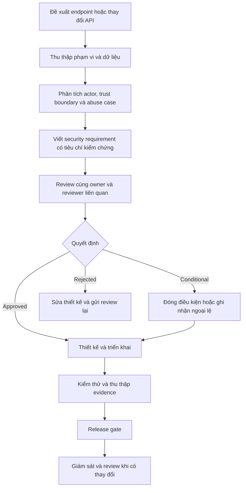

# Phê duyệt security requirement cho endpoint mới

Trước khi một endpoint mới được triển khai hoặc đưa lên production, nhóm phát triển cần thống nhất endpoint đó phải bảo vệ dữ liệu và luồng nghiệp vụ như thế nào. Việc thống nhất này được thực hiện bằng cách xác định, xem xét và phê duyệt các *security requirement* (yêu cầu bảo mật) có thể kiểm chứng.

Phê duyệt security requirement là một cổng trong vòng đời API. Kết quả của cổng này phải cho biết endpoint phục vụ ai, thao tác trên dữ liệu nào, những tình huống lạm dụng nào cần ngăn chặn, hệ thống phải thực thi những kiểm soát gì và bằng chứng nào chứng minh các kiểm soát đó hoạt động. Một câu xác nhận chung như “endpoint đã bảo mật” không đủ để triển khai hoặc nghiệm thu.

## 1. Phê duyệt security requirement nằm ở đâu trong vòng đời API?

Yêu cầu bảo mật nên được xem xét khi API còn ở giai đoạn thiết kế, lúc thay đổi vẫn dễ và ít tốn kém. Nếu đợi đến khi code hoàn tất mới hỏi endpoint có cần phân quyền theo object hay giới hạn dữ liệu không, nhóm có thể phải thay đổi hợp đồng API, mô hình dữ liệu hoặc cả luồng nghiệp vụ.



Phê duyệt yêu cầu là thống nhất về điều endpoint phải đáp ứng. Nó chưa chứng minh implementation đã đáp ứng. Sau khi triển khai, nhóm vẫn phải kiểm thử, review code và xác minh cấu hình trước release.

## 2. Khi nào cần mở một lượt security requirement review?

Nên tạo hoặc cập nhật yêu cầu bảo mật khi có một endpoint mới, hoặc khi thay đổi làm thay đổi bề mặt tấn công hay quyền truy cập. Các trường hợp thường gặp gồm:

- Thêm method hoặc thao tác mới, ví dụ từ chỉ đọc sang cập nhật, xóa, hoàn tiền hoặc xuất dữ liệu.
- Thêm loại caller, client, role, scope, service account hoặc cơ chế xác thực mới.
- Thay đổi dữ liệu request/response, đặc biệt khi thêm dữ liệu cá nhân, thông tin tài chính, định danh hoặc trường nội bộ.
- Thay đổi cách xác định owner, tenant, quan hệ ủy quyền hoặc phạm vi truy cập của object.
- Thêm upload/download, import/export, webhook, callback hoặc chức năng để service gọi URL do người dùng cung cấp.
- Thêm tích hợp với service, nhà cung cấp hoặc hệ thống lưu trữ bên ngoài.
- Thay đổi giới hạn lưu lượng, kích thước payload, batch, phân trang hoặc tác vụ tốn tài nguyên.
- Mở endpoint cho internet, đối tác hoặc client mới; thay đổi gateway, network route hay trust boundary.
- Sửa luồng nghiệp vụ có ảnh hưởng đến thanh toán, phê duyệt, trạng thái tài khoản hoặc quyền quản trị.

Một thay đổi chỉ sửa lỗi chính tả trong mô tả và không tác động đến hợp đồng, dữ liệu, quyền hay hành vi có thể được xử lý theo quy trình thay đổi thông thường. Nếu chưa rõ thay đổi có ảnh hưởng bảo mật hay không, API owner cần ghi nhận phạm vi thay đổi và nhờ security reviewer phân loại, thay vì tự kết luận rằng review không cần thiết.

## 3. Thu thập thông tin đầu vào trước khi viết yêu cầu

Không thể phê duyệt một endpoint chỉ dựa vào tên và URL. Người đề xuất cần mô tả đủ ngữ cảnh để reviewer hiểu chức năng, dữ liệu và rủi ro. Bộ thông tin đầu vào tối thiểu nên có:

| Nhóm thông tin | Nội dung cần cung cấp | Ví dụ |
|---|---|---|
| Định danh API | Service, method, path, phiên bản, môi trường | `POST /api/orders/{orderId}/cancel`, v1 |
| Mục đích nghiệp vụ | Endpoint giải quyết nhu cầu gì, ai khởi tạo | Khách hàng yêu cầu hủy đơn trước khi giao |
| Caller | Người dùng, ứng dụng, đối tác hay service account | Mobile app và web app đã đăng nhập |
| Đối tượng dữ liệu | Bản ghi, tenant, trường dữ liệu được đọc hoặc ghi | Order, trạng thái, lý do hủy |
| Phạm vi truy cập | Owner, tenant, vai trò, ủy quyền | Chủ đơn hoặc nhân viên hỗ trợ có quyền phù hợp |
| Luồng xử lý | Các bước trước và sau endpoint, trạng thái liên quan | Kiểm tra trạng thái, ghi yêu cầu hủy, thông báo service thanh toán |
| Kết nối phụ thuộc | Database, message broker, service ngoài, URL đích | Order Service, Payment Service |
| Mức độ phơi lộ | Internet, mạng nội bộ, partner, loại client | Public API qua gateway |
| Tác động khi bị lạm dụng | Thiệt hại dữ liệu, tiền, tính sẵn sàng hoặc vận hành | Hủy đơn trái phép, hoàn tiền sai, dò đơn hàng |

Hợp đồng API, chẳng hạn OpenAPI, nên được đính kèm hoặc tham chiếu. Hợp đồng cần thể hiện schema request/response, mã trạng thái, cơ chế xác thực, giới hạn và mô tả các trường có ý nghĩa bảo mật. Những thông tin chưa biết phải được ghi là câu hỏi mở hoặc giả định cần xác nhận; không biến giả định thành sự thật trong quyết định phê duyệt.

## 4. Phân loại dữ liệu và xác định mức ảnh hưởng

Trước khi chọn kiểm soát, hãy xác định dữ liệu endpoint có thể đọc, tạo, sửa, xóa hoặc chuyển tiếp. Có thể dùng hệ phân loại của tổ chức; nếu chưa có, cần thống nhất một cách phân loại tối thiểu, chẳng hạn:

- **Public:** dữ liệu được phép công khai.
- **Internal:** dữ liệu vận hành nội bộ, không dành cho công chúng.
- **Confidential:** dữ liệu kinh doanh hoặc dữ liệu cá nhân cần giới hạn người truy cập.
- **Restricted:** bí mật xác thực, dữ liệu tài chính nhạy cảm hoặc dữ liệu có hậu quả nghiêm trọng nếu lộ hay bị sửa.

Tên nhãn không quan trọng bằng việc xác định hậu quả thực tế. Với từng loại dữ liệu, xem xét ba khía cạnh:

1. **Confidentiality:** nếu người không có quyền đọc được dữ liệu thì hậu quả là gì?
2. **Integrity:** nếu dữ liệu bị sửa hoặc trạng thái bị chuyển trái phép thì hậu quả là gì?
3. **Availability:** nếu endpoint bị gọi quá mức hoặc phụ thuộc bị làm quá tải thì hoạt động nào bị gián đoạn?

Đồng thời xác định yêu cầu về lưu giữ, xóa, che dữ liệu, vị trí lưu trữ và quyền truy cập theo chính sách áp dụng. Nếu endpoint trả dữ liệu tổng hợp, cần kiểm tra liệu kết quả có thể tiết lộ dữ liệu cá nhân khi kết hợp với bộ lọc hoặc truy vấn lặp lại hay không.

Phân loại dữ liệu ảnh hưởng trực tiếp đến mức xác thực, phân quyền, mã hóa, logging, kiểm thử và cấp độ phê duyệt. Không nên áp dụng cùng một bộ yêu cầu cho endpoint đọc danh sách nội dung công khai và endpoint xuất hồ sơ khách hàng hoặc thực hiện hoàn tiền.

## 5. Xác định actor, trust boundary và tình huống lạm dụng

Hãy lập danh sách các chủ thể có thể gọi endpoint và những thành phần tham gia vào luồng dữ liệu. Với mỗi actor, trả lời họ cần làm gì, trên đối tượng nào và trong phạm vi nào. Bao gồm cả actor hợp lệ lẫn nguồn gọi có thể bị xâm nhập hoặc giả mạo.

Vẽ luồng dữ liệu đơn giản để xác định ranh giới giữa client, API gateway, service, database, message broker và hệ thống bên ngoài. Đánh dấu dữ liệu đi qua từng ranh giới, thông tin xác thực được sử dụng và nơi quyết định phân quyền được thực thi. Một service nằm trong mạng nội bộ vẫn cần xác thực caller và giới hạn quyền.

Tiếp theo, viết các *abuse case* cụ thể. Với endpoint hủy đơn hàng, ví dụ:

- Người dùng A thay `orderId` để hủy đơn hàng của người dùng B.
- Người dùng gửi request trực tiếp dù giao diện đã ẩn nút hủy.
- Người dùng thêm trường `refundAmount` hoặc `status` vào body để tự quyết định số tiền và trạng thái.
- Người dùng gửi lặp request hoặc gửi đồng thời để tạo nhiều yêu cầu hoàn tiền.
- Một service account bị lộ được dùng để gọi endpoint với quyền rộng hơn nhu cầu.
- Attacker dò nhiều ID để tìm đơn hàng tồn tại hoặc suy ra hoạt động của khách hàng.

Không cần viết một danh sách đe dọa dài không liên quan. Hãy ưu tiên tình huống có đường đi thực tế từ đầu vào đến dữ liệu hoặc hành động quan trọng, rồi xác định kiểm soát ngăn chặn hoặc phát hiện tình huống đó.

## 6. Chuyển rủi ro thành security requirement có thể kiểm chứng

Một security requirement tốt mô tả hành vi bắt buộc, phạm vi áp dụng và cách xác minh. Tránh các câu mơ hồ như “phải an toàn”, “phải validate kỹ” hoặc “chỉ người phù hợp được truy cập”. Hãy viết sao cho developer có thể triển khai và tester có thể tạo test pass/fail.

Mỗi yêu cầu nên có mã định danh ổn định, ví dụ `SEC-ORD-CAN-01`, cùng các trường:

- **Requirement:** hệ thống bắt buộc phải làm gì.
- **Rationale:** rủi ro hoặc quy tắc nghiệp vụ mà yêu cầu xử lý.
- **Scope:** endpoint, actor, dữ liệu và luồng áp dụng.
- **Verification:** test, review hoặc bằng chứng cấu hình dùng để xác minh.
- **Owner:** người chịu trách nhiệm triển khai và duy trì.
- **Status:** proposed, approved, implemented, verified hoặc exception.

Các nhóm yêu cầu thường cần xem xét:

| Nhóm | Câu hỏi cần chuyển thành yêu cầu | Ví dụ tiêu chí kiểm chứng |
|---|---|---|
| Authentication | Caller phải được xác thực bằng cơ chế nào? | Token thiếu, sai chữ ký, hết hạn hoặc sai audience đều bị từ chối |
| Function authorization | Ai được gọi chức năng này? | Caller thiếu scope/authority không thể gọi thao tác hủy |
| Object authorization | Caller được thao tác trên object nào? | Chủ đơn A không thể hủy đơn của B; kiểm tra được áp dụng ở service hoặc truy vấn |
| Tenant isolation | Dữ liệu được giới hạn theo tenant ra sao? | Thay tenant ID trong request không mở rộng phạm vi truy cập |
| Input validation | Trường, kiểu, giới hạn và trạng thái hợp lệ là gì? | Body ngoài schema hoặc lý do vượt giới hạn bị xử lý theo hợp đồng |
| Property authorization | Caller được phép sửa trường nào? | `status`, `ownerId` và `refundAmount` do server quản lý không thể bị ghi đè từ request |
| Data exposure | Response được phép chứa trường nào? | Response không trả token, dữ liệu thanh toán hoặc trường nội bộ không cần thiết |
| Abuse/resource control | Giới hạn và chống gọi lặp thế nào? | Có rate limit, timeout và idempotency cho thao tác có tác dụng phụ |
| Outbound calls | Service được gọi đích nào và bằng quyền gì? | Kết nối chỉ tới dependency đã duyệt; URL đầu vào không thể truy cập mạng nội bộ |
| Logging/monitoring | Cần ghi nhận và cảnh báo điều gì? | Có audit event cho thao tác nhạy cảm, không ghi token hoặc payload nhạy cảm |
| Error handling | Lỗi được trả và ghi nhận ra sao? | Response không lộ stack trace, SQL hay bí mật cấu hình |

Không phải endpoint nào cũng cần tất cả kiểm soát ở mức như nhau. Reviewer cần ghi rõ yêu cầu nào áp dụng, yêu cầu nào không áp dụng và lý do. “Không áp dụng” phải có căn cứ từ thiết kế hoặc dữ liệu, không chỉ vì nhóm chưa triển khai.

## 7. Lập ma trận quyền cho endpoint

Đối với endpoint thao tác trên object, hãy thể hiện quyền theo actor, action và object. Ví dụ dưới đây là ma trận ban đầu cho `POST /api/orders/{orderId}/cancel`; quyền thực tế phải khớp với chính sách nghiệp vụ của sản phẩm:

| Actor | Object | Điều kiện | Quyết định |
|---|---|---|---|
| Khách hàng | Đơn của chính họ | Đơn ở trạng thái cho phép hủy và chưa vượt thời hạn | Cho phép |
| Khách hàng | Đơn của người khác | Bất kỳ trạng thái nào | Từ chối |
| Nhân viên hỗ trợ | Đơn trong phạm vi được giao | Có quyền hỗ trợ và lý do thao tác được ghi nhận | Cho phép theo chính sách |
| Service account thanh toán | Đơn được xử lý trong luồng thanh toán | Đúng workload identity và quyền service được cấp | Chỉ cho phép thao tác được định nghĩa trong hợp đồng service |
| Caller chưa xác thực | Bất kỳ đơn nào | Không có principal hợp lệ | Từ chối |

Ma trận này giúp phát hiện các trường hợp chưa được mô tả như quyền của nhân viên hỗ trợ, quyền truy cập được ủy quyền hoặc hành động từ service-to-service. Không nên dùng một role tổng quát như `USER` để thay thế kiểm tra owner và trạng thái của từng đơn hàng.

## 8. Ví dụ bộ requirement cho endpoint hủy đơn

Giả sử sản phẩm muốn cung cấp:

```http
POST /api/orders/{orderId}/cancel
Authorization: Bearer <access-token>
Content-Type: application/json
Idempotency-Key: 7a9d...

{
  "reason": "CUSTOMER_REQUEST"
}
```

Endpoint cho phép khách hàng yêu cầu hủy đơn của họ khi trạng thái nghiệp vụ còn cho phép. Service có thể phát sinh sự kiện để Payment Service xử lý hoàn tiền theo chính sách. Body không cho phép client quyết định `customerId`, `status` hay `refundAmount`.

Một bộ yêu cầu có thể được viết như sau:

| ID | Security requirement | Bằng chứng xác minh |
|---|---|---|
| SEC-ORD-CAN-01 | Request phải có access token hợp lệ do issuer được tin cậy phát hành, đúng audience và còn hiệu lực | Test token thiếu, sai chữ ký, sai audience và hết hạn |
| SEC-ORD-CAN-02 | Caller phải có authority `orders:cancel` hoặc quyền tương đương được quy định trong policy | Test caller thiếu authority và caller hợp lệ |
| SEC-ORD-CAN-03 | Khách hàng chỉ được hủy đơn thuộc tài khoản của mình; kiểm tra owner phải được thực thi phía server | Test user A hủy đơn của B và kiểm tra không có thay đổi dữ liệu |
| SEC-ORD-CAN-04 | Chỉ cho phép hủy khi trạng thái đơn và thời điểm hiện tại thỏa mãn quy tắc nghiệp vụ | Test đơn đã giao, đã hủy hoặc đã qua hạn hủy |
| SEC-ORD-CAN-05 | Request chỉ nhận `reason` thuộc enum cho phép; server bỏ qua hoặc từ chối các trường do server quản lý như `status`, `customerId`, `refundAmount` theo hợp đồng đã công bố | Test thêm trường ngoài schema và xác minh không thay đổi dữ liệu nhạy cảm |
| SEC-ORD-CAN-06 | Thao tác lặp với cùng idempotency key và cùng nội dung không tạo thêm yêu cầu hủy hoặc hoàn tiền | Test retry và request đồng thời |
| SEC-ORD-CAN-07 | Response chỉ chứa mã đơn, trạng thái phù hợp và thông tin cần thiết; không trả dữ liệu thanh toán hoặc dữ liệu nội bộ | Contract test và response inspection |
| SEC-ORD-CAN-08 | Mọi lần hủy thành công hoặc bị từ chối vì lý do phân quyền phải có audit event với actor, order reference, thời điểm và correlation ID; không ghi token hoặc payload nhạy cảm | Test audit event và kiểm tra nội dung log |
| SEC-ORD-CAN-09 | Lời gọi sang Payment Service dùng danh tính service đã xác thực và quyền tối thiểu; client không được chỉ định URL đích | Integration test và kiểm tra cấu hình outbound |
| SEC-ORD-CAN-10 | Endpoint có rate limit và timeout phù hợp; vượt ngưỡng được xử lý có kiểm soát | Test giới hạn request và hành vi khi dependency chậm |

Các mã requirement được giữ ổn định để liên kết với ticket, test case, pull request và kết quả kiểm thử. Nếu yêu cầu thay đổi, cập nhật nội dung và lịch sử quyết định thay vì tái sử dụng cùng một mã cho ý nghĩa khác.

## 9. Review và ra quyết định phê duyệt

Thành phần tham gia phụ thuộc vào mức ảnh hưởng của endpoint. Một mô hình trách nhiệm thường dùng gồm:

- **API/product owner:** xác nhận mục đích, actor, quy tắc nghiệp vụ và phạm vi dữ liệu.
- **Engineering/API owner:** xác nhận thiết kế khả thi, vị trí thực thi kiểm soát và người chịu trách nhiệm triển khai.
- **Security reviewer:** xem xét threat model, yêu cầu bảo mật, tính đầy đủ của kiểm soát và cách kiểm chứng.
- **Data owner hoặc privacy reviewer:** tham gia khi endpoint xử lý dữ liệu thuộc phạm vi quản lý hoặc dữ liệu cá nhân nhạy cảm.
- **Platform/operations owner:** tham gia khi thiết kế phụ thuộc gateway, network egress, secret, logging, rate limit hoặc khả năng vận hành.

Một người có thể giữ nhiều vai trò trong nhóm nhỏ, nhưng trách nhiệm phê duyệt và người chấp nhận rủi ro cần được ghi rõ. Người đề xuất thay đổi không nên tự phê duyệt ngoại lệ rủi ro của chính thay đổi đó nếu tổ chức yêu cầu người có thẩm quyền độc lập.

Trong buổi review, kiểm tra lần lượt:

1. Phạm vi endpoint, actor, object và luồng dữ liệu có rõ ràng, nhất quán với hợp đồng API không?
2. Dữ liệu và hậu quả khi lộ, sửa hoặc làm gián đoạn đã được phân loại chưa?
3. Abuse case quan trọng có kiểm soát tương ứng không?
4. Requirement có đủ cụ thể để developer triển khai và tester xác minh không?
5. Quyền trên object, tenant và thuộc tính có được mô tả theo chính sách nghiệp vụ không?
6. Dependency, quyền service-to-service, outbound connection và giới hạn tài nguyên có được xem xét không?
7. Có owner, kế hoạch kiểm thử, log/metric và điều kiện release cho từng yêu cầu quan trọng không?
8. Các giả định, điểm chưa giải quyết và rủi ro còn lại có được ghi nhận không?

Kết quả review nên thuộc một trong các trạng thái sau:

| Trạng thái | Ý nghĩa | Việc tiếp theo |
|---|---|---|
| Approved | Phạm vi và requirement đủ rõ; rủi ro còn lại nằm trong mức được chấp nhận theo chính sách | Chuyển sang thiết kế/triển khai và giữ requirement làm tiêu chí nghiệm thu |
| Conditional approval | Có thể tiếp tục một phần công việc, nhưng còn điều kiện bắt buộc trước release | Ghi rõ điều kiện, owner, deadline và người xác minh; chưa release khi điều kiện chưa đóng |
| Rejected / Needs redesign | Có rủi ro trọng yếu chưa được kiểm soát hoặc thiết kế chưa đủ thông tin | Sửa thiết kế hoặc bổ sung thông tin rồi review lại |
| Exception accepted | Một yêu cầu không thể đáp ứng được chấp nhận có giới hạn bởi người có thẩm quyền | Ghi phạm vi, lý do, kiểm soát bù, thời hạn và kế hoạch xử lý |

Không dùng conditional approval như một cách bỏ qua release gate. Điều kiện nào ảnh hưởng trực tiếp đến quyền truy cập dữ liệu nhạy cảm, giao dịch tài chính hoặc khả năng thực thi hành động trái phép phải được đóng trước khi endpoint được mở cho caller thực tế.

## 10. Ghi nhận ngoại lệ và rủi ro còn lại

Không phải lúc nào cũng có thể đáp ứng ngay mọi yêu cầu. Nếu cần ngoại lệ, hồ sơ phải chỉ rõ:

- Requirement nào được ngoại lệ và endpoint/version/phạm vi nào bị ảnh hưởng.
- Lý do nghiệp vụ và lý do kỹ thuật; vì sao không thể đáp ứng yêu cầu hiện tại.
- Tình huống rủi ro còn lại và hậu quả có thể xảy ra.
- Kiểm soát bù đang áp dụng, ví dụ giới hạn caller, giới hạn mạng, giám sát tăng cường hoặc quy trình xử lý thủ công.
- Người có thẩm quyền chấp nhận rủi ro và người chịu trách nhiệm khắc phục.
- Ngày hết hạn hoặc ngày review lại, cùng điều kiện đóng ngoại lệ.

Ngoại lệ không nên được ghi dưới dạng câu chung “đã được Security đồng ý”. Một ngoại lệ không có owner hoặc thời hạn dễ trở thành trạng thái vĩnh viễn. Khi hết hạn, cần đóng ngoại lệ, gia hạn qua review mới hoặc ngừng chức năng liên quan theo quyết định của owner.

## 11. Lưu evidence và liên kết requirement với triển khai

Sau khi approved, mỗi requirement cần được liên kết với công việc implementation và cách xác minh. Một bộ evidence có thể gồm:

- Hợp đồng API đã review và sơ đồ luồng dữ liệu.
- Bảng phân loại dữ liệu, actor/object matrix và abuse case.
- Security requirement có ID, owner và trạng thái.
- Pull request hoặc thay đổi cấu hình thể hiện nơi kiểm soát được thực thi.
- Unit/integration/contract test cho trường hợp được phép và bị từ chối.
- Kết quả kiểm tra dependency, secret, cấu hình gateway và outbound policy khi phù hợp.
- Audit event, dashboard hoặc alert chứng minh khả năng giám sát hành vi nhạy cảm.
- Quyết định phê duyệt, điều kiện còn mở và hồ sơ ngoại lệ nếu có.

Ví dụ liên kết truy vết:

```text
SEC-ORD-CAN-03
  -> Ticket: kiểm tra owner của order
  -> Implementation: OrderService.cancelForCustomer(...)
  -> Test: user A không thể hủy order của user B
  -> Evidence: kết quả integration test trong CI
  -> Release gate: bắt buộc PASS
```

Hãy lưu phiên bản requirement cùng phiên bản API hoặc bản thay đổi tương ứng. Nếu chỉ lưu một tài liệu được ghi đè, nhóm sẽ khó biết release cũ đã được phê duyệt theo yêu cầu nào và tại sao quyết định được đưa ra.

## 12. Release gate và review sau khi phát hành

Trước release, API owner cần xác minh các requirement đã approved được triển khai và kiểm chứng. Tối thiểu cần:

- Tất cả requirement bắt buộc có trạng thái implemented và verified.
- Test quyền chức năng, quyền object, tenant isolation và các trường hợp từ chối đã pass.
- Validation, giới hạn tài nguyên, idempotency và kiểm soát outbound đã được xác minh nếu áp dụng.
- Cấu hình xác thực, gateway, secret và quyền service-to-service khớp thiết kế đã review.
- Log/audit/metric cần thiết hoạt động và không ghi dữ liệu nhạy cảm ngoài chính sách.
- Điều kiện conditional approval đã đóng; ngoại lệ còn hiệu lực có người chấp nhận và ngày review rõ ràng.
- Có phương án rollback hoặc disable endpoint nếu phát hiện hành vi nguy hiểm sau release.

Sau release, theo dõi các chỉ dấu liên quan như số lần truy cập bị từ chối, lỗi phân quyền, request vượt rate limit, lỗi dependency và thao tác nhạy cảm bất thường. Một sự cố, thay đổi nghiệp vụ hoặc thay đổi dữ liệu có thể khiến giả định ban đầu không còn đúng. Khi đó cần mở lại review.

Các thay đổi sau thường yêu cầu đánh giá lại security requirement:

- Thêm caller, role, scope hoặc loại credential.
- Thêm trường response hoặc trường có thể ghi, đặc biệt là trường nhạy cảm.
- Thay đổi owner, tenant, quy tắc ủy quyền hoặc trạng thái được phép thao tác.
- Thêm dependency, webhook, callback, URL đầu vào hoặc quyền truy cập mạng mới.
- Thay đổi rate limit, kích thước request, batch size hoặc cách xử lý tác vụ bất đồng bộ.
- Thay đổi mục đích nghiệp vụ, mức độ phơi lộ hoặc phân loại dữ liệu.
- Phát hiện lỗ hổng, sự cố hoặc abuse case mới liên quan đến endpoint.

## 13. Mẫu hồ sơ review ngắn

Có thể dùng mẫu sau để bắt đầu một lượt review. Những mục không áp dụng cần ghi lý do; không để trống khiến reviewer phải đoán.

```text
API / Version:
Service owner:
Business purpose:
Method / Path:
Caller and authentication:
Objects and data classification:
Tenant / ownership rule:
Read / write fields:
Dependencies and trust boundaries:
Abuse cases:
Security requirements (IDs):
Verification plan and evidence:
Logging / monitoring:
Open assumptions and risks:
Decision: Approved / Conditional / Rejected / Exception
Conditions, owners and due dates:
Risk approver (if exception):
Review date / API version:
```

## 14. Checklist trước khi chốt phê duyệt

- [ ] Endpoint, version, caller và mục đích nghiệp vụ đã được xác định.
- [ ] Object, tenant, trường dữ liệu và mức độ nhạy cảm đã được phân loại.
- [ ] Luồng dữ liệu, trust boundary và dependency đã được mô tả.
- [ ] Abuse case phù hợp với chức năng và hậu quả đã được phân tích.
- [ ] Quyền xác thực, quyền chức năng, quyền object và quyền thuộc tính đã được làm rõ.
- [ ] Validation, giới hạn tài nguyên, outbound call và xử lý lỗi đã được xem xét.
- [ ] Mỗi requirement có phạm vi, owner và cách kiểm chứng.
- [ ] Reviewer và người có thẩm quyền chấp nhận rủi ro đã được xác định.
- [ ] Quyết định, điều kiện, ngoại lệ và thời hạn được lưu cùng phiên bản API.
- [ ] Release gate có test và evidence tương ứng; có kế hoạch giám sát sau release.

## Kết luận

Phê duyệt security requirement là bước biến rủi ro của một endpoint thành những điều kiện kỹ thuật và nghiệp vụ có thể kiểm chứng. Nhóm cần bắt đầu từ caller, dữ liệu, object và luồng xử lý; phân tích tình huống lạm dụng; viết yêu cầu cụ thể; review với đúng owner; rồi liên kết quyết định với implementation, test và release gate. Khi endpoint hoặc bối cảnh sử dụng thay đổi, requirement và quyết định phê duyệt cũng cần được xem xét lại. Nhờ đó, bảo mật API trở thành một phần có thể truy vết của vòng đời phát triển và vận hành endpoint.
