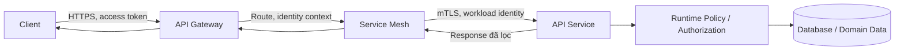

# Triển khai qua gateway, service mesh và runtime policy

API Security cần được thực thi ở nhiều lớp trong đường đi của request. API gateway kiểm soát lưu lượng đi vào hệ thống và định tuyến đến dịch vụ phù hợp; service mesh xác thực, bảo vệ và giới hạn giao tiếp giữa các workload; runtime policy áp dụng quy tắc ngay trong ngữ cảnh ứng dụng, nơi hệ thống hiểu người dùng, dữ liệu và trạng thái nghiệp vụ. Ba lớp này bổ sung cho nhau để bảo vệ endpoint, đối tượng dữ liệu và luồng nghiệp vụ trong suốt quá trình triển khai và vận hành API.

Không có một lớp nào tự giải quyết toàn bộ bài toán. Gateway có thể xác thực access token và giới hạn tốc độ nhưng thường không biết người dùng có quyền sửa một đơn hàng cụ thể hay không. Service mesh có thể xác nhận service gọi là workload được cấp danh tính và chỉ cho phép một số luồng giao tiếp, nhưng mTLS không chứng minh người dùng cuối có quyền xem dữ liệu. Runtime policy có thể kiểm tra quyền trên từng đối tượng, nhưng vẫn cần các lớp mạng và biên API để giảm lưu lượng độc hại, bảo vệ kết nối và giới hạn tài nguyên.

## 1. Ba lớp thực thi trong kiến trúc API

Một request từ Internet đến dịch vụ thường đi qua gateway, sau đó qua các kết nối service-to-service được service mesh quản lý. Khi đến ứng dụng, runtime policy và logic nghiệp vụ quyết định request có được phép thực hiện trên dữ liệu cụ thể hay không.



| Lớp | Phạm vi chính | Kiểm soát phù hợp | Câu hỏi được trả lời |
| --- | --- | --- | --- |
| API gateway | Biên hệ thống, north-south traffic | TLS termination, xác thực token, route, quota, rate limit, giới hạn request, WAF và kiểm tra schema cơ bản | Client nào được gọi API này và request có được phép đi vào hệ thống không? |
| Service mesh | Giao tiếp giữa workload, east-west traffic | Workload identity, mTLS, allowlist service, policy theo namespace/service/method/path, timeout và telemetry | Workload nào đang gọi workload nào, qua kết nối nào và được phép giao tiếp ra sao? |
| Runtime policy | Endpoint, đối tượng và luồng nghiệp vụ | Quyền chức năng, quyền trên object/field, tenant isolation, trạng thái nghiệp vụ, validation và lọc dữ liệu | Chủ thể này có được thực hiện hành động này trên dữ liệu cụ thể trong ngữ cảnh hiện tại không? |

**North-south traffic** là lưu lượng đi từ bên ngoài vào hệ thống hoặc từ hệ thống ra bên ngoài. **East-west traffic** là lưu lượng giữa các dịch vụ bên trong hệ thống. Ranh giới này giúp chọn nơi thực thi chính sách, nhưng không phải hệ thống nào cũng có cùng topology: một gateway có thể chạy trong cluster, và một service mesh có thể quản lý cả ingress gateway lẫn các workload nội bộ.

## 2. API gateway: kiểm soát tại biên API

API gateway là điểm tiếp nhận tập trung cho các client bên ngoài hoặc cho một nhóm API. Gateway thường đảm nhiệm việc kết thúc TLS, chọn route, xác thực credential, áp dụng giới hạn lưu lượng và chuyển request đến backend. Nhờ đó, các quy tắc chung có thể được quản lý nhất quán mà không cần lặp lại toàn bộ ở từng dịch vụ.

### 2.1. Xác thực và kiểm soát request

Với API dùng OAuth 2.0 access token hoặc JWT, gateway có thể xác minh chữ ký bằng khóa tin cậy, issuer, audience, thời hạn và các claim cần thiết. Nếu token không hợp lệ hoặc không dành cho API đang gọi, gateway từ chối request trước khi chuyển tiếp. Gateway cũng có thể kiểm tra scope hoặc quyền ở mức route, ví dụ chỉ cho phép token có scope `orders:read` gọi `GET /api/orders`.

Gateway nên áp dụng các giới hạn phù hợp với hợp đồng API:

- Chỉ công bố route và HTTP method cần thiết; không để lộ route quản trị hoặc endpoint nội bộ ra Internet.
- Giới hạn kích thước request body, header, file upload, số phần tử batch và thời gian chờ.
- Rate limit và quota theo API key, client, identity, tenant hoặc route; dùng chính sách riêng cho endpoint có chi phí cao.
- Kiểm tra content type, schema và định dạng cơ bản khi gateway hỗ trợ; từ chối request sai giao thức hoặc thiếu trường bắt buộc.
- Áp dụng WAF hoặc quy tắc phát hiện request bất thường khi phù hợp với bề mặt tấn công.
- Định tuyến đến đúng phiên bản backend, áp dụng TLS đến upstream nếu kiến trúc yêu cầu và không ghi credential vào access log.

Các kiểm tra ở gateway giúp chặn request không phù hợp sớm, giảm tải cho backend và tạo một điểm quản lý chính sách chung. Tuy nhiên, schema hợp lệ không đồng nghĩa dữ liệu hợp lệ về nghiệp vụ. Ví dụ `quantity: 3` có thể đúng kiểu số nguyên nhưng vẫn vượt số lượng tồn kho; việc này cần được kiểm tra trong ứng dụng với dữ liệu nghiệp vụ mới nhất.

### 2.2. Phân quyền tại gateway có giới hạn

Gateway có thể kiểm tra quyền chức năng ở mức route hoặc scope, nhưng không nên tự suy diễn quyền trên từng bản ghi nếu nó không có ngữ cảnh và dữ liệu đáng tin cậy. Với request `GET /api/orders/{orderId}`, token có scope `orders:read` chỉ cho biết client được gọi chức năng đọc đơn hàng. Backend vẫn phải kiểm tra đơn hàng có thuộc user hoặc tenant của người gọi hay không.

Nếu gateway chuyển thông tin identity xuống backend qua header, phải loại bỏ header cùng tên do client gửi từ bên ngoài trước khi tự tạo header tin cậy. Không chấp nhận mù quáng `X-User-Id`, `X-Tenant-Id`, `X-Role` hoặc các header tương tự từ Internet. Backend chỉ được tin dữ liệu identity khi đường truyền và nguồn tạo dữ liệu đó được bảo vệ rõ ràng, chẳng hạn gateway xác thực token rồi ký context, hoặc backend tự xác minh token. Trong môi trường nhiều gateway và nhiều service, cần quy định rõ thành phần nào được phép phát hành và xác minh context.

### 2.3. Ví dụ cấu hình chính sách gateway

Đoạn YAML dưới đây là cấu hình minh họa theo ý tưởng, không phải schema có thể áp dụng trực tiếp cho mọi sản phẩm gateway. Tên trường và cách khai báo plugin cần được điều chỉnh theo gateway đang sử dụng.

```yaml
routes:
  - name: orders-read
    match:
      path: /api/orders
      methods: [GET]
    upstream: orders-service
    security:
      require_access_token: true
      issuer: https://identity.example.com/
      audience: orders-api
      required_scopes: [orders:read]
    limits:
      requests_per_minute: 120
      max_body_bytes: 65536
```

Chính sách minh họa thể hiện ba việc độc lập: route chỉ nhận method đã công bố, token phải được xác minh theo issuer/audience và scope yêu cầu, lưu lượng bị giới hạn theo quota. Việc giới hạn cần tính đến NAT, nhiều người dùng chung IP, burst traffic và nhu cầu của từng tenant; rate limit chỉ theo IP có thể khóa nhầm người dùng hợp lệ.

## 3. Service mesh: bảo vệ giao tiếp giữa các workload

Khi hệ thống có nhiều service, chỉ bảo vệ request ở gateway là chưa đủ. Các service có thể gọi nhau qua nhiều hop, và một service bị xâm nhập có thể tìm cách truy cập service hoặc dữ liệu khác. Service mesh cung cấp lớp quản lý giao tiếp giữa workload, thường thông qua proxy đi cùng workload hoặc cơ chế dataplane tương đương.

### 3.1. Workload identity và mTLS

Service mesh có thể cấp hoặc phân phối danh tính workload dựa trên service account, namespace, cluster hoặc hệ thống định danh workload. Với mutual TLS (mTLS), hai đầu kết nối xác thực chứng thư của nhau và mã hóa lưu lượng trên đường truyền. Chính sách mTLS nghiêm ngặt giúp tránh việc workload vô danh hoặc kết nối plaintext đi vào một service đã được bảo vệ.

Ví dụ với Istio, có thể yêu cầu mTLS cho workload trong namespace:

```yaml
apiVersion: security.istio.io/v1
kind: PeerAuthentication
metadata:
  name: default
  namespace: orders
spec:
  mtls:
    mode: STRICT
```

Khi dùng cấu hình này, cần bảo đảm các workload hợp lệ tham gia mesh và có danh tính/chứng thư phù hợp trước khi bật chế độ nghiêm ngặt. Tên API version có thể khác theo phiên bản Istio đang triển khai.

mTLS xác nhận danh tính ở cấp workload và bảo vệ kênh giao tiếp. Nó không thay thế xác thực người dùng cuối. Nếu `checkout-service` gọi `orders-service` thay mặt người dùng Alice, chứng thư mTLS chứng minh workload gọi là `checkout-service`; nó không tự chứng minh Alice có quyền xem đơn hàng được yêu cầu.

### 3.2. Giới hạn giao tiếp service-to-service

Mesh có thể áp dụng allowlist theo workload identity, namespace, service account, HTTP method hoặc path. Ví dụ, chỉ `checkout` được gọi endpoint nội bộ để tạo đơn; service báo cáo chỉ được đọc dữ liệu đã công bố; workload không có nhiệm vụ gọi Internet không được phép tạo kết nối ra ngoài.

Ví dụ Istio AuthorizationPolicy dưới đây chỉ cho phép workload `checkout` trong namespace `checkout` gọi phương thức `GET` trên các đường dẫn `/internal/orders/` của service được chọn trong namespace `orders`:

```yaml
apiVersion: security.istio.io/v1
kind: AuthorizationPolicy
metadata:
  name: allow-checkout-read
  namespace: orders
spec:
  selector:
    matchLabels:
      app: orders
  action: ALLOW
  rules:
    - from:
        - source:
            principals:
              - cluster.local/ns/checkout/sa/checkout
      to:
        - operation:
            methods: [GET]
            paths: ["/internal/orders/*"]
```

Đây là policy theo danh tính workload. Nó giới hạn service nào được gọi một nhóm endpoint, nhưng không chứng minh request thuộc về user nào hoặc user đó sở hữu đơn hàng. Service `orders` vẫn phải thực hiện kiểm tra authorization ở runtime. Cần kiểm tra principal thực tế được mesh cấp, selector label, thứ tự và hành vi mặc định của các policy `ALLOW`/`DENY` theo cấu hình Istio đang dùng trước khi áp dụng.

### 3.3. Kiểm soát luồng và độ tin cậy vận hành

Service mesh thường cung cấp hoặc tích hợp các cơ chế vận hành như timeout, retry, circuit breaker, giới hạn kết nối, telemetry và kiểm soát egress. Những cơ chế này góp phần giảm tác động của lỗi dây chuyền và hành vi tiêu tốn tài nguyên bất thường.

- Đặt timeout theo loại request và ngân sách thời gian của toàn bộ luồng; timeout quá dài giữ tài nguyên, timeout quá ngắn làm hỏng thao tác hợp lệ.
- Chỉ retry thao tác an toàn hoặc có cơ chế idempotency; retry một lệnh tạo thanh toán có thể gây tác dụng phụ lặp lại.
- Dùng circuit breaker hoặc giới hạn kết nối để tránh một backend lỗi kéo theo toàn bộ hệ thống.
- Giới hạn egress theo nhu cầu của workload; service không cần truy cập Internet nên bị chặn đường ra không cần thiết.
- Theo dõi lỗi TLS, lỗi xác thực workload, policy deny, retry, timeout và lưu lượng bất thường giữa các service.

Mesh không tự động bảo vệ mọi lưu lượng nếu một workload nằm ngoài mesh, dùng đường kết nối bypass hoặc có cấu hình ngoại lệ. Cần lập danh sách workload tham gia, kiểm soát đường đi thay thế và kiểm tra trạng thái thực tế của dataplane.

## 4. Runtime policy: quyết định trong ngữ cảnh ứng dụng

Runtime policy được thực thi khi ứng dụng xử lý request. Đây là nơi có thể kết hợp identity người dùng, quyền chức năng, quan hệ sở hữu, tenant, thuộc tính tài nguyên và trạng thái nghiệp vụ để quyết định một hành động cụ thể.

Runtime policy có thể được viết trực tiếp trong domain service hoặc tách thành policy engine như Open Policy Agent (OPA), Cedar hay một dịch vụ quyết định quyền nội bộ. Dù chọn cách nào, ứng dụng vẫn phải xác định rõ dữ liệu đầu vào nào đáng tin cậy, policy được gọi ở thời điểm nào và quyết định được áp dụng ra sao.

### 4.1. Các thuộc tính cần có trong quyết định

Một quyết định authorization thường cần ba nhóm thông tin:

- **Subject (chủ thể):** user ID hoặc workload ID, tenant, role, scope và các thuộc tính đã được xác thực.
- **Action (hành động):** ví dụ `orders:read`, `orders:change-address`, `payments:refund`.
- **Resource và context (tài nguyên, ngữ cảnh):** order ID, owner ID, tenant ID, trạng thái đơn hàng, mức độ nhạy cảm, thời điểm và các điều kiện nghiệp vụ liên quan.

Ứng dụng phải lấy subject từ principal đã xác thực, lấy thuộc tính resource từ nguồn dữ liệu đáng tin cậy và chuẩn hóa action theo một quy ước thống nhất. Không đưa nguyên trạng `ownerId`, `tenantId` hoặc role do client tự gửi vào input của policy rồi xem đó là sự thật.

### 4.2. Ví dụ policy kiểm tra quyền đọc đơn hàng bằng OPA

Policy Rego v1 sau đây chỉ cho phép người dùng đọc đơn hàng nếu họ thuộc cùng tenant và là chủ sở hữu đơn hàng, hoặc có role hỗ trợ với quyền đọc được cấp rõ ràng:

```rego
package api.orders

default allow := false

allow if {
    input.action == "orders:read"
    input.subject.tenant_id == input.resource.tenant_id
    input.subject.id == input.resource.owner_id
}

allow if {
    input.action == "orders:read"
    input.subject.tenant_id == input.resource.tenant_id
    "SUPPORT" in input.subject.roles
    input.subject.permissions[_] == "orders:read:any"
}
```

Ứng dụng có thể gửi input đã được xây dựng từ principal và bản ghi đã tải từ repository:

```json
{
  "subject": {
    "id": "user-42",
    "tenant_id": "tenant-a",
    "roles": ["CUSTOMER"],
    "permissions": []
  },
  "action": "orders:read",
  "resource": {
    "id": "order-100",
    "tenant_id": "tenant-a",
    "owner_id": "user-42"
  }
}
```

Với input này, policy cho phép vì người dùng thuộc tenant và sở hữu đơn hàng. Nếu đổi `owner_id` thành `user-99` hoặc đổi tenant của tài nguyên, policy từ chối. Ví dụ minh họa tập trung vào quyền đọc; các hành động sửa, hủy hoặc hoàn tiền cần quy tắc riêng và phải kiểm tra trạng thái nghiệp vụ.

### 4.3. Policy engine không thay thế kiểm soát dữ liệu

Policy engine thường trả về quyết định dựa trên input mà ứng dụng cung cấp. Nếu ứng dụng truyền sai tenant hoặc lấy resource từ truy vấn không giới hạn tenant, policy có thể đưa ra quyết định sai dù biểu thức policy đúng. Do đó:

- Tải resource bằng truy vấn có ràng buộc tenant hoặc owner khi phù hợp.
- Chỉ dùng claims đã được xác minh và thuộc tính resource từ nguồn tin cậy.
- Mặc định từ chối khi policy không tồn tại, input thiếu hoặc policy engine không thể đưa ra quyết định theo chính sách fail-closed.
- Xác định rõ hành vi khi policy engine lỗi hoặc timeout; không âm thầm cho phép request nhạy cảm.
- Không cache quyết định quá lâu nếu quyền, trạng thái resource hoặc membership có thể thay đổi; xác định TTL và cách vô hiệu hóa cache.
- Chỉ áp dụng decision tại điểm thực thi; không để code gọi policy nhưng bỏ qua kết quả.

Với dữ liệu nhạy cảm, runtime còn phải lọc trường trong response, giới hạn field có thể cập nhật và thực thi validation nghiệp vụ. Quyết định “được đọc order” không tự động cho phép đọc mọi thuộc tính của order.

## 5. Truyền identity an toàn qua nhiều lớp

Trong một luồng có gateway, mesh và nhiều service, cần phân biệt **user identity** với **workload identity**:

- User identity đại diện cho người hoặc client cuối cùng đã xác thực ở biên API.
- Workload identity đại diện cho service đang mở kết nối đến service khác.

Một request có thể đồng thời mang cả hai. Ví dụ, gateway xác thực Alice; `checkout-service` nhận request và dùng workload identity của chính nó để gọi `orders-service`; request vẫn cần mang ngữ cảnh user Alice đã được xác minh để `orders-service` kiểm tra quyền trên đơn hàng.

Có một số cách truyền ngữ cảnh user:

1. Backend tự xác minh lại access token và kiểm tra audience/scope phù hợp với service đích.
2. Gateway hoặc service trung gian thực hiện token exchange để cấp token có audience và quyền tối thiểu cho service đích.
3. Một thành phần tin cậy phát hành context có chữ ký hoặc cơ chế bảo vệ tương đương; service nhận phải xác minh nguồn phát hành, tính toàn vẹn, thời hạn và phạm vi sử dụng.

Không chuyển tiếp access token gốc đến mọi service theo mặc định. Token nên có audience, scope và thời hạn phù hợp; tránh đưa token vào log, trace hoặc thông báo lỗi. Nếu dùng header nội bộ, phải ngăn client bên ngoài giả mạo header, giới hạn nguồn phát hành và bảo vệ kết nối giữa các hop. mTLS bảo vệ danh tính workload và kênh truyền, nhưng không tự làm cho header user identity trở nên đáng tin cậy.

## 6. Đưa chính sách vào vòng đời triển khai

Chính sách bảo mật cần được quản lý như một phần của thay đổi API và hạ tầng. Một quy trình triển khai có thể chia thành các bước sau:

1. **Khám phá và phân loại API:** lập inventory route, method, phiên bản, chủ sở hữu, dữ liệu nhạy cảm, client và dependency. Đánh dấu API công khai, API nội bộ và API quản trị.
2. **Thiết kế chính sách:** xác định identity, scope, quyền object/field, giới hạn lưu lượng, workload được phép giao tiếp, egress và yêu cầu audit. Gắn mỗi policy với threat model và luồng nghiệp vụ cụ thể.
3. **Định nghĩa policy-as-code:** lưu cấu hình gateway, mesh và runtime policy trong version control; review thay đổi, kiểm tra cú pháp, kiểm thử allow/deny và ghi rõ owner.
4. **Kiểm thử trong pipeline:** kiểm tra token hợp lệ/không hợp lệ, truy cập chéo tenant, workload không được cấp quyền, request quá lớn, rate limit và lỗi policy engine. Dùng môi trường kiểm thử có dữ liệu đại diện nhưng không chứa bí mật thật.
5. **Triển khai theo giai đoạn:** thử trên môi trường staging hoặc một nhóm workload/route nhỏ; dùng chế độ dry-run hoặc shadow nếu nền tảng hỗ trợ; so sánh quyết định dự kiến với hành vi thực tế trước khi enforce toàn bộ.
6. **Quan sát và điều chỉnh:** theo dõi deny, lỗi xác thực, độ trễ policy, timeout, quota và tác động đến người dùng; rollback hoặc sửa policy qua quy trình kiểm soát khi phát hiện chặn nhầm.
7. **Luân chuyển và thu hồi:** quản lý vòng đời khóa ký token, chứng thư workload, API key và quyền của service; thu hồi identity hoặc route cũ khi client/service ngừng hoạt động.

Khi triển khai policy mới, cần tránh mở rộng quyền tạm thời mà không có thời hạn. Nếu phải tạo ngoại lệ để khôi phục dịch vụ, ghi rõ phạm vi, người chịu trách nhiệm, lý do và thời điểm hết hiệu lực.

## 7. Kiểm thử theo từng lớp và theo đường đi thực tế

Kiểm thử riêng từng cấu hình là cần thiết, nhưng chưa đủ. Một request phải đi qua đúng gateway, mesh và runtime policy trong môi trường gần với production để phát hiện lỗi do header bị ghi đè, token sai audience, workload chưa tham gia mesh hoặc policy không được thực thi.

| Lớp kiểm thử | Trường hợp cần kiểm tra | Kết quả mong đợi |
| --- | --- | --- |
| Gateway | Token thiếu, hết hạn, sai issuer/audience/chữ ký; thiếu scope; route hoặc method không công bố | Từ chối trước khi chuyển đến backend. |
| Gateway | Request body/header quá lớn, vượt quota hoặc gọi dồn dập | Trả lỗi phù hợp như `413` hoặc `429`; backend không phải xử lý request bị chặn. |
| Gateway context | Client tự gửi `X-User-Id`, `X-Tenant-Id` hoặc role giả | Header giả bị loại bỏ hoặc không được backend tin cậy. |
| Service mesh | Workload không có identity hợp lệ, kết nối plaintext khi yêu cầu mTLS, service gọi endpoint ngoài allowlist | Kết nối hoặc request bị từ chối theo policy. |
| Service mesh | Workload nằm ngoài mesh hoặc tìm đường bypass | Đường đi không được bảo vệ bị phát hiện và xử lý theo kiến trúc. |
| Runtime | User A đọc object của user B; tenant A truy cập dữ liệu tenant B; user sửa field không được phép | Từ chối; không rò rỉ dữ liệu hoặc thay đổi trạng thái. |
| Runtime | Policy engine timeout, input thiếu thuộc tính hoặc policy chưa được nạp | Hành vi fail-closed đối với thao tác cần bảo vệ; có log và metric. |
| End-to-end | Request hợp lệ đi qua đủ ba lớp; token user và workload identity được phân biệt | Request chỉ thành công khi cả ba lớp đều cho phép và nghiệp vụ hợp lệ. |

Nên kiểm tra cả response và side effect trong cơ sở dữ liệu. Một API trả `403` nhưng đã ghi dữ liệu trước khi kiểm tra quyền vẫn là lỗi bảo mật nghiêm trọng. Với thao tác có retry, kiểm tra tính idempotent và tránh tạo side effect lặp lại.

## 8. Quan sát và xử lý sự cố

Mỗi lớp nên tạo telemetry đủ để nối các quyết định trong cùng một request. Có thể dùng correlation ID hoặc trace ID xuyên suốt gateway, mesh và ứng dụng. Không dùng token hoặc dữ liệu cá nhân làm trace baggage nếu chưa có cơ chế bảo vệ phù hợp.

Các tín hiệu vận hành hữu ích:

- **Gateway:** tỷ lệ `401`, `403`, `413`, `429`; request theo route/client/tenant; quota bị chạm; lỗi upstream và độ trễ xác thực token.
- **Service mesh:** lỗi mTLS, workload identity không hợp lệ, policy deny, kết nối egress bị chặn, retry, timeout, circuit breaker và độ trễ giữa các service.
- **Runtime:** quyết định allow/deny theo action và policy ID; lỗi hoặc timeout của policy engine; truy cập object chéo tenant; validation thất bại; thay đổi dữ liệu nhạy cảm.

Log cần tránh chứa access token, API key, mật khẩu, secret, payload nhạy cảm hoặc toàn bộ dữ liệu cá nhân. Nên ghi policy ID/version, route template, service principal, action, kết quả và correlation ID ở mức đủ điều tra. Quyền truy cập log, thời gian lưu và quy trình xử lý sự cố phải được quản lý như dữ liệu bảo mật.

Khi tỷ lệ deny tăng đột ngột, cần xác định lớp phát sinh quyết định, phiên bản policy đang chạy và nhóm client/workload bị ảnh hưởng. Phân biệt tấn công, thay đổi client hợp lệ và lỗi cấu hình trước khi nới policy. Nếu rollback, cần quay về phiên bản policy đã biết là an toàn và kiểm tra lại đường đi end-to-end.

## 9. Lỗi triển khai thường gặp

- **Dồn mọi authorization vào gateway:** gateway biết route và token nhưng thường không có trạng thái object mới nhất. Backend cần kiểm tra quyền trên resource và trạng thái nghiệp vụ.
- **Coi mTLS là quyền người dùng:** mTLS xác thực workload và mã hóa kết nối; nó không chứng minh user cuối được phép đọc hoặc sửa dữ liệu.
- **Tin header do client gửi:** header identity có thể bị giả mạo nếu gateway không xóa và phát hành lại, hoặc backend không xác minh nguồn tin cậy.
- **Chỉ bảo vệ traffic từ Internet:** service bị xâm nhập có thể gọi ngang sang service khác nếu east-west traffic không có allowlist và workload identity.
- **Policy engine lỗi thì cho qua:** fail-open có thể biến sự cố hạ tầng thành quyền truy cập trái phép. Chọn fail-closed cho hành động nhạy cảm và thiết kế phương án sẵn sàng phù hợp.
- **Retry không giới hạn hoặc không idempotent:** có thể làm tăng tải, lặp giao dịch và tạo side effect nhiều lần.
- **Triển khai policy trực tiếp không có quan sát:** policy mới có thể chặn nhầm hoặc mở quyền quá rộng; cần kiểm thử, rollout có kiểm soát và telemetry.
- **Cấu hình lệch giữa các môi trường:** staging và production có thể dùng issuer, trust domain, namespace hoặc policy version khác nhau; cần kiểm tra drift và cấu hình thực tế.

## 10. Checklist trước khi đưa API vào production

- [ ] Gateway chỉ công bố đúng route/method; xác minh token theo issuer, audience, thời hạn và scope cần thiết.
- [ ] Đã đặt giới hạn body, upload, timeout, rate limit và quota theo đặc điểm endpoint.
- [ ] Header identity do client cung cấp bị loại bỏ hoặc xác minh; backend biết rõ nguồn identity đáng tin cậy.
- [ ] Các service cần bảo vệ có workload identity và mTLS; policy giao tiếp service-to-service theo allowlist.
- [ ] Đường egress và các workload nằm ngoài mesh được kiểm soát.
- [ ] Runtime kiểm tra quyền chức năng, object, field, tenant và trạng thái nghiệp vụ trên dữ liệu đáng tin cậy.
- [ ] Policy engine có hành vi fail-closed phù hợp, timeout, cache và quy trình cập nhật được xác định.
- [ ] Policy-as-code được review, kiểm thử allow/deny và triển khai theo giai đoạn.
- [ ] Kiểm thử end-to-end xác nhận request thực sự đi qua gateway, mesh và runtime policy.
- [ ] Log, trace, metric và cảnh báo có thể nối các quyết định nhưng không làm lộ credential hoặc dữ liệu nhạy cảm.
- [ ] Có quy trình rollback, thu hồi token/key/chứng thư và xử lý ngoại lệ có thời hạn.

API gateway bảo vệ điểm vào và kiểm soát lưu lượng north-south; service mesh xác thực workload và giới hạn giao tiếp east-west; runtime policy quyết định quyền trên dữ liệu và hành động nghiệp vụ. Khi ba lớp dùng chung mô hình identity rõ ràng, policy có kiểm thử và telemetry xuyên suốt, hệ thống có thể thực thi bảo mật nhất quán từ request đầu tiên đến từng thao tác bên trong service.
