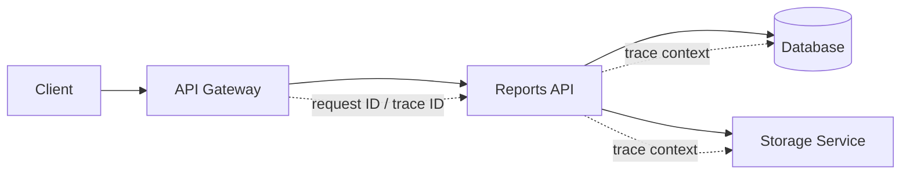
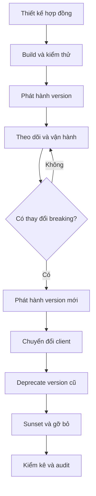

# Theo dõi, version hóa và xử lý incident

Một API không kết thúc vòng đời ở thời điểm được triển khai thành công. Sau khi đi vào hoạt động, API cần được theo dõi để phát hiện lỗi và hành vi bất thường, cần có chính sách version để thay đổi hợp đồng mà không làm hỏng client, và cần có quy trình xử lý sự cố khi dữ liệu hoặc chức năng bị đe dọa.

Ba hoạt động này gắn chặt với bảo mật API. Log và telemetry giúp phát hiện việc dò ID, tăng đột biến lỗi xác thực hoặc truy cập bất thường. Quản lý version giúp đội vận hành vá lỗi và loại bỏ endpoint cũ không an toàn. Quy trình incident giúp giới hạn tác động, khôi phục dịch vụ và rút kinh nghiệm sau một sự cố.

Trong phạm vi API security, theo dõi, version hóa và xử lý incident cần trả lời được ba câu hỏi:

1. **Điều gì đang xảy ra với API?** Endpoint nào lỗi, ai đang gọi, dữ liệu hoặc tenant nào bị ảnh hưởng, có dấu hiệu lạm dụng hay không?
2. **Hợp đồng API nào đang được sử dụng?** Client nào phụ thuộc vào version nào, version nào còn được hỗ trợ, thay đổi nào có thể phá vỡ tương thích?
3. **Nếu có sự cố, đội ngũ phải hành động thế nào?** Ai chịu trách nhiệm, cách xác nhận phạm vi, chặn hoạt động nguy hiểm, khôi phục và thông báo ra sao?

## 1. Theo dõi API là một phần của bảo mật

Theo dõi API (API monitoring/observability) là việc thu thập và phân tích tín hiệu từ request, response, ứng dụng và hạ tầng để hiểu tình trạng vận hành. Mục tiêu không chỉ là biết dịch vụ có đang trả HTTP 200 hay không. Một API vẫn có thể trả 200 trong khi đang làm lộ dữ liệu, cho phép truy cập chéo tenant hoặc bị khai thác để tiêu tốn tài nguyên.

Một hệ thống theo dõi hữu ích kết hợp ba loại telemetry chính:

| Loại tín hiệu | Trả lời câu hỏi | Ví dụ dữ liệu |
|---|---|---|
| Metrics (chỉ số) | Tình trạng thay đổi theo thời gian như thế nào? | Request/giây, tỷ lệ 4xx/5xx, latency p95/p99, timeout, số lần bị rate limit |
| Logs (nhật ký) | Một sự kiện cụ thể đã xảy ra như thế nào? | Thời điểm, endpoint, kết quả xác thực, principal đã được định danh, mã lỗi, request ID |
| Traces (dấu vết phân tán) | Một request đi qua những dịch vụ nào và chậm/lỗi ở đâu? | Trace ID, thời gian ở API gateway, service, database và dịch vụ ngoài |

Ba loại tín hiệu bổ sung cho nhau. Metrics giúp phát hiện xu hướng; logs cung cấp ngữ cảnh cho sự kiện; traces giúp lần theo request qua nhiều thành phần. Không nên chỉ dựa vào một loại tín hiệu để điều tra sự cố.

### 1.1. Theo dõi các chỉ số vận hành

Những chỉ số cơ bản nên có cho từng API hoặc nhóm endpoint:

- **Traffic:** số request, tốc độ tăng/giảm, phân bố theo endpoint, client, tenant và vùng triển khai.
- **Errors:** tỷ lệ phản hồi 4xx/5xx, timeout, lỗi phụ thuộc dịch vụ và lỗi nghiệp vụ. Cần phân biệt lỗi client thông thường với lỗi xác thực, phân quyền hoặc validation.
- **Latency:** thời gian phản hồi trung vị, p95, p99 và thời gian xử lý ở từng thành phần.
- **Saturation:** mức sử dụng CPU, bộ nhớ, connection pool, thread pool, hàng đợi và giới hạn kết nối.
- **Security signals:** số lần xác thực thất bại, token không hợp lệ/hết hạn, truy cập bị từ chối, vi phạm quota, request có payload bị chặn và thay đổi quyền nhạy cảm.

Không nên gộp mọi phản hồi 4xx thành một chỉ số lỗi duy nhất. Một đợt tăng `401` có thể chỉ ra client dùng credential hết hạn; tăng `403` có thể là cấu hình quyền sai hoặc hành vi dò endpoint; tăng `429` có thể phản ánh rate limit đang hoạt động hoặc một cuộc lạm dụng. Cần xem mã phản hồi cùng endpoint, danh tính, nguồn gọi và khoảng thời gian.

### 1.2. Thiết kế log có ích cho điều tra

Một bản ghi log truy cập có cấu trúc có thể gồm:

```json
{
  "timestamp": "2026-11-18T10:15:30Z",
  "requestId": "req-7f31",
  "traceId": "trace-91ac",
  "service": "orders-api",
  "route": "GET /v1/orders/{orderId}",
  "status": 403,
  "durationMs": 18,
  "principalType": "user",
  "principalId": "user-42",
  "tenantId": "tenant-7",
  "authorizationResult": "denied",
  "reasonCode": "OBJECT_ACCESS_DENIED"
}
```

Ví dụ trên dùng route template thay vì ghi nguyên URL có thể chứa ID nhạy cảm. Trong thực tế, mức định danh cần được cân bằng giữa khả năng điều tra, chính sách lưu trữ và quyền riêng tư. Có thể dùng mã định danh nội bộ hoặc giá trị đã băm khi không cần lưu dữ liệu định danh trực tiếp.

Log bảo mật nên ghi nhận các sự kiện quan trọng như:

- Đăng nhập, xác thực thất bại, cấp mới, refresh, thu hồi hoặc hết hạn credential.
- Quyết định authorization bị từ chối, đặc biệt với thao tác quản trị, dữ liệu nhạy cảm và truy cập chéo tenant.
- Thay đổi role, permission, API key, webhook, cấu hình bảo mật hoặc chính sách truy cập.
- Các request bị chặn do rate limit, kích thước payload, validation, SSRF policy hoặc quy tắc chống lạm dụng.
- Thao tác dữ liệu nhạy cảm, xuất dữ liệu hàng loạt, thay đổi trạng thái giao dịch và hành động quản trị.

Không ghi access token, refresh token, mật khẩu, API key, session cookie, private key hoặc toàn bộ payload nhạy cảm vào log. Nếu cần liên kết một credential trong điều tra, hãy dùng fingerprint hoặc ID đã được thiết kế để không thể dùng lại làm thông tin xác thực. Cần kiểm soát quyền đọc log, thời hạn lưu, mã hóa và audit việc truy cập log vì bản thân log cũng có thể chứa dữ liệu nhạy cảm.

### 1.3. Kết nối request qua nhiều dịch vụ

Khi một request đi qua API gateway, service nghiệp vụ, database và dịch vụ bên ngoài, request ID hoặc trace ID giúp kết nối các sự kiện. Mỗi thành phần nên truyền context theo chuẩn tracing phù hợp, đồng thời tránh đưa token hay dữ liệu cá nhân vào baggage hoặc thuộc tính trace.

Ví dụ, một request xuất báo cáo có latency tăng có thể được phân tích như sau:



Trace giúp nhận ra thời gian chờ tập trung ở database hay storage. Logs giải thích request được gọi bởi principal nào và có vượt quota không. Metrics cho biết đây là một request đơn lẻ hay một xu hướng trên diện rộng.

### 1.4. Alert cần gắn với hành động

Không phải mọi chỉ số bất thường đều cần báo động khẩn cấp. Alert nên có ngưỡng, cửa sổ thời gian, mức độ nghiêm trọng, người nhận và hướng dẫn điều tra. Ví dụ:

| Tín hiệu | Khả năng cần kiểm tra | Hành động ban đầu |
|---|---|---|
| Tỷ lệ `5xx` tăng cùng latency p99 | Lỗi triển khai hoặc phụ thuộc dịch vụ | Kiểm tra phiên bản vừa triển khai, trace và health của dependency |
| `401` tăng đột biến từ nhiều nguồn | Credential sai, client lỗi hoặc dò thông tin xác thực | Phân nhóm theo client, IP, principal và endpoint; kiểm tra dấu hiệu credential stuffing |
| `403` tăng trên endpoint đọc tài nguyên | Client sai quyền hoặc dò ID/tài nguyên | Kiểm tra phân bố ID, tenant, principal và các quyết định authorization |
| `429` tăng trên luồng OTP hoặc đăng nhập | Lạm dụng hoặc giới hạn quá chặt | Xác minh phân bố nguồn gọi, hiệu quả quota và ảnh hưởng người dùng hợp lệ |
| Xuất dữ liệu tăng bất thường | Tài khoản bị chiếm quyền hoặc lạm dụng nghiệp vụ | Xác minh principal, phạm vi dữ liệu và hành động tiếp theo theo runbook |

Đặt alert theo tỷ lệ hoặc xu hướng thường hữu ích hơn một ngưỡng tuyệt đối duy nhất. Ví dụ, 100 lỗi trong một phút có ý nghĩa khác nhau với API xử lý 200 request/phút và API xử lý 100.000 request/phút. Cần hiệu chỉnh ngưỡng dựa trên lưu lượng nền và mức độ ảnh hưởng.

## 2. Theo dõi theo góc nhìn bảo mật API

Telemetry nên gắn với mô hình bảo mật của API. Với mỗi endpoint, cần biết ai gọi, hành động gì, trên đối tượng nào, trong tenant nào và kết quả authorization ra sao.

### 2.1. Theo dõi xác thực và credential

Theo dõi các sự kiện cấp, refresh, thu hồi và sử dụng credential. Một số dấu hiệu cần chú ý:

- Một tài khoản có nhiều lần đăng nhập thất bại trong thời gian ngắn.
- Một access token được dùng từ các vị trí hoặc thiết bị khác thường, nếu chính sách và dữ liệu cho phép đánh giá.
- API key có lưu lượng tăng đột ngột hoặc được dùng bởi client không nằm trong hồ sơ đã đăng ký.
- Credential đã thu hồi vẫn xuất hiện trong request; điều này có thể cho thấy cache hoặc cơ chế thu hồi chưa hoạt động như kỳ vọng.
- Một client sử dụng token với scope hoặc audience không phù hợp với API.

Khi ghi nhận, cần phân biệt lỗi cấu hình của client với hành vi tấn công. Ví dụ, một đợt `401` sau khi xoay khóa có thể do ứng dụng chưa cập nhật secret; một đợt tương tự từ nhiều IP, nhiều tài khoản và nhiều user-agent có thể là dấu hiệu dò thông tin xác thực. Dữ liệu quan sát cần đủ để phân biệt mà không lưu lại bí mật.

### 2.2. Theo dõi authorization theo đối tượng và tenant

Đối với API đa tenant, log chỉ có `status=200` là chưa đủ. Cần có thông tin ngữ cảnh để xác minh request được thực hiện trong phạm vi nào. Có thể theo dõi:

- Số lượng quyết định cho phép/từ chối theo action và endpoint.
- Tần suất một principal truy cập tài nguyên thuộc nhiều tenant hoặc nhiều chủ sở hữu.
- Số ID tài nguyên khác nhau được một principal thử truy cập trong một khoảng thời gian.
- Thao tác đọc hoặc xuất dữ liệu nhạy cảm theo vai trò và tenant.

Không nên tạo metric label có cardinality không giới hạn bằng cách đưa mọi user ID, request ID hoặc object ID vào nhãn. Điều này có thể làm hệ thống metrics tốn bộ nhớ và chi phí. Hãy dùng metrics tổng hợp theo nhóm; lưu chi tiết cần điều tra trong logs hoặc traces có kiểm soát.

### 2.3. Theo dõi SSRF và lạm dụng tài nguyên

Với endpoint nhận URL, theo dõi kết quả chính sách SSRF: scheme/host bị từ chối, redirect bị chặn, lỗi phân giải DNS, timeout và kích thước phản hồi. Tránh ghi URL đầy đủ nếu URL có thể chứa token hoặc tham số nhạy cảm; có thể ghi hostname đã chuẩn hóa và reason code.

Với lạm dụng tài nguyên, theo dõi request size, page size, số phần tử batch, thời gian chạy, số lần retry, concurrency và chi phí tác vụ. Một request riêng lẻ có thể hợp lệ nhưng chuỗi request lặp lại có thể gây cạn tài nguyên hoặc phát sinh chi phí bất thường.

## 3. Version hóa API và quản lý hợp đồng

Version hóa API là cách quản lý những thay đổi đối với hợp đồng mà client sử dụng: endpoint, schema request/response, mã lỗi, quy tắc xác thực, phân quyền và hành vi nghiệp vụ.

Version hóa không chỉ là đổi `/v1` thành `/v2`. Một thay đổi về trường dữ liệu, quyền truy cập hoặc cách xử lý lỗi cũng có thể ảnh hưởng đến client và bảo mật.

### 3.1. Khi nào cần version mới?

Một thay đổi thường được xem là breaking change nếu client hiện tại có thể không hoạt động hoặc thay đổi hành vi khi nâng cấp. Ví dụ:

- Xóa hoặc đổi tên endpoint, field, query parameter hay enum value đang được sử dụng.
- Đổi kiểu dữ liệu, định dạng ngày giờ hoặc ý nghĩa của một field.
- Thay đổi cấu trúc response theo cách client cũ không thể phân tích.
- Thay đổi quy tắc xác thực, scope bắt buộc, quyền truy cập hoặc điều kiện nghiệp vụ.
- Đổi cách phân trang, thứ tự mặc định, xử lý retry hoặc semantics của thao tác.

Một số thay đổi có vẻ chỉ là bổ sung vẫn có thể phá vỡ client. Ví dụ, thêm một giá trị mới vào enum có thể làm client cũ lỗi nếu code của họ giả định chỉ có các giá trị đã biết. Thêm field response có thể gây lỗi với client dùng schema strict. Vì vậy, cần kiểm tra cách client thực sự tiêu thụ hợp đồng.

Các thay đổi thường ít rủi ro hơn gồm thêm endpoint độc lập, thêm field tùy chọn với giá trị mặc định rõ ràng hoặc thêm header tùy chọn. Tuy vậy, vẫn cần đánh giá tác động đến parser, policy và bảo mật trước khi phát hành.

### 3.2. Các chiến lược version phổ biến

| Chiến lược | Ví dụ | Ưu điểm | Điểm cần cân nhắc |
|---|---|---|---|
| URL path | `/api/v1/orders` | Dễ nhìn, dễ định tuyến, dễ quan sát theo version | URL và tài liệu có thể tăng nhanh; cần quản lý nhiều route |
| Query parameter | `/api/orders?version=1` | Dễ thêm vào một endpoint hiện có | Dễ bị bỏ sót trong cache key, log hoặc kiểm soát truy cập nếu cấu hình không nhất quán |
| Header | `API-Version: 2026-01` | URL gọn, tách version khỏi resource path | Khó quan sát hơn nếu gateway/log không ghi header; cần xử lý cache variation đúng cách |
| Media type | `Accept: application/vnd.example.v2+json` | Version hóa theo representation | Phức tạp hơn với client, tài liệu và cấu hình gateway |

Không có chiến lược duy nhất phù hợp cho mọi hệ thống. Điều quan trọng là chọn một cách nhất quán, áp dụng tại gateway và service, đưa version vào logs/metrics, đồng thời ghi rõ version mặc định nếu client không cung cấp.

### 3.3. Phân biệt version API với version triển khai

Version API mô tả hợp đồng công khai. Version ứng dụng hoặc artifact mô tả bản build được triển khai. Hai thứ có thể thay đổi độc lập:

- Có thể triển khai bản vá nội bộ `orders-service 2.8.4` mà không đổi hợp đồng `/v1`.
- Có thể hỗ trợ `/v1` và `/v2` đồng thời trong cùng một bản triển khai.
- Có thể phát hành một API version mới nhưng triển khai theo từng vùng hoặc từng nhóm client.

Hãy ghi nhận cả hai trong telemetry để khi điều tra có thể xác định request đi qua hợp đồng nào và chạy trên bản build nào.

### 3.4. Giữ tương thích và quản lý deprecation

Khi cần thay đổi breaking, nên thực hiện theo lộ trình có kiểm soát:

1. Xác định thay đổi, lý do, rủi ro và các client bị ảnh hưởng.
2. Công bố version mới, schema, tài liệu, ví dụ và hướng dẫn chuyển đổi.
3. Triển khai song song trong thời gian chuyển tiếp nếu kiến trúc cho phép.
4. Theo dõi lượng traffic theo version và client để biết ai còn sử dụng version cũ.
5. Gửi thông báo deprecation, nêu rõ thời điểm ngừng hỗ trợ và phương án nâng cấp.
6. Xác minh mức sử dụng đã giảm và các client quan trọng đã chuyển đổi trước khi ngừng version cũ.
7. Gỡ route, credential, policy và tài liệu không còn cần thiết; xác minh endpoint cũ thực sự không thể truy cập.

Thông báo deprecation nên đủ cụ thể để client hành động. Có thể dùng header `Deprecation` và `Sunset` theo chính sách, kèm liên kết đến tài liệu di trú. Thời gian hỗ trợ cần được công bố và tuân theo cam kết sản phẩm hoặc hợp đồng với khách hàng.

### 3.5. Version cũ cũng là bề mặt tấn công

Endpoint cũ thường có thể giữ lại logic xác thực/phân quyền yếu, thư viện lỗi thời hoặc quy tắc validation không còn phù hợp. Nếu `/v2` đã sửa BOLA nhưng `/v1` vẫn truy vấn dữ liệu chỉ bằng object ID, kẻ tấn công có thể tiếp tục dùng version cũ.

Vì vậy, mọi version đang hoạt động đều phải tuân theo baseline bảo mật hiện tại:

- Xác thực và authorization tương đương cho cùng một hành động/dữ liệu.
- Validation, giới hạn tài nguyên và chính sách SSRF nhất quán.
- Log, audit và alert bao phủ tất cả version.
- Không để version cũ trở thành đường vòng để bỏ qua policy mới.

Nếu chưa thể sửa ngay một version cũ, cần đánh giá phạm vi sử dụng, giới hạn truy cập, giảm quyền hoặc tắt endpoint có rủi ro theo kế hoạch incident/change phù hợp.

## 4. Quản lý vòng đời API từ phát hành đến ngừng hỗ trợ

Một vòng đời API có thể được quản lý bằng các trạng thái vận hành rõ ràng:



Trước khi phát hành, cần có hợp đồng API, schema, chính sách xác thực/phân quyền, kiểm thử tương thích và kế hoạch rollback. Trong vận hành, cần theo dõi traffic theo version, lỗi, latency, security signals và tình trạng dependency. Khi sunset, phải xác minh cả gateway, service, route nội bộ, tài liệu, key và quyền của client cũ đã được xử lý.

Một inventory API hữu ích nên lưu tối thiểu:

| Trường thông tin | Mục đích |
|---|---|
| Tên API, owner, nhóm chịu trách nhiệm | Xác định người chịu trách nhiệm khi có thay đổi hoặc incident |
| Version và trạng thái | Biết version đang active, deprecated hay sunset |
| Endpoint và dữ liệu nhạy cảm | Hiểu bề mặt tấn công và tác động nếu lộ dữ liệu |
| Loại client/consumer | Xác định ai cần được thông báo khi thay đổi |
| Cơ chế xác thực và scope | Rà soát credential và quyền truy cập |
| Dependency và vùng triển khai | Khoanh vùng ảnh hưởng và đường lan truyền sự cố |
| SLO, dashboard, runbook | Liên kết vận hành với cách xử lý thực tế |

Inventory cần được cập nhật tự động hoặc có quy trình kiểm tra định kỳ. API không còn được quảng bá vẫn có thể đang được client cũ gọi, vì vậy không nên suy ra rằng một endpoint đã hết sử dụng chỉ vì tài liệu đã bị xóa.

## 5. Xử lý incident bảo mật API

Incident bảo mật API là sự kiện làm ảnh hưởng hoặc có nguy cơ ảnh hưởng đến tính bí mật, toàn vẹn hoặc khả dụng của API và dữ liệu mà API xử lý. Ví dụ:

- API key hoặc access token bị lộ.
- Người dùng truy cập dữ liệu của tenant khác do lỗi authorization.
- Endpoint bị khai thác SSRF để truy cập dịch vụ nội bộ.
- API bị gọi hàng loạt làm cạn tài nguyên hoặc phát sinh chi phí.
- Version cũ có lỗ hổng đang bị khai thác.
- Dữ liệu nhạy cảm xuất hiện trong response, log hoặc bản sao lưu ngoài phạm vi cho phép.

Incident response cần có người chịu trách nhiệm, kênh liên lạc, quyền thực hiện biện pháp khẩn cấp và bằng chứng để điều tra. Không nên đợi đến khi có sự cố mới quyết định ai có thể thu hồi key hoặc tắt endpoint.

### 5.1. Chuẩn bị trước khi xảy ra sự cố

Chuẩn bị tốt giúp rút ngắn thời gian phát hiện và giới hạn thiệt hại. Những thành phần nên có:

- **Runbook:** hướng dẫn xử lý theo từng loại sự cố, gồm dấu hiệu nhận biết, truy vấn log, biện pháp containment và tiêu chí phục hồi.
- **Ownership và escalation:** người trực, service owner, security, hạ tầng, pháp chế/đầu mối quyền riêng tư và người có quyền quyết định thông báo.
- **Công cụ khẩn cấp:** thu hồi API key/token, vô hiệu hóa client, giảm quota, chặn route, rollback release hoặc chuyển traffic.
- **Bằng chứng:** log có đồng bộ thời gian, audit trail chống sửa đổi, trace và thông tin version/build.
- **Kịch bản diễn tập:** credential bị lộ, truy cập chéo tenant, DDoS/abuse, SSRF và lỗi phát hành.

Runbook nên ghi rõ hành động nào có thể thực hiện ngay, hành động nào cần phê duyệt và cách xác minh thay đổi đã có hiệu lực. Với credential, cần biết thời gian lan truyền của revocation, cache và thời hạn token để không nhầm rằng thao tác thu hồi ở một nơi đã vô hiệu hóa mọi bản sao.

### 5.2. Các giai đoạn ứng phó

Một quy trình thực tế có thể chia thành sáu giai đoạn:

1. **Phát hiện và ghi nhận:** alert, khách hàng, đội vận hành hoặc hệ thống giám sát báo dấu hiệu bất thường. Tạo incident record, ghi thời điểm phát hiện, dịch vụ, version, người điều phối và mức độ ban đầu.
2. **Xác minh và phân loại:** kiểm tra xem đây là lỗi vận hành hay sự cố bảo mật; xác định dữ liệu, endpoint, tenant, principal và khoảng thời gian có thể bị ảnh hưởng. Gán mức độ dựa trên tác động và phạm vi, không chỉ dựa vào số lượng alert.
3. **Containment (khoanh vùng):** giới hạn hoạt động đang gây hại. Có thể thu hồi key/token, khóa client, giảm quota, chặn route, vô hiệu hóa chức năng hoặc cô lập thành phần bị ảnh hưởng.
4. **Eradication (loại bỏ nguyên nhân):** sửa lỗi code/policy, vá dependency, loại bỏ credential bị lộ, đóng đường truy cập và xác minh không còn cơ chế khai thác tương tự.
5. **Recovery (khôi phục):** triển khai bản sửa, khôi phục traffic theo từng bước, theo dõi metrics/security signals và xác minh chức năng, quyền truy cập, dữ liệu hoạt động đúng.
6. **Post-incident review:** dựng lại timeline, đánh giá tác động, xác định nguyên nhân gốc và yếu tố góp phần, ghi nhận quyết định, tạo action item có owner và deadline.

Các giai đoạn có thể lặp lại. Khi containment làm lộ thêm phạm vi ảnh hưởng, nhóm ứng phó cần cập nhật mức độ và kế hoạch. Việc thu thập bằng chứng nên diễn ra song song nếu không làm chậm biện pháp ngăn thiệt hại; ưu tiên bảo vệ người dùng và dữ liệu.

### 5.3. Đánh giá mức độ và phạm vi ảnh hưởng

Khi phân loại incident, cần xem xét:

- **Confidentiality:** dữ liệu nào có thể đã bị đọc hoặc xuất ra ngoài? Có dữ liệu cá nhân, tài chính, thông tin xác thực hay bí mật thương mại không?
- **Integrity:** dữ liệu hoặc cấu hình nào có thể đã bị thay đổi? Có giao dịch, quyền, role, webhook hay thông tin thanh toán bị tác động không?
- **Availability:** API hoặc dependency có bị gián đoạn, quá tải hoặc mất khả năng phục vụ không?
- **Scope:** endpoint/version nào, tenant/client nào, bao nhiêu principal và trong khoảng thời gian nào?
- **Exploitability:** hoạt động có dấu hiệu khai thác có chủ đích hay chỉ là lỗi cấu hình/client? Có thể tái hiện bằng request nào?
- **Persistence:** credential, webhook, scheduled job hoặc quyền trái phép có thể tiếp tục được sử dụng sau khi vá lỗi không?

Không nên kết luận “không có dữ liệu bị lộ” chỉ vì không tìm thấy log thành công. Nếu telemetry không đầy đủ, hãy ghi rõ khoảng trống bằng chứng và dùng giả định thận trọng phù hợp với mức rủi ro.

## 6. Ví dụ incident: API key bị lộ

Giả sử một API key dùng cho đối tác xuất hiện trong repository công khai. Dashboard phát hiện key đó bắt đầu gọi endpoint xuất dữ liệu với tần suất cao từ một nguồn chưa từng thấy.

### Phát hiện và xác minh

Nhóm vận hành xác định key ID, client sở hữu key, thời điểm đầu tiên có lưu lượng bất thường, endpoint được gọi, tenant và số bản ghi được trả về. Không sao chép giá trị secret vào ticket hoặc chat incident. Cần phân biệt key ID dùng để nhận diện với giá trị key bí mật.

### Khoanh vùng

- Thu hồi key bị lộ và xác minh gateway/service từ chối các request mới dùng key đó.
- Nếu client hợp lệ bị ảnh hưởng, cấp credential thay thế qua kênh an toàn và cập nhật quyền ở mức tối thiểu cần thiết.
- Tạm giới hạn hoặc tắt chức năng xuất dữ liệu nếu vẫn có nguy cơ tiếp tục truy cập.
- Kiểm tra xem key có quyền truy cập nhiều tenant hoặc nhiều loại dữ liệu hơn nhu cầu thực tế hay không.

### Điều tra và khôi phục

Đối chiếu logs, audit events và traces để xác định những request đã được chấp nhận, đối tượng dữ liệu bị truy cập và các thay đổi có thể xảy ra. Kiểm tra bản sao của key trong lịch sử repository, CI logs, artifact, biến môi trường và hệ thống secret. Xóa secret khỏi nơi lưu trữ hiện tại là chưa đủ; credential đã lộ phải được thu hồi.

Sau khi cấp key mới, xác minh client dùng key mới, key cũ bị từ chối, quota được khôi phục an toàn và không còn hoạt động bất thường. Đánh giá nghĩa vụ thông báo dựa trên loại dữ liệu và chính sách/hợp đồng áp dụng.

### Ngăn tái diễn

Tạo action item như quét secret trong CI, chuyển key sang secret manager, giảm scope/quota, đặt hạn sử dụng và quy trình xoay khóa, bổ sung alert cho lưu lượng xuất dữ liệu. Xác định vì sao key được đưa vào repository và sửa quy trình phát triển để giảm khả năng lặp lại.

## 7. Ví dụ incident: lỗi BOLA ở một API version cũ

Một nhóm phát hiện người dùng A có thể đọc đơn hàng của người dùng B bằng cách thay `orderId` trên endpoint `/v1/orders/{orderId}`. Endpoint `/v2` đã có kiểm tra quyền theo chủ sở hữu, nhưng `/v1` vẫn dùng truy vấn theo ID mà không ràng buộc tenant.

Trình tự xử lý nên bao gồm:

1. Xác nhận lỗi bằng tài khoản thử nghiệm và request tối thiểu; lưu bằng chứng đã loại bỏ token và dữ liệu cá nhân.
2. Xác định tất cả route/version dùng chung logic truy vấn và phạm vi tài nguyên có nguy cơ bị truy cập.
3. Khoanh vùng bằng cách áp dụng kiểm tra authorization ở lớp dùng chung, tắt endpoint dễ bị khai thác hoặc giới hạn truy cập trong lúc sửa.
4. Rà soát logs để tìm truy cập chéo owner/tenant và xác định khoảng thời gian, dữ liệu, client có thể bị ảnh hưởng.
5. Triển khai bản vá cho mọi version còn hoạt động, thêm kiểm thử âm tính và xác minh bằng các principal/tenant khác nhau.
6. Thông báo theo quy trình nội bộ và nghĩa vụ liên quan nếu có dữ liệu bị truy cập trái phép; theo dõi đến khi mọi client chuyển đổi hoặc version rủi ro được sunset.

Sự cố này cho thấy version hóa và bảo mật không thể tách rời. Việc sửa `/v2` không giải quyết được rủi ro nếu `/v1` vẫn còn truy cập được và chứa cùng dữ liệu.

## 8. Khôi phục an toàn và rollback

Rollback có thể giúp khôi phục dịch vụ sau một bản phát hành lỗi, nhưng rollback một bản build cũ cũng có thể khôi phục lỗ hổng đã được vá. Trước khi rollback, cần biết thay đổi nào liên quan đến bảo mật và dữ liệu đã được ghi theo schema mới hay chưa.

Một kế hoạch recovery nên xác định:

- Bản build/version nào được phép triển khai lại và các lỗ hổng đã biết của bản đó.
- Thay đổi database có tương thích ngược không; có cần migration tiến/lùi hoặc forward-fix không.
- Credential, policy, key và cấu hình nào phải giữ nguyên hoặc tiếp tục bị thu hồi.
- Cách chuyển traffic theo từng bước, health check, security test và tiêu chí dừng rollout.
- Cách xác minh không có request độc hại tiếp tục được xử lý sau khi dịch vụ hoạt động lại.

Trong một số trường hợp, forward-fix (phát hành bản sửa mới) an toàn hơn rollback. Quyết định cần dựa trên tác động thực tế và khả năng loại bỏ nguyên nhân, không chỉ dựa vào việc đưa dịch vụ về trạng thái trước đó.

## 9. Đo lường chất lượng vận hành

Để biết hoạt động theo dõi và incident response có hiệu quả không, có thể đo:

| Chỉ số | Ý nghĩa |
|---|---|
| MTTD (Mean Time to Detect) | Thời gian trung bình từ khi sự cố bắt đầu đến khi được phát hiện |
| MTTA (Mean Time to Acknowledge) | Thời gian từ alert đến khi có người nhận trách nhiệm xử lý |
| MTTR (Mean Time to Recover/Resolve) | Thời gian trung bình để khôi phục hoặc xử lý sự cố theo định nghĩa đã chọn |
| Tỷ lệ alert hữu ích | Mức độ alert dẫn đến hành động điều tra hoặc xử lý có ý nghĩa |
| Tỷ lệ API/version có owner và runbook | Mức độ sẵn sàng vận hành của inventory |
| Tỷ lệ traffic trên version deprecated | Tiến độ chuyển đổi client và khả năng sunset |
| Thời gian thu hồi credential | Độ nhanh và hiệu quả của cơ chế revoke/rotation |
| Tỷ lệ endpoint có kiểm thử authorization | Mức bao phủ kiểm thử quyền chức năng, đối tượng và thuộc tính |

Các chỉ số này cần có định nghĩa thống nhất. MTTR có thể mang nghĩa thời gian khôi phục dịch vụ hoặc thời gian giải quyết hoàn toàn; cần ghi rõ cách tính. Không nên tối ưu số liệu bằng cách đóng incident sớm hoặc giảm alert đến mức bỏ sót sự cố.

## 10. Checklist vận hành cho mỗi API

Trước khi đưa API vào production và trong các đợt rà soát định kỳ, hãy kiểm tra:

- [ ] Có owner, inventory, version, client/consumer và dependency rõ ràng.
- [ ] Có dashboard traffic, errors, latency, saturation và security signals theo endpoint/version.
- [ ] Logs có request/trace ID, principal context và reason code cần thiết; không ghi credential hoặc payload nhạy cảm.
- [ ] Quyền truy cập log, thời hạn lưu, mã hóa và audit log được xác định.
- [ ] Có alert với mức độ, người nhận và hướng dẫn xử lý; đã kiểm tra alert hoạt động.
- [ ] Mọi version đang hoạt động có cùng baseline xác thực, authorization, validation và giới hạn tài nguyên.
- [ ] Breaking change có kế hoạch version mới, tương thích, deprecation, thông báo và sunset.
- [ ] Có thể xác định client nào còn gọi version cũ trước khi ngừng hỗ trợ.
- [ ] Có runbook cho credential bị lộ, BOLA/BFLA, SSRF, resource abuse và lỗi phát hành.
- [ ] Có cơ chế thu hồi credential, chặn client/route, giới hạn traffic và triển khai bản sửa.
- [ ] Có quy trình đánh giá phạm vi dữ liệu, thông báo, lưu bằng chứng và post-incident review.
- [ ] Đã diễn tập hoặc kiểm tra định kỳ khả năng khôi phục và hiệu lực của các biện pháp containment.

## 11. Nguyên tắc cần ghi nhớ

Theo dõi API cần quan sát cả sức khỏe dịch vụ lẫn kết quả kiểm soát bảo mật. Một API phản hồi nhanh vẫn có thể đang cho phép truy cập trái phép; một dashboard chỉ có latency và tỷ lệ 5xx sẽ không phát hiện đầy đủ vấn đề đó.

Version hóa phải bao phủ toàn bộ hợp đồng, gồm schema, hành vi, xác thực và phân quyền. Mỗi version còn được hỗ trợ là một bề mặt API đang hoạt động và phải được bảo vệ, theo dõi, kiểm thử như nhau.

Incident response cần được chuẩn bị trước: biết ai xử lý, bằng chứng nằm ở đâu, credential thu hồi thế nào, endpoint có thể bị giới hạn ra sao và điều kiện nào cho phép khôi phục. Sau sự cố, action item cần có người phụ trách và thời hạn để cải thiện hệ thống.

Khi ba hoạt động được kết nối, đội ngũ có thể phát hiện bất thường sớm hơn, thay đổi API có kiểm soát hơn và giới hạn thiệt hại khi sự cố xảy ra. Đó là một phần của vòng đời bảo mật API từ lúc phát hành, vận hành đến khi ngừng hỗ trợ.

## Tài liệu tham khảo

- OWASP API Security Top 10: các nhóm rủi ro API như broken authentication, broken object/function level authorization, unrestricted resource consumption và SSRF.
- OWASP Cheat Sheet Series: Logging, Secrets Management, REST Security, Authorization và Incident Response liên quan.
- Google Cloud Architecture Framework và SRE Workbook: các khái niệm observability, SLI/SLO, alerting và incident management.
- RFC 9110 — HTTP Semantics: ngữ nghĩa HTTP, status code và các header liên quan đến hành vi giao thức.
- RFC 8594 — The Sunset HTTP Header Field: thông tin thời điểm một tài nguyên hoặc dịch vụ dự kiến ngừng hoạt động.
