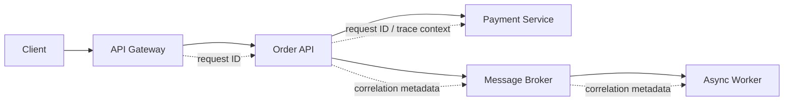

# Correlation ID không chứa thông tin nhạy cảm

Trong chương **API error security** của module `SECURITY_API_SECURITY`, correlation ID giúp nối các log, trace và sự kiện của cùng một request hoặc một luồng xử lý qua nhiều service. Nó hỗ trợ điều tra lỗi, theo dõi request xuyên gateway, application và message consumer. Tuy nhiên, correlation ID là metadata phục vụ quan sát hệ thống, không phải nơi để nhúng danh tính, tenant, credential hay dữ liệu nghiệp vụ.

Một ID như `user-12345-order-98765` có vẻ dễ tìm trong log, nhưng lại làm lộ định danh người dùng và cấu trúc nghiệp vụ cho bất kỳ ai nhìn thấy response header, log hoặc trace. Một ID chứa email, số điện thoại, access token hay session ID còn tạo ra rủi ro nghiêm trọng hơn: dữ liệu nhạy cảm bị nhân bản vào nhiều hệ thống quan sát, nơi thường có quyền truy cập rộng và retention dài. Correlation ID nên là một giá trị opaque, ngẫu nhiên, có giới hạn định dạng và được tạo hoặc kiểm soát tại ranh giới tin cậy.

## 1. Correlation ID dùng để làm gì?

Correlation ID là một mã tham chiếu giúp liên kết các bản ghi thuộc cùng một request hoặc workflow. Ví dụ, một request đi qua API gateway, Order Service, Payment Service và message consumer có thể tạo ra log ở nhiều nơi. Nếu mỗi thành phần ghi cùng một correlation ID, người vận hành có thể tìm toàn bộ dấu vết mà không cần đưa email, user ID hoặc order number vào chuỗi log.



Correlation ID thường giúp trả lời câu hỏi “các log này có thuộc cùng một luồng không?”. Nó không trả lời “ai đang gọi?”, “người gọi có quyền gì?” hay “request đã được xác thực chưa?”. Những câu hỏi đó phải dựa trên principal, token/session, workload identity và authorization policy.

### 1.1. Correlation ID khác các loại ID khác

Các hệ thống thường có nhiều ID với mục đích riêng. Không nên dùng một giá trị cho mọi mục đích.

| Loại ID | Phạm vi | Mục đích | Có nên chứa PII/secret? |
|---|---|---|---|
| Request ID | Một lần nhận request tại một service/edge | Tra cứu log của request | Không |
| Correlation ID | Một luồng nghiệp vụ hoặc chuỗi xử lý liên quan | Liên kết log qua nhiều service | Không |
| Trace ID | Một distributed trace | Liên kết span trong tracing system | Không; phải là giá trị opaque |
| Span ID | Một operation/span trong trace | Xác định một đoạn xử lý | Không |
| Message ID | Một message cụ thể | Deduplication, delivery và audit | Không nhúng dữ liệu nhạy cảm |
| Workflow/Job ID | Một tiến trình nghiệp vụ dài hạn | Theo dõi trạng thái job | Nên opaque; không mã hóa dữ liệu người dùng |
| User/Tenant/Order ID | Định danh nghiệp vụ | Truy vấn resource và authorization | Có thể là dữ liệu nhạy cảm theo ngữ cảnh; không dùng làm correlation ID |
| Idempotency key | Một thao tác cần chống thực hiện trùng | Bảo đảm retry an toàn | Không dùng token/session; giới hạn và quản lý riêng |

Một trace có thể bao gồm nhiều request và nhiều service; một request cũng có thể tạo nhiều trace khi gọi bất đồng bộ hoặc retry. Correlation ID có thể nhóm các hoạt động theo một định nghĩa nghiệp vụ, nhưng không thay thế trace ID, message ID hoặc workflow ID.

### 1.2. Correlation ID không phải credential

Không dùng correlation ID để xác thực, phân quyền, mở file, truy cập đơn hàng hoặc tải dữ liệu. Không coi việc biết một ID là bằng chứng được phép xem request tương ứng. Nếu endpoint cho phép tra cứu trạng thái theo correlation ID, endpoint đó vẫn phải xác thực principal và kiểm tra quyền trên dữ liệu được trả về.

Correlation ID có thể xuất hiện trong response header, ticket hỗ trợ, log hoặc màn hình vận hành. Vì vậy nó không phải secret và không được dùng như bearer token hay capability URL.

## 2. Vì sao không được nhúng thông tin nhạy cảm vào ID?

Một correlation ID thường được sao chép qua nhiều hệ thống: reverse proxy, application log, tracing backend, message header, dashboard, alert, error response và công cụ hỗ trợ. Nếu ID chứa dữ liệu nhạy cảm, dữ liệu đó bị nhân bản theo mọi nơi ID được truyền.

Ví dụ không an toàn:

```text
correlationId = "alice@example.com-order-93827"
correlationId = "tenant-acme-user-10021"
correlationId = "session-eyJhbGciOi..."
correlationId = "+84901234567-2026-11-18"
correlationId = "Bearer-eyJhbGciOiJIUzI1NiJ9..."
```

Các ví dụ này có thể làm lộ email, tenant, user ID, số điện thoại, session hoặc access token. Kể cả khi ID chỉ được lưu trong log nội bộ, log có thể được gửi tới SaaS, được tải về máy developer hoặc giữ lâu hơn dữ liệu nghiệp vụ gốc.

### 2.1. Những loại dữ liệu tuyệt đối không nên đưa vào

- Password, OTP, API key, access token, refresh token, session ID hoặc cookie.
- Private key, chữ ký, credential database và secret provider.
- Email, số điện thoại, địa chỉ, tên thật hoặc định danh cá nhân.
- Số tài khoản, số thẻ, mã giao dịch hoặc định danh thanh toán.
- Tenant ID, user ID, order ID hoặc resource ID nếu chúng có thể tiết lộ cấu trúc dữ liệu hoặc liên kết trực tiếp tới người dùng.
- URL đầy đủ có query string, signed URL, reset token hoặc tham số chứa dữ liệu riêng tư.
- Nội dung lỗi, stack trace, SQL hoặc payload request/response.

Không nên “mã hóa” PII rồi nhúng vào ID để coi là an toàn. Giá trị mã hóa vẫn là dữ liệu có thể giải mã và làm tăng độ phức tạp quản lý key. Hash email hoặc số điện thoại cũng có thể bị dò từ tập giá trị phổ biến; hash không tự động biến dữ liệu cá nhân thành dữ liệu vô danh.

### 2.2. Không dùng ID có cấu trúc dễ suy luận

Tránh tạo ID từ timestamp + sequence + user ID, hoặc nối các field nghiệp vụ bằng dấu phân cách. ID tuần tự có thể tiết lộ lưu lượng, thứ tự hoạt động hoặc quy mô hệ thống; ID dựa trên dữ liệu có thể giúp liên kết hành vi giữa các hệ thống.

Ưu tiên một giá trị ngẫu nhiên, không mang ngữ nghĩa nghiệp vụ. UUIDv4 là một lựa chọn phổ biến. Nếu dùng định dạng khác, cần bảo đảm đủ entropy, không chứa thông tin node/user và không thể dự đoán dễ dàng.

### 2.3. Không dùng hash của dữ liệu nhạy cảm làm correlation ID

Ví dụ `SHA-256(email)` vẫn tạo ra một định danh ổn định cho cùng email. Kẻ có danh sách email có thể tính hash để đối chiếu, từ đó liên kết log hoặc trace với một người cụ thể. HMAC có key làm giảm khả năng dò từ bên ngoài nhưng vẫn tạo định danh bền vững và có thể liên kết dữ liệu; đây không phải lựa chọn mặc định cho correlation ID.

Nếu cần liên kết sự kiện với user hoặc tenant để điều tra, dùng field riêng có kiểm soát truy cập, masking/pseudonymization và retention phù hợp. Không biến correlation ID thành khóa liên kết danh tính trên mọi hệ thống.

## 3. Tạo correlation ID opaque và an toàn

Một correlation ID phù hợp thường có các đặc điểm:

- Được tạo bằng nguồn ngẫu nhiên an toàn hoặc được phát hành bởi một gateway tin cậy.
- Không mã hóa thông tin người dùng, tenant, resource hoặc credential.
- Có định dạng giới hạn, độ dài cố định hoặc bounded length.
- Không chứa ký tự điều khiển, CR/LF hoặc dữ liệu có thể phá cấu trúc log/header.
- Được gắn với một request/workflow theo semantics rõ ràng.
- Không được dùng để cấp quyền hoặc thay thế idempotency.

### 3.1. Dùng UUIDv4 hoặc random identifier

Ví dụ tạo request ID ở Java:

```java
String requestId = UUID.randomUUID().toString();
```

UUIDv4 có phần lớn bit được sinh ngẫu nhiên và không mang user ID hoặc timestamp theo cấu trúc như UUIDv1. Đây là lựa chọn đủ tốt cho correlation ID trong phần lớn ứng dụng. Nếu dùng ID ngắn hơn, cần dùng bộ sinh random có entropy phù hợp và kiểm soát collision ở quy mô thực tế.

Không tự tạo ID bằng `new Random()` hoặc bộ đếm toàn cục nếu yêu cầu là không thể đoán và không để lộ lưu lượng. Dù correlation ID không phải secret, giá trị ngẫu nhiên giúp tránh enumeration và giảm khả năng kẻ gọi cố tình tạo ID trùng để gây nhầm lẫn điều tra.

### 3.2. Tạo ID ở trust boundary

Một cách triển khai phổ biến là gateway tạo request ID mới cho mỗi request và ghi đè header do client gửi. Gateway sau đó truyền ID này tới các service nội bộ qua kết nối được xác thực.

Nếu application có thể được gọi trực tiếp ngoài gateway, application cần tự tạo ID hoặc xác minh rõ upstream identity trước khi chấp nhận ID do upstream cấp. Không tin header chỉ vì tên của nó là `X-Request-ID`.

Trong môi trường nhiều gateway hoặc service, cần thống nhất ai có quyền phát hành ID canonical. Nếu một service nhận request từ nhiều nguồn, có thể tạo request ID local và lưu external request ID riêng để tránh client bên ngoài kiểm soát định danh nội bộ.

### 3.3. Tách ID do client cung cấp khỏi ID do server tạo

Client có thể gửi một mã hỗ trợ để đối chiếu log phía họ. Nếu cần hỗ trợ use case này, dùng hai trường riêng:

```text
X-Request-ID: <server-generated opaque ID>
X-Client-Request-ID: <optional untrusted client reference>
```

`X-Request-ID` là mã canonical do server/gateway tin cậy tạo. `X-Client-Request-ID` chỉ là input không tin cậy, phải giới hạn độ dài và ký tự, không dùng làm khóa chính trong log, không phản chiếu nguyên văn nếu không cần, và không dùng để nối quyền truy cập. Có thể bỏ qua giá trị không hợp lệ hoặc ghi nhận trạng thái invalid mà không lưu nội dung thô.

Nếu kiến trúc yêu cầu gateway nhận một request ID do client gửi, gateway phải ghi đè giá trị đó hoặc lưu riêng trước khi tạo ID nội bộ mới. Không để client chọn ID của một request khác nhằm làm sai lệch điều tra hoặc khiến log của hai tenant bị trộn.

### 3.4. Giới hạn format và độ dài

Định nghĩa format rõ, ví dụ UUID canonical dài 36 ký tự. Nếu nhận external ID, giới hạn chiều dài nhỏ (chẳng hạn 64 hoặc 128 ký tự tùy contract), allowlist ký tự ASCII an toàn và từ chối CR, LF, tab hoặc control character. Không cho phép chuỗi nhiều dòng hoặc header lặp không được xử lý rõ.

Giới hạn giúp tránh log injection, header abuse, memory waste và metric cardinality. Không dùng một chuỗi không giới hạn làm key trong MDC, tracing attribute hoặc cache.

## 4. Phân biệt correlation ID, traceparent và baggage

Distributed tracing có chuẩn truyền context giữa service. W3C Trace Context định nghĩa header `traceparent` và `tracestate`; nhiều hệ thống còn dùng `baggage` để truyền thuộc tính bổ sung. Các header này hữu ích nhưng cần được xem là telemetry context, không phải identity.

### 4.1. Trace ID và Span ID

`traceparent` mang trace ID và parent span ID cùng thông tin flags theo định dạng chuẩn. Trace ID là mã định danh ngẫu nhiên của trace; span ID xác định một span trong trace. Framework như OpenTelemetry thường quản lý việc tạo và truyền các giá trị này.

Không nhúng user ID, tenant ID hoặc order number vào trace ID. Không tự viết parser hoặc sửa chuỗi traceparent bằng regex; dùng thư viện tracing tuân thủ chuẩn và kiểm tra phiên bản SDK.

### 4.2. Trace context từ client vẫn không đáng tin cho authorization

Client có thể gửi `traceparent` hoặc `tracestate`. Hệ thống có thể tiếp tục trace context hợp lệ theo policy, hoặc tạo trace mới tại trust boundary. Dù chọn cách nào, trace ID không chứng minh request đã được xác thực và không được dùng làm permission key.

Kẻ tấn công có thể gửi trace ID cố định để làm nhiều request xuất hiện như cùng một trace, hoặc gửi context gây chi phí tracing cao. Cần giới hạn format, sampling và chính sách tiếp nhận context từ bên ngoài. Không cho phép trace context quyết định tenant hoặc user.

### 4.3. Baggage có nguy cơ mang dữ liệu nhạy cảm

`baggage` được thiết kế để truyền các thuộc tính qua nhiều service. Nếu ứng dụng thêm email, account ID, JWT fragment, tenant secret hoặc dữ liệu nghiệp vụ vào baggage, các giá trị đó có thể xuất hiện trong telemetry và được truyền tới nhiều dependency.

Chỉ đưa thuộc tính tối thiểu, không nhạy cảm và có mục đích rõ vào baggage. Đặt allowlist key/value, giới hạn kích thước tổng và loại bỏ các trường không được phép tại ranh giới tin cậy. Không sao chép toàn bộ request headers hoặc security principal vào baggage.

### 4.4. Correlation ID và Trace ID có thể cùng tồn tại

Một hệ thống có thể trả `X-Request-ID` cho support và đồng thời dùng `traceparent` cho tracing. Có thể ghi cả hai trong log structured fields nhưng cần giữ ý nghĩa riêng. Correlation ID có thể nối workflow qua queue hoặc nhiều trace; trace ID phục vụ một distributed trace cụ thể.

Không cần tạo thêm correlation ID nếu trace ID đã đáp ứng use case hỗ trợ và không cần liên kết rộng hơn. Tránh tạo nhiều ID dư thừa khiến operator không biết nên tìm theo trường nào.

## 5. Truyền ID an toàn qua HTTP và service boundary

Correlation ID có ích khi được truyền nhất quán, nhưng propagation phải có quy tắc. Header từ Internet không tự động trở thành metadata đáng tin cậy ở service nội bộ.

### 5.1. Chọn một header canonical

Tài liệu hóa tên header và semantics, ví dụ `X-Request-ID` cho request ID server cấp. Không để mỗi service dùng một tên khác nhau như `Request-Id`, `Correlation`, `X-Correlation-ID` mà không có mapping rõ. Nếu cần tương thích header cũ, gateway nên chuẩn hóa một lần.

Response có thể trả request ID để người dùng gửi cho bộ phận hỗ trợ:

```http
HTTP/1.1 500 Internal Server Error
Content-Type: application/problem+json
X-Request-ID: 7b2a3d4e-5f60-4a71-8b92-1c3d4e5f6071
```

ID trong ví dụ là giá trị ngẫu nhiên minh họa. Response body chỉ nên có mã lỗi công khai và request ID; không đưa stack trace, SQL, host nội bộ hoặc dữ liệu nhạy cảm vào body/header.

### 5.2. Ghi đè hoặc loại bỏ header từ nguồn không tin cậy

Gateway public nên xóa các header request ID canonical do client gửi rồi tạo giá trị mới. Nếu giữ external reference, lưu vào field riêng đã validate. Service chỉ tin request ID được chuyển qua kết nối upstream đã xác thực và có cấu hình bảo đảm proxy ghi đè header.

Nếu service có thể truy cập trực tiếp, cần áp dụng cùng validation tại service. Không giả định mọi request đều đi qua gateway; misconfiguration, internal load balancer hoặc đường debug có thể tạo entry point khác.

### 5.3. Không chuyển tiếp tất cả header một cách mù quáng

Khi gọi downstream, chỉ truyền các header cần thiết. Tránh sao chép toàn bộ request headers, vì có thể chuyển tiếp `Authorization`, `Cookie`, `X-Forwarded-*`, client-supplied correlation ID hoặc header nội bộ không phù hợp. Correlation metadata nên được tạo/propagate theo allowlist riêng.

Không để downstream dùng correlation ID để xác định user/tenant. Nếu cần principal context, truyền bằng credential service-to-service có audience/scope phù hợp hoặc context đã được xác minh theo kiến trúc; không nhét principal vào correlation header.

### 5.4. Xử lý redirect và outbound request

Không đưa correlation ID vào query string hoặc URL để tiện theo dõi. URL có thể được lưu trong browser history, proxy log, analytics, Referer hoặc third-party telemetry. Nếu cần gửi tới downstream, dùng header được kiểm soát và chỉ gửi trong phạm vi trust boundary phù hợp.

Không chuyển correlation header chứa dữ liệu nội bộ tới host bất kỳ do người dùng cung cấp. Với URL fetcher, outbound request phải qua SSRF policy; header propagation phải có allowlist và không làm lộ metadata nội bộ tới domain ngoài tổ chức.

## 6. Truyền correlation metadata qua message queue

Trong hệ thống bất đồng bộ, request HTTP có thể tạo event hoặc command được xử lý sau đó. Có thể truyền correlation ID như message metadata để nối log producer và consumer.

### 6.1. Đặt trong header/metadata, không ghép vào business payload

Ví dụ metadata message:

```text
messageId: 2f5e...
correlationId: 7b2a...
traceparent: 00-4bf92f3577b34da6a3ce929d0e0e4736-00f067aa0ba902b7-01
schemaVersion: 2
```

Business payload vẫn chứa dữ liệu nghiệp vụ theo schema. Metadata quan sát được tách riêng giúp tránh vô tình đưa correlation ID vào API response hoặc persistence domain model.

### 6.2. Giữ correlation ID nhưng tạo trace/span mới khi phù hợp

Một message có thể được xử lý sau nhiều phút hoặc nhiều giờ. Consumer có thể tiếp tục trace context theo tracing propagation standard hoặc tạo trace mới và liên kết với trace trước bằng link, tùy semantics và thời gian sống của trace backend.

Correlation ID có thể được giữ xuyên workflow nếu nó thực sự đại diện cho cùng một workflow. Nếu một message được fan-out thành nhiều workflow độc lập, cân nhắc tạo workflow ID mới và lưu quan hệ parent/reference rõ ràng thay vì dùng một ID duy nhất cho tất cả.

### 6.3. Không tin metadata do producer tùy ý gửi

Producer có thể ghi correlation ID bất kỳ. Consumer nên validate format/length và phân biệt message đến từ producer nào bằng broker identity/ACL. Không dùng correlation ID để xác định tenant, actor hoặc quyền. Nếu cần tenant context, kiểm tra producer grant và mapping server-side.

Với message từ bên ngoài, gateway/ingestion service nên tạo correlation ID nội bộ và giữ external reference riêng. Không để một producer không tin cậy cố ý dùng ID trùng để trộn log giữa tenant hoặc làm nhiễu điều tra.

## 7. Đưa correlation ID vào log mà không làm lộ dữ liệu

Correlation ID thường được thêm vào structured log để tìm kiếm nhanh. Cần log như một field riêng, không nối trực tiếp input thô vào message tự do.

### 7.1. Structured logging

Ví dụ log JSON:

```json
{
  "timestamp": "2026-11-18T10:15:30Z",
  "level": "ERROR",
  "service": "order-api",
  "event": "payment_authorization_failed",
  "request_id": "7b2a3d4e-5f60-4a71-8b92-1c3d4e5f6071",
  "trace_id": "4bf92f3577b34da6a3ce929d0e0e4736",
  "error_code": "PAYMENT_PROVIDER_UNAVAILABLE"
}
```

Log này chứa ID opaque, service, event và error code ổn định. Không cần thêm email, phone, token hoặc toàn bộ request body để tìm log. Khi cần liên kết với user, dùng hệ thống audit có quyền truy cập và retention riêng thay vì nhúng định danh vào correlation ID.

### 7.2. Tránh log injection

Nếu nhận external correlation reference, không ghi trực tiếp chuỗi có thể chứa newline, tab, escape sequence hoặc ký tự điều khiển. Structured logger thường encode giá trị đúng cách, nhưng vẫn phải giới hạn độ dài và validate. Không tự nối string vào log line hoặc terminal output.

Ví dụ input nguy hiểm:

```text
client-request-id = "abc\r\nlevel=INFO event=admin_login_success"
```

Nếu logger ghi raw string, attacker có thể tạo log line giả và làm sai lệch điều tra. Hãy dùng field riêng, serializer an toàn, allowlist ký tự và không lưu giá trị không hợp lệ.

### 7.3. Redact dữ liệu nhạy cảm ở mọi log path

Correlation ID sạch không bảo đảm log sạch. Cần redaction cho Authorization, Cookie, password, OTP, query token, signed URL, PII và payload nhạy cảm. Redaction phải áp dụng cả application log, gateway log, exception log, trace attributes, message metadata và audit export.

Không dựa vào regex hậu xử lý duy nhất nếu secret có thể xuất hiện ở nhiều định dạng. Tránh log toàn bộ request/response; log allowlist các field cần thiết và error code đã chuẩn hóa.

### 7.4. Không đưa correlation ID vào metric label không giới hạn

Mỗi request có thể có ID riêng. Nếu dùng correlation ID làm label của Prometheus hoặc metric time series, số lượng label sẽ tăng theo số request, gây high cardinality và làm cạn bộ nhớ/chi phí monitoring.

Metric nên dùng label có miền hữu hạn như service, route template, status class, error code và dependency. Correlation ID thuộc log/trace hoặc exemplars có hỗ trợ, không phải label thông thường.

## 8. MDC và context propagation trong Java/Spring

Trong ứng dụng Java, SLF4J MDC thường dùng để gắn request ID vào log mà không phải truyền tham số qua mọi method. Tuy nhiên, MDC thường gắn với thread hiện tại. Nếu không dọn context hoặc truyền context đúng qua thread pool/async execution, request ID có thể bị rò sang request khác hoặc biến mất trong log.

### 8.1. Filter tạo request ID server-side

Ví dụ `OncePerRequestFilter` tạo ID mới cho mỗi request và trả lại qua response header:

```java
@Component
public class RequestIdFilter extends OncePerRequestFilter {
    public static final String HEADER = "X-Request-ID";
    public static final String MDC_KEY = "requestId";

    @Override
    protected void doFilterInternal(
            HttpServletRequest request,
            HttpServletResponse response,
            FilterChain filterChain) throws ServletException, IOException {

        String requestId = UUID.randomUUID().toString();
        try {
            MDC.put(MDC_KEY, requestId);
            response.setHeader(HEADER, requestId);
            filterChain.doFilter(request, response);
        } finally {
            MDC.remove(MDC_KEY);
        }
    }
}
```

Filter này chủ động không dùng header `X-Request-ID` từ client. Nếu gateway tin cậy đã phát hành ID canonical và application cần giữ nguyên, chỉ chấp nhận sau khi xác thực đường upstream, proxy ghi đè header và format được kiểm tra. Khi không có bằng chứng đó, tạo ID local mới.

Đặt filter ở vị trí phù hợp trong servlet filter chain để cả lỗi authentication/authorization cũng có request ID. Nếu response có thể được commit trước khi filter set header, cần đặt header trước khi gọi chain như ví dụ. Với async servlet dispatch, kiểm tra lifecycle để ID và MDC được gắn/dọn đúng cho từng dispatch.

### 8.2. Luôn dọn MDC trong finally

Thread pool tái sử dụng thread giữa nhiều request. Nếu không gọi `MDC.remove()` hoặc restore context trước khi thread được trả về pool, request tiếp theo có thể ghi nhầm ID của request trước. Không chỉ dùng `MDC.clear()` một cách tùy tiện nếu ứng dụng còn các MDC field khác do framework quản lý; lưu/restore key do filter sở hữu.

Nếu filter lồng nhau hoặc nhiều component cùng set request ID, cần quy định owner duy nhất và semantics restore giá trị trước đó. Không để filter ghi đè context rồi xóa mất dữ liệu hợp lệ của component bên ngoài.

### 8.3. Propagate context qua executor

MDC không tự động được sao chép an toàn qua mọi thread pool, `@Async`, `CompletableFuture` hoặc reactive pipeline. Dùng TaskDecorator hoặc context propagation mechanism của framework/observability SDK. Chỉ truyền các field allowlist như request ID và trace context; không sao chép toàn bộ security principal hoặc credential vào MDC.

Ví dụ `TaskDecorator` đơn giản cho MDC:

```java
public class MdcTaskDecorator implements TaskDecorator {
    @Override
    public Runnable decorate(Runnable task) {
        Map<String, String> context = MDC.getCopyOfContextMap();
        return () -> {
            Map<String, String> previous = MDC.getCopyOfContextMap();
            try {
                if (context == null) {
                    MDC.clear();
                } else {
                    MDC.setContextMap(context);
                }
                task.run();
            } finally {
                if (previous == null) {
                    MDC.clear();
                } else {
                    MDC.setContextMap(previous);
                }
            }
        };
    }
}
```

Đây là ví dụ cho executor dùng MDC; reactive stack nên dùng Reactor Context hoặc context propagation phù hợp thay vì dựa vào thread-local. Không propagate context sang task chạy lâu hơn lifecycle request nếu ID đó không còn biểu diễn đúng workflow; hãy dùng workflow/job ID riêng.

## 9. Error response và hỗ trợ khách hàng

Correlation ID giúp người dùng báo lỗi mà không cần gửi toàn bộ dữ liệu request. Error response nên trả một mã tham chiếu opaque và mã lỗi công khai.

Ví dụ:

```json
{
  "type": "https://api.example.test/problems/internal-error",
  "title": "Đã xảy ra lỗi khi xử lý yêu cầu",
  "status": 500,
  "code": "INTERNAL_ERROR",
  "requestId": "7b2a3d4e-5f60-4a71-8b92-1c3d4e5f6071"
}
```

Không trả stack trace, class name, SQL, internal hostname, filesystem path, access token hoặc payload. Người dùng có thể cung cấp `requestId` cho support; support dùng hệ thống log có kiểm soát để tra cứu. Không tạo endpoint public cho phép bất kỳ ai gửi request ID rồi đọc log hoặc trace thô.

### 9.1. Tránh biến ID thành oracle tra cứu dữ liệu

Nếu có màn hình support tra cứu theo request ID, cần xác thực nhân viên, permission theo tenant/customer, audit việc tra cứu và chỉ hiển thị dữ liệu tối thiểu. Request ID ngẫu nhiên không thay authorization. Không trả “ID tồn tại” hay thông tin chi tiết cho caller không có quyền vì điều đó có thể trở thành oracle về hoạt động của người khác.

### 9.2. Giới hạn thông tin trong response header

Response header chỉ nên có request ID opaque và các header vận hành được công bố. Không trả trace baggage, service topology, internal span attributes hoặc ID chứa thông tin tenant/user. Kiểm tra gateway/CDN có thể giữ header nào và đảm bảo header không bị duplicate hoặc phản chiếu input client.

## 10. Bảo vệ correlation metadata trong log và tracing platform

Ngay cả khi correlation ID không chứa PII, log và trace vẫn có thể chứa dữ liệu nhạy cảm ở các field khác. Nền tảng quan sát cần được bảo vệ như một hệ thống lưu dữ liệu production.

### 10.1. Access control và tenant boundary

- Giới hạn quyền xem log/trace theo team, service và môi trường.
- Hạn chế quyền export/download và truy vấn diện rộng.
- Không cho tenant truy cập trace của tenant khác chỉ bằng cách biết correlation ID.
- Audit các truy vấn hỗ trợ có dữ liệu nhạy cảm.
- Dùng môi trường và index tách biệt nếu yêu cầu dữ liệu khác nhau.

### 10.2. Retention và deletion

Đặt retention theo mục đích vận hành và nghĩa vụ dữ liệu. Trace không cần thiết thường có thể giữ ngắn hơn audit record. Không sao chép log production vào môi trường dev hoặc ticket mà không mask. Khi request ID liên kết với một hồ sơ điều tra, việc giữ lại phải theo chính sách retention và legal hold được phê duyệt.

### 10.3. Sampling không phải kiểm soát bảo mật

Sampling giảm lượng trace lưu trữ, nhưng không được dùng để quyết định request có được phép hay không. Attacker có thể gửi trace flags hoặc tạo nhiều request nhằm ảnh hưởng chi phí telemetry; cấu hình collector/SDK phải kiểm soát sampling và giới hạn ingest.

### 10.4. Tránh cardinality và enumeration

ID ngẫu nhiên làm giảm khả năng đoán, nhưng không nên mở API tìm kiếm log không giới hạn theo ID. Giới hạn query rate, thời gian tìm kiếm và quyền theo service/tenant. Metric label dùng tập giá trị hữu hạn; log/trace search có quota và audit.

## 11. Kiểm thử correlation ID và chống rò rỉ

Test cần chứng minh ID được tạo/propagate đúng, không phản chiếu input nguy hiểm và không chứa thông tin nhạy cảm.

### 11.1. Kiểm thử tạo ID

- Mỗi request mới có request ID hợp lệ.
- Hai request độc lập không dùng cùng ID trong test thực tế.
- ID có format/length đúng contract.
- ID không chứa user ID, tenant ID, email, phone, token hoặc timestamp nghiệp vụ.
- ID được tạo kể cả khi request lỗi authentication hoặc application exception.

Không cần chứng minh ID “không bao giờ trùng” bằng test thống kê nhỏ; cần dùng generator phù hợp và theo dõi collision nếu kiến trúc yêu cầu.

### 11.2. Kiểm thử header do client cung cấp

Gửi các giá trị:

- Header vắng mặt.
- UUID hợp lệ.
- Chuỗi quá dài.
- CR/LF, tab và control characters.
- Nhiều header cùng tên hoặc giá trị có dấu phẩy.
- Chuỗi chứa email, số điện thoại, token hoặc SQL.
- ID trùng với request khác.

Xác minh server tạo canonical request ID mới, external reference được lưu riêng hoặc bỏ qua theo policy, và log không bị chèn dòng. Không phản chiếu chuỗi thô vào response.

### 11.3. Kiểm thử propagation

- Gateway ghi đè header client gửi.
- Service downstream nhận cùng request ID canonical qua trust boundary đã xác minh.
- Message consumer nhận correlation metadata đã validate.
- Retry giữ original workflow/correlation reference theo semantics, đồng thời có attempt ID nếu cần.
- Async executor không làm mất context hoặc rò ID sang task tiếp theo.
- Redirect/outbound call không gửi metadata nội bộ tới host không tin cậy.

### 11.4. Kiểm thử log và trace

- Structured log có field `request_id` riêng.
- Authorization, Cookie, OTP, signed URL và payload nhạy cảm được redact.
- Không có correlation ID làm metric label không giới hạn.
- Trace baggage chỉ chứa key/value allowlist.
- Log/trace query cần quyền và được audit.
- Error response không có stack trace hoặc internal details.

### 11.5. Ma trận kiểm thử đề xuất

| Trường hợp | Kết quả mong đợi |
|---|---|
| Request bình thường | ID opaque được tạo và trả theo contract |
| Request không xác thực | Vẫn có ID để điều tra; request bị từ chối theo auth policy |
| Client gửi ID giả | ID canonical không bị client ghi đè |
| Client gửi CRLF | Input bị từ chối/bỏ qua; log không bị giả mạo |
| Request có PII trong body | ID không được tạo từ body hoặc principal |
| Downstream call | ID được propagate có kiểm soát |
| Async worker | Context được truyền đúng và MDC được dọn |
| DLQ/redrive | Metadata có ID nguồn và redrive reference; không chứa secret |
| Metric | Không có ID duy nhất làm label |
| Support lookup | Principal thiếu quyền không thể đọc log bằng cách biết ID |

## 12. Monitoring và vận hành

Correlation ID giúp điều tra nhưng không nên trở thành chỉ số cardinality cao. Theo dõi chất lượng metadata và lỗi propagation bằng metric tổng hợp:

- Tỷ lệ request thiếu request ID trước và sau trust boundary.
- Tỷ lệ external ID sai format hoặc quá dài.
- Số request tạo ID mới do header upstream không hợp lệ.
- Tỷ lệ log/trace thiếu correlation context trong service cần có.
- Lỗi context propagation ở async worker.
- Số lần baggage bị loại bỏ do policy.
- Số truy vấn support theo request ID và actor thực hiện.

Không tạo metric label từ chính ID. Dùng service, route template, error code, environment và outcome làm dimension có giới hạn.

### 12.1. Khi correlation ID không tìm thấy trong log

Không kết luận ngay request chưa tới hệ thống. Có thể ID bị đổi ở gateway, log sampling, retention, async context bị mất, service ghi log sang index khác hoặc trace bị tách. Kiểm tra từng boundary và metadata mapping. Nếu có external client request ID, tìm qua field riêng có quyền truy cập, không thay đổi canonical ID để khớp với client.

### 12.2. Khi phát hiện ID chứa dữ liệu nhạy cảm

1. Dừng phát hành ID format đó và chuyển sang ID opaque mới.
2. Xác định các hệ thống đã nhận ID: gateway log, application, trace, broker, dashboard, ticket và export.
3. Đánh giá loại dữ liệu bị lộ và phạm vi người có thể truy cập.
4. Redact hoặc xóa theo retention/incident policy; giữ evidence cần thiết có kiểm soát.
5. Nếu ID chứa credential, thu hồi/rotate credential tương ứng; xóa ID khỏi log không làm credential mất hiệu lực.
6. Thêm test ngăn ID được tạo từ PII/secret và kiểm tra propagation.

## 13. Lỗi thiết kế thường gặp

| Lỗi | Hệ quả | Cách khắc phục |
|---|---|---|
| Dùng email/user ID làm correlation ID | Lộ danh tính qua log, trace và response | ID ngẫu nhiên, opaque |
| Nối tenant/order ID vào ID | Tiết lộ cấu trúc và tạo liên kết dữ liệu | Lưu business ID ở field riêng có quyền |
| Dùng token/session làm ID | Credential bị nhân bản vào nhiều hệ thống | Không đưa secret vào telemetry; rotate nếu đã lộ |
| Hash PII làm ID | Có thể dò dictionary và liên kết lâu dài | Random ID không mang ngữ nghĩa |
| Tin `X-Request-ID` từ client | Spoofing, log confusion và injection | Gateway ghi đè; server validate và tạo ID riêng |
| Không giới hạn độ dài/ký tự | Log/header abuse và cardinality | Bounded length, allowlist và control-character rejection |
| Dùng correlation ID làm authorization key | Biết ID có thể dẫn tới truy cập sai | Principal và policy độc lập |
| Truyền toàn bộ header xuống service ngoài | Lộ metadata hoặc credential | Header propagation allowlist |
| Nhét PII vào baggage | Dữ liệu lan qua trace collector và vendor | Baggage allowlist, size limit và redaction |
| Không dọn MDC | ID request cũ rò sang request mới | `try/finally`, restore context và async decorator |
| Dùng ID làm metric label | High cardinality, tăng chi phí monitoring | Metric dimensions hữu hạn |
| Public endpoint tra log theo ID | ID trở thành oracle truy vấn dữ liệu | Authentication, authorization và audit lookup |

## 14. Checklist review trước khi phát hành

- [ ] Correlation ID có mục đích và phạm vi rõ; phân biệt request, trace, message và workflow ID.
- [ ] ID opaque, ngẫu nhiên và không chứa PII, tenant/resource ID hoặc secret.
- [ ] Không dùng hash/encryption của PII làm correlation ID.
- [ ] ID canonical được tạo tại trust boundary hoặc từ upstream đã xác minh.
- [ ] Client-supplied reference được tách riêng, validate và không được dùng làm identity.
- [ ] Format/length được giới hạn; CR/LF và control characters bị từ chối hoặc loại bỏ.
- [ ] Gateway ghi đè header canonical từ Internet; service direct-entry có policy tương đương.
- [ ] Correlation ID không được dùng làm credential, authorization key hoặc idempotency key.
- [ ] `traceparent`, `tracestate` và baggage được xử lý bằng tracing SDK và policy riêng.
- [ ] Baggage chỉ có field allowlist, không có PII/secret và có giới hạn kích thước.
- [ ] Downstream/async propagation chỉ truyền metadata cần thiết.
- [ ] Log dùng structured fields; input không tin cậy không thể chèn dòng.
- [ ] MDC được dọn/restore; async và reactive context propagation được kiểm thử.
- [ ] Log, trace và DLQ được bảo vệ bằng access control, encryption, retention và audit.
- [ ] Không dùng correlation ID làm metric label có cardinality không giới hạn.
- [ ] Error response chỉ trả request ID opaque và mã lỗi công khai.
- [ ] Support lookup yêu cầu authentication, authorization và audit.
- [ ] Có test spoofing, CRLF, PII, propagation, async cleanup và redaction.

## Kết luận

Correlation ID giúp nối các dấu vết kỹ thuật mà không cần đưa danh tính hoặc dữ liệu nghiệp vụ vào log. Hãy tạo ID opaque, giới hạn định dạng, kiểm soát header tại trust boundary và tách request ID khỏi trace ID, message ID cùng workflow ID. Propagate metadata theo allowlist, dọn MDC đúng cách, bảo vệ log/trace như dữ liệu production và tuyệt đối không dùng correlation ID làm bằng chứng xác thực hay phân quyền. Như vậy, đội vận hành vẫn điều tra được sự cố mà không nhân bản PII hoặc credential qua toàn bộ hệ thống quan sát.
