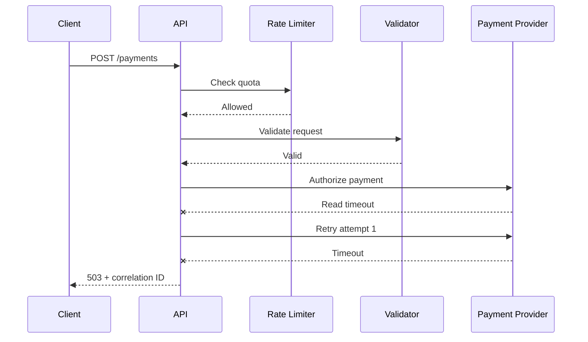

# Ghi rate limit, validation và dependency failure

API logging cần giúp đội vận hành trả lời được request nào bị giới hạn, loại dữ liệu đầu vào nào thường xuyên không hợp lệ và dependency nào đang lỗi. Ba nhóm sự kiện này vừa có giá trị vận hành vừa có ý nghĩa bảo mật: rate limit có thể phát hiện lạm dụng, validation failure có thể chỉ ra fuzzing hoặc dò endpoint, còn dependency failure có thể làm lộ vấn đề availability, retry storm hoặc hành vi fallback nguy hiểm.

Log tốt phải ghi đủ ngữ cảnh để điều tra nhưng không sao chép token, secret, dữ liệu cá nhân hoặc toàn bộ payload vào hệ thống log. Cần phân biệt log sự kiện, metric tổng hợp, distributed trace và audit record; mỗi loại có mục đích, mức chi tiết, quyền truy cập và thời hạn lưu khác nhau.

## 1. Mục tiêu và ranh giới của logging

Với mỗi request, hệ thống nên có khả năng xác định:

- Route template, HTTP method, API version và kết quả xử lý.
- Rate limit policy nào được áp dụng, bucket nào bị chạm ngưỡng và quyết định allow/deny.
- Validation thất bại ở nhóm quy tắc nào, tại bước nào và có bị từ chối trước side effect hay không.
- Dependency nào được gọi, operation nào thất bại, lỗi thuộc timeout, connection, HTTP response hay circuit breaker.
- Request/trace nào liên kết được log ở gateway, API, worker và dependency.
- Có dấu hiệu lạm dụng, lỗi cấu hình hoặc sự cố availability cần cảnh báo không.

Logging không thay thế authorization, rate limiting, input validation, circuit breaker hoặc audit. Nó ghi lại kết quả và ngữ cảnh của các cơ chế đó để con người và hệ thống giám sát hiểu chuyện gì đã xảy ra.

### 1.1. Phân biệt log, metric, trace và audit

| Loại telemetry | Câu hỏi chính | Ví dụ |
|---|---|---|
| Structured log | Một sự kiện cụ thể đã xảy ra như thế nào? | Request bị `429` bởi policy `orders-read-per-user` |
| Metric | Sự kiện xảy ra bao nhiêu lần và xu hướng ra sao? | Tỷ lệ `429` theo route và client tier |
| Distributed trace | Request đi qua những service nào và chậm ở đâu? | Span gọi payment provider mất 2,4 giây rồi timeout |
| Audit record | Ai đã thực hiện hành động bảo mật/nghiệp vụ nào? | Principal bị từ chối thao tác `payments:refund` trên resource |

Không dùng log thay cho metric bằng cách đếm mọi dòng log ở dashboard nếu metric có thể được phát trực tiếp. Không dùng trace để lưu payload nhạy cảm. Audit record cần độ bền, quyền truy cập và retention riêng vì có thể được dùng cho điều tra hoặc tuân thủ.

## 2. Thiết kế structured log nhất quán

Ưu tiên log có cấu trúc như JSON thay vì ghép chuỗi tự do. Các field ổn định giúp truy vấn, lọc, tổng hợp và cảnh báo chính xác hơn.

Một schema log request có thể gồm:

| Field | Ý nghĩa | Ví dụ |
|---|---|---|
| `timestamp` | Thời điểm sự kiện UTC | `2026-11-18T10:15:30.125Z` |
| `level` | Mức độ log | `INFO`, `WARN`, `ERROR` |
| `event` | Tên sự kiện có kiểm soát | `api.rate_limit.denied` |
| `service` | Tên service | `orders-api` |
| `environment` | Môi trường | `production` |
| `route` | Route template, không phải raw URL | `/api/orders/{orderId}` |
| `method` | HTTP method | `GET` |
| `status_code` | HTTP status | `429` |
| `request_id` | Correlation ID nội bộ | `req_8f2c` |
| `trace_id` | Distributed trace ID | `4bf92f3577b34da6a3ce929d0e0e4736` |
| `principal_ref` | Định danh đã được pseudonymize nếu cần | `usr_hmac_92ab` |
| `tenant_ref` | Tenant reference được phép ghi log | `tnt_hmac_14ef` |
| `duration_ms` | Thời gian xử lý | `34` |
| `outcome` | Kết quả tổng quát | `denied`, `invalid`, `timeout` |

Ví dụ một log JSON:

```json
{
  "timestamp": "2026-11-18T10:15:30.125Z",
  "level": "INFO",
  "event": "api.rate_limit.denied",
  "service": "orders-api",
  "environment": "production",
  "route": "/api/orders/{orderId}",
  "method": "GET",
  "status_code": 429,
  "request_id": "req_8f2c",
  "trace_id": "4bf92f3577b34da6a3ce929d0e0e4736",
  "principal_ref": "usr_hmac_92ab",
  "policy_id": "orders-read-per-user",
  "limit": 120,
  "window_seconds": 60,
  "retry_after_seconds": 18,
  "outcome": "denied"
}
```

Field name, event name và kiểu dữ liệu nên được chuẩn hóa giữa service. Không đưa raw URL có query string vào `route`; query có thể chứa email, token, search term hoặc dữ liệu cá nhân. Route template giúp giảm cardinality và tránh lưu ID riêng tư trong log.

## 3. Ghi nhận rate limit decision

Khi rate limiter từ chối request, log nên giúp xác định policy và phạm vi giới hạn mà không tiết lộ credential hoặc giá trị bucket nội bộ.

### 3.1. Những thông tin nên ghi

- Event name, ví dụ `api.rate_limit.allowed` hoặc `api.rate_limit.denied`.
- Route template và method.
- Policy ID/version đã áp dụng.
- Dimension của limit: principal, API client, tenant, IP hoặc route class.
- Limit, window và retry-after nếu có.
- Số lần request hoặc trạng thái bucket ở dạng cần thiết.
- Principal/client/tenant reference đã pseudonymize nếu cần điều tra theo chủ thể.
- HTTP status và correlation/trace ID.

Ví dụ:

```json
{
  "event": "api.rate_limit.denied",
  "level": "INFO",
  "route": "/api/reports/export",
  "method": "POST",
  "policy_id": "report-export-per-tenant",
  "limit_dimension": "tenant",
  "tenant_ref": "tnt_hmac_14ef",
  "limit": 10,
  "window_seconds": 3600,
  "retry_after_seconds": 240,
  "status_code": 429,
  "request_id": "req_91b7"
}
```

### 3.2. Không log rate-limit key hoặc credential thô

Rate limiter có thể tạo key từ API key, user ID, tenant ID hoặc IP. Không ghi nguyên giá trị key nếu nó chứa credential hoặc định danh cá nhân. Không ghi `Authorization`, cookie, API key hoặc session ID.

Nếu cần nối nhiều sự kiện của cùng principal, dùng reference pseudonymized bằng HMAC với khóa logging riêng, hoặc ID nội bộ đã được phê duyệt cho mục đích log. Hash không khóa của email hoặc ID dễ đoán có thể bị dò ngược bằng dictionary; không coi SHA-256 thuần là pseudonymization đủ mạnh cho dữ liệu ít entropy.

IP address có thể là dữ liệu cá nhân theo bối cảnh pháp lý. Chỉ lưu khi có mục đích bảo mật rõ, giới hạn quyền truy cập và retention; cân nhắc rút gọn IPv4/IPv6 hoặc dùng tokenized reference. Không lấy `X-Forwarded-For` tùy ý từ client làm IP thật; chỉ tin forwarding header từ proxy nằm trong trusted proxy list và dùng đúng quy tắc chọn hop.

### 3.3. Chọn log level và tránh log flood

Một request `429` có thể là hành vi bình thường khi client chạm quota đã công bố. Không nhất thiết ghi từng request ở mức `WARN` hoặc `ERROR`; điều đó có thể tạo alert fatigue và biến log thành bề mặt DoS.

Gợi ý:

| Tình huống | Logging gợi ý |
|---|---|
| Client chạm quota bình thường | Metric/counter; log `INFO` có sampling hoặc theo ngưỡng |
| Một principal vượt limit lặp lại bất thường | `WARN` hoặc security event tổng hợp |
| Nhiều principal/IP tạo burst có dấu hiệu tấn công | Security alert/aggregate event |
| Rate limiter store không truy cập được | `ERROR` cho dependency failure, kèm policy fallback |
| Policy cấu hình sai hoặc limit bị bỏ qua ngoài dự kiến | `ERROR`/audit event và cảnh báo vận hành |

Không log mọi request được allow ở mức chi tiết cao nếu lưu lượng lớn. Có thể dùng metric cho toàn bộ traffic, log sampling cho request bình thường và log đầy đủ cho các quyết định bất thường có rủi ro cao.

### 3.4. Ghi rõ hành vi fail-open hoặc fail-closed

Nếu Redis hoặc rate-limit service không sẵn sàng, hệ thống có thể fail-open hoặc fail-closed tùy endpoint và threat model. Quyết định đó phải được ghi nhận rõ:

```json
{
  "event": "api.rate_limit.dependency_failure",
  "level": "ERROR",
  "dependency": "rate-limit-store",
  "route_group": "payments-write",
  "failure_type": "timeout",
  "fallback": "fail_closed",
  "request_outcome": "rejected",
  "request_id": "req_2d11"
}
```

Không chỉ ghi “rate limit error”. Cần biết hệ thống đã cho request đi qua hay từ chối khi limiter lỗi, đặc biệt với endpoint tạo thanh toán, gửi OTP, đăng nhập hoặc export dữ liệu.

## 4. Ghi nhận validation failure

Validation failure có thể đến từ client tích hợp sai, bug frontend, schema drift, fuzzing hoặc attacker cố đưa dữ liệu vượt qua parser. Log cần giúp phân biệt các nhóm nguyên nhân mà không sao chép giá trị đầu vào.

### 4.1. Phân loại lỗi validation

Có thể chuẩn hóa các nhóm mã:

| Nhóm | Ví dụ | Event/code gợi ý |
|---|---|---|
| Syntax/parse | JSON malformed, encoding sai | `request.parse_failed` |
| Missing field | Thiếu field bắt buộc | `request.validation_failed` / `REQUIRED_FIELD_MISSING` |
| Type mismatch | String thay cho integer | `TYPE_MISMATCH` |
| Format | UUID, date hoặc email sai định dạng | `INVALID_FORMAT` |
| Range/length | Số âm, chuỗi quá dài | `VALUE_OUT_OF_RANGE` |
| Enum/allowlist | Method, sort hoặc status không hỗ trợ | `UNSUPPORTED_VALUE` |
| Cross-field rule | `from` sau `to` | `CONSTRAINT_VIOLATION` |
| Business validation | Trạng thái không cho phép chuyển tiếp | `BUSINESS_RULE_REJECTED` |
| Resource limit | Body, array hoặc nesting vượt ngưỡng | `INPUT_LIMIT_EXCEEDED` |

Không dùng raw exception class hoặc message thư viện làm event code công khai. Mã lỗi nên ổn định, có danh sách kiểm soát và không chứa nội dung do client tùy ý tạo.

### 4.2. Những gì nên ghi

- Event name và validation code.
- Route template, method, API version.
- Tên field hoặc JSON Pointer đã chuẩn hóa nếu không nhạy cảm.
- Vị trí lỗi ở dạng index/path có giới hạn.
- Schema version hoặc validator version.
- Content type và kích thước body theo bucket nếu hữu ích.
- Principal/client/tenant reference đã pseudonymize.
- HTTP status, request ID và trace ID.
- Có side effect hay chưa; thông thường validation phải xảy ra trước side effect.

Ví dụ:

```json
{
  "event": "api.validation.failed",
  "level": "INFO",
  "route": "/api/orders",
  "method": "POST",
  "api_version": "v2",
  "validation_code": "VALUE_OUT_OF_RANGE",
  "field": "items[2].quantity",
  "schema_version": "orders-create-2.1",
  "body_size_bucket": "1-4KB",
  "status_code": 400,
  "principal_ref": "usr_hmac_92ab",
  "side_effect_started": false,
  "request_id": "req_33c1"
}
```

### 4.3. Không ghi giá trị field hoặc toàn bộ payload theo mặc định

Không ghi password, access token, refresh token, API key, số thẻ, dữ liệu sức khỏe, địa chỉ hoặc nội dung request đầy đủ chỉ để giải thích validation. Thay vào đó, ghi tên field, loại lỗi, độ dài hoặc bucket giá trị nếu thực sự cần.

Ví dụ không an toàn:

```text
Validation failed: password=CorrectHorseBatteryStaple123
```

Ví dụ phù hợp hơn:

```json
{
  "event": "api.validation.failed",
  "validation_code": "VALUE_TOO_SHORT",
  "field": "password",
  "observed_length_bucket": "8-15"
}
```

Ngay cả tên field cũng có thể chứa dữ liệu nếu API cho phép map key động. Cần giới hạn độ dài, loại bỏ control character và tránh ghi nguyên JSON Pointer do client tạo nếu nó có thể chứa dữ liệu tùy ý.

### 4.4. Tránh biến validation logging thành log injection

Client có thể gửi newline, tab, ANSI escape hoặc chuỗi giả JSON trong header/field. Structured logger thường serialize an toàn, nhưng vẫn cần giới hạn và sanitize field do client kiểm soát.

Không ghép raw input vào một dòng log tự do. Dùng field có cấu trúc, encode đúng format, giới hạn độ dài và loại control character. Không để attacker tạo một giá trị `event`, `level`, `service` hoặc `principal` ghi đè metadata hệ thống.

### 4.5. Phân biệt lỗi client với dấu hiệu tấn công

Một validation failure đơn lẻ thường là lỗi request bình thường. Một chuỗi payload bất thường, nhiều schema violation khác nhau, path traversal probe hoặc request lặp ở tốc độ cao có thể cần security alert.

Không nâng mọi lỗi `400` thành cảnh báo bảo mật. Kết hợp tần suất, principal/client, route, loại lỗi và hành vi trước/sau để phát hiện pattern. Cần giới hạn số event chi tiết để attacker không thể làm cạn log storage bằng cách gửi payload sai liên tục.

## 5. Ghi nhận dependency failure

Dependency failure xảy ra khi API gọi database, cache, message broker, identity provider, payment provider hoặc service nội bộ nhưng không nhận được kết quả mong đợi. Log cần phân biệt lỗi ở dependency với lỗi request của caller và cho biết hệ thống đã retry, fallback hoặc mở circuit breaker như thế nào.

### 5.1. Phân loại failure

| Loại | Ví dụ | Ý nghĩa vận hành |
|---|---|---|
| Connection failure | DNS, TCP connect refused, TLS handshake | Không thiết lập được kết nối |
| Timeout | Connect/read/request timeout | Không có kết quả trong thời hạn |
| Upstream HTTP error | `429`, `500`, `502`, `503`, `504` | Dependency trả response lỗi |
| Protocol/parse error | Response sai content type hoặc schema | Dependency phản hồi không đúng hợp đồng |
| Authentication failure | Credential service hết hạn, audience sai | Service identity hoặc token exchange lỗi |
| Authorization failure | Upstream từ chối scope/permission | Cấu hình quyền hoặc policy không khớp |
| Circuit open | Circuit breaker ngăn lời gọi | Dependency đang được bảo vệ khỏi request mới |
| Bulkhead rejection | Hết concurrency slot/thread pool | Hạn mức tài nguyên nội bộ đã chạm ngưỡng |
| Retry exhausted | Đã hết số lần retry | Request không thể hoàn tất sau retry policy |
| Fallback used | Trả cache/stale/default hoặc degraded result | Kết quả không đến từ dependency chính |

Không gom tất cả thành `UPSTREAM_ERROR`. Phân loại rõ giúp xác định sự cố do network, dependency, credential, schema hay giới hạn tài nguyên nội bộ.

### 5.2. Field nên có trong dependency log

- Tên dependency logic, ví dụ `payment-provider` hoặc `customer-profile-service`.
- Operation, ví dụ `authorize-payment`, `lookup-customer`.
- Upstream status hoặc failure type.
- Timeout budget và elapsed time.
- Retry attempt, retry limit và backoff nếu có.
- Circuit breaker state hoặc bulkhead result.
- Fallback/degraded mode đã áp dụng.
- Request/trace ID để nối span upstream.
- Kết quả cuối cùng đối với API caller.

Ví dụ:

```json
{
  "event": "api.dependency.failed",
  "level": "ERROR",
  "dependency": "payment-provider",
  "operation": "authorize-payment",
  "failure_type": "read_timeout",
  "timeout_ms": 2000,
  "elapsed_ms": 2004,
  "retry_attempt": 2,
  "retry_limit": 2,
  "circuit_state": "OPEN",
  "fallback": "none",
  "request_outcome": "503",
  "request_id": "req_5a01",
  "trace_id": "4bf92f3577b34da6a3ce929d0e0e4736"
}
```

### 5.3. Không làm lộ thông tin kết nối và credential

Không log URL upstream đầy đủ nếu query string có API key hoặc signed parameter. Không ghi `Authorization`, cookie, client secret, database connection string, TLS private key hoặc nội dung response có dữ liệu nhạy cảm.

Log tên dependency logic và operation thường đủ để điều tra. Nếu cần host/region để phân biệt instance, dùng identifier đã được phê duyệt như `upstream_cluster` hoặc `region`, không ghi URL tùy ý do response điều khiển.

Không trả exception message của HTTP client trực tiếp cho caller; message có thể chứa hostname, internal IP, path, query hoặc credential. Response công khai nên dùng error code và correlation ID, còn chi tiết kỹ thuật nằm trong log được bảo vệ.

### 5.4. Ghi rõ retry và fallback

Retry có thể khuếch đại sự cố nếu nhiều request cùng retry liên tục. Log nên cho biết attempt hiện tại, retry limit, backoff và lý do retry. Tránh ghi một stack trace đầy đủ ở mọi attempt; có thể ghi event ngắn cho từng attempt và một exception chi tiết ở lần cuối hoặc theo sampling.

Nếu dùng fallback, ghi chính xác fallback nào được áp dụng:

- Cache hit/stale data.
- Degraded response với một số field bị thiếu.
- Queue hóa tác vụ để xử lý sau.
- Circuit breaker từ chối sớm.
- Fail-open hoặc fail-closed đối với dependency bảo mật.

Không ghi `success` chung khi API chỉ trả dữ liệu stale hoặc đã bỏ qua một bước kiểm tra. Kết quả degraded cần được thể hiện rõ để dashboard và người vận hành không nhầm với thành công đầy đủ.

## 6. Liên kết rate limit, validation và dependency failure bằng correlation

Một request có thể tạo nhiều sự kiện: validation pass, rate limit allow, dependency timeout, retry và cuối cùng trả `503`. Cần một correlation ID ổn định trong phạm vi request để nối các log.

Ví dụ chuỗi sự kiện:



Các log có thể cùng chứa `request_id`, `trace_id`, route template và outcome tương ứng. Không dùng correlation ID làm credential hoặc quyền truy cập log. Nếu client được phép gửi request ID, server cần validate định dạng/độ dài hoặc tạo ID nội bộ mới; không tin một giá trị tùy ý để nối các sự kiện bảo mật.

### 6.1. Trace context từ bên ngoài

W3C `traceparent` có thể được dùng để nối distributed trace, nhưng trace context do client gửi là metadata quan sát, không phải danh tính. Kiểm tra cú pháp, giới hạn kích thước và không đưa dữ liệu nhạy cảm vào `tracestate` hoặc baggage.

Không đưa access token, email, tenant secret hoặc payload vào span attribute. Span name nên dùng route template, không dùng URL chứa ID hoặc query. Nếu cần liên kết principal, dùng reference pseudonymized trong log bảo mật thay vì đưa raw identity vào mọi trace.

## 7. Từ log sang metric và cảnh báo

Log giải thích sự kiện; metric giúp phát hiện xu hướng. Nên phát metric riêng cho ba nhóm:

| Metric | Label gợi ý | Mục đích |
|---|---|---|
| `api_rate_limit_decisions_total` | `route`, `policy`, `decision` | Theo dõi allow/deny theo policy |
| `api_validation_failures_total` | `route`, `validation_code`, `schema_version` | Phát hiện client lỗi hoặc input probing |
| `api_dependency_failures_total` | `dependency`, `operation`, `failure_type` | Theo dõi dependency degradation |
| `api_dependency_duration_seconds` | `dependency`, `operation` | Đo latency upstream |
| `api_dependency_retries_total` | `dependency`, `operation` | Phát hiện retry storm |
| `api_circuit_breaker_state` | `dependency`, `state` | Quan sát trạng thái bảo vệ |

Không dùng `user_id`, `request_id`, raw IP, email hoặc resource ID làm label metric vì cardinality có thể tăng không giới hạn. Các giá trị này phù hợp hơn với log có kiểm soát.

### 7.1. Ví dụ cảnh báo

- Tỷ lệ `429` tăng đột biến trên endpoint đăng nhập, OTP hoặc export.
- Validation failure của cùng một client tăng mạnh hoặc xuất hiện nhiều mã lỗi bất thường.
- Dependency timeout vượt ngưỡng trong một cửa sổ thời gian.
- Retry rate tăng nhanh trong khi upstream success rate giảm.
- Circuit breaker mở liên tục hoặc không đóng lại sau thời gian dự kiến.
- Rate limiter store lỗi khiến policy chuyển sang fail-open.
- Một dependency trả schema không hợp lệ hoặc authentication failure hàng loạt.

Alert cần dựa trên tỷ lệ, thời lượng và mức ảnh hưởng, không chỉ một dòng log `ERROR`. Có thể dùng burn rate hoặc SLO để tránh cảnh báo từ một lỗi thoáng qua.

## 8. Bảo vệ log khỏi lộ dữ liệu và bị giả mạo

Log là một kho dữ liệu nhạy cảm. Nó có thể chứa định danh người dùng, hành vi bảo mật, tenant reference, lỗi dependency và thông tin hạ tầng.

### 8.1. Redaction và data minimization

Không ghi các dữ liệu sau theo mặc định:

- Password, access token, refresh token, API key, session cookie.
- Private key, HMAC secret, client secret và database credential.
- Toàn bộ request/response body nếu có dữ liệu cá nhân hoặc tài chính.
- Số thẻ, mã xác thực, OTP hoặc dữ liệu định danh đầy đủ.
- URL có signed query parameter hoặc credential.
- Stack trace/exception message vào kênh log mà người dùng không được phép xem.

Thay bằng mã lỗi, field name, kích thước theo bucket, dependency ID, route template và reference đã pseudonymize. Redaction cần chạy trước khi log được gửi tới collector; không chỉ ẩn dữ liệu trên dashboard.

### 8.2. Phân quyền và bảo vệ integrity

- Chỉ cấp quyền đọc log theo vai trò và nhu cầu điều tra.
- Tách quyền xem audit/security log khỏi quyền vận hành thông thường khi phù hợp.
- Mã hóa khi truyền và khi lưu.
- Giới hạn retention theo mục đích; có quy trình xóa hoặc archive.
- Bảo vệ log khỏi sửa/xóa trái phép bằng immutable storage hoặc cơ chế integrity phù hợp.
- Đồng bộ thời gian hệ thống để timestamp giữa service có thể so sánh.
- Ghi nhận truy cập, export và thay đổi cấu hình logging.
- Không cho client kiểm soát `level`, `event`, `service` hoặc timestamp tùy ý.

### 8.3. Sampling có kiểm soát

Sampling giúp giảm chi phí nhưng không được làm mất mọi sự kiện bảo mật quan trọng. Có thể sampling request thành công bình thường, nhưng giữ metric đầy đủ và ghi log cho các quyết định deny, failure quan trọng hoặc một tỷ lệ đại diện theo policy.

Nếu log theo ngưỡng, ghi cả aggregate count và khoảng thời gian. Đừng để attacker tạo nhiều sự kiện khiến hệ thống chỉ giữ lại mẫu ngẫu nhiên mà bỏ qua tín hiệu đầu tiên hoặc principal quan trọng.

## 9. Ví dụ triển khai trong Java/Spring

Ví dụ dưới đây minh họa cách log validation failure bằng mã lỗi có kiểm soát. Không serialize toàn bộ request DTO vào log.

```java
@RestControllerAdvice
public class ValidationLogHandler {
    private static final Logger log =
            LoggerFactory.getLogger(ValidationLogHandler.class);

    @ExceptionHandler(MethodArgumentNotValidException.class)
    ResponseEntity<ProblemDetail> handleValidation(
            MethodArgumentNotValidException ex,
            HttpServletRequest request) {

        List<String> fields = ex.getBindingResult()
                .getFieldErrors()
                .stream()
                .map(error -> safeFieldName(error.getField()))
                .distinct()
                .limit(10)
                .toList();

        log.atInfo()
                .addKeyValue("event", "api.validation.failed")
                .addKeyValue("route", routeTemplate(request))
                .addKeyValue("method", request.getMethod())
                .addKeyValue("validation_code", "CONSTRAINT_VIOLATION")
                .addKeyValue("fields", fields)
                .addKeyValue("request_id", requestId(request))
                .log("Request validation failed");

        ProblemDetail problem = ProblemDetail.forStatus(400);
        problem.setTitle("Invalid request");
        problem.setProperty("code", "VALIDATION_FAILED");
        return ResponseEntity.badRequest().body(problem);
    }

    private String safeFieldName(String field) {
        if (field == null || field.length() > 100) return "unknown";
        return field.replaceAll("[^A-Za-z0-9_.\\[\\]-]", "_");
    }
}
```

Các hàm `routeTemplate()` và `requestId()` cần lấy dữ liệu đã chuẩn hóa từ framework hoặc middleware tin cậy. Không dùng raw request URI có query string. Trong production, cần giới hạn số field lỗi, tránh log cùng một payload quá nhiều lần và không ghi `error.getRejectedValue()`.

### 9.1. Ví dụ log dependency failure

```java
try {
    return paymentClient.authorize(command);
} catch (ReadTimeoutException ex) {
    log.atError()
            .addKeyValue("event", "api.dependency.failed")
            .addKeyValue("dependency", "payment-provider")
            .addKeyValue("operation", "authorize-payment")
            .addKeyValue("failure_type", "read_timeout")
            .addKeyValue("retry_attempt", attempt)
            .addKeyValue("request_id", requestId)
            .log("Payment provider did not respond within timeout");

    throw new PaymentDependencyUnavailableException();
}
```

Không log `ex.getMessage()` nếu thư viện có thể đưa URL, header hoặc query nhạy cảm vào message. Stack trace đầy đủ có thể được giữ trong log nội bộ có kiểm soát, nhưng nên tránh lặp lại trên mọi retry.

### 9.2. Ví dụ ghi rate limit decision

```java
void logRateLimitDenied(
        String route,
        String method,
        String policyId,
        String principalRef,
        long retryAfterSeconds,
        String requestId) {

    log.atInfo()
            .addKeyValue("event", "api.rate_limit.denied")
            .addKeyValue("route", route)
            .addKeyValue("method", method)
            .addKeyValue("policy_id", policyId)
            .addKeyValue("principal_ref", principalRef)
            .addKeyValue("retry_after_seconds", retryAfterSeconds)
            .addKeyValue("request_id", requestId)
            .log("Request rejected by rate limit policy");
}
```

`principalRef` phải được tạo từ nguồn identity đã xác minh và pseudonymize theo logging policy. Không truyền raw API key hoặc token vào hàm logging.

## 10. Kiểm thử logging

Không chỉ kiểm tra code có gọi logger. Cần xác minh log được phát ra với field cần thiết, không chứa dữ liệu cấm và có thể liên kết với metric/trace.

| Tình huống | Kết quả cần xác minh |
|---|---|
| Request bị rate limit | Có event/policy/route/status/retry-after phù hợp |
| Request allow bình thường | Metric được cập nhật; log chi tiết tuân theo sampling |
| Rate-limit store timeout | Ghi dependency failure và quyết định fail-open/closed thực tế |
| JSON malformed | Có parse failure code; không log raw body |
| Field validation sai | Có field/code/schema version; không log rejected value nhạy cảm |
| Input chứa newline/control character | Không thể tạo log injection hoặc giả mạo field hệ thống |
| Payload quá lớn | Log kích thước/bucket và limit; không sao chép payload |
| Dependency connect/read timeout | Có dependency, operation, failure type và elapsed time |
| Retry nhiều lần | Attempt/retry limit được ghi rõ; không tạo stack trace flood |
| Circuit breaker open | Log/metric phản ánh trạng thái và request outcome |
| Fallback được dùng | Ghi đúng degraded mode, không báo success đầy đủ |
| Token hoặc API key fixture | Secret không xuất hiện trong log, trace, error report |
| Query string có email/token giả | Raw query không bị ghi vào access log |
| Nhiều tenant/principal | Log reference không làm lộ định danh ngoài policy |
| Correlation ID từ client bất thường | Được validate hoặc thay bằng ID nội bộ |
| Log collector unavailable | Hành vi buffering/drop/backpressure được xác định, không làm sập API |

Nên dùng secret fixture giả có thể tìm kiếm trong log test để xác nhận redaction. Kiểm thử ở cả application logger, gateway/access log, APM agent và log collector vì một lớp có thể ghi dữ liệu mà lớp khác đã che.

## 11. Xử lý khi hệ thống logging gặp sự cố

Logging pipeline cũng là dependency. Nếu collector chậm hoặc không sẵn sàng, ứng dụng có thể bị block bởi appender đồng bộ, đầy disk hoặc tạo backpressure.

Thiết kế cần xác định:

- Appender đồng bộ hay bất đồng bộ và queue capacity.
- Hành vi khi queue đầy: drop, block hay ghi buffer cục bộ.
- Log nào bắt buộc phải giữ, log nào có thể sampling/drop.
- Cảnh báo khi log loss hoặc collector lag vượt ngưỡng.
- Disk quota, rotation và bảo vệ file log cục bộ.
- Không để attacker tạo validation failure hàng loạt làm cạn disk.

Không nên làm API ngừng toàn bộ chỉ vì log debug không gửi được. Với audit/security event bắt buộc phải lưu, có thể cần durable queue hoặc transactional outbox riêng; quyết định này phải được thiết kế theo mức quan trọng của sự kiện. Không âm thầm drop audit record bắt buộc.

## 12. Ma trận giám sát vận hành

| Tín hiệu | Nguồn | Hành động điều tra |
|---|---|---|
| `429` tăng trên một route | Rate-limit metric/log | Kiểm tra client, policy, traffic burst và khả năng abuse |
| Validation failure tăng theo schema version | Validation metric | Kiểm tra client rollout, schema drift hoặc fuzzing |
| Một principal thử nhiều loại field/path bất thường | Security log | Đánh giá probing, enumeration hoặc automation độc hại |
| Dependency timeout tăng | Dependency metric/trace | Kiểm tra latency, network, pool và upstream health |
| Retry tăng cùng upstream error | Retry metric | Kiểm tra retry storm, backoff và idempotency |
| Circuit breaker liên tục open | Circuit metric/log | Kiểm tra dependency và ngưỡng breaker |
| Rate limiter fail-open | Security/operational event | Đánh giá rủi ro endpoint và khôi phục limiter |
| Log collector lag hoặc drop | Logging pipeline metric | Kiểm tra queue, storage, network và backpressure |
| Secret xuất hiện trong log scan | DLP/redaction test | Xử lý credential exposure và sửa redaction path |

Dashboard nên phân biệt traffic hợp lệ bị quota với abuse, validation lỗi do client rollout với input probing, và dependency failure với lỗi do chính API. Tránh dashboard chỉ đếm `ERROR` vì nhiều sự kiện rate limit hoặc validation bình thường không phải lỗi hệ thống.

## 13. Checklist logging cho rate limit, validation và dependency failure

- [ ] Log có cấu trúc, event name và field schema nhất quán.
- [ ] Route dùng template, không ghi raw URL/query string.
- [ ] Rate limit log có policy ID, dimension, limit/window và retry-after phù hợp.
- [ ] Rate-limit key, API key, token, cookie và session ID không bị ghi thô.
- [ ] Principal/IP/tenant reference được xử lý theo privacy policy.
- [ ] Validation log ghi error code, field/schema context cần thiết, không ghi rejected value hoặc payload.
- [ ] Input do client kiểm soát được giới hạn/sanitize để tránh log injection.
- [ ] Dependency log phân biệt connection, timeout, HTTP, parse, auth, circuit và retry failure.
- [ ] Retry/fallback/fail-open/fail-closed được ghi đúng outcome thực tế.
- [ ] Exception message và upstream URL không làm lộ credential hoặc internal detail.
- [ ] Request ID/trace ID liên kết được các tầng nhưng không được dùng làm credential.
- [ ] Metric label có cardinality giới hạn; không dùng user/resource ID tùy ý.
- [ ] Log level, sampling và alert threshold tránh log flood/alert fatigue.
- [ ] Log storage có access control, encryption, retention và integrity protection.
- [ ] Có test redaction ở app, gateway, APM và collector.
- [ ] Có monitoring cho log loss, queue lag và collector outage.

## 14. Nguyên tắc thiết kế

Rate limit logging cần cho biết policy nào quyết định allow/deny và giới hạn nào đã chạm mà không lưu credential hoặc định danh thô. Validation logging cần phân loại lỗi theo mã ổn định, ghi field/schema context vừa đủ và tránh sao chép payload. Dependency failure logging cần phân biệt loại lỗi, operation, timeout, retry, circuit breaker và fallback để đội vận hành hiểu trạng thái thực tế.

Hãy dùng structured log, correlation/trace ID đã kiểm soát, metric có cardinality thấp và audit record riêng cho sự kiện cần độ bền. Bảo vệ log như một kho dữ liệu nhạy cảm, kiểm thử redaction ở mọi tầng và xác định hành vi khi logging pipeline lỗi. **Log hữu ích là log đủ để điều tra và hành động, nhưng không biến dữ liệu đầu vào, credential hoặc thông tin nội bộ thành một bề mặt rò rỉ mới.**
