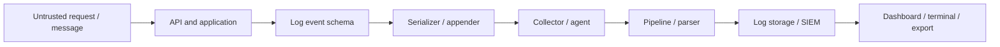

# Chống log injection từ input

Log là bằng chứng để vận hành, điều tra sự cố và phát hiện hành vi bất thường. Nếu API ghi trực tiếp dữ liệu do client kiểm soát vào log, attacker có thể chèn dòng giả, làm sai cấu trúc sự kiện, che giấu hoạt động hoặc khiến hệ thống SIEM phân tích nhầm. Payload nguy hiểm có thể đến từ query string, header, username, filename, validation error, webhook, message queue hoặc exception từ downstream service.

Log injection thường được gọi là log forging khi dữ liệu đầu vào làm xuất hiện bản ghi giả hoặc làm thay đổi cách người đọc hiểu bản ghi thật. CR/LF là trường hợp dễ thấy, nhưng tab, dấu phân cách, ký tự điều khiển, ANSI escape, Unicode line separator và ký tự điều khiển hướng chữ cũng có thể gây nhầm lẫn. Structured logging giúp giảm rủi ro, nhưng chỉ an toàn khi serializer và toàn bộ pipeline giữ đúng ranh giới giữa các event.

Trong module `SECURITY_API_SECURITY`, log phải hỗ trợ giám sát mà không làm lộ dữ liệu hoặc tạo thêm điểm tấn công. Bài này tập trung vào cách xử lý input không tin cậy trước khi ghi log, thiết kế event schema, encoding theo sink, ví dụ Java/SLF4J và kiểm thử end-to-end.

## Mục tiêu học tập

Sau bài này, người học có thể:

- Giải thích log injection/log forging và các đường dữ liệu đi vào log.
- Nhận diện rủi ro từ CRLF, delimiter, control character, Unicode và terminal escape.
- Phân biệt parameterized logging, structured logging, sanitization và output encoding.
- Thiết kế event schema với field allowlist và giới hạn kích thước.
- Viết log an toàn bằng Java/SLF4J mà không làm mất thông tin điều tra cần thiết.
- Tránh ghi credential, PII, raw body và downstream error không đáng tin.
- Bảo vệ log ở collector, SIEM, dashboard, terminal và file export.
- Xây dựng kiểm thử bảo đảm một request không thể giả mạo event khác.

## 1. Log injection là gì?

### 1.1. Log injection và log forging

Log injection xảy ra khi dữ liệu không tin cậy được đưa vào log theo cách làm thay đổi nội dung hoặc cấu trúc mà hệ thống logging mong đợi. Log forging là dạng attacker lợi dụng điều đó để tạo bản ghi giả, ví dụ chèn một dòng có timestamp và severity giống một sự kiện bảo mật thật.

Lỗi này thường được phân loại là CWE-117 (Improper Output Neutralization for Logs): dữ liệu đi vào log không được neutralize/encode phù hợp với format mà log sink sử dụng.

Giả sử ứng dụng ghi log dạng text:

```text
2026-11-18 10:12:00 WARN Login failed user=alice
```

Client gửi username chứa ký tự xuống dòng:

```text
alice
2026-11-18 10:12:01 INFO Login succeeded user=admin
```

Nếu ứng dụng nối raw username vào log message, output có thể trông như hai sự kiện riêng. Người vận hành hoặc công cụ phân tích có thể tin rằng admin đã đăng nhập thành công dù sự kiện đó chưa từng xảy ra.

### 1.2. Tác động

Log injection có thể gây:

- **Giả mạo sự kiện:** chèn dòng `INFO`, `WARN` hoặc `ERROR` để tạo bằng chứng sai.
- **Che giấu sự cố:** tạo dòng giả hoặc phá delimiter khiến event thật bị phân tích sai.
- **Làm sai cảnh báo:** đẩy metric, rule correlation hoặc alert vào trạng thái không chính xác.
- **Phá pipeline:** tạo JSON/CSV/syslog record malformed, làm parser bỏ qua event hoặc dừng xử lý.
- **Tấn công người xem log:** chèn HTML/JavaScript vào dashboard hoặc ANSI escape vào terminal.
- **Từ chối dịch vụ:** gửi chuỗi cực dài, nhiều dòng hoặc payload khiến log volume, index và storage tăng mạnh.
- **Lộ dữ liệu:** khi đội vận hành bật debug để điều tra, raw input có thể chứa token, password hoặc PII.

Log thường được dùng làm bằng chứng sau sự cố. Nếu attacker có thể tạo hoặc làm sai bằng chứng đó, thời gian điều tra tăng và quyết định ứng phó có thể sai.

### 1.3. Các điểm input có thể đi vào log

Không chỉ username hoặc request body mới có rủi ro. Hãy kiểm tra:

| Nguồn | Ví dụ | Rủi ro |
|---|---|---|
| Path/query | `/users/{name}`, `?search=...` | CRLF, delimiter, token trong query |
| HTTP headers | `User-Agent`, `Referer`, custom header | Control character, giá trị rất dài, giả mạo client metadata |
| Cookie/authentication | Session ID, bearer token, API key | Lộ credential và injection |
| Form/JSON | Username, email, display name, search term | Newline, Unicode, raw payload quá lớn |
| File metadata | Filename, MIME type, archive entry name | Path traversal, control character, log forging |
| Validation error | Field/value không hợp lệ | Exception message phản chiếu raw input |
| Downstream response | Error body, remote message, partner reference | Service khác có thể bị xâm nhập hoặc trả dữ liệu không tin cậy |
| Queue/webhook | Event ID, topic metadata, message fields | Producer có thể bị xâm nhập hoặc message bị replay |
| Exception | `getMessage()`, nested cause | Nội dung exception có thể chứa input attacker |
| Trace baggage/MDC | Correlation ID, tenant tag | Header do client gửi có thể bị đưa vào log context |

Nguyên tắc: mọi giá trị có thể bị client, partner, workload khác hoặc hệ thống bên ngoài kiểm soát đều là untrusted data cho mục đích logging.

## 2. Threat model: dữ liệu đi qua những đâu?

### 2.1. Không chỉ có file log

Một event có thể đi qua nhiều sink:



Mỗi bước có thể thay đổi cách biểu diễn dữ liệu. JSON serializer có thể escape newline đúng cách, nhưng collector có thể giải mã rồi tách dòng sai. Dashboard có thể hiển thị một field dưới dạng HTML. Terminal có thể thực thi ANSI escape. CSV export có thể diễn giải field như spreadsheet formula.

Vì vậy, bảo vệ chỉ ở controller hoặc chỉ ở appender là chưa đủ. Phải xác định format và hành vi của toàn pipeline.

### 2.2. Các loại sink và encoding cần có

| Sink | Cách tấn công thường gặp | Biện pháp |
|---|---|---|
| Plain text file | CR/LF và delimiter tạo record/field giả | Escape control character và delimiter; giới hạn độ dài |
| JSON Lines | Newline hoặc quote phá record nếu nối JSON thủ công | Dùng JSON serializer; một event thành một JSON object |
| Syslog | CR/LF hoặc structured-data delimiter | Dùng syslog library và escaping theo protocol |
| Terminal/CLI | ANSI escape, carriage return, backspace | Escape control/ANSI; không in raw input |
| HTML dashboard | HTML/script trong field log | Contextual HTML encoding; không render raw HTML |
| CSV/spreadsheet export | Formula bắt đầu bằng `=`, `+`, `-`, `@` | CSV quoting và spreadsheet formula mitigation riêng |
| SIEM/parser | Key/value delimiter hoặc field name giả | Schema allowlist, typed field và parser chặt |

Output encoding phải phù hợp với nơi hiển thị cuối cùng. JSON escaping không thay thế HTML encoding; HTML encoding không thay thế terminal escaping.

## 3. Các kiểu payload nguy hiểm

### 3.1. CR và LF

CR (`\r`) và LF (`\n`) có thể tạo record mới trong log format theo dòng. Payload có thể được gửi dưới dạng literal hoặc URL-encoded:

```text
alice%0d%0a2026-11-18 INFO login-success user=admin
```

Application framework có thể decode URL trước khi controller xử lý. Vì vậy, cần kiểm thử giá trị sau các bước decoding thực tế, không chỉ chuỗi raw trên wire.

### 3.2. Delimiter và field injection

Nếu log dùng `key=value`, dấu cách, `=`, `|`, `;`, tab hoặc dấu phẩy có thể làm field bị tách sai.

Ví dụ log delimiter:

```text
event=login_failed|user=alice|source=203.0.113.10
```

Nếu raw value của `user` chứa `|source=trusted|result=success`, parser đơn giản có thể hiểu đó là field mới. Structured logging với serializer phù hợp giảm lỗi này; nếu vẫn dùng text format, phải escape delimiter theo grammar của format.

### 3.3. Control character và terminal escape

Ngoài CR/LF, các ký tự như NUL, backspace, tab, ESC và C1 controls có thể làm hỏng hiển thị hoặc parser. ANSI escape sequence có thể đổi màu, ẩn nội dung, di chuyển con trỏ hoặc làm terminal thực hiện hành động đặc biệt.

Không nên xem log trên terminal như một vùng an toàn. Khi hiển thị input không tin cậy, hãy escape ESC/control character hoặc dùng viewer hiển thị chúng dưới dạng text.

### 3.4. Unicode line separator và bidi control

Unicode có U+2028 LINE SEPARATOR và U+2029 PARAGRAPH SEPARATOR. Một số công cụ coi chúng là ranh giới dòng dù không phải CR/LF ASCII. Bidi control có thể làm thứ tự hiển thị khác với thứ tự lưu, khiến tên user, filename hoặc event text gây nhầm lẫn.

Đối với log một dòng, cân nhắc escape các Unicode line separator và bidi control cụ thể. Không loại bỏ toàn bộ Unicode hoặc mọi ký tự thuộc nhóm `FORMAT` một cách máy móc vì một số ký tự như ZWJ/ZWNJ cần cho ngôn ngữ và chữ viết. Chính sách cần giữ được giá trị điều tra mà vẫn làm rõ ký tự điều khiển.

### 3.5. Payload rất dài hoặc encoding bất thường

Attacker có thể gửi:

- Một chuỗi nhiều MB trong `User-Agent` hoặc query.
- Nhiều ký tự lặp để tăng log volume.
- UTF-8 lỗi hoặc chuỗi có ký tự thay thế.
- Chuỗi percent-encoded nhiều lớp.
- JSON lồng sâu hoặc array lớn được phản chiếu trong exception.

Giới hạn số code point/byte của từng field và tổng kích thước event. Không ghi toàn bộ body chỉ để chẩn đoán validation failure.

## 4. Parameterized logging không tự chống log injection

### 4.1. Dùng parameterized logging

Với SLF4J, nên dùng placeholder:

```java
logger.warn("Authentication failed for userId={}", userId);
```

Không nối chuỗi thủ công:

```java
logger.warn("Authentication failed for userId=" + userId);
```

Parameterized logging giúp tránh format string construction không cần thiết và giảm lỗi do nối chuỗi. Tuy nhiên, nó không tự loại bỏ CR/LF trong `userId`. Nếu appender ghi message dạng plain text, newline vẫn có thể tạo thêm dòng.

### 4.2. Không để input làm message template

Không dùng dữ liệu client làm format string:

```java
logger.warn(userSuppliedMessage);
```

Với SLF4J, {} là placeholder; các API như String.format/printf lại dùng quy tắc % riêng. Không truyền input làm format template cho bất kỳ API nào. Event message nên là template cố định do code kiểm soát; input chỉ là field argument đã được giới hạn và encode.

### 4.3. Exception message cũng là untrusted data

Exception từ parser, HTTP client, database adapter hoặc partner SDK có thể chứa một phần input. Ghi toàn bộ exception message vào plain text log có thể đưa CR/LF vào output. Stack trace cũng thường nhiều dòng theo thiết kế, nên cần format và parse như một phần riêng của event thay vì trộn vào chuỗi message không kiểm soát.

Với lỗi từ bên ngoài, ưu tiên log event code, exception class, downstream service name đã allowlist và correlation ID. Nếu cần stack trace, dùng structured exception field hoặc appender bảo đảm mỗi event vẫn là một record; tránh đưa raw response body hoặc credential vào exception context.

## 5. Structured logging và event schema

### 5.1. Mỗi log là một event có field rõ ràng

Thay vì xây một câu text chứa mọi dữ liệu, tạo event với các field riêng:

```json
{
  "timestamp": "2026-11-18T10:12:00Z",
  "severity": "WARN",
  "event": "api.input.rejected",
  "request_id": "req_01J...",
  "route": "/api/users/{userId}",
  "field": "displayName",
  "reason_code": "INVALID_CONTROL_CHARACTER",
  "input_preview": "alice\\r\\nforged-entry"
}
```

Đây là một JSON object cho một event. Newline bên trong `input_preview` được biểu diễn thành escape sequence, không tạo physical line mới trong JSON Lines output.

### 5.2. Schema cần allowlist

Các field quan trọng như `timestamp`, `severity`, `event`, `service`, `route`, `request_id`, `actor_id`, `tenant_id`, `reason_code` phải do server hoặc code tin cậy quyết định. Client không được tự đặt:

- Severity hoặc logger name.
- Event name dùng cho alert/correlation.
- Tên field mới trong log schema.
- `authenticated=true`, `role=admin` hoặc `source=trusted`.
- Timestamp của sự kiện bảo mật nếu hệ thống có timestamp server-side.

Input do client cung cấp chỉ được đặt trong field đã định nghĩa, ví dụ `input_preview`, sau khi giới hạn và encode. Không deserialize một map tùy ý rồi ghi mọi key/value vào log event.

### 5.3. Dùng JSON serializer, không nối JSON bằng tay

Không làm:

```java
String event = "{\"user\":\"" + userInput + "\"}";
logger.info(event);
```

Nếu `userInput` chứa quote, backslash hoặc newline, JSON có thể malformed hoặc chứa dữ liệu không đúng cấu trúc dự kiến. Dùng serializer như Jackson để encode giá trị:

```java
ObjectNode event = objectMapper.createObjectNode();
event.put("event", "api.input.rejected");
event.put("request_id", requestId);
event.put("field", "displayName");
event.put("input_preview", LogValue.singleLine(userInput, 128));

logger.warn("{}", objectMapper.writeValueAsString(event));
```

Đây là ví dụ minh họa serialization; method chứa đoạn code cần xử lý JsonProcessingException. Trong production, ưu tiên JSON appender/encoder tích hợp với logging framework để mỗi event được phát như một record có cấu trúc; tránh stringify JSON rồi lại bị pattern layout bọc thêm metadata không thống nhất.

### 5.4. JSON Lines vẫn cần pipeline đúng

JSON Lines thường dùng một JSON object trên mỗi physical line. Serializer phải escape newline trong string. Collector cần giữ nguyên ranh giới event; không giải mã `\n` rồi tách record lần nữa. Khi chuyển từ JSON sang syslog hoặc một format khác, dùng encoder tương ứng thay vì nối chuỗi thủ công.

Structured logging làm rõ field boundary, nhưng không tự ngăn:

- Log volume DoS do field quá lớn.
- Secret/PII leakage.
- HTML/terminal injection ở viewer.
- Parser lỗi ở downstream pipeline.
- Event giả nếu client được phép điều khiển event type hoặc severity.

## 6. Sanitization và output encoding

### 6.1. Phân biệt validation, sanitization và encoding

| Kỹ thuật | Mục đích | Ví dụ |
|---|---|---|
| Input validation | Xác định dữ liệu có hợp lệ cho nghiệp vụ không | Username không chứa control character theo contract |
| Canonicalization | Đưa dữ liệu về dạng chuẩn trước khi so sánh/kiểm tra | Normalize Unicode khi nghiệp vụ yêu cầu |
| Log sanitization | Giới hạn và biểu diễn an toàn dữ liệu trong log | Escape CR/LF, ESC, bidi control và truncate |
| Output encoding | Mã hóa theo sink cuối cùng | JSON serializer, HTML escaping, CSV handling |
| Redaction | Loại bỏ hoặc che dữ liệu nhạy cảm | Không ghi Authorization header hoặc che email |

Không dùng log sanitization để thay validation nghiệp vụ. Một username có newline có thể bị từ chối bởi contract; dù vậy, nếu log lý do từ chối thì field log vẫn cần được encode. Ngược lại, một search string hợp lệ về nghiệp vụ vẫn phải được encode khi ghi log.

### 6.2. Không chỉ xóa CR/LF

Một cách làm chưa đủ:

```java
value.replace("\r", "").replace("\n", "");
```

Cách này bỏ sót tab, NUL, C1 controls, Unicode line separators, ESC và bidi controls. Nó cũng có thể làm mất bằng chứng quan trọng về payload bị tấn công. Với log một dòng, biểu diễn control character dưới dạng escape thường tốt hơn xóa im lặng.

### 6.3. Ví dụ helper cho plain-text field

Ví dụ sau tạo một biểu diễn một dòng, giới hạn theo code point và escape một số control character phổ biến. Đây là lớp bảo vệ cho field text; JSON appender hoặc output encoder vẫn phải xử lý encoding theo sink:

```java
import java.util.Locale;

public final class LogValue {
    private LogValue() {}

    public static String singleLine(String input, int maxCodePoints) {
        if (input == null) return "<null>";
        if (maxCodePoints < 1) {
            throw new IllegalArgumentException("maxCodePoints must be positive");
        }

        StringBuilder out = new StringBuilder();
        int count = 0;
        for (int offset = 0; offset < input.length();) {
            int cp = input.codePointAt(offset);
            offset += Character.charCount(cp);

            if (count++ >= maxCodePoints) {
                out.append("…[truncated]");
                break;
            }

            if (cp == 13) {
                out.append("\\r");
            } else if (cp == 10) {
                out.append("\\n");
            } else if (cp == 9) {
                out.append("\\t");
            } else if (cp == 92) {
                out.append("\\\\");
            } else if (Character.isISOControl(cp)
                    || (cp >= 0xD800 && cp <= 0xDFFF)
                    || cp == 0x061C || cp == 0x200E || cp == 0x200F
                    || cp == 0x2028 || cp == 0x2029
                    || (cp >= 0x202A && cp <= 0x202E)
                    || (cp >= 0x2066 && cp <= 0x2069)) {
                appendUnicodeEscape(out, cp);
            } else {
                out.appendCodePoint(cp);
            }
        }
        return out.toString();
    }

    private static void appendUnicodeEscape(StringBuilder out, int cp) {
        String hex = Integer.toHexString(cp).toUpperCase(Locale.ROOT);
        if (cp <= 0xFFFF) {
            out.append("\\u");
            for (int i = hex.length(); i < 4; i++) out.append('0');
            out.append(hex);
        } else {
            out.append("\\u{").append(hex).append('}');
        }
    }
}
```

Lưu ý khi dùng helper:

- `maxCodePoints` cần là giới hạn dương do ứng dụng cấu hình, không lấy từ request.
- Hàm escape các ký tự điều khiển cụ thể, không loại bỏ mọi Unicode format character để tránh phá chữ viết hợp lệ.
- Nếu log dùng delimiter riêng, cần escape delimiter theo grammar đó hoặc chuyển sang structured logging.
- Nếu logger JSON serialize kết quả, serializer vẫn phải chạy; không tự ghép JSON.
- Không dùng output đã sanitize làm dữ liệu nghiệp vụ hoặc đưa ngược vào database.

### 6.4. Escape hay redact?

Escape phù hợp khi cần giữ một phần bằng chứng về ký tự gây tấn công. Redaction phù hợp khi giá trị chứa secret/PII. Ví dụ, không nên log password đã escape; phải không ghi nó. Với email, có thể log actor ID hoặc một dạng masked theo chính sách. Với API token, log key ID hoặc fingerprint được thiết kế riêng thay vì token gốc.

## 7. Thiết kế event an toàn cho API

### 7.1. Ưu tiên field server-side

Một event `api.input.rejected` có thể chứa:

| Field | Nguồn | Quy tắc |
|---|---|---|
| `timestamp` | Clock của server | UTC, không lấy từ client |
| `severity` | Code/policy | Giá trị cố định trong allowlist |
| `event` | Code | Event name cố định |
| `service` | Deployment config | Không lấy từ header |
| `request_id` | Middleware/server | Sinh server-side hoặc validate correlation ID theo format/length |
| `route` | Route template | Không log raw path có ID/secret nếu không cần |
| `actor_id` | Authenticated principal | Pseudonymous/internal ID theo policy |
| `tenant_id` | Security context | Không lấy từ body/query làm bằng chứng tenant |
| `field` | Validation schema | Tên field từ allowlist/schema |
| `reason_code` | Validation rule | Mã lỗi cố định, không dùng raw exception message |
| `input_preview` | Request data | Optional, redact, escape và truncate |

Không cần log mọi field ở mọi event. Chỉ ghi thông tin cần cho use case vận hành và điều tra.

### 7.2. Ví dụ SLF4J với field đã kiểm soát

```java
String safePreview = LogValue.singleLine(rawDisplayName, 128);

logger.warn(
    "event=api.input.rejected requestId={} route={} field={} reason={} inputPreview={}",
    requestId,
    "/api/profile",
    "displayName",
    "INVALID_CONTROL_CHARACTER",
    safePreview
);
```

Ví dụ này giả định format text và các field được giới hạn. Nếu dùng delimiter `key=value`, phải bảo đảm các field không thể chèn dấu phân cách hoặc dùng structured logger thay thế. `requestId` nên do server sinh; route/field/reason là constant hoặc value từ allowlist.

Với SLF4J 2 fluent API hoặc logger hỗ trợ key-value, có thể ghi event fields trực tiếp. Hãy xác nhận appender thực sự serialize key-value thành JSON; nếu appender chỉ render message text, newline trong field vẫn cần được xử lý.

### 7.3. Không log raw request/response

Tránh log mặc định:

- Toàn bộ request body hoặc response body.
- `Authorization`, `Cookie`, `Set-Cookie`, API key và session ID.
- Password, OTP, reset token, magic link và presigned URL.
- Query string có thể chứa token, email hoặc thông tin cá nhân.
- File bytes, multipart payload hoặc nội dung document.
- Raw SQL/connection string hoặc downstream error body.

Nếu cần debug một trường hợp, chọn field cụ thể, redact theo data classification và dùng sampling có thời hạn. Không bật log body toàn cục trong production chỉ để tìm một lỗi.

## 8. Exception, validation error và downstream message

### 8.1. Validation error

Validation framework có thể tạo message chứa rejected value. Ví dụ `Field error in object 'profile' on field 'displayName': rejected value [<raw input>]`. Nếu ghi nguyên message, attacker có thể chèn dòng giả hoặc làm log quá lớn.

Thay vào đó, log:

- Route template.
- Tên field từ schema.
- Stable validation code.
- Kích thước/kiểu dữ liệu nếu cần.
- Request ID và actor đã xác minh.

Chỉ log preview đã redacted và escaped khi thực sự cần điều tra. Không log rejected value cho password, token, payment data hoặc field nhạy cảm.

### 8.2. Exception từ downstream

Một dịch vụ bên ngoài có thể trả error message chứa input, HTML, newline hoặc secret. Không ghi raw response body vào log. Map lỗi về error category nội bộ, ghi downstream service ID từ allowlist và correlation ID.

Nếu ghi stack trace, hãy dùng structured exception field được encoder xử lý. Đảm bảo stack trace không phá event framing và không chứa request/response body nhạy cảm. Không nối `exception.getMessage()` vào một format string plain text mà không xử lý.

### 8.3. MDC và trace baggage

MDC (Mapped Diagnostic Context) tiện để gắn request ID, trace ID, tenant hoặc actor vào mọi log trong request. Nhưng dữ liệu được đưa vào MDC từ header client vẫn là untrusted.

- Tạo request ID ở server hoặc validate định dạng/độ dài của correlation ID do client gửi.
- Không đưa bearer token, email hoặc raw query vào MDC.
- Chỉ đưa tenant/actor sau khi authentication thành công.
- Xóa MDC ở cuối request/thread để tránh rò context giữa các request trên thread pool.
- Khi truyền context qua async executor/message queue, copy allowlisted fields và giới hạn kích thước.

## 9. Bảo vệ log pipeline và viewer

### 9.1. Collector và multiline parsing

Collector có thể đọc file theo newline, Docker/container runtime có thể chia log thành chunk và agent có thể ghép lại. Nếu event có stack trace nhiều dòng, cần cấu hình multiline parser rõ ràng. Không để parser quyết định event boundary chỉ dựa vào một prefix mà attacker có thể giả mạo.

Ưu tiên một JSON object cho mỗi event và cấu hình collector theo JSON framing. Nếu buộc dùng plain text, xác định escaping và record delimiter nhất quán ở cả producer và consumer.

### 9.2. Dashboard và HTML

Log viewer phải hiển thị dữ liệu như text đã encode, không render raw HTML. Một field chứa `<script>` hoặc markup phải được HTML-escape tại UI. Không giả định JSON escaping bảo vệ browser khi dữ liệu đã được parse thành string rồi đưa vào `innerHTML`.

### 9.3. Terminal và command-line tools

Khi support engineer grep/cat log trong terminal, ANSI escape hoặc control character có thể làm ẩn, tô màu hoặc ghi đè nội dung. Tool xem log nên escape control character hoặc hỗ trợ chế độ hiển thị bytes an toàn. Không copy/paste raw log field vào shell command.

### 9.4. Export CSV/spreadsheet

Nếu log được export sang CSV rồi mở bằng spreadsheet, đây là một sink khác với log file. Field bắt đầu bằng `=`, `+`, `-` hoặc `@` có thể bị spreadsheet diễn giải như formula tùy ứng dụng. Cần CSV quoting và formula mitigation phù hợp khi tạo export. JSON serializer không giải quyết CSV formula injection.

### 9.5. Integrity và access control

Với audit/security log, cần giới hạn quyền ghi/đọc/xóa, retention và khả năng sửa đổi. Tách application writer khỏi quyền quản trị log storage khi có thể; dùng append-only/immutable storage hoặc integrity control phù hợp. Log injection và log tampering là hai vấn đề khác nhau, nhưng có thể kết hợp để làm sai evidence.

## 10. Giới hạn và bảo vệ dữ liệu trong log

### 10.1. Allowlist trước khi log

Không log toàn bộ object bằng `toString()` hoặc JSON serialization mặc định. Object có thể chứa password, token, nested payload, lazy field hoặc PII. Tạo DTO/event riêng với các field được phép.

Ví dụ:

```java
record InputRejectedEvent(
    String requestId,
    String route,
    String field,
    String reasonCode,
    String inputPreview
) {}
```

Tạo event từ dữ liệu server-side và đưa `inputPreview` qua chính sách redaction/escaping/length limit. Không serialize trực tiếp DTO request nhận từ client.

### 10.2. Giới hạn kích thước

Đặt giới hạn cho:

- Mỗi field do client kiểm soát.
- Tổng số field và tổng event bytes.
- Exception message và stack trace retention.
- Số event được ghi cho một request hoặc actor trong một khoảng thời gian.
- Số lượng event lặp khi retry hoặc validation fail hàng loạt.

Nếu input vượt giới hạn, ghi metadata như `input_length`, `truncated=true` và một preview nhỏ đã sanitize; không ghi toàn bộ payload.

### 10.3. Rate limit logging và chống log flooding

Một endpoint public có thể bị gọi hàng triệu lần với input invalid. Nếu mọi lần đều tạo stack trace và log event lớn, chính logging pipeline có thể bị quá tải.

Biện pháp:

- Dùng rate limit cho request và event theo route/client/tenant.
- Với lỗi lặp, dùng sampling hoặc aggregation có kiểm soát.
- Giữ count/first-seen/last-seen để không mất tín hiệu hoàn toàn.
- Không sample mất audit event bắt buộc cho thao tác quan trọng.
- Dùng queue/buffer có giới hạn và cảnh báo khi log pipeline backpressure.
- Không để logging failure làm lộ request hoặc gây fail-open trong security decision.

### 10.4. Phân biệt operational log và audit log

Operational log hỗ trợ debug/monitoring và có thể sampling. Audit log ghi hành động quan trọng và cần tính toàn vẹn, actor, resource, result và retention rõ. Không dùng cùng một event tùy tiện cho cả hai mục tiêu.

Audit event không nên lưu raw input chỉ để “giữ bằng chứng”. Ghi stable identifier, action, decision, reason code và fingerprint nếu phù hợp. Nếu pháp lý/nghiệp vụ cần giữ raw evidence, phải có storage riêng với encryption, access control, retention và quy trình truy cập rõ; không đưa nó vào log vận hành phổ thông.

## 11. Ví dụ triển khai trong Spring Boot

### 11.1. Logging validation failure trong controller/service

```java
@RestController
class ProfileController {
    private static final Logger log = LoggerFactory.getLogger(ProfileController.class);

    @PostMapping("/api/profile")
    ResponseEntity<Void> update(@Valid @RequestBody ProfileRequest request,
                                Authentication authentication,
                                HttpServletRequest httpRequest) {
        String requestId = (String) httpRequest.getAttribute("requestId");
        log.info("event=profile.update.accepted requestId={} actorId={}",
            requestId, safeActorId(authentication));

        profileService.update(authentication, request);
        return ResponseEntity.noContent().build();
    }

    private String safeActorId(Authentication authentication) {
        // Lấy ID nội bộ từ principal đã xác minh; không log credential.
        return actorIdFromTrustedPrincipal(authentication);
    }
}
```

Đoạn code chỉ minh họa cách lấy context. Nếu nghiệp vụ không cần ghi display name, đừng đưa field đó vào log. Không log request object bằng toString().

### 11.2. Handler cho validation exception

```java
@RestControllerAdvice
class ApiValidationHandler {
    private static final Logger log = LoggerFactory.getLogger(ApiValidationHandler.class);

    @ExceptionHandler(MethodArgumentNotValidException.class)
    ResponseEntity<ProblemDetail> handleValidation(
            MethodArgumentNotValidException ex,
            HttpServletRequest request) {

        String requestId = (String) request.getAttribute("requestId");
        List<String> fields = ex.getBindingResult().getFieldErrors().stream()
            .map(error -> allowlistedFieldName(error.getField()))
            .distinct()
            .limit(10)
            .toList();

        log.warn("event=api.validation.rejected requestId={} route={} fields={} count={}",
            requestId, "/api/profile", fields, ex.getBindingResult().getErrorCount());

        ProblemDetail problem = ProblemDetail.forStatus(HttpStatus.BAD_REQUEST);
        problem.setTitle("Request validation failed");
        problem.setProperty("code", "VALIDATION_FAILED");
        problem.setProperty("requestId", requestId);
        return ResponseEntity.badRequest().body(problem);
    }
}
```

Không gọi `getRejectedValue()` để ghi log mặc định. Field name nên được đối chiếu với schema/allowlist; không phản chiếu tên field tùy ý nếu framework hoặc custom binder cho phép field path quá dài.

### 11.3. Filter tạo request ID và dọn MDC

```java
public class RequestLoggingFilter extends OncePerRequestFilter {
    @Override
    protected void doFilterInternal(HttpServletRequest request,
                                    HttpServletResponse response,
                                    FilterChain chain)
            throws ServletException, IOException {
        String requestId = UUID.randomUUID().toString();
        request.setAttribute("requestId", requestId);
        MDC.put("requestId", requestId);
        response.setHeader("X-Request-ID", requestId);
        try {
            chain.doFilter(request, response);
        } finally {
            MDC.remove("requestId");
        }
    }
}
```

Ví dụ tạo ID server-side để correlation. Nếu hệ thống chấp nhận correlation ID từ client, validate charset/length, lưu riêng dưới tên `clientCorrelationId` và không dùng nó làm ID nội bộ duy nhất. Với async dispatch, executor và message queue, phải truyền context có chọn lọc và dọn ở consumer.

### 11.4. Cấu hình JSON encoder

Trong production, cấu hình appender/encoder để serialize event thành JSON bằng thư viện đã được kiểm chứng. Không viết custom JSON bằng pattern string. Xác minh bằng integration test rằng:

- Một log event tạo đúng một JSON object/record.
- CR/LF trong field thành escape sequence trong JSON string.
- Exception/stack trace được biểu diễn trong field có cấu trúc.
- Không có field request body, Authorization hoặc cookie ngoài allowlist.
- Collector nhận đúng một event sau khi parse.

Tên encoder và cấu hình cụ thể phụ thuộc logging backend (Logback/Log4j2) và dependency của ứng dụng; cần kiểm tra version đang dùng thay vì copy config không tương thích.

## 12. Kiểm thử chống log injection

### 12.1. Payload test matrix

| Nhóm | Payload/điều kiện | Kết quả mong đợi |
|---|---|---|
| LF | `alice\nforged=success` | Không tạo record thứ hai |
| CRLF | `alice\r\nINFO admin-login` | Không giả mạo severity/event |
| URL encoded | `%0d%0a` qua query/path | Sau decode vẫn được encode trước khi log |
| Double encoded | `%250d%250a` | Pipeline không decode bất ngờ và tạo line break |
| Delimiter | `alice|role=admin` hoặc `x,success` | Không tạo field mới |
| Quotes/backslash | `"} , "severity":"INFO` | JSON parse vẫn ra đúng một object và field schema cố định |
| Tab/NUL | `a\tb\u0000c` | Không phá cột hoặc parser |
| C1 controls | U+0085 và control khác | Không tạo record/field giả |
| Unicode separators | U+2028, U+2029 | Không chia event ngoài ý muốn |
| Bidi controls | U+202E/U+2066..U+2069 | Hiển thị rõ hoặc escaped theo policy |
| ANSI | ESC sequence đổi màu/di chuyển con trỏ | Terminal viewer không thực thi control sequence từ input |
| Very long | Field dài hơn configured limit | Truncate, ghi length/truncated marker |
| Invalid Unicode | Malformed byte sequence | Decoder policy rõ, không crash parser/logging |
| Exception reflection | Downstream exception chứa CRLF/body | Không tạo forged record và không lộ body |
| MDC | Client gửi X-Request-ID chứa newline | Internal request ID vẫn server-generated/validated |
| Secret | Authorization/cookie/password trong request | Không xuất hiện trong log hoặc SIEM |

### 12.2. Kiểm tra event boundary

Với mỗi payload, kiểm tra output ở nhiều lớp:

1. Raw appender output.
2. Collector/agent sau khi đọc file hoặc container stream.
3. Parsed event trong log pipeline/SIEM.
4. Dashboard hoặc terminal viewer.
5. Export CSV nếu sản phẩm hỗ trợ.

Assertion quan trọng: một request tạo đúng số event do ứng dụng dự kiến; payload không thể tạo event mới, đổi severity, đổi event name hoặc thêm field tin cậy. Kiểm tra cả event malformed và event bị drop.

### 12.3. Ví dụ unit test cho sanitizer

```java
class LogValueTest {
    @Test
    void escapesLineBreaksAndBoundsLength() {
        String result = LogValue.singleLine("alice\r\nadmin", 64);
        assertEquals("alice\\r\\nadmin", result);
    }

    @Test
    void truncatesLongInput() {
        String result = LogValue.singleLine("abcdefghij", 5);
        assertTrue(result.startsWith("abcde"));
        assertTrue(result.endsWith("[truncated]"));
    }

    @Test
    void escapesUnicodeLineSeparators() {
        String input = "a" + Character.toString(0x2028)
            + "b" + Character.toString(0x2029) + "c";
        String result = LogValue.singleLine(input, 64);
        assertTrue(result.contains("\\u2028"));
        assertTrue(result.contains("\\u2029"));
    }
}
```

Unit test helper là chưa đủ. Cần integration test với logger/appender và pipeline thực tế vì serializer, multiline parser và viewer có thể thay đổi kết quả.

## 13. Logging failure, monitoring và incident response

### 13.1. Metrics cần theo dõi

- Số input bị từ chối theo route/reason code.
- Số field bị truncate hoặc chứa control character.
- Log event serialization failure và malformed JSON count.
- Collector parse/drop/error rate.
- Event volume và bytes theo service/route/event type.
- Queue backlog, disk usage, ingestion latency và dropped event.
- Tỷ lệ validation failure hoặc auth failure tăng bất thường.

Không dùng raw input, user ID hoặc request ID làm metric label có cardinality vô hạn. Dùng route template, reason code và event type.

### 13.2. Khi phát hiện log forging

1. Xác định input vector, endpoint, actor/client và thời gian bị ảnh hưởng.
2. Bảo toàn raw log/artifact theo quy trình incident response; hạn chế quyền truy cập.
3. Đối chiếu request access log, trace, gateway log và application event để phân biệt record thật/giả.
4. Kiểm tra parser/collector có drop, split hoặc merge event hay không.
5. Bổ sung escaping/schema validation và triển khai theo canary.
6. Xem xét rule SIEM có bị kích hoạt sai hoặc bị che khuất không.
7. Nếu log chứa credential/PII, xử lý như data exposure và rotate/revoke khi cần.
8. Thêm regression test cho đúng payload và sink đã bị ảnh hưởng.

Không xóa các dòng đáng ngờ ngay lập tức nếu chúng là bằng chứng cần bảo toàn. Ghi chú rõ mức độ tin cậy và dùng nguồn độc lập để xác minh.

## 14. Checklist trước khi phát hành

- [ ] Inventory tất cả nguồn untrusted data có thể đi vào log: path, query, header, body, file, queue và exception.
- [ ] Event name, severity, timestamp, service và field schema do server/code tin cậy quyết định.
- [ ] Dùng parameterized logging; input không được dùng làm message template.
- [ ] Structured logging dùng serializer/appender được kiểm chứng, không nối JSON bằng tay.
- [ ] Một event tương ứng đúng một record qua appender, collector và SIEM.
- [ ] Plain-text field escape CR/LF, control, delimiter và Unicode separator theo sink.
- [ ] Terminal viewer xử lý ANSI/control character an toàn.
- [ ] Dashboard HTML encode field như text, không render raw markup.
- [ ] CSV export có biện pháp riêng cho spreadsheet formula injection.
- [ ] Input preview có giới hạn code point/byte và marker truncate.
- [ ] Không log raw password, token, cookie, API key, reset link, presigned URL hoặc file content.
- [ ] Validation/exception/downstream error không phản chiếu raw body vào log.
- [ ] MDC/trace baggage chỉ chứa field allowlisted và được dọn sau request.
- [ ] Actor/tenant/source IP lấy từ security context hoặc trusted proxy, không từ header tự khai báo.
- [ ] Operational log và audit log có mục tiêu, quyền truy cập và retention riêng.
- [ ] Log flooding có rate limit/sampling/aggregation và backpressure có giới hạn.
- [ ] Có test CRLF, delimiter, Unicode, ANSI, long input, exception reflection và secret redaction.
- [ ] Có integration test kiểm tra event boundary tại collector/SIEM/viewer.
- [ ] Có monitoring cho malformed/drop events, truncation, volume và ingestion lag.

## Kết luận

Chống log injection cần giữ nguyên ranh giới event từ lúc nhận input tới lúc hiển thị và phân tích. Parameterized logging giúp tránh lỗi nối chuỗi nhưng không tự escape newline; structured logging giảm lỗi delimiter nhưng vẫn cần serializer, schema allowlist và pipeline đúng. Hãy giới hạn dữ liệu ghi, escape theo sink, redact secret, kiểm soát viewer và kiểm thử event boundary end-to-end. Log khi đó vẫn hữu ích cho điều tra mà không trở thành nơi attacker có thể giả mạo hoặc phá bằng chứng.
