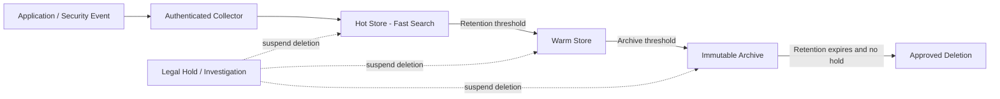
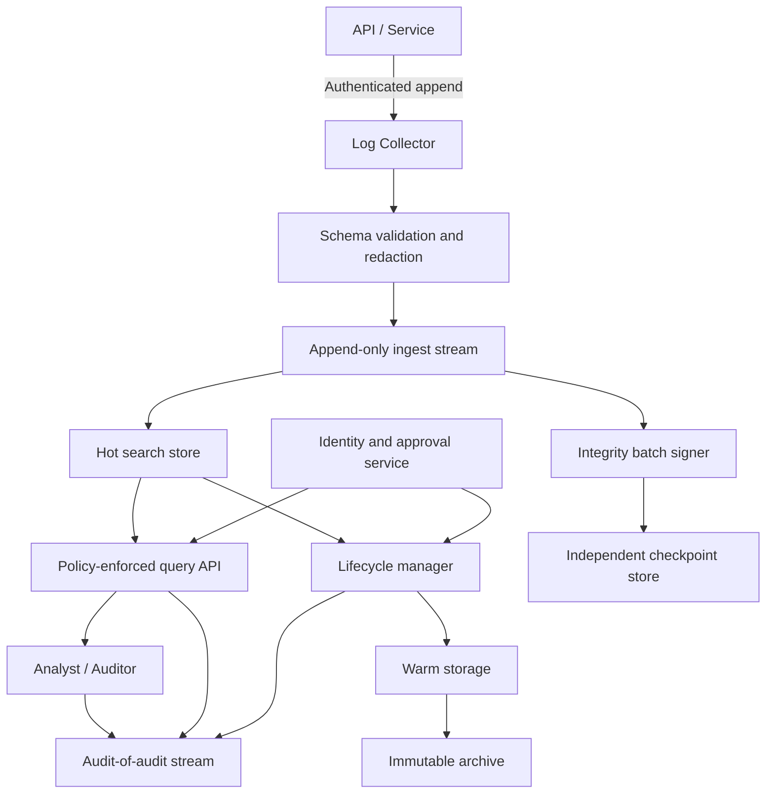

# Retention và access control cho audit log

## 1. Vì sao audit log cần chính sách lưu giữ và truy cập riêng?

Audit log ghi lại ai đã thực hiện hành động nào, trên tài nguyên nào, vào thời điểm nào và kết quả ra sao. Những sự kiện như thay đổi role, tạo hoặc thu hồi API key, truy cập dữ liệu nhạy cảm, thay đổi cấu hình bảo mật, hoàn tiền hay cập nhật webhook cần được giữ đủ lâu để điều tra, đối soát và chứng minh trách nhiệm.

Audit log cũng là dữ liệu nhạy cảm. Nó có thể tiết lộ danh tính người dùng, tenant, cấu trúc hệ thống, quyền quản trị, thời điểm hoạt động và các thao tác quan trọng. Nếu người có quyền quản trị ứng dụng có thể tự xóa dấu vết của mình, hoặc quá nhiều nhân viên có thể tìm kiếm/export log, audit system sẽ mất giá trị và trở thành một nguồn rò rỉ mới.

Hai câu hỏi cần được thiết kế cùng nhau:

- **Retention:** sự kiện nào được giữ trong bao lâu, ở tầng lưu trữ nào, khi nào được archive/xóa và trường hợp nào phải hold?
- **Access control:** ai được ghi, đọc, tìm kiếm, export, quản trị policy, thay đổi retention hoặc yêu cầu xóa?

Không có một thời hạn lưu giữ duy nhất phù hợp với mọi loại audit log. Thời hạn phải dựa trên mục đích, mức độ rủi ro, nghĩa vụ pháp lý/hợp đồng áp dụng, thời gian phát hiện sự cố và nguyên tắc tối thiểu hóa dữ liệu. Tương tự, quyền đọc log không nên tự động đi kèm với quyền quản trị ứng dụng hoặc hạ tầng.

## 2. Xác định phạm vi và phân loại audit event

Trước khi đặt retention, hãy xác định event nào thực sự là audit record và mức độ quan trọng của nó. Không nên gom mọi debug message, access log và business event vào cùng một nhóm rồi áp dụng một TTL chung.

| Nhóm audit event | Ví dụ | Mức bảo vệ thường cần |
|---|---|---|
| Identity và credential | Đăng nhập đặc quyền, MFA reset, tạo/rotate/revoke API key, thay đổi certificate. | Cao; có thể dùng để điều tra chiếm đoạt tài khoản và credential misuse. |
| Authorization và policy | Thay đổi role/scope, policy, tenant membership, quyền truy cập object. | Cao; cần actor, target, before/after phù hợp và approval reference. |
| Data access | Đọc/export dữ liệu cá nhân, hồ sơ tài chính, tài liệu nhạy cảm. | Theo data classification và mục đích truy cập; tránh ghi nội dung dữ liệu. |
| Data modification | Tạo, sửa, xóa record quan trọng, thay trạng thái giao dịch. | Cần liên kết transaction/object ID, actor và kết quả. |
| Security configuration | Thay CORS allowlist, gateway route, firewall, webhook destination hoặc secret policy. | Cao; cần version, người thay đổi và nguồn phê duyệt. |
| Administrative operation | Thay cấu hình tenant, khóa tài khoản, thay retention hoặc export audit. | Cao; cần separation of duties và audit cả thao tác trên log system. |
| Integration/system event | Webhook delivery, service identity change, provider key rotation. | Theo rủi ro của integration và khả năng đối soát. |

Với mỗi loại event, ghi rõ mục đích, chủ sở hữu dữ liệu, độ nhạy cảm, hệ thống nguồn, consumer điều tra và thời hạn cần thiết. Nếu không có mục đích cụ thể cho một field, không thu thập field đó chỉ vì có thể.

## 3. Xây dựng retention schedule theo mục đích

Retention schedule là quy tắc có thể kiểm tra được, xác định thời hạn lưu giữ theo loại log và điều kiện vòng đời. Một bảng chính sách có thể gồm:

| Thuộc tính | Câu hỏi cần trả lời |
|---|---|
| Event class | Đây là identity, authorization, data access, admin hay security event? |
| Purpose | Dùng cho vận hành, điều tra, audit nội bộ, đối soát hay nghĩa vụ cụ thể nào? |
| Data owner | Team nào chịu trách nhiệm phê duyệt và rà soát? |
| Classification | Có chứa PII, dữ liệu tài chính, định danh tenant hoặc thông tin bảo mật không? |
| Hot retention | Bao lâu cần truy vấn nhanh trong hệ thống online? |
| Archive retention | Sau giai đoạn hot, có cần lưu archive không và trong bao lâu? |
| Legal/contract basis | Quy định, hợp đồng hoặc chính sách nội bộ nào áp dụng? |
| Hold conditions | Khi nào phải tạm dừng xóa do incident, dispute, investigation hoặc legal hold? |
| Deletion method | Xóa khỏi primary store, replica, archive và backup theo cách nào? |
| Review date | Khi nào owner phải xem lại thời hạn và mục đích? |

Ví dụ minh họa về phân tầng, không phải khuyến nghị thời hạn pháp lý:

| Lớp | Mục đích | Cách xử lý |
|---|---|---|
| Hot | Điều tra sự cố đang diễn ra và truy vấn thường xuyên. | Index có giới hạn, tìm kiếm nhanh, quyền đọc chặt. |
| Warm | Điều tra trong thời gian trung hạn, truy vấn ít thường xuyên. | Storage chi phí thấp hơn, có thể giảm index/field. |
| Archive | Giữ bằng chứng theo chính sách dài hạn. | Mã hóa, immutable/object lock nếu cần, restore có phê duyệt. |
| Expired | Hết mục đích và hết mọi hold hợp lệ. | Xóa hoặc ẩn danh theo quy trình, ghi nhận bằng chứng hoàn tất. |

Không chọn số ngày tùy ý rồi áp dụng cho tất cả. Owner cần xác nhận retention dựa trên luật và quy định thực tế của tổ chức, loại dữ liệu, hợp đồng khách hàng, khả năng phát hiện sự cố và chi phí. Khi yêu cầu pháp lý chưa rõ, cần chuyển cho bộ phận có thẩm quyền đánh giá thay vì suy đoán.

## 4. Hot, warm, archive và vòng đời log

Một kiến trúc phổ biến chuyển audit record qua các tầng lưu trữ khi mức độ truy cập giảm:



Mỗi lần chuyển tầng phải bảo toàn event identity, timestamp, source, schema version và integrity metadata. Nếu archive nén hoặc đóng gói nhiều event, cần lưu manifest, checksum, thời gian tạo và thông tin xác minh để có thể kiểm tra sau khi restore.

Các điểm cần xác định:

- Hot store cần index những field nào để phục vụ điều tra? Không index raw payload hoặc secret.
- Warm/archive có giữ cùng dữ liệu hay chỉ giữ tập field đã được phê duyệt?
- Ai có quyền restore archive, vào môi trường nào và trong bao lâu?
- Restore có tạo bản sao tạm cần xóa sau điều tra không?
- Khi chuyển tier lỗi, log có bị mất hoặc bị giữ vô hạn không?
- Retention clock bắt đầu từ event time, ingest time hay thời điểm đóng case? Phải định nghĩa rõ và tránh reset TTL không chủ đích.

Không dùng thời điểm archive làm thời điểm bắt đầu retention mới nếu điều đó khiến log được giữ lâu hơn chính sách ban đầu. Lưu `event_time`, `ingested_at`, `archived_at` và `retention_expiry` riêng nếu cần kiểm toán vòng đời.

## 5. Legal hold và preservation khi có sự cố

Legal hold hoặc investigation hold tạm dừng việc xóa những record có liên quan trong thời gian được phê duyệt. Hold có thể áp dụng cho một case, khoảng thời gian, tenant, actor, service hoặc tập event cụ thể.

Quy trình cần:

1. Có yêu cầu hold được xác thực, nêu case/reference ID, phạm vi, lý do và người có thẩm quyền.
2. Xác định tập log liên quan bằng tiêu chí có thể tái lập; tránh hold toàn bộ hệ thống nếu không cần.
3. Đặt hold metadata tách khỏi event payload để không phải sửa record gốc.
4. Ngăn lifecycle job xóa record đang hold ở hot, warm, archive và bản sao liên quan.
5. Audit ai tạo, sửa, gia hạn và gỡ hold; việc gỡ hold cũng cần phê duyệt.
6. Rà soát hold định kỳ; khi kết thúc, tiếp tục retention theo thời hạn còn lại và chính sách áp dụng.

Không cho người đang bị điều tra tự tạo hoặc gỡ hold. Không để hold trở thành cách giữ dữ liệu vô hạn; mỗi hold cần owner, lý do, ngày review và điều kiện kết thúc. Khi nhiều policy cùng áp dụng, dùng quy tắc bảo toàn hợp lệ dài hơn trong phạm vi cần thiết, sau khi được người có thẩm quyền xác nhận.

## 6. Xóa an toàn và xử lý backup

Hết retention không có nghĩa chỉ xóa một row trong hot database. Audit record có thể còn trong replica, search index, object archive, export file, backup, snapshot, disaster recovery site hoặc cache.

Một quy trình deletion nên:

- Xác minh record đã hết retention và không có legal/investigation hold.
- Xác định mọi bản sao theo lineage/manifest: primary, replica, index, archive, export và backup.
- Xóa hoặc crypto-erase theo khả năng của storage; không chỉ đánh dấu `deleted=true` nếu dữ liệu vẫn có thể truy cập.
- Với backup bất biến không thể xóa từng record, định nghĩa rõ backup expiry, kiểm soát restore và bảo đảm record hết hạn không được đưa trở lại hệ thống hoạt động sau restore.
- Xóa cache và bản sao tạm sau khi hoàn tất điều tra/restore.
- Ghi deletion receipt gồm policy version, phạm vi, thời điểm, kết quả và job ID, không chứa lại payload đã xóa.
- Có retry và alert khi một tầng xóa thất bại; trạng thái phải thể hiện deletion chưa hoàn tất.

Crypto-erasure chỉ có ý nghĩa khi key được tách biệt, quản lý vòng đời đúng và không còn bản sao key có thể giải mã dữ liệu. Không tuyên bố dữ liệu đã bị xóa hoàn toàn nếu backup hoặc replica vẫn còn khả năng khôi phục ngoài chính sách.

## 7. Immutable storage, WORM và tamper evidence

Audit log cần khó bị sửa hoặc xóa trái phép, đặc biệt bởi chính principal có thể là đối tượng được ghi lại. Một số kỹ thuật thường dùng:

| Cơ chế | Cách bảo vệ | Giới hạn cần hiểu |
|---|---|---|
| Append-only permission | Service ghi chỉ có quyền append; không có quyền update/delete. | Admin storage cấp cao vẫn có thể thay đổi policy nếu không có kiểm soát bổ sung. |
| WORM/object lock | Storage ngăn overwrite/delete trong thời gian retention được cấu hình. | Cần cấu hình mode/retention đúng; quyền quản trị và key vẫn phải được bảo vệ. |
| Hash/checksum | Phát hiện nội dung thay đổi khi so với digest tin cậy. | Nếu attacker sửa cả log và digest ở cùng nơi, checksum đơn lẻ không đủ. |
| Hash chain | Mỗi record liên kết digest của record trước để phát hiện sửa/xóa trong chuỗi. | Cần xử lý partition, concurrency, checkpoint và bảo vệ điểm neo cuối. |
| Digital signature | Ký batch/manifest bằng signing key được bảo vệ. | Cần quản lý key, rotation, revocation và xác minh signature. |
| External checkpoint | Đưa digest định kỳ sang trust domain khác hoặc immutable ledger. | Cần vận hành và đối soát checkpoint; không tự chứng minh event nguồn là trung thực. |

### Hash chain ở mức khái niệm

Với record (i), có thể tính:

\[
H_i = SHA256(H_{i-1} \parallel Canonical(Event_i))
\]

Trong đó `Canonical(Event_i)` là biểu diễn byte có quy tắc ổn định của event. Nếu một event bị sửa hoặc xóa giữa chuỗi, các hash tiếp theo không còn khớp. Hệ thống cần định kỳ ký hoặc gửi checkpoint (H_n) tới một miền quản trị độc lập để attacker không thể viết lại toàn bộ chuỗi và thay luôn digest cuối.

Trong hệ thống phân tán, không nhất thiết có một chuỗi toàn cục duy nhất. Có thể chia theo stream/partition và ký manifest theo batch, kèm sequence range, event count, first/last timestamp và previous checkpoint. Cần định nghĩa cách phát hiện missing batch, duplicate, reorder và clock skew.

Hash chain chỉ chứng minh tính toàn vẹn của những bytes đã được ghi nhận theo cơ chế đó. Nó không chứng minh ứng dụng đã phát ra mọi event cần thiết, actor identity ban đầu là đúng hay event payload phản ánh sự thật. Cần kết hợp source authentication, workload identity, collector controls, audit coverage và reconciliation.

## 8. Access control: tách quyền ghi, đọc và quản trị

Không nên có một role chung `LOG_ADMIN` vừa đọc mọi audit event, vừa sửa retention, xóa log và quản lý signing key. Tách nhiệm vụ theo rủi ro và chỉ cấp quyền tối thiểu.

| Vai trò | Quyền phù hợp | Quyền không nên mặc định có |
|---|---|---|
| Application writer | Gửi event qua collector đã xác thực, append vào stream được cấp. | Đọc log toàn hệ thống, sửa/xóa record, đổi retention hoặc hold. |
| Security analyst | Tìm kiếm event security trong phạm vi được phân công. | Thay policy lưu giữ, xóa evidence hoặc quản lý key. |
| Auditor | Đọc audit record và metadata cần thiết cho cuộc kiểm tra. | Sửa record, thay role của chính mình hoặc export không giới hạn. |
| Service owner | Đọc log operational của service mình; có thể xem security summary theo policy. | Đọc audit của tenant/service khác hoặc xóa log liên quan đến service mình. |
| Privacy/data steward | Rà soát data classification, retention và yêu cầu xóa. | Tự thay đổi event gốc hoặc phê duyệt hold của chính mình. |
| Log platform operator | Vận hành collector, storage, index và backup. | Mặc định đọc nội dung audit nhạy cảm hoặc đơn phương xóa evidence. |
| Retention administrator | Cấu hình lifecycle theo policy đã phê duyệt. | Tự phê duyệt thay đổi retention và tự thực hiện deletion không có audit. |
| Security/key custodian | Quản lý signing/encryption key theo quy trình. | Tự đọc mọi log hoặc sửa retention. |

Đây là các trách nhiệm logic; một tổ chức nhỏ có thể phải kiêm nhiệm. Khi không thể tách hoàn toàn, dùng dual approval, session recording, just-in-time access và review độc lập để giảm rủi ro.

## 9. Áp dụng RBAC kết hợp ABAC

RBAC phù hợp để gán nhóm quyền cơ bản như analyst, auditor hoặc platform operator. ABAC bổ sung điều kiện theo thuộc tính: team, environment, tenant, event class, case assignment, data classification, thời gian và trạng thái approval.

Ví dụ policy:

```text
ALLOW read audit_event IF
    principal.role IN [security_analyst, auditor]
    AND principal.environment_scope CONTAINS event.environment
    AND principal.event_class_scope CONTAINS event.event_class
    AND (event.classification <= principal.clearance)
    AND (event.tenant_id IN principal.allowed_tenants)
    AND request.purpose IS APPROVED
```

Các thuộc tính như tenant, event class và classification phải đến từ metadata đáng tin do collector/policy engine gán, không lấy từ query parameter của người đọc. Nếu không có thuộc tính hoặc policy không xác định, từ chối truy cập đối với log nhạy cảm.

Không chỉ kiểm tra quyền ở giao diện. Search API, export API, direct storage access, archive restore và query console đều phải thực thi policy. Một user không có quyền đọc log qua UI cũng không được truy cập cùng object bằng signed URL, raw bucket endpoint hoặc database credential khác.

## 10. Kiểm soát tìm kiếm, truy vấn và export

Quyền đọc log có thể cho phép suy ra hoạt động người dùng, cấu trúc hệ thống và sự kiện bảo mật. Vì vậy cần giới hạn cả cách tìm kiếm và khối lượng dữ liệu trả về.

- Bắt buộc xác định time range; giới hạn tối đa khoảng truy vấn theo role/use case.
- Giới hạn số record, page size, query complexity, regex/wildcard và thời gian chạy.
- Chặn query có thể quét toàn bộ index hoặc gây tải lớn nếu không có lý do được duyệt.
- Áp row/field-level filtering theo tenant, event class và classification.
- Mask hoặc tokenize PII theo mặc định; chỉ reveal field cụ thể khi có purpose và quyền cao hơn.
- Export cần quyền riêng, giới hạn record/size, thời hạn link, mã hóa và audit event.
- Không gửi export qua email công khai hoặc tạo URL không hết hạn.
- Theo dõi download, query bất thường, tìm kiếm nhiều actor/tenant và truy vấn ngoài giờ theo baseline.
- Đảm bảo log query không tự ghi lại raw search term chứa PII/secret; audit query metadata ở mức cần thiết.

Export có thể tạo bản sao nằm ngoài retention engine. Mỗi export cần owner, purpose, expiry, nơi lưu và cơ chế xóa; nếu không, bản CSV tải về có thể tồn tại lâu hơn audit source.

## 11. Break-glass và just-in-time access

Trong sự cố nghiêm trọng, responder có thể cần truy cập log vượt quyền thông thường. Break-glass phải là ngoại lệ có kiểm soát, không phải tài khoản admin dùng chung.

Một flow phù hợp:

1. Người yêu cầu xác thực mạnh và nêu incident/case ID, lý do, phạm vi log cần đọc.
2. Hệ thống kiểm tra eligibility và yêu cầu approval độc lập nếu tình huống cho phép.
3. Cấp quyền tạm thời, chỉ read-only, chỉ phạm vi cần thiết và có thời hạn ngắn.
4. Ghi audit event về người yêu cầu, người duyệt, phạm vi, thời gian bắt đầu/kết thúc và thao tác thực hiện.
5. Thu hồi quyền tự động khi hết hạn; không để session hoặc token đặc quyền tồn tại lâu hơn.
6. Review sau sự cố: truy vấn nào đã chạy, dữ liệu nào được export và có cần thông báo/khắc phục không.

Nếu tình huống khẩn cấp không thể chờ approval, cần cơ chế emergency access có lý do bắt buộc, alert tức thời và review độc lập sau đó. Không cho phép người dùng xóa log của chính phiên break-glass.

## 12. Audit cả hoạt động truy cập audit log

Audit system phải ghi lại những hành động trên chính audit system. Nếu analyst tìm kiếm dữ liệu nhạy cảm, operator thay retention hoặc admin export toàn bộ log, các hành động đó cũng cần được ghi nhận.

Các event nên audit:

- Đăng nhập/đăng xuất và xác thực mạnh vào log platform.
- Search/query, filter scope, số record trả về và purpose/reference.
- Xem/reveal field nhạy cảm hoặc mở record thuộc classification cao.
- Export/download/restore archive và tạo signed URL.
- Thay đổi role, policy, tenant scope hoặc data classification.
- Thay retention, legal hold, deletion schedule và archive configuration.
- Thay collector, source allowlist, signing key, encryption key hoặc integrity checkpoint.
- Truy cập trực tiếp storage/database, break-glass và hành động bị từ chối.

Audit-of-audit cần được gửi tới một stream hoặc trust boundary độc lập đủ để điều tra khi log platform chính bị xâm phạm. Không để cùng một admin role vừa sửa audit record gốc vừa xóa event ghi lại việc sửa đó.

## 13. Multi-tenant isolation và phân vùng dữ liệu

Trong nền tảng multi-tenant, audit log có thể chứa event của nhiều khách hàng. Người đọc thuộc tenant A không được tìm kiếm hoặc export log của tenant B chỉ bằng cách thay `tenantId` trong query.

- Gắn tenant context từ identity/resource mapping đã xác minh tại nguồn hoặc collector.
- Áp tenant filter ở query service và storage boundary; không chỉ filter trong frontend.
- Tách encryption key hoặc storage partition theo tenant nếu yêu cầu rủi ro/data residency cần.
- Tránh index/global dashboard vô tình hiển thị field nhạy cảm cross-tenant.
- Service writer chỉ append vào stream/namespace được cấp; không được tự khai báo tenant bất kỳ.
- Kiểm thử cả search, export, archive restore, backup recovery và support tooling.
- Với support access cross-tenant, yêu cầu ticket/purpose, approval và audit riêng.

Tenant ID trong event cần được gắn bởi nguồn có thẩm quyền. Nếu event đến từ client hoặc partner, không tin một field `tenantId` trong payload trước khi ràng buộc với principal đã xác thực.

## 14. Kiến trúc tham khảo

Một kiến trúc có thể tách đường ghi và đường đọc:



Đường ghi chỉ cho workload đã xác thực append event vào namespace phù hợp. Collector validate schema, gắn metadata tin cậy, redaction field không được phép và gửi vào storage append-only. Đường đọc đi qua query API thực thi RBAC/ABAC, masking và export policy. Lifecycle manager chuyển tier, xử lý hold và deletion. Audit-of-audit cùng integrity checkpoint được bảo vệ ở miền quản trị độc lập.

Đây là kiến trúc logic; có thể triển khai bằng SIEM, log analytics platform, object storage hoặc database. Dù chọn sản phẩm nào, cần xác minh quyền thực tế ở từng API/storage endpoint và tránh để console admin trở thành đường bypass policy.

## 15. Ví dụ retention policy dạng cấu hình

Một policy nội bộ có thể được biểu diễn như sau:

```yaml
policy_version: 3
event_classes:
  privileged_access:
    owner: security-governance
    hot_days: 30
    archive_days: 365
    immutable: true
    legal_hold_supported: true
    classification: restricted
  routine_access_audit:
    owner: api-platform
    hot_days: 14
    archive_days: 180
    immutable: true
    legal_hold_supported: true
    classification: confidential
  operational_debug:
    owner: service-team
    hot_days: 7
    archive_days: 0
    immutable: false
    legal_hold_supported: false
    classification: internal
```

Các số ngày chỉ là ví dụ cấu hình để minh họa cách tách event class. Không sao chép chúng vào production nếu chưa có phê duyệt từ data owner, security, privacy/legal và chủ sở hữu dịch vụ. Cần xác định `archive_days` tính từ event time hay sau hot retention, backup expiry, hold behavior và deletion SLA. Policy phải được version hóa, review và audit mỗi lần thay đổi.

## 16. Những anti-pattern cần tránh

| Anti-pattern | Rủi ro | Cách khắc phục |
|---|---|---|
| Một TTL cho mọi loại log | Giữ dữ liệu không cần thiết hoặc xóa evidence quá sớm. | Retention theo event class, purpose và owner. |
| Giữ log vô thời hạn | Tăng rủi ro PII exposure, chi phí và phạm vi breach. | Retention schedule, review và deletion thực thi được. |
| Admin ứng dụng có quyền xóa audit log | Attacker/insider có thể xóa dấu vết hành động của mình. | Tách role, append-only/WORM và approval độc lập. |
| Một role vừa đọc, export, đổi policy và xóa | Không có separation of duties. | Tách quyền và dual control cho thao tác rủi ro cao. |
| Chỉ filter tenant ở frontend | API query/export có thể bị gọi trực tiếp để đọc chéo tenant. | Enforce tenant scope ở backend và storage boundary. |
| Checksum lưu cùng log trong cùng quyền quản trị | Attacker có thể sửa cả dữ liệu và checksum. | Ký manifest, external checkpoint và tách key/admin domain. |
| Legal hold chỉ là cờ trong UI | Lifecycle job vẫn có thể xóa bản archive/backup. | Hold được thực thi ở mọi storage tier và có test. |
| Xóa hot index nhưng quên archive/export/backup | Dữ liệu vẫn còn ngoài chính sách. | Data lineage và deletion workflow xuyên các bản sao. |
| Break-glass dùng tài khoản chung | Không xác định được actor và thao tác. | Identity cá nhân, JIT, approval và audit-of-audit. |
| Export không hết hạn | Tạo bản sao log không được kiểm soát. | Export TTL, encryption, access audit và deletion. |
| Audit query không được ghi lại | Người đọc có thể tìm dữ liệu nhạy cảm mà không để lại dấu vết. | Audit-of-audit ở trust domain riêng. |

## 17. Kiểm thử retention và access control

Kiểm thử cần xác minh policy ở storage, query API, archive và backup, không chỉ kiểm tra quyền trên giao diện.

| Ca kiểm thử | Thao tác | Kết quả mong đợi |
|---|---|---|
| Writer isolation | Service A thử append vào stream của service/tenant khác. | Collector từ chối; event denial được ghi nhận. |
| Read least privilege | Service owner thử đọc audit event restricted ngoài scope. | Bị từ chối ở query/storage API. |
| Tenant isolation | Analyst tenant A đổi filter sang tenant B. | Không trả record hoặc metadata của B. |
| Field masking | Analyst tìm event có PII restricted. | Field bị mask; reveal cần quyền/purpose riêng. |
| Export permission | Người chỉ có quyền search thử export hàng loạt. | Bị từ chối; không tạo file/signed URL. |
| Privileged role change | Operator tự nâng quyền đọc log. | Bị chặn hoặc cần approval độc lập; thao tác được audit. |
| Break-glass expiry | Cấp quyền khẩn cấp có TTL rồi để hết hạn. | Quyền tự thu hồi; token/session cũ không còn dùng được. |
| Audit-of-audit | Analyst search/export, admin đổi retention. | Event tương ứng được ghi ở stream độc lập. |
| Hot-to-warm transition | Chuyển event qua ngưỡng hot retention. | Record và integrity metadata được giữ; query/restore theo policy. |
| Archive restore | User không có quyền yêu cầu restore restricted archive. | Bị từ chối; restore hợp lệ có approval và audit. |
| Legal hold | Đặt hold rồi chạy lifecycle deletion. | Record trong scope không bị xóa ở mọi tier. |
| Hold release | Gỡ hold bằng principal không có quyền. | Bị từ chối; release hợp lệ được audit và retention tiếp tục. |
| Expired deletion | Chạy deletion cho record hết hạn, không hold. | Xóa/ẩn danh theo policy; receipt ghi kết quả, không chứa payload. |
| Backup recovery | Restore backup có record đã hết hạn trước thời điểm restore. | Record không được đưa lại vào searchable active store ngoài policy. |
| Tamper detection | Sửa/xóa event hoặc manifest trong test. | Hash/signature/checkpoint verification phát hiện sai lệch. |
| Clock and ordering | Gửi event lệch giờ hoặc batch thiếu sequence. | Hệ thống đánh dấu anomaly; không âm thầm coi integrity là hợp lệ. |
| Log platform outage | Collector/storage tạm thời không sẵn sàng. | Buffer/failure policy hoạt động; không báo đã ghi thành công khi event chưa durable. |

Kiểm tra audit event của chính các thao tác test. Nếu test thay retention, export hoặc break-glass mà audit-of-audit không ghi nhận, kiểm soát chưa hoàn chỉnh dù thao tác nghiệp vụ có thành công.

## 18. Giám sát và vận hành liên tục

Theo dõi tối thiểu:

- Số event ingest, dropped event, ingest latency và collector authentication failure.
- Tỷ lệ event theo classification, tenant và source; phát hiện source đột ngột gửi volume bất thường.
- Storage growth, hot/warm/archive transition lag và chi phí theo event class.
- Record quá hạn chưa xóa, deletion job failure, backup expiry và legal hold backlog.
- Search/export volume, query duration, field reveal và truy cập ngoài giờ theo baseline.
- Thay đổi role/policy/retention, signing key rotation và integrity verification failure.
- Archive restore, break-glass activation, hold create/release và direct storage access.
- Log pipeline lag, checkpoint gap, signature verification failure và clock drift.

Đặt alert cho deletion job bị lỗi, hold bị bỏ qua, export lớn bất thường, analyst truy vấn nhiều tenant, quyền admin thay đổi ngoài quy trình và integrity checkpoint không khớp. Runbook cần nêu người chịu trách nhiệm, cách dừng lifecycle job, bảo toàn evidence, revoke session/credential, khôi phục từ archive và thông báo theo quy trình tổ chức.

Rà soát quyền định kỳ và khi nhân sự/team thay đổi. Thu hồi quyền khi chuyển nhóm hoặc kết thúc nhiệm vụ; không để quyền tạm thời trở thành quyền vĩnh viễn. Kiểm tra access review bằng dữ liệu thực tế về query/export, không chỉ danh sách role được cấp.

## 19. Checklist retention và access control cho audit log

- [ ] Audit event được phân loại theo purpose, owner và data sensitivity?
- [ ] Retention schedule xác định hot, warm, archive, expiry và review date?
- [ ] Thời hạn có căn cứ được phê duyệt, không áp dụng một TTL tùy ý cho mọi log?
- [ ] Legal/investigation hold có scope, owner, expiry/review và được thực thi ở mọi tier?
- [ ] Deletion bao gồm primary, index, replica, archive, export và backup theo policy?
- [ ] Có immutable/WORM hoặc tamper-evident controls phù hợp với mức rủi ro?
- [ ] Integrity key/checkpoint được bảo vệ tách khỏi quyền quản trị storage log?
- [ ] Quyền writer, reader, auditor, operator, retention admin và key custodian được tách?
- [ ] RBAC/ABAC enforce ở query API, export, archive restore và direct storage?
- [ ] Tenant/event-class/field-level scope được áp dụng ở backend, không chỉ UI?
- [ ] Search/export có giới hạn time range, volume, masking và expiry?
- [ ] Break-glass/JIT có identity cá nhân, TTL, approval và review?
- [ ] Hoạt động đọc, tìm kiếm, reveal, export, restore, đổi policy và deletion đều được audit?
- [ ] Log platform có encryption, RBAC, access review và monitoring pipeline?
- [ ] Có test hold, deletion, backup restore, tamper detection và tenant isolation?
- [ ] Có alert/runbook cho access anomaly, retention failure và integrity mismatch?

Retention và access control là hai phần của cùng một thiết kế audit. Lưu quá lâu làm tăng lượng dữ liệu nhạy cảm cần bảo vệ; lưu quá ngắn có thể làm mất bằng chứng. Cấp quyền quá rộng khiến người dùng hoặc attacker có thể đọc, export hay xóa dấu vết. Hãy phân loại event theo mục đích, đặt vòng đời có thể thực thi và kiểm tra quyền ở mọi đường truy cập, đồng thời bảo vệ integrity và audit cả hoạt động trên chính log platform.
