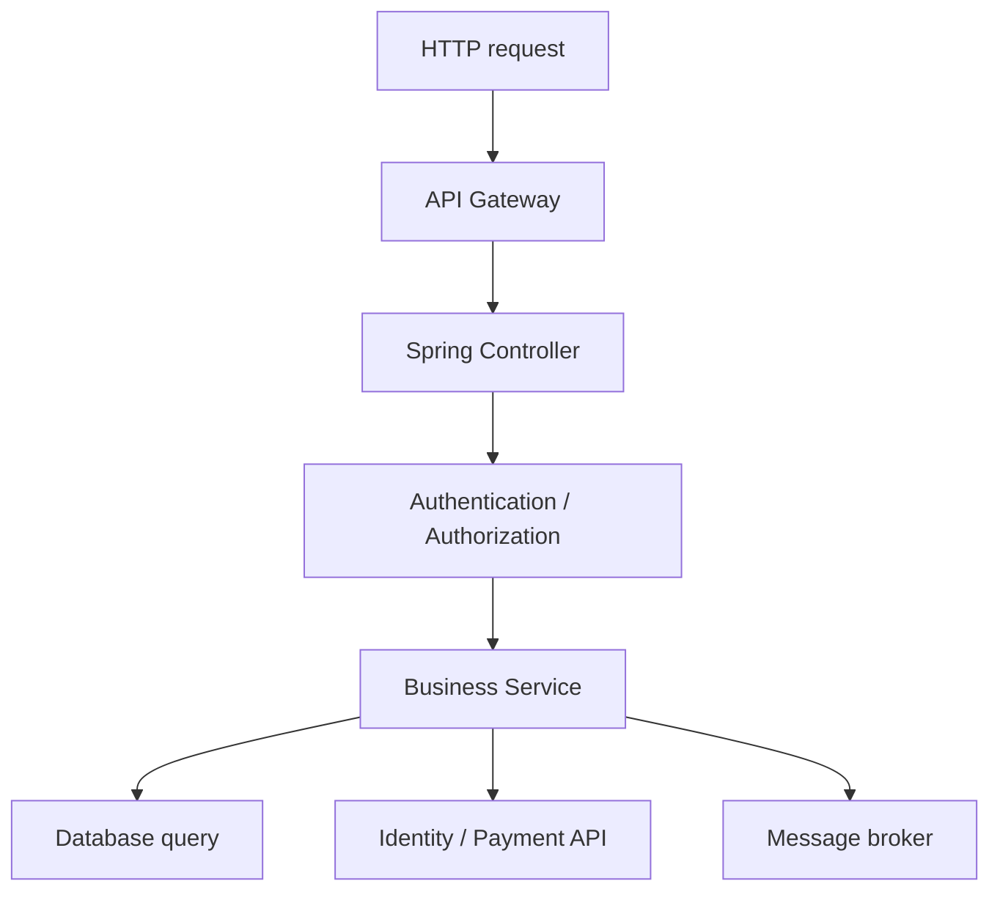

# Theo dõi latency, error rate và status code

Một API có thể vẫn trả lời request nhưng đang chậm dần, trả nhiều lỗi hơn hoặc từ chối một nhóm client mà đội vận hành chưa nhận ra. Với API xử lý dữ liệu và nghiệp vụ nhạy cảm, các dấu hiệu này còn giúp phát hiện lỗi authorization, rate limiting bị cấu hình sai, dependency bất thường hoặc hành vi dò endpoint. Vì vậy, giám sát cần đo được chất lượng phục vụ theo từng route và method, đồng thời phân biệt lỗi kỹ thuật với request bị từ chối đúng chính sách.

Ba tín hiệu cơ bản thường được theo dõi là **latency**, **error rate** và **HTTP status code**. Latency cho biết request mất bao lâu; error rate cho biết tỷ lệ request không hoàn thành theo mục tiêu; status code cho biết server đã phân loại kết quả như thế nào. Không nên xem riêng từng chỉ số: p95 latency tăng cùng 5xx có thể chỉ ra dependency chậm; 401/403 tăng có thể là client hết hạn credential hoặc một đợt dò quyền; 429 tăng có thể là rate limit đang bảo vệ hệ thống hoặc giới hạn đang quá thấp.

Trong API Security, cần đo các tín hiệu này theo route template, HTTP method, kết quả xác thực/phân quyền và dependency quan trọng. Metric phải đủ chi tiết để tìm nguyên nhân nhưng không chứa token, payload, user ID hoặc URL có dữ liệu nhạy cảm. Dashboard và alert cần dẫn đến một hành động cụ thể, không chỉ tạo thêm nhiều con số.

## 1. Ba tín hiệu RED cho API

RED là cách quan sát service qua ba nhóm tín hiệu: **Rate** (lưu lượng), **Errors** (lỗi) và **Duration** (thời gian xử lý). Với chủ đề này, Rate là mẫu số để hiểu latency/error rate; Errors được phân tích qua error rate và status code; Duration được thể hiện bằng latency distribution.

| Tín hiệu | Câu hỏi cần trả lời | Ví dụ metric |
| --- | --- | --- |
| Latency / Duration | Request mất bao lâu? Nhóm request chậm nhất là route nào? | p50, p90, p95, p99, histogram bucket. |
| Error rate / Errors | Bao nhiêu request thất bại theo định nghĩa SLI? | Tỷ lệ 5xx, timeout, dependency failure. |
| Status code | Server trả kết quả nào và nhóm nào đang tăng? | Request count theo 2xx, 3xx, 4xx, 5xx, 429, 401, 403. |

Nên theo dõi thêm request rate để biết mẫu số và phân biệt “không có lỗi vì không có traffic” với “hệ thống đang hoạt động tốt”. Một endpoint không có request có thể là endpoint ít dùng, nhưng cũng có thể là route đã bị lỗi DNS, gateway hoặc client integration.

## 2. Đo latency đúng cách

Latency là thời gian từ lúc một tầng nhận request đến khi tầng đó hoàn tất response. Với metric `http.server.requests` ở ứng dụng, thời gian thường phản ánh xử lý phía server trong phạm vi instrumentation của framework. Nó có thể không bao gồm toàn bộ DNS lookup, TLS handshake, mạng giữa client và gateway hoặc thời gian browser xử lý response.

Nên xác định rõ điểm bắt đầu và kết thúc của phép đo:

- **Client-side latency:** từ lúc client bắt đầu gọi đến khi nhận xong response; phản ánh trải nghiệm đầu-cuối.
- **Gateway latency:** thời gian gateway nhận request đến khi trả response; bao gồm một phần thời gian proxy và upstream.
- **Application server latency:** thời gian ứng dụng xử lý request; thường có sẵn qua Micrometer/Spring Boot.
- **Dependency latency:** thời gian gọi database, cache, identity provider, payment provider hoặc service khác.

Đo ở nhiều tầng giúp tìm được phần thời gian bị tiêu tốn. Nếu client latency tăng nhưng application latency ổn định, cần xem DNS, TLS, mạng, gateway hoặc response transfer. Nếu application latency tăng cùng database span, cần điều tra query, lock hoặc connection pool.

### 2.1. Dùng percentile thay vì chỉ dùng average

Average có thể che khuất nhóm request rất chậm. Giả sử 99 request mất 50 ms và một request mất 10 giây; average xấp xỉ 149,5 ms, trong khi một người dùng đã phải chờ 10 giây. Với API, cần quan sát phân phối latency:

| Chỉ số | Ý nghĩa | Cách sử dụng |
| --- | --- | --- |
| p50 | 50% request hoàn tất trong thời gian này hoặc nhanh hơn | Đại diện trải nghiệm điển hình. |
| p90 | 90% request nhanh hơn hoặc bằng giá trị này | Nhìn nhóm chậm hơn mức thông thường. |
| p95 | 95% request nhanh hơn hoặc bằng giá trị này | Thường dùng cho SLO và dashboard vận hành. |
| p99 | 99% request nhanh hơn hoặc bằng giá trị này | Phát hiện tail latency và các request rất chậm. |
| max | Request chậm nhất trong cửa sổ quan sát | Dùng điều tra, không nên dùng làm SLO duy nhất. |

Ví dụ: p50 của `GET /api/orders/{id}` là 40 ms nhưng p99 là 2,8 giây. Phần lớn request nhanh, nhưng một nhóm nhỏ có thể đang gặp lock contention, cache miss, payload lớn hoặc downstream timeout. Chỉ nhìn average sẽ khó phát hiện vấn đề này.

Percentile phải được tính từ histogram hoặc dữ liệu phân phối phù hợp. Không lấy trung bình các p95 của từng instance để tạo p95 toàn cụm; percentile không cộng gộp theo cách đó. Với Prometheus, histogram bucket có thể được cộng theo instance rồi dùng `histogram_quantile()` để ước lượng percentile chung.

### 2.2. Histogram và bucket

Histogram đếm số request có duration nhỏ hơn hoặc bằng từng ngưỡng. Ví dụ các bucket `50ms`, `100ms`, `250ms`, `500ms`, `1s`, `2s` giúp quan sát request trong vùng latency quan trọng. Cần chọn bucket bao quanh mục tiêu dịch vụ; nếu mọi bucket đều thấp hơn hoặc cao hơn latency thực tế, percentile sẽ thiếu hữu ích.

Histogram phù hợp để tổng hợp qua nhiều instance và tính percentile ở backend metrics. Client-side summary có thể cung cấp percentile tại từng instance nhưng không thể cộng gộp percentile giữa các instance thành percentile chính xác của toàn hệ thống.

### 2.3. Theo dõi latency theo route và method

Không chỉ đo latency tổng toàn service. Một endpoint upload có thể chậm tự nhiên hơn endpoint đọc hồ sơ; nếu gộp chung, thay đổi traffic mix có thể làm latency trung bình biến động dù từng route không đổi.

Các dimension hữu ích:

- Route template, ví dụ `/api/orders/{id}`, thay vì path chứa ID thật.
- HTTP method như `GET`, `POST`, `PATCH`, `DELETE`.
- Kết quả status hoặc outcome.
- Tên dependency hoặc operation đã chuẩn hóa.
- Nhóm loại API, ví dụ `read`, `write`, `upload`, `admin`, nếu số nhóm nhỏ và ổn định.

Tránh dùng raw URL, query string, resource ID, email, username, tenant ID, token hoặc request ID làm label metric. Những giá trị này tạo cardinality cao và có thể chứa dữ liệu nhạy cảm. Chi tiết của một request nên được tra qua trace/log bằng correlation ID có kiểm soát.

## 3. Định nghĩa error rate có ý nghĩa

Error rate là tỷ lệ request lỗi trong một cửa sổ thời gian. Công thức đơn giản:

\[
\text{Error rate} = \frac{\text{Số request lỗi}}{\text{Tổng request được tính}} \times 100\%
\]

Khó khăn nằm ở việc định nghĩa “request lỗi”. Không nên coi mọi status 4xx là lỗi dịch vụ. `400 Bad Request` có thể là client gửi payload sai; `401 Unauthorized` hoặc `403 Forbidden` có thể là quyết định bảo mật đúng; `404 Not Found` có thể là resource không tồn tại. Ngược lại, một request trả `200` nhưng chứa business result thất bại trong body vẫn có thể là lỗi nghiệp vụ nếu contract định nghĩa như vậy.

Một SLI availability thường tính các request server không hoàn thành như kỳ vọng, ví dụ 5xx, timeout và một số lỗi dependency. Các request bị từ chối hợp lệ do client hoặc policy có thể được tách khỏi error rate availability và theo dõi riêng. `429 Too Many Requests` cần được xem theo mục tiêu: nếu rate limit đang chủ động bảo vệ hệ thống thì đó là throttling; nếu khách hàng hợp lệ bị throttle do capacity hoặc quota cấu hình sai, nó có thể là vấn đề chất lượng dịch vụ.

### 3.1. Phân loại lỗi để không đánh giá sai

| Nhóm | Ví dụ | Cách theo dõi |
| --- | --- | --- |
| Server failure | `500`, `502`, `503`, `504` | Thường tính vào service error rate/availability SLI. |
| Timeout | Request hoặc dependency vượt deadline | Theo dõi riêng và thường tính vào lỗi nếu người gọi không nhận được kết quả đúng hạn. |
| Client input error | `400`, `413`, `415`, `422` | Theo dõi chất lượng client/validation; không mặc định tính vào availability error. |
| Authentication failure | `401` | Theo dõi credential/token failures và xu hướng theo client/route. |
| Authorization denial | `403` | Theo dõi policy denial; tăng đột biến có thể là lỗi role/scope hoặc hành vi dò quyền. |
| Resource missing | `404` | Theo dõi theo route và client; tăng bất thường có thể là enumeration hoặc client dùng ID sai. |
| Rate limit | `429` | Theo dõi throttle rate, quota và `Retry-After`; phân biệt bảo vệ dự kiến với giới hạn gây ảnh hưởng khách hàng. |
| Conflict/business rejection | `409`, `422` hoặc mã nghiệp vụ theo contract | Theo dõi outcome nghiệp vụ riêng, không gộp tùy tiện với 5xx. |

### 3.2. Chọn mẫu số và cửa sổ thời gian

Error rate cần tính trên cùng phạm vi với mục tiêu: một route, một API product, một service hoặc toàn hệ thống. Nếu chỉ tính 5xx của `GET /api/orders/{id}` thì cả tử số và mẫu số phải dùng cùng route/method và cùng cửa sổ.

Khi traffic thấp, một lỗi trong vài request có thể tạo tỷ lệ phần trăm rất cao nhưng tác động nhỏ. Dashboard nên hiển thị cả tỷ lệ và số lượng tuyệt đối. Alert có thể yêu cầu tối thiểu số request, hoặc dùng cửa sổ dài hơn để tránh báo động từ mẫu quá nhỏ.

Không gộp các route có độ quan trọng rất khác nhau thành một tỷ lệ duy nhất nếu điều đó che khuất lỗi ở endpoint thanh toán hoặc quản trị. Có thể có service-wide SLO và các SLI riêng cho critical route.

## 4. Hiểu status code theo semantics HTTP

Status code là tín hiệu hữu ích nhưng không tự mô tả toàn bộ kết quả nghiệp vụ. Cần theo dõi cả mã cụ thể và nhóm mã.

| Nhóm | Ý nghĩa | Ví dụ và điều cần quan sát |
| --- | --- | --- |
| `2xx` | Request được xử lý thành công theo semantics của response | `200`, `201`, `202`, `204`; xem tỷ lệ và latency theo route. `202` có thể chỉ là accepted để xử lý async, chưa phải hoàn tất nghiệp vụ. |
| `3xx` | Điều hướng hoặc redirect | `301`, `302`, `304`; redirect bất thường có thể làm client loop hoặc chuyển sang host ngoài dự kiến. |
| `4xx` | Request có vấn đề từ phía client hoặc bị từ chối theo policy | `400`, `401`, `403`, `404`, `405`, `409`, `413`, `415`, `422`, `429`; cần phân loại thay vì coi tất cả là service failure. |
| `5xx` | Server hoặc gateway không thể hoàn thành request | `500`, `502`, `503`, `504`; thường là tín hiệu chính của availability error. |

### 4.1. Một số status code quan trọng với API Security

- **401 Unauthorized:** request thiếu hoặc có credential không hợp lệ. Theo HTTP semantics, response thường cần `WWW-Authenticate` phù hợp. Theo dõi tăng đột biến theo issuer/client để phát hiện token hết hạn, sai audience hoặc credential bị dò.
- **403 Forbidden:** caller đã được nhận diện nhưng không có quyền thực hiện hành động. Theo dõi theo route/action và reason code nội bộ; không trả chi tiết policy nhạy cảm cho caller.
- **404 Not Found:** resource hoặc route không tồn tại. Có thể được dùng nhất quán để hạn chế tiết lộ resource có tồn tại hay không; metric vẫn cần route template và kết quả nội bộ để điều tra.
- **405 Method Not Allowed:** method không được hỗ trợ trên route. Tăng đột biến có thể là client integration sai hoặc scanner dò method.
- **409 Conflict:** request xung đột trạng thái hiện tại, ví dụ idempotency conflict hoặc state transition không hợp lệ.
- **413 Content Too Large:** request body vượt giới hạn. Theo dõi để phát hiện client lỗi, upload abuse hoặc limit không phù hợp.
- **415 Unsupported Media Type:** media type không được hỗ trợ; có thể phản ánh client gửi sai content type.
- **422 Unprocessable Content:** nội dung có thể parse nhưng không thỏa validation/contract hoặc business rule theo API design.
- **429 Too Many Requests:** vượt rate limit/quota; theo dõi client/route và hướng dẫn retry qua `Retry-After` khi phù hợp.
- **500 Internal Server Error:** lỗi không dự kiến trong ứng dụng; cần correlation ID để tìm log/trace.
- **502/503/504:** gateway/upstream failure, service unavailable hoặc timeout; xem thêm health và dependency metrics.

Không thay đổi status code chỉ để làm dashboard “xanh”. Nếu authorization denial được trả `200`, metric status sẽ không phản ánh kết quả thật và client có thể hiểu sai contract. Public response cần tuân theo semantics ổn định; reason code chi tiết nằm trong log/audit có kiểm soát.

### 4.2. Status code không đủ để đo business success

Một endpoint tạo payment có thể trả `202 Accepted` sau khi ghi lệnh vào queue. Điều đó chứng minh request được nhận, chưa chứng minh payment đã thành công. Cần metric nghiệp vụ riêng như `payment_processing_succeeded`, `payment_processing_failed` và thời gian từ accepted đến terminal state. Không dùng HTTP 2xx thay cho outcome nghiệp vụ.

## 5. Instrumentation theo route template

Metric HTTP cần được gắn với route đã được router xác định, không phải path tùy ý do client gửi. Ví dụ:

| Không nên dùng | Nên dùng |
| --- | --- |
| `/api/orders/8f91a...` | `/api/orders/{id}` |
| `/api/users/alice@example.com` | `/api/users/{userId}` hoặc route template tương ứng |
| `/api/search?q=secret` | `/api/search` |
| Full URL có signed query | Route template và outcome; không ghi query string |

Nếu framework chưa xác định route khi filter bắt đầu, có thể lấy route pattern sau khi handler mapping hoàn tất hoặc dùng instrumentation tích hợp của framework. Không tự gắn raw path làm label dự phòng vì nó sẽ tạo một series mới cho mỗi resource ID.

Các dimension nên giới hạn trong tập nhỏ:

- `method`: HTTP method chuẩn.
- `uri` hoặc `route`: route template đã chuẩn hóa.
- `status`: status code hoặc status class.
- `outcome`: kết quả framework như `SUCCESS`, `CLIENT_ERROR`, `SERVER_ERROR` nếu có.
- `exception`: tên nhóm exception đã chuẩn hóa, không phải message.
- `service`/`instance`: do nền tảng metrics quản lý; cần cân nhắc khi aggregate.

Không đưa `userId`, `tenantId`, `email`, `requestId`, `traceId`, `token`, `filename`, IP tùy ý hoặc payload field vào metric label. Nếu cần điều tra một client cụ thể, dùng structured log/audit có phân quyền và retention phù hợp.

## 6. Ví dụ Spring Boot, Micrometer và Prometheus

Spring Boot Actuator/Micrometer có thể tự thu thập metric HTTP server như `http.server.requests`. Metric này thường có các tag `method`, `uri`, `status`, `outcome` và `exception` tùy phiên bản/framework. Cần kiểm tra route tag là route template và không bị cấu hình thành raw URI.

Ví dụ cấu hình histogram và Service Level Objective buckets trong `application.yml`:

```yaml
management:
  endpoints:
    web:
      exposure:
        include: health,prometheus
  metrics:
    distribution:
      percentiles-histogram:
        http.server.requests: true
      slo:
        http.server.requests: 50ms,100ms,250ms,500ms,1s,2s
```

Các property cụ thể có thể khác theo phiên bản Spring Boot/Micrometer. Chỉ expose endpoint metrics trên management network hoặc qua authentication/authorization phù hợp; không công khai toàn bộ Actuator chỉ để Prometheus scrape. Nếu Prometheus scrape qua mạng riêng, dùng network policy và xác thực scrape theo kiến trúc triển khai.

### 6.1. PromQL: p95 latency theo route

```promql
histogram_quantile(
  0.95,
  sum by (le, uri, method) (
    rate(http_server_requests_seconds_bucket[5m])
  )
)
```

Query này tổng hợp bucket qua các instance rồi ước lượng p95 theo route và method trong cửa sổ 5 phút. Tên metric và tag thực tế phụ thuộc exporter/configuration; kiểm tra `/actuator/prometheus` trong môi trường triển khai để xác nhận. Loại trừ management/internal routes nếu chúng không thuộc SLI của API.

### 6.2. PromQL: tỷ lệ 5xx

```promql
sum(rate(http_server_requests_seconds_count{status=~"5.."}[5m]))
/
sum(rate(http_server_requests_seconds_count[5m]))
```

Kết quả là tỷ lệ request 5xx trên tổng request trong 5 phút. Khi dùng cho alert, cần lọc đúng service/route, đặt điều kiện traffic tối thiểu và quyết định rõ timeout có được tính từ metric khác hay không. Không tự động thêm 4xx vào numerator.

### 6.3. PromQL: phân bố status code

```promql
sum by (status) (
  rate(http_server_requests_seconds_count[5m])
)
```

Query này hiển thị tốc độ request theo từng status code. Có thể dùng thêm nhóm 4xx/5xx hoặc tách `401`, `403`, `404`, `405`, `413`, `429` để quan sát tín hiệu bảo mật và chất lượng client.

### 6.4. PromQL: tỷ lệ 429 theo route

```promql
sum by (uri, method) (
  rate(http_server_requests_seconds_count{status="429"}[5m])
)
```

Theo dõi 429 cùng request rate và quota decision để biết rate limiter đang hoạt động đúng hay từ chối quá nhiều traffic hợp lệ. Không alert chỉ vì có một vài 429 nếu đây là hành vi bình thường theo chính sách.

## 7. Đo dependency latency và trace

HTTP server latency tăng thường là triệu chứng; nguyên nhân có thể nằm ở database, cache, identity provider, object storage hoặc service downstream. Dùng distributed tracing để liên kết request với các span con:



Trace giúp trả lời request chậm ở bước nào. Ví dụ application p95 tăng từ 120 ms lên 1,4 giây; trace cho thấy 1,1 giây nằm trong database query. Khi đó tối ưu SQL/index/connection pool có thể hiệu quả hơn tăng thread pool.

Các nguyên tắc:

- Propagate trace context qua gateway và service-to-service theo chuẩn OpenTelemetry/W3C Trace Context.
- Dùng span name theo operation/route template, không dùng ID tài nguyên trong tên span.
- Gắn status/outcome và dependency name; không gắn token, raw payload hoặc PII.
- Sampling phải giữ đủ trace lỗi/chậm để điều tra; tail-based sampling có thể ưu tiên trace vượt latency/error threshold.
- Không coi trace thay thế metrics: metrics cho xu hướng tổng hợp, trace cho một request cụ thể.

## 8. Kết hợp metrics, logs và audit

Metrics trả lời “điều gì đang tăng hoặc giảm”; logs trả lời “request cụ thể đã xảy ra gì”; audit ghi lại quyết định bảo mật/nghiệp vụ cần truy vết. Ba loại dữ liệu có mục đích khác nhau.

| Dữ liệu | Nội dung nên có | Không nên chứa |
| --- | --- | --- |
| Metrics | Route template, method, status, outcome, latency bucket, dependency | Token, user ID, raw path ID, payload, email. |
| Application log | Correlation ID, route, status, exception class, reason code, dependency | Password, cookie, access token, raw multipart/file content. |
| Security audit | Actor/client reference được bảo vệ, action, resource reference, decision, reason code, timestamp | Secret, private key, toàn bộ credential hoặc payload không cần thiết. |
| Trace | Span operation, duration, status, dependency, trace ID | Authorization header, cookie, payload nhạy cảm. |

Dùng correlation ID hoặc trace ID để nối dashboard với log/trace. ID này không phải bí mật và không nên dùng làm metric label. Nếu client được phép gửi correlation ID, cần giới hạn độ dài/ký tự và không dùng nó làm identity hoặc bằng chứng tin cậy.

## 9. Xây dựng SLI và SLO

SLI (Service Level Indicator) là phép đo chất lượng; SLO (Service Level Objective) là mục tiêu cho SLI trong một cửa sổ thời gian. Mục tiêu nên gắn với trải nghiệm và contract của API.

Ví dụ minh họa cho một API đọc đơn hàng:

| SLI | Cách đo | SLO ví dụ |
| --- | --- | --- |
| Availability | Request hợp lệ không bị 5xx/timeout chia cho tổng request đủ điều kiện | 99,9% trong 30 ngày. |
| Latency | Tỷ lệ request hoàn tất dưới ngưỡng 300 ms | 95% request trong 30 ngày. |
| Async completion | Event accepted được xử lý terminal trong thời hạn | 99% hoàn tất trong 2 phút. |

Các con số chỉ là ví dụ, không phải mặc định phù hợp mọi API. API thanh toán, upload, search và health endpoint có workload khác nhau; cần chọn ngưỡng dựa trên baseline, yêu cầu sản phẩm và năng lực dependency.

### 9.1. Định nghĩa request đủ điều kiện

SLI cần nói rõ có tính request nào:

- Có thể loại health probe, scrape metrics hoặc synthetic check khỏi SLI người dùng nếu có dashboard riêng.
- Thường không tính 4xx do client gửi dữ liệu sai hoặc bị authorization từ chối vào availability error, nhưng vẫn theo dõi riêng.
- Cần quyết định cách tính 429 theo hợp đồng/quota.
- Timeout ở gateway hoặc client cần được liên kết với request đã bắt đầu để không bị bỏ sót.
- Retry nội bộ không nên làm mẫu số tăng giả tạo; xác định đo request bên ngoài hay từng attempt downstream.

Nếu định nghĩa SLI thay đổi, phải version hóa dashboard/alert và ghi chú thời điểm để tránh so sánh sai giữa các giai đoạn.

### 9.2. Error budget

Nếu SLO availability là 99,9%, error budget là 0,1% request đủ điều kiện trong cửa sổ. Khi budget bị tiêu thụ nhanh, đội phát triển có thể giảm rollout rủi ro, ưu tiên reliability work hoặc điều tra dependency. Error budget giúp chuyển alert từ “có lỗi” sang “mức lỗi đang đe dọa mục tiêu dịch vụ”.

## 10. Thiết kế alert có thể hành động

Alert nên thông báo khi người trực cần hành động. Không alert cho mọi status code khác 2xx vì điều đó tạo noise và khiến đội vận hành bỏ qua cảnh báo quan trọng.

Một số alert có thể dùng:

| Alert | Điều kiện ví dụ | Hành động đầu tiên |
| --- | --- | --- |
| API 5xx rate high | 5xx > 5% trong 5 phút và có đủ traffic | Kiểm tra deploy gần nhất, exception top, dependency và gateway. |
| p95 latency high | p95 vượt SLO trong 10 phút | Xem route bị ảnh hưởng và trace chậm; kiểm tra DB/cache/downstream. |
| p99 latency spike | p99 tăng mạnh so với baseline trong khi p50 ổn định | Điều tra tail latency, lock, retry, pool exhaustion hoặc payload bất thường. |
| 401 spike | 401 tăng nhiều lần so với baseline theo issuer/client | Kiểm tra token expiry, JWKS/key rotation, issuer/audience và credential abuse. |
| 403 spike | 403 tăng theo route/action/client | Kiểm tra thay đổi role/scope/policy và dấu hiệu enumeration. |
| 429 sustained | Tỷ lệ 429 cao với client hợp lệ hoặc kéo dài | Kiểm tra quota, burst, tenant fairness và capacity; xác nhận `Retry-After`. |
| 502/503/504 spike | Gateway/upstream failure tăng | Kiểm tra health của upstream, connection pool, DNS và timeout budget. |

Ngưỡng phải được hiệu chỉnh theo baseline và traffic. Một alert nên có owner, severity, dashboard/runbook link, điều kiện tự hết và hướng xử lý. Với API có traffic thấp, kết hợp tỷ lệ với số lượng tuyệt đối hoặc dùng synthetic probe.

### 10.1. Multi-window / burn-rate alert

Với SLO, có thể alert theo tốc độ tiêu thụ error budget thay vì ngưỡng 5xx cố định. Một mô hình phổ biến dùng hai cửa sổ ngắn/dài để tránh báo động từ spike ngắn và phát hiện vi phạm kéo dài. Ví dụ burn rate cao trên 5 phút và 1 giờ có thể tạo alert page; burn rate thấp hơn trên 30 phút và 6 giờ có thể tạo ticket. Giá trị chính xác phải theo SLO, volume và chính sách on-call.

Không copy ngưỡng từ dịch vụ khác mà không kiểm tra. Với mẫu rất nhỏ, burn rate có thể biến động mạnh; cần traffic guard hoặc synthetic monitoring.

### 10.2. Tách alert availability và security

401/403 tăng có thể không làm giảm availability của service, nhưng có thể chỉ ra lỗi cấu hình identity hoặc hành vi tấn công. Hãy có alert/security signal riêng cho:

- Nhiều `401` từ một client hoặc issuer trong thời gian ngắn.
- `403` tăng trên endpoint nhạy cảm hoặc theo nhiều resource ID.
- `404`/`405` tăng theo pattern dò route/method.
- `429` tập trung vào một tenant hoặc credential.
- Tỷ lệ signature/token validation failure tăng sau key rotation.

Không đưa toàn bộ request bị từ chối vào availability error rate; vẫn cần giám sát chúng như security telemetry.

## 11. Dashboard vận hành API

Một dashboard hữu ích nên giúp người trực trả lời nhanh: service có đang nhận traffic không, nhóm request nào chậm/lỗi, và thay đổi bắt đầu từ khi nào.

Các panel cơ bản:

1. Request rate theo service, route và method.
2. p50/p95/p99 latency toàn service và critical routes.
3. 5xx error rate cùng số lượng request tuyệt đối.
4. Status code distribution: 2xx, 3xx, 4xx, 5xx và các mã 401/403/404/405/413/429.
5. Dependency latency/error theo database, cache, identity provider và downstream API.
6. Timeout, retry, connection pool và queue backlog nếu liên quan.
7. Security denial/throttle signals theo client category và route.
8. Deploy marker, config change và key rotation timeline để đối chiếu.

Dashboard nên có filter theo environment, service, route template và method; tránh filter tùy ý theo user/tenant ID làm tăng cardinality. Đặt link từ panel sang trace/log phù hợp và đảm bảo người dùng dashboard có quyền xem dữ liệu tương ứng.

## 12. Ví dụ metric custom cho kết quả authorization

HTTP status không cho biết toàn bộ lý do authorization. Có thể tạo counter riêng cho quyết định allow/deny với reason code hữu hạn:

```java
@Component
public class AuthorizationMetrics {
    private final MeterRegistry registry;

    public AuthorizationMetrics(MeterRegistry registry) {
        this.registry = registry;
    }

    public void recordDecision(String action, String result, String reason) {
        registry.counter(
            "api.authorization.decisions",
            "action", normalizeAction(action),
            "result", normalizeResult(result),
            "reason", normalizeReason(reason)
        ).increment();
    }

    private String normalizeResult(String result) {
        return Set.of("ALLOW", "DENY").contains(result) ? result : "OTHER";
    }

    private String normalizeAction(String action) {
        return Set.of("order.read", "order.update", "order.cancel")
            .contains(action) ? action : "other";
    }

    private String normalizeReason(String reason) {
        return Set.of("ALLOW", "MISSING_SCOPE", "TENANT_MISMATCH", "OBJECT_DENIED")
            .contains(reason) ? reason : "OTHER";
    }
}
```

Đây là ví dụ minh họa; nên dùng enum thay cho string tự do trong code thực tế. Không thêm user ID, resource ID, tenant ID, raw exception hoặc client-supplied reason làm tag. Metric chỉ ghi số lượng tổng hợp; audit bảo mật lưu actor/resource reference cần thiết ở hệ thống có phân quyền.

## 13. Các sai lầm thường gặp

- **Chỉ theo dõi average latency:** che giấu tail latency và nhóm request chậm.
- **Gộp tất cả route:** endpoint chậm hoặc lỗi có thể bị route có traffic lớn che khuất.
- **Coi mọi 4xx là service error:** làm sai availability SLI và tạo alert noise.
- **Bỏ qua 401/403:** mất tín hiệu về token, policy hoặc hành vi dò quyền.
- **Chỉ nhìn status code:** bỏ sót business failure trong response 2xx và async processing failure.
- **Dùng raw URL làm metric label:** tạo cardinality cao và có thể rò rỉ ID/query/PII.
- **Tính p95 bằng cách lấy trung bình p95 các instance:** percentile aggregate sai.
- **Chỉ đo application latency:** không thấy DNS, TLS, gateway, mạng hoặc dependency.
- **Alert không có owner/runbook:** người trực không biết phải làm gì.
- **Không tính traffic thấp:** một lỗi có thể làm tỷ lệ tăng đột biến; cần volume context.
- **Expose metrics endpoint công khai:** có thể lộ route, throughput, dependency và cấu trúc hệ thống.
- **Log toàn bộ request để điều tra:** có thể làm lộ token, cookie, payload hoặc dữ liệu cá nhân.

## 14. Kiểm thử instrumentation và alert

Không nên chờ production mới biết metric bị thiếu hoặc status được phân loại sai. Cần kiểm thử:

| Kịch bản | Kết quả mong đợi |
| --- | --- |
| Request thành công | Counter tăng đúng route/method/status; timer ghi duration. |
| Controller ném exception | Request được ghi nhận 5xx và có exception class đã chuẩn hóa. |
| Authentication fail | 401 được ghi riêng; không tính nhầm thành 5xx. |
| Authorization deny | 403 và authorization decision counter tăng; không có side effect. |
| Resource không tồn tại | 404 được ghi theo route template, không tạo label theo ID. |
| Rate limited | 429 tăng; `Retry-After` và quota decision đúng contract. |
| Dependency timeout | Application latency/error và dependency span/metric phản ánh đúng lỗi. |
| Route ID khác nhau | Metric vẫn dùng cùng route template, không tăng cardinality theo ID. |
| Traffic mix thay đổi | Dashboard theo route cho thấy thay đổi mà không bị aggregate che khuất. |
| Không có traffic | Dashboard thể hiện no data/low traffic, không kết luận error rate bằng 0 là service khỏe. |
| Metrics endpoint | Chỉ scraper/management network được truy cập theo policy. |
| Alert threshold | Test rule với dữ liệu mô phỏng để xác minh fire, resolve và không alert khi volume thấp. |

Có thể dùng load test để tạo traffic bình thường và tải đỉnh, fault injection để mô phỏng database chậm, dependency timeout và 5xx. Sau khi deploy dashboard/alert, xác minh metric thực tế trong Prometheus và đối chiếu một số request với log/trace.

## 15. Checklist theo dõi latency, error rate và status code

- [ ] Định nghĩa rõ điểm đo client, gateway, application và dependency latency.
- [ ] Theo dõi p50/p90/p95/p99 và histogram bucket phù hợp với SLO.
- [ ] Không lấy trung bình percentile giữa các instance.
- [ ] Đo request rate cùng latency/error để hiểu mẫu số và traffic thấp.
- [ ] Định nghĩa error rate; phân biệt 5xx/timeout với 4xx do client/policy.
- [ ] Theo dõi status code cụ thể, nhất là 401, 403, 404, 405, 413 và 429.
- [ ] Phân tích theo route template và method; không dùng raw path/query làm label.
- [ ] Dùng Micrometer/Prometheus hoặc nền tảng tương đương với histogram aggregation.
- [ ] Liên kết metrics với trace/log qua correlation ID mà không đưa ID vào metric labels.
- [ ] Định nghĩa SLI/SLO, error budget và request eligibility rõ ràng.
- [ ] Alert có owner, severity, runbook, traffic guard và điều kiện resolve.
- [ ] Tách availability alerts khỏi security-denial/throttling signals.
- [ ] Bảo vệ metrics/Actuator endpoint bằng management network và access control.
- [ ] Không log token, cookie, payload hoặc PII để hỗ trợ dashboard.
- [ ] Kiểm thử instrumentation, cardinality, alert firing và behavior khi không có traffic.

Theo dõi latency, error rate và status code có giá trị khi ba tín hiệu được định nghĩa nhất quán, đo theo route/method và gắn với mục tiêu dịch vụ. Percentile cùng histogram giúp nhìn thấy request chậm; error rate cho biết mức thất bại thực tế; status code giải thích server đang thành công, gặp lỗi hay từ chối request theo policy. Khi kết hợp với trace, log, audit và alert có thể hành động, đội vận hành vừa bảo vệ được availability vừa phát hiện sớm bất thường về xác thực, phân quyền và lạm dụng API.
