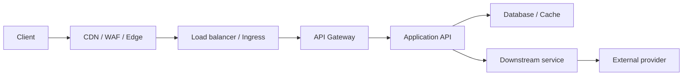
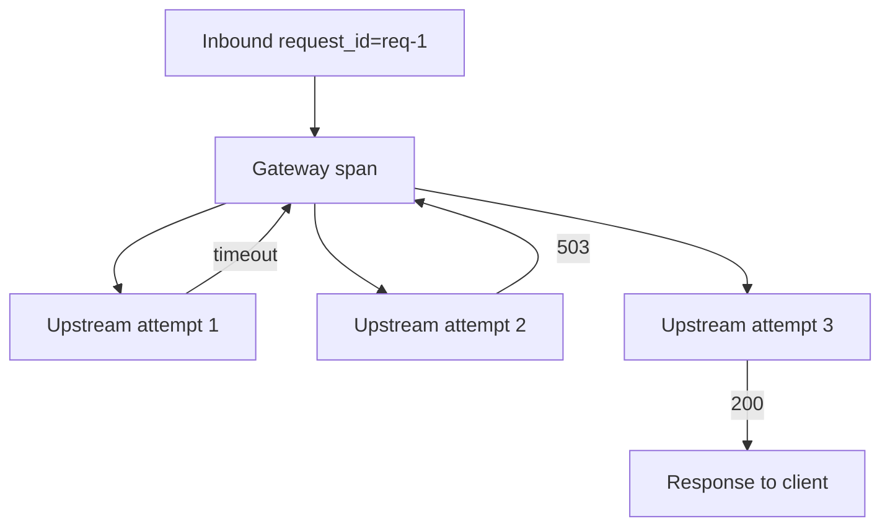

# Tương quan edge, gateway và application telemetry

Khi một request đi qua CDN/WAF, load balancer, API gateway rồi tới nhiều service, mỗi lớp thường tạo log, metric và trace riêng. Nếu các lớp không chia sẻ context và không thống nhất cách đặt tên field, người vận hành khó trả lời những câu hỏi cơ bản: request nào bị chặn ở edge, gateway đã route tới service nào, application có nhận request không, downstream nào chậm và response cuối cùng được tạo ở đâu?

Tương quan telemetry (telemetry correlation) là khả năng nối các sự kiện ở nhiều lớp thành cùng một hành trình xử lý. Nó dựa trên request ID, trace ID/span ID, route identity, timestamp, trạng thái và một schema field nhất quán. Những giá trị này hỗ trợ điều tra và vận hành; chúng không phải bằng chứng xác thực người dùng, không cấp quyền và không được dùng thay authorization.

Trong module `SECURITY_API_SECURITY`, quan sát phải phản ánh được trust boundary từ Internet tới application và dependency. Bài này hướng dẫn thiết kế correlation context cho edge, gateway và application; dùng W3C Trace Context/OpenTelemetry; giữ đúng nguồn của identity, client IP và status; truyền context qua retry/async; đồng bộ thời gian; đồng thời kiểm soát sampling, cardinality và dữ liệu nhạy cảm.

## Mục tiêu học tập

Sau bài này, người học có thể:

- Giải thích khác nhau giữa request ID, correlation ID, trace ID và span ID.
- Thiết kế đường đi của context qua CDN/WAF, load balancer, gateway và application.
- Sử dụng `traceparent`, `tracestate` và OpenTelemetry propagation đúng mục đích.
- Phân biệt thông tin do client khai báo với thông tin do trusted proxy hoặc application xác minh.
- Chuẩn hóa field để đối chiếu edge log, gateway log, application log, metric và trace.
- Xử lý retry, redirect, fan-out và asynchronous message mà không làm mất quan hệ nhân quả.
- Hiểu tác động của clock skew, sampling, dropped telemetry và high-cardinality labels.
- Bảo vệ PII, credential và security context trong telemetry.
- Điều tra một request bị chặn, timeout hoặc có dấu hiệu tấn công xuyên nhiều lớp.

## 1. Vì sao cần tương quan telemetry?

### 1.1. Một request, nhiều quan sát

Một request Internet có thể đi qua các lớp:



Mỗi lớp trả lời một phần khác nhau:

- **Edge:** request đến từ đâu theo network view của edge, có bị WAF/rate policy chặn không, TLS và bot policy có kết quả gì?
- **Load balancer/ingress:** request được chuyển tới backend/target nào, có lỗi kết nối hoặc health check không?
- **Gateway:** route nào được chọn, authentication/plugin/rate policy có kết quả gì, upstream nào được gọi?
- **Application:** handler nào chạy, principal nào đã xác thực, authorization decision nào được đưa ra, nghiệp vụ có hoàn tất không?
- **Dependency:** database/cache/partner call mất bao lâu, lỗi nào xảy ra và có retry không?

Không lớp nào một mình nhìn thấy toàn bộ hành trình. Nếu chỉ có timestamp và IP, các request đồng thời có thể bị ghép nhầm; nếu mỗi lớp tự sinh ID mà không truyền context, người vận hành phải tìm thủ công và dễ bỏ sót hop.

### 1.2. Các câu hỏi cần trả lời khi điều tra

Một hệ thống có correlation tốt cần giúp trả lời:

1. Request được edge nhận lúc nào và được xử lý theo policy nào?
2. Edge đã forward request hay chặn trước gateway?
3. Gateway có nhận đúng request ID/trace context không?
4. Gateway route đến service/cluster/version nào?
5. Application đã xác thực caller chưa; nếu có, principal nào được xác minh?
6. Authorization đã allow/deny action trên resource nào?
7. Application gọi dependency nào, theo thứ tự nào và bao nhiêu lần?
8. Có retry, redirect, timeout hoặc circuit breaker không?
9. Response status cuối cùng do edge, gateway hay application tạo?
10. Có dữ liệu nào bị redacted, sampled hoặc mất trong pipeline?

Correlation không yêu cầu ghi toàn bộ request/response. Thông thường route template, IDs, event name, status, duration và reason code đã đủ để nối các lớp mà không lưu payload nhạy cảm.

### 1.3. Không nhầm correlation với authentication

`X-Request-ID`, `traceparent`, trace ID, span ID và baggage đều có thể được gửi hoặc tác động bởi thành phần bên ngoài. Chúng giúp nối telemetry, nhưng không chứng minh danh tính caller.

Không được:

- Cho request đi qua chỉ vì nó có trace ID hợp lệ.
- Tin `X-User-Id`, `X-Tenant-Id` hoặc `X-Authenticated` chỉ vì chúng xuất hiện trong log context.
- Dùng trace ID làm khóa authorization hoặc làm secret truy cập dữ liệu.
- Cho phép client đặt severity, event name hoặc security decision trong telemetry.

Authentication phải dựa trên credential được xác minh; authorization phải dựa trên principal, action, resource và policy ở server. Telemetry chỉ ghi lại kết quả đã xác minh cùng nguồn của nó.

## 2. Phân biệt các loại ID

### 2.1. Request ID

Request ID là định danh cho một request ở một API boundary hoặc một request lifecycle theo quy ước của hệ thống. Nó hữu ích khi tìm log theo một lần gọi HTTP cụ thể.

Một request ID có thể được tạo tại edge rồi truyền qua gateway/application. Nếu hệ thống có nhiều hop hoặc retry, cần quy định rõ ID này đại diện cho logical request hay một lần attempt. Thực tế thường giữ request ID ổn định cho logical inbound request và tạo attempt/span riêng cho từng lần gọi upstream.

Request ID nên:

- Được tạo bằng nguồn ngẫu nhiên/unique phù hợp ở trusted boundary.
- Có charset và length giới hạn.
- Không chứa thông tin cá nhân, token hoặc dữ liệu nghiệp vụ.
- Không mang ý nghĩa quyền truy cập.
- Được log ở mọi lớp có nhận context.

Nếu client gửi `X-Request-ID`, hãy xem nó là client correlation hint. Có thể lưu riêng sau khi validate, nhưng không để nó ghi đè ID nội bộ hoặc quyết định trust.

### 2.2. Correlation ID

Correlation ID là định danh dùng để nhóm nhiều event có quan hệ nghiệp vụ hoặc vận hành. Tùy hệ thống, nó có thể bao phủ một request, một workflow, một transaction hoặc một job bất đồng bộ.

Ví dụ một lần tạo đơn hàng có thể phát sinh request HTTP, event publish, worker xử lý và callback. Một `correlation_id` nghiệp vụ có thể giữ xuyên workflow, trong khi mỗi HTTP request có `request_id` riêng và trace có thể nối qua message propagation hoặc span link.

Không nên mặc định correlation ID luôn giống request ID hoặc trace ID. Chọn semantics rõ ràng và đặt tên field theo ý nghĩa.

### 2.3. Trace ID và span ID

Distributed trace gồm một trace chứa nhiều span. Trace ID định danh toàn trace; span ID định danh một operation cụ thể trong trace. Span thường có parent span, start/end time, attributes, events và status.

Ví dụ:

```text
Trace: 4bf92f3577b34da6a3ce929d0e0e4736
  Span edge.request       00f067aa0ba902b7
    Span gateway.route   b7ad6b7169203331
      Span api.handle     00f067aa0ba902b8
        Span db.query     00f067aa0ba902b9
        Span payment.call 00f067aa0ba902ba
```

Các ID trong ví dụ chỉ minh họa. Trace ID cho biết các span thuộc cùng trace; span ID cho biết operation cụ thể. Khi log trong một span, ghi cả `trace_id` và `span_id` nếu SDK/context có sẵn.

### 2.4. Attempt ID và event ID

Retry tạo nhiều lần attempt cho cùng một logical operation. Có thể dùng span riêng cho mỗi attempt hoặc thêm `attempt`/`retry_count` trong span attributes. Event ID dùng để định danh một audit/log event duy nhất, hữu ích cho deduplication và đối chiếu pipeline.

Không tái sử dụng cùng một span ID cho nhiều attempt độc lập. Không dùng request ID làm event ID nếu một request tạo nhiều event.

### 2.5. Bảng so sánh

| ID | Phạm vi | Ai thường tạo | Dùng để |
|---|---|---|---|
| `client_request_id` | Giá trị client đề xuất | Client | Hỗ trợ support nếu đã validate; không dùng làm trust anchor |
| `request_id` | Một inbound request theo boundary contract | Edge hoặc gateway tin cậy | Tìm log của request |
| `correlation_id` | Một workflow/transaction | Service khởi tạo workflow | Nối request và event nghiệp vụ liên quan |
| `trace_id` | Một distributed trace | Tracing SDK hoặc inbound trace context | Nối các span qua nhiều process |
| `span_id` | Một operation trong trace | Tracing SDK | Xác định hop/operation cụ thể |
| `event_id` | Một telemetry/audit event | Producer event | Deduplicate và đối chiếu event |
| `attempt` | Một lần thử gọi operation | Caller thực hiện retry | Phân biệt retry và lần gọi đầu |

## 3. Thiết kế context xuyên edge, gateway và application

### 3.1. Chọn trusted boundary để tạo request ID

Một thiết kế phổ biến là edge tạo `request_id` nội bộ cho mỗi inbound request. Edge xóa hoặc ghi đè header nội bộ do Internet gửi, rồi forward ID đã tạo tới gateway. Gateway và application giữ nguyên ID này cho logical request.

Nếu CDN/WAF không thể tạo ID, gateway có thể là nơi đầu tiên tạo ID. Điều quan trọng là phải có một owner rõ ràng và không để client tùy ý chọn giá trị được xem là authoritative.

Ví dụ luồng:

```mermaid
sequenceDiagram
    participant C as Client
    participant E as Edge / WAF
    participant G as API Gateway
    participant A as Application
    C->>E: Request + untrusted headers
    E->>E: Strip external X-Request-ID
    E->>E: Generate request_id and trace span
    E->>G: Forward trusted request_id + trace context
    G->>G: Create gateway span; keep request_id
    G->>A: Forward request_id + trace context
    A->>A: Authenticate, authorize, create app span
    A-->>G: Response + telemetry context
    G-->>E: Upstream response
    E-->>C: Final response + safe request ID
```

Response có thể trả `X-Request-ID` để người dùng gửi cho support. Chỉ trả một ID opaque, không trả trace baggage, internal hostname hoặc actor/tenant metadata.

### 3.2. Xử lý header do client gửi

Client có thể gửi `X-Request-ID`, `traceparent`, `tracestate`, `baggage`, `X-Forwarded-For` và các header custom. Cần có policy riêng cho từng header:

- `X-Request-ID`: strip/replace tại trusted edge hoặc validate và lưu riêng dưới dạng client-provided ID.
- `traceparent`/`tracestate`: xử lý theo W3C Trace Context và tracing SDK; không dùng để xác thực.
- `baggage`: chỉ propagate field allowlisted, giới hạn kích thước và không chứa secret/PII.
- `Forwarded`/`X-Forwarded-*`: chỉ tin giá trị do proxy nằm trong trusted proxy chain ghi/chuẩn hóa.
- `X-User-*`/`X-Tenant-*`: không tin làm identity trừ khi được tạo bởi một trusted identity propagation mechanism đã xác minh.

Proxy đầu tiên phải loại bỏ các header forwarding do client tự khai báo hoặc ghi đè theo cấu hình. Backend chỉ nên đọc forwarding metadata từ các hop đã được cấu hình tin cậy; nếu backend có thể truy cập trực tiếp từ Internet, không thể mặc định header đó đáng tin.

### 3.3. Tạo ID mới hay giữ ID được truyền?

Giữ request ID khi các hop đang xử lý cùng một inbound request và có cùng trust boundary contract. Tạo request ID mới khi một client bắt đầu request độc lập hoặc khi một hệ thống tiếp nhận công việc mới mà không thể tin ID được gửi tới.

Đối với trace context, tracing SDK thường tiếp tục trace hợp lệ bằng cách tạo child span. Nếu không có context hợp lệ, nó tạo trace mới. Với context từ Internet, có thể tiếp tục trace để hỗ trợ observability, nhưng cần giới hạn sampling và tránh coi trace flags/tracestate là chỉ thị bảo mật. Một tổ chức có thể chọn tạo trace mới tại một trust boundary nhạy cảm và lưu link tới upstream context theo policy.

### 3.4. Không ghi đè context đã xác minh

Application có thể nhận request ID từ gateway, nhưng actor/tenant phải được xác minh bằng authentication context. Nếu gateway forward user context, phải dùng token/delegation context có issuer, audience, signature và expiry phù hợp; không dùng header text tự do.

Khi application tạo telemetry event, phân biệt rõ:

- `request_id`: correlation ID do trusted edge/gateway cấp.
- `trace_id`/`span_id`: context từ tracing SDK.
- `actor_id`: principal đã xác thực tại application.
- `client_ip`: địa chỉ client được xác định từ trusted proxy chain.
- `tenant_id`: tenant context được kiểm tra theo authorization policy.

Không điền các field này bằng cùng một giá trị hoặc lấy tất cả từ request header.

## 4. W3C Trace Context và OpenTelemetry

### 4.1. `traceparent`

W3C Trace Context định nghĩa header `traceparent` để truyền trace context giữa các process. Dạng version `00` phổ biến có cấu trúc:

```http
traceparent: 00-4bf92f3577b34da6a3ce929d0e0e4736-00f067aa0ba902b7-01
```

Các phần gồm:

- Version: `00`.
- Trace ID: 32 ký tự hex (16 byte), không được toàn số 0.
- Parent ID: 16 ký tự hex (8 byte), không được toàn số 0.
- Trace flags: 2 ký tự hex; bit sampled phổ biến là bit thấp nhất.

Header malformed hoặc version không hỗ trợ cần được xử lý theo W3C specification/SDK. Không tự parse bằng substring rồi tin mọi giá trị. Dùng propagator của OpenTelemetry hoặc implementation tương thích.

### 4.2. `tracestate`

`tracestate` mang vendor-specific trace information. Nó có thể được nối/điều chỉnh qua các hệ thống tracing. Không đưa dữ liệu nhạy cảm hoặc thông tin authorization vào `tracestate`; không dùng giá trị vendor-specific làm policy quyết định quyền truy cập.

Giữ giới hạn kích thước và số member theo W3C specification. Khi qua trust boundary, chỉ forward nếu policy cho phép và SDK xử lý đúng grammar.

### 4.3. Trace flags không phải security policy

Trace flag sampled do upstream gửi không phải quyền yêu cầu hệ thống phải thu thập toàn bộ trace. Nếu public client có thể đặt sampled bit và hệ thống tin tuyệt đối, attacker có thể làm tăng telemetry cost.

Sampler ở edge/gateway/SDK cần có policy riêng: parent-based sampling có thể tôn trọng parent decision trong trusted environment, nhưng với inbound public context cần cân nhắc sampler override, rate/cost limit hoặc tail sampling. Không dùng sampling decision để allow/deny request.

### 4.4. Baggage

W3C Baggage truyền key-value context ngoài traceparent. Baggage có thể hữu ích cho tenant tier hoặc workflow classification, nhưng được propagate tới nhiều downstream service và có nguy cơ lộ dữ liệu.

Chỉ propagate field allowlisted. Không đưa email, username, access token, session ID, payment detail hoặc secret vào baggage. Đặt giới hạn số field và tổng bytes; strip field không được phép tại edge. Application vẫn phải xác minh tenant/actor từ security context thay vì tin baggage.

### 4.5. OpenTelemetry propagation

OpenTelemetry SDK dùng propagator để inject/extract trace context qua HTTP, gRPC và message carrier. Dùng W3C Trace Context propagator mặc định khi phù hợp và thống nhất cấu hình giữa các service.

Các nguyên tắc:

- Tạo server span ở ingress/application server.
- Tạo client span khi gọi dependency hoặc upstream service.
- Inject context vào outbound request/message bằng SDK.
- Extract context ở receiver bằng SDK.
- Ghi `trace_id`/`span_id` vào log bằng log correlation integration hoặc bridge phù hợp.
- Không tự tạo span ID bằng UUID hoặc request ID.
- Không tạo duplicate server/client spans do instrumentation thủ công trùng với auto-instrumentation.

Tên semantic convention thay đổi theo phiên bản OpenTelemetry; cần dùng schema/semantic conventions tương ứng phiên bản SDK và backend đang triển khai.

## 5. Field schema dùng chung giữa edge, gateway và application

### 5.1. Field bắt buộc và field theo lớp

Không phải mọi lớp đều có đủ mọi field. Hãy thống nhất tên và semantics, cho phép field vắng mặt khi lớp đó chưa biết thông tin.

| Field | Ý nghĩa | Nguồn có thẩm quyền |
|---|---|---|
| `timestamp` | Thời điểm event được tạo | Clock của process ghi event |
| `service.name` | Tên service/workload | Deployment/resource attributes |
| `service.version` | Phiên bản release | Deployment metadata |
| `deployment.environment` | Environment | Runtime/deployment config |
| `request.id` | ID logical inbound request | Trusted edge/gateway |
| `trace_id` | Distributed trace | Tracing SDK |
| `span_id` | Operation hiện tại | Tracing SDK |
| `event.name` | Loại event | Code/policy cố định |
| `http.request.method` | HTTP method | Request đã parse |
| `http.route` | Route template | Gateway/application router |
| `url.path` | Path theo policy | Lớp sở hữu URL parsing; thường nên tránh raw path có ID |
| `http.response.status_code` | Status trả ở lớp ghi event | Response tại lớp đó |
| `upstream.status_code` | Status nhận từ upstream | Proxy/gateway |
| `duration_ms` | Thời lượng tại lớp đó | Monotonic timer trong process |
| `network.peer.address` | Peer trực tiếp kết nối | Socket/proxy hop hiện tại |
| `client.address` | Client address theo trusted proxy policy | Edge hoặc proxy chain đã xác minh |
| `user.id`/`actor.id` | Principal đã xác thực | Application authentication context |
| `tenant.id` | Tenant đã được xác minh/authorize | Application policy context |
| `error.type` | Nhóm lỗi ổn định | Code/framework mapping |

Các tên field ở trên là schema minh họa. Nếu dùng OpenTelemetry semantic conventions, ưu tiên tên attribute chuẩn theo phiên bản; không tự đổi nghĩa của một attribute chuẩn.

### 5.2. Phân biệt status theo từng hop

Edge có thể trả `403` do WAF dù gateway không nhận request. Gateway có thể trả `502` vì upstream connection thất bại trong khi application không tạo response. Application có thể trả `200` nhưng edge trả `504` do timeout ở phía client. Nếu mọi lớp ghi một field `status`, người vận hành có thể hiểu nhầm.

Ghi status của chính lớp đó trong field chuẩn và bổ sung field riêng như `upstream.status_code` khi cần. Trong dashboard, phân biệt:

- `edge.response.status_code` — response edge gửi client.
- `gateway.response.status_code` — response gateway tạo/forward.
- `application.response.status_code` — response application tạo.
- `upstream.status_code` — status upstream mà proxy nhận được.

Đừng ghi status của application vào event edge nếu edge chỉ biết status cuối cùng. Khi gateway trả 502, ghi `upstream.connect_error` hoặc `upstream.status_code` vắng mặt thay vì bịa status application.

### 5.3. Route template thay cho raw URL

Metric label và phần lớn log index nên dùng route template như `/api/orders/{orderId}` thay vì raw path `/api/orders/ord_123...`. Raw URL có thể chứa PII, token hoặc identifier có cardinality rất cao.

Query string thường không cần ghi đầy đủ. Nếu cần chẩn đoán, ghi tên parameter allowlisted hoặc boolean presence; không log token, email, search text hoặc signed URL. Gateway có thể dùng route ID, application dùng route template; duy trì mapping để đối chiếu.

### 5.4. Schema version và naming

Định nghĩa schema version cho log/event khi field thay đổi. Giữ naming convention nhất quán (ví dụ snake_case hoặc OpenTelemetry attribute names), kiểu dữ liệu ổn định và semantics không thay đổi theo service.

Không dùng một field lúc là milliseconds, lúc là seconds; lúc là status cuối, lúc là status upstream. Nếu cần migrate, hỗ trợ version hoặc dual-write trong thời gian chuyển đổi và cập nhật parser/dashboard có kế hoạch.

## 6. Trách nhiệm telemetry theo từng lớp

### 6.1. Edge/CDN/WAF

Edge thường là nơi nhìn thấy kết nối Internet đầu tiên. Nó nên ghi:

- Request ID nội bộ và trace context đã xử lý.
- Timestamp nhận request và duration edge.
- Host/route rule đã match theo allowlist.
- Method, protocol/TLS metadata cần thiết.
- Kết quả WAF/bot/rate policy bằng stable rule ID và action.
- Client network address theo trusted edge view.
- Response status edge gửi client và bytes theo chiều vào/ra.
- Upstream target/route nếu edge có forward request.

Không log raw Authorization/Cookie, request body hoặc toàn bộ query string. Với WAF, ghi rule ID/category và action; hạn chế ghi matched payload vì có thể chứa secret/PII hoặc tạo log injection. Nếu cần forensic sample, dùng store riêng có quyền và retention chặt.

### 6.2. Load balancer/ingress

Load balancer/ingress nên ghi target/backend, connection outcome, retry/health selection, TLS handshake error và timing ở lớp của nó. Cần phân biệt lỗi client disconnect, backend connect failure và backend response.

Nếu load balancer tự tạo request ID, xác định nó có phải authoritative ID của toàn hệ thống không. Tránh có ba header khác nhau cùng tên `request_id` nhưng semantics khác nhau.

### 6.3. API gateway

Gateway ghi route ID, upstream service/cluster, auth plugin decision, rate/quota result, transformation, retry và status ở gateway. Nếu gateway thực hiện authentication, nó cần ghi issuer/client identity theo kết quả xác minh; application vẫn phải xác minh token/delegation context phù hợp với boundary của nó.

Gateway không nên khẳng định user đã được authorize trên object nếu application là nơi sở hữu resource và thực hiện object-level authorization. Có thể log `gateway.authn.result=success` nhưng không ghi `object.authorization=allow` khi gateway chưa kiểm tra object.

### 6.4. Application

Application biết handler, business action, authenticated principal, tenant context và object authorization. Nó nên ghi:

- Route template và operation/action.
- Request ID, trace ID và span ID.
- Actor/principal ID đã xác minh (theo data policy).
- Authorization decision, policy/reason code và resource reference ở mức cần thiết.
- Business outcome hoặc state transition quan trọng.
- Dependency span/latency và error category.
- Response status do application tạo.

Không ghi raw object, request body hoặc dữ liệu nhạy cảm chỉ để nối trace. Nếu cần audit, dùng event audit riêng với schema, integrity và retention phù hợp.

### 6.5. Dependency và data store

Database/cache/partner instrumentation nên tạo child span và ghi operation type, peer/service, duration, status/error type. Tránh ghi raw SQL với literal values, query parameter chứa PII, connection string hoặc secret. Dùng statement summary/fingerprint và database system attributes phù hợp.

## 7. Client IP và forwarding chain

### 7.1. `X-Forwarded-For` không tự đáng tin

`X-Forwarded-For` có thể chứa nhiều IP. Client có thể tự gửi header này; mỗi proxy có thể append hoặc rewrite theo cấu hình. Nếu application lấy phần tử đầu tiên mà không xác định trusted proxy chain, attacker có thể giả mạo client IP trong log hoặc rate-limit key.

Chỉ tin forwarding header từ proxy nằm trong trusted proxy configuration. Edge cần xóa/ghi đè header do client gửi; gateway/application chỉ phân tích chain theo danh sách proxy tin cậy và quy tắc deployment.

### 7.2. Ghi cả peer trực tiếp và client đã suy ra

Để điều tra, có thể ghi hai field khác nhau:

- `network.peer.address`: địa chỉ TCP peer trực tiếp kết nối tới process.
- `client.address`: client address được suy ra theo trusted proxy chain.

Không ghi `X-Forwarded-For` raw như thể nó là client IP đã xác minh. Nếu cần lưu chain, ghi riêng dưới dạng metadata đã giới hạn và chỉ cho nhóm có nhu cầu điều tra.

### 7.3. IPv4, IPv6 và NAT

Địa chỉ client có thể là IPv4, IPv6, NAT gateway, corporate proxy hoặc mobile carrier. Một IP không phải identity duy nhất của user. Tránh dùng IP làm actor ID; rate limit cần kết hợp identity đã xác minh, route và network signals theo threat model.

## 8. Retry, redirect và fan-out

### 8.1. Một logical request có nhiều upstream attempts

Gateway có thể retry khi upstream trả 503 hoặc connection reset. Cùng một request ID có thể xuất hiện trong nhiều attempt. Cần ghi retry count, upstream target và span riêng cho từng attempt.



Log gateway nên giúp phân biệt response cuối cùng với status từng attempt. Application có thể nhận một, hai hoặc ba request tùy nơi retry xảy ra; nếu operation không idempotent, retry có thể tạo side effect lặp. Telemetry giúp phát hiện nhưng idempotency phải được xử lý ở application/business layer.

### 8.2. Redirect

Redirect tạo request mới từ client, thường có request ID mới và trace context có thể không được browser giữ qua navigation. Nếu cần nối workflow, dùng correlation ID nghiệp vụ hoặc server-side state; không kỳ vọng browser luôn forward custom headers.

Không forward Authorization, Cookie hoặc baggage nhạy cảm sang host khác chỉ để giữ trace. Trace context có thể được gửi theo policy, nhưng credential phải tuân theo origin/audience boundary.

### 8.3. Fan-out

Một application request có thể gọi nhiều downstream service song song. Các span con có cùng trace ID nhưng span ID khác nhau. Không ép các dependency call thành một chuỗi tuần tự giả. Dùng span parent-child hoặc span link đúng semantics và ghi dependency name ổn định.

### 8.4. Retry ở nhiều lớp

Nếu edge, gateway, application client và SDK đều retry, tổng số attempt có thể nhân lên. Correlation cần thể hiện layer thực hiện retry, retry count và final outcome. Đặt retry budget và timeout deadline end-to-end để tránh retry storm.

## 9. Asynchronous message và background job

### 9.1. Truyền trace context qua message

Khi application publish event/job, inject trace context vào message headers bằng OpenTelemetry propagator. Consumer extract context và tạo consumer/process span. Giữ `job_id` hoặc `correlation_id` riêng để truy vấn workflow kể cả khi trace đã kết thúc hoặc telemetry bị sampled out.

Không copy toàn bộ HTTP headers vào message. Chỉ truyền trace context và các metadata được allowlist; không truyền Authorization/Cookie hoặc raw baggage không được kiểm soát.

### 9.2. Parent-child hay span link?

Với một message xử lý đơn giản, consumer span có thể tiếp tục context của producer theo instrumentation semantics. Với batch consumer gom nhiều message hoặc một job được kích hoạt bởi nhiều event, span link thường phù hợp hơn một parent duy nhất. Với job chạy lâu, không nên giữ một span mở hàng giờ/ngày; tạo span cho từng phase và liên kết bằng job/correlation ID hoặc span link.

### 9.3. Queue redelivery và duplicate event

Message có thể được redeliver. Ghi `message.id`, `job.id`, `delivery_attempt` hoặc retry count theo semantics của broker. Không dùng trace ID để deduplicate side effect; deduplication cần event/job/business idempotency key và storage logic phù hợp.

### 9.4. Context không phải quyền

Trace baggage hoặc message attribute không thể cấp tenant/user permission. Consumer phải xác minh producer identity, message schema, job record và actor/delegation context theo policy. Nếu user bị revoke sau khi enqueue, revalidation phải theo business rule; trace propagation không quyết định điều đó.

## 10. Clock, duration và ordering

### 10.1. Đồng bộ clock

Các host nên đồng bộ thời gian bằng NTP hoặc dịch vụ time synchronization của nền tảng. Ghi timestamp theo UTC/RFC 3339/ISO 8601 với timezone rõ. Tránh local time không có offset vì log ở nhiều region khó đối chiếu.

Clock sync không hoàn hảo. Có thể có clock skew giữa edge, gateway, application và database. Một child span có timestamp sớm hơn parent vài mili giây không nhất thiết có nghĩa trace context sai.

### 10.2. Dùng monotonic clock cho duration

Duration trong một process nên được đo bằng monotonic clock (`System.nanoTime()` trong Java), không trừ hai wall-clock timestamp có thể bị chỉnh bởi NTP hoặc clock step.

Ghi start/end timestamp để đối chiếu cross-system; ghi duration đo local để đo latency chính xác hơn. Không so sánh trực tiếp duration của hai host nếu chúng dùng đơn vị/semantics khác nhau.

### 10.3. Ordering không chỉ dựa vào timestamp

Khi điều tra distributed trace, dùng parent-child relation, span links, request/job/event IDs và sequence của broker để hiểu nhân quả. Timestamp giúp định vị thời gian nhưng không phải total order toàn hệ thống.

Nếu cần event ordering nghiệp vụ, lưu sequence/version do aggregate hoặc broker cấp. Không dùng timestamp client gửi làm event order tin cậy.

## 11. Sampling, missing telemetry và trace completeness

### 11.1. Head sampling và tail sampling

Head sampling quyết định sớm khi trace bắt đầu. Nó tiết kiệm tài nguyên nhưng có thể bỏ qua trace trước khi biết request có lỗi hay không. Tail sampling quyết định sau khi thu thập một phần/toàn bộ trace và có thể ưu tiên error/slow trace, nhưng cần collector/buffer có tài nguyên và chính sách rõ.

Với API public, không để client ép sampled flag gây tăng chi phí vô hạn. Có thể dùng sampler ở edge hoặc collector để áp rate/cost budget và ưu tiên một số security event.

### 11.2. Log, metric và trace có sampling khác nhau

Không giả định mọi log đều có trace tương ứng. Có thể log được giữ nhưng trace bị sampled out; metric thường aggregate và không chứa trace ID. Một số nền tảng hỗ trợ exemplars để nối histogram metric với trace mẫu.

Security audit event quan trọng không nên phụ thuộc hoàn toàn vào trace sampling. Audit log cần retention/integrity riêng. Metrics nên aggregate, không mang ID cá nhân.

### 11.3. Trace bị đứt đoạn

Trace có thể thiếu span do:

- Service chưa instrument hoặc propagator không đồng nhất.
- Header bị proxy strip/rename.
- Async context không được inject/extract.
- Collector/exporter bị mất dữ liệu hoặc sampling.
- Timeout/crash trước khi flush span.
- Cross-vendor propagation không tương thích.

Không kết luận service không chạy chỉ vì trace không có span. Đối chiếu access log, gateway log, metric, broker event và application log.

### 11.4. Giữ trace ID trong log

Khi log trong context có active span, thêm `trace_id` và `span_id` vào structured log. Không tự tạo giá trị nếu không có context; để field vắng mặt hoặc dùng trạng thái rõ ràng. Log correlation integration của OpenTelemetry có thể tự inject field, nhưng phải kiểm tra format/field name và tránh ghi duplicate IDs.

## 12. Privacy, security và cardinality

### 12.1. Không đưa secret vào correlation context

Không dùng:

- Access token, refresh token, API key, session ID.
- Cookie hoặc authorization header.
- Email, phone, full name hoặc địa chỉ trong baggage.
- Raw query string, signed URL hoặc password reset link.
- Request body, payment data hoặc file content.

IDs nên opaque, không chứa dữ liệu có thể đọc ngược. Nếu actor/tenant ID cần ghi, áp dụng data classification, pseudonymization hoặc access restriction. Tracing backend thường có nhiều người đọc hơn database nghiệp vụ.

### 12.2. Cardinality trong metric

Không dùng request ID, trace ID, user ID, tenant ID, raw URL hoặc IP làm metric label thông thường. Những field này tạo cardinality rất cao, làm tăng memory/storage và khiến query chậm.

Metric labels nên dùng dimension bounded như:

- Service, environment, region.
- Route template/route ID.
- HTTP method và status class/status code theo policy.
- Upstream service name.
- Error type/reason code allowlisted.
- WAF action/rule category ở mức ổn định.

ID chi tiết thuộc log/trace có quyền kiểm soát; metric giữ aggregate. Nếu cần tenant-level usage, dùng tier/cohort hoặc một dimension bounded đã được phê duyệt.

### 12.3. Log injection và header length

Correlation header là input. Validate charset/length, strip control characters và không đưa raw header vào text log. JSON serializer bảo vệ JSON syntax nhưng không thay redaction hoặc sink-specific encoding. Giới hạn baggage và `tracestate` theo W3C rules để tránh header bloat.

### 12.4. Trust boundary và sampling abuse

Client có thể tạo nhiều trace ID, đổi sampled flag hoặc gửi baggage lớn. Edge/gateway cần giới hạn header size, số field, sampling rate và trace creation cost. Không cho telemetry context làm thay đổi rate-limit identity hoặc authorization principal.

## 13. Ví dụ Java/Spring Boot với OpenTelemetry

### 13.1. Lấy trace/span ID từ active span

Ví dụ dùng OpenTelemetry API:

```java
SpanContext spanContext = Span.current().getSpanContext();
if (spanContext.isValid()) {
    logger.info("event=payment.authorized trace_id={} span_id={}",
        spanContext.getTraceId(), spanContext.getSpanId());
}
```

Đây là minh họa cho log text. Trong production, ưu tiên structured logger hoặc OpenTelemetry log correlation integration để field được serialize đúng và không nối chuỗi tùy tiện.

### 13.2. Tạo custom span cho business operation

```java
Span span = tracer.spanBuilder("order.authorize")
    .setSpanKind(SpanKind.INTERNAL)
    .startSpan();

try (Scope scope = span.makeCurrent()) {
    span.setAttribute("app.operation", "order.authorize");
    span.setAttribute("app.result", "started");

    authorizationService.authorizeOrder(principal, orderId);
    orderService.authorize(orderId);
    span.setStatus(StatusCode.OK);
} catch (AccessDeniedException ex) {
    span.setAttribute("app.authorization.result", "deny");
    throw ex;
} catch (RuntimeException ex) {
    span.recordException(ex);
    span.setStatus(StatusCode.ERROR);
    throw ex;
} finally {
    span.end();
}
```

Không đưa raw order ID, email hoặc PII vào span attribute nếu không cần. Với resource identifier, đánh giá cardinality và data access policy; có thể dùng loại resource hoặc opaque internal ID ở nơi phù hợp. Không đánh dấu mọi authorization deny là application fault nếu observability convention của hệ thống phân loại denial riêng.

### 13.3. Propagation qua HTTP client

Khi dùng OpenTelemetry auto-instrumentation cho Spring MVC/WebClient/RestClient, SDK có thể tự tạo server/client span và inject/extract context. Nếu tự instrument, dùng `TextMapPropagator` thay vì tự nối `traceparent`:

```java
TextMapPropagator propagator = openTelemetry.getPropagators().getTextMapPropagator();
propagator.inject(Context.current(), requestHeaders, (carrier, key, value) ->
    carrier.put(key, value));
```

`requestHeaders` cần là carrier mà HTTP client thực sự gửi. Chỉ inject trace context đã được SDK xử lý; không copy toàn bộ inbound headers. Tránh tạo duplicate instrumentation nếu agent/library đã tự inject.

### 13.4. Request ID filter

Ví dụ tạo ID nội bộ khi chưa có ID từ trusted upstream:

```java
public class RequestIdFilter extends OncePerRequestFilter {
    @Override
    protected void doFilterInternal(HttpServletRequest request,
                                    HttpServletResponse response,
                                    FilterChain chain)
            throws ServletException, IOException {
        String requestId = trustedUpstream(request)
            ? validatedInternalRequestId(request.getHeader("X-Request-ID"))
            : UUID.randomUUID().toString();

        request.setAttribute("requestId", requestId);
        MDC.put("request_id", requestId);
        response.setHeader("X-Request-ID", requestId);
        try {
            chain.doFilter(request, response);
        } finally {
            MDC.remove("request_id");
        }
    }
}
```

Đây là pseudocode minh họa: `trustedUpstream` phải dựa trên network/mTLS/service identity đã xác minh, không dựa vào header do client tự khai. `validatedInternalRequestId` phải từ chối/chuẩn hóa giá trị sai format/length. Nếu application chỉ nhận request từ gateway và gateway luôn tạo ID, cấu hình có thể đơn giản hơn; vẫn cần bảo vệ direct-origin access.

### 13.5. Correlation trong Spring Security

Filter tạo request ID không nên đọc actor từ header. Sau authentication, application có thể ghi principal ID từ `SecurityContext` vào log context ở filter/interceptor phù hợp. Cần dọn MDC trong `finally`, đặc biệt khi dùng thread pool.

Authorization decision cần log từ nơi policy được thực thi. Gateway authn event và application object authorization event nên là hai event riêng với field semantics rõ.

## 14. Điều tra request xuyên nhiều lớp

### 14.1. Bắt đầu từ request ID

Khi support nhận được `X-Request-ID`, tìm ID trong edge log trước:

1. Xác định edge action: allow, block, challenge, rate limit hay error.
2. Nếu edge forward, tìm cùng `request_id` ở load balancer/gateway.
3. Đọc route ID, upstream target, status và attempt count.
4. Tìm application log theo request ID và trace ID.
5. Mở trace để xem span duration, parent-child relation và dependency error.
6. Nếu có async job, tìm `job_id`/`correlation_id` trong producer/consumer log.
7. Đối chiếu status từng lớp và response cuối cùng.

Nếu edge chặn request, không có application span là điều bình thường. Nếu gateway có request nhưng application không có, kiểm tra upstream connect, service mesh, routing và collector gap.

### 14.2. Ví dụ event liên kết

```json
{
  "timestamp": "2026-11-18T10:12:00.123Z",
  "service.name": "api-gateway",
  "event.name": "gateway.upstream.completed",
  "request.id": "req_01JXYZ",
  "trace_id": "4bf92f3577b34da6a3ce929d0e0e4736",
  "span_id": "00f067aa0ba902b7",
  "route.id": "orders-v2",
  "upstream.service": "orders-api",
  "upstream.status_code": 200,
  "http.response.status_code": 200,
  "duration_ms": 42
}
```

Application có thể ghi event cùng `request.id` và `trace_id`, nhưng có `service.name`, `span_id`, `http.route`, actor/authorization result riêng. Không copy toàn bộ event gateway sang application rồi đổi service name.

### 14.3. Ví dụ request bị WAF chặn

Nếu edge ghi `action=block`, `rule_id=WAF-942xxx`, `status=403` và không có gateway event, đó có thể là kết quả đúng. Không coi việc thiếu gateway log là logging outage nếu edge chưa forward request. Cần kiểm tra edge telemetry completeness và WAF policy decision.

### 14.4. Ví dụ gateway timeout

Gateway có `504`, upstream attempt có timeout và application không có response. Có thể application đã nhận request nhưng response không về kịp; cần tìm app span theo trace ID hoặc request ID. Nếu không có span, đối chiếu load balancer access log, network telemetry và app request counter để phân biệt request chưa tới app với telemetry bị mất.

### 14.5. Ví dụ status không khớp

Application trả `200` nhưng edge trả `499` do client đóng kết nối hoặc edge timeout; application event và edge event đều đúng theo góc nhìn riêng. Dashboard phải hiển thị status theo lớp và final client outcome, không ghi đè một status lên tất cả.

## 15. Metrics, logs và traces bổ sung cho nhau

| Loại telemetry | Trả lời câu hỏi | Dùng ID thế nào |
|---|---|---|
| Metrics | Điều gì đang tăng/giảm theo thời gian? | Không dùng request/trace ID làm label; có thể dùng exemplar |
| Logs | Sự kiện cụ thể nào đã xảy ra? | Ghi request ID, trace ID/span ID và event ID khi có |
| Traces | Một request/workflow đi qua những operation nào? | Trace ID và span ID là định danh chính |
| Audit events | Ai thực hiện action nào trên resource và quyết định ra sao? | Ghi actor/resource/request reference theo policy, integrity riêng |

Không dùng trace thay audit log. Trace có thể sampled out, retention ngắn hoặc thiếu business decision. Không dùng log làm metric aggregate nếu query phải scan dữ liệu lớn. Không đưa high-cardinality IDs vào metric labels.

## 16. Kiểm thử correlation và telemetry propagation

### 16.1. Test matrix

| Nhóm | Kịch bản | Kết quả mong đợi |
|---|---|---|
| Client request ID | Client gửi ID hợp lệ hoặc malformed | Edge tạo ID authoritative; client value lưu riêng hoặc bị bỏ |
| Header spoofing | Client gửi `X-User-Id`, `X-Tenant-Id`, `X-Forwarded-For` giả | Không thay đổi identity/client address đã xác minh |
| Trace context | `traceparent` hợp lệ | SDK tiếp tục trace và tạo span mới |
| Malformed trace | Trace ID/parent ID zero hoặc grammar sai | Context bị bỏ/được xử lý theo SDK; request vẫn qua auth bình thường |
| Trace flags | Client đặt sampled bit | Sampling policy của hệ thống vẫn kiểm soát chi phí |
| Baggage | Gửi secret/PII hoặc baggage quá lớn | Field bị strip/deny; không propagate tùy tiện |
| Edge block | WAF chặn trước gateway | Có edge event; không yêu cầu app span phải tồn tại |
| Gateway forward | Request được forward | Request ID và trace context được truyền theo contract |
| Direct origin | Gọi application bỏ qua gateway | Network/auth controls chặn hoặc request ID được tạo theo policy; không tin header giả |
| Retry | Gateway retry nhiều upstream attempts | Mỗi attempt có span/attempt rõ; request ID logical giữ nhất quán |
| Fan-out | App gọi nhiều dependency song song | Child spans có chung trace ID và parent/link đúng |
| Async | Publish message rồi consumer xử lý | Trace context được inject/extract; job/correlation ID giữ xuyên workflow |
| Redelivery | Broker gửi message lặp | Delivery attempt/event ID rõ; không dùng trace ID để deduplicate side effect |
| Clock skew | Host clocks lệch trong ngưỡng kiểm thử | Duration local vẫn đúng; trace ordering dựa thêm parent/link |
| Sampling | Trace bị sample out nhưng security audit cần giữ | Audit event vẫn được ghi theo policy riêng |
| Status mapping | Edge/gateway/app status khác nhau | Field từng lớp không bị ghi đè hoặc nhầm nghĩa |
| Privacy | Header/body có token, cookie, email | Không xuất hiện trong log, trace attribute hoặc baggage |
| Cardinality | Nhiều request/trace ID | Metrics không tạo label theo từng ID |
| Pipeline loss | Collector drop hoặc exporter down | Có metric/alert về dropped telemetry và ingestion lag |

### 16.2. Integration test end-to-end

Tạo một request test qua edge/gateway/application với ID test đã biết và xác minh:

1. Edge phát một request ID authoritative.
2. Gateway và application log cùng request ID.
3. Trace có cùng trace ID, span ID khác nhau theo operation.
4. Route/status/duration mang semantics của từng lớp.
5. Actor/tenant chỉ xuất hiện sau authentication/authorization phù hợp.
6. Raw token, cookie, query secret và body không xuất hiện.
7. Retry có attempt span riêng; async có message context/job ID.
8. Dashboard/search có thể tìm từ request ID sang trace và ngược lại.

Chạy thêm test WAF block, gateway timeout, direct-origin request, malformed trace header và collector outage. Một test chỉ kiểm tra application log không chứng minh edge-to-app correlation hoạt động.

## 17. Monitoring chất lượng telemetry

Theo dõi chính hệ thống quan sát:

- Tỷ lệ request edge có request ID hợp lệ.
- Tỷ lệ gateway/app event thiếu request ID hoặc trace context khi kỳ vọng phải có.
- Tỷ lệ trace có span edge/gateway/app theo route/service.
- Propagation failure, malformed trace context và baggage rejected.
- Collector/exporter queue depth, dropped records/spans và ingestion lag.
- Tỷ lệ log không parse được hoặc schema version không hỗ trợ.
- Sampling rate theo environment/route và số trace bị drop do budget.
- Clock offset/NTP health và timestamp outlier.
- Cardinality growth, metric series churn và index/storage cost.

Đặt alert theo mức ảnh hưởng: mất toàn bộ gateway telemetry có thể là incident; một route legacy thiếu span có thể là warning. Không cảnh báo chỉ vì một request bị WAF chặn hoặc trace bị sample out theo policy.

## 18. Checklist trước khi phát hành

- [ ] Có owner rõ cho `request_id` authoritative và contract truyền ID giữa các lớp.
- [ ] Client-supplied request ID được validate/lưu riêng; không thể ghi đè trusted ID.
- [ ] Trace ID/span ID do OpenTelemetry/tracing SDK quản lý.
- [ ] `traceparent`/`tracestate` được parse/propagate bằng W3C-compatible propagator.
- [ ] Trace flags từ Internet không thể ép sampling cost vượt budget.
- [ ] Baggage có allowlist, size limit và không chứa secret/PII.
- [ ] Edge strip/overwrite spoofed forwarding headers; trusted proxy chain được cấu hình.
- [ ] Application không dùng trace/request ID làm authentication hoặc authorization.
- [ ] Actor/tenant chỉ được log từ security context đã xác minh.
- [ ] Edge, gateway và app dùng schema/field naming nhất quán với semantics rõ.
- [ ] Status của edge/gateway/application/upstream được phân biệt.
- [ ] Route template/route ID được dùng thay raw URL trong metric và phần lớn log index.
- [ ] Retry/attempt/fan-out được biểu diễn bằng span/attempt riêng.
- [ ] Async producer/consumer propagate trace context và giữ job/correlation ID riêng.
- [ ] Monotonic clock được dùng cho duration; host clocks đồng bộ UTC.
- [ ] Sampling không làm mất audit event bắt buộc.
- [ ] Metrics không dùng request ID, trace ID, user ID hoặc raw IP làm label.
- [ ] Logs/traces không chứa Authorization, Cookie, raw body, signed URL hoặc baggage nhạy cảm.
- [ ] Có integration test từ edge qua gateway tới application và dependency.
- [ ] Có monitoring cho propagation failure, missing spans, dropped telemetry, clock skew và cardinality.

## Kết luận

Tương quan edge, gateway và application telemetry cần một contract rõ về ID, trace context, field semantics và trust boundary. Request ID giúp tìm một inbound request; trace ID/span ID mô tả các operation phân tán; correlation/job ID nối workflow nghiệp vụ. Truyền context bằng W3C Trace Context và OpenTelemetry, nhưng xác minh actor, tenant, client IP và quyền bằng cơ chế bảo mật riêng. Khi status từng lớp, retry, async, clock, sampling và privacy được biểu diễn đúng, đội vận hành có thể tái dựng hành trình request mà không biến telemetry thành một nguồn tin cậy sai hoặc nơi rò rỉ dữ liệu.
