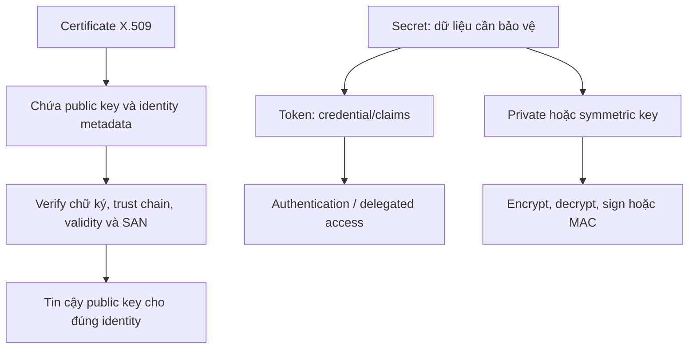

# Secret, token, key và certificate khác nhau thế nào

Trong module `SECURITY_API_SECURITY`, quản lý credential là một phần của thiết kế bảo mật API. Một API có thể dùng access token để xác thực request, API key để nhận diện integration, cryptographic key để ký hoặc mã hóa dữ liệu, và certificate để xác minh public key thuộc về một máy chủ hay workload nào. Những khái niệm này liên quan với nhau nhưng không đồng nghĩa. Nhầm lẫn chúng dễ dẫn tới việc lưu sai cách, cấp quyền quá rộng, xoay vòng sai thứ cần xoay hoặc tin một certificate như thể nó tự cấp quyền nghiệp vụ.

Điểm cần phân biệt trước tiên là **secret mô tả mức độ nhạy cảm của dữ liệu**, còn **token, key và certificate mô tả loại vật thể hoặc cơ chế bảo mật cụ thể**. Một access token có thể là secret vì ai nắm token bearer có thể sử dụng quyền được cấp. Private key là secret vì người khác có thể giả mạo chữ ký hoặc giải mã dữ liệu nếu lấy được nó. Certificate X.509 thường chứa public key và metadata công khai; nó không phải private key và thường không cần giữ bí mật, dù việc phát hành, thu hồi và bảo vệ tính toàn vẹn của certificate vẫn rất quan trọng.

## 1. Nhìn nhanh: bốn khái niệm khác nhau ở đâu?

| Khái niệm | Bản chất | Dùng để làm gì? | Có phải giữ bí mật? | Ví dụ |
|---|---|---|---|---|
| **Secret** | Phân loại dữ liệu nhạy cảm mà người không được phép biết không nên đọc hoặc sử dụng | Bảo vệ credential, key material và giá trị nhạy cảm | Có | Password, API key, client secret, access token, private key |
| **Token** | Một giá trị đại diện cho quyền, phiên hoặc thông tin xác thực; semantics phụ thuộc loại token | Chứng minh quyền truy cập hoặc truyền claims giữa các thành phần | Thường có, đặc biệt bearer token | OAuth access token, refresh token, OIDC ID token, opaque session token |
| **Key** | Vật liệu mật mã được thuật toán sử dụng | Mã hóa/giải mã, ký/xác minh chữ ký, MAC, dẫn xuất key | Tùy loại; private/symmetric key phải giữ bí mật | AES key, HMAC key, RSA private key, EC private key |
| **Certificate** | Tài liệu có chữ ký số ràng buộc public key với identity/attributes | Cho bên khác kiểm tra public key và identity theo trust chain | Thường không; certificate công khai, private key tương ứng phải bí mật | X.509 server certificate, client certificate cho mTLS |

Các khái niệm có thể giao nhau. API key thường là một credential và cũng là secret. Access token thường phải được bảo vệ như secret. Private key là key material đồng thời là secret. Certificate thường không phải secret, nhưng certificate không đáng tin nếu không xác minh chữ ký, chain, thời hạn và tên identity.



Sơ đồ chỉ thể hiện vai trò. Certificate không chứa private key; token không nhất thiết được mã hóa; và một key không tự quyết định người dùng có được phép thực hiện một operation hay không.

## 2. Secret là cách phân loại dữ liệu, không phải một thuật toán

Secret là bất kỳ giá trị nào cần hạn chế người hoặc workload được đọc, sao chép hay sử dụng. Secret có thể là password, API key, OAuth client secret, bearer token, private key, HMAC key, database credential hoặc webhook signing secret.

Một giá trị được xem là secret vì hậu quả khi bị lộ, không phải vì tên biến có chữ `secret`. Ví dụ, `PAYMENT_API_KEY` và `JWT_SIGNING_PRIVATE_KEY` đều là secret; một biến cấu hình `PAYMENT_TIMEOUT_SECONDS=5` thường không phải secret. Ngược lại, một URL chứa signed query token có thể là secret dù biến đó chỉ được đặt tên `callbackUrl`.

### 2.1. Secret khác configuration thông thường

Configuration mô tả cách ứng dụng hoạt động: endpoint, timeout, feature flag, giới hạn batch hoặc tên queue. Secret cấp quyền hoặc cho phép thực hiện một thao tác nhạy cảm: kết nối database, gọi provider, ký token hoặc giải mã dữ liệu.

Một số configuration có thể nhạy cảm tùy môi trường. Ví dụ hostname nội bộ, topology hoặc tenant mapping có thể cần hạn chế truy cập, nhưng không nhất thiết có cùng mức bảo vệ như password hoặc private key. Hãy phân loại theo tác động khi lộ và áp dụng quyền truy cập, retention phù hợp.

### 2.2. Những thứ thường là secret

- Password, passphrase và recovery code.
- API key, OAuth client secret và credential của service account.
- Access token, refresh token, session cookie và webhook bearer token.
- Symmetric encryption key, HMAC key và private key của cặp bất đối xứng.
- Database password, cloud credential, signing secret và certificate private key.
- URL có signed query parameter, reset token hoặc one-time capability.

Không phải mọi token đều có cùng quyền. Access token có scope hẹp và thời hạn ngắn khác refresh token có khả năng cấp access token mới. Tuy vậy, cả hai đều phải được bảo vệ theo khả năng mà người nắm giữ có thể thực hiện.

### 2.3. Nguyên tắc xử lý secret

1. Chỉ tạo secret khi một trust relationship hoặc thao tác mật mã cần nó.
2. Dùng secret manager hoặc KMS/HSM phù hợp thay vì commit vào source code.
3. Cấp quyền đọc/use cho đúng workload và môi trường.
4. Tránh đưa secret vào log, trace, URL, exception hoặc error response.
5. Dùng secret ngắn hạn hoặc dynamic credential khi hệ thống hỗ trợ.
6. Có owner, expiry/rotation policy, cách revoke và quy trình xử lý khi lộ.
7. Xóa hoặc vô hiệu hóa secret cũ sau khi migration hoàn tất.

Secret manager bảo vệ việc lưu trữ và phân phối; nó không tự đảm bảo ứng dụng dùng secret đúng cách. Nếu ứng dụng log secret sau khi đọc từ vault, rủi ro rò rỉ vẫn còn.

## 3. Token: giá trị đại diện cho quyền hoặc thông tin xác thực

Token là một chuỗi hoặc cấu trúc dữ liệu được một bên phát hành để bên khác sử dụng theo một contract. Tùy loại, token có thể đại diện cho quyền truy cập, phiên đăng nhập, danh tính đã xác thực, quyền làm mới phiên hoặc một lần xác nhận giao dịch.

Không nên gọi mọi token là “JWT”. JWT là một định dạng token phổ biến; nhiều access token là opaque string, còn một số JWT không phải access token.

### 3.1. Access token

OAuth 2.0 access token được client gửi tới resource server để truy cập tài nguyên trong phạm vi đã cấp. Token có thể opaque hoặc JWT. Resource server cần xác minh token theo cách phù hợp với định dạng và authorization server.

Với JWT access token, thường cần kiểm tra:

- Chữ ký theo issuer/key và thuật toán được cho phép.
- `iss` (issuer) đúng authorization server tin cậy.
- `aud` (audience) bao gồm resource server đang nhận token.
- `exp`, `nbf` và thời gian hợp lệ theo clock-skew policy.
- `scope`, `roles` hoặc claims được ánh xạ thành quyền theo contract.
- Loại token và token profile phù hợp với API; không nhầm ID token với access token.

Chữ ký hợp lệ chỉ chứng minh token được ký bởi key tương ứng và nội dung không bị sửa. Nó không tự chứng minh token dành cho API hiện tại, chưa hết hạn hoặc principal được phép truy cập object cụ thể.

### 3.2. Refresh token

Refresh token được dùng với authorization server để xin access token mới. Nó thường sống lâu hơn access token và có khả năng duy trì quyền truy cập sau nhiều lần cấp token. Vì vậy, refresh token thường cần bảo vệ chặt hơn access token thông thường.

Các biện pháp thường dùng gồm:

- Lưu ở nơi phù hợp với loại client; browser phải cân nhắc XSS, cookie và CSRF.
- Rotation: mỗi lần sử dụng phát hành refresh token mới và vô hiệu hóa token cũ theo policy.
- Reuse detection: phát hiện refresh token cũ bị dùng lại và thu hồi token family/session liên quan.
- Gắn token với client/session/device context theo khả năng của authorization server.
- Có cơ chế revoke khi user logout, đổi credential hoặc phát hiện compromise.

Không đưa refresh token vào JavaScript log, analytics, URL hoặc local diagnostic report. Không dùng refresh token để gọi resource API nếu contract không cho phép.

### 3.3. ID token

OIDC ID token cung cấp thông tin xác thực về người dùng cho client relying party. Nó thường chứa subject và claims về authentication/session. ID token không mặc định là access token cho API.

Một API không nên chấp nhận ID token chỉ vì nó là JWT có chữ ký hợp lệ. Kiểm tra token type, audience và semantics. Nếu resource server cần access token, yêu cầu đúng access token được phát hành cho API đó.

### 3.4. Opaque token và JWT

| Đặc điểm | Opaque token | JWT |
|---|---|---|
| Nội dung | Chuỗi không có cấu trúc công khai cho client | Claims được encode trong các phần của token |
| Kiểm tra | Thường cần introspection hoặc tra cứu server-side | Có thể verify chữ ký cục bộ nếu profile cho phép |
| Thu hồi | Có thể vô hiệu hóa tập trung theo trạng thái server | Khó thu hồi tức thời nếu verifier chỉ kiểm tra chữ ký và expiry |
| Rò rỉ dữ liệu | Giá trị token vẫn là credential | Payload thường chỉ Base64URL-encode, không được mã hóa mặc định |
| Phù hợp | Khi cần kiểm soát trạng thái/revocation tập trung | Khi cần xác minh phân tán và claims có thời hạn |

JWT ký bằng JWS không đồng nghĩa JWT được mã hóa. Payload thường có thể đọc được bởi bất kỳ ai có token. Không đặt password, private data hoặc secret vào claims với giả định chữ ký sẽ che nội dung.

### 3.5. Bearer token và sender-constrained token

Bearer token trao quyền cho bất kỳ bên nào nắm giữ token và gửi nó đúng cách. Nếu token bị lộ qua log, browser storage, proxy hoặc malware, attacker có thể replay token cho đến khi token hết hạn hoặc bị revoke.

Sender-constrained token ràng buộc việc sử dụng token với bằng chứng sở hữu một key hoặc kênh cụ thể, ví dụ mTLS-bound access token hoặc DPoP trong hệ sinh thái hỗ trợ. Điều này giảm giá trị của token bị đánh cắp riêng lẻ, nhưng không loại bỏ yêu cầu bảo vệ token, private key và authorization.

### 3.6. Token không phải authorization hoàn chỉnh

Token có thể chứa scope `orders:read`, nhưng API vẫn phải kiểm tra user có được đọc order cụ thể không, order có thuộc tenant được phép không và response field nào được trả. Không suy ra object permission từ việc token hợp lệ hoặc scope rộng.

## 4. API key: credential cho integration hoặc client

API key thường là một giá trị do hệ thống cấp để nhận diện một application, integration hoặc consumer khi gọi API. Trong nhiều sản phẩm, API key cũng là một bearer credential: ai lấy được key có thể sử dụng quyền gắn với key đó.

API key không nhất thiết là cryptographic key theo nghĩa AES/RSA/EC. Nó thường là một chuỗi ngẫu nhiên được hệ thống tra cứu hoặc kiểm tra để nhận diện client và áp dụng quota/scope.

### 4.1. API key xác định client, không tự xác định người dùng cuối

Một key có thể đại diện cho một integration của đối tác hoặc một service nội bộ. Nó không chứng minh user cuối cùng đang thực hiện request là ai. Nếu API cần biết cả application và user, dùng client authentication kết hợp user delegation/token hoặc cơ chế tương ứng.

Không cấp quyền admin chỉ vì request có API key hợp lệ. Key cần được gắn với scope, resource, environment, quota và owner cụ thể; API vẫn cần object-level authorization khi thao tác trên dữ liệu người dùng/tenant.

### 4.2. Đặc điểm của API key an toàn

- Được sinh ngẫu nhiên với entropy đủ lớn.
- Có prefix không nhạy cảm để nhận diện loại key hoặc môi trường, nếu cần.
- Phần secret không thể suy đoán và chỉ hiển thị đầy đủ lúc tạo nếu thiết kế hỗ trợ.
- Có owner, purpose, created-at, last-used-at, expiry và trạng thái.
- Có scope/permission hẹp, quota và giới hạn network/client nếu phù hợp.
- Có thể revoke độc lập mà không ảnh hưởng credential khác.
- Được lưu an toàn và không xuất hiện trong log hoặc URL.

### 4.3. Lưu API key phía server

Nếu server chỉ cần so sánh key do client gửi, có thể lưu hash của key thay vì plaintext, tùy thiết kế và khả năng xác minh. Vì API key thường được sinh ngẫu nhiên có entropy cao, hash bằng thuật toán phù hợp có thể hỗ trợ kiểm tra mà không giữ bản gốc. Cần dùng cách so sánh chống timing leak phù hợp và quản lý pepper/key nếu kiến trúc yêu cầu.

Nếu cần dùng key để ký request hoặc derive material, không dùng cùng một chuỗi theo cách không rõ mục đích. Tách credential nhận diện khỏi cryptographic key và quản lý key theo lifecycle mật mã.

### 4.4. Hạn chế API key dài hạn

API key tĩnh thường khó thu hồi theo user session và có thể bị nhúng vào mobile app, JavaScript bundle hoặc repository. Bất kỳ key nào phân phối tới client không thể giữ bí mật tuyệt đối trước người kiểm soát client đó.

Với browser/mobile public client, ưu tiên authorization code flow với PKCE hoặc cơ chế token phù hợp thay vì nhúng một API key có quyền rộng. Với server-to-server, dùng workload identity, OAuth client credentials, mTLS hoặc key ngắn hạn khi khả thi.

### 4.5. Rotation và revoke API key

Cho phép overlap ngắn giữa key cũ và key mới để integration chuyển đổi. Ghi nhận key ID/prefix, không log secret. Sau khi xác minh traffic đã chuyển, revoke key cũ. Có cảnh báo nếu key cũ tiếp tục được sử dụng gần hoặc sau thời hạn sunset.

Không chỉ đổi key trong secret manager mà quên revoke bản cũ ở API gateway/provider. Rotation chỉ hoàn tất khi mọi nơi chấp nhận key cũ đã ngừng xác thực nó.

## 5. Cryptographic key: vật liệu cho thuật toán mật mã

Cryptographic key là giá trị được thuật toán sử dụng để mã hóa, giải mã, tạo chữ ký, xác minh MAC hoặc dẫn xuất key khác. Key có loại, độ dài, algorithm, purpose, owner và lifecycle. Một chuỗi ngẫu nhiên không tự trở thành key an toàn nếu được tạo, lưu hoặc dùng sai cách.

### 5.1. Symmetric key

Symmetric cryptography dùng cùng một key bí mật cho phép mã hóa và giải mã, hoặc tạo/xác minh MAC tùy thuật toán. Ví dụ AES-GCM dùng key đối xứng để mã hóa và xác thực dữ liệu; HMAC dùng shared secret để tạo và kiểm tra message authentication code.

Vì các bên cùng cần giữ một key bí mật, việc phân phối và rotation cần được quản lý cẩn thận. Không dùng một key duy nhất cho nhiều mục đích không liên quan nếu không có thiết kế key derivation và domain separation rõ ràng.

### 5.2. Asymmetric key pair

Asymmetric cryptography dùng một cặp public key và private key có quan hệ toán học:

- **Private key** được giữ bởi chủ thể; dùng để ký hoặc giải mã tùy thuật toán.
- **Public key** có thể phân phối cho bên khác; dùng để xác minh chữ ký hoặc mã hóa cho chủ thể.

Ví dụ RSA hoặc elliptic-curve algorithms. Public key không cần giữ bí mật, nhưng cần xác minh rằng nó thực sự thuộc về identity mong đợi. Certificate là một cách phổ biến để ràng buộc public key với identity.

### 5.3. Signing key và encryption key có mục đích khác nhau

Key dùng để ký token hoặc webhook xác nhận nguồn gốc/tính toàn vẹn; key dùng để mã hóa bảo vệ tính bí mật. Không mặc định dùng cùng một key cho cả hai mục đích.

| Purpose | Ví dụ | Tính chất cần bảo vệ |
|---|---|---|
| Data encryption | AES-GCM | Bí mật và integrity/authenticity của ciphertext |
| Message authentication | HMAC-SHA-256 | Tính toàn vẹn và nguồn gốc trong nhóm cùng giữ key |
| Digital signature | EdDSA, ECDSA, RSA-PSS | Private key ký; public key xác minh |
| Key wrapping | KEK trong KMS | Bảo vệ DEK hoặc key material khác |
| TLS handshake | Private key của certificate | Chứng minh sở hữu key tương ứng với certificate |

Không dùng encryption để thay authorization. Một ciphertext giải mã được không có nghĩa caller có quyền xem dữ liệu đó; key access cần được kiểm soát riêng và API vẫn cần authorization theo user/resource.

### 5.4. Key Encryption Key và Data Encryption Key

Trong envelope encryption, dữ liệu được mã hóa bằng Data Encryption Key (DEK); DEK sau đó được bảo vệ (wrap) bằng Key Encryption Key (KEK) hoặc key do KMS quản lý. Ứng dụng có thể lưu ciphertext và wrapped DEK mà không phải lưu plaintext DEK lâu dài.

KEK thường được quản lý trong KMS/HSM với quyền rất hẹp; DEK có thể được tạo theo object, record hoặc data set tùy threat model. Cần định nghĩa cách rotation KEK, rewrap DEK, backup và khôi phục. Đổi KEK không nhất thiết phải giải mã và mã hóa lại toàn bộ dữ liệu nếu hệ thống hỗ trợ rewrap an toàn.

### 5.5. Không tự thiết kế thuật toán hoặc key format

Dùng thư viện và thuật toán hiện đại được duy trì. Không tự nghĩ ra encryption, tự cắt key thành chuỗi, hoặc tái sử dụng nonce/IV theo cách vi phạm yêu cầu thuật toán. Key length, nonce generation, algorithm parameters và serialization phải theo tài liệu chuẩn của thư viện.

## 6. Certificate: ràng buộc public key với identity

Certificate số, thường theo chuẩn X.509, là một cấu trúc được CA (Certificate Authority) hoặc một trust anchor ký để ràng buộc public key với subject/identity và các thuộc tính. Certificate thường có thể công khai; phần bí mật cần bảo vệ là private key tương ứng.

### 6.1. Certificate thường chứa gì?

Một X.509 certificate có thể bao gồm:

- Subject và Subject Alternative Name (SAN) xác định hostname, URI hoặc identity theo profile.
- Issuer là CA phát hành.
- Public key và thuật toán liên quan.
- Serial number.
- Not Before/Not After (thời hạn hiệu lực).
- Key Usage và Extended Key Usage (EKU).
- Basic Constraints, policy extension và các extension khác.
- Chữ ký số của issuer trên certificate.

Certificate không chứa private key. Việc có certificate trong tay không chứng minh caller đang sở hữu private key; TLS handshake hoặc cơ chế proof-of-possession phải chứng minh điều đó.

### 6.2. Trust chain

Khi kiểm tra certificate, client xây dựng chain từ certificate leaf qua intermediate CA tới trust anchor đã được cấu hình. Chữ ký và chain hợp lệ chỉ là một phần của xác minh. Client còn cần kiểm tra:

- Certificate còn trong thời hạn hiệu lực.
- Hostname/URI/SAN khớp với server hoặc identity mong đợi.
- Key Usage/EKU phù hợp với mục đích (serverAuth, clientAuth hoặc profile khác).
- Trust anchor đúng và không bị thay bằng CA không tin cậy.
- Revocation status theo chính sách và khả năng của hệ thống (OCSP/CRL hoặc cơ chế tương ứng).
- Thuật toán, key size và signature algorithm đáp ứng policy hiện hành.

Không tắt hostname verification hoặc trust validation chỉ để xử lý lỗi certificate ở môi trường production. Không chấp nhận mọi certificate tự ký mà không pin/trust một identity cụ thể.

### 6.3. TLS server certificate

Trong HTTPS, server gửi certificate để client xác minh public key và identity của server. Client xác minh chain và hostname/SAN rồi thực hiện TLS handshake để thiết lập kênh bảo mật. Private key của server được giữ ở server, KMS/HSM hoặc thiết bị bảo vệ phù hợp.

Certificate không tự mã hóa request body và không cấp quyền gọi endpoint. TLS cung cấp kênh bảo mật và xác minh server identity theo trust model; API vẫn cần authentication và authorization.

### 6.4. Client certificate và mutual TLS

Trong mTLS, cả client và server đều xác minh certificate của phía còn lại. Client certificate có thể đại diện cho workload/service identity. Server xác minh chain, EKU, SAN hoặc identity mapping rồi quyết định workload nào đang kết nối.

mTLS giúp xác thực ở lớp kết nối, nhưng không tự quyết định service đó được gọi operation nào hoặc truy cập tenant/resource nào. Cần ánh xạ identity certificate sang principal và permission; không cấp quyền admin chỉ vì certificate được CA nội bộ ký.

### 6.5. Certificate và private key có lifecycle khác nhau

Certificate có thời hạn và có thể renew/reissue; private key có thể được giữ lại hoặc thay mới tùy policy. Với hệ thống nhạy cảm, key rotation cùng certificate renewal thường được thực hiện theo kế hoạch. Khi private key bị compromise, chỉ gia hạn certificate với cùng key là không đủ; cần tạo key pair mới, cấp certificate mới, thu hồi certificate cũ và kiểm tra nơi key cũ được dùng.

## 7. Phân biệt các cặp dễ nhầm

### 7.1. API key và cryptographic key

API key thường là credential để nhận diện client hoặc project trong API platform. Cryptographic key là vật liệu cho thuật toán mã hóa/ký/MAC. Một API key có thể được lưu bằng hash hoặc tra cứu như một credential; không vì tên có chữ “key” mà có thể đưa nó vào AES hoặc dùng làm signing key.

Nếu một integration cần ký request, cấp signing key riêng với format, algorithm, key ID, rotation và verification policy rõ ràng. Không tái sử dụng API key làm HMAC key trừ khi contract đã thiết kế rõ mục đích đó và có entropy/derivation phù hợp.

### 7.2. Certificate và public key

Public key là thành phần mật mã. Certificate là tài liệu có chữ ký ràng buộc public key với identity và thuộc tính. Có thể phân phối public key trực tiếp, nhưng khi đó cần một cơ chế tin cậy khác để xác minh nguồn gốc key. Certificate cung cấp trust chain dựa trên CA.

### 7.3. Certificate và private key

Certificate thường được chia sẻ; private key tương ứng phải được bảo vệ. Đặt file `.pem` hoặc `.p12` trong cùng một thư mục không có nghĩa cả hai có cùng mức nhạy cảm. File PKCS#12 có thể chứa private key được bảo vệ bằng password; cả file và password đều cần kiểm soát. Không commit keystore chứa private key vào repository.

### 7.4. JWT và encryption

JWT có thể được ký bằng JWS hoặc mã hóa bằng JWE. Một JWT ký thông thường có payload Base64URL-encoded, không phải ciphertext. Không coi claims là bí mật. Nếu dùng JWE, vẫn cần kiểm tra issuer, audience, expiry và authorization; mã hóa chỉ bảo vệ nội dung token theo key/trust model.

### 7.5. Secret manager và KMS/HSM

Secret manager tập trung lưu, phân phối, kiểm soát truy cập và rotation secret/credential. KMS quản lý cryptographic key và thực hiện hoặc điều phối thao tác mật mã; HSM là phần cứng bảo vệ key material và có thể thực hiện crypto operation trong ranh giới bảo vệ. Sản phẩm có thể tích hợp các vai trò này, nhưng không nên giả định mọi secret manager đều là HSM hoặc mọi KMS đều lưu mọi loại credential ứng dụng.

## 8. Dùng loại nào trong từng tình huống API?

| Tình huống | Cơ chế phù hợp | Điều cần kiểm tra thêm |
|---|---|---|
| User đăng nhập và gọi API | OAuth/OIDC access token hoặc session phù hợp | Issuer, audience, expiry, scope, object/tenant authorization |
| Client xin access token | OAuth client authentication phù hợp, có thể dùng private_key_jwt hoặc mTLS | Client identity, audience, scope, credential lifecycle |
| Server-to-server gọi API | Workload identity, OAuth client credentials, mTLS hoặc token ngắn hạn | Service principal và permission theo operation |
| Public browser/mobile app | Authorization Code + PKCE hoặc flow phù hợp | Không nhúng secret dài hạn vào bundle/app |
| Integration đơn giản với provider | API key có scope/quota và rotation | Owner, storage, restriction, revoke, không log key |
| Ký webhook | HMAC secret hoặc asymmetric signing key theo contract | Timestamp, replay protection, signature verification, rotation |
| Mã hóa dữ liệu lưu trữ | Symmetric key qua KMS/envelope encryption | Nonce, integrity, key access, rotation và backup |
| HTTPS cho server | X.509 server certificate + private key | Chain, SAN, expiry, EKU, private-key protection |
| Service mesh mTLS | Workload/client certificate và private key | Identity mapping, trust domain, authorization policy |
| Ký access token/JWT | Signing private key hoặc HMAC key theo issuer design | Algorithm allowlist, key ID, rotation, verifier trust |

Không có một credential dùng tốt cho mọi tình huống. Chọn theo câu hỏi cần giải quyết: nhận diện client, đại diện quyền user, chứng minh workload identity, ký dữ liệu hay mã hóa dữ liệu.

## 9. Lifecycle của secret, token, key và certificate

Quản lý credential không kết thúc khi tạo xong. Mỗi loại cần owner, mục đích, thời hạn, cách phân phối, rotation, revoke và xóa.

### 9.1. Inventory và ownership

Lập inventory cho từng credential/key/certificate:

| Thuộc tính | Câu hỏi |
|---|---|
| Identifier | Secret/key/certificate ID là gì? Không ghi giá trị secret |
| Type | API key, OAuth secret, signing key, TLS certificate...? |
| Purpose | Dùng để gọi provider, ký token hay mã hóa dữ liệu? |
| Owner | Team/service nào chịu trách nhiệm? |
| Consumer | Workload nào được phép dùng? |
| Environment | Dev, staging, production hay tenant-specific? |
| Scope | Operation, audience, tenant hoặc resource nào? |
| Created/expiry | Tạo lúc nào, hết hạn khi nào? |
| Rotation | Chu kỳ và quy trình thay thế? |
| Revocation | Thu hồi ở hệ thống nào và kiểm tra hiệu lực ra sao? |
| Dependency | Service, job, certificate chain hoặc dữ liệu nào phụ thuộc? |

Không ghi plaintext secret vào inventory hoặc ticket. Dùng secret ID, key version, certificate serial number hoặc fingerprint phù hợp.

### 9.2. Generation

Tạo credential bằng random generator/crypto library hoặc dịch vụ chuyên dụng. Không dùng password con người làm encryption key trực tiếp; nếu cần derive key từ password, dùng password-based KDF với salt và parameters được thiết kế phù hợp. Không dùng UUID hoặc timestamp làm cryptographic key.

Đối với key pair, dùng thuật toán và kích thước key được policy hiện hành cho phép. Đối với certificate, tạo CSR và để CA tin cậy phát hành; không tự ký certificate production rồi yêu cầu mọi client tắt kiểm tra.

### 9.3. Storage và distribution

- Dùng secret manager/KMS/HSM hoặc cơ chế nền tảng có access control, audit và rotation.
- Cấp quyền theo workload identity, không dùng một master credential cho mọi service.
- Tách môi trường và tenant; không chia sẻ production key với dev/test.
- Hạn chế export private key nếu có thể thực hiện crypto operation bên trong KMS/HSM.
- Không lưu secret trong source, Docker image, artifact, log, issue hoặc chat.
- Nếu dùng environment variable, hiểu rằng giá trị có thể xuất hiện trong process inspection, crash dump hoặc diagnostic; ưu tiên secret injection/volume/API của nền tảng khi phù hợp.

### 9.4. Use và least privilege

Ứng dụng chỉ nên đọc secret cần cho operation. Không cấp quyền list/read toàn bộ secret store cho một service nếu nó chỉ cần một API key. Dùng permission tách biệt giữa `read secret`, `use key`, `rotate key`, `issue certificate` và `revoke credential` khi nền tảng hỗ trợ.

Không đưa secret vào exception, metric, trace baggage hoặc debug endpoint. Không để admin endpoint trả toàn bộ environment variables hoặc secret configuration.

### 9.5. Rotation

Rotation thay credential/key bằng phiên bản mới và chuyển consumer sang phiên bản đó. Quy trình nên có:

1. Tạo phiên bản mới và lưu trong secret manager/KMS.
2. Cấu hình verifier/consumer chấp nhận phiên bản mới; với signing key, publish public key/JWKS hoặc certificate chain trước khi signer chuyển đổi.
3. Chuyển producer/client/workload sang key mới.
4. Theo dõi usage và lỗi xác thực/decrypt.
5. Ngừng chấp nhận key cũ sau thời gian overlap được xác định.
6. Revoke/destroy key cũ theo policy và kiểm tra backup/dependency.

Không rotate một chiều mà chưa xác minh consumer đã nhận key mới. Với encryption key, cần giữ khả năng giải mã dữ liệu cũ trong giai đoạn migration; với signing key, verifier có thể cần giữ public key cũ để xác minh token đã phát hành trước đó đến khi chúng hết hạn.

### 9.6. Revocation và compromise

Khi credential bị lộ, ưu tiên vô hiệu hóa khả năng sử dụng và điều tra phạm vi. Revoke token/session/API key tại issuer/gateway/provider; rotate private/symmetric key; thu hồi certificate qua cơ chế CA/OCSP/CRL hoặc policy trust; kiểm tra service nào vẫn dùng bản cũ.

Đổi file ở một nơi không có nghĩa credential cũ đã mất hiệu lực ở mọi nơi. Cần kiểm tra cache, replica, backup, deployment secret, CI/CD variable, mobile app và third-party provider.

### 9.7. Destruction và retention

Khi key hết vòng đời, xóa hoặc vô hiệu hóa theo chính sách, bao gồm bản sao và backup theo khả năng. Với key mã hóa dữ liệu, destruction có thể làm dữ liệu không thể khôi phục; cần retention, legal hold, backup và recovery plan rõ trước khi xóa. Với certificate, lưu metadata/fingerprint và audit cần thiết ngay cả khi private key đã bị hủy.

## 10. Lưu trữ secret an toàn trong ứng dụng Java/Spring

Không hardcode secret vào source hoặc cấu hình được commit. Ứng dụng nên nhận secret từ runtime secret provider và chỉ sử dụng trong component cần thiết.

### 10.1. Ví dụ cấu hình bằng placeholder

Ví dụ `application.yml`:

```yaml
payments:
  provider:
    base-url: https://payments.example.test
    api-key: ${PAYMENTS_API_KEY}
```

`PAYMENTS_API_KEY` cần được inject từ secret manager hoặc runtime environment được bảo vệ. File cấu hình chỉ chứa tên placeholder; không commit giá trị thật. Với hệ thống lớn, có thể dùng Spring Cloud Vault, Kubernetes Secrets được mã hóa/CSI driver hoặc integration KMS/secret manager theo nền tảng.

Không giả định environment variable tự động an toàn. Kiểm soát quyền đọc process/container, tránh in environment khi startup, không đưa secret vào crash report và bảo vệ deployment manifest/CI variable.

### 10.2. Không log header credential

Ví dụ client gửi API key:

```java
HttpRequest request = HttpRequest.newBuilder(providerUri)
    .header("X-API-Key", paymentApiKey)
    .header("Content-Type", "application/json")
    .POST(HttpRequest.BodyPublishers.ofString(payload))
    .build();
```

HTTP client instrumentation, wire logging và exception handler phải được cấu hình để không ghi `X-API-Key`. Không bật debug logging toàn bộ request headers ở production. Nếu cần trace downstream, chỉ ghi provider name, operation, status category, duration và request ID opaque.

### 10.3. Tách config binding khỏi việc in object

`@ConfigurationProperties` giúp bind cấu hình có cấu trúc, nhưng không nên để `toString()` của properties object in secret. Dùng class không tự sinh `toString()` chứa field nhạy cảm, hoặc override/toString exclude credential. Tránh đưa properties object vào exception hoặc actuator diagnostic response.

### 10.4. Không tự quản lý private key bằng string nếu KMS có thể dùng

Với signing/encryption key, ưu tiên KMS/HSM API để thực hiện operation mà ứng dụng không cần export private key. Nếu phải tải key vào process, bảo vệ memory, file permission, backup, dump và quyền truy cập runtime; hạn chế thời gian key tồn tại trong memory và không serialize object chứa key.

## 11. Ví dụ: cùng một API request có thể dùng nhiều cơ chế

Giả sử một service nhận request cập nhật đơn hàng:

1. User đăng nhập qua OIDC và client nhận access token.
2. API gateway/resource server xác minh access token: issuer, audience, expiry và scope.
3. API kiểm tra user có quyền cập nhật order cụ thể và order thuộc tenant được phép.
4. Order Service gọi Payment Service bằng workload identity hoặc mTLS.
5. Payment Service xác minh service identity và permission cho operation `payment:authorize`.
6. Payment Service dùng provider API key được lưu trong secret manager để gọi cổng thanh toán.
7. Webhook provider trả về được xác minh bằng HMAC secret hoặc asymmetric public key theo contract.
8. TLS certificate/private key bảo vệ identity và kênh HTTPS giữa các bên.
9. Signing key của authorization server dùng để ký access token; resource server xác minh bằng public key/JWKS.

Mỗi credential giải quyết một ranh giới khác nhau. Không dùng provider API key để đại diện cho user cuối, không dùng TLS certificate để cấp quyền đọc order, và không dùng correlation ID làm token.

## 12. Kiểm thử và vận hành

Credential cần được kiểm thử theo lifecycle và failure mode, không chỉ kiểm tra ứng dụng khởi động thành công.

### 12.1. Kiểm thử storage và access control

- Source repository và build artifact không chứa secret thật.
- Workload A không thể đọc secret chỉ dành cho workload B.
- Developer/test environment không đọc được production secret nếu không có grant riêng.
- Secret manager audit log ghi nhận access, rotation và revoke.
- Không có secret trong application log, gateway log, trace, exception hoặc actuator output.
- Private key không được export nếu policy yêu cầu non-exportable.

### 12.2. Kiểm thử token

- Token hết hạn, sai issuer hoặc sai audience bị từ chối.
- ID token không được chấp nhận thay access token nếu contract không cho phép.
- Scope thiếu hoặc sai resource bị từ chối.
- Refresh token rotation/reuse detection hoạt động theo policy.
- Token bị revoke không tiếp tục được chấp nhận ngoài cửa sổ đã định nghĩa.
- JWT payload không chứa secret hoặc dữ liệu cần giữ bí mật khi dùng JWS.

### 12.3. Kiểm thử API key

- Key sai, bị revoke hoặc hết hạn bị từ chối.
- Key chỉ gọi được scope/operation đã cấp.
- Quota và restriction theo key/client hoạt động.
- Key mới và cũ overlap đúng thời hạn rotation.
- Key cũ bị từ chối sau khi revoke.
- Header/query/body không bị log chứa key.

### 12.4. Kiểm thử cryptographic key

- Key purpose và algorithm được kiểm tra; không chấp nhận algorithm downgrade.
- Key rotation không làm mất khả năng giải mã dữ liệu cũ trong migration window.
- Signing key mới được verifier nhận trước khi signer dùng nó.
- Key cũ bị ngừng ký sau cutover và chỉ được giữ để verify/decrypt khi cần.
- Nonce/IV và authentication tag được xử lý theo yêu cầu thuật toán.
- Backup/recovery và destruction được thử nghiệm.

### 12.5. Kiểm thử certificate và mTLS

- Certificate chain không tin cậy bị từ chối.
- Hostname/SAN mismatch bị từ chối.
- Certificate hết hạn hoặc chưa có hiệu lực bị từ chối.
- EKU/Key Usage sai mục đích bị từ chối.
- Client certificate không được ánh xạ tới workload identity được cấp quyền bị từ chối.
- Certificate renewal/rotation không gây downtime ngoài dự kiến.
- Private key không nằm trong repository, image hoặc log.

### 12.6. Ma trận so sánh kiểm thử

| Vật thể | Trường hợp lỗi | Kết quả mong đợi |
|---|---|---|
| Secret | Workload không có quyền đọc | Secret manager từ chối và ghi audit |
| Access token | Sai audience hoặc hết hạn | Resource server từ chối |
| Refresh token | Dùng lại token đã rotate | Phát hiện reuse và áp dụng revoke policy |
| API key | Key bị revoke | API gateway/service từ chối |
| Symmetric key | Key version không còn được phép encrypt | Không tạo ciphertext mới bằng key cũ |
| Signing key | Signature không hợp lệ | Token/webhook bị từ chối |
| Certificate | SAN/chain/expiry không hợp lệ | TLS/mTLS handshake bị từ chối |
| Private key | File permission/identity sai | Workload không thể truy cập hoặc dùng key |

## 13. Lỗi thiết kế thường gặp

| Lỗi | Hệ quả | Cách khắc phục |
|---|---|---|
| Gọi mọi credential là API key | Không rõ semantics và cách xác minh | Phân loại theo purpose và protocol |
| Dùng API key làm encryption/signing key | Sai mục đích, thiếu key lifecycle | Cấp cryptographic key riêng |
| Dùng ID token để gọi resource API | Nhầm token profile và audience | Dùng access token đúng resource server |
| Nghĩ JWT đã được mã hóa | Claims có thể đọc được | Không đặt secret trong JWS payload; dùng JWE khi thực sự cần |
| Tin token chỉ vì chữ ký đúng | Sai issuer/audience/expiry/scope vẫn có thể lọt | Validate đầy đủ profile và authorization |
| Lưu bearer token trong log | Token bị replay | Redaction, revoke và rotation khi lộ |
| Nhúng API key trong frontend/mobile | Key có thể bị trích xuất | Public-client flow và token ngắn hạn |
| Certificate bị coi là private key | Không hiểu đúng trust model | Bảo vệ private key; xác minh certificate chain/identity |
| Chấp nhận mọi certificate nội bộ | Workload giả mạo có thể được tin | Trust domain, SAN mapping và authorization |
| Dùng một key cho nhiều mục đích | Tăng blast radius khi compromise | Key separation và domain separation |
| Rotation nhưng không revoke bản cũ | Credential cũ tiếp tục hoạt động | Verify usage và revoke ở mọi verifier/provider |
| Commit secret vào repository | Secret tồn tại trong history/artifact | Secret manager, scan và rotate credential đã lộ |
| Nghĩ KMS thay authorization API | Key operation có thể bị lạm dụng | IAM cho key use và API authorization độc lập |

## 14. Checklist review trước khi phát hành

- [ ] Mỗi credential được phân loại rõ: secret, token, API key, cryptographic key hay certificate.
- [ ] Purpose, owner, consumer, environment, scope và expiry được ghi nhận.
- [ ] Secret không nằm trong source code, image, artifact, log, URL hoặc ticket.
- [ ] Secret manager/KMS/HSM có access control, audit và rotation policy.
- [ ] Workload chỉ đọc/use credential cần thiết theo least privilege.
- [ ] Access token được kiểm tra issuer, audience, expiry, token type và scope.
- [ ] Refresh token có rotation/reuse detection/revocation phù hợp.
- [ ] ID token không bị nhầm với access token.
- [ ] API key đại diện đúng client/integration, có scope/quota/owner và revoke độc lập.
- [ ] API key không bị nhầm với cryptographic key.
- [ ] Signing, encryption và MAC key có purpose riêng và algorithm được cho phép.
- [ ] Private/symmetric key được bảo vệ; public key/certificate được xác minh nguồn gốc.
- [ ] JWT ký không bị coi là JWT mã hóa; claims không chứa secret.
- [ ] Certificate chain, SAN, expiry, EKU, revocation và trust anchor được kiểm tra.
- [ ] mTLS identity được ánh xạ tới principal và authorization policy.
- [ ] Rotation có overlap, cutover, kiểm tra consumer và revoke key cũ.
- [ ] Incident runbook có bước revoke/rotate và rà soát mọi bản sao credential.
- [ ] Có test cho sai audience, token reuse, API key revoke, key rotation và certificate failure.

## Kết luận

Secret là phân loại dữ liệu cần bảo vệ; token là giá trị đại diện cho quyền hoặc phiên; API key thường nhận diện integration; cryptographic key là vật liệu để mã hóa, ký hoặc xác thực thông điệp; certificate ràng buộc public key với identity qua chữ ký của CA. Hãy chọn đúng cơ chế cho từng trust boundary, kiểm tra token/certificate theo đầy đủ semantics, tách key theo purpose và quản lý lifecycle từ tạo đến revoke. Với API, credential hợp lệ chỉ mở đầu cho quyết định bảo mật: authentication xác minh principal, còn authorization vẫn phải kiểm tra action, object, tenant và field trên từng request.
