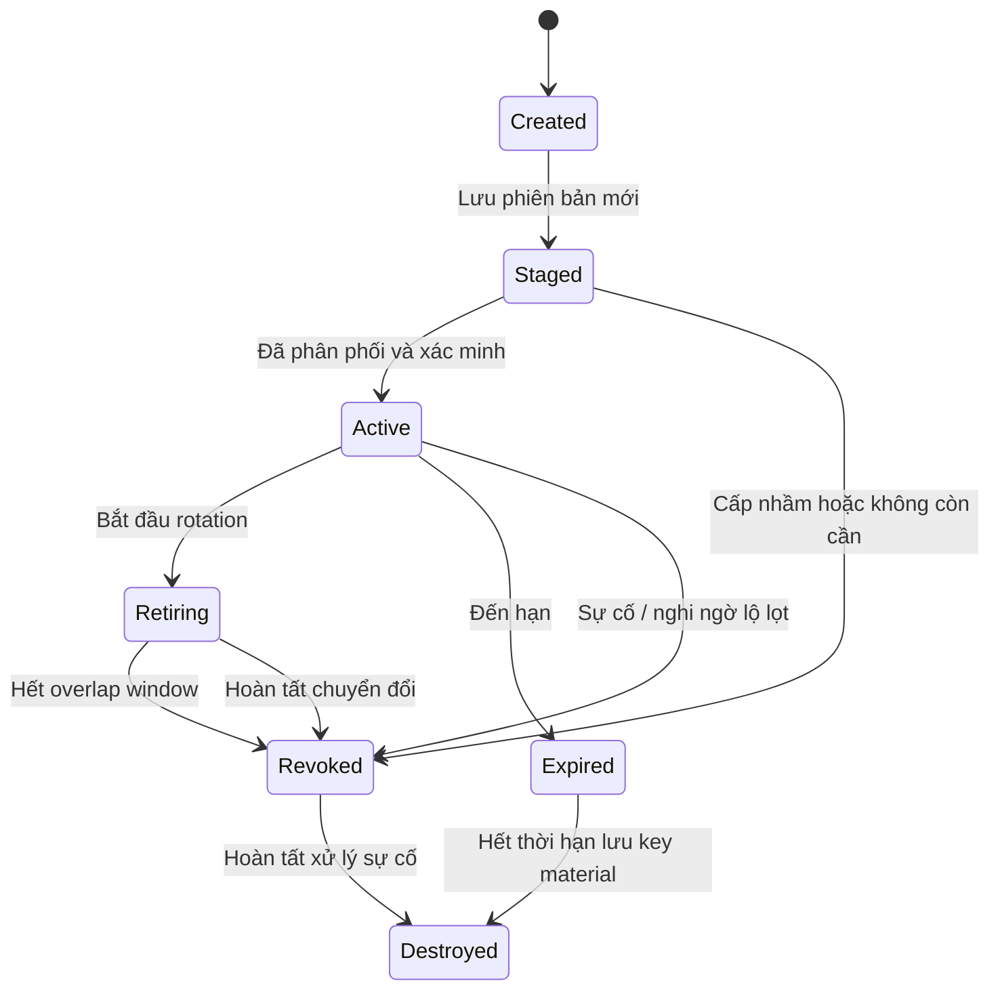

# Rotation, expiry và revoke

Trong chương **Quản lý secret API** của module `SECURITY_API_SECURITY`, secret phải có vòng đời được quản lý từ lúc tạo, phân phối, sử dụng, xoay vòng đến khi hết hạn hoặc bị thu hồi. Một API key hay client secret không nên tồn tại vô thời hạn chỉ vì ứng dụng vẫn đang chạy. Nếu credential bị lộ, quyền truy cập của nó có thể cho phép gọi API, đọc dữ liệu, ký webhook hoặc giả mạo service trong thời gian dài.

Ba hoạt động có liên quan nhưng không giống nhau:

- **Rotation** tạo credential/key mới và chuyển các bên sử dụng sang phiên bản mới, sau đó loại bỏ phiên bản cũ.
- **Expiry** đặt giới hạn thời gian một credential được phép sử dụng. Khi đến hạn, hệ thống từ chối credential đó theo policy.
- **Revoke** chủ động vô hiệu hóa credential trước hoặc tại thời điểm cần thiết, thường do nghi ngờ lộ lọt, nhân sự/service thay đổi, quyền không còn phù hợp hoặc cần phản ứng sự cố.

Rotation là hoạt động bảo trì có kế hoạch; expiry là giới hạn vòng đời; revoke là hành động thu hồi quyền sử dụng. Một credential có thể được rotate trước expiry, tự hết hạn mà không rotate, hoặc bị revoke khẩn cấp ngay trong thời hạn hiệu lực.

## Vì sao secret cần vòng đời rõ ràng?

Secret thường xuất hiện ở nhiều điểm trong hệ thống API:

- API key dùng để nhận diện client hoặc tích hợp đối tác.
- OAuth client secret dùng để xác thực confidential client.
- HMAC secret dùng để ký/xác minh webhook hoặc request nội bộ.
- Private key dùng để ký JWT, request hoặc chứng thư.
- Database password, broker credential và credential của service-to-service.
- TLS client certificate và private key của workload.
- Refresh token hoặc credential dài hạn được dùng để cấp token mới.

Nếu credential không được quản lý vòng đời, một secret cũ có thể còn quyền truy cập sau khi owner đã rời dự án, vendor đã ngừng hợp tác hoặc hệ thống đã chuyển sang cơ chế xác thực khác. Việc dùng chung một secret cho nhiều service cũng khiến phạm vi ảnh hưởng của một lần lộ lọt trở nên khó xác định.

Rotation và revoke giúp giảm thời gian credential bị lạm dụng. Expiry giới hạn khoảng thời gian một credential bị quên hoặc bị đánh cắp còn có thể được sử dụng. Tuy nhiên, đặt expiry ngắn mà không có quy trình cấp mới đáng tin cậy có thể gây outage; rotate tự động mà không xác minh consumer đã nhận key mới có thể làm gián đoạn toàn bộ tích hợp.

## Phân biệt rotation, expiry và revoke

| Hoạt động | Khi nào dùng | Hành vi chính |
|---|---|---|
| Rotation | Theo lịch, thay đổi định kỳ hoặc sau thay đổi kiến trúc | Tạo phiên bản mới, chuyển consumer, xác minh rồi vô hiệu hóa phiên bản cũ |
| Expiry | Credential có thời hạn hoặc policy yêu cầu giới hạn tuổi | Từ chối credential khi vượt `expiresAt`, trừ ngoại lệ đã phê duyệt |
| Revoke | Secret bị lộ, owner không còn tin cậy, cần cắt quyền ngay | Đánh dấu vô hiệu hóa và lan truyền trạng thái tới mọi nơi xác minh |
| Disable/suspend | Tạm ngừng tích hợp hoặc điều tra | Chặn sử dụng tạm thời; có thể khôi phục sau khi được phê duyệt |
| Destroy | Kết thúc vòng đời key material | Hủy key theo quy trình; chỉ thực hiện khi không còn phụ thuộc hoặc đã có bản thay thế |

Không được coi việc xóa secret khỏi secret manager là đã revoke credential. Bản sao có thể còn trong cache, process memory, file cấu hình, container cũ, backup hoặc phía đối tác. Tương tự, hết hạn trong metadata không có tác dụng nếu verifier không kiểm tra `expiresAt` hoặc không nhận được trạng thái thu hồi.

## Inventory và phân loại secret

Không thể rotate hoặc revoke một secret mà không biết nó đang được dùng ở đâu. Hãy duy trì inventory có owner và quan hệ phụ thuộc.

Mỗi mục inventory nên ghi:

- Secret ID hoặc credential ID; không ghi giá trị secret.
- Loại credential và thuật toán/format liên quan.
- Service, môi trường, tenant, API hoặc đối tác sử dụng.
- Owner kỹ thuật và owner nghiệp vụ.
- Nơi lưu trữ, nguồn cấp và danh tính workload được phép đọc.
- Phiên bản hiện tại, thời điểm tạo, `expiresAt` và trạng thái.
- Consumer/verifier cần cập nhật khi rotation.
- Cơ chế revoke và thời gian lan truyền dự kiến.
- Ngày rotate gần nhất, lần sử dụng gần nhất và exception đang có hiệu lực.

Không lưu secret value trong inventory, ticket, spreadsheet, log hoặc tài liệu hướng dẫn. Dùng ID/metadata để tham chiếu tới secret manager có kiểm soát quyền.

### Phân loại theo cách xác minh

| Loại secret/key | Bên cần cập nhật khi rotate | Điểm cần chú ý |
|---|---|---|
| API key | Client gửi key và API gateway/backend xác minh | Có thể cần hai key cùng hợp lệ trong cửa sổ chuyển đổi |
| OAuth client secret | Confidential client và authorization server | Client có thể cần đăng ký secret mới; revoke secret cũ không nhất thiết thu hồi access token đã phát |
| HMAC webhook secret | Nhà cung cấp gửi và endpoint xác minh | Hai bên phải thống nhất key ID, thời điểm chuyển và thuật toán ký |
| JWT signing key | Issuer ký bằng private key; API xác minh bằng public key | Công bố public key mới trước khi ký token mới; verifier có thể cache JWKS |
| mTLS certificate | Client/server và trust store liên quan | Xoay certificate, private key, chain và trust anchor theo kế hoạch |
| Database/broker credential | Service kết nối và hệ thống đích | Cập nhật connection pool, worker và instance đang chạy; tránh để process cũ tiếp tục dùng credential cũ |
| Refresh token | Client và authorization server | Thường rotate theo từng lần dùng; phát hiện reuse có thể là tín hiệu token bị đánh cắp |

Một quy trình chung không thể thay thế semantics riêng của từng loại credential. Đặc biệt, thay private key ký JWT khác với thay API key tĩnh: public key cần được phân phối tới verifier trước khi issuer bắt đầu phát token mới.

## Vòng đời và trạng thái credential

Nên quản lý trạng thái rõ ràng thay vì chỉ có một trường `active`:



Ý nghĩa gợi ý:

- `CREATED`: phiên bản đã được tạo nhưng chưa được cấp cho consumer.
- `STAGED`: secret đã được lưu và consumer có thể lấy theo quyền, nhưng chưa phải credential chính.
- `ACTIVE`: được phép dùng cho request mới.
- `RETIRING`: chỉ chấp nhận trong overlap window đã định; không cấp mới cho consumer.
- `EXPIRED`: đã qua thời điểm hiệu lực.
- `REVOKED`: bị vô hiệu hóa chủ động.
- `DESTROYED`: key material đã bị hủy theo quy trình; metadata audit tối thiểu vẫn có thể được giữ.

Trạng thái phải được verifier thực thi. Chỉ đổi trạng thái trong dashboard mà gateway, API hoặc database chưa nhận được thông tin thì chưa thu hồi quyền truy cập thực tế.

## Thiết kế rotation an toàn

Rotation thường cần một khoảng chuyển tiếp để client và server không phải đổi credential cùng một thời điểm. Quy trình phổ biến là tạo key mới, cho verifier chấp nhận cả hai phiên bản trong thời gian giới hạn, chuyển producer sang key mới, xác minh không còn request bằng key cũ rồi revoke key cũ.

### 1. Quy trình rotation theo từng bước

1. **Inventory:** xác định secret ID, owner, consumer, verifier, môi trường, quyền và dependency. Xác nhận tất cả instance có cách nhận phiên bản mới.
2. **Chuẩn bị:** kiểm tra policy, hạn dùng, cơ chế rollback và lịch chuyển đổi. Thông báo cho đối tác/client nếu họ phải thao tác.
3. **Tạo phiên bản mới:** sinh secret/key bằng secret manager hoặc KMS phù hợp. Dùng entropy và thuật toán đúng với loại credential; không tự tạo bằng UUID thông thường hoặc password dễ đoán.
4. **Phân phối có kiểm soát:** cấp quyền đọc phiên bản mới cho đúng workload/consumer. Không gửi key qua chat, email thường hoặc ticket.
5. **Mở overlap window:** verifier chấp nhận key cũ và key mới theo key ID/phiên bản; giới hạn khoảng thời gian và không mở rộng quyền.
6. **Chuyển producer/client:** cập nhật client, issuer hoặc workload để ký/gửi bằng key mới. Với client bên ngoài, cung cấp hướng dẫn và deadline rõ ràng.
7. **Xác minh:** theo dõi request theo key ID, kiểm tra tỷ lệ thành công, lỗi xác thực, consumer còn dùng key cũ và độ trễ cập nhật cache.
8. **Ngừng key cũ:** chuyển sang `RETIRING` rồi revoke khi đạt điều kiện kết thúc overlap. Không để hai key cùng active vô thời hạn.
9. **Dọn dẹp:** thu hồi quyền đọc phiên bản cũ, xóa bản sao không cần thiết theo policy, cập nhật inventory và giữ audit metadata.

### 2. Overlap window phải có giới hạn

Overlap window là khoảng thời gian verifier chấp nhận cả credential cũ và mới. Cửa sổ này giúp rollout không đồng thời, nhưng cũng kéo dài thời gian key cũ còn có thể bị lạm dụng.

Đặt thời hạn dựa trên:

- Thời gian deploy/restart của toàn bộ consumer.
- Chu kỳ batch hoặc job chạy không thường xuyên.
- Thời gian cache cấu hình, JWKS hoặc credential tại client.
- Độ trễ phân phối secret và khả năng xác nhận từng consumer.
- Cam kết chuyển đổi với đối tác.

Không đặt overlap window dài vô hạn chỉ vì chưa biết client nào còn dùng key cũ. Hãy có deadline, metric usage theo key ID và quy trình exception có owner. Nếu key cũ bị nghi ngờ compromise, bỏ qua overlap thông thường và ưu tiên revoke khẩn cấp.

### 3. Chuyển đổi theo key ID

Verifier nên biết key nào đã được dùng để tạo chữ ký. Ví dụ header có thể mang `kid` hoặc key ID đã đăng ký; verifier chỉ tra key trong registry tin cậy, không tải key từ URL do request cung cấp.

```http
X-Client-Key-Id: partner-2026-02
X-Webhook-Signature: v2=...
```

Đây là header minh họa, không phải chuẩn chung. Không đưa secret value vào key ID. Key ID chỉ là định danh công khai để chọn đúng phiên bản key; chữ ký vẫn phải được xác minh bằng key material lấy từ nguồn tin cậy.

Với HMAC, bên gửi và bên nhận cần cùng biết secret mới trong cửa sổ chuyển đổi. Với chữ ký bất đối xứng, issuer có thể bắt đầu ký bằng private key mới sau khi verifier đã nhận public key mới. Cách phân phối khác nhau nên không dùng chung một quy trình máy móc.

## Expiry và chính sách thời hạn

Mỗi credential nên có `createdAt`, `notBefore` (nếu cần), `expiresAt`, trạng thái và owner. Verifier phải kiểm tra thời hạn theo đồng hồ UTC và xử lý clock skew có giới hạn.

Expiry policy cần xác định:

- Tuổi tối đa của credential theo loại và mức độ nhạy cảm.
- Có tự động gia hạn/rotate hay phải có người phê duyệt.
- Thời gian cảnh báo trước khi hết hạn.
- Hành vi khi hết hạn: từ chối, yêu cầu cấp mới hoặc chuyển sang trạng thái degraded đã được thiết kế.
- Cách xử lý credential đang được dùng bởi batch/job dài hạn.
- Exception có thời hạn và người chịu trách nhiệm.

Ví dụ lịch cảnh báo có thể là 30, 14, 7 và 1 ngày trước `expiresAt`. Đây chỉ là mốc tham khảo; với certificate hoặc credential có quy trình cấp mới dài, cần cảnh báo sớm hơn. Cảnh báo phải tới owner có khả năng hành động, không chỉ gửi vào một mailbox không được theo dõi.

Không dùng thời hạn của access token để thay thế expiry của client secret hoặc signing key. Đây là các lớp credential khác nhau. Ví dụ, access token có thể hết hạn sau vài phút trong khi OAuth client secret vẫn còn hiệu lực nhiều tháng; nếu client secret bị lộ, attacker có thể tiếp tục xin token mới cho đến khi secret bị revoke.

### Xử lý khi credential hết hạn

Khi verifier thấy credential đã hết hạn, từ chối request theo hợp đồng xác thực và ghi failure code phù hợp. Không tự động chấp nhận lại vì dependency cấp mới đang lỗi. Nếu hệ thống cần tính sẵn sàng cao, phải thiết kế cơ chế cấp mới và chuyển đổi trước thời điểm hết hạn, cùng một phương án degraded an toàn được phê duyệt.

Đối với token:

- Access token ngắn hạn thường được từ chối sau `exp`.
- Refresh token cần có expiry, rotation/reuse detection và khả năng revoke ở authorization server.
- JWT đã phát hành có thể vẫn được chấp nhận đến `exp` nếu API chỉ kiểm tra chữ ký và thời hạn; revoke client secret không tự động làm mọi JWT đã phát hành mất hiệu lực.
- Nếu cần thu hồi sớm, cân nhắc introspection, denylist theo `jti`, token version hoặc thời hạn token ngắn kết hợp kiểm soát refresh token. Mỗi cách có trade-off về latency, cache và khả năng sẵn sàng.

## Revoke và phản ứng khi secret bị lộ

Revoke là thao tác chặn credential sử dụng tiếp. Có thể cần revoke khi:

- Secret xuất hiện trong Git, log, image, ticket hoặc hệ thống không được phép.
- Phát hiện request bất thường hoặc dấu hiệu credential bị sử dụng từ nơi không mong đợi.
- Nhân sự, vendor, workload hoặc integration không còn quyền truy cập.
- Key hết nhiệm vụ, certificate bị thay thế hoặc quyền của client bị thu hồi.
- Có lỗ hổng ở hệ thống lưu trữ/phân phối secret.

### 1. Quy trình revoke khẩn cấp

1. Xác định credential ID, loại key, owner, phạm vi quyền và các hệ thống phụ thuộc. Không đưa secret value vào incident ticket.
2. Đánh giá phạm vi ảnh hưởng: API/tenant/service nào có thể bị truy cập, dữ liệu nào có thể đã bị đọc hoặc thay đổi.
3. Vô hiệu hóa credential tại nguồn xác minh hoặc hệ thống đích; không chỉ xóa bản secret trong secret manager.
4. Thu hồi phiên bản ở gateway, API, identity provider, webhook verifier, database hoặc broker liên quan.
5. Xoay sang credential mới bằng kênh phân phối tin cậy nếu service cần tiếp tục hoạt động.
6. Vô hiệu hóa cache, session hoặc token phụ thuộc nếu threat model yêu cầu; xác minh mọi replica/region đã nhận revoke.
7. Theo dõi request tiếp tục dùng credential cũ, lỗi client và dấu hiệu truy cập bất thường.
8. Ghi audit event về actor, thời điểm, credential ID, lý do, phạm vi và kết quả; không ghi giá trị secret.
9. Điều tra nơi secret bị lộ, loại bỏ bản sao và khắc phục nguyên nhân gốc.

Nếu có nguy cơ khai thác đang diễn ra, ưu tiên cắt quyền và giảm thiểu tác động. Có thể xảy ra gián đoạn dịch vụ; quyết định cần dựa trên mức độ rủi ro và runbook sự cố. Không trì hoãn revoke chỉ để duy trì overlap window bình thường.

### 2. Revoke phải lan truyền tới verifier

Một credential có thể được cache ở nhiều nơi. Hãy xác định thời gian tối đa để revoke có hiệu lực:

- Gateway và từng API instance.
- Cache credential, JWKS hoặc introspection response.
- Worker chạy dài, batch job và connection pool.
- Region/cluster dự phòng và disaster recovery environment.
- Đối tác bên ngoài nếu họ đang giữ secret dùng chung.

Nếu verifier chỉ đọc trạng thái credential lúc khởi động, restart hoặc reload có thể là điều kiện cần để revoke có hiệu lực. Tốt hơn là thiết kế cơ chế cập nhật/invalidating cache có xác nhận, hoặc giới hạn TTL cache sao cho phù hợp với thời gian revoke mục tiêu.

Đối với API key, verifier có thể tra trạng thái active/revoked trong store hoặc cache ngắn hạn. Với JWT, revoke signing key có phạm vi ảnh hưởng lớn: mọi token ký bằng key đó có thể bị từ chối, kể cả token hợp lệ chưa hết hạn. Cần phân biệt revoke một client credential với thu hồi một signing key dùng chung cho nhiều client.

### 3. Revoke không phải xóa lịch sử

Khi credential bị revoke, giữ metadata audit tối thiểu để biết credential nào bị thu hồi, lúc nào, bởi ai và vì sao. Xóa sạch mọi dấu vết có thể làm mất khả năng điều tra. Tuy nhiên, không giữ secret value đã bị thu hồi trong log hoặc ticket; key material được hủy theo quy trình và retention của hệ thống quản lý key.

## Tự động hóa rotation bằng secret manager và KMS

Tự động hóa giúp giảm thao tác thủ công và hạn chế secret tồn tại quá lâu, nhưng phải thiết kế cơ chế kiểm tra và rollback phù hợp.

### 1. Dùng workload identity thay cho secret tĩnh khi có thể

Nếu nền tảng hỗ trợ, ưu tiên workload identity, managed identity hoặc short-lived credential để service lấy quyền truy cập mà không phải lưu một API key dài hạn trong file cấu hình. Secret manager/KMS có thể cấp hoặc phân phối key theo policy dựa trên danh tính workload.

Service chỉ nên có quyền đọc đúng secret/version cần thiết. Tránh cấp quyền list/read toàn bộ secret store cho mọi service. Phân tách quyền tạo key, đọc key, rotate, revoke và quản trị policy.

### 2. Quy trình tự động cần có xác nhận

Một rotation job có thể:

1. Kiểm tra owner, policy và trạng thái hiện tại.
2. Sinh version mới trong KMS/secret manager.
3. Cập nhật verifier để chấp nhận version mới.
4. Phân phối version mới tới producer/consumer theo rollout.
5. Kiểm tra health, usage và lỗi xác thực.
6. Chuyển version cũ sang retiring sau khi đạt điều kiện.
7. Revoke version cũ và xác nhận không còn verifier chấp nhận.
8. Cập nhật inventory, expiry và audit record.

Không để rotation job tự revoke key cũ chỉ dựa vào việc deployment đã báo thành công. Cần bằng chứng các consumer thật sự dùng version mới và không còn traffic hợp lệ dùng key cũ trong cửa sổ quan sát đã chọn.

### 3. Tránh lưu secret vào nơi không cần thiết

- Không commit secret vào Git, Docker image, source map, build artifact hoặc script triển khai.
- Hạn chế đưa secret vào environment variable nếu nền tảng có cách mount/fetch an toàn hơn; environment có thể xuất hiện trong process inspection, dump hoặc diagnostic.
- Không in secret trong pipeline output, shell trace, exception, debug log hoặc command history.
- Không truyền secret qua URL/query string.
- Không ghi secret vào cache dùng chung hoặc local disk không mã hóa.
- Khi ứng dụng giữ secret trong memory, giảm bản sao, hạn chế dump và chỉ giữ trong thời gian cần thiết.

Secret manager bảo vệ nơi lưu trữ và phân phối; nó không tự ngăn ứng dụng ghi secret ra log hoặc serialize nhầm vào response. Cần kiểm tra cả cách ứng dụng sử dụng secret.

## Ví dụ cấu hình metadata và verifier

Ví dụ metadata không chứa giá trị secret:

```yaml
credential:
  id: partner-webhook-signing
  version: v2026-02
  type: hmac
  status: ACTIVE
  createdAt: "2026-11-01T00:00:00Z"
  expiresAt: "2027-02-01T00:00:00Z"
  owner: payments-platform
  consumers:
    - payment-webhook-sender
  verifiers:
    - payment-webhook-api
```

Giá trị ngày tháng và ID chỉ minh họa. Metadata thật cần được lấy từ hệ thống quản lý credential, kiểm tra UTC và đồng bộ với policy đã phê duyệt.

Verifier nên chọn key theo ID đã đăng ký và trạng thái hiện hành:

```java
public record VerificationKey(
        String keyId,
        SecretKey secretKey,
        Instant notBefore,
        Instant expiresAt,
        Instant acceptUntil,
        CredentialStatus status
) {}

boolean isUsable(VerificationKey key, Instant now) {
    boolean withinValidity = !now.isBefore(key.notBefore())
        && now.isBefore(key.expiresAt());
    if (!withinValidity) {
        return false;
    }

    return switch (key.status()) {
        case ACTIVE -> true;
        case RETIRING -> key.acceptUntil() != null
            && now.isBefore(key.acceptUntil());
        case STAGED, EXPIRED, REVOKED, DESTROYED -> false;
    };
}
```

Đoạn code minh họa điều kiện sử dụng: mọi trạng thái đều phải nằm trong khoảng `notBefore` đến `expiresAt`; key `RETIRING` còn bị giới hạn bởi `acceptUntil`, là thời điểm kết thúc overlap window. Enum `CredentialStatus` cần được định nghĩa tương ứng trong ứng dụng. Không tải `SecretKey` từ request. Key material phải được resolve từ secret manager/KMS bằng workload identity đã được cấp quyền. Khi revoke, trạng thái chuyển sang `REVOKED` và verifier phải nhận cập nhật; không chỉ dựa vào expiry.

## Kiểm thử rotation, expiry và revoke

Kiểm thử cần bao gồm nhiều consumer, nhiều replica, cache và tình huống lỗi giữa quá trình chuyển đổi.

| Tình huống | Kết quả mong đợi |
|---|---|
| Secret mới được tạo nhưng chưa phân phối | Consumer cũ tiếp tục hoạt động theo policy; key mới chưa được dùng tùy tiện |
| Verifier nhận key mới trước producer | Chấp nhận key mới và key cũ trong overlap window đã giới hạn |
| Producer chuyển sang key mới | Request mới được xác minh; metric thể hiện key ID mới đang được dùng |
| Consumer còn dùng key cũ sau deadline | Cảnh báo owner; sau revoke, request bằng key cũ bị từ chối |
| Credential đến `expiresAt` | Verifier từ chối credential hết hạn |
| Credential bị revoke giữa hai lần kiểm tra | Các verifier nhận revoke trong thời gian mục tiêu và từ chối request tiếp theo |
| Secret manager tạm thời không truy cập được | Ứng dụng xử lý theo cache/fail policy đã định; không tự cấp quyền bằng secret mặc định |
| Rotation job lỗi giữa rollout | Có thể tiếp tục/retry idempotent; không revoke key cũ trước điều kiện an toàn |
| Secret bị lộ | Revoke khẩn cấp, rotate và xác minh mọi consumer/cache/region |
| JWT signing key được rotate | Public key mới được công bố trước khi phát token mới; verifier refresh JWKS đúng cách |
| JWT signing key bị revoke | Phạm vi token bị ảnh hưởng được xác định; không nhầm với revoke một client secret |
| OAuth client secret bị revoke | Client không xin token mới bằng secret đó; xử lý access/refresh token hiện hữu theo policy riêng |
| Hai phiên bản key cùng tồn tại | Chỉ các version trong overlap window được chấp nhận; không có key cũ active vô thời hạn |
| Secret value xuất hiện trong log/trace | Redaction/test phát hiện; không có giá trị thô trong output |

Nên có integration test với verifier thật hoặc môi trường tương đương, kiểm tra cache invalidation và propagation giữa các instance. Test một unit function kiểm tra ngày hết hạn là chưa đủ để chứng minh revoke có hiệu lực trên toàn hệ thống.

## Giám sát và audit

Theo dõi các chỉ số:

- Credential sắp hết hạn theo owner, loại và môi trường.
- Số secret quá hạn nhưng vẫn còn được tham chiếu.
- Số lần rotation thành công/thất bại và thời gian hoàn tất.
- Consumer còn sử dụng version cũ trong overlap window.
- Revoke propagation latency theo gateway, service, region và cache.
- Request thất bại do `EXPIRED`, `REVOKED`, `UNKNOWN_KEY_ID` hoặc `INVALID_SIGNATURE`.
- Secret manager/KMS access denied, bất thường về workload identity và hoạt động export key.
- Credential không có owner hoặc không có lần sử dụng trong thời gian dài.

Audit event cho rotation/revoke nên có credential ID, version, loại hành động, actor/workload, thời điểm, lý do, phạm vi và kết quả. Không ghi secret value, private key, token hoặc toàn bộ cấu hình bí mật. Quyền xem audit log và quyền đọc key material cần tách biệt.

## Những sai lầm thường gặp

- Chỉ tạo secret mới mà quên cập nhật verifier hoặc một số consumer.
- Revoke key cũ ngay khi deploy bắt đầu, trước khi client mới sẵn sàng.
- Giữ hai key active vô thời hạn vì không đo usage theo key ID.
- Cho rằng xóa secret khỏi secret manager sẽ thu hồi bản sao đã cache.
- Nghĩ rằng revoke OAuth client secret sẽ vô hiệu hóa ngay mọi access token đã cấp.
- Xoay JWT signing key mà không công bố public key mới trước khi ký token mới.
- Dùng một secret chung cho nhiều service, tenant hoặc môi trường.
- Đặt expiry nhưng verifier không kiểm tra thời hạn.
- Chỉ cảnh báo expiry cho một nhóm vận hành không có owner cụ thể.
- Dùng rotation thường lệ cho secret đã bị compromise và để overlap window kéo dài.
- Ghi secret vào log hoặc pipeline output trong lúc debug rotation.
- Không kiểm thử cache, replica và region nên revoke chỉ có hiệu lực ở một phần hệ thống.

## Checklist triển khai

- [ ] Có inventory secret/credential với ID, loại, owner, consumer, verifier và `expiresAt`.
- [ ] Secret value không xuất hiện trong inventory, source, image, log, ticket hoặc pipeline output.
- [ ] Mỗi loại credential có policy rotation/expiry/revoke phù hợp với semantics của nó.
- [ ] Có version/key ID để phân biệt credential trong giai đoạn chuyển đổi.
- [ ] Rotation có staged rollout, overlap window giới hạn và điều kiện revoke key cũ.
- [ ] Producer/consumer đã xác minh dùng key mới trước khi key cũ bị revoke theo lịch.
- [ ] Expiry được verifier thực thi và có cảnh báo tới owner đủ sớm.
- [ ] Revoke có cơ chế lan truyền tới gateway, API, cache, worker, region và đối tác liên quan.
- [ ] Có runbook khẩn cấp khi secret bị lộ, gồm phạm vi ảnh hưởng và xác minh sau revoke.
- [ ] JWT signing key, OAuth client secret, API key, HMAC secret và certificate có quy trình riêng.
- [ ] Secret manager/KMS dùng workload identity và least privilege; quyền rotate/revoke được kiểm soát.
- [ ] Rotation job có retry idempotent, quan sát được và không tự revoke sớm khi rollout chưa đạt.
- [ ] Có test expiry, dual-key overlap, cache invalidation, revoke propagation và secret redaction.
- [ ] Audit ghi metadata về vòng đời credential nhưng không ghi key material.

Rotation, expiry và revoke cần hoạt động cùng nhau để giới hạn thời gian và phạm vi sử dụng của secret. Khi inventory đầy đủ, version được quản lý, rollout có overlap window giới hạn, verifier thực thi expiry/revoke và quá trình được giám sát tới từng consumer, hệ thống có thể thay credential an toàn theo kế hoạch và phản ứng nhanh khi secret bị lộ.
