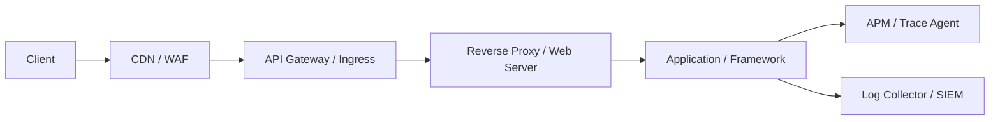

# Không truyền secret qua query hoặc log

API thường cần credential để xác thực caller: API key, access token, refresh token, session cookie, mật khẩu, OTP hoặc chữ ký webhook. Những giá trị này phải được gửi qua một kênh phù hợp và được giữ kín trong suốt vòng đời xử lý. Đưa secret vào URL query hoặc ghi nguyên secret vào log là hai lỗi phổ biến khiến credential bị lộ dù request vẫn dùng HTTPS và hệ thống có authentication.

Ví dụ không an toàn:

```http
GET /api/orders?access_token=eyJhbGciOi... HTTP/1.1
Host: api.example.com
```

Hoặc log nguyên request:

```text
GET /api/orders?api_key=sk_live_example123
Authorization: Bearer eyJhbGciOi...
```

URL có thể xuất hiện trong browser history, reverse proxy access log, API gateway, APM, analytics, error report và header `Referer`. Log thường được sao chép qua nhiều hệ thống, lưu lâu và được nhiều nhóm truy cập. Một secret bị lộ ở bất kỳ điểm nào có thể cho phép người khác mạo danh caller cho đến khi credential hết hạn hoặc bị thu hồi.

Trong API Security, secret cần được truyền qua header hoặc body phù hợp với giao thức, còn log phải được thiết kế theo nguyên tắc allowlist và giảm thiểu dữ liệu. HTTPS bảo vệ dữ liệu trên đường truyền; nó không tự xóa secret khỏi URL, log, trace, browser hay hệ thống giám sát sau khi request đã đến.

## 1. Secret là gì và vì sao cần bảo vệ?

Secret là dữ liệu mà người nắm giữ có thể dùng để chứng minh danh tính, thực hiện quyền hoặc tạo chữ ký được hệ thống tin cậy. Ví dụ:

- API key và client secret.
- OAuth access token, refresh token và authorization code.
- Session ID hoặc cookie xác thực.
- Mật khẩu, OTP, recovery code và password reset token.
- Private key, shared signing key và webhook HMAC secret.
- Database password, cloud credential và service account key.
- Presigned URL hoặc link chứa capability cho phép đọc/ghi tài nguyên.

Không phải mọi ID đều là secret. `client_id`, `key_id` hoặc resource ID có thể không đủ để xác thực nếu được thiết kế đúng. Tuy nhiên, chúng vẫn có thể là dữ liệu nhạy cảm hoặc hỗ trợ enumeration; cần phân loại theo threat model thay vì tự động coi mọi identifier là public.

Một giá trị cần được xem là secret nếu người có được nó có thể dùng trực tiếp để truy cập, ký request, reset credential hoặc vượt qua một bước xác minh. Khi chưa chắc, xử lý theo mức bảo vệ cao hơn cho đến khi owner xác định rõ.

## 2. Vì sao không đặt secret trong URL query?

URL thường được truyền qua nhiều thành phần ngoài phạm vi xử lý của API. Query string có thể bị ghi hoặc sao chép ở các nơi sau:

- Browser history, bookmark, tab synchronization và crash report.
- Reverse proxy, load balancer, CDN, WAF và API gateway access log.
- Web server access log và framework request log.
- APM agent, distributed tracing, error monitoring và support dump.
- Analytics, click tracking, link preview và hệ thống kiểm tra URL.
- Header `Referer` khi trình duyệt điều hướng hoặc tải tài nguyên khác.
- Ticket hỗ trợ, chat, email hoặc screenshot mà người dùng chia sẻ.

Một số thành phần chỉ ghi path và query chứ không ghi request body. Do đó, secret trong query có thể bị lưu ngay cả khi ứng dụng không chủ động log request. Khi URL được đưa vào trace hoặc exception message, secret còn có thể xuất hiện ở hệ thống thứ ba.

### 2.1. HTTPS không giải quyết rò rỉ URL

HTTPS/TLS mã hóa dữ liệu khi truyền giữa hai đầu kết nối. Tuy nhiên:

- Browser biết URL trước khi mã hóa và có thể lưu nó vào history.
- TLS termination tại CDN, gateway hoặc load balancer giải mã request; tầng đó có thể ghi URL vào log.
- API server nhận được URL ở dạng có thể đọc và có thể log nó.
- Client, proxy hoặc APM có thể lưu URL sau khi request đã kết thúc.

HTTPS vẫn bắt buộc để bảo vệ credential trên đường truyền. Nhưng nó không biến query string thành nơi an toàn để đặt secret.

### 2.2. Query string có thể đi vào Referer

Khi browser tải link hoặc tài nguyên khác, nó có thể gửi URL của trang hiện tại trong header `Referer`. Chính sách mặc định của nhiều browser hiện đại thường giới hạn thông tin khi đi cross-origin, nhưng URL đầy đủ vẫn có thể xuất hiện trong một số điều hướng cùng origin hoặc theo policy tùy chỉnh. Không nên dựa vào hành vi mặc định để bảo vệ secret.

Trang có URL chứa secret mà tải analytics, ảnh, script hoặc link ngoài có thể vô tình phát tán URL. `Referrer-Policy: no-referrer` là biện pháp giảm rủi ro cho một số luồng browser, nhưng không thay thế việc loại secret khỏi URL.

### 2.3. Secret trong path cũng là vấn đề

Không đặt token hoặc API key trong path segment như:

```text
/download/eyJhbGciOiJIUzI1NiJ9.secret.signature
/api/key/sk_live_example123/orders
```

Path cũng thường được ghi trong access log, trace, proxy và browser history. Dùng header hoặc body phù hợp với giao thức thay vì chuyển secret từ query sang path.

## 3. Kênh truyền credential phù hợp

Chọn kênh theo loại client và giao thức. Không có một vị trí duy nhất phù hợp cho mọi loại secret.

| Loại credential / tình huống | Cách truyền ưu tiên | Lưu ý bảo mật |
| --- | --- | --- |
| OAuth access token cho API | `Authorization: Bearer ...` | Chỉ qua HTTPS; không đưa token vào URL; kiểm tra issuer, audience, expiry và scope. |
| API key cho service integration | Header như `X-API-Key` hoặc cơ chế auth chuẩn của nền tảng | Key phải có scope, owner, quota và khả năng rotate/revoke. |
| Username/password hoặc OTP | Request body của endpoint xác thực qua HTTPS | Không log body; không dùng GET; giới hạn retry và chống brute force. |
| Session authentication trên browser | Cookie `Secure`, `HttpOnly`, `SameSite` phù hợp | Có CSRF protection cho request thay đổi trạng thái. |
| OAuth client secret | Secret manager phía backend trong client authentication | Không nhúng vào mobile app, SPA hoặc JavaScript chạy trong browser. |
| Webhook signing secret | Lưu ở secret manager; dùng để verify HMAC phía receiver | Không gửi secret qua webhook; chỉ gửi signature/timestamp theo contract. |
| mTLS private key | Keystore/HSM hoặc workload identity | Không truyền private key trong request hoặc log. |
| File download capability | Authenticated endpoint hoặc presigned URL có giới hạn | Presigned URL là bearer capability; phải xử lý như secret nếu dùng. |

### 3.1. Authorization header cho bearer token

Với OAuth bearer token, cách phổ biến là:

```http
GET /api/orders HTTP/1.1
Host: api.example.com
Authorization: Bearer <ACCESS_TOKEN>
Accept: application/json
```

Resource server cần xác minh chữ ký hoặc introspection theo mô hình token, issuer, audience, thời hạn và quyền. Header `Authorization` vẫn là secret và có thể bị log nếu gateway/APM ghi toàn bộ header; phải cấu hình redaction ở mọi tầng.

RFC 6750 khuyến nghị không sử dụng URI query parameter để truyền bearer token vì URL có thể bị ghi lại. Dùng Authorization header theo profile được áp dụng.

### 3.2. API key trong header

Ví dụ:

```http
GET /v1/reports HTTP/1.1
Host: api.example.com
X-API-Key: <API_KEY>
Accept: application/json
```

Nếu API dùng `Authorization` cho API key hoặc một scheme riêng, tuân theo contract nhất quán. Header không tự làm key an toàn: key vẫn phải được gửi qua TLS, không được đưa vào log, phải có scope/quota và cần quy trình rotate/revoke.

Không dùng custom header để thay thế OAuth khi hệ thống cần user delegation, audience, scope hoặc token lifecycle. Chọn cơ chế xác thực theo loại caller và quyền cần cấp.

### 3.3. Credential trong request body

Endpoint đăng nhập hoặc đổi credential thường nhận password/OTP trong body qua HTTPS:

```http
POST /api/session HTTP/1.1
Host: api.example.com
Content-Type: application/json

{
  "username": "user@example.com",
  "password": "<PASSWORD>"
}
```

Body tránh được nhiều loại URL leakage nhưng không tự an toàn. Middleware, debug logger, request recorder hoặc APM có thể capture body. Chỉ log metadata đã allowlist; tắt body capture cho endpoint xác thực và dữ liệu nhạy cảm. Không ghi password/OTP vào exception message hoặc validation error.

### 3.4. Cookie cho browser

Với session-based browser API, server có thể gửi:

```http
Set-Cookie: __Host-SESSION=<OPAQUE_SESSION_ID>; Path=/; Secure; HttpOnly; SameSite=Lax
```

Cookie xác thực phải có `Secure`, `HttpOnly` và `SameSite` phù hợp. Browser tự động gửi cookie nên cần CSRF protection cho thao tác thay đổi trạng thái. Không log `Cookie` hoặc `Set-Cookie`; session ID là credential dù không có tên gọi “token”.

## 4. Không truyền secret qua query trong các luồng đặc biệt

Một số integration cũ cho phép `?api_key=...`, `?access_token=...` hoặc `?password=...`. Cần loại bỏ theo lộ trình:

1. Inventory endpoint/client đang dùng query credential.
2. Phát hành cơ chế header hoặc cookie/body tương thích.
3. Cập nhật SDK, sample code, documentation và gateway policy.
4. Theo dõi request cũ bằng metric không chứa giá trị secret.
5. Cảnh báo consumer, đặt thời hạn ngừng query authentication.
6. Từ chối query credential sau sunset và rotate key có nguy cơ đã bị lộ.

Không ghi lại giá trị query để tìm client cũ. Có thể ghi route template, tên parameter đã chuẩn hóa (ví dụ `credential_parameter_present=true`), client reference đã xác minh và status; tuyệt đối không ghi giá trị parameter.

### 4.1. Trường hợp presigned URL

Object storage thường hỗ trợ presigned URL chứa signature, expiry và các query parameter cho phép tải lên hoặc tải xuống trong thời gian giới hạn. Đây là ngoại lệ có chủ đích với mô hình capability URL: ai có URL có thể sử dụng quyền được cấp cho đến khi URL hết hạn hoặc bị vô hiệu hóa theo cơ chế của storage.

Nếu phải dùng presigned URL:

- Giới hạn đúng object/key, HTTP method, thời hạn và content constraints cần thiết.
- Dùng TTL ngắn nhất phù hợp nghiệp vụ; không cấp URL có quyền rộng hoặc thời hạn dài tùy tiện.
- Không log full URL ở application, gateway, CDN, analytics, tracing hoặc support tooling.
- Redact toàn bộ query string của URL ký trong log; chỉ giữ object reference nội bộ và request ID.
- Không gửi URL qua kênh công khai hoặc đưa vào telemetry/error message.
- Hạn chế referrer bằng `Referrer-Policy: no-referrer` cho trang/luồng sử dụng URL nếu phù hợp.
- Kiểm tra policy của object storage về versioning, overwrite, content type, size và quyền truy cập.
- Audit việc tạo/cấp URL bằng actor, object reference, method, expiry và policy; không lưu signature.

Presigned URL thường có thể được dùng nhiều lần cho đến khi hết hạn tùy provider; không giả định nó là one-time token. Nếu cần khả năng thu hồi tức thời, cân nhắc authenticated proxy/download service hoặc cơ chế cấp capability có trạng thái và revoke được.

### 4.2. OAuth authorization code trong redirect callback

OAuth 2.0 Authorization Code flow thường trả authorization code qua redirect URI; với response mode mặc định, code có thể nằm trong query string. Đây là dữ liệu nhạy cảm có thời hạn ngắn và chỉ được dùng một lần theo contract, nhưng nó khác với access token hoặc client secret. Không tự ý thay đổi protocol để “xóa query” nếu authorization server và client chưa hỗ trợ phương thức khác.

Để giảm rủi ro:

- Dùng Authorization Code + PKCE, kiểm tra `state` và ràng buộc redirect URI chính xác.
- Đổi code lấy token ngay ở callback và không log giá trị `code`, `state` hoặc token response.
- Nếu authorization server hỗ trợ `response_mode=form_post` và client phù hợp, có thể dùng POST callback để tránh code nằm trong URL; vẫn phải tắt body logging.
- Giữ callback page tối giản, không tải analytics, script hoặc tài nguyên bên thứ ba trước khi xử lý callback.
- Đặt `Referrer-Policy: no-referrer` và `Cache-Control: no-store` cho callback response phù hợp.
- Sau khi xử lý, redirect đến URL sạch không còn code/state; không đưa code vào exception, trace hoặc support ticket.

Authorization code vẫn cần được redact khỏi access log, gateway, APM và browser telemetry. PKCE, state và thời hạn ngắn giảm khả năng sử dụng code bị lộ; chúng không phải lý do để ghi code vào log.

## 5. Vì sao log thường làm secret bị lộ?

Logging middleware thường được cấu hình để ghi “toàn bộ request” nhằm debug: method, full URL, headers, body và response. Cách làm này tiện khi phát triển nhưng nguy hiểm ở production vì request có thể chứa credential, PII, dữ liệu thanh toán hoặc payload nghiệp vụ.

Secret có thể xuất hiện trong:

- Access log có `$request`, `$request_uri`, query string hoặc full URL.
- Gateway log ghi toàn bộ header `Authorization`, `Cookie` hoặc custom API key.
- Application log ghi request object bằng `toString()`.
- Exception log chứa URL có query, request body hoặc downstream error.
- APM agent capture request/response headers và body.
- Distributed trace lưu `url.full`, `url.query` hoặc HTTP header attributes.
- Audit event lưu raw request để “giữ bằng chứng”.
- Log shipper, SIEM, data lake, archive và backup sao chép log sang nhiều vùng.

Log có thể có retention dài hơn token lifetime. Một access token hết hạn không có nghĩa log chứa nó đã biến mất; refresh token, API key hoặc private key có thể còn hiệu lực lâu hơn nhiều.

## 6. Thiết kế logging theo allowlist

Ưu tiên xác định rõ những trường được phép ghi thay vì ghi tất cả rồi cố che một vài trường. Allowlist giảm nguy cơ bỏ sót header hoặc field mới khi API được mở rộng.

Một structured log an toàn có thể gồm:

```json
{
  "timestamp": "2026-11-18T10:15:30.125Z",
  "service": "orders-api",
  "event": "http_request_completed",
  "request_id": "req_01JXYZ",
  "route": "/api/orders/{id}",
  "method": "GET",
  "status_code": 200,
  "duration_ms": 42,
  "client_ref": "orders-web-prod",
  "auth_result": "AUTHENTICATED",
  "authorization_result": "ALLOWED"
}
```

Các trường trên giúp điều tra request mà không cần lưu credential hoặc raw URL. `client_ref` phải là định danh ứng dụng đã được xác minh, không phải giá trị tùy ý do caller gửi. `request_id` dùng để nối log/trace, không dùng làm metric label có cardinality cao.

### 6.1. Các trường không được log nguyên vẹn

Danh sách cần chặn hoặc redact tối thiểu:

| Nguồn | Trường/giá trị cần bảo vệ |
| --- | --- |
| HTTP headers | `Authorization`, `Proxy-Authorization`, `Cookie`, `Set-Cookie`, `X-API-Key`, `X-Auth-Token`, header chứa signature hoặc credential tùy chỉnh. |
| Query string | `access_token`, `refresh_token`, `api_key`, `key`, `token`, `password`, `secret`, `client_secret`, `code`, `otp`, `signature`, `X-Amz-Signature` và parameter nhạy cảm theo contract. |
| Request/response body | Password, OTP, recovery code, token, session ID, private key, payment data và PII không cần cho log. |
| URL/path | Token hoặc capability đặt trong path; signed URL; query string đầy đủ. |
| Exception/debug | Request/response object, SQL bind có secret, downstream URL hoặc error message chứa credential. |

Tên header/query cần được chuẩn hóa không phân biệt chữ hoa/thường. Cần xử lý percent-encoding, duplicate parameter và tên alias theo contract. Tuy nhiên, allowlist trường được ghi vẫn an toàn hơn phụ thuộc hoàn toàn vào danh sách blacklist.

### 6.2. Redact hay drop?

Có thể thay giá trị nhạy cảm bằng `[REDACTED]`, nhưng cần cân nhắc:

- Với secret, thường nên loại bỏ hoàn toàn hoặc thay bằng marker cố định; không lưu một phần token để tránh lộ cấu trúc hoặc entropy.
- Không hash secret bằng hash không khóa rồi dùng làm định danh nếu secret có entropy thấp; attacker có thể dò offline. Nếu cần đối chiếu, dùng HMAC key riêng và bảo vệ key đó.
- Không log prefix/suffix của API key trừ khi có quy trình an toàn đã đánh giá; một số key có cấu trúc dễ suy ra.
- Redaction phải diễn ra trước khi log được serialize hoặc gửi đến exporter, không chỉ che ở giao diện dashboard.
- Nếu không thể bảo đảm redaction cho một loại payload, tắt body logging ở endpoint đó.

## 7. Redaction phải áp dụng ở mọi tầng

Không thể chỉ cấu hình application logger rồi cho rằng secret đã an toàn. Request thường đi qua nhiều thành phần và mỗi nơi có logging riêng.



Tại mỗi tầng cần xác định:

- Access log có ghi query string hoặc full URL không?
- Header nào được capture và có allowlist/redaction không?
- Request/response body có được ghi không?
- Exception và trace attribute có chứa URL hoặc credential không?
- Log được gửi đến đâu, ai có quyền đọc, retention bao lâu và backup ra sao?
- Có cơ chế test tự động để phát hiện secret xuất hiện trong output không?

Nếu gateway đã redact header nhưng APM agent trong application tự capture `Authorization`, secret vẫn bị lộ. Nếu application đã tắt query logging nhưng CDN access log giữ full URL, rủi ro vẫn tồn tại.

### 7.1. Reverse proxy và web server

Kiểm tra format access log để tránh các biến thể ghi full request URI. Ví dụ với Nginx, `$request` và `$request_uri` có thể chứa query; `$uri` thường là normalized URI không gồm query. Tuy nhiên, không nên thay thế máy móc mà cần xác nhận format thực tế, rewrite behavior và module đang dùng. Có thể log method, normalized path, status, request time và upstream time; không log query hoặc credential header.

Ở API gateway/CDN, cấu hình log field allowlist. Tắt capture raw query hoặc dùng parameter redaction nếu nền tảng hỗ trợ. Không export toàn bộ header để tiện debug production.

### 7.2. Application logger

Không log `HttpServletRequest`, request DTO hoặc toàn bộ header map bằng `toString()`. Tạo log event với trường đã chọn. Tránh log body trong `OncePerRequestFilter` hoặc interceptor mặc định; nếu cần debug payload, chỉ dùng fixture giả trong môi trường local/test và không bật ở production.

Ví dụ Spring Boot với `CommonsRequestLoggingFilter`:

```java
@Bean
CommonsRequestLoggingFilter requestLoggingFilter() {
    CommonsRequestLoggingFilter filter = new CommonsRequestLoggingFilter();
    filter.setIncludeQueryString(false);
    filter.setIncludePayload(false);
    filter.setIncludeHeaders(false);
    filter.setIncludeClientInfo(false);
    return filter;
}
```

Ví dụ này tắt query, body, headers và client info trong filter. Nó không tự tạo structured access log an toàn và không cấu hình các logger khác, gateway hoặc APM. Chỉ bật filter khi có mục đích; production thường nên ghi một event có allowlist riêng thay vì log request dump.

### 7.3. APM và distributed tracing

APM agent có thể tự capture HTTP attributes mà không cần code ứng dụng gọi logger. Kiểm tra cấu hình capture headers, URL và body của agent/SDK/exporter. Loại bỏ hoặc redact `Authorization`, `Cookie`, `Set-Cookie`, API key và URL query. Với OpenTelemetry, tránh gắn `url.full` hoặc `url.query` có credential vào span; dùng route template và các thuộc tính an toàn theo semantic conventions.

Không gửi secret vào baggage hoặc custom span attribute vì baggage có thể được propagate qua nhiều service. Trace sampling không phải biện pháp bảo vệ dữ liệu: trace không được sample vẫn có thể bị ghi ở một tầng khác.

## 8. Ví dụ structured logging an toàn trong Spring

Tạo event từ dữ liệu đã xác định, không serialize request:

```java
public record ApiRequestLog(
    String requestId,
    String route,
    String method,
    int statusCode,
    long durationMs,
    String clientRef,
    String authResult
) {}

@Component
public class ApiRequestLogger {
    private static final Logger log =
        LoggerFactory.getLogger(ApiRequestLogger.class);

    public void completed(ApiRequestLog event) {
        log.info(
            "http_request_completed requestId={} route={} method={} " +
            "status={} durationMs={} clientRef={} authResult={}",
            event.requestId(),
            event.route(),
            event.method(),
            event.statusCode(),
            event.durationMs(),
            event.clientRef(),
            event.authResult()
        );
    }
}
```

`route` phải là route template đã được framework xác định, không phải raw request URI. `clientRef` phải đến từ authentication context đã xác minh. Không đưa query, header map, request body hoặc exception message vào event này. Với exception, ghi class/reason code và correlation ID; chi tiết stack trace cần được kiểm soát để tránh message chứa URL hoặc credential.

### 8.1. Không để exception làm rò secret

Một số HTTP client đưa full request URL vào exception, ví dụ `Request failed for https://host/path?token=...`. Trước khi log exception, cần kiểm tra message và nested cause. Tốt nhất, không đưa credential vào URL từ đầu; đồng thời dùng exception handler ghi error category, destination host đã chuẩn hóa và correlation ID thay vì dump toàn bộ request.

Không xóa stack trace một cách máy móc nếu cần điều tra lỗi. Hãy bảo vệ sink, scrub dữ liệu nhạy cảm và giữ exception detail ở vùng truy cập hạn chế. Public API response tuyệt đối không trả stack trace hoặc secret.

## 9. Quản lý secret trong client và server

Không truyền secret qua URL là một phần của thiết kế credential tổng thể:

- Backend lấy secret từ secret manager hoặc workload identity; không hard-code trong source code, Docker image hoặc file cấu hình commit.
- SPA/mobile app không thể giữ client secret an toàn vì người dùng có thể phân tích binary hoặc JavaScript. Dùng public client flow như Authorization Code + PKCE cho ứng dụng phù hợp.
- Không đưa API key vào query của SDK hoặc sample code; SDK nên gắn credential vào header qua HTTP client interceptor đã được kiểm thử.
- Secret manager chỉ cấp quyền đọc cho workload cần dùng; không log secret khi khởi tạo client hoặc khi refresh.
- Phân tách credential theo môi trường, service và mục đích; giới hạn scope và thời hạn.
- Rotate/revoke credential nếu nghi ngờ đã xuất hiện trong URL, log hoặc trace.

Không dùng một secret chung cho nhiều service nếu có thể tách credential theo workload. Khi một log hoặc integration bị lộ, phạm vi ảnh hưởng của credential riêng lẻ sẽ nhỏ hơn.

## 10. Phát hiện và ngăn secret lọt vào log

Redaction cần được kiểm thử bằng dữ liệu marker giả, không chờ incident production.

### 10.1. Automated tests

Tạo request chứa marker như `TEST_API_KEY_ABC123`, `TEST_BEARER_TOKEN_XYZ` và `TEST_PASSWORD_456` ở query, header và body. Gửi qua môi trường test rồi kiểm tra tất cả output log/trace được thu thập:

- Secret không xuất hiện nguyên vẹn.
- Query string không bị ghi vào access log.
- Header credential không bị APM capture.
- Body endpoint login/upload không bị ghi.
- Exception message không chứa URL/credential.
- Log vẫn giữ request ID, route template, status, latency và reason code cần thiết.

Test phải bao gồm secret với tên header viết hoa/thường khác nhau, percent-encoded query, duplicate query parameter và alias riêng của ứng dụng. Kiểm tra cả log collector output thay vì chỉ kiểm tra logger mock trong unit test.

### 10.2. Secret scanning

Dùng secret scanning trong pre-commit, CI, repository và artifact registry để phát hiện credential vô tình được commit. Có thể bổ sung scanner cho log sample hoặc data pipeline để phát hiện pattern token/API key. Scanner cần có false-positive handling và quy trình incident; không copy secret thật vào ticket khi báo phát hiện.

Secret scanning không thay thế việc không ghi secret. Một log chứa token vẫn là rò rỉ ngay cả khi scanner phát hiện sau đó.

## 11. Xử lý khi secret đã xuất hiện trong URL hoặc log

Hãy coi credential đã bị lộ nếu nó xuất hiện trong nơi không được phép, kể cả chưa có bằng chứng bị sử dụng.

1. Xác định loại credential, owner, scope, expiry và hệ thống đã ghi nhận nó.
2. Thu hồi hoặc rotate credential theo mức độ rủi ro; với session/access token, revoke session/token family hoặc giảm TTL theo khả năng.
3. Tạo credential mới qua secret manager và cập nhật workload/consumer an toàn.
4. Chặn query authentication hoặc đường log gây lộ; triển khai redaction ở tất cả tầng liên quan.
5. Xác định phạm vi log, trace, browser, analytics, backup và hệ thống bên thứ ba có thể đã nhận secret.
6. Rà soát audit/access log để tìm việc sử dụng credential bất thường trong khoảng thời gian nghi ngờ.
7. Hạn chế quyền truy cập và retention của bản log có rò rỉ; xử lý bản sao theo incident/data retention policy và bảo toàn bằng chứng cần thiết.
8. Ghi incident record không chứa lại secret; kiểm thử để xác nhận secret mới không tiếp tục bị log.

Không chỉ xóa dòng log trong một dashboard rồi xem sự cố đã kết thúc. Log có thể đã được replicate hoặc backup. Việc xóa/giữ bản sao phải theo quy trình incident, pháp lý và forensic của tổ chức; ưu tiên vô hiệu hóa credential để bản sao cũ không còn sử dụng được.

## 12. Kiểm thử bảo mật cho URL và logging

| Kịch bản | Kết quả mong đợi |
| --- | --- |
| Bearer token gửi trong Authorization header | API xác minh thành công; token không xuất hiện trong log/trace. |
| Bearer token gửi qua query | Request bị từ chối theo contract; metric chỉ ghi việc phát hiện query credential, không ghi giá trị. |
| API key trong query | Không dùng để xác thực; client nhận hướng dẫn chuyển sang header. |
| Secret trong path | Route không chấp nhận credential trong path; access log không lưu token. |
| Password/OTP trong POST body | Endpoint xử lý qua HTTPS; body không bị request logger/APM capture. |
| Cookie session | Cookie được gửi theo policy; `Cookie`/`Set-Cookie` không xuất hiện trong log. |
| Gateway access log | Không có query credential hoặc sensitive header. |
| Application exception | Stack/message đã scrub; không có full URL chứa secret. |
| APM trace | Không có `url.query`, Authorization, Cookie hoặc body nhạy cảm. |
| Presigned URL | Query bị redact ở mọi log sink; URL có TTL và scope phù hợp. |
| Case variation/encoding | Header/query alias và percent-encoding không vượt qua redaction. |
| Log export/backup | Quyền truy cập và retention đáp ứng chính sách; không mở rộng người xem không cần thiết. |
| Secret rotation sau leak | Credential cũ không còn dùng được; workload dùng secret mới. |

### 12.1. Kiểm thử end-to-end qua toàn bộ đường đi

Không chỉ gọi controller trực tiếp. Gửi request qua CDN/WAF (nếu có), gateway, ingress, web server, application và APM/log collector của môi trường test. Dùng marker giả và tìm kiếm marker trong từng sink. Một tầng có thể ghi URL trước khi application redaction được thực thi.

## 13. Những sai lầm thường gặp

- **Đưa access token vào query vì tiện cho GET:** URL bị lưu ở nhiều nơi; dùng Authorization header.
- **Tin HTTPS sẽ che URL khỏi log:** TLS kết thúc tại client và server/proxy, nơi URL có thể được ghi.
- **Chỉ redaction trong application:** gateway, CDN, APM hoặc proxy vẫn có thể log secret.
- **Ghi toàn bộ request để debug:** body/header có thể chứa password, token, cookie và PII.
- **Dùng blacklist không đầy đủ:** header alias hoặc parameter mới có thể lọt qua; ưu tiên allowlist.
- **Che secret chỉ ở dashboard:** dữ liệu gốc trong log store vẫn còn nguyên.
- **Hash secret bằng SHA-256 rồi log:** có thể cho phép dò offline với secret entropy thấp; nếu cần fingerprint, dùng HMAC key riêng.
- **Cho rằng presigned URL không phải secret:** ai có URL có thể dùng quyền capability đến khi hết hạn.
- **Dùng API key trong frontend:** người dùng có thể lấy key từ JavaScript/binary; dùng public-client flow hoặc backend proxy.
- **Chỉ xóa log sau khi lộ:** credential có thể đã được sao chép; phải revoke/rotate và xử lý toàn bộ sink.

## 14. Checklist không truyền secret qua query hoặc log

- [ ] Không đặt API key, access/refresh token, password, OTP, session ID hoặc signature trong query/path.
- [ ] Dùng Authorization header, API-key header, cookie hoặc body theo đúng loại client và giao thức.
- [ ] Bắt buộc HTTPS; không xem TLS là biện pháp thay thế cho URL/log hygiene.
- [ ] Endpoint nhận credential trong body không bật body logging ở production.
- [ ] Browser cookie có Secure/HttpOnly/SameSite và CSRF defense phù hợp.
- [ ] Không nhúng client secret vào SPA/mobile app hoặc public artifact.
- [ ] Access log/gateway log dùng allowlist, không ghi full query hoặc sensitive headers.
- [ ] Application logger không serialize request/response hoặc header map nguyên vẹn.
- [ ] APM/tracing không capture Authorization, Cookie, body hoặc URL query nhạy cảm.
- [ ] Exception handler không log full URL hoặc downstream error chứa credential.
- [ ] Redaction xử lý case variation, encoded parameter và custom credential names.
- [ ] Presigned URL có TTL/scope hẹp và được redact toàn bộ query ở mọi sink.
- [ ] Log store có access control, retention, encryption và audit phù hợp.
- [ ] Có automated test dùng secret marker giả qua toàn bộ pipeline.
- [ ] Có quy trình revoke/rotate và incident response khi secret đã bị lộ.

Secret không nên xuất hiện trong URL query, path hoặc log vì những nơi này thường được lưu và sao chép vượt khỏi phạm vi kiểm soát của API. Hãy truyền credential qua header, cookie hoặc body đúng với loại client; đồng thời thiết kế logging theo allowlist, redaction tại mọi tầng và kiểm thử bằng marker giả. Nếu một secret đã lọt vào log hoặc URL, cần coi nó là credential có nguy cơ bị lộ, thu hồi/rotate và rà soát toàn bộ nơi đã nhận bản sao.
