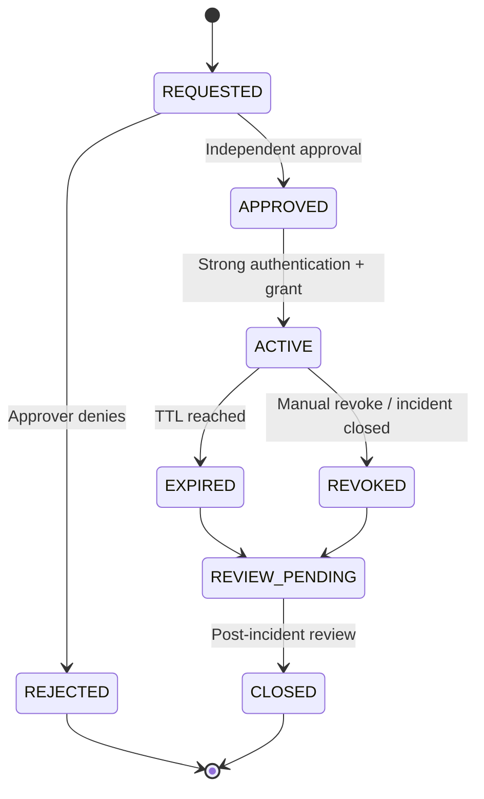

# Break-glass có phê duyệt và audit

Break-glass là quy trình cấp quyền truy cập khẩn cấp khi cơ chế vận hành thông thường không đủ để khôi phục dịch vụ hoặc xử lý sự cố nghiêm trọng. Trong API và hệ thống quản lý secret, quyền này có thể cho phép một operator truy cập secret, xoay vòng credential, sửa policy hoặc thực hiện thao tác quản trị bị khóa trong điều kiện bình thường.

Quyền khẩn cấp có sức ảnh hưởng lớn nên phải được kiểm soát như một quy trình đặc biệt: có lý do, phê duyệt độc lập, phạm vi tối thiểu, thời hạn ngắn, xác thực mạnh, audit bất biến và thu hồi sau khi hoàn tất. Break-glass không phải một API key admin dùng chung hoặc một tài khoản có quyền vĩnh viễn để phòng khi cần.

Mục tiêu là bảo đảm đội vận hành có thể khôi phục hệ thống trong tình huống thực sự khẩn cấp mà mọi lần sử dụng quyền đặc biệt vẫn có người chịu trách nhiệm, có thể điều tra và có thể thu hồi.

## 1. Khi nào cần break-glass?

Quy trình thông thường có thể không khả dụng hoặc không đủ nhanh trong một số tình huống:

- Identity provider hoặc hệ thống cấp quyền chính gặp sự cố khiến operator không thể đăng nhập theo luồng chuẩn.
- Secret production bị lộ và cần revoke/rotate ngay, nhưng nhóm quản trị secret thông thường không truy cập được.
- Một lỗi cấu hình IAM hoặc policy chặn nhầm quyền phục hồi dịch vụ.
- Dependency bảo mật quan trọng bị lỗi và cần thao tác khôi phục có kiểm soát.
- Incident response cần cô lập credential, thu hồi API key hoặc vô hiệu hóa integration bị xâm phạm.
- Một dịch vụ production ngừng hoạt động và chỉ một thao tác quản trị đặc biệt mới có thể khôi phục.

Không dùng break-glass cho các trường hợp tiện lợi như quên xin quyền từ trước, muốn bỏ qua quy trình change thông thường, cần truy cập dữ liệu để debug tùy ý hoặc muốn tránh chờ phê duyệt cho một công việc không khẩn cấp.

### 1.1. Xác định điều kiện kích hoạt

Tổ chức cần định nghĩa điều kiện khách quan, ví dụ mức độ severity, phạm vi ảnh hưởng, thời gian gián đoạn, nguy cơ mất dữ liệu hoặc nguy cơ credential đang bị khai thác. Không nên để người yêu cầu tự quyết định một mình rằng tình huống đủ khẩn cấp.

Một ma trận ví dụ:

| Tình huống | Break-glass có thể phù hợp? | Điều kiện |
|---|---|---|
| Production outage nghiêm trọng, đường truy cập chuẩn bị lỗi | Có | Có incident ID, phạm vi thao tác và người phê duyệt độc lập |
| Secret production bị xác nhận lộ | Có | Ưu tiên revoke/rotate; giới hạn secret và service bị ảnh hưởng |
| Operator cần xem secret để debug thông thường | Không | Dùng quyền read-only/JIT theo quy trình chuẩn |
| Muốn triển khai thay đổi ngoài giờ | Không tự động | Dùng change process; chỉ chuyển break-glass nếu có incident thực sự |
| IdP lỗi nhưng cần thao tác phục hồi | Có thể | Dùng emergency identity độc lập, MFA mạnh và audit dự phòng |
| Không có ticket hoặc lý do rõ ràng | Không | Yêu cầu tạo incident record trước, trừ trường hợp ngoại lệ được định nghĩa rõ |

## 2. Nguyên tắc thiết kế quyền khẩn cấp

Một thiết kế break-glass nên tuân thủ các nguyên tắc sau:

1. **Least privilege:** chỉ cấp đúng quyền cần cho incident, không cấp toàn quyền mặc định.
2. **Just-in-time:** quyền chỉ được cấp khi cần và tự hết hạn sau khoảng thời gian ngắn.
3. **Independent approval:** người yêu cầu không tự phê duyệt yêu cầu của chính mình.
4. **Strong authentication:** xác minh danh tính bằng MFA chống phishing hoặc cơ chế tương đương.
5. **Separation of duties:** người yêu cầu, người phê duyệt và người rà soát hậu kiểm có vai trò phân biệt khi khả thi.
6. **Auditable:** mọi bước quan trọng được ghi lại ở hệ thống độc lập với tài nguyên đang được khôi phục.
7. **Revocable:** có thể thu hồi ngay quyền, session, token và credential phát sinh.
8. **Tested:** quy trình được diễn tập định kỳ để không trở thành tài liệu chỉ tồn tại trên giấy.

Không để một tài khoản khẩn cấp bỏ qua toàn bộ authentication, network control hoặc audit. Nếu hệ thống danh tính chính không khả dụng, emergency identity phải có cơ chế xác minh độc lập và được bảo vệ tương đương hoặc cao hơn.

## 3. Tách emergency identity khỏi tài khoản thường

Emergency identity là danh tính được chuẩn bị trước để sử dụng trong tình huống đặc biệt. Có thể là tài khoản operator riêng, workload identity khẩn cấp hoặc cơ chế truy cập qua privileged access management (PAM).

Các yêu cầu quan trọng:

- Không dùng tài khoản admin chung cho nhiều người.
- Mỗi người được cấp danh tính emergency riêng hoặc có thể quy trách nhiệm tới cá nhân cụ thể.
- Không dùng mật khẩu/secret tĩnh được chia sẻ qua chat, email hoặc tài liệu nội bộ.
- Credential được lưu trong vault/PAM có kiểm soát truy cập và rotation.
- MFA phải độc lập với yếu tố đang gặp sự cố nếu có thể; ưu tiên security key/passkey hoặc phương thức chống phishing.
- Quyền emergency identity bị khóa hoặc không hoạt động trong điều kiện bình thường, chỉ được kích hoạt theo workflow.
- Có quy trình thu hồi và thay thế credential nếu nghi ngờ bị lộ.

Không nhúng emergency credential vào source code, CI variable dùng chung, container image, script vận hành hoặc file cấu hình trên máy cá nhân. Việc cất một API key admin trong vault không tự làm nó an toàn nếu key đó có quyền vĩnh viễn và bất kỳ operator nào cũng có thể đọc.

### 3.1. Không dùng một secret chung cho cả nhóm

Nếu nhiều người cùng biết một password hoặc API key, audit chỉ cho biết credential đã được sử dụng chứ không xác định được ai thực hiện. Mỗi lần kích hoạt cần gắn với principal đã xác thực và một incident cụ thể.

Nếu nền tảng bắt buộc có credential dự phòng dùng chung ở lớp hạ tầng, chỉ PAM hoặc broker được phép truy cập nó; người dùng cuối không được xem secret thô. Broker phải ghi nhận người yêu cầu, phê duyệt, session, command hoặc API operation đã thực hiện và thời điểm kết thúc.

## 4. Quy trình yêu cầu và phê duyệt

Break-glass nên là workflow có trạng thái rõ ràng thay vì một endpoint đơn giản kiểu `POST /admin/unlock`.

Thông tin yêu cầu tối thiểu:

- Người yêu cầu và danh tính đã xác thực.
- Incident/ticket ID và mức độ nghiêm trọng.
- Lý do cụ thể và tác động nếu không thực hiện.
- Service, tenant, environment và secret/resource bị ảnh hưởng.
- Permission/action cần cấp.
- Thời hạn mong muốn và thời điểm hết hạn.
- Biện pháp giảm thiểu và kế hoạch thu hồi.
- Người phê duyệt độc lập hoặc quorum cần thiết.

Ví dụ trạng thái:



Không cho phép request chuyển thẳng từ `REQUESTED` sang `ACTIVE` chỉ vì người yêu cầu có role admin thông thường.

### 4.1. Phê duyệt độc lập và dual control

Với quyền có thể đọc secret production, thay đổi IAM hoặc ảnh hưởng nhiều tenant, nên yêu cầu ít nhất một approver độc lập; với thao tác đặc biệt nguy hiểm, có thể yêu cầu quorum hai người hoặc hai vai trò khác nhau.

Approver cần thấy đủ thông tin để đánh giá:

- Incident có hợp lệ và đang hoạt động không?
- Người yêu cầu có liên quan tới service chịu ảnh hưởng không?
- Quyền đề xuất có thực sự cần thiết không?
- Scope có giới hạn theo service, tenant, secret và action không?
- Có phương án ít quyền hơn hoặc thao tác thay thế an toàn hơn không?
- TTL và kế hoạch hậu kiểm có hợp lý không?

Người phê duyệt không nên chỉ bấm “Approve” mà không xem phạm vi. Hệ thống phải lưu danh tính approver, quyết định, thời gian và lý do. Không cho người yêu cầu tự thêm mình làm approver hoặc sửa yêu cầu sau khi đã được duyệt mà không tạo một vòng phê duyệt mới.

### 4.2. Trường hợp approver hoặc IdP không khả dụng

Sự cố có thể làm chính hệ thống phê duyệt hoặc identity provider không hoạt động. Cần thiết kế đường khẩn cấp độc lập trước khi incident xảy ra:

- Emergency approver roster được quản lý và kiểm tra định kỳ.
- Phương thức xác minh độc lập như hardware security key hoặc quy trình xác minh out-of-band đã được phê duyệt.
- Quorum dự phòng hoặc cơ chế two-person control qua PAM.
- Nếu buộc phải cấp quyền tạm thời khi không có approver, yêu cầu phạm vi cực hẹp, thời gian rất ngắn, ghi nhận đầy đủ và bắt buộc hậu kiểm độc lập ngay sau đó.

Không dùng “break-glass” làm lý do để bỏ phê duyệt vĩnh viễn. Ngoại lệ không có approver phải là một trạng thái riêng, có điều kiện kích hoạt và giới hạn được phê duyệt trước trong chính sách tổ chức.

## 5. Cấp quyền tối thiểu và có thời hạn

Sau khi được phê duyệt, hệ thống nên tạo grant tạm thời thay vì sửa role dài hạn của user.

Một grant cần ràng buộc:

- Principal được cấp quyền.
- Incident ID.
- Resource scope: project, environment, service, tenant hoặc secret cụ thể.
- Action được phép: `secret.read`, `secret.rotate`, `credential.revoke` hoặc `policy.restore`.
- Thời điểm bắt đầu và hết hạn.
- Approver và approval record.
- Điều kiện bổ sung như source network, device posture hoặc session assurance.

Ví dụ, incident xử lý một API key bị lộ chỉ cần quyền `credential.revoke` và `secret.rotate` trên một integration trong production. Không cấp quyền `secret.read` cho toàn bộ vault nếu operator không cần xem giá trị secret cũ.

### 5.1. TTL ngắn và tự động hết hạn

Grant phải có `expires_at` bắt buộc. Không cho client yêu cầu TTL tùy ý; server áp dụng giới hạn tối đa theo loại action. Khi hết hạn, quyền phải mất hiệu lực ở authorization layer, kể cả khi session hoặc token cũ vẫn còn tồn tại.

Ví dụ chính sách minh họa:

```yaml
break_glass:
  enabled: true
  max_ttl_minutes: 30
  require_incident_id: true
  require_independent_approval: true
  mfa_assurance: phishing_resistant
  default_actions:
    - secret.rotate
    - credential.revoke
  forbidden_by_default:
    - vault.export
    - secret.bulk_read
    - iam.owner_grant
```

Đây là cấu hình minh họa. TTL thực tế cần dựa trên rủi ro và quy trình incident. Không để quyền tự gia hạn liên tục; mỗi lần gia hạn phải nêu lý do, đánh giá lại scope và có phê duyệt theo policy.

### 5.2. Grant phải được kiểm tra tại mỗi API operation

Không chỉ kiểm tra lúc tạo session. Mỗi request nhạy cảm cần xác minh grant còn `ACTIVE`, chưa hết hạn, đúng principal, incident, resource và action. Nếu grant bị revoke, request tiếp theo phải bị từ chối ngay theo giới hạn propagation đã định.

Không dùng một claim `isBreakGlass=true` chung để bỏ qua mọi authorization. Claim này chỉ là ngữ cảnh; permission thực tế phải được xác định từ grant cụ thể và policy hiện hành.

## 6. Kiểm soát truy cập secret trong break-glass

Break-glass trong secret management cần phân biệt các thao tác khác nhau:

| Action | Mức rủi ro | Kiểm soát gợi ý |
|---|---|---|
| Xem metadata secret | Thấp hơn đọc giá trị | Scope hẹp, audit truy cập |
| Đọc secret value | Cao | Phê duyệt rõ, one-time retrieval khi phù hợp, không hiển thị/log lại |
| Rotate secret | Cao | Phê duyệt, version mới, phối hợp consumer và rollback plan |
| Revoke credential | Cao nhưng có thể cần khẩn cấp | Incident linkage, xác nhận resource và audit kết quả |
| Thay policy/ACL | Rất cao | Dual control, diff review, thời hạn và rollback |
| Export nhiều secret | Rất cao | Mặc định cấm; chỉ ngoại lệ có phê duyệt cấp cao và justification đặc biệt |

Nếu mục tiêu là phục hồi, ưu tiên hành động rotate/revoke thay vì đọc secret hiện tại. Nếu cần đọc để khôi phục một integration, giới hạn một secret cụ thể và chỉ hiển thị qua kênh được kiểm soát.

### 6.1. One-time retrieval và không để lộ secret

Với secret value phải xem, có thể dùng cơ chế one-time reveal:

- Secret được trả qua session đã xác thực mạnh và có thời hạn ngắn.
- Chỉ người được phê duyệt mới xem được đúng secret/version được nêu.
- Không lưu secret trong response cache, browser local storage hoặc log.
- Không đưa secret vào URL, query string, ticket, chat hoặc screenshot.
- Ghi audit rằng secret đã được reveal, nhưng không ghi giá trị.
- Có thể yêu cầu re-authentication trước khi reveal.

One-time reveal không thể ngăn người dùng đã được cấp quyền chụp lại hoặc sao chép giá trị. Vì vậy, cần giới hạn người được cấp quyền, endpoint, session và thời gian; nếu có thể, dùng broker thực hiện thao tác thay người dùng để họ không cần biết secret thô.

### 6.2. Ưu tiên credential broker thay cho trao secret

Một mô hình an toàn hơn là operator yêu cầu thao tác, broker xác thực grant rồi tự gọi vault/provider bằng workload identity. Ví dụ broker có thể rotate API key hoặc revoke credential mà không hiển thị secret cho operator.

Broker cần:

- Xác minh grant và approval record.
- Chỉ thực hiện operation nằm trong allowlist.
- Không nhận command/script tùy ý.
- Không trả secret nếu response chỉ cần operation ID hoặc trạng thái.
- Ghi audit trước và sau operation.
- Có idempotency để retry không tạo nhiều credential ngoài ý muốn.
- Hạn chế network egress và chỉ gọi vault/provider đã cấu hình.

## 7. API workflow cho break-glass

Không nên thiết kế một endpoint duy nhất vừa yêu cầu, phê duyệt và thực thi. Tách các bước để áp dụng policy độc lập.

Một API contract minh họa:

```http
POST /admin/break-glass/requests
Authorization: Bearer <operator-token>
Content-Type: application/json

{
  "incidentId": "INC-2026-1042",
  "resource": "production/orders-api/payment-provider-key",
  "actions": ["credential.revoke", "secret.rotate"],
  "requestedTtlMinutes": 20,
  "justification": "Provider key is confirmed exposed; revoke and rotate to restore trust."
}
```

Response chỉ trả request ID và trạng thái:

```http
HTTP/1.1 202 Accepted
Content-Type: application/json

{
  "requestId": "bg-req-82f1",
  "status": "REQUESTED",
  "approvalRequired": true
}
```

Approver sử dụng endpoint riêng, yêu cầu principal khác người tạo:

```http
POST /admin/break-glass/requests/bg-req-82f1/approvals
Authorization: Bearer <approver-token>
Content-Type: application/json

{
  "decision": "APPROVE",
  "reason": "Incident confirmed; scope is limited to one production credential."
}
```

Sau khi phê duyệt và re-authentication, hệ thống kích hoạt grant hoặc broker thực hiện operation. Không trả access token hoặc secret lâu dài trong response approval. Nếu cấp session token tạm thời, token cần audience riêng, scope hẹp, TTL ngắn và khả năng revoke.

### 7.1. Kiểm tra server-side bắt buộc

Server phải tự xác minh:

- Người yêu cầu có được phép tạo emergency request không.
- Incident ID có tồn tại và ở trạng thái phù hợp không.
- Resource thuộc service/environment/tenant nào.
- Requested actions nằm trong allowlist của break-glass policy.
- TTL không vượt giới hạn.
- Approver độc lập, đủ assurance và không có xung đột vai trò.
- Approval chưa bị thu hồi hoặc thay đổi.
- Grant chưa hết hạn và chưa bị revoke.
- Mỗi operation vẫn được kiểm tra resource/action cụ thể.

Không tin các field `approved=true`, `approverId`, `role=admin` hoặc `expiresAt` do client gửi. Những giá trị này phải do server tạo sau khi xác minh workflow.

## 8. Audit bất biến và đầy đủ

Audit là một phần cốt lõi của break-glass. Nếu không biết ai yêu cầu, ai phê duyệt, quyền nào được cấp và thao tác nào đã thực hiện, tổ chức không thể chứng minh hoặc điều tra việc sử dụng quyền khẩn cấp.

Các sự kiện nên ghi:

1. `break_glass.requested` — principal, incident, resource, actions, justification reference.
2. `break_glass.approved` hoặc `break_glass.rejected` — approver, decision, reason và thời gian.
3. `break_glass.mfa_verified` — assurance method và kết quả, không ghi OTP/credential.
4. `break_glass.grant_activated` — grant ID, scope, TTL và policy version.
5. `break_glass.secret_accessed` — secret reference/version và access mode, không ghi secret value.
6. `break_glass.operation_executed` — action, target, result, correlation ID.
7. `break_glass.grant_extended` — lý do và approval bổ sung.
8. `break_glass.grant_revoked` hoặc `break_glass.expired` — thời điểm và actor/system.
9. `break_glass.post_reviewed` — reviewer, kết quả và action follow-up.

### 8.1. Audit record mẫu

```json
{
  "event": "break_glass.operation_executed",
  "timestamp": "2026-11-18T10:35:00Z",
  "requestId": "bg-req-82f1",
  "incidentId": "INC-2026-1042",
  "requester": "operator-17",
  "approver": "security-lead-04",
  "grantId": "bg-grant-19a2",
  "resourceRef": "production/orders-api/payment-provider-key",
  "action": "credential.revoke",
  "result": "SUCCESS",
  "policyVersion": "break-glass-7",
  "correlationId": "req-3a91"
}
```

Không ghi secret value, access token, MFA code, private key hoặc raw request body vào audit. Nếu cần chứng minh nội dung artifact, ghi resource/version reference hoặc digest đã được thiết kế phù hợp.

### 8.2. Lưu audit độc lập với hệ thống đang được khôi phục

Nếu audit chỉ được ghi vào cùng database hoặc account mà emergency operator có thể sửa/xóa, người sử dụng break-glass có thể xóa dấu vết. Nên gửi audit tới hệ thống độc lập có quyền ghi append-only, immutable/WORM retention hoặc cơ chế integrity protection.

Audit pipeline cần có buffering/durable delivery nếu collector tạm thời lỗi. Với thao tác đặc biệt nhạy cảm, policy có thể yêu cầu audit durable trước khi thực thi; nếu không thể ghi audit, hành động phải bị chặn trừ ngoại lệ được định nghĩa trước. Không âm thầm bỏ audit.

### 8.3. Không để log trở thành nơi rò secret

Audit cần ghi rằng secret đã được đọc hoặc rotate, không ghi chính giá trị. Redaction phải áp dụng tại API, broker, application logger, gateway, APM và log collector. Dùng secret fixture trong test để xác nhận giá trị không xuất hiện ở bất kỳ kênh nào.

## 9. Thu hồi quyền và dọn dẹp sau sử dụng

Kết thúc thao tác không chỉ là đóng cửa sổ terminal. Cần thu hồi toàn bộ quyền và credential phát sinh:

- Revoke break-glass grant và session.
- Thu hồi token tạm thời, refresh token, certificate hoặc delegated credential.
- Xóa quyền IAM/role binding tạm thời nếu workflow đã tạo.
- Hủy lease hoặc dynamic secret đã cấp.
- Rotate secret nếu giá trị đã được hiển thị hoặc có khả năng bị sao chép.
- Xóa temporary file/cache/clipboard artifact theo policy.
- Thu hồi network rule hoặc elevated access tạm thời.
- Kiểm tra broker, queue và job không còn message chứa credential.
- Xác nhận quyền đã mất hiệu lực ở mọi service/region.

TTL là lớp bảo vệ tự động, nhưng không thay thế revoke chủ động. Cần có cơ chế truyền revoke tới mọi authorization cache và session store. Nếu propagation có độ trễ, giới hạn tối đa phải được đo và giám sát.

### 9.1. Xử lý khi rotation không hoàn tất

Nếu secret cũ đã bị revoke nhưng secret mới chưa được triển khai tới consumer, dịch vụ có thể tiếp tục lỗi. Quy trình cần có trạng thái rõ như `ROTATION_PENDING`, `VALIDATION_FAILED` hoặc `ROLLBACK_REQUIRED`, cùng owner chịu trách nhiệm.

Không tự động khôi phục secret đã xác nhận bị lộ chỉ để khôi phục availability. Rollback nên dùng credential mới được xác minh hoặc một phương án phục hồi an toàn đã chuẩn bị trước.

## 10. Hậu kiểm bắt buộc

Sau khi quyền khẩn cấp hết hạn hoặc bị thu hồi, cần review độc lập:

- Incident có đáp ứng điều kiện break-glass không?
- Người yêu cầu và approver có đúng vai trò, độc lập và đủ assurance không?
- Scope và TTL có lớn hơn mức cần thiết không?
- Có thao tác nào ngoài danh sách đã phê duyệt không?
- Secret nào đã được reveal, rotate hoặc revoke?
- Có credential/session/role tạm thời nào còn tồn tại không?
- Audit có đầy đủ và không bị gián đoạn không?
- Có dấu hiệu truy cập ngoài phạm vi, export hoặc exfiltration không?
- Cần rotate thêm secret, thu hồi token hay điều tra endpoint nào không?
- Có cần sửa quy trình thông thường để tránh lặp lại việc dùng break-glass không?

Kết quả review nên gắn với incident ID, reviewer và thời hạn hoàn thành. Phát hiện bất thường cần mở follow-up incident hoặc security action riêng.

## 11. Giám sát và cảnh báo

Break-glass hiếm khi được sử dụng; mọi lần kích hoạt nên tạo tín hiệu giám sát rõ ràng. Các cảnh báo quan trọng:

- Có request break-glass mới.
- Có phê duyệt, từ chối hoặc thay đổi approver.
- Grant được kích hoạt, gia hạn hoặc revoke.
- Có secret value được reveal hoặc bulk operation được yêu cầu.
- Có thao tác ngoài scope hoặc request sau khi grant hết hạn.
- Có nhiều lần kích hoạt trong thời gian ngắn.
- Có grant còn active lâu hơn TTL dự kiến.
- Audit delivery thất bại hoặc log integrity check không đạt.
- Emergency identity đăng nhập từ thiết bị/network bất thường.

Thông báo cần gửi tới kênh incident/security độc lập với hệ thống đang gặp sự cố. Không gửi secret value hoặc token vào Slack/email alert; chỉ gửi request ID, incident ID, actor reference và liên kết tới audit console được bảo vệ.

## 12. Rủi ro thường gặp

**Tài khoản break-glass luôn có quyền admin.** Kẻ tấn công chỉ cần chiếm credential là có quyền toàn hệ thống. Giữ identity riêng, khóa mặc định và cấp grant JIT theo scope/time.

**Người yêu cầu tự phê duyệt.** Quy trình không còn dual control. Kiểm tra requester và approver là hai principal độc lập; với thao tác rất nhạy cảm dùng quorum.

**Dùng shared API key.** Không quy trách nhiệm được tới cá nhân. Dùng identity riêng hoặc broker ghi nhận principal và operation.

**Cấp quyền quá rộng.** Một incident ở một integration không cần quyền đọc toàn bộ vault. Giới hạn theo resource, action, tenant và environment.

**Không có TTL hoặc tự gia hạn vô hạn.** Quyền khẩn cấp biến thành quyền thường trực. Bắt buộc `expires_at`, giới hạn tối đa và phê duyệt lại khi gia hạn.

**Chỉ audit sau khi thao tác thành công.** Nếu process chết hoặc actor xóa dấu vết, sự kiện có thể mất. Ghi nhận request/approval/grant trước khi thực thi và lưu audit ở hệ thống độc lập.

**Ghi secret vào log để tiện điều tra.** Audit vô tình trở thành kho credential. Chỉ ghi secret reference/version và sự kiện reveal/rotate/revoke.

**Tin flag `isBreakGlass` do client gửi.** Caller có thể tự khai báo quyền. Grant phải được server tạo và xác minh tại mỗi operation.

**Không revoke session và credential phát sinh.** Hết thời gian trên UI không có nghĩa token hoặc role đã mất hiệu lực. Thu hồi ở mọi lớp và xác nhận propagation.

**Không diễn tập.** Khi incident thật xảy ra, approver không truy cập được hoặc emergency identity đã hết hạn. Diễn tập an toàn định kỳ và kiểm tra runbook.

## 13. Kiểm thử quy trình break-glass

Test cần bao phủ cả workflow, authorization, audit, expiry và recovery. Dùng môi trường thử nghiệm, secret giả và incident giả; không thử nghiệm bằng cách mở quyền production ngoài kế hoạch.

| Tình huống | Kết quả cần xác minh |
|---|---|
| Người không đủ quyền tạo request | Bị từ chối; không tạo grant |
| Request thiếu incident ID/justification | Bị từ chối hoặc yêu cầu bổ sung theo policy |
| Người yêu cầu tự approve | Bị từ chối |
| Approver không thuộc roster hoặc thiếu MFA assurance | Bị từ chối |
| Approver độc lập phê duyệt | Request chuyển sang trạng thái được phép kích hoạt |
| Scope chứa resource/action ngoài allowlist | Bị từ chối hoặc yêu cầu phê duyệt mới |
| TTL vượt giới hạn | Server áp dụng giới hạn hoặc từ chối; không tin TTL client |
| Grant hết hạn | Mọi operation tiếp theo bị từ chối |
| Grant bị revoke giữa session | Quyền mất hiệu lực trong propagation SLA |
| Secret reveal | Không có secret trong log, trace, cache hoặc audit |
| Broker rotate/revoke thay người dùng | Chỉ operation được duyệt được thực hiện; audit có request/grant ID |
| API request sau khi approval bị thu hồi | Bị từ chối |
| IdP chính lỗi | Emergency identity hoạt động theo quy trình độc lập và có audit |
| Approval service lỗi | Không tự động fail-open ngoài ngoại lệ đã định nghĩa |
| Audit collector tạm thời lỗi | Durable buffer hoặc chặn operation theo policy; không âm thầm mất audit |
| Process chết giữa operation | Có trạng thái phục hồi/đối soát, không cấp grant vô hạn |
| Rotation thất bại | Secret cũ không được khôi phục nếu đã bị lộ; có workflow xử lý tiếp |
| Có grant active quá TTL | Cảnh báo và tự động revoke theo policy |
| Hậu kiểm không hoàn tất | Có cảnh báo, owner và deadline |
| Emergency identity bị nghi lộ | Có quy trình khóa, revoke và thay thế credential |

Nên diễn tập cả trường hợp bình thường và trường hợp chính hệ thống phê duyệt/IdP/logging gặp sự cố. Đo thời gian kích hoạt, thời gian revoke, khả năng truy xuất audit và số bước thủ công còn phụ thuộc một cá nhân.

## 14. Checklist triển khai

- [ ] Điều kiện kích hoạt break-glass được định nghĩa theo severity và incident.
- [ ] Emergency identity tách khỏi tài khoản thường, không dùng shared credential trực tiếp.
- [ ] MFA mạnh và xác minh độc lập được yêu cầu.
- [ ] Người yêu cầu không tự phê duyệt; có dual control/quorum cho action rủi ro cao.
- [ ] Request có incident ID, justification, resource, action, TTL và kế hoạch revoke.
- [ ] Grant được cấp JIT, least privilege và có `expires_at` bắt buộc.
- [ ] Mỗi API operation kiểm tra grant, principal, scope, action và trạng thái hiện tại.
- [ ] Không có cờ client-side hoặc role admin chung để bypass authorization.
- [ ] Secret access ưu tiên broker operation; reveal chỉ khi cần và có kiểm soát.
- [ ] Audit request, approval, MFA, grant, operation, revoke và post-review.
- [ ] Audit được lưu độc lập, append-only/immutable phù hợp và không chứa secret value.
- [ ] Token, session, IAM binding, lease và credential phát sinh được thu hồi.
- [ ] Có hậu kiểm độc lập và theo dõi action follow-up.
- [ ] Alert được gửi tới kênh security/incident độc lập.
- [ ] Có test expiry, revoke, approver separation, IdP outage, audit outage và rotation failure.
- [ ] Quy trình được diễn tập định kỳ và emergency roster được xác minh.

## 15. Nguyên tắc thiết kế

Break-glass phải giúp khôi phục dịch vụ trong tình huống khẩn cấp nhưng không tạo một đường admin không kiểm soát. Hãy dùng emergency identity riêng, xác thực mạnh, phê duyệt độc lập, grant JIT có scope và TTL ngắn, kiểm tra quyền tại mỗi operation và ghi audit bất biến ở hệ thống độc lập.

Ưu tiên broker thực hiện rotate/revoke thay vì trao secret thô cho operator. Sau khi hoàn tất, thu hồi grant, session, token và quyền tạm thời; rotate credential đã được reveal khi cần; thực hiện hậu kiểm và diễn tập để cải thiện quy trình. **Mọi lần dùng quyền khẩn cấp phải trả lời được ai yêu cầu, ai phê duyệt, quyền nào được cấp, đã làm gì, trong phạm vi nào và khi nào quyền bị thu hồi.**
