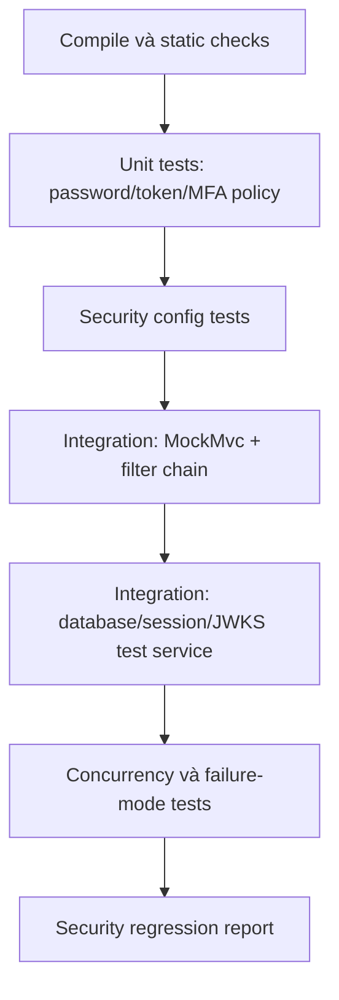

# Unit và integration test cho authentication

Authentication là quá trình xác minh danh tính của người hoặc workload đang gọi API. Một endpoint có thể được viết đúng nhưng vẫn không an toàn nếu cấu hình JWT chấp nhận sai issuer, password encoder bị cấu hình yếu, session không bị thu hồi sau logout hoặc refresh token cũ vẫn dùng được sau khi rotation. Vì vậy, kiểm thử authentication phải xác minh cả logic nhỏ bên trong lẫn toàn bộ đường đi từ HTTP request qua security filter, credential verifier và identity provider tới principal được tạo.

Unit test giúp kiểm tra các quy tắc xác thực riêng lẻ như kiểm tra password, thời hạn token, trạng thái tài khoản và chính sách MFA. Integration test xác minh các thành phần thật phối hợp đúng: HTTP filter chain, JWT decoder, JWKS, session repository, database, cookie và cấu hình endpoint. Chỉ mock principal trong mọi test có thể làm suite xanh trong khi ứng dụng thực tế vẫn chấp nhận token sai hoặc bỏ qua authentication filter.

Trong API Security, authentication cần được kiểm thử độc lập với authorization. Authentication trả lời “caller là ai và credential có hợp lệ không”; authorization trả lời “caller được làm gì trên endpoint, object và property nào”. Bài này tập trung vào kiểm chứng danh tính, credential và vòng đời phiên/token; quyền truy cập nghiệp vụ cần có test riêng.

Sau bài học, người đọc có thể:

- Xác định ranh giới unit test và integration test cho authentication.
- Kiểm thử password, account state, MFA, session, API key và JWT/OAuth token.
- Kiểm tra issuer, audience, signature, expiry, not-before, algorithm và key rotation.
- Viết integration test đi qua Spring Security filter chain thật.
- Kiểm tra các trường hợp thiếu, sai, hết hạn, bị thu hồi hoặc giả mạo credential.
- Tạo test fixture an toàn, ổn định và không phụ thuộc secret production.
- Kiểm tra chống account enumeration, brute force, replay và lỗi cấu hình fail-open.
- Tổ chức test suite chạy được lặp lại trong CI.

## 1. Xác định chính xác điều gì cần được kiểm thử

Trước khi viết test, mô tả authentication flow đang được sử dụng. Một API có thể chấp nhận nhiều loại credential hoặc nhiều cách xác minh danh tính.

| Cơ chế | Đầu vào cần xác minh | Kết quả cần kiểm tra |
|---|---|---|
| Password login | Username/email và password | Đúng danh tính, password sai bị từ chối, trạng thái tài khoản được xét |
| Session cookie | Session ID/cookie | Session được tìm thấy, còn hạn, chưa bị thu hồi và gắn đúng principal |
| JWT bearer token | Compact token hoặc signed JWT | Chữ ký, thuật toán, issuer, audience, thời gian và claim bắt buộc |
| Opaque access token | Bearer token | Introspection/lookup trả active và đúng metadata |
| API key | Key hoặc key identifier/secret | Key hợp lệ, còn hiệu lực, thuộc client đúng và không bị lộ trong log |
| mTLS/workload identity | Client certificate | Chain, validity, SAN/identity và trust policy hợp lệ |
| MFA | OTP, WebAuthn assertion hoặc factor khác | Factor được xác minh, chống replay và gắn đúng phiên đăng nhập |
| Refresh token | Refresh credential | Rotation, reuse detection, expiry và revocation đúng |

Không giả định mọi API dùng cùng một flow. Test phải phản ánh cơ chế thực tế và các điểm tin cậy: nơi credential được nhận, nơi xác minh, nơi tạo principal, nơi lưu session/token state và nơi thu hồi.

### 1.1. Phân biệt authentication với authorization trong test

Một test `401 Unauthorized` thường kiểm tra authentication chưa thành công hoặc thiếu credential. `403 Forbidden` thường thể hiện caller đã được xác thực nhưng không có quyền. Tuy nhiên, status code cụ thể còn phụ thuộc contract và chính sách che giấu tài nguyên.

Ví dụ:

- Không có bearer token tới endpoint cần đăng nhập: kiểm tra authentication, thường mong đợi `401`.
- Token sai chữ ký hoặc hết hạn: authentication thất bại, thường `401`.
- Token hợp lệ nhưng thiếu scope/role: authentication thành công, authorization có thể trả `403`.
- Token hợp lệ của user A gọi object user B: đây là object authorization test; không nên để test đó bị nhầm thành token validation.

Test suite nên đặt tên theo lớp đang xác minh. Điều này giúp khi test fail, nhóm phát triển biết lỗi thuộc credential verification hay access policy.

## 2. Phân lớp test và chọn đúng mức kiểm thử

Một chiến lược thực tế kết hợp ba lớp:

1. **Unit test:** kiểm tra quy tắc xác thực thuần, không cần khởi động web server hoặc database thật. Dùng fake clock, fixture token và dependency mock/fake có kiểm soát.
2. **Integration test:** khởi động ứng dụng hoặc phần lớn security stack, gửi HTTP request thật qua filter chain, kết nối database/session store hoặc test identity provider.
3. **End-to-end/contract test:** kiểm tra luồng từ client tới identity provider/resource server hoặc OAuth authorization server trong môi trường kiểm thử gần production.

| Câu hỏi | Unit test | Integration test |
|---|---|---|
| Password đúng/sai được xử lý thế nào? | Có | Có thể kiểm tra thêm qua login endpoint |
| Password encoder được cấu hình và gọi đúng không? | Kiểm tra service với encoder thật hoặc test vector | Xác minh bean/config thực tế |
| JWT decoder từ chối sai issuer/audience không? | Có thể test validator riêng | Phải test decoder/filter chain đang được ứng dụng sử dụng |
| Endpoint có thực sự yêu cầu authentication không? | Không đủ | Có, gửi HTTP request không credential |
| Cookie/session được tạo, rotate và revoke đúng không? | Test service logic | Test cookie, repository và filter chain thật |
| JWKS/key rotation hoạt động không? | Test key selection/validator | Test fetch/cache/refresh của decoder với JWKS server giả lập |
| MFA factor có chống replay không? | Test verifier và state logic | Test enrollment/challenge/verification endpoint |

Không cần mock mọi thứ trong unit test. Một thuật toán validator hoặc password encoder có thể được dùng thật với key/test data cố định. Mock những boundary bên ngoài như email, SMS, identity provider hoặc secret store khi mục tiêu test không phải tích hợp với nhà cung cấp đó.

## 3. Unit test cho password authentication

Password authentication thường có các bước: chuẩn hóa định danh, tìm tài khoản, kiểm tra trạng thái, xác minh password hash, áp dụng rate limit/lockout và tạo session hoặc token. Test nên kiểm tra từng nhánh và các side effect quan trọng.

### 3.1. Password đúng và sai

Các trường hợp cơ bản:

- Password đúng với hash đã lưu: xác thực thành công.
- Password sai: xác thực thất bại và không tạo session/access token.
- Tài khoản không tồn tại: trả lỗi tổng quát giống trường hợp password sai nếu chính sách chống enumeration yêu cầu.
- Password hash không hợp lệ hoặc encoder lỗi: không coi là đăng nhập thành công.
- Password input rỗng hoặc vượt giới hạn: xử lý theo contract và giới hạn tài nguyên.

Ví dụ JUnit với password encoder thật:

```java
class PasswordVerifierTest {
    private final PasswordEncoder encoder = new BCryptPasswordEncoder(12);
    private final PasswordVerifier verifier = new PasswordVerifier(encoder);

    @Test
    void acceptsCorrectPassword() {
        String hash = encoder.encode("Correct-Horse-Battery-42!");

        assertThat(verifier.matches(
                "Correct-Horse-Battery-42!", hash)).isTrue();
    }

    @Test
    void rejectsIncorrectPassword() {
        String hash = encoder.encode("Correct-Horse-Battery-42!");

        assertThat(verifier.matches("wrong-password", hash)).isFalse();
    }
}
```

Ví dụ chỉ minh họa hành vi. Work factor cần được chọn theo benchmark và policy của hệ thống; không nhất thiết dùng cùng con số cho mọi môi trường. Test không nên assert chuỗi hash cụ thể vì password hashing có salt ngẫu nhiên. Hãy assert match đúng/sai và kiểm tra format/algorithm metadata theo contract.

### 3.2. Không làm lộ tài khoản tồn tại

Nếu API login trả “email không tồn tại” khác với “password sai”, attacker có thể dò danh sách tài khoản. Unit test service có thể xác minh cả hai trường hợp trả cùng error code/message và không tạo token.

Một số triển khai dùng dummy password hash để giảm khác biệt timing khi user không tồn tại. Nếu có, test nên xác minh dummy hash path được gọi và không vô tình bypass rate limiting. Không nên viết test timing quá cứng trên CI dùng chung vì nhiễu hệ thống có thể lớn; kiểm tra cấu trúc flow và dùng security/performance test chuyên biệt cho timing.

### 3.3. Account state

Kiểm tra tài khoản:

- `ACTIVE`: có thể xác thực nếu credential đúng.
- `LOCKED`: không cấp session/token dù password đúng.
- `DISABLED` hoặc `SUSPENDED`: từ chối theo policy.
- `PENDING_VERIFICATION`: yêu cầu xác minh trước khi cho phép login đầy đủ.
- `PASSWORD_RESET_REQUIRED`: có thể chỉ cấp quyền vào flow đổi password, không cấp access token thông thường.
- `DELETED`: không xác thực được theo chính sách retention/restore.

Không chỉ test giá trị trả về. Xác minh session/token không được tạo, refresh token không được cấp và audit/security event có reason code phù hợp.

### 3.4. Password migration và rehash

Khi nâng thuật toán hoặc work factor, hệ thống có thể rehash password sau lần login thành công. Test nên xác minh:

- Hash cũ được xác minh bằng encoder tương ứng.
- Rehash chỉ xảy ra sau khi password đúng.
- Hash mới dùng thuật toán/work factor hiện hành.
- Không ghi password hoặc hash vào log.
- Nếu lưu hash mới thất bại, hệ thống không tạo trạng thái đăng nhập không nhất quán theo policy.

Không cần test mọi implementation detail của thư viện mật mã. Tập trung vào hợp đồng ứng dụng và cấu hình được triển khai.

## 4. Unit test cho JWT validation

JWT là dữ liệu có chữ ký hoặc MAC, nhưng không phải mọi JWT đều đáng tin. Resource server cần xác minh chữ ký và các claim bắt buộc trước khi tạo authenticated principal.

Các kiểm tra thường cần có:

- Chữ ký hợp lệ bằng key được tin cậy.
- Thuật toán nằm trong allowlist; từ chối `alg=none` và algorithm confusion.
- `iss` đúng issuer đã cấu hình.
- `aud` chứa audience dành cho API hiện tại.
- `exp` chưa hết hạn.
- `nbf` đã có hiệu lực.
- `iat` không nằm trong tương lai vượt policy và token không quá cũ nếu có giới hạn.
- Claim bắt buộc có đúng kiểu/format.
- `kid` chọn key trong tập key được tin cậy, không cho token điều khiển URL tải key.
- Token bị revoke/denylist nếu hệ thống có hỗ trợ trạng thái thu hồi.

### 4.1. Dùng Clock cố định

Không viết test expiry phụ thuộc thời gian thực và `Thread.sleep`. Inject `Clock` để kiểm tra chính xác trước/sau mốc thời gian.

```java
class TokenTimeValidatorTest {
    private final Instant now = Instant.parse("2026-11-18T10:00:00Z");
    private final Clock clock = Clock.fixed(now, ZoneOffset.UTC);

    private final TokenTimeValidator validator =
            new TokenTimeValidator(clock, Duration.ofSeconds(30));

    @Test
    void acceptsTokenInsideValidityWindow() {
        assertThat(validator.isValid(
                now.minusSeconds(60),
                now.plusSeconds(300))).isTrue();
    }

    @Test
    void rejectsExpiredTokenOutsideClockSkew() {
        assertThat(validator.isValid(
                now.minusSeconds(600),
                now.minusSeconds(31))).isFalse();
    }
}
```

Đây là ví dụ validator đơn giản. Trong JWT thực tế, `exp`, `nbf` và clock skew phải tuân theo thư viện/contract đang dùng. Test biên tại đúng thời điểm hết hạn, lệch clock cho phép và vượt clock skew.

### 4.2. Test signature và claim riêng biệt

Tạo fixture bằng test key cố định trong test resources hoặc generate key trong test setup. Không dùng private key production. Tạo các token:

- Signed bằng trusted key và claim hợp lệ.
- Signed bằng key khác.
- Payload bị thay đổi sau khi ký.
- Sai issuer hoặc audience.
- Thiếu `exp`/`sub` nếu claim đó bắt buộc.
- Sai kiểu claim, ví dụ `aud` dạng string khi parser/policy yêu cầu array hoặc ngược lại.
- Unknown `kid`.
- Thuật toán không được phép.

Đảm bảo test xác minh toàn bộ validator chain, không chỉ decode payload. Decode JWT mà không verify chữ ký không chứng minh token hợp lệ.

### 4.3. JWKS và key rotation

Nếu ứng dụng lấy public key từ JWKS endpoint, test integration nên mô phỏng:

- JWKS có key hiện hành: token ký bằng key tương ứng được chấp nhận.
- Key ID không tồn tại: token bị từ chối.
- JWKS rotate thêm key mới: decoder có thể refresh theo cache policy và chấp nhận token mới.
- Key cũ bị loại: token cũ bị từ chối sau khi cache/overlap policy hết hiệu lực.
- JWKS endpoint timeout hoặc trả dữ liệu sai: không chấp nhận token không xác minh được.
- Token có `jku`/`x5u` trỏ tới host do attacker chọn: verifier không tự tải key từ URL đó nếu profile không cho phép.

Test rotation cần tính tới cache TTL và overlap giữa key cũ/mới. Không viết test kỳ vọng key cũ bị từ chối ngay lập tức nếu thiết kế có thời gian chuyển tiếp hợp lệ.

## 5. Unit test cho opaque token, API key và mTLS identity

### 5.1. Opaque access token

Với token opaque, resource server thường gọi introspection endpoint hoặc tra trạng thái trong hệ thống tin cậy. Kiểm tra:

- Token active được map đúng subject/client/scope/expiry.
- Token inactive, expired hoặc revoked bị từ chối.
- Introspection timeout/5xx không biến thành active.
- Audience/resource không khớp bị từ chối.
- Cache introspection không giữ trạng thái active lâu hơn policy revocation.
- Không log token thô trong request hoặc introspection call.

### 5.2. API key

API key nên có định danh để tìm record và secret ngẫu nhiên đủ mạnh. Test cần xác minh:

- Key hợp lệ map đúng client/workload.
- Key sai, hết hạn, disabled hoặc revoked bị từ chối.
- Key thuộc môi trường/tenant khác không được dùng chéo.
- Rotation cho phép overlap đúng thời hạn và thu hồi key cũ.
- Secret chỉ hiển thị khi tạo nếu thiết kế yêu cầu; database lưu hash/HMAC phù hợp, không lưu plain text.
- Rate limit và lockout áp dụng theo key/client mà không làm lộ key trong log.

Không dùng API key dễ đoán như `client-123`. Nếu dùng prefix để tra cứu nhanh, prefix không được xem là secret; phần secret cần entropy cao và được so sánh an toàn.

### 5.3. mTLS/workload identity

Nếu authentication dựa trên client certificate, test trust policy:

- Certificate chain được CA tin cậy ký.
- Certificate còn hạn và chưa bị revoke theo cơ chế triển khai.
- SAN/subject identity khớp workload được phép.
- Certificate từ CA khác hoặc identity không đúng bị từ chối.
- Client không có certificate bị từ chối nếu endpoint yêu cầu mTLS.
- Proxy terminate TLS truyền identity qua trust channel đã xác thực, không qua header client tự đặt.

Không chỉ test certificate chain hợp lệ; cần test mapping certificate sang service identity vì đây là bước quyết định workload nào đang gọi API.

## 6. Unit test cho MFA và step-up authentication

MFA flow có thể gồm enrollment, challenge, verification, recovery và session upgrade. Test các quy tắc:

- OTP đúng và trong time window được chấp nhận.
- OTP sai, hết hạn hoặc đã dùng bị từ chối.
- Counter/attempt limit được áp dụng.
- TOTP không được chấp nhận lại nếu policy yêu cầu chống replay bằng last accepted timestep.
- WebAuthn assertion kiểm tra challenge, origin, RP ID, signature và counter theo policy.
- Recovery code chỉ dùng một lần và được lưu dạng an toàn.
- Thay đổi MFA factor yêu cầu xác minh phù hợp.
- Step-up authentication tạo mức assurance/session state mới đúng thời hạn.

Không test TOTP bằng cách đợi thời gian thật đổi mã. Dùng Clock cố định và secret test. Không lưu seed/OTP/recovery code thật trong fixture hoặc log.

## 7. Unit test cho refresh token và session lifecycle

Refresh token thường có vòng đời dài hơn access token nên cần test rotation và thu hồi chặt chẽ.

| Tình huống | Kết quả mong đợi |
|---|---|
| Refresh token hợp lệ, chưa dùng | Cấp access token mới và refresh token mới theo rotation policy |
| Dùng lại refresh token cũ | Từ chối; có thể revoke token family theo policy |
| Token hết hạn/revoked | Từ chối |
| Token thuộc client/session khác | Từ chối |
| Logout | Session/refresh token bị revoke theo contract |
| Password reset hoặc account disable | Các session/token cần thu hồi bị vô hiệu |
| Hai request refresh đồng thời | Không tạo hai nhánh token hợp lệ ngoài policy |
| Token store unavailable | Không fallback cấp token không xác minh được |

Với session cookie, test tạo session, cookie flags (`Secure`, `HttpOnly`, `SameSite`), expiry, rotation sau login/privilege change, logout và server-side invalidation. Kiểm tra session fixation: session ID trước login không được giữ nguyên như session đã xác thực nếu framework/policy yêu cầu rotate.

## 8. Integration test phải đi qua security filter chain thật

Một lỗi phổ biến là dùng `@WithMockUser` hoặc `SecurityMockMvcRequestPostProcessors.user()` cho tất cả test rồi kết luận authentication hoạt động. Những helper này thường thiết lập SecurityContext trực tiếp và bỏ qua bước xác minh password/JWT/session ở filter chain. Chúng hữu ích cho authorization test, nhưng không đủ để kiểm tra authentication mechanism.

Đối với authentication integration test:

- Khởi động `SecurityFilterChain` thực tế của ứng dụng.
- Gửi request HTTP với credential thực tế theo contract.
- Không inject principal giả nếu mục tiêu là kiểm tra credential validation.
- Xác minh response status, headers/cookies và principal được tạo trong controller/service test probe.
- Kiểm tra request không credential, credential sai và credential hợp lệ.
- Đảm bảo endpoint thật sự được bảo vệ; không chỉ test một controller method gọi trực tiếp.

### 8.1. Ví dụ MockMvc với JWT Resource Server

Ví dụ cấu hình test dùng decoder thật với public key test cố định và gửi bearer token ký bởi private key test:

```java
@SpringBootTest
@AutoConfigureMockMvc
class JwtAuthenticationIntegrationTest {
    @Autowired MockMvc mockMvc;
    @Autowired TestJwtIssuer testJwtIssuer;

    @Test
    void rejectsRequestWithoutBearerToken() throws Exception {
        mockMvc.perform(get("/api/me"))
                .andExpect(status().isUnauthorized());
    }

    @Test
    void acceptsValidSignedToken() throws Exception {
        String token = testJwtIssuer.issue(
                "user-42", "https://issuer.test", "api-test",
                Instant.now().plusSeconds(300));

        mockMvc.perform(get("/api/me")
                        .header(HttpHeaders.AUTHORIZATION, "Bearer " + token))
                .andExpect(status().isOk())
                .andExpect(jsonPath("$.subject").value("user-42"));
    }

    @Test
    void rejectsTokenSignedByUntrustedKey() throws Exception {
        String token = testJwtIssuer.issueWithUntrustedKey(
                "user-42", Instant.now().plusSeconds(300));

        mockMvc.perform(get("/api/me")
                        .header(HttpHeaders.AUTHORIZATION, "Bearer " + token))
                .andExpect(status().isUnauthorized());
    }
}
```

Đây là skeleton; `TestJwtIssuer`, public key và validator cần được cấu hình cho đúng ứng dụng. Dùng `Clock` test hoặc thời gian cố định thay `Instant.now()` trực tiếp nếu cần test expiry chính xác. Endpoint `/api/me` phải đi qua filter chain đang dùng trong production profile tương ứng.

### 8.2. Vì sao không dùng `jwt()` helper cho mọi JWT test?

Spring Security cung cấp helper như `jwt()` để tạo authentication token trong test mà không cần ký JWT thật. Đây là cách nhanh để kiểm tra controller hoặc authorization rule sau khi principal đã được tạo. Nhưng helper không xác minh chữ ký, issuer, audience, expiry hoặc JWKS. Dùng nó cho test authorization; dùng bearer token thật được ký bằng test key để kiểm tra resource server authentication.

### 8.3. Kiểm tra endpoint protection theo ma trận

Gọi từng nhóm endpoint với:

- Không có credential.
- Header Authorization rỗng hoặc sai scheme.
- Token malformed.
- Token hết hạn.
- Token sai chữ ký.
- Token đúng chữ ký nhưng sai issuer/audience.
- Token hợp lệ.

Kết quả phải khớp security contract. Không để một endpoint bị bỏ quên do matcher order hoặc cấu hình `permitAll` quá rộng. Test endpoint inventory có thể tạo danh sách route cần authentication và kiểm tra từng route, nhưng danh sách đó phải được duy trì theo API contract.

## 9. Integration test cho password login và session cookie

Với login endpoint, gửi request HTTP thực tế và kiểm tra:

1. Password đúng tạo session hoặc token đúng contract.
2. Cookie có flags phù hợp nếu dùng session cookie.
3. Password sai trả lỗi tổng quát và không tạo session.
4. User locked/disabled không được cấp credential.
5. Login nhiều lần thất bại áp dụng rate limit/lockout.
6. Session ID được rotate sau authentication nếu cấu hình yêu cầu.
7. Logout thu hồi session và cookie bị xóa/expire theo contract.
8. Session cũ không còn truy cập endpoint protected.

Ví dụ kiểm tra cookie:

```java
mockMvc.perform(post("/login")
        .contentType(MediaType.APPLICATION_FORM_URLENCODED)
        .param("username", "test-user")
        .param("password", "test-password"))
    .andExpect(status().is3xxRedirection())
    .andExpect(cookie().exists("SESSION"))
    .andExpect(cookie().httpOnly("SESSION", true))
    .andExpect(cookie().secure("SESSION", true));
```

Status và cookie name phụ thuộc ứng dụng. Với REST login có thể trả JSON/token thay vì redirect. `SameSite` thường cần kiểm tra trực tiếp `Set-Cookie` header vì matcher của test framework có thể không cung cấp assertion chuyên biệt.

### 9.1. CSRF trong session-based login

Nếu authentication dựa trên cookie tự động được browser gửi, integration test cần xác minh CSRF protection cho request thay đổi trạng thái. Kiểm tra request POST/PATCH/DELETE không có CSRF token bị từ chối và request có token hợp lệ được xử lý. Đây là test CSRF riêng nhưng có liên hệ trực tiếp với cách session authentication được sử dụng.

Không tắt CSRF trong test chỉ để MockMvc request dễ chạy nếu production dùng session cookie. Nếu API dùng stateless bearer token trong Authorization header, cấu hình CSRF có thể khác; test phải phản ánh authentication model thực tế.

## 10. Integration test với identity provider hoặc JWKS

Không nên phụ thuộc Internet hoặc identity provider production trong CI. Dùng test authorization server/JWKS endpoint giả lập hoặc container riêng với key test.

Test cần bao phủ:

- Discovery/JWKS endpoint đúng host đã cấu hình.
- Token từ issuer được tin cậy.
- Unknown issuer và audience bị từ chối.
- JWKS rotate key và decoder refresh theo policy.
- JWKS trả `404`, `500`, timeout, JSON lỗi hoặc key không hợp lệ.
- Cache key không giữ key bị thu hồi quá lâu so với policy.
- Opaque token introspection trả `active=false` hoặc unavailable.
- TLS certificate của identity provider được xác minh; không tắt hostname verification trong test rồi vô tình đưa cấu hình đó vào production.

Khi identity provider không khả dụng, hệ thống không được chấp nhận token chưa xác minh. Có thể trả `503` hoặc `401` tùy điểm lỗi và contract, nhưng không được fail open.

## 11. Rate limit, lockout và chống brute force

Authentication endpoint là mục tiêu thường xuyên của credential stuffing và brute force. Test các kiểm soát:

- Rate limit theo account, IP/network, client ID hoặc kết hợp theo policy.
- Lockout hoặc progressive delay không cho attacker dễ dàng khóa tài khoản người khác vĩnh viễn.
- Không tiết lộ account tồn tại qua message/status/timing quá rõ.
- MFA challenge có giới hạn attempt và cooldown.
- Password reset/OTP endpoint có quota riêng.
- Distributed rate limit hoạt động giữa nhiều instance, không chỉ trong memory của một JVM.
- Retry của client/proxy không vô tình nhân đôi lần kiểm tra hoặc bypass counter.

Test unit có thể xác minh quyết định rate limiter và lockout policy với Clock cố định. Integration test cần dùng store thực tế hoặc Testcontainers để xác minh counter được chia sẻ giữa instance/transaction nếu hệ thống phân tán.

Không đặt ngưỡng quá thấp trong test làm hỏng test song song; dùng test profile và namespace riêng. Test lockout cần xác minh cả khả năng mở khóa an toàn, audit và tránh reset counter do thay đổi node.

## 12. Test error handling và không rò rỉ thông tin

Authentication failure response cần nhất quán và không chứa:

- Password hoặc token nhận được.
- Secret/key material hoặc nội dung JWKS nội bộ.
- Stack trace, SQL, đường dẫn file hoặc tên class.
- Chi tiết cho biết account cụ thể có tồn tại hay không nếu policy chống enumeration.
- Thông tin nội bộ về thuật toán/secret rotation có thể giúp attacker.

Test response body, header và log output. Một API có thể trả `401` đúng nhưng logger lại ghi toàn bộ `Authorization` header. Test redaction phải quét cả structured log và exception.

Kiểm tra `WWW-Authenticate` header theo authentication scheme và error semantics của API. Không đưa token hoặc thông tin bí mật vào error description. Tránh trả cùng một response `500` cho lỗi cấu hình nội bộ nếu cần phân biệt operational alert; client vẫn chỉ nhận thông báo an toàn.

## 13. Test concurrency và failure mode

Authentication thường liên quan trạng thái thay đổi đồng thời. Những race condition có thể xuất hiện khi:

- Hai request cùng refresh một refresh token.
- User logout trong lúc một request protected đang được xử lý.
- Admin disable account khi token/session vẫn còn hạn.
- MFA OTP được submit đồng thời hai lần.
- Password reset và login xảy ra cùng lúc.
- Key rotation diễn ra khi nhiều instance đang cache JWKS khác nhau.

Test concurrency nên dùng barrier/latch hoặc cơ chế đồng bộ rõ ràng thay vì `sleep`. Xác minh chỉ một refresh token rotation được chấp nhận theo policy, OTP one-time không thể dùng hai lần và trạng thái disable/revoke có hiệu lực trong giới hạn thời gian đã cam kết.

Mô phỏng dependency failure:

- Database user lookup timeout.
- Session store unavailable.
- JWKS/introspection endpoint timeout.
- Secret manager không truy cập được.
- Clock skew hoặc clock source lỗi.

Hệ thống phải từ chối credential khi không thể xác minh. Không dùng cache stale hoặc service account quyền rộng làm fallback nếu điều đó phá vỡ policy đã định nghĩa. Nếu có chế độ offline validation, phải nêu rõ giới hạn revocation và test chính sách đó.

## 14. Test fixture và dữ liệu kiểm thử an toàn

Test authentication thường xử lý dữ liệu nhạy cảm. Hãy thiết kế fixture an toàn:

- Chỉ dùng account giả và email domain dành cho test.
- Dùng password test không được tái sử dụng ở production.
- Dùng keypair, shared secret và certificate được tạo riêng cho test.
- Không import database dump production chứa password hash, token hoặc PII.
- Không ghi credential vào test report, snapshot, CI artifact hoặc console output.
- Dùng clock cố định và test data có thể tái tạo.
- Mỗi test tạo namespace/account/session riêng để tránh ảnh hưởng test chạy song song.
- Dọn session, token, key và record sau test.

Với Testcontainers hoặc external test service, dùng network/profile tách biệt và pin image/version phù hợp. Không để test vô tình gọi SMS/email thật hoặc gửi thông báo tới người dùng thật; thay bằng adapter fake hoặc mailbox sandbox.

## 15. Ví dụ test matrix cho authentication

| Nhóm | Test case | Kết quả cần xác minh |
|---|---|---|
| Password | Password đúng | Principal/session/token được tạo đúng |
| Password | Password sai | Từ chối, không tạo session/token |
| Account | User disabled/locked | Từ chối dù password đúng |
| Enumeration | User không tồn tại vs password sai | Response không tiết lộ account tồn tại theo policy |
| JWT | Signature sai | `401`, không tạo authenticated principal |
| JWT | `alg=none`/algorithm ngoài allowlist | Từ chối |
| JWT | Issuer/audience sai | Từ chối |
| JWT | Expired/not-before | Từ chối theo clock skew policy |
| JWKS | Unknown kid/key rotation | Refresh hoặc từ chối theo policy, không tin key tùy ý |
| Opaque token | Introspection inactive/timeout | Từ chối, không fail open |
| API key | Invalid/expired/revoked | Từ chối và không log secret |
| mTLS | Certificate không tin cậy/SAN sai | Handshake hoặc identity mapping thất bại |
| MFA | OTP sai/hết hạn/replay | Từ chối, attempt counter được cập nhật |
| Refresh | Reuse token cũ | Từ chối và xử lý token family theo policy |
| Session | Logout/expiry/rotation | Session cũ không còn hợp lệ |
| Brute force | Vượt rate limit | Throttle/lockout đúng policy |
| Failure | Identity provider/store unavailable | Fail closed, alert phù hợp |
| Logging | Credential sai | Không log password/token/secret |
| Filter chain | Endpoint protected không credential | Request bị chặn trước controller |

## 16. Tổ chức test suite trong CI

Một pipeline có thể chạy theo thứ tự:



Unit test chạy nhanh và thường xuyên. Integration test có thể chạy trong pull request hoặc pipeline kiểm soát; test concurrency/failure injection có thể chạy theo lịch hoặc trước release nếu chi phí cao. Các test quan trọng như endpoint protection, token validation và fail-closed không nên chỉ chạy thủ công.

### 16.1. Giữ test ổn định

- Không dùng `sleep` để đợi token hết hạn; dùng Clock.
- Không phụ thuộc public identity provider hoặc Internet.
- Không dùng shared account/key giữa test chạy song song.
- Không assert timing quá chính xác trong unit test thông thường.
- Pin version thư viện/test container và cập nhật có chủ đích.
- Khi test thất bại, in reason code an toàn, không in credential.
- Tách test cần Docker hoặc external dependency để báo rõ điều kiện môi trường.

### 16.2. Security regression test

Mỗi lỗi authentication từng xảy ra nên có test tái hiện trước khi fix được merge. Ví dụ:

- JWT decoder chấp nhận sai audience.
- Logout không revoke refresh token.
- Endpoint mới vô tình được `permitAll`.
- Key rotation không refresh JWKS.
- Login response phân biệt user không tồn tại.
- OTP được chấp nhận lại.
- Header identity từ client bị tin cậy.

Test regression phải đi qua lớp nơi lỗi xuất hiện. Nếu lỗi nằm ở filter ordering, unit test validator không đủ; cần integration test với filter chain thực.

## 17. Checklist review trước khi phát hành

- [ ] Authentication flow và credential types đã được liệt kê.
- [ ] Unit test bao phủ password, account state, token claims, expiry và MFA theo phạm vi sử dụng.
- [ ] JWT test xác minh chữ ký và allowlist thuật toán, issuer, audience, `exp`, `nbf`, `kid`.
- [ ] Opaque token/API key/mTLS có test invalid, expired, revoked và wrong identity.
- [ ] Refresh token rotation, reuse detection, logout và session invalidation được kiểm tra.
- [ ] Integration test gửi HTTP request qua security filter chain thật.
- [ ] Không dùng mock principal làm bằng chứng duy nhất cho authentication.
- [ ] Endpoint protected từ chối request thiếu/sai credential.
- [ ] Preflight/health/public endpoint có policy rõ và không vô tình mở endpoint nhạy cảm.
- [ ] MFA, rate limit, lockout và chống account enumeration được kiểm tra.
- [ ] Dependency failure không khiến hệ thống fail open.
- [ ] Test fixture dùng key/account/password riêng, không chứa secret production.
- [ ] Response, log và trace không làm lộ credential hoặc thông tin nội bộ.
- [ ] Có test concurrency cho refresh, OTP, revoke và key rotation khi cần.
- [ ] Security regression tests chạy tự động trong CI.

## Kết luận

Unit test kiểm tra quy tắc xác minh credential và trạng thái danh tính; integration test xác minh các quy tắc đó thực sự được áp dụng qua HTTP filter chain, decoder, session store và identity provider. Hãy kiểm tra cả đường thành công lẫn token/password sai, hết hạn, bị thu hồi, sai issuer/audience, MFA replay và dependency failure. Với Spring Security, dùng mock principal cho test authorization phù hợp, nhưng authentication integration test phải gửi credential thật được tạo bằng test key hoặc test account qua filter chain. Fixture an toàn, Clock cố định, test rotation/concurrency và regression test giúp phát hiện lỗi xác thực trước khi phát hành.
